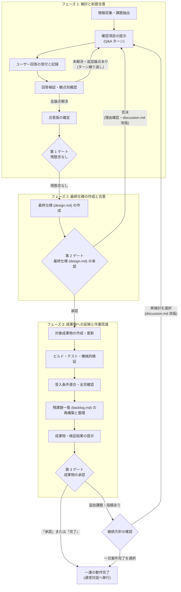

# 成果物実装前の前提合意

## 基本原則

成果物に必要な前提を多角的に検討し、ユーザーとの合意を検討用 Markdown (`対象となる事柄-discussion.md` または `案件ディレクトリ/discussion.md` を基本形とする) に記録してから実装・作成・更新してください。

検討用 Markdown が生成・管理する作業 WBS は、最終決定事項 (最終仕様) を記載した `対象となる事柄-design.md` または `案件ディレクトリ/design.md` を基本形とします。検討用 Markdown のための情報収集と質問の実施、残懸念がないことの確認と最終仕様作成への着手 (第 1 ゲート)、最終決定事項 (最終仕様) の作成、最終仕様の承認の受付 (第 2 ゲート)、承認された最終仕様に従った作業の実施、および作業完了後の成果物の承認の受付 (第 3 ゲート) に至る詳細な手順を、状態を絵文字で示すリスト形式で管理してください。

見送る決定がなされた事項や、作業中に潜在または別問題として判明した事項は、`対象となる事柄-backlog.md` (または `案件ディレクトリ/backlog.md`) に記録してください。backlog は作業期間中に気になる事項が生じた時点で随時書き足し、フェーズ 3 の成果物の承認 (第 3 ゲート) を求める前に、文書を再構築して整理します。整理後の backlog には、作業中に解消した問題や、仕様・制約として容認した問題点は含めず、今回は対策しなかった最終的な残渣 (残課題) だけを、チケット管理システムでの起票にそのまま利用できる詳細度・具体性で記載します。詳細は [残課題の記録 (backlog.md)](#残課題の記録-backlogmd) を参照してください。

検討や設計を通じて得られた知見や設計判断のうち、将来にわたって永続的に必要とされる内容は、コードのコメントや該当する各種正本ドキュメントへ反映してください。ただし、検討過程のやり取りや個別の論点を一言一句すべて反映するのではなく、将来参照される最終仕様として真に有意義なものを選定して反映します。作業誤りの訂正や、もともと正本から逸脱していた実装を補正した際に生じた個々の逸脱点や対症療法的な禁止事項をやみくもに正本へ盛り込むことは避け、本来あるべき恒久的な仕様・設計意図として価値のある内容を厳選してください。

このスキルは特定のプロジェクトやドメインに依存しない汎用スキルです。コーディング規範、テスト構成、文章規範、ディレクトリ構成、Git 運用などのリポジトリ固有の情報や制約は、作業対象パスの `AGENTS.md` および各リポジトリの個別規範 (正本文書) を参照してください。前提検討、質問の提示、回答検証、最終仕様の作成、および成果物への反映に至るすべての段階において、該当する個別規範に準拠してください。

AI-DLC の質問による明確化を参考とする独自の汎用手順として扱い、AWS 公式スキルや v1 へ厳密に準拠していると表明しないでください。

AI は資料の読解、事実確認、不足や矛盾の検出、選択肢と推奨理由の提示を行います。ただし、ユーザーが示していない条件、判断、決定を補わないでください。これらは推奨案や源泉を明確にした意見の提示としてのみ許されます。慣行、既定値、推奨案、実装の容易さを採用の根拠にしてはなりません。不足、曖昧さ、矛盾はすべて Q としてユーザーに確認してください。事実の引用と、採用すべき方針の決定を明確に区別してください。

ユーザーから提示された案件の目標、目的、および手法は、計画策定においては確定した作業手順ではなく、まず満たすべき要求・要件として受け止めてください。指示された手法そのものを機械的に適用するのではなく、その指示によって得られる機能や効果が、リポジトリ固有の各種規範や既存実装と相反しないか、またリポジトリを横断して妥当かつ有益であるかを分析します。たとえば、指示内容が個別規範と異なる場合や、単一ファイルへの局所的な対症療法にとどまる一方で依存元の共通処理を改修したほうが全体的な機能向上や不具合解消につながる場合などは、指示の文面だけをそのまま踏襲してはなりません。本来の意図や得られる効果を損なわない全体最適の観点から、意図の確認や代替案の提案を Q&A に織り込んで合意を形成してください。

## 書き込みの境界

作業の進行段階に応じて、書き込み可能な対象を厳格に制限してください。

1. **残懸念の解消前 (第 1 ゲート前)**: 指定した検討用 Markdown (`対象となる事柄-discussion.md` または `案件ディレクトリ/discussion.md`) のみを作成・更新してください。対象成果物、参照資料、コード、設定、関連文書の新規作成・変更・削除を行ってはなりません。下書きや試作という名目であっても、セッション用の一時ファイル以外の検討用 Markdown の外へ出力してはなりません。必要な比較案や短い試案は検討用 Markdown 内に配置してください。資料を変更するコマンド、生成器、整形器、ビルドなども合意前に実行しないでください。セッション用の一時フォルダーに複製しての事前検証は許容します。
2. **最終仕様の作成中 (第 1 ゲート通過後 〜 第 2 ゲート前)**: エージェントからの質問がなくなり懸念がないことを確認した段階で (第 1 ゲート通過)、ユーザーへの明示的な承認確認を挟まず、懸念がないことをもってフェーズ 2 の最終仕様 (design.md) の作成に着手してください。最終決定事項 (最終仕様) を記載した `対象となる事柄-design.md` (または `案件ディレクトリ/design.md`) のみを作成・更新してください。この段階でも、対象成果物 (ソース コードや既存文書など) への変更は一切行ってはなりません。
3. **最終仕様の承認後 (第 2 ゲート通過後)**: 最終仕様の承認を得た後、初めて最終仕様に従って対象成果物の作成・変更に着手してください。永続的に必要とされる知見の正本ドキュメントやコード コメントへの反映も、この段階の作業として実施します。
4. **作業全完後 (残課題の整理)**: 最終仕様に従った作業がすべて完了した後、第 3 ゲートの前に、`対象となる事柄-backlog.md` (または `案件ディレクトリ/backlog.md`) を再構築して整理してください。
5. **成果物の承認とスキル完了 (第 3 ゲート通過後)**: 成果物の提示に対してユーザーから「承認」または「完了」の宣言を受けた時点で、スキルによる一連の動作を完了します (以後、通常の対話セッションとなります)。追加の課題や指摘を受けた場合は、フェーズ 1 の追加検討から再度やり直すか、一旦案件を完了して通常の対話として作業を行うかをユーザーに問い合わせてください。

残課題一覧 (`backlog.md`) は対象成果物ではないため、上記のどの段階でも作成・追記できます。見送りの決定や、範囲外の気付きが生じた時点で書き足してください。

検討文書には判断過程を、成果物 (最終決定事項を記載した `対象となる事柄-design.md` または `案件ディレクトリ/design.md`、および以降の対象成果物) には確定した内容を記載します。最終決定事項 (最終仕様) は、途中で覆った経緯や議論の推移を含めず、最終的に確定した仕様を構造的に論ずる構成としてください。重要な補足情報や意思決定の背景を残す場合は、本文の構造を崩さず、admonition (注記ブロック: `> [!NOTE]` や `> [!IMPORTANT]` など) で補ってください。検討用 Markdown を削除しても単体で意味が通る自己完結した文書とし、最終決定事項から検討用 Markdown への個別参照 (個々の記述や節からのリンクや言及) は原則として行わないでください。上流文書である検討用 Markdown への案内は、本文ではなく [生成物のメタ情報](#生成物のメタ情報) に記載します。成果物と検討文書は、検討 ID、合意版、パスで対応付けます。

## 生成物のメタ情報

検討用 Markdown (discussion)、最終仕様 (design)、残課題一覧 (backlog) の先頭には、本文より前に HTML コメントでメタ情報を置いてください。HTML コメントは、GitHub、エディターのプレビュー、文書生成器のいずれでも表示されません。そのため、本文を変えずに、ファイルを初めて開いたエージェントへ生成元と再開手順を伝えられます。YAML フロント マターは GitHub で表として表示され、文書生成器にもメタデータとして解釈されるため使用しません。

メタ情報には次の項目を記載します。書式は各テンプレートの先頭に従ってください。

| 項目 | 内容 |
| --- | --- |
| 生成元 | agree-before-implement スキルの生成物であること |
| 文書種別 | 検討用 Markdown (discussion)、最終仕様 (design)、残課題一覧 (backlog) の別 |
| 最終更新エージェント | その対話を最終更新したエージェントの名称 (`agy`、`codex`、`claude code`、`grok`、`copilot` など) と、含められる場合はそのセッション ID |
| 上流文書 / 下流文書 | 関連する生成物のパス (この文書からの相対パス) と、削除されている場合があること |
| 再開手順 | スキルの読み込み、関連する生成物の参照順、進行位置の確認方法 |

各文書を作成・更新する際は、その対話を担当したエージェントの名称 (`agy`、`codex`、`claude code`、`grok`、`copilot` など) と、取得・特定できる場合はセッション ID をメタ情報に含めて更新してください。運用上、複数の異なるエージェントを混在して利用するため、自身と異なるエージェントの過去セッションを引き取って継続する場合や、担当エージェントを変えて継続するために過去のセッションが見つからない場合があります。セッション ID を取得できない場合や記録されたセッションが見つからない場合も致命的条件 (異常) とはせず、セッション情報が存在し参照可能であれば再開時のコンテキスト把握に利用できる補足情報として扱ってください。

上流文書や下流文書への案内は、本文に書かずメタ情報だけに記載してください。最終仕様は、内容を正本文書や成果物へ反映した後に削除される場合があります。検討用 Markdown も削除される場合があります。関連する生成物が存在しないことを異常として扱わず、存在する文書だけを参照してください。

## 検討の開始と再開

まず依頼内容、既存の検討文書、参照資料を確認してください。対象成果物、参照資料の版、今回の範囲、書き込み可能な検討用 Markdown (`対象となる事柄-discussion.md` または `案件ディレクトリ/discussion.md`) を記録します。ユーザーが示した目標や手法は要件として整理し、依存する各種規範や既存実装との整合性、およびリポジトリ横断での影響度を初期分析してください。ユーザーがすでに明示した内容は根拠とともに転記し、再回答を強制しないでください。ただし、新たな意味を含む解釈や、規範・共通処理との相反に起因する確認事項は Q として確認します。

新規の検討には `assets/discussion-template.md`、各質問には `assets/question-template.md`、最終仕様には `assets/design-template.md`、作業全完後の残課題記録には `assets/backlog-template.md` を参照して使用してください。初期作成時の検討用 Markdown (discussion ファイル) は `版: 1` から開始します。検討用 Markdown の先頭には、検討用 Markdown のための情報収集と質問の実施、残懸念がないことの確認 (第 1 ゲート)、最終決定事項 (最終仕様) の作成 (`対象となる事柄-design.md` または `案件ディレクトリ/design.md`)、最終仕様の承認の受付 (第 2 ゲート)、承認された最終仕様に従った作業の実施、および作業完了後の成果物の承認の受付 (第 3 ゲート) に至る詳細な手順を、[作業 WBS の進捗表示](#作業-wbs-の進捗表示) に従ってリスト形式で設けてください。作業 WBS には抽象的な工程だけでなく、具体的な作業対象 (設計成果物や対象ファイル名など) を明記します。

質問は明確化のための確認項目とし、独立した見出しと安定した Q-ID を持つ単位として、1 件で 1 つの判断のみを求めます (1 問 1 判断)。1 つの検討用 Markdown 内に明確化のための確認項目を複数配置して構いません。確認対象をまとめた複合質問にしないでください。

Markdown 内には必要なファイル内リンクを設けてください。質問一覧テーブル、観点別確認表、関連質問の相互参照など、特に質問同士の依存関係や言及にはファイル内リンク (`[Q-XXX](#q-xxx-質問の短い題名)`) を必須とします。

再開時はユーザーが編集した最新版を読み直してください。メタ情報に最終更新エージェントとセッション ID が記録されており、そのセッション情報を参照できる場合は再開時の補足コンテキストとして利用します。別エージェントからの引き継ぎや担当変更によりセッションが見つからない場合も異常とせず、文書に記録された内容に基づいて継続してください。前回参照した内容やチャット上の記憶で上書きしてはなりません。更新直前にも変更を確認し、競合を検出したら最新版に基づいて処理します。取得できない過去の内容や時刻を推測で補わないでください。

対話セッションでユーザーから「回答済み」「回答した」と伝えられたにもかかわらず、検討用 Markdown ファイルが更新されていない場合 (未保存、差分がない、チェック ボックスが未選択のままなど) は、推測で進行してはなりません。対話にてファイルの保存を促し (エディターで検討用 Markdown ファイルを上書き保存したうえで再度知らせてほしい旨を案内)、ファイルが実際に保存されて更新を確認できるまで進行を停止してください。

## 作業 WBS の進捗表示

作業 WBS の各項目は、チェック ボックスではなく行頭の絵文字で状態を示します。チェック ボックスは 2 値であり、着手済みで未完了の項目、中断している項目、未確認の事項が残る項目を表せないためです。

| 絵文字 | 状態 | 設定する時点 |
| --- | --- | --- |
| ⏸️ | 未着手 | 作業 WBS の作成時、および項目の追加時 |
| 🔄 | 実施中 | 項目への着手時、ブロック中の原因が解消して作業を再開した時、および要注意の確認で手直しが必要になった時 |
| 🚫 | ブロック中 | ユーザーの判断待ちや問題の発生で、項目の作業を中断した時 |
| ⚠️ | 要注意 | 項目の作業を終えたが、検証の一部が未実施であるなど未確認の事項が残る時 |
| ✅ | 完了 | 項目の完了と確認を終えた時、およびゲートの通過・承認時 |

各項目は `- ⏸️ 1.1. 項目名` の形式で記述し、項目番号の前に絵文字を置きます。

ブロック中 (🚫) の項目には、停止理由と関連する Q-ID (ファイル内リンク付き) を項目の末尾に併記してください。要注意 (⚠️) の項目には、未確認の事項とその確認方法を併記してください。要注意 (⚠️) の項目は、確認を終えた時点で完了 (✅) にします。要注意 (⚠️) の項目を残したまま作業の全完としないでください。確認できない理由がある場合は、未確認の事項を成果物の提示に含め、扱いをユーザーに確認してください。

現在取り組んでいる末端の項目には、末尾に `← **CURRENT**` を付けてください (例: `- 🔄 4.2. 対象ファイル B (path/to/fileB) の作成・更新 ← **CURRENT**`)。`← **CURRENT**` は作業 WBS 全体で 1 件だけとし、次の項目へ移る際に付け替えます。作業を中断した場合は、ブロック中 (🚫) の項目に残して停止位置を示します。第 3 ゲートで成果物の承認を受けた時点で取り除いてください。

`← **CURRENT**` の項目は、作業の途中で処理が中止された項目である場合があります。作業 WBS の状態は項目の着手時と完了時にだけ更新するため、項目のどこまで進んでいたかは文書だけでは分かりません。再開時は、対象成果物の内容と差分、生成物、検証結果を確認して、項目の実施済みの範囲を特定してから作業を再開してください。実施済みの範囲を特定できない場合は、推測で完了や未着手として扱わず、確認結果を示してユーザーに扱いを確認してください。

子項目を持つ項目の状態は、子項目から次の順に判定して導いてください。

1. すべての子項目が完了 (✅) であれば完了 (✅) とします。
2. すべての子項目が未着手 (⏸️) であれば未着手 (⏸️) とします。
3. いずれかの子項目がブロック中 (🚫) であればブロック中 (🚫) とします。
4. 子項目が完了 (✅) と要注意 (⚠️) だけであれば要注意 (⚠️) とします。
5. 上記以外は実施中 (🔄) とします。

質問の **Answer** の選択肢は、ユーザーがエディター上でクリックして回答するため、`- [ ]` と `- [x]` のチェック ボックスを維持します。絵文字による状態表示は作業 WBS だけに適用し、質問の選択肢には適用しないでください。

## 多角的な確認

次の各観点について、確認結果と根拠となる資料またはファイル内リンク付きの Q-ID を記録してください。

| 観点 | 確認事項 |
| --- | --- |
| 目的・利用者 | 誰が何のために使い、何を実現すればよいか |
| 範囲・境界 | 対象、対象外、変更可能範囲が明確か。局所対応と横断的対応の境界が適切か |
| 入力・根拠 | 必要な資料がそろい、版と適用範囲が明確か |
| 整合性・依存関係 | 指示内容と各種規範・既存実装が整合するか。回答同士、用語、制約に矛盾がないか |
| 実現性・例外 | 実現可能性、異常時、境界条件が明確か |
| 受入条件・検証 | 完成と正しさを確認する基準と方法があるか |

観点ごとに「確認済み」「未解決」「対象外」を示してください。ユーザーの指示が個別規範と異なる場合や、単一箇所の局所修正にとどまり共通処理の改修によって全体最適を図れる余地がある場合などは、整合性や範囲の観点で必ず未解決として扱い、意図の確認項目 (Q) を設けてください。対象外としての扱い、後回し、仮定の採用についても、ユーザーによる根拠の提示または回答を必須とします。質問がすべて回答済みであっても、観点の未確認や未解決があれば実装・作成へ進まないでください。

## 質問と回答の形式

**Status** には現在の状態を単語の言い切り (「未回答」「未解決」「解決済み」など) で記述してください。「です・ます調」などの丁寧語は不要です。

**Question** には判断対象を 1 つのみ記述してください。**Context** には質問に至った経緯 (現状の調査結果、課題や不整合の発見、個別規範との乖離、局所対応と共通処理改修による横断的効果の比較など) を盛り込み、質問が必要な理由と判断による影響を具体的に示します。専門用語を平易に説明し、回答に必要な背景を省かないでください。

根拠となった実際の資料へのリンクや、各案の具体例・コード ブロックの引用は、質問意図が簡潔明瞭な際には挿入する必要はありません。成果物の具体的な姿を提示したほうが判断しやすい場合や、技術的な分岐の差異を明示すべき場合に記載してください。具体例を示す際は、推奨案だけでなく他の案 (代替案) についても「その案を採用した場合にどのようになるか」をコード ブロックや具体例で提示し、各案の違いやトレードオフをユーザーが直感的に理解できるように盛り込みます。後述する「意図不明」とされた質問の詳細化においては、根拠資料リンクや各案のコード比較を積極的に提示してください。

**Answer** には選択方式 (単一選択または複数選択の別) を明記し、代表的な選択肢を記述します。選択肢 ID は A, B, C 形式 (A, B, C) とし、`- [ ]` を付与します。推奨する選択肢がある場合は、選択肢テキストの先頭に `(推奨)` を付与してマークしてください (例: `- [ ] A: (推奨) 代表的な選択肢を記述する。`)。必ず「その他」と自由記入欄を設け、さらに `- [ ] X: 意図不明 (詳細な質問内容に再生成すること)` (選択肢 X) を設けてください。自由回答も正式な回答として受け付けます。「その他の回答」および「補足」をユーザーからフィードバックするための、`その他の回答 / 補足:` 欄を設けてください。

**Recommendation** には推奨する選択肢 ID (A など) と理由、重要な制約を示します。根拠が不足して推奨できない場合は、その不足を明記し、根拠のない推奨案を創作しないでください。推奨案であっても初期状態ではチェックを付けないでください。

**Related** には、関連する質問へのファイル内リンク (`[Q-XXX](#q-xxx-質問の短い題名)`)、参照資料、影響する決定を記述します。該当がなければ **Related** を設ける必要はありません。

Q の提示段階では、**Answer** の回答者、回答日時、および **Assessment**、**History** は記載しないでください。提示段階では意味のない情報であり、ユーザーに質問内容の判断に集中させるためです。これらはユーザーの回答後に追記・記録します。

## 回答の検証と追加質問

回答後は、**Answer** に回答者と回答日時 (JST ベースの日時 `YYYY-MM-DD HH:MM:SS JST`、通常の対話セッションでは Git ユーザー名、トランスクリプト反映時は発言者) を記録し、AI の検証結果として **Assessment** を追記してください。必要に応じて **History** も記録します。回答結果によって過去の質問に **Related** の追加が必要になった場合は、その際に対象の過去質問へ **Related** を追加して相互参照を更新してください。トランスクリプト (`.vtt`) は会議開始時からの相対時刻で記録されるため、絶対日時を特定するために必要があればユーザーに会議の開催日時を確認してください。

**Answer** はユーザーの意思表示、**Assessment** は AI の検証結果として分離してください。ユーザーが明示的に選んだ内容のみを `- [x]` にします。チャットやトランスクリプトから回答および補足事項を転記する場合は発言の出典を残し、推測を回答へ混入させないでください。回答を誘導する事前チェックを行わないでください。

回答後は、単一の Q だけでなく、過去の回答、現行の合意要約、参照資料を横断して再検証してください。回答済みと解決済みを区別します。

未回答、単一選択の複数チェック、自由記述との不一致、「その他」の具体内容不足、曖昧な条件、資料との矛盾は未解決とします。AI が優先順位を決定したり、不足した値を補ったりしないでください。それぞれ 1 つの判断を問う追加 Q を作成します。例えば再試行の実施が決まっても、回数と間隔は別々の Q としてください。

質問に推奨案 (**Recommendation**) が明確に提示されており、ユーザーから「おまかせ」あるいはこれに準じる回答 (「お任せ」「適切に」「推奨で」など) がなされた場合は、その回答を以て推奨案の採用として方針を確定してください。この場合、再確認の質問は不要です。検討用 Markdown の当該質問を推奨案の選択 (`- [x]`) として確定し、対話の応答で推奨案に基づいて回答を自動選定した旨を報告してください。一方、推奨案が明示されていない場合や採用対象が一意でない場合は、具体的な提案を追加 Q にして確認してください。沈黙、経過時間、単なる「続けて」といった指示を、未解決事項の承認とみなさないでください。

## 再質問と補足質問の扱い

再質問、過去の質問に対する補足質問、および意図不明に伴う再生成質問は、過去のやり取りを編集させず、新たな質問番号 (Q-ID) で継続してください。過去の Q&A は確定した記録としてそのまま残し、改変しないでください。

新たな質問から過去の質問への参照は、ファイル内リンク (`[Q-XXX](#q-xxx-質問の短い題名)`) を用いて関連 (**Related**) や背景 (**Context**) に示します。過去の質問側にも必要に応じて **Related** を追加し、双方向の参照関係を維持します。

Q&A のターンごとに、ユーザーの回答や方針決定を踏まえて作業 WBS の見直し要否を判断してください。作業対象の追加・変更や工程の詳細化が必要であれば、適宜作業 WBS を見直して更新します。また、Q&A のターンを重ねる際は、検討用 Markdown (discussion ファイル) のメタデータにある版番号 (`版:`) をインクリメントしてください。確認項目の追加提示や回答反映のターンごとに 2, 3, ... と版番号を進め、検討の更新履歴と最新版を明確に識別します。

質問文と選択肢の意図は原則として固定し、回答後に定義を変更しないでください。新たな判断には新しい Q-ID を用います。

## 「意図不明」による質問再生成

ユーザーが **Answer** の選択肢 X (「意図不明」) を選択した場合は、そのターンでの回答 (その他の回答 / 補足や発言など) を踏まえて、背景、用語説明、選択肢、推奨理由をより具体化した新たな Q-ID の質問として再生成してください。

意図不明とされた元の Q は「回答済み」として確定扱いとし、以降のターンで過去の質問に回答を記入させないでください。

新たな質問の **Context** や **Related** に、意図不明とされた元の Q へのファイル内リンク (`[Q-XXX](#q-xxx-質問の短い題名)`) を記載し、再生成の経緯と具体化した点を明記します。意図不明とされた質問の詳細化においては、質問に至った経緯、根拠資料へのリンク、および各案のコード ブロック引用や具体例の比較を積極的に活用し、ユーザーが判断に必要な情報を具体的に把握できるようにしてください。元の質問と新しい質問を独立した履歴として残すことで、過去のやり取りを改変せずに検討の推移を完全に保持します。

## 三段階の合意ゲートと進行順序

前提合意から成果物の実装・作成・更新、そして作業完了に至る手順は、必ず次の 3 段階のゲートを経て進行してください。フェーズ 1 においてエージェントからの質問がなくなり懸念がないことをもって第 1 ゲート通過と判断し、フェーズ 2 の最終仕様の作成に着手します。検討文書の作成時点で対象成果物の変更を一括承認させたり、最終仕様の承認 (第 2 ゲート) を得ずに対象成果物の変更に着手したりしてはなりません。また、成果物の反映後も独断で完了とせず、成果物の受入承認 (第 3 ゲート) を得てから一連の動作を終了してください。

CodeBlock: 前提合意から成果物承認までの三段階ゲート進行フロー

### 第 1 ゲート: 残懸念の解消 (最終仕様作成への着手)

すべての確認観点に根拠があり、必要な決定に未解決事項やエージェントからの質問がないことを検証してください。未確定事項を対象外、後続判断、仮定として扱う場合も、その扱いに対するユーザーの根拠の提示または回答を必須とします。必須の前提が不足したまま作業を進めないでください。

検討用 Markdown に確定内容、更新対象、受入条件、根拠となる Q-ID (ファイル内リンク付き) をまとめ、検討文書の合意版を特定します。**エージェントからユーザーへの質問がなくなり懸念がないことをもって、対話セッションでの承認確認を挟まずにフェーズ 2 の最終仕様 (`design.md`) の作成に着手してください**。

**禁止事項**:

- 懸念や未解決の質問が残っている段階で、最終仕様の作成に着手してはなりません。
- 最終仕様の作成を飛び越えて、対象成果物への変更に直接着手してはなりません。
- 複数の未決事項を推測で補って残懸念なしとみなしてはなりません。

### 最終仕様 (design.md) の作成

第 1 ゲートを通過した (懸念がないことを確認した) 後は、検討用 Markdown の作業 WBS の第 1 ゲート項目を完了 (✅) にし、最終決定事項 (最終仕様) を記載した `対象となる事柄-design.md` (または `案件ディレクトリ/design.md`) を作成してください。

設計書は最終的に確定した仕様を構造的に論ずる構成とし、議論の推移は含めず、重要な補足情報や意思決定の背景は admonition (注記ブロック) で補います。検討用 Markdown を削除しても単体で意味が通る自己完結した文書とし、検討用 Markdown への個別参照は原則として行わないでください。検討用 Markdown への案内は、本文ではなく [生成物のメタ情報](#生成物のメタ情報) に記載します。また、検討や設計を通じて得られた知見のうち永続的に必要とされる内容について、どの正本ドキュメントやコード コメントへ反映するか (知見の反映計画) も最終仕様に含めて整理してください。反映対象は将来必要になる有意義な仕様を厳選し、作業誤りの訂正や逸脱補正に伴う個々の対症療法的な禁止事項は除外します。

**禁止事項**:

- この段階では最終仕様書の作成のみを行い、対象成果物 (ソース コード、設定、既存文書など) への書き込みを行ってはなりません。
- 最終仕様書内から検討用 Markdown の個々の質問や記述への個別参照を設けてはなりません。

### 第 2 ゲート: 最終仕様 (design.md) の承認

作成した最終仕様 (`対象となる事柄-design.md` または `案件ディレクトリ/design.md`) を対話セッションで提示し、**「この最終仕様に従って対象成果物の作成・更新に着手してよいか」のみを確認** してください。

ユーザーから最終仕様に対する明確な承認を得るまで、対象成果物への変更に着手してはなりません。

最終仕様がユーザーから否決された場合 (修正要求、懸念の指摘、差し戻しなど) は、検討用 Markdown (`discussion.md`) の改版につながります。対話セッションで否決の理由を確認し、フェーズ 1 に戻ってユーザーと条件の再明確化作業を行ってください。指摘事項や新たな判断を検討用 Markdown (`discussion.md`) に反映・改版 (Q&A ターンを重ねて版番号をインクリメント) し、残懸念を解消して第 1 ゲートを通過した後に、改めて最終仕様 (`design.md`) を作成して第 2 ゲートの承認を確認します。

### 承認後の作業進行と進捗管理 (作業実施)

第 2 ゲートでユーザーの承認を得た後は、作業 WBS の第 2 ゲート項目を完了 (✅) にし、承認された最終仕様に従って対象成果物の作成・更新作業に着手してください。ユーザーが承認した版と範囲のみを作成・更新します。

作業の進行に従って検討用 Markdown 先頭の作業 WBS の状態を順次更新します。各作業項目の着手前に実施中 (🔄) へ更新して `← **CURRENT**` を付け替え、完了と確認を終えた後に完了 (✅) へ更新し、進捗状況を可視化してください。

作業中に新たな判断が必要になった場合や問題が発生した場合は、対象成果物への書き込みを中断し、該当する WBS 項目 (ブロック中 (🚫) にして停止理由と関連 Q-ID を併記) や検討用 Markdown の Q の状態を更新してユーザーに確認してください。変更済みの範囲と停止位置を記録し、独断で修正や巻き戻しを行わないでください。作業完了後は合意内容および受入条件と照合します。前提合意と成果物の受入を区別し、作成しただけで受入済みとしないでください。

**正本ドキュメントおよびコード コメントへの知見反映**:  
作業実施の一環として、検討や設計を通じて得られた知見・設計判断のうち、将来にわたって永続的に必要とされる内容をコードのコメントや各種正本ドキュメントへ反映してください。このとき、検討用 Markdown や最終仕様の記述を一言一句すべて転記するのではなく、将来の保守・開発において真に有意義な最終仕様を選定して反映します。作業誤りの訂正や、もともと正本から逸脱していた実装を補正した際に生じた個々の逸脱点や対症療法的な禁止事項をやみくもに正本へ盛り込むことは避け、本来あるべき恒久的な仕様・構造・設計判断を簡潔かつ明確に記述してください。

対象成果物の作成・更新、知見の正本・コメント反映、および機械的検証が完了した後は、受入条件と照合して作業の全完を確認します。全完確認後、作業中に書き足してきた残課題一覧 (`backlog.md`) を再構築して整理してください。確認および残課題の整理の完了後、成果物・検証結果を提示して第 3 ゲートの承認を確認します。

### 第 3 ゲート: 成果物の承認 (受入確認)

対象成果物、機械的検証 (テストやフォーマット チェック) の結果、および未対応残渣がある場合の残課題一覧 (`backlog.md`) を対話セッションで提示し、**成果物の承認 (受入確認)** を求めてください。

- **「承認」または「完了」の受領**:
    ユーザーから「承認」または「完了」が宣言された場合、スキルによる一連の動作を完了させます。検討用 Markdown の作業 WBS の該当項目を完了 (✅) にし、一連のスキル フローを終了します (以後、通常の対話セッションとなります)。
- **追加課題・指摘の受領**:
    成果物に対してユーザーから追加の課題や修正・改善の指摘を受けた場合は、AI の独断で修正や追加作業に着手してはなりません。以下のいずれとするかをユーザーに問い合わせてください:
    1. **フェーズ 1 の検討から再度やり直す**: 検討用 Markdown (`discussion.md`) に戻り、新たな課題や指摘事項を反映して版番号 (`版:`) をインクリメントし、条件の再明確化 (Q&A) と残懸念の解消、最終仕様の改版を経て進める。
    2. **一旦案件を完了して通常の対話として作業を行う**: 本案件の合意フローは完了扱いとし、追加の修正や作業を通常の対話セッションとして個別に進める。

## 残課題の記録 (backlog.md)

検討時に見送る決定がなされた問題点や、作業中に潜在または別問題として判明した問題点は、`対象となる事柄-backlog.md` (または `案件ディレクトリ/backlog.md`) に記録してください。記録は、作業の終わりにまとめて行うのではなく、随時の追記と、第 3 ゲート前の再構築と整理の 2 段階で行います。作業の中断や障害で終盤の手順が実行されなくても、それまでに気付いた事項が失われないようにするためです。

**作業期間中の随時の追記**:

- 見送りの決定、範囲外の気付き、後で確かめたい懸念が生じた時点で、案件のどの段階でも追記してください。最初の項目を書く時点で、`assets/backlog-template.md` から文書を作成します。
- 追記の時点では、題名、現状の事象、摘出の契機を最低限書けば足ります。起票レベルの詳細化は、整理の段階で行います。
- 作業中に解消した項目は、その時点で削除するか、状態を「解消」にして整理の段階で除外してください。
- 整理を終えるまで、文書冒頭の「整理状態」を「随時追記中」とします。

**第 3 ゲート前の再構築と整理**:

- 最終仕様 (`design.md`) に従った作業が全完した後、成果物の承認を求める前に、文書全体を再構築してください。
- 作業中に解消した項目と、仕様・制約として容認した項目を除外し、重複する項目を統合します。
- 残した項目を、下記の記載の要件を満たす詳細度に書き直し、一覧表と各項目の記載をそろえます。
- 課題 ID を振り直す場合は、検討用 Markdown など他の文書からの参照も合わせて更新してください。
- 整理を終えたら、「整理状態」を「整理済み」にします。

**記載の要件** (整理後の backlog):

- **解消済み・容認した問題の除外**: 作業中に解消・解決した問題や、仕様・制約として容認した問題点は含めず、未対応のまま残された最終的な残渣のみを記載してください。
- **起票レベルの具体性**: チケット管理システム (GitHub Issues、Jira など) への起票にそのまま利用できる詳細度・具体性で問題点を記載してください。
    - 現状の事象と本来あるべき姿 (期待される仕様・動作)
    - 摘出の契機と今回の見送り理由 (スコープ外、大規模改修が必要など)
    - 影響範囲と放置した場合のリスク
    - 推奨される恒久対応策の技術的方針
- **テンプレート**: `assets/backlog-template.md` を参照して記述してください。
- **残渣がない場合**: 整理の結果、見送り事項や未対策の残渣が一切残らない場合は、`backlog.md` を削除し、完了報告で残課題なしと報告します。作業期間中に一度も記録する事項がなかった場合は、`backlog.md` を作成する必要はありません。

## 出力品質と文書管理

作成する文書 (検討用 Markdown および設計書) は、原則として「です・ます調」の文体で記述してください (見出し、表のセル、コード ブロック、短いリスト項目などは体言止めや常体を使用して構いません)。ただし、状態表示 (各質問の **Status** や検討文書メタデータの `状態:`) は「です・ます調」にせず、単語の言い切り (「未回答」「未解決」「解決済み」「検討中」「合意済み」など) で記述してください。

ユーザーの使用言語で、具体的かつ回答可能な問いを記述してください。質問待ちの応答では検討文書と未解決 Q-ID をファイル内リンク付きで案内します。内部の逐語的思考ではなく、検証可能な根拠、選択理由、決定、変更履歴を記録してください。Markdown ファイルは文字コード UTF-8、LF 改行とし、末尾を空行で終えてください。

Q&A の各ターンで文章を作成・更新する都度、リポジトリ固有の機械的なフォーマット チェックを実行する必要はありません。検討用 Markdown の初期作成時や、最終承認時の文書確定時などの節目においてフォーマット チェックを実施してください。

## 出典

参考にした公開資料と本対話による独自ルールは [references/sources.md](references/sources.md) に記録します。出典、AWS との対応関係、準拠範囲を説明または変更する際に参照してください。
