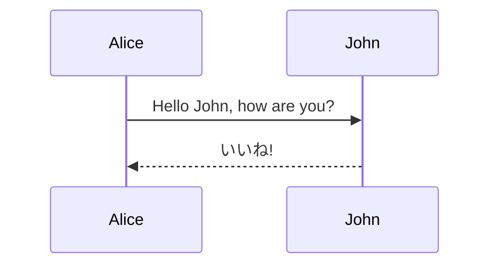
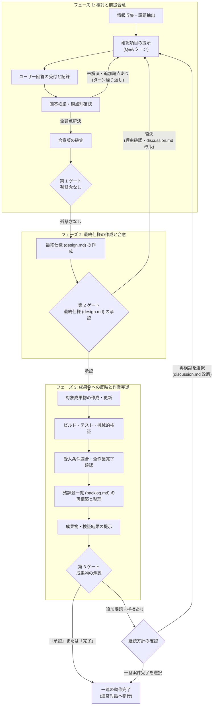

# 成果物実装前の前提合意

## 基本原則

成果物に必要な前提を多角的に検討し、ユーザーとの合意を原則として検討用 Markdown (`yymmdd-対象となる事柄-discussion.md` または `案件ディレクトリ/yymmdd-案件概要-discussion.md` を基本形とする) に記録してから実装・作成・更新してください。`yymmdd-` の日付の決め方は [生成物のファイル名](#生成物のファイル名) を参照してください。

作業の進行は、全体管理文書 (`yymmdd-対象となる事柄-overview.md` または `案件ディレクトリ/yymmdd-案件概要-overview.md` を基本形とする) の作業 WBS で管理します。最終決定事項 (最終仕様) は、`yymmdd-対象となる事柄-design.md` または `案件ディレクトリ/yymmdd-案件概要-design.md` を基本形とする文書に記載します。作業 WBS では、検討用 Markdown のための情報収集と質問の実施、残懸念がないことの確認と最終仕様作成への着手 (第 1 ゲート)、最終決定事項 (最終仕様) の作成、最終仕様の承認の受付 (第 2 ゲート)、承認された最終仕様に従った作業の実施、および作業完了後の成果物の承認の受付 (第 3 ゲート) に至る詳細な手順を、状態を絵文字で示すリスト形式で管理してください。

検討用 Markdown には Q&A の本文だけを置き、新しい Q を末尾へ追記します。案件の識別、作業 WBS、対象と参照資料、観点別の確認、質問一覧、合意版、経緯、反映と検証の記録は、全体管理文書に置きます。Q&A のたびに更新する情報を検討用 Markdown の先頭に置くと行数が増減し、ユーザーがエディターで回答している Q の表示位置がずれるためです。詳細は [全体管理文書 (overview.md)](#全体管理文書-overviewmd) を参照してください。

Q&A で得られた事実、ユーザーの選択とコメント、およびそれらに基づく決定事項は、簡易 ADR (`yymmdd-対象となる事柄-lightadr.md` または `案件ディレクトリ/yymmdd-案件概要-lightadr.md` を基本形とする) に記録してください。簡易 ADR は、決定 1 件ごとの記載を方針変更のたびに書き換え、案件終了時点の決定を示す文書です。詳細は [決定事項の記録 (lightadr.md)](#決定事項の記録-lightadrmd) を参照してください。

見送ると決定した事項や、作業中に潜在的な問題や別問題として判明した事項は、`yymmdd-対象となる事柄-backlog.md` (または `案件ディレクトリ/yymmdd-案件概要-backlog.md`) に記録してください。backlog は作業期間中に気になる事項が生じた時点で随時書き足し、フェーズ 3 の成果物の承認 (第 3 ゲート) を求める前に、文書を再構築して整理します。整理後の当該作業の backlog には、その作業中に解消した問題や、仕様・制約として容認した問題点は含めず、今回は対策しなかった最終的な残渣 (残課題) だけを、チケット管理システムでの起票にそのまま利用できる詳細度・具体性で記載します。

過去の backlog (残課題一覧) を使って新たな案件を開始・進行する際は、過去の backlog ファイルやその記載を削除することなく、作業完了時だけでなく案件開始時から進行の各段階において、過去の backlog 側の継続作業の状況 (状態、経緯、対処内容) も随時更新することを原則とします。また、フェーズ分けした backlog の対策で対処できていない項目は、当該作業の backlog にも必ず転記し、最新作業の backlog を見れば残件が把握できるようにしてください。詳細は [残課題の記録 (backlog.md)](#残課題の記録-backlogmd) を参照してください。

検討や設計を通じて得られた知見や設計判断のうち、将来にわたって永続的に必要とされる内容は、コードのコメントや該当する各種正本ドキュメントへ反映してください。ただし、検討過程のやり取りや個別の論点を一言一句すべて反映するのではなく、将来参照される最終仕様として真に有意義なものを選定して反映します。作業誤りの訂正経緯や、もともと正本から逸脱していた実装を補正した際に生じた個々の逸脱点・対症療法的な禁止事項をやみくもに正本へ盛り込むことは避け、本来あるべき恒久的な仕様・設計意図として価値のある内容を厳選してください。

このスキルは特定のプロジェクトやドメインに依存しない汎用スキルです。コーディング規範、テスト構成、文章規範、ディレクトリ構成、Git 運用などのリポジトリ固有の情報や制約は、作業対象パスの `AGENTS.md` および各リポジトリの個別規範 (正本文書) を参照してください。前提検討、質問の提示、回答検証、最終仕様の作成、および成果物への反映に至るすべての段階において、該当する個別規範に準拠してください。

AI-DLC の質問による明確化を参考とする独自の汎用手順として扱い、AWS 公式スキルや v1 へ厳密に準拠していると表明しないでください。

AI は資料の読解、事実確認、不足や矛盾の検出、選択肢と推奨理由の提示を行います。ただし、ユーザーが示していない条件、判断、決定を補わないでください。AI による提案は、推奨案や根拠を明確にした意見の提示としてのみ許されます。慣行、既定値、推奨案、実装の容易さを採用の根拠にしてはなりません。不足、曖昧さ、矛盾はすべて Q としてユーザーに確認してください。事実の引用と、採用すべき方針の決定を明確に区別してください。

ユーザーから提示された案件の目標、目的、および手法は、計画策定においては確定した作業手順ではなく、まず満たすべき要求・要件として受け止めてください。指示された手法そのものを機械的に適用するのではなく、その指示によって得られる機能や効果が、リポジトリ固有の各種規範や既存実装と相反しないか、またリポジトリを横断して妥当かつ有益であるかを分析します。たとえば、指示内容が個別規範と異なる場合や、単一ファイルへの局所的な対症療法にとどまり、依存元の共通処理を改修したほうが全体的な機能向上や不具合解消につながる場合などは、指示の文面だけをそのまま踏襲してはなりません。本来の意図や得られる効果を損なわない全体最適の観点から、意図の確認や代替案の提案を Q&A に織り込んで合意を形成してください。

## 書き込みの境界

作業の進行段階に応じて、書き込み可能な対象を厳格に制限してください。

1. **残懸念の解消前 (第 1 ゲート前)**: 指定した検討用 Markdown (`yymmdd-対象となる事柄-discussion.md` または `案件ディレクトリ/yymmdd-案件概要-discussion.md`)、全体管理文書 (`overview.md`)、簡易 ADR (`lightadr.md`) のみを作成・更新してください。残課題一覧 (`backlog.md`) は、この制限の対象外とし、後述の全段階に共通の規則に従います。対象成果物、参照資料、コード、設定、関連文書の新規作成・変更・削除を行ってはなりません。下書きや試作という名目であっても、セッション用の一時ファイルを除き、これらの文書の外へ出力してはなりません。必要な比較案や短い試案は検討用 Markdown 内に配置してください。資料を変更するコマンド、生成器、整形器、ビルドなども合意前に実行しないでください。セッション用の一時ディレクトリに複製しての事前検証は許容します。
2. **最終仕様の作成中 (第 1 ゲート通過後 〜 第 2 ゲート前)**: エージェントからの質問がなくなり懸念がないことを確認した段階 (第 1 ゲート通過) で、ユーザーへの明示的な承認確認を挟まずにフェーズ 2 の最終仕様 (design.md) の作成に着手してください。最終決定事項 (最終仕様) を記載した `yymmdd-対象となる事柄-design.md` (または `案件ディレクトリ/yymmdd-案件概要-design.md`) を作成・更新してください。この段階でも、対象成果物 (ソース コードや既存文書など) への変更は一切行ってはなりません。
3. **最終仕様の承認後 (第 2 ゲート通過後)**: 最終仕様の承認を得た後、初めて最終仕様に従って対象成果物の作成・変更に着手してください。永続的に必要とされる知見の正本ドキュメントやコード コメントへの反映も、この段階の作業として実施します。
4. **全作業の完了後 (残課題の整理と過去 backlog の最終更新)**: 最終仕様に従った作業がすべて完了した後、第 3 ゲートの前に、当該作業の `yymmdd-対象となる事柄-backlog.md` (または `案件ディレクトリ/yymmdd-案件概要-backlog.md`) を再構築して整理してください。過去の backlog を継続作業によって対策した場合は、随時更新してきた過去の backlog ファイルの記載を最終確認して全対象項目の最終状態と対処結果の記録を完了させ、フェーズ分けした対策で未対処の項目があれば当該作業の backlog へ転記します。
5. **成果物の承認とスキル完了 (第 3 ゲート通過後)**: 成果物の提示に対してユーザーから「承認」または「完了」の宣言を受けた時点で、スキルによる一連の動作を完了します (以後、通常の対話セッションとなります)。追加の課題や指摘を受けた場合は、フェーズ 1 の追加検討から再度やり直すか、一旦案件を完了して通常の対話として作業を行うかをユーザーに問い合わせてください。

全体管理文書 (`overview.md`) と簡易 ADR (`lightadr.md`) は対象成果物ではないため、上記のどの段階でも更新できます。作業 WBS の状態、経緯、決定事項は、変化した時点で更新してください。

残課題一覧 (`backlog.md`) も対象成果物ではないため、当該作業で新規作成する `backlog.md` への随時の追記だけでなく、対策元となる過去の `backlog.md` に対する継続作業の状況更新も、上記のどの段階 (第 1 ゲート前や第 2 ゲート前を含む) でも行えます。当該作業の `backlog.md` には、見送りの決定や範囲外の気付きが生じた時点で追記してください。あわせて、過去の `backlog.md` を使って新たな案件を開始・進行する際は、案件開始時、Q&A での方針合意や見送り決定時、最終仕様の確定時、および各課題の実装・検証完了時など、継続作業の状況が変化した時点で過去の `backlog.md` 側も随時更新してください。

検討文書には判断過程を、成果物 (最終決定事項を記載した `yymmdd-対象となる事柄-design.md` または `案件ディレクトリ/yymmdd-案件概要-design.md`、および以降の対象成果物) には確定した内容を記載します。最終決定事項 (最終仕様) は、途中で覆った経緯や議論の推移を含めず、最終的に確定した仕様を構造的に記述してください。重要な補足情報や意思決定の背景を残す場合は、本文の構造を崩さず、admonition (注記ブロック: `> [!NOTE]` や `> [!IMPORTANT]` など) で補ってください。検討用 Markdown を削除しても単体で意味が通る自己完結した文書とし、最終決定事項から検討用 Markdown や簡易 ADR への個別参照 (個々の記述や節からのリンクや言及) は原則として行わないでください。上流文書である全体管理文書、検討用 Markdown、簡易 ADR への案内は、本文ではなく [生成物のメタ情報](#生成物のメタ情報) に記載します。成果物と検討文書は、検討 ID、合意版、パスで対応付けます。

## 生成物のファイル名

全体管理文書 (overview)、検討用 Markdown (discussion)、簡易 ADR (lightadr)、最終仕様 (design)、残課題一覧 (backlog) のファイル名は、案件名の前に `yymmdd-` 形式の日付を付けます (例: `261107-porter-handle-lifecycle-discussion.md`)。案件ディレクトリを使う形式でも、ディレクトリ名には日付を付けず、ディレクトリ内のファイル名に日付と案件概要を付けます (例: `porter-handle-lifecycle/261107-api-review-discussion.md`)。日付を付けると、同じ配置先に複数の案件が並んでも作成順に並び、同じ案件の生成物を同じ接頭辞で識別できます。

日付は、案件の全体管理文書と検討用 Markdown を新規作成した日 (JST) とします。同じ案件の簡易 ADR、最終仕様、残課題一覧は、作成日が異なっても同じ日付を使ってください。過去の backlog を対策する継続作業は新しい案件として扱い、その全体管理文書と検討用 Markdown を作成した日の日付を付けます。既存の生成物を更新する場合や再開する場合は、ファイル名の日付を変更しないでください。

生成物を配置するディレクトリは、このスキルでは定めません。作業対象パスの `AGENTS.md` や個別規範、またはユーザーの指示に従ってください。

## 生成物のメタ情報

全体管理文書 (overview)、検討用 Markdown (discussion)、簡易 ADR (lightadr)、最終仕様 (design)、残課題一覧 (backlog) の先頭には、本文より前に HTML コメントでメタ情報を置いてください。HTML コメントは、GitHub、エディターのプレビュー、文書生成器のいずれでも表示されません。そのため、本文を変えずに、ファイルを初めて開いたエージェントへ生成元と再開手順を伝えられます。YAML フロント マターは GitHub で表として表示され、文書生成器にもメタデータとして解釈されるため使用しません。

メタ情報には次の項目を記載します。書式は各テンプレートの先頭に従ってください。

| 項目 | 内容 |
| --- | --- |
| 生成元 | agree-before-implement スキルの生成物であること |
| 文書種別 | 全体管理文書 (overview)、検討用 Markdown (discussion)、簡易 ADR (lightadr)、最終仕様 (design)、残課題一覧 (backlog) の別 |
| 最終更新日時 | その文書を最終更新した日時 (`YYYY-MM-DD HH:MM:SS JST`) |
| 最終更新エージェント | その文書を最終更新したエージェントの名称 (`agy`、`codex`、`claude code`、`grok`、`copilot` など) と、含められる場合はそのセッション ID |
| 稼働 OS | その文書を最終更新した際の稼働 OS (`Windows`、`Linux`、`Linux (WSL)` など) |
| 上流文書 / 下流文書 | 関連する生成物のパス (この文書からの相対パス) と、削除されている場合があること |
| 再開手順 | スキルの読み込み、関連する生成物の参照順、進行位置の確認方法 |

各文書を作成・更新する際は、最終更新日時 (JST ベースの `YYYY-MM-DD HH:MM:SS JST`)、その対話を担当したエージェントの名称 (`agy`、`codex`、`claude code`、`grok`、`copilot` など。取得・特定できる場合はセッション ID を併記)、および稼働 OS (`Windows`、`Linux`、`Linux (WSL)` など。WSL 上の Linux 環境はネイティブの `Linux` と区別して `Linux (WSL)` と記載する) をメタ情報に含めて更新してください。ホスト名などの端末固有の識別情報は、リポジトリで公開すべき情報ではないため記載しないでください。運用上、複数の異なるエージェントや複数の環境、稼働 OS (`Windows` と `Linux (WSL)` の切り替えなど) を混在して利用するため、自身と異なるエージェントや別環境・別 OS の過去セッションを引き取って継続する場合や、担当エージェント・作業環境を変えて継続するために過去のセッションが現在の環境で見つからない場合があります。セッション ID を取得できない場合や記録されたセッションが見つからない場合も致命的な異常とはせず、いつ・どの稼働 OS のどのエージェントが更新したかを把握し、セッション情報が参照可能であれば再開時のコンテキスト把握に利用できる補足情報として扱ってください。

上流文書や下流文書への案内は、本文に書かずメタ情報だけに記載してください。最終仕様は、内容を正本文書や成果物へ反映した後に削除される場合があります。全体管理文書、検討用 Markdown、簡易 ADR も削除される場合があります。関連する生成物が存在しないことを異常として扱わず、存在する文書だけを参照してください。

## 検討の開始と再開

検討用 Markdown (`discussion.md`) の作成にあたり、詳細調査や Q&A の作成に先立って、対話セッションでユーザーの意向を簡単に確認しても構いません。  
確認は、回答に応じて複数回行えます。  
指示が明確であれば、対話での事前確認を省いて検討用 Markdown の作成に進んでも構いません。  
ユーザーの指示から最終仕様に必要な前提と判断がそろい、残懸念がないことを確認できる場合は、第 1 ゲートを通過したものとして、検討用 Markdown の作成を省いて最終仕様 (`design.md`) の作成に進んでも構いません。  
その場合は、判断の根拠を全体管理文書に記録し、通常どおり最終仕様の承認を求めてください。

まず依頼内容、既存の検討文書、参照資料を確認してください。対象成果物、参照資料の版、今回の範囲、書き込み可能な検討文書 (全体管理文書、検討用 Markdown、簡易 ADR) を全体管理文書に記録します。ユーザーが示した目標や手法は要件として整理し、依存する各種規範や既存実装との整合性、およびリポジトリ横断での影響度を初期分析してください。ユーザーがすでに明示した内容は根拠とともに転記し、再回答を強制しないでください。ただし、新たな意味を含む解釈や、規範・共通処理との相反に起因する確認事項は Q として確認します。

新規の検討には `assets/overview-template.md` と `assets/discussion-template.md`、各質問には `assets/question-template.md`、決定事項の記録には `assets/lightadr-template.md`、最終仕様には `assets/design-template.md`、残課題記録には `assets/backlog-template.md` を参照して使用してください。検討用 Markdown を作成する場合は、案件の開始時に全体管理文書と同時に作成します。検討用 Markdown の版は全体管理文書の「案件の識別」に記録し、初期作成時は `検討用 Markdown の版: 1` から開始します。

全体管理文書には、検討用 Markdown のための情報収集と質問の実施、残懸念がないことの確認 (第 1 ゲート)、最終決定事項 (最終仕様) の作成 (`yymmdd-対象となる事柄-design.md` または `案件ディレクトリ/yymmdd-案件概要-design.md`)、最終仕様の承認の受付 (第 2 ゲート)、承認された最終仕様に従った作業の実施、および作業完了後の成果物の承認の受付 (第 3 ゲート) に至る詳細な手順を、[作業 WBS の進捗表示](#作業-wbs-の進捗表示) に従ってリスト形式で設けてください。作業 WBS には抽象的な工程だけでなく、具体的な作業対象 (設計成果物や対象ファイル名など) を明記します。過去の残課題一覧 (`backlog.md`) を使って新たな案件を開始する場合は、新しい全体管理文書と検討用 Markdown を作成する時点で対策元の `backlog.md` 側も更新し、対象課題の状態を「検討中」(または「対応中」) にして継続案件の開始を記録するとともに、以降の進行に応じた対策元 `backlog.md` の随時更新も作業 WBS に組み込んでください。

質問は明確化のための確認項目 (`## 明確化のための確認項目`) の配下に置き、`assets/question-template.md` に従って独立したレベル 3 見出し (`### Q-XXX 質問の短い題名`) と安定した Q-ID を持つ単位として、1 件で 1 つの判断のみを求めます (1 問 1 判断)。1 つの検討用 Markdown 内に明確化のための確認項目を複数配置して構いません。確認対象をまとめた複合質問にしないでください。

Markdown 内には必要なリンクを設けてください。検討用 Markdown 内の質問同士の依存関係や言及には、ファイル内リンク (`[Q-XXX](#q-xxx-質問の短い題名)`) を必須とします。全体管理文書の質問一覧、観点別確認表、作業 WBS、および簡易 ADR の源泉から Q を参照する場合は、検討用 Markdown の該当見出しへの相対リンク (`[Q-XXX](yymmdd-対象となる事柄-discussion.md#q-xxx-質問の短い題名)`) を必須とします。

再開時はユーザーが編集した最新版を読み直してください。メタ情報に最終更新日時、最終更新エージェントとセッション ID、稼働 OS が記録されており、そのセッション情報を参照できる場合は再開時の補足コンテキストや前回作業時の環境把握に利用します。別エージェントや別環境・別 OS からの引き継ぎ、担当変更によりセッションが見つからない場合も異常とせず、文書に記録された内容に基づいて継続してください。前回参照した内容やチャット上の記憶で上書きしてはなりません。更新直前にも変更を確認し、競合を検出したら最新版に基づいて処理します。取得できない過去の内容や時刻を推測で補わないでください。

モバイル セッションなど、検討用 Markdown を直接編集・保存しづらい環境への対応として、ユーザーが個別の Q&A を対話セッションで要求した場合は、先に未回答状態の質問を記載した検討用 Markdown を作成・更新したうえでユーザーへ問い合わせ、回答後の検討用 Markdown への記入はエージェントが実施します (詳細は [対話セッションでの個別質問 (モバイル セッション対応)](#対話セッションでの個別質問-モバイル-セッション対応) を参照してください)。  
この場合も、対話で確認した内容をそのまま検討用 Markdown、全体管理文書、簡易 ADR へ記録し、Markdown ベースの手続きと品質を変えないでください。

ユーザーがエディター上で検討用 Markdown を直接編集する通常の進行において、対話セッションでユーザーから「回答済み」「回答した」と伝えられたにもかかわらず、検討用 Markdown ファイルが更新されていない場合 (未保存、差分がない、チェック ボックスが未選択のままなど) は、推測で進行してはなりません。対話でファイルの保存を促し (エディターで検討用 Markdown ファイルを上書き保存したうえで再度知らせてほしい旨を案内)、ファイルが実際に保存されて更新を確認できるまで進行を停止してください。

## 全体管理文書 (overview.md)

全体管理文書は、案件の入口となる文書です。次の節を持ち、`assets/overview-template.md` に従って作成します。

| 節 | 内容 | 更新する時点 |
| --- | --- | --- |
| 案件の識別 | 検討 ID、検討用 Markdown の版、状態 | Q&A のターンごと、および状態の変化時 |
| 作業 WBS と進捗管理 | ゲートと作業項目の状態 | 項目の着手時と完了時、および WBS の見直し時 |
| 対象と参照資料 | 対象成果物、対象範囲、参照資料と版 | 案件の開始時、および範囲の変更時 |
| 観点別の確認 | 6 観点の状態と根拠 | 回答の検証時 |
| 質問一覧 | Q-ID、論点、状態、依存・関連、反映先の決定 | Q の追加時と状態の変化時 |
| 対象成果物と合意版 | 最終仕様のパス、各ゲートの合意版、受入条件 | 各ゲートの通過時 |
| 経緯 | 案件の進行上の出来事の時系列 | 出来事の発生時 |
| 反映と検証の記録 | 対応箇所、検証結果、未完了項目 | 作業の実施後 |

これらの節を検討用 Markdown に置かないでください。検討用 Markdown を更新する際は、メタ情報の値の書き換えと、Q の回答後の追記 (**Answer** の回答者と回答日時、**Assessment**、**History**、**Related**、**Status**) および末尾への新しい Q の追記だけを行います。

経緯には、案件の開始、ゲートの通過、最終仕様の否決と差し戻し、方針の変更、作業 WBS の見直し、作業の中断と再開などの出来事を、発生順に末尾へ追記します。個々の決定の内容は簡易 ADR に記載し、経緯には出来事と参照先だけを記載してください。

## 作業 WBS の進捗表示

作業 WBS の各項目は、チェック ボックスではなく行頭の絵文字で状態を示します。チェック ボックスは 2 値であり、着手済みで未完了の項目、中断している項目、未確認の事項が残る項目を表せないためです。

| 絵文字 | 状態 | 設定する時点 |
| --- | --- | --- |
| ⏸️ | 未着手 | 作業 WBS の作成時、および項目の追加時 |
| 🔄 | 実施中 | 項目への着手時、ブロック中の原因が解消して作業を再開した時、および要注意の確認で手直しが必要になった時 |
| 🚫 | ブロック中 | ユーザーの判断待ちや問題の発生で、項目の作業を中断した時 |
| ⚠️ | 要注意 | 項目の作業を終えたが、検証の一部が未実施であるなど未確認の事項が残る時 |
| ✅ | 完了 | 項目の完了と確認を終えた時、およびゲートの通過・承認時 |

各項目は `- ⏸️ 1.1. 項目名` の形式で記述し、項目番号の前に絵文字を置きます。

ブロック中 (🚫) の項目には、停止理由と関連する Q-ID (検討用 Markdown へのリンク付き) を項目の末尾に併記してください。要注意 (⚠️) の項目には、未確認の事項とその確認方法を併記してください。要注意 (⚠️) の項目は、確認を終えた時点で完了 (✅) にします。要注意 (⚠️) の項目を残したまま作業完了としないでください。確認できない理由がある場合は、未確認の事項を成果物の提示に含め、扱いをユーザーに確認してください。

現在取り組んでいる末端の項目には、末尾に `← **CURRENT**` を付けてください (例: `- 🔄 4.2. 対象ファイル B (path/to/fileB) の作成・更新 ← **CURRENT**`)。`← **CURRENT**` は作業 WBS 全体で 1 件だけとし、次の項目へ移る際に付け替えます。作業を中断した場合は、ブロック中 (🚫) の項目に残して停止位置を示します。第 3 ゲートで成果物の承認を受けた時点で取り除いてください。

`← **CURRENT**` の項目は、作業の途中で処理が中止された項目である場合があります。作業 WBS の状態は項目の着手時と完了時にだけ更新するため、項目のどこまで進んでいたかは文書だけでは分かりません。再開時は、対象成果物の内容と差分、生成物、検証結果を確認して、項目の実施済みの範囲を特定してから作業を再開してください。実施済みの範囲を特定できない場合は、推測で完了や未着手として扱わず、確認結果を示してユーザーに扱いを確認してください。

子項目を持つ項目の状態は、子項目から次の順に判定して導いてください。

1. すべての子項目が完了 (✅) であれば完了 (✅) とします。
2. すべての子項目が未着手 (⏸️) であれば未着手 (⏸️) とします。
3. いずれかの子項目がブロック中 (🚫) であればブロック中 (🚫) とします。
4. 子項目が完了 (✅) と要注意 (⚠️) だけであれば要注意 (⚠️) とします。
5. 上記以外は実施中 (🔄) とします。

質問の **Answer** の選択肢は、ユーザーがエディター上でクリックして回答するため、`- [ ]` と `- [x]` のチェック ボックスを維持します。絵文字による状態表示は作業 WBS だけに適用し、質問の選択肢には適用しないでください。

## 多角的な確認

次の各観点について、確認結果と根拠となる資料またはリンク付きの Q-ID を、全体管理文書の「観点別の確認」に記録してください。

| 観点 | 確認事項 |
| --- | --- |
| 目的・利用者 | 誰が何のために使い、何を実現すればよいか |
| 範囲・境界 | 対象、対象外、変更可能範囲が明確か。局所対応と横断的対応の境界が適切か |
| 入力・根拠 | 必要な資料がそろい、版と適用範囲が明確か |
| 整合性・依存関係 | 指示内容と各種規範・既存実装が整合するか。回答同士、用語、制約に矛盾がないか |
| 実現性・例外 | 実現可能性、異常時、境界条件が明確か |
| 受入条件・検証 | 完成と正しさを確認する基準と方法があるか |

観点ごとに「確認済み」「未解決」「対象外」を示してください。ユーザーの指示が個別規範と異なる場合や、単一箇所の局所修正にとどまり共通処理の改修によって全体最適を図れる余地がある場合などは、整合性や範囲の観点で必ず未解決として扱い、意図の確認項目 (Q) を設けてください。対象外としての扱い、後回し、仮定の採用についても、ユーザーによる根拠の提示または回答を必須とします。質問がすべて回答済みであっても、観点の未確認や未解決があれば実装・作成へ進まないでください。

## 質問と回答の形式

**Status** には現在の状態を単語の言い切り (「未回答」「未解決」「解決済み」など) で記述してください。「です・ます調」などの丁寧語は不要です。

**Question** には判断対象を 1 つのみ記述してください。**Context** には質問に至った経緯 (現状の調査結果、課題や不整合の発見、個別規範との乖離、局所対応と共通処理改修による横断的効果の比較など) を盛り込み、質問が必要な理由と判断による影響を具体的に示します。専門用語を平易に説明し、回答に必要な背景を省かないでください。

根拠となった実際の資料へのリンクや、各案の具体例・コード ブロックの引用は、質問意図が簡潔で明瞭な場合は挿入する必要はありません。成果物の具体的な姿を提示したほうが判断しやすい場合や、技術的な分岐の差異を明示すべき場合に記載してください。具体例を示す際は、推奨案だけでなく他の案 (代替案) についても「その案を採用した場合にどのようになるか」をコード ブロックや具体例で提示し、各案の違いやトレードオフをユーザーが直感的に理解できるように盛り込みます。後述する「意図不明」とされた質問の詳細化においては、根拠資料リンクや各案のコード比較を積極的に提示してください。

説明を分かりやすくするために必要な場合は、主に検討用 Markdown (`discussion.md`) の **Context** などで Mermaid 図を利用しても構いません (最終仕様など他の文書でも、構成や状態遷移の説明に有効な場合は同様に利用できます)。Mermaid 図のキャプションを指定する場合は、コード ブロックのフェンスに言語名 `mermaid` だけを記述し、コード ブロックの直後に空行を挟んで `Figure:` 行を配置してください。フェンスには言語名だけを記述するため、GitHub などの Web 表示でも図がそのまま描画されます。

````markdown


Figure: Mermaid のキャプション
````

**Answer** には選択方式 (単一選択または複数選択の別) を明記し、代表的な選択肢を記述します。選択肢 ID は A, B, C 形式とし、`- [ ]` を付与します。推奨する選択肢がある場合は、選択肢テキストの先頭に `(推奨)` を付与してマークしてください (例: `- [ ] A: (推奨) 代表的な選択肢を記述します。`)。必ず「その他」と自由記入欄を設け、さらに `- [ ] X: 意図不明 (詳細な質問内容に再生成すること)` (選択肢 X) を設けてください。自由回答も正式な回答として受け付けます。ユーザーから「その他の回答」および「補足」を受け取るための、`その他の回答 / 補足:` 欄を設けてください。

**Recommendation** には推奨する選択肢 ID (A など) に加え、推奨案の選定にあたって重視した優先順位・判断基準、理由、重要な制約を示します。選択を推奨する際は、エージェント内部で用いた優先順位 (例: ABI の維持を優先、性能の確保を優先、全体の設計ポリシーの統一を優先、変更量の抑制を優先、影響サブモジュールの最小化を優先など) を明示的に開示し、ユーザーが自身の考える優先順位と乖離がないかを確認できるようにしてください。根拠が不足して推奨できない場合は、その不足を明記し、根拠のない推奨案を創作しないでください。推奨案であっても初期状態ではチェックを付けないでください。また、ユーザーに回答を促す際に「全件おすすめ」「おまかせ」などの一括判断や判断の全面的な委任を提案・誘導してはなりません。

**Related** には、関連する質問へのファイル内リンク (`[Q-XXX](#q-xxx-質問の短い題名)`)、参照資料、影響する決定を記述します。該当がなければ **Related** を設ける必要はありません。

Q の提示段階では、**Answer** の回答者、回答日時、および **Assessment**、**History** は記載しないでください。提示段階では意味のない情報であり、ユーザーに質問内容の判断に集中させるためです。これらはユーザーの回答後に追記・記録します。

## 対話セッションでの個別質問 (モバイル セッション対応)

モバイル セッションなど、ユーザーが検討用 Markdown を直接編集・保存しづらい環境への対応として、ユーザーが個別の Q&A を対話セッションで要求した場合は、検討用 Markdown への記入 (選択肢への `- [x]` の設定、`その他の回答 / 補足:` へのコメント転記、回答者・回答日時の記録) はエージェントが実施します。

対話セッションで質問を問い合わせる際も、**問い合わせを行う前に、まず未回答状態の質問を記載した検討用 Markdown (`discussion.md`) および全体管理文書 (`overview.md`) の該当項目 (質問一覧、版番号、作業 WBS など) を作成・更新してから** ユーザーに問い合わせてください (追加質問や再質問を対話で問い合わせる場合も同様です)。  
ユーザーが検討用 Markdown を直接編集できる環境にいる場合、対話 UI による回答をキャンセルして検討用 Markdown を直接編集・保存する可能性があるためです。  
先に未回答の検討用 Markdown を作成しておくことで、対話での回答がキャンセルされても、ユーザーはそのままファイルを開いて回答を記入・保存して続行できます。対話で回答が得られた場合はエージェントが検討用 Markdown の該当 Q へ回答を記入し、対話での回答がキャンセルされて検討用 Markdown が直接編集された場合は、保存されたファイルを読み直して通常どおり検証と記録を進めます。

対話セッションで個別の Q&A を進める場合も、Markdown ベースの手続きと品質を変えてはなりません。事前調査・規範整合性の確認、1 問 1 判断の原則、Q-ID と版番号の管理、書き込みの境界、**Context** における背景・根拠資料・具体例の提示、選択肢 A/B/C と選択肢 X (「意図不明」) の構成、**Recommendation** の明記、回答後の検証と観点別の確認、簡易 ADR への決定事項記録、全体管理文書の更新を、ファイルを直接編集する場合と同等の品質で実施してください。対話上のやり取りだけに留めて検討用 Markdown への記録を省略したり、要約だけで選択肢やコメントの記録を簡略化したりしないでください。

対話セッションで回答を受け取る際も、検討用 Markdown での回答と同様に、選択肢の決定とコメント (補足、条件、理由、自由回答など) の記入を併用するべきです。  
対話セッションの質問 UI や問い合わせ機能において、択一式 (単一選択) では選択肢を選んだ時点で回答が確定し、選択とコメントの記入を同時にユーザーが示すことができない場合があります。  
そのため、対話セッションで質問を提示する際は、**複数選択式の選択肢の提示と任意コメントを 1 回で入力できる問い合わせ方法** を推奨します (その問い合わせ方法が利用できない場合は、1 回の応答で選択肢 ID とコメントを併記してもらうなど、選択とコメントを同時に受け取れる手段を用いてください)。  
なお、検討用 Markdown 上の **Answer** に記載する `選択方式:` は、問い合わせ UI の形式に合わせず、その質問の本来の性質 (`単一選択` または `複数選択`) のまま記載してください。

本来は択一式 (単一選択) である質問に対して、複数選択式の問い合わせ方法で複数の選択肢がチェックされた場合は、エージェントがどれか 1 つを推測で選んだり優先順位を決めたりしてはなりません。  
その質問をそのまま確定扱いとせず、**再度ユーザーに真意を確認** する必要があります。  
検討用 Markdown の該当 Q にはユーザーがチェックした複数の選択肢とコメントをそのまま転記し、**Assessment** に本来単一選択だが複数チェックされたため未解決である旨を記録して **Status** を `未解決` にしたうえで、どの選択肢を採用する意図なのか (または条件付きの採用や別案の意図なのか) を確認する新たな Q-ID の質問を先に検討用 Markdown へ追記してから問い合わせてください。  
真意の確認も、同様に複数選択式の選択肢の提示と任意コメントを 1 回で入力できる問い合わせ方法 (または明確な再質問) で行い、合意できた選択を確認してから元の Q を解決済みにしてください。

## 回答の検証と追加質問

回答後は、**Answer** に回答者と回答日時 (JST ベースの日時 `YYYY-MM-DD HH:MM:SS JST`、通常の対話セッションでは Git ユーザー名、トランスクリプト反映時は発言者) を記録し、AI の検証結果として **Assessment** を追記してください。必要に応じて **History** も記録します。回答結果によって過去の質問に **Related** の追加が必要になった場合は、その際に対象の過去質問へ **Related** を追加して相互参照を更新してください。トランスクリプト (`.vtt`) は会議開始時からの相対時刻で記録されるため、絶対日時を特定するために必要があればユーザーに会議の開催日時を確認してください。

**Answer** はユーザーの意思表示、**Assessment** は AI の検証結果として分離してください。ユーザーが明示的に選んだ内容のみを `- [x]` にします。対話セッションでの個別 Q&A、チャット、またはトランスクリプトから回答および補足事項を転記する場合は発言の出典を残し、推測を回答へ混入させないでください。回答を誘導する事前チェックを行わないでください。

回答後は、単一の Q だけでなく、過去の回答、簡易 ADR の決定事項、参照資料を横断して再検証してください。回答済みと解決済みを区別します。Q を解決済みにした時点で、[決定事項の記録 (lightadr.md)](#決定事項の記録-lightadrmd) に従って簡易 ADR を更新し、全体管理文書の質問一覧と観点別の確認を更新してください。

未回答、単一選択の複数チェック (対話セッションで複数選択式の問い合わせ方法を用いた結果、本来択一式の質問に複数チェックされた場合を含む)、自由記述との不一致、「その他」の具体内容不足、曖昧な条件、資料との矛盾は未解決とします。AI が優先順位を決定したり、不足した値を補ったりしないでください。それぞれ 1 つの判断を問う追加 Q を作成します。例えば再試行の実施が決まっても、回数と間隔は別々の Q としてください。

「その他の回答 / 補足」にユーザーが記した見解、理解、方針を、選択された **Answer**、元の **Context** に示した前提、およびエージェントによる回答や要件の解釈と照合してください。  
認識のずれ、不一致、矛盾があれば、元の Q を未解決とし、新しい Q-ID で追加 Q を作成してください。  
追加 Q の **Context** では、元の Q へのリンクを付け、どの記述や解釈がどの点で食い違うのか、各解釈を採用すると何が変わるのかを具体的に説明してください。  
判断に必要な根拠や具体例を添え、1 問につき 1 つの判断をユーザーに確認してください。  
ユーザーの回答を受けて食い違いが解消し、採用する理解や方針について合意できたことを確認してから、元の Q を解決済みにしてください。

各質問における判断をエージェントへ全面的に委任することは許容されません。推奨案 (**Recommendation**) が明確に提示されている質問であっても、次のいずれかを満たす場合にのみ推奨案の採用を確定してください。

- ユーザーが検討用 Markdown 上で当該質問の `(推奨)` の選択肢にチェック (`- [x]`) を付けて回答している場合
- 対話セッションにおいて、ユーザーが対象となる Q-ID を明示的に指定したうえで、その対象について推奨案で良い旨を回答している場合

対話で対象を明示的に指定したうえで推奨案の採用が指示された場合は、検討用 Markdown の該当質問を推奨案の選択 (`- [x]`) として記録し、出典 (対話での指示) と回答者・回答日時を明記したうえで、応答で対象 Q-ID の推奨案を反映した旨を報告してください。一方、対象となる Q-ID の指定を伴わない包括的・曖昧な指示 (「全件おまかせ」「すべておすすめで」「お任せ」「適切に」「推奨で」など) を受理して自動選定・確定してはなりません。その場合は、各質問について検討用 Markdown 上で `(推奨)` を含む希望の選択肢へチェックを入れて保存するか、対話で対象の Q-ID を明示的に指定して指示するよう改めて求めてください。また、対象の Q-ID が明示されていても、その質問に推奨案が明示されていない場合や採用対象が一意でない場合は確定せず、具体的な提案を追加 Q にして確認してください。沈黙、経過時間、単なる「続けて」といった指示を、未解決事項の承認とみなさないでください。

## 再質問と補足質問の扱い

再質問、過去の質問に対する補足質問、および意図不明に伴う再生成質問は、過去のやり取りを編集させず、新たな質問番号 (Q-ID) で継続してください。過去の Q&A は確定した記録としてそのまま残し、改変しないでください。

新たな質問から過去の質問への参照は、ファイル内リンク (`[Q-XXX](#q-xxx-質問の短い題名)`) を用いて関連 (**Related**) や背景 (**Context**) に示します。過去の質問側にも必要に応じて **Related** を追加し、双方向の参照関係を維持します。

Q&A のターンごとに、ユーザーの回答や方針決定を踏まえて作業 WBS の見直し要否を判断してください。作業対象の追加・変更や工程の詳細化が必要であれば、適宜作業 WBS を見直して更新します。また、Q&A のターンを重ねる際は、全体管理文書の「案件の識別」にある検討用 Markdown の版番号 (`検討用 Markdown の版:`) をインクリメントしてください。確認項目の追加提示や回答反映のターンごとに 2, 3, ... と版番号を進め、検討の更新履歴と最新版を明確に識別します。

質問文と選択肢の意図は原則として固定し、回答後に定義を変更しないでください。新たな判断には新しい Q-ID を用います。

## 「意図不明」による質問再生成

ユーザーが **Answer** の選択肢 X (「意図不明」) を選択した場合は、そのターンでの回答 (その他の回答 / 補足や発言など) を踏まえて、背景、用語説明、選択肢、推奨理由をより具体化した新たな Q-ID の質問として再生成してください。

意図不明とされた元の Q は「回答済み」として確定扱いとし、以降のターンで過去の質問に回答を記入させないでください。

新たな質問の **Context** や **Related** に、意図不明とされた元の Q へのファイル内リンク (`[Q-XXX](#q-xxx-質問の短い題名)`) を記載し、再生成の経緯と具体化した点を明記します。意図不明とされた質問の詳細化においては、質問に至った経緯、根拠資料へのリンク、および各案のコード ブロック引用や具体例の比較を積極的に活用し、ユーザーが判断に必要な情報を具体的に把握できるようにしてください。元の質問と新しい質問を独立した履歴として残すことで、過去のやり取りを改変せずに検討の推移を完全に保持します。

## 三段階の合意ゲートと進行順序

前提合意から成果物の実装・作成・更新、そして作業完了に至る手順は、必ず次の 3 段階のゲートを経て進行してください。フェーズ 1 でエージェントからの質問がなくなり懸念がないことを確認した時点で第 1 ゲート通過と判断し、フェーズ 2 の最終仕様の作成に着手します。検討文書の作成時点で対象成果物の変更を一括承認させたり、最終仕様の承認 (第 2 ゲート) を得ずに対象成果物の変更に着手したりしてはなりません。また、成果物の反映後も独断で完了とせず、成果物の受入承認 (第 3 ゲート) を得てから一連の動作を終了してください。



Figure: 前提合意から成果物承認までの三段階ゲート進行フロー

### 第 1 ゲート: 残懸念の解消 (最終仕様作成への着手)

すべての確認観点に根拠があり、必要な決定に未解決事項やエージェントからの質問がないことを検証してください。未確定事項を対象外、後続判断、仮定として扱う場合も、その扱いに対するユーザーの根拠の提示または回答を必須とします。必須の前提が不足したまま作業を進めないでください。

簡易 ADR の各決定が、その根拠となった解決済み Q の最終的な回答またはユーザーの明示的な指示と一致していることを確認し、全体管理文書に更新対象、受入条件、および検討用 Markdown を作成した場合はその合意版を記録します。**エージェントからユーザーへの質問がなくなり懸念がないことをもって、対話セッションでの承認確認を挟まずにフェーズ 2 の最終仕様 (`design.md`) の作成に着手してください**。

**禁止事項**:

- 懸念や未解決の質問が残っている段階で、最終仕様の作成に着手してはなりません。
- 最終仕様の作成を飛び越えて、対象成果物への変更に直接着手してはなりません。
- 複数の未決事項を推測で補って残懸念なしとみなしてはなりません。

### 最終仕様 (design.md) の作成

第 1 ゲートを通過した (懸念がないことを確認した) 後は、全体管理文書の作業 WBS の第 1 ゲート項目を完了 (✅) にし、最終決定事項 (最終仕様) を記載した `yymmdd-対象となる事柄-design.md` (または `案件ディレクトリ/yymmdd-案件概要-design.md`) を作成してください。

設計書は最終的に確定した仕様を構造的に記述し、議論の推移は含めず、重要な補足情報や意思決定の背景は admonition (注記ブロック) で補います。検討用 Markdown を削除しても単体で意味が通る自己完結した文書とし、検討用 Markdown への個別参照は原則として行わないでください。検討用 Markdown への案内は、本文ではなく [生成物のメタ情報](#生成物のメタ情報) に記載します。また、検討や設計を通じて得られた知見のうち永続的に必要とされる内容について、どの正本ドキュメントやコード コメントへ反映するか (知見の反映計画) も最終仕様に含めて整理してください。反映対象は将来必要になる有意義な仕様を厳選し、作業誤りの訂正や逸脱補正に伴う個々の対症療法的な禁止事項は除外します。

**禁止事項**:

- この段階では最終仕様書の作成のみを行い、対象成果物 (ソース コード、設定、既存文書など) への書き込みを行ってはなりません。
- 最終仕様書内から検討用 Markdown の個々の質問や記述への個別参照を設けてはなりません。

### 第 2 ゲート: 最終仕様 (design.md) の承認

作成した最終仕様 (`yymmdd-対象となる事柄-design.md` または `案件ディレクトリ/yymmdd-案件概要-design.md`) を対話セッションで提示し、**「この最終仕様に従って対象成果物の作成・更新に着手してよいか」のみを確認** してください。

ユーザーから最終仕様に対する明確な承認を得るまで、対象成果物への変更に着手してはなりません。

最終仕様がユーザーから否決された場合 (修正要求、懸念の指摘、差し戻しなど) は、検討用 Markdown (`discussion.md`) を改版します。対話セッションで否決の理由を確認し、フェーズ 1 に戻ってユーザーと条件の再明確化作業を行ってください。指摘事項や新たな判断を検討用 Markdown (`discussion.md`) に反映・改版 (Q&A ターンを重ねて版番号をインクリメント) し、残懸念を解消して第 1 ゲートを通過した後に、改めて最終仕様 (`design.md`) を作成して第 2 ゲートの承認を確認します。

### 承認後の作業進行と進捗管理 (作業実施)

第 2 ゲートでユーザーの承認を得た後は、作業 WBS の第 2 ゲート項目を完了 (✅) にし、承認された最終仕様に従って対象成果物の作成・更新作業に着手してください。ユーザーが承認した版と範囲のみを作成・更新します。

作業の進行に従って全体管理文書の作業 WBS の状態を順次更新します。各作業項目の着手前に実施中 (🔄) へ更新して `← **CURRENT**` を付け替え、完了と確認を終えた後に完了 (✅) へ更新し、進捗状況を可視化してください。過去の残課題一覧 (`backlog.md`) を対策する案件では、全作業の終了を待たず、各課題の対策方針の決定時、最終仕様の作成時、および各課題の実装・検証が完了した時点で、対策元の `backlog.md` 側の状態と経緯・対処もあわせて随時更新してください。

作業中に新たな判断が必要になった場合や問題が発生した場合は、対象成果物への書き込みを中断し、該当する WBS 項目 (ブロック中 (🚫) にして停止理由と関連 Q-ID を併記) や検討用 Markdown の Q の状態を更新してユーザーに確認してください。変更済みの範囲と停止位置を記録し、独断で修正や巻き戻しを行わないでください。作業完了後は合意内容および受入条件と照合します。前提合意と成果物の受入を区別し、作成しただけで受入済みとしないでください。

**正本ドキュメントおよびコード コメントへの知見反映**:  
作業実施の一環として、検討や設計を通じて得られた知見・設計判断のうち、将来にわたって永続的に必要とされる内容をコードのコメントや各種正本ドキュメントへ反映してください。このとき、検討用 Markdown や最終仕様の記述を一言一句すべて転記するのではなく、将来の保守・開発において真に有意義な最終仕様を選定して反映します。作業誤りの訂正経緯や、もともと正本から逸脱していた実装を補正した際に生じた個々の逸脱点・対症療法的な禁止事項をやみくもに正本へ盛り込むことは避け、本来あるべき恒久的な仕様・構造・設計判断を簡潔かつ明確に記述してください。

対象成果物の作成・更新、知見の正本・コメント反映、および機械的検証が完了した後は、受入条件と照合してすべての作業が完了していることを確認します。確認後、簡易 ADR (`lightadr.md`) の各決定が案件終了時点の決定を示していることを確認し、作業中に書き足してきた残課題一覧 (`backlog.md`) を再構築して整理してください。確認および残課題の整理の完了後、成果物・検証結果を提示して第 3 ゲートの承認を確認します。

### 第 3 ゲート: 成果物の承認 (受入確認)

対象成果物、機械的検証 (テストやフォーマット チェック) の結果、および未対応残渣がある場合の残課題一覧 (`backlog.md`) を対話セッションで提示し、**成果物の承認 (受入確認)** を求めてください。

- **「承認」または「完了」の受領**:
    ユーザーから「承認」または「完了」が宣言された場合、スキルによる一連の動作を完了させます。全体管理文書の作業 WBS の該当項目を完了 (✅) にし、一連のスキル フローを終了します (以後、通常の対話セッションとなります)。
- **追加課題・指摘の受領**:
    成果物に対してユーザーから追加の課題や修正・改善の指摘を受けた場合は、AI の独断で修正や追加作業に着手してはなりません。次のいずれにするかをユーザーに問い合わせてください。
    1. **フェーズ 1 の検討から再度やり直す**: 検討用 Markdown (`discussion.md`) に戻り、新たな課題や指摘事項を反映して全体管理文書の版番号 (`検討用 Markdown の版:`) をインクリメントし、条件の再明確化 (Q&A) と残懸念の解消、最終仕様の改版を経て進める。
    2. **一旦案件を完了して通常の対話として作業を行う**: 本案件の合意フローは完了扱いとし、追加の修正や作業を通常の対話セッションとして個別に進める。

## 決定事項の記録 (lightadr.md)

Q&A で得られた事実、ユーザーの選択とコメント、およびそれらに基づく決定事項は、簡易 ADR (`yymmdd-対象となる事柄-lightadr.md` または `案件ディレクトリ/yymmdd-案件概要-lightadr.md`) に記録してください。簡易 ADR は、MADR (Markdown Architectural Decision Records) の構成を参考に、設計判断の記録から「背景と課題」と「決定」に相当する部分だけを残した独自の簡易形式です。本来の ADR は 1 件の決定を 1 つのファイルに記載しますが、簡易 ADR は 1 つのファイルに案件の決定事項をまとめて記載します。

**正式な ADR との関係**:

- 簡易 ADR は正式な ADR ではありません。対案の比較、判断基準、決定の影響の評価は記載の対象外とします。
- 正式な ADR への転記は、ユーザーが必要時に行います。このスキルは、正式な ADR の配置、採番、書式、作成、更新を扱いません。ユーザーの依頼なしに、正式な ADR を作成・更新したり、簡易 ADR の内容を転記したりしないでください。

**記録の単位と時点**:

- 最初の決定を記録する時点で、`assets/lightadr-template.md` から文書を作成します。決定の源泉は、解決済みにした Q の回答、またはユーザーが依頼や対話で明示した指示です。記録のためだけに Q を作成する必要はありません。
- 決定 1 件につき 1 つのレベル 2 見出し (`## LADR-001 決定の短い題名`) と安定した決定 ID (`LADR-001` 形式) を設け、その配下にレベル 3 見出し (`### 背景と課題`、`### 得られた事実`、`### 決定`、`### 経緯`) を配置します。決定の単位は判断の対象とし、Q の単位と一致させる必要はありません。
- Q を解決済みにするたびに、その回答が既存の決定の対象に該当するかを確認します。該当する場合は、その決定の「決定」を最新の内容に書き換え、「経緯」に行を追記します。該当しない場合は、新しい決定を追加します。過去の Q&A は改変しないため、1 件の決定が複数の Q を源泉に持ちます。
- Q を経ずにユーザーが依頼や対話で明示した決定も、発言の出典を源泉として同じように記録します。最初の依頼に含まれる決定は、全体管理文書と検討用 Markdown の作成時に記録します。
- 第 2 ゲートでの否決、作業中に生じた追加の Q、第 3 ゲート後の再検討で方針が変わった場合も、該当する決定を書き換えて「経緯」に追記します。
- 第 3 ゲートの前に、各決定が案件終了時点の決定を示していること、および「経緯」が時系列にそろっていることを確認します。

**記載の要件**:

- 「決定」には、現時点で有効な決定だけを言い切りで記載します。覆った決定を「決定」に併記しないでください。方針変更の推移は「経緯」の「決定への反映」に記載します。
- 「得られた事実」には、資料、ソース コード、検証結果などの出典を伴う事実だけを記載します。AI の推測、推奨案、推奨理由を事実として記載しないでください。
- 「経緯」には、源泉 (検討用 Markdown の該当 Q へのリンク、または対話での発言の出典)、ユーザーの選択、ユーザーのコメントを発生順に記載します。ユーザーが示していない理由や意図を補わないでください。
- 検討用 Markdown が削除されても意味が通るように、選択した選択肢の内容とコメントの要旨を記載し、Q-ID だけの記載にしないでください。
- 全体管理文書の質問一覧の「反映先の決定」に、各 Q を反映した決定 ID を記載します。
- 決定が 1 件も生じなかった場合は、簡易 ADR を作成する必要はありません。

## 残課題の記録 (backlog.md)

検討時に見送る決定がなされた問題点や、作業中に潜在的な問題や別問題として判明した問題点は、`yymmdd-対象となる事柄-backlog.md` (または `案件ディレクトリ/yymmdd-案件概要-backlog.md`) に記録してください。記録は、作業の終わりにまとめて行うのではなく、随時の追記と、第 3 ゲート前の再構築と整理の 2 段階で行います。作業の中断や障害で終盤の手順が実行されなくても、それまでに気付いた事項が失われないようにするためです。

**作業期間中の随時の追記**:

- 見送りの決定、範囲外の気付き、後で確かめたい懸念が生じた時点で、案件のどの段階でも追記してください。最初の項目を書く時点で、`assets/backlog-template.md` から文書を作成します。
- 追記の時点では、題名、現状の事象、摘出の契機を最低限書けば足ります。起票レベルの詳細化は、整理の段階で行います。
- 当該作業中に解消した項目は、その時点で削除するか、状態を「解消」にして整理の段階で除外してください (この削除・除外は当該作業の backlog に追記した項目に限ります。過去の案件で確定した backlog の項目は削除しないでください)。
- 整理を終えるまで、文書冒頭の「整理状態」を「随時追記中」とします。

**第 3 ゲート前の再構築と整理**:

- 最終仕様 (`design.md`) に従った作業がすべて完了した後、成果物の承認を求める前に、当該作業の backlog 文書全体を再構築してください。
- 当該作業中に解消した項目と、仕様・制約として容認した項目を除外し、重複する項目を統合します。
- 過去の backlog をフェーズ分けして対策している場合で、今回の作業で対処できていない項目があるときは、その未対処項目を当該作業の backlog にも必ず転記してください。
- 残した項目および転記した項目を、下記の記載の要件を満たす詳細度に書き直し、一覧表と各項目の記載をそろえます。
- 課題 ID を振り直す場合は、検討用 Markdown など他の文書からの参照も合わせて更新してください。
- 整理を終えたら、「整理状態」を「整理済み」にします。

**記載の要件** (整理後の当該作業の backlog):

- **当該作業内で解消・容認した問題の除外**: 当該作業中に新たに挙がり、その作業内で解消・解決した問題や、仕様・制約として容認した問題点は含めず、未対応のまま残された最終的な残渣 (過去の backlog から引き継いだ未対処項目の転記分を含む) のみを記載してください。
- **起票レベルの具体性**: チケット管理システム (GitHub Issues、Jira など) への起票にそのまま利用できる詳細度・具体性で問題点を記載してください。
    - 現状の事象と本来あるべき姿 (期待される仕様・動作)
    - 摘出の契機と今回の見送り理由 (スコープ外、大規模改修が必要など)
    - 影響範囲と放置した場合のリスク
    - 推奨される恒久対応策の技術的方針
- **テンプレート**: `assets/backlog-template.md` を参照し、各残課題をレベル 2 見出し (`## BL-001 課題の短い題名`)、その配下の固定節をレベル 3 見出し (`### 概要と問題点`、`### 経緯と見送り理由`、`### 影響範囲とリスク`、`### 推奨される対応策`) として記述してください。
- **残渣がない場合**: 整理の結果、当該作業の見送り事項や過去の backlog から引き継いだ未対処項目を含め、未対策の残渣が一切残らない場合は、当該作業で一時作成した `backlog.md` を削除し、完了報告で残課題なしと報告します。作業期間中に一度も記録する事項がなく、過去の backlog からの未対処項目の引き継ぎもなかった場合は、当該作業の `backlog.md` を作成する必要はありません (ただし、対策元である過去の `backlog.md` ファイル自体は削除せず保持してください)。

**過去の backlog を継続作業によって対策する場合**:

- **過去の backlog ファイルと記載の保持**: 過去の案件で作成・整理された `backlog.md` を継続作業によって対策する場合、過去の `backlog.md` ファイルや各項目の記載を削除せず、経緯と対処を更新することを原則とします。「解消した項目の除外」や「残渣がない場合のファイル削除」は当該作業で新規作成中の `backlog.md` にのみ適用する規則であり、過去の `backlog.md` から記載やファイルを削除する根拠として解釈してはなりません。過去の `backlog.md` の全項目が対策完了となった場合でも、過去の `backlog.md` ファイルは削除せずそのまま残します。
- **継続作業の開始時から完了までの随時更新**: 残課題一覧 (`backlog.md`) を使って新たな案件を開始・進行する際は、作業がすべて終わってから一括更新するのではなく、継続作業の進行に合わせて過去の `backlog.md` 側も随時更新してください。途中の段階で中断や担当エージェントの引き継ぎが発生しても、過去の `backlog.md` から継続作業の最新状況と参照先を把握できるようにします。
    1. **案件開始時 (全体管理文書と検討用 Markdown の作成時)**: 新たな全体管理文書 (`overview.md`) と検討用 Markdown (`discussion.md`) を作成した時点で、対策元 `backlog.md` の先頭メタ情報 (最終更新日時、最終更新エージェント、稼働 OS、および「下流文書」への継続案件の `overview.md` と `discussion.md` のパスの追記) を更新します。あわせて、対策元 `backlog.md` の「残課題一覧」表および対象課題の「継続作業での経緯と対処」を更新し、状態を「未着手」から「検討中」(または「対応中」) に変更して、どの継続案件 (`overview.md` のパスと検討 ID) で対策を開始したかを記録します。
    2. **検討・設計の進行時 (Q&A での方針合意・最終仕様の作成時)**: Q&A のターンで各課題の対策方針が合意された場合や、今回のスコープから外して次フェーズへ見送る決定がなされた場合は、その時点で対策元 `backlog.md` の該当項目に決定内容を反映します。最終仕様 (`design.md`) を作成した時点で、対策元 `backlog.md` のメタ情報 (下流文書) と該当課題の経緯に `design.md` のパスおよび確定した対策方針を追記し、実装対象となった項目の状態を「対応中」にします。
    3. **実装・検証の進行時 (第 2 ゲート通過後の作業実施中)**: 複数の残課題を対策する場合や段階的に作業を進める場合は、全課題の完了を待たず、各課題の実装と局所検証が完了した時点で随時、対策元 `backlog.md` の該当項目の状態を「対応済み」(確認作業のみの場合は「完了」) に更新し、具体的な対処内容と確認結果を追記します。別エージェントが並行または先行して特定課題の確認・対処を完了した場合も、その時点で対策元 `backlog.md` に反映します。
    4. **全作業の完了後の整理時 (第 3 ゲート前)**: 当該作業の `backlog.md` を再構築・整理する際、対策元 `backlog.md` の全対象項目について最終状態と対処結果の記録がそろっていることを確認します。
- **フェーズ分けした対策における未対処項目の最新 backlog への転記**: 過去の `backlog.md` の課題を複数フェーズ (複数案件) に分けて対策する場合、当該作業で対処できていない項目は、過去の `backlog.md` に残すだけでなく、当該作業の `backlog.md` にも必ず転記してください。過去の `backlog.md` を複数たどらなくても、最新作業の `backlog.md` を見れば現時点の残件がすべて把握できるようにします。あわせて、過去の `backlog.md` 側の該当項目も状態を「次フェーズへ転記」に更新し、最新作業の `backlog.md` へ転記して引き継いだ旨 (転記先ファイルのパスや課題 ID) を経緯として記録してください。

## 出力品質と文書管理

作成するすべての生成物 (全体管理文書、検討用 Markdown、簡易 ADR、最終仕様、残課題一覧) では、レベル 1 見出し (`#`) を文書タイトルとして各ファイルにつき先頭の 1 か所のみに使用してください。質問 (`Q-XXX`)、決定 (`LADR-XXX`)、残課題 (`BL-XXX`) などの個別項目や本文の章・節にレベル 1 見出しを使用せず、本文の見出しはレベル 2 (`##`) から始めて、親見出しから 1 段ずつ下げて階層を飛ばさないでください。

| 文書種別 | レベル 1 (`#`) | レベル 2 (`##`) | レベル 3 (`###`) | レベル 4 (`####`) 以降 |
| --- | --- | --- | --- | --- |
| 全体管理文書 (`overview.md`) | 文書タイトル (1 か所のみ) | 固定の各管理節 (`案件の識別`、`作業 WBS と進捗管理` など) | 節内の下位項目 (必要な場合のみ) | さらに下位の項目 (階層を飛ばさない) |
| 検討用 Markdown (`discussion.md`) | 文書タイトル (1 か所のみ) | `明確化のための確認項目` | 各質問 (`Q-XXX 質問の短い題名`) | 質問の **Context** などで見出しが必要な場合のみ (通常はテンプレートの太字ラベルを使用) |
| 簡易 ADR (`lightadr.md`) | 文書タイトル (1 か所のみ) | `決定事項一覧`、および各決定 (`LADR-XXX 決定の短い題名`) | 各決定の固定節 (`背景と課題`、`得られた事実`、`決定`、`経緯`) | 固定節内で下位の見出しが必要な場合のみ |
| 最終仕様 (`design.md`) | 文書タイトル (1 か所のみ) | 仕様の大項目 (章) | 仕様の中項目 (節) | 仕様の小項目 (項。階層を飛ばさない) |
| 残課題一覧 (`backlog.md`) | 文書タイトル (1 か所のみ) | `案件の識別`、`残課題一覧`、および各課題 (`BL-XXX 課題の短い題名`) | 各課題の固定節 (`概要と問題点`、`経緯と見送り理由`、`影響範囲とリスク`、`推奨される対応策`) | 固定節内で下位の見出しが必要な場合のみ |

作成する文書 (全体管理文書、検討用 Markdown、簡易 ADR、最終仕様、残課題一覧) は、原則として「です・ます調」の文体で記述してください (見出し、表のセル、コード ブロック、短いリスト項目などは体言止めや常体を使用して構いません)。ただし、状態表示 (各質問の **Status** や全体管理文書の `状態:`) は「です・ます調」にせず、単語の言い切り (「未回答」「未解決」「解決済み」「検討中」「合意済み」など) で記述してください。

ユーザーの使用言語で、具体的かつ回答可能な問いを記述してください。質問待ちの応答では検討用 Markdown と未解決 Q-ID をリンク付きで案内します。その際、「全件おすすめで進める」「おまかせで確定する」といった一括承認や判断の全面的な委任を提案・誘導してはなりません。各質問には推奨案と理由を示したうえで、ユーザーに検討用 Markdown 上で各選択肢 (推奨を含む) へチェックを入れてもらうか、対話で対象の Q-ID を明示的に指定して判断を指示するよう案内してください。内部の逐語的思考ではなく、検証可能な根拠、選択理由、決定、変更履歴を記録してください。Markdown ファイルは文字コード UTF-8、LF 改行とし、末尾を空行で終えてください。

Q&A の各ターンで文章を作成・更新する都度、リポジトリ固有の機械的なフォーマット チェックを実行する必要はありません。全体管理文書と検討用 Markdown の初期作成時や、最終承認時の文書確定時などの節目においてフォーマット チェックを実施してください。

## 出典

参考にした公開資料と本スキルの独自ルールは [references/sources.md](references/sources.md) に記録します。出典、AWS との対応関係、準拠範囲を説明または変更する際に参照してください。
