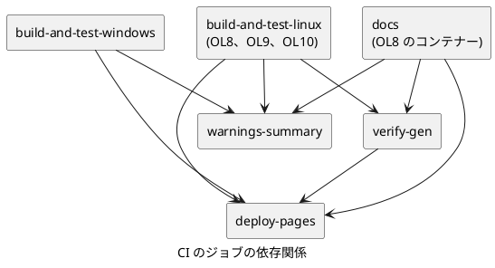

<!--
生成元: agree-before-implement スキル
文書種別: 最終仕様 (design)
最終更新エージェント: claude code / セッション ID: session_01KJc53S9NTSL234pjuYHGV9
上流文書: `261111-ci-docs-job-split-discussion.md` (検討用 Markdown)。削除されている場合があります。
再開手順: このファイルを開いたエージェントは、作業の前に agree-before-implement スキルを読み込んでください。上流文書が存在する場合は、上流文書の再開手順に従って進行位置を確認し、判断の経緯を上流文書の Q&A で確認します。存在しない場合は、この文書を単体の最終仕様として扱います。セッション情報が見つからない場合も異常とせず、文書の記載から継続してください。
-->

# CI のドキュメント生成ジョブの分離と make gen 最終仕様

## 目的

GitHub Actions の全体の所要時間を短縮し、1 ジョブ 6 時間の上限に対する余裕を確保します。  
そのために、ドキュメント生成 (`make doxy && make docs`) を OL8 のレグから独立したジョブへ移し、ビルドとテストに並行して実行します。  
独立したジョブがフル ビルドなしで生成ソースをそろえられるよう、ゴール `gen` を makefw に追加します。

## 範囲

対象は、makefw のテンプレートと補助スクリプト、各 app の `makefile`、`app/struct-meta/appdeps.mk`、ルートの `makefile`、`.github/workflows/ci.yml`、関連する正本ドキュメントです。  
`.jenkins/` の構成は対象外です。Jenkins は直列で実行しており、分離の効果がないためです。

## make gen の仕様

### 契約

`make gen` は、`prod` 配下の生成ソースをすべて作ります。通常のソースはコンパイルしません。  
例外として、自前でビルドした生成器が必要な app では、その app と依存先の `prod` を、テストを除いてビルドします。

生成ソースは、次の 3 種類です。

| 種類 | 生成の仕組み | `gen` での扱い |
| --- | --- | --- |
| パース時スクリプト | `makepart.mk` が makefile のパース時にスクリプトを実行する | `prod` 配下の makefile をパースした時点で生成される |
| ツールだけの規則 | flex / bison、mc.exe の規則 | 規則の生成物を `prod` 配下のゴール `_gen` の前提にする |
| 自前ビルドの生成器 | app が `prod` でビルドした実行体を実行する | app が宣言し、`prod` のビルドに切り替える |

Table: 生成ソースの種類と gen での扱い

### 階層ごとの動作

ルートの `makefile` の `gen` は、`$(MAKE) -C app gen` を実行します。`skills` の同期と framework のビルドは行いません。

`app/makefile` (`__app_template.mk`) の `gen` は、`run_ordered_subdir_target.sh --app-deps` で、依存順に各 app の `gen` を実行します。  
`prod` のビルドが必要な app の一覧を `resolve_app_deps.sh --gen-build-apps` で 1 回だけ求め、環境変数 `MAKEFW_GEN_BUILD_APPS` で各 app へ渡します。  
`gen` を `_MAKEFW_APP_RUNNER_GOALS` に加え、ほかのランナー経由のゴールと同じ出力制御にします。

各 app の `makefile` (`__each_app_template.mk`) の `gen` は、`prod/makefile` がある場合に次のどちらかを実行します。

- app が `prod` のビルド対象に含まれる場合は、`$(MAKE) -C prod` を実行します。
- 含まれない場合は、`$(MAKE) -C prod _gen` を実行します。

`MAKEFW_GEN_BUILD_APPS` が未定義の場合 (app 直下で `make gen` を直接実行した場合) は、app が自分で `--gen-build-apps` を解決します。この場合、依存先の app はビルドしません。app 直下の `make` が依存先をビルドしないことと同じ扱いです。  
`gen` は `make_build.stamp` と `make_test.stamp` を更新しません。`test` をビルドしないためです。

`prod` 配下のゴール名は `_gen` とします。

> [!IMPORTANT]
> 末端のディレクトリでは、ターゲット名 `gen` が、生成物の置き場所 `$(GENDIR)` (値は `gen`) を作る既存の規則と重なります。そのため `prod` 配下では `gen` をゴール名に使えません。`test` に対する `_test_build` と `_test_run` と同じく、下線で始まる内部のゴール名にします。ルート、`app/`、app 直下のゴール名は `gen` です。

`prod` 配下の中間ディレクトリ (`makemain.mk`) では、`_gen` を `default` や `clean` と同じく `SUBDIRS` へ伝えます。宣言順を持つ `SUBDIRS` の直列化は、`_gen` にも適用されます。  
`makemain.mk` に空の `_gen` を定義し、生成物を持たないディレクトリと .NET のディレクトリでは何もしません。  
`_parallel.mk` の既定の並列化の対象に、`gen` と `_gen` を加えます。

末端のディレクトリでは、生成の規則を持つ断片が `_gen` へ前提を追加します。

- `_flex_bison_compile.mk` は、bison の `.tab.c` と `.tab.h`、flex の `.lex.c`、`GENDIR_EXTRA_C` を前提にします。
- `_resource_compile.mk` は、mc.exe が生成する `.rc` と `.h` を前提にします (Windows だけ)。

> [!NOTE]
> `GENDIR_EXTRA_C` の規則が、同じ app でビルドする実行体を前提にする場合、宣言のない app の `make gen` は「規則がない」というエラーで止まります。黙って生成を飛ばすことはありません。この場合は、app の `appdeps.mk` に宣言を追加します。

### prod のビルドが必要な app の宣言

自前ビルドの生成器を持つ app は、`appdeps.mk` で宣言します。

```{.makefile caption="app/struct-meta/appdeps.mk"}
APP_DEPS := cplat cjson
# struct-meta-gen (prod でビルドする生成器) が gen/ のソースを作るため、
# make gen では prod をビルドする。
APP_GEN_REQUIRES_BUILD := 1
```

`resolve_app_deps.sh --gen-build-apps` は、宣言した app と、その `APP_DEPS` の推移的な依存先を、名前順に 1 行ずつ出力します。該当がなければ何も出力しません。  
宣言の読み取りは、`APP_DEPS` と同じく awk による自明な代入の解析とし、値が `1` の場合だけ有効にします。

現在の構成で宣言するのは `app/struct-meta` だけです。`prod` をビルドする app は、struct-meta、cplat、cjson、zlib、openssl の 5 つになります。

### mc.exe の規則の分割

`.mc` から `.res` を作る 1 つの規則を、生成とコンパイルの 2 つに分けます。

- 生成: `.mc` から mc.exe で `$(GENDIR)/<名前>.rc` を作ります。mc.exe は同名の `.h` と `.bin` も出力します。`.h` は `.rc` に依存させ、存在の確認だけを行います。
- コンパイル: `$(GENDIR)/<名前>.rc` から rc.exe で `$(OBJDIR)/<名前>.res` を作ります。

> [!NOTE]
> 1 つの規則に複数のターゲットを並べる書き方 (`&:`) は、GNU Make 4.3 以降の機能です。このリポジトリの最低要件は GNU Make 4.0 のため使いません。正本のターゲットを 1 つにし、副次の生成物をそれに依存させます。`app/struct-meta` の `struct-meta-gen` の規則と同じ形です。

規則は、対象のファイルを明示する静的パターン規則にします。明示したターゲットは中間ファイルとして扱われないため、生成した `.rc` と `.h` は make の終了時に削除されません。  
単体の `.rc` から `.res` を作る既存の規則は変更しません。同じ名前の `.mc` と `.rc` を同じディレクトリに置かない制約も変わりません。

### ルートの doxy との関係

ルートの `doxy` は `gen` に依存させません。`make doxy` の動作と所要時間は変わりません。  
生成ソースを含む文書が必要な場合は、`make gen && make doxy` と続けて実行します。

## CI の構成

### ジョブの構成



`docs` ジョブを追加します。OL8 のコンテナーで、次の順に実行します。

1. リポジトリをチェックアウトします。サブモジュールを含め、`fetch-depth: 0` とします。`make docs` が `git log` から著者と日付を取得するためです。
2. app の環境変数を読み込みます (`load-app-env.sh`)。
3. `make gen` を実行します。
4. `prod` 配下の `gen/` のファイル一覧を作り、アーティファクト `gen-manifest-gen` として保存します。
5. docsfw の npm と Puppeteer のキャッシュを復元します。キーは OL8 のレグと同じにします。
6. `make doxy && make docs` を実行します。
7. 発行物と警告ファイルをアーティファクトとして保存します。ステップの内容とアーティファクトの名前は、現在の OL8 のレグのものをそのまま移します。

`build-and-test-linux` からは、`docs: true` の分岐と、ドキュメント関連のステップをすべて外します。マトリックスの `docs` と `fetch-depth` を削除し、3 つのレグとも `fetch-depth: 1` にします。  
OL8 のレグには、Build の後に `gen/` のファイル一覧を作り、アーティファクト `gen-manifest-build` として保存するステップを追加します。  
`.jenkins/build.sh` の `BUILD_DOCS` に触れているコメントは、実態に合わせて書き直します。

`warnings-summary` と `deploy-pages` の `needs` に `docs` を追加します。`deploy-pages` の `needs` には `verify-gen` も追加します。

並列数は、現在の 4 本から 5 本になります。`verify-gen` などの後続のジョブは、先行するジョブの終了後に実行します。GitHub の Free プランの上限は同時 20 ジョブです。

### 生成漏れの照合

`verify-gen` ジョブは、`gen-manifest-build` と `gen-manifest-gen` を突き合わせます。差分があれば、差分を出力して失敗します。  
`deploy-pages` は `verify-gen` に依存するため、生成漏れがある文書は公開されません。

ファイル一覧は、`app/<名前>/prod` 配下で、名前が `gen` のディレクトリにある C/C++ のソースとヘッダーの相対パスを、名前順に並べたものです。`obj` 配下と、ログやスタンプなどの中間ファイルは除きます。  
2 つのジョブは、同じスクリプト (`.github/scripts/list-generated-sources.sh`) で一覧を作ります。

> [!NOTE]
> 照合の目的は、`appdeps.mk` の宣言漏れを検出することです。宣言が漏れても `docs` ジョブはエラーにならず、文書からページが欠けるだけになるため、フル ビルドの結果と比べます。

> [!IMPORTANT]
> 照合の対象は、`gen/` に置かれた生成ソースだけです。`gen/` 以外へ生成するファイル (たとえば `app/string-catalog-sample` の `prod/include/samplecatalog/` のヘッダー) は対象外です。このヘッダーは `gen/` のソースと同じスクリプトの同じ呼び出しで生成されるため、`gen/` の照合で間接的に検出できます。

## テスト

makefw の `bin_test/` に、ゴール `gen` のテストを追加します。`bin_test/` のテストは、CI の全レグの「Run script tests」で実行されます。

| テスト | 実行する OS | 確認する内容 |
| --- | --- | --- |
| flex / bison の生成 | Linux、Windows | `make _gen` が `.tab.c`、`.tab.h`、`.lex.c` を作り、オブジェクトを作らないこと |
| `.mc` の生成 | Windows | `make _gen` が `.rc` と `.h` を作り、`.res` を作らないこと。通常のビルドでは `.res` まで作ること |
| 中間ディレクトリの伝播 | Linux、Windows | 上位のディレクトリの `make _gen` が、下位の生成物を作ること |
| app の解決 | Linux、Windows | `--gen-build-apps` が、宣言した app と推移的な依存先を出力し、宣言がなければ何も出力しないこと |

Table: 追加するテスト

`.mc` のテストは、理由が `[Windows]` で始まるスキップとして宣言します。`run-bin-tests.py` は、この形式のスキップを Linux では想定内として扱います。  
Windows の `make gen` は、現在の CI ではドキュメント生成に使いません。Windows だけのプロジェクトで利用する場合に備え、このテストで退行を防ぎます。

## 変更対象

| 対象 | 変更の内容 |
| --- | --- |
| `framework/makefw/makefiles/makemain.mk` | 空の `_gen` の定義と、`SUBDIRS` への伝播 |
| `framework/makefw/makefiles/_parallel.mk` | 既定の並列化の対象への `gen` と `_gen` の追加 |
| `framework/makefw/makefiles/_flex_bison_compile.mk` | `_gen` への前提の追加 |
| `framework/makefw/makefiles/_resource_compile.mk` | `.mc` の規則の分割と、`_gen` への前提の追加 |
| `framework/makefw/makefiles/__each_app_template.mk` | `gen` の追加 |
| `framework/makefw/makefiles/__app_template.mk` | `gen` の追加 |
| `framework/makefw/bin_internal/resolve_app_deps.sh` | `--gen-build-apps` の追加 |
| `framework/makefw/bin_test/` | テストの追加 |
| `app/makefile` と各 app の `makefile` | `bin/update_template_makefiles.py` によるテンプレートとの同期 |
| `app/struct-meta/appdeps.mk` | `APP_GEN_REQUIRES_BUILD := 1` の追加 |
| `makefile` (ルート) | `gen` の追加 |
| `.github/workflows/ci.yml` | `docs` ジョブと `verify-gen` ジョブの追加、OL8 のレグの変更 |
| `.github/scripts/list-generated-sources.sh` | 生成ソースの一覧を作るスクリプトの追加 |

Table: 変更対象

`framework/makefw` と、app のうち porter、cjson、sqlite、lua、zlib、cplat、openssl はサブモジュールです。テンプレートの変更と `makefile` の同期は、これらのサブモジュールにもまたがります。  
ステージング、コミット、push は、ユーザーの個別の指示があるまで行いません。

## 知見の反映計画

| 反映先 | 反映する内容 |
| --- | --- |
| `framework/makefw/docs/build-configurations.md` | ゴール `gen` の契約、階層ごとの動作、スタンプを更新しないこと |
| `framework/makefw/docs/makeparts.md` | `appdeps.mk` の `APP_GEN_REQUIRES_BUILD` と、`GENDIR_EXTRA_C` が自前の生成器を前提にする場合の宣言 |
| `app/general/docs/workspace-agent-workflow.md` | CI のジョブの構成、`make gen && make doxy && make docs` の順序、生成漏れの照合 |
| `_resource_compile.mk` のコメント | 規則を 2 つに分けた理由と、GNU Make 4.0 で動く書き方にした理由 |
| `ci.yml` のコメント | `docs` ジョブが `make gen` を先に実行する理由と、`verify-gen` の目的 |

Table: 知見の反映計画

各文書の該当節の位置は、作業時に現物を読んで決めます。該当する節がない場合は、節を追加します。

## 受入条件

エージェントが確認する条件は、次のとおりです。

- 追加したテストを含め、makefw の `bin_test/` のテストが手元 (Windows) で成功すること。
- 変更した Markdown が `text_style_jp.py --dry-run` で指摘なしになること。
- 各 app の `makefile` が、`update_template_makefiles.py` の確認でテンプレートと一致すること。

ユーザーが push した後、GitHub Actions の実走で確認する条件は、次のとおりです。

- すべてのジョブが成功すること。`verify-gen` で差分が出ないこと。
- `make docs` が処理した doxybook2 の Markdown の一覧が、分離前の直近の成功した実行と一致すること。比較は発行ログの `Processing Markdown file:` の行で行います。分離前後でソースの Doxygen コメントに変更がある場合は、その差分を除いて比較します。
- 全体の所要時間が、同じ実行の「OL8 のレグの所要時間と、`docs` ジョブの `make doxy && make docs` の所要時間の合計」より短いこと。

> [!NOTE]
> 所要時間は、過去の実行と比べず、同じ実行の中で比べます。ランナーの性能が実行ごとに大きく変わり (Windows のジョブで 196 ～ 275[分])、過去の実行との比較では分離の効果を判定できないためです。

> [!NOTE]
> 文書の一致は、ページの総数では判定しません。この案件の検討用 Markdown などの追加で、発行するページの総数が変わるためです。

`make` と `make test` の実行確認は、ユーザーが担当します。エージェントは、合意した範囲の `bin_test/` のテストだけを実行します。

## 見込み

`make gen` の所要時間は、CI のログからの推定で 25[分] 以内です。cplat のビルドで出力されたコンパイルとリンクのコマンドのうち、`prod` は件数で約 15[%] でした。  
`docs` ジョブは 105 ～ 125[分] 程度になる見込みで、OL8 のレグ (ドキュメント生成を除いて 207 ～ 257[分]) より短くなります。  
全体の所要時間は、OL8 のレグと Windows のジョブの長いほうで決まります。直近の成功 3 回に当てはめると、短縮は約 6 ～ 92[分] です。

これらは推定であり、実測は CI の実走で確認します。
