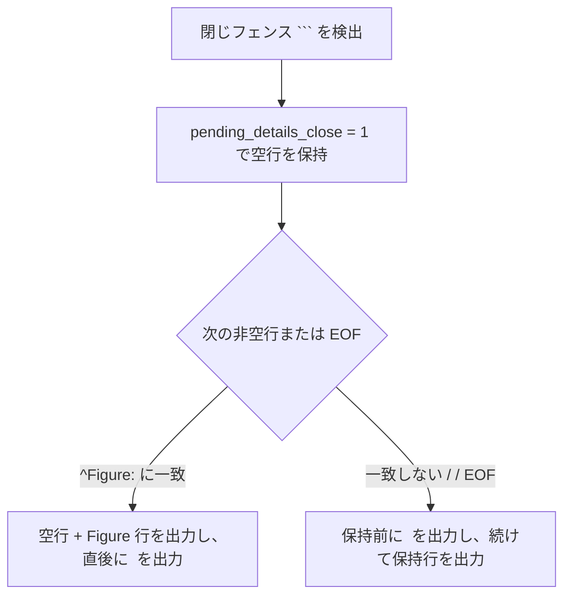

<!--
生成元: agree-before-implement スキル
文書種別: 最終仕様書 (design)
最終更新エージェント: agy / セッション ID: 0781d8d9-344b-4de0-9d84-13f456bc6886
上流文書: [261114-doxygen-mermaid-migration-discussion.md](261114-doxygen-mermaid-migration-discussion.md)
位置づけ: 合意済み内容だけを正本反映可能な形式で記述する独立した仕様書。
-->

# Doxygen 由来の PlantUML 図を Mermaid へ移行する最終仕様

合意 ID: `doxygen-mermaid-migration-20261114` / 版: 1 / 状態: 承認待ち (第 2 ゲート)

## 概要と対象範囲

本仕様は、Doxygen と Doxybook2 を経由して生成される Markdown 内の PlantUML 図を Mermaid (`Figure:` キャプション付き) へ移行するための実装仕様、正本文書更新計画、既存 Markdown 修正範囲、および受入・検証手順を定めます。

- **移行対象の 2 系統**:
    1. C ヘッダーの Doxygen コメント内に記述された手動図 ([memory_lock.h](../../../../cplat/prod/include/cplat/runtime/memory_lock.h) の 2 図)。
    2. [extract-graphs.py](../../../../../framework/doxyfw/templates/extract-graphs.py) が Doxygen XML から生成する自動グラフ 4 種別 (インクルード依存グラフ・逆インクルード依存グラフ、継承グラフ、コラボレーション図、コールグラフ・呼び出し元グラフ)。
- **互換維持の範囲**:
    - 既存の `@startuml` / `@enduml` および `<plantuml>` タグの変換経路 ([preprocess.sh](../../../../../framework/doxyfw/templates/preprocess.sh))、[postprocess.sh](../../../../../framework/doxyfw/templates/postprocess.sh) の `~_~_` 退避、Doxygen の `PLANTUML_*` 設定、および [input-filter.py](../../../../../framework/doxyfw/bin_internal/input-filter.py) による ```` ```plantuml ```` 除去は互換・補足経路としてそのまま維持します。
- **対象外とする事項**:
    - `@mermaidfile` および外部 `.mmd` ファイル参照の一般的な変換対応は、現行の手動 2 図・自動生成グラフのいずれにも使用されていないため本移行の必須対象に含めません。

> [!IMPORTANT]
> 本仕様確定後、実装フェーズの開始直前に、承認済みの `doxyfw` 局所単体テスト Python 4 ファイルを実行して変更前の基準値を記録してからソース変更へ進みます。

## 手動 Doxygen コメントの Mermaid 変換仕様

対象は [memory_lock.h](../../../../cplat/prod/include/cplat/runtime/memory_lock.h) 内の関数コメント 2 箇所です。  
Doxygen `1.17.0` (および CI 環境の `1.18.0`) における `@mermaid{caption="..."}` 〜 `@endmermaid` 構文を用い、ブロック先頭は行頭 `*` を置かない 4 スペース基準のインデントで記述します。この形式は [check-doxygen-indent.py](../../../../../framework/doxyfw/bin/check-doxygen-indent.py) が `/** ... */` 内で `^\s*\*` に一致しない行をスキップする仕様と整合します。

> [!NOTE]
> `memory_lock.h` の仮引数名 (`options`、`&scope_out`、`scope_out`、`scope`) は現行実装および周辺 Doxygen コメントと一致させる必要があり、既存の参考 Markdown 側の名称 (`&scope` 等) へ勝手に読み替えません。

### cplat_memory_lock_self (L130-153 付近) の変換内容

既存の `@startuml cplat_memory_lock_self のロック取得` 〜 `@enduml` を、次の記述へ置き換えます。

```c
 * @par 動作フロー
    @mermaid{caption="cplat_memory_lock_self のロック取得"}
    sequenceDiagram
        participant Caller as 呼び出し元
        participant API as cplat_memory_lock_self
        participant Lock as Lock API
        participant Scope as スコープ

        Caller->>API: options, &scope_out
        opt 引数チェック
            API-->>Caller: CPLAT_ERR_INVALID_ARG
        end
        API->>Lock: memory_lock(min_bytes)
        alt ロック失敗
            Lock-->>API: エラー
            API-->>Caller: 変換済みエラー
        else ロック成功
            API->>Scope: scope にロック情報を保存
            API-->>Caller: CPLAT_OK, scope_out
        end
    @endmermaid
 *
```

### cplat_memory_lock_scope_release (L175-204 付近) の変換内容

既存の `@startuml cplat_memory_lock_scope_release の解放フロー` 〜 `@enduml` を、次の記述へ置き換えます。

```c
 * @par 解放フロー
    @mermaid{caption="cplat_memory_lock_scope_release の解放フロー"}
    sequenceDiagram
        participant Caller as 呼び出し元
        participant API as cplat_memory_lock_scope_release
        participant Unlock as Unlock API

        Caller->>API: scope
        alt scope == NULL
            API-->>Caller: return
        else state == 0 または size == 0
            API-->>Caller: clear scope
        else state == CPLAT_MEMORY_LOCK_STATE_LOCKED
            API->>Unlock: memory_unlock(base, size)
            API-->>Caller: clear scope
        end
    @endmermaid
 *
```

## 自動生成グラフの Mermaid 変換仕様

[extract-graphs.py](../../../../../framework/doxyfw/templates/extract-graphs.py) が Doxygen XML を解析して生成する自動グラフ出力を、`<plantuml>` から `<mermaid>` 形式へ移行します。  
既存の制限・制御パラメーター (`DOT_GRAPH_MAX_NODES = 50`、`INC_GRAPH_LABEL_BASENAME_ONLY = True`、`GRAPH_DETAILS_ONLY = True`、`DETAILS_ONLY_MARKER = "DOXYFW_DETAILS_ONLY"`、エッジ 0 本またはノード 1 個以下のスキップ条件、および再帰コールグラフ展開ロジック) は変更しません。

### 図種別・向き・矢印のマッピング

| Doxygen グラフ種別 | Mermaid 図種別・向き | 関係種別の矢印 | 備考 |
| --- | --- | --- | --- |
| `incdepgraph` / `invincdepgraph` (インクルード依存) | `flowchart TD` | `-->` | `INC_GRAPH_LABEL_BASENAME_ONLY` を維持 |
| `inheritancegraph` (継承関係) | `flowchart BT` | `-->` | 下から上へ向かう矢印で派生から基底の階層を表現 |
| `collaborationgraph` (コラボレーション) | `flowchart TD` | `-.->` (`usage`) / `-->` (その他) | エッジ ラベルがある場合は `-->\|"..."\|` 形式で付与 |
| `references` / `referencedby` (コール・呼び出し元) | `flowchart TD` | `-->` | `build_recursive_callgraph` / `build_recursive_callergraph` を維持 |

Table: 自動生成グラフの Mermaid 構文マッピング

### ノード ID、特殊文字エスケープ、および強調表現

- **安全なノード ID**:
    - Mermaid 予約語 (`end`、`style`、`subgraph`、`class`、`click` など) や記号 (`:`、`-`、`.`、空白) との衝突を防ぐため、生成するノード ID はすべて ASCII 連番 (`n0`、`n1`、`n2`、...) へ正規化します。
- **ラベルのエスケープ順と形式**:
    - ノード定義は二重引用符付きの `nX["<escaped_label>"]` 形式を徹底します。
    - XML テキスト生成前、ラベル文字列に対して `&` -> `&amp;`、`<` -> `&lt;`、`>` -> `&gt;`、`"` -> `#quot;` の順でエスケープし、改行 (`\n` およびリテラル `\n`) は `<br/>` へ置換します。これにより `__dunder__`、`*`、`[...]`、`{...}`、`#` を含む C/C++ シンボル名も Mermaid パーサーおよび `postprocess.sh` と干渉しません。
- **対象ノードの強調 (色・太字)**:
    - 現行の PlantUML における `#LightBlue` および `**...**` による強調は、ノード直後またはブロック末尾のスタイル指定 `style nX fill:#ADD8E6,stroke:#333,font-weight:bold` へ置き換えます。
    - `<mermaid>` 内へ生の HTML タグ (`<b>` など) を出力すると Doxybook2 (`v1.6.1`) が未認識タグ警告を出力するため、ラベル内 HTML 太字タグは使用しません。

> [!NOTE]
> 上記の `flowchart TD` / `flowchart BT`、`style nX fill:#ADD8E6,stroke:#333,font-weight:bold`、および `#quot;`・`&amp;`・`&lt;`・`&gt;`・`<br/>` を含むノード ラベルは、ローカルの `mmdc` (`11.17.0`) による構文別 SVG 生成で終了コード `0` を確認済みです。

### XML タグ出力と関数構成の整理

- **XML 挿入形式 (`build_mermaid_tag`)**:
    - グラフ本文とタイトルをそれぞれ XML エスケープ (`&`、`"`、`<`、`>`) し、次の形式で `<simplesect kind="par">` 内に挿入します。

```xml
<mermaid caption="{caption=&quot;{xml_escaped_title}&quot;}">
{xml_escaped_mermaid_code}
</mermaid>
```

- **内部関数の命名整理**:
    - グラフ種別ごとの生成関数およびタグ構築関数は Mermaid 生成に即した名称 (`graph_to_mermaid`、`callgraph_to_mermaid`、`callergraph_to_mermaid`、`callgraph_to_mermaid_graph`、`callergraph_to_mermaid_graph`、`build_mermaid_tag`) へ統一し、旧 PlantUML 専用名の重複を残しません。

## Doxygen XML 前処理 (preprocess.sh) の仕様

[preprocess.sh](../../../../../framework/doxyfw/templates/preprocess.sh) では、既存の `<plantuml>` 変換を残したまま、`<mermaid>` タグを Markdown の Mermaid コード フェンスおよび `Figure:` キャプション行へ変換する Python ヘルパーを新規追加して呼び出します。

### 新設ヘルパー (framework/doxyfw/templates/convert-mermaid-tags.py)

- **文字コードとパス規範**:
    - `app/general/docs/python-text-encoding-guideline.md` に従い、ファイル入出力で `encoding="utf-8"` および `newline="\n"` を明示します。
    - `app/general/docs/python-import-path-guideline.md` に準拠し、`PYTHONSAFEPATH=1` 下で動作するよう単体スクリプトとして完結させます (同一ディレクトリの他モジュールへ依存する場合は `Path(__file__).resolve().parent` を参照)。
- **変換仕様**:
    1. `<mermaid([^>]*)>(.*?)</mermaid>` (`re.DOTALL`) に一致する各ブロックを抽出します。
    2. 開始タグ属性から `caption="..."` を抽出して HTML アンエスケープし、`{caption="..."}` ラッパー形式である場合は外側の `{caption="..."}` と引用符を取り除いてキャプション本文を得ます (空文字列または属性なしの場合はキャプションなしとみなします)。
    3. 本文先頭・末尾の余分な空行を除去したうえで `textwrap.dedent` を適用し、Doxygen が付与した共通インデントを整えます。本文内の XML 実体参照 (`&gt;`、`&amp;`、`&lt;`、`&quot;`) は Doxybook2 の XML パーサーが復号するため、前処理段階では生文字へ戻さずそのまま保持します。
    4. 置換出力を次のように整形します (`caption` が存在しない場合は `Figure:` 行を省略)。なお、`caption` 本文は XML エスケープ (`xml.sax.saxutils.escape`) して出力し、Doxybook2 への XML 入力を常に整形式に保ちます。

````xml
```mermaid
{dedented_body}
```

Figure: {xml_escaped_caption}

````

    5. ブロック前後に改行を確保し、隣接するタグ本文や Doxybook2 テンプレート出力との行連結を防ぎます。

### preprocess.sh への組み込み順序

- `<plantuml>` 置換および `<bold>` / `<name>` / `<title>` の `!dunder!` 退避に悪影響を与えない位置 (既存の `<plantuml>` 変換と同時期、`</para>` や `<bold>` 処理の前または並列段) で `python3 "$SCRIPT_DIR/convert-mermaid-tags.py"` を実行します。
- `@mermaid` 本文内の `__` は Doxygen が `<bold>` へ変換しないため、`!dunder!` 置換対象と干渉しません。

## Markdown 後処理 (postprocess.sh) と Doxygen 設定の仕様

### postprocess.sh の保護と折り畳み調整

1. **`is_mermaid` ブロック状態の追跡**:
    - 既存のコード フェンス追跡 (`in_code_block` および `is_plantuml`) へ `is_mermaid` フラグを追加し、開始行が `` /^[[:space:]]*```[[:space:]]*mermaid([[:space:]]|$)/ `` に一致した場合に `is_mermaid = 1`、閉じフェンス `` ``` `` 到達時に `is_mermaid = 0` へ戻します。
2. **`!dunder!` 保護の維持**:
    - 既存の `in_code_block && !is_plantuml` 分岐は `~_~_` 退避と `&#95;&#95;` 置換の双方をスキップするため、Mermaid フェンス内の `__flag__` などはすでに保護されます。この保護条件を維持し、`is_mermaid` も含めて非破壊対象であることが読み取れるコメントを補います。
3. **`fix_ptr` パスからの Mermaid 除外**:
    - `fix_ptr` 処理 (ポインター `*` 周辺の空白・エスケープ補正) では、フェンス外の通常テキストだけでなくコード フェンス内の引用符外テキストも走査されます。条件を `in_code_block && is_mermaid` の場合は変換をスキップするよう変更し、Mermaid 構文内の `*` や演算子が書き換わらないようにします。
4. **`DOXYFW_DETAILS_ONLY` の `Figure:` 内包折り畳み**:
    - 現在の `DOXYFW_DETAILS_ONLY` 状態機械は閉じコード フェンス ```` ``` ```` 直後で即座に `<!--:details-->` を出力します。
    - これを改め、閉じフェンス到達後は `pending_details_close = 1` として後続の空行をバッファリングします。
    - 次の非空行が `^Figure:` に一致する場合は、空行 (1 行) と `Figure:` 行を出力した直後に `<!--:details-->` と後続空行を出力して折り畳み内にキャプションを含めます。
    - 次の非空行が `^Figure:` に一致しない場合 (または `<!--par-end-->`・ファイル終端 `END` に達した場合) は、従来どおり閉じフェンス直後に `<!--:details-->` を出力してからバッファー済みの空行・次行を出力します。



Figure: `DOXYFW_DETAILS_ONLY` における `Figure:` 行と `<!--:details-->` の終端制御フロー

### Doxyfile および input-filter.py の扱い

- **`framework/doxyfw/Doxyfile`**:
    - `PLANTUML_*` の互換定義はそのまま維持します。
    - `GENERATE_HTML = YES` および `GENERATE_XML = YES` が有効ですが、Doxygen `1.17.0` / CI `1.18.0` の既定値である `MERMAID_RENDER_MODE = AUTO` により、`mmdc` が存在しない環境でも XML 生成および HTML 生成が警告なし・終了コード `0` で動作するため、新たな `MERMAID_*` 設定行は原則追加しません (局所 `make doxy` 検証で環境依存の問題が見つかった場合のみ最小設定を検討します)。
- **`framework/doxyfw/bin_internal/input-filter.py`**:
    - Markdown 入力から ```` ```plantuml ```` フェンスを除去する現行処理は互換維持のため変更せず、```` ```mermaid ```` に対する不要な除去は行いません。

## 正本文書 (framework/doxyfw/docs/) への反映計画

`app/general/AGENTS.md` の規則に従い、`framework/doxyfw/docs/` 配下の汎用正本文書には個別 `app` 固有のパスや例外条件を記載せず、一般的な機能・利用例として更新します。更新はすべて `text_style_jp.py` で機械整形を確認します。

| 正本ファイル | 更新内容 |
| --- | --- |
| [maintenance-verification.md](../../../../../framework/doxyfw/docs/maintenance-verification.md) | 推奨図記法を Mermaid (`Figure:` キャプション推奨、[codeblock-caption.md](../../../../../framework/docsfw/docs/codeblock-caption.md) 参照) へ改訂し、PlantUML を互換・補足として位置づける。 |
| [commands.md](../../../../../framework/doxyfw/docs/commands.md) | Doxygen コメント内の標準図コマンドとして `@mermaid{caption="..."}` / `@endmermaid` を記述し、`@startuml` / `@enduml` を互換構文として併記する。 |
| [cheatsheet.md](../../../../../framework/doxyfw/docs/cheatsheet.md) | 図の記述テンプレートを `@mermaid{caption="..."}` 〜 `@endmermaid` へ更新し、PlantUML 互換注記を添える。 |
| [extract-graphs.md](../../../../../framework/doxyfw/docs/extract-graphs.md) | 自動生成グラフの出力形式・強調・キャプション (`Figure:`) 仕様を更新し、生成例 `plantuml` 4 箇所 (L139、L154、L169、L184) を `mermaid` 出力例 (`flowchart TD` / `flowchart BT`、`style ... fill:#ADD8E6,...`、`Figure:`) へ置換する。 |
| [doxybook2-plantuml.md](../../../../../framework/doxyfw/docs/doxybook2-plantuml.md) | 既存の PlantUML 変換・下線保護仕様を、移行完了後の「PlantUML 互換経路」として明確に位置づける。 |

Table: 正本文書の更新対象と反映方針

## 既存 Markdown 3 箇所の修正仕様

過去 27 ファイルの実態調査で特定された差異 3 箇所を次のとおり修正し、変更後は `text_style_jp.py` で整形確認します。

1. **[cplat-account-session-discussion.md](../../../../cplat/docs/prompts/current/cplat-account-session-discussion.md) (L295)**:
    - L295 の `CodeBlock: セッション上でプロセスを起動する処理の流れ (試案)` を `Figure: セッション上でプロセスを起動する処理の流れ (試案)` へ変更します。
    - 同ファイル内の C コード ブロック 5 箇所 (`{.c caption="..."}`) は Mermaid 図ではないため変更しません。
2. **[architecture.md](../../../../porter/docs/architecture.md) (L28-36)**:
    - `## ハンドルの寿命と通知の実行` 節にあるキャプションなし `flowchart LR` の閉じフェンス直後へ、内容に沿った `Figure:` キャプション行 (`Figure: ハンドルの寿命と非同期通知の実行関係`) を 1 行空けて追記します。
3. **[sequence-data.md](../../../../porter/docs/sequence-data.md) (L408-421)**:
    - `## close と登録済み通知` 節にあるキャプションなし `sequenceDiagram` の閉じフェンス直後へ、内容に沿った `Figure:` キャプション行 (`Figure: close 呼び出しと登録済み通知の処理シーケンス`) を 1 行空けて追記します。

## Windows / Linux 両対応仕様

- **文字コード・改行コード**:
    - すべての新規・更新 Python スクリプト、テンプレート、ヘッダー、Markdown ファイルは UTF-8・LF 改行 (`newline="\n"`) で統一します。
- **Bash と Python 実行環境**:
    - `preprocess.sh` / `postprocess.sh` の単体テストおよび実行経路は Linux の `/bin/bash` と Windows の Git Bash (`shutil.which("bash")` で探索し WSL 環境へ誤誘導しない既存方式) の双方で同一動作させます。
- **`mmdc` 有無と実行コマンド**:
    - Doxygen の既定 `MERMAID_RENDER_MODE = AUTO` により、`mmdc` がインストールされていない環境でも XML 抽出・Markdown 生成がエラー・警告なしで完走する構成とします。
    - 描画検証等で `mmdc` を直接起動する場合は、`shutil.which("mmdc")` により Linux の `mmdc` および Windows の `mmdc.cmd` (`mmdc.CMD`) を環境非依存で解決します。

## 変更対象一覧・単体テスト・受入条件

### 変更・新設ファイル一覧

| 区分 | パス | 変更概要 |
| --- | --- | --- |
| ヘッダー | [memory_lock.h](../../../../cplat/prod/include/cplat/runtime/memory_lock.h) | 手動 2 図を `@mermaid{caption="..."}` 〜 `@endmermaid` へ移行 |
| グラフ抽出 | [extract-graphs.py](../../../../../framework/doxyfw/templates/extract-graphs.py) | 4 種別グラフを `<mermaid>` + `style` 強調 + XML/ラベル エスケープ出力へ変更 |
| XML 前処理 | [preprocess.sh](../../../../../framework/doxyfw/templates/preprocess.sh) | `convert-mermaid-tags.py` 呼び出しを追加 (`<plantuml>` 互換維持) |
| 新設ヘルパー | `framework/doxyfw/templates/convert-mermaid-tags.py` | `<mermaid>` タグを ```` ```mermaid ```` + `Figure:` へ変換 |
| MD 後処理 | [postprocess.sh](../../../../../framework/doxyfw/templates/postprocess.sh) | `is_mermaid` 判定追加、`fix_ptr` 除外、`DOXYFW_DETAILS_ONLY` の `Figure:` 内包閉じ |
| 単体テスト | [test_preprocess.py](../../../../../framework/doxyfw/bin_test/test_preprocess.py)、[test_postprocess.py](../../../../../framework/doxyfw/bin_test/test_postprocess.py)、[test_doxybook2_templates.py](../../../../../framework/doxyfw/bin_test/test_doxybook2_templates.py) | Mermaid 変換・特殊文字・`fix_ptr` 除外・`DOXYFW_DETAILS_ONLY`・`extract-graphs.py` 出力検証を追加 |
| 正本文書 | `framework/doxyfw/docs/` の 5 ファイル | 推奨方針・構文例・生成例・PlantUML 互換位置づけを更新 |
| 既存 MD | `cplat-account-session-discussion.md`、`architecture.md`、`sequence-data.md` | 残存 `CodeBlock:` 1 箇所の `Figure:` 化および無題 2 図への `Figure:` 付与 |

Table: 変更および新設予定のファイル一覧

### 単体テストおよび局所検証の実施手順

1. **変更前基準値の取得 (`bin_test` 承認範囲 4 ファイル)**:
    - 実装変更に着手する直前、`framework/doxyfw/bin_test/` の承認対象 Python 4 ファイル (`test_preprocess.py`、`test_postprocess.py`、`test_doxybook2_templates.py`、`test_materialize_group_members.py`) を実行し、全件成功する基準値を記録します (残る Python 6 ファイルおよび JavaScript 13 ファイルは実行しません)。
    - あわせて `app/cplat` で変更前の `make doxy` を実行し、比較用の基準 Markdown 出力を一時退避します。
2. **実装および単体テスト追加・更新**:
    - `convert-mermaid-tags.py` 新設、`extract-graphs.py` / `preprocess.sh` / `postprocess.sh` / `memory_lock.h` 更新を行います。
    - `test_preprocess.py` へ `<mermaid>` (キャプションあり/なし、特殊文字/`&lt;`/`__dunder__`、`<plantuml>` 共存)、`test_postprocess.py` へ `mermaid` フェンス内の `__` 保存・`fix_ptr` `*` 保護・`DOXYFW_DETAILS_ONLY` の `Figure:` 後 `<!--:details-->` 閉じ・`<plantuml>` `~_~_` 回帰、および `test_doxybook2_templates.py` へ `extract-graphs.py` 4 種別 (`incdep`/`inheritance`/`collaboration`/`call`・`caller`) の出力検証を追加します。
3. **局所検証および描画確認**:
    - 承認対象 Python 4 ファイルを `EncodingWarning` 確認も含めて再実行し、全件成功を確認します。
    - Python インポート経路検査 (`check-python-import-path.py`) および Doxygen インデント検査 (`check-doxygen-indent.py`) を変更対象に対して確認します。
    - `app/cplat` で `make doxy` を再実行し、生成物比較 (手動 2 図および自動グラフの Mermaid 化、`Figure:` と `<!--:details-->` 配置、既存非図本文の不変性) と対象範囲の `.warn` 警告ゼロを確認します。
    - 生成された代表 Mermaid 図 (手動 2 図 + 自動グラフ代表 4 種別。`app/cplat` に存在しないグラフ種別がある場合は単体テストのサンプル XML 出力から補完) を `mmdc` で SVG 変換し、全件で終了コード `0`・構文エラーなし、かつ変更前 PlantUML 図とノード/エッジ/手順の意味が一致することを確認します。
    - 変更・作成したすべての Markdown ファイル (`framework/doxyfw/docs/` 5 件、既存修正 3 件、検討・仕様文書) について `text_style_jp.py --dry-run` および `--in-place` が正常終了することを確認します。

### 受入条件

- [ ] 承認済み Python 4 テスト (`test_preprocess.py`、`test_postprocess.py`、`test_doxybook2_templates.py`、`test_materialize_group_members.py`) が実装前後の双方で全件成功していること。
- [ ] `app/cplat` の `make doxy` が終了コード `0` で完了し、対象 `.warn` に Mermaid / Doxybook2 / 前後処理起因の警告が存在しないこと。
- [ ] `app/cplat` 生成 Markdown において、手動 2 図 (`cplat_memory_lock_self`、`cplat_memory_lock_scope_release`) と自動生成グラフが ```` ```mermaid ```` + `Figure:` 形式で出力され、`DOXYFW_DETAILS_ONLY` ブロックでは `Figure:` 行の後で `<!--:details-->` が閉じられていること。
- [ ] `mmdc` (`11.17.0` または実行環境の同系統版) により代表図 (手動 2 図 + 自動生成グラフ 4 種別) がエラーなしで描画でき、移行前とノード・エッジ・処理手順の意味が一致していること。
- [ ] 既存の PlantUML 変換経路 (`@startuml`/`<plantuml>`、`~_~_` 退避、`PLANTUML_*`、`input-filter.py`) の互換性が単体テストで確認されていること。
- [ ] 正本文書 5 件と既存 Markdown 3 件の修正が完了し、すべての変更 Markdown で `text_style_jp.py --dry-run` 確認後の `--in-place` が正常終了していること。
