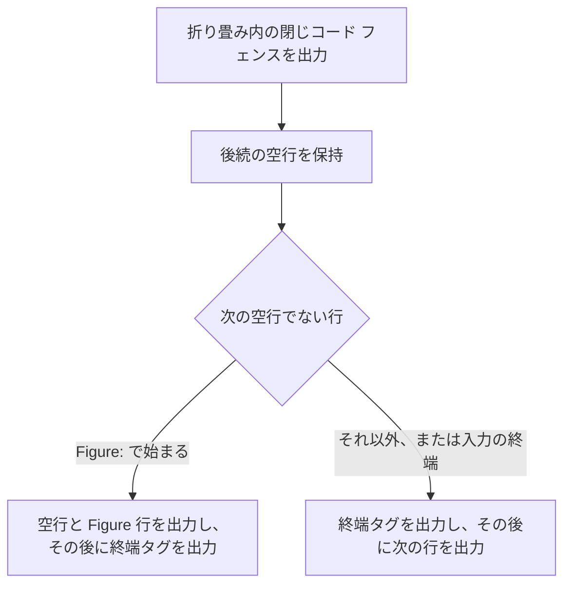
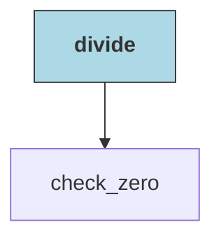

<!--
生成元: agree-before-implement スキル
文書種別: 最終仕様 (design)
最終更新エージェント: claude code / セッション ID: e1665a31-f98a-4cbe-aff5-beff19ab41c0
上流文書: [261114-doxygen-mermaid-migration-discussion.md](261114-doxygen-mermaid-migration-discussion.md) (検討用 Markdown)。削除されている場合があります。
再開手順: このファイルを開いたエージェントは、作業の前に agree-before-implement スキルを読み込んでください。上流文書が存在する場合は、上流文書の再開手順に従って進行位置を確認し、判断の経緯を上流文書の Q&A で確認します。存在しない場合は、この文書を単体の最終仕様として扱います。最終更新エージェントのセッション情報が参照可能であれば再開時のコンテキストとして利用し、別エージェントからの引き継ぎや担当変更によりセッションが見つからない場合も異常とせず、文書の記載から継続してください。
-->

# Doxygen 由来の PlantUML 図を Mermaid へ移行する最終仕様

合意 ID: `doxygen-mermaid-migration-20261114` / 版: 2 / 状態: 承認済み

## 概要と対象範囲

Doxygen と Doxybook2 を経由して生成する Markdown の図を、PlantUML から Mermaid (`Figure:` キャプション付き) へ移行します。  
あわせて、Doxygen コメントへ図を記述する際の規範を定め、規範への違反を検出する検査を追加します。

### 変換対象

`<mermaid>` タグは、次の 3 つの発生源から Doxygen XML へ現れます。変換処理は発生源を区別せず、すべての `<mermaid>` タグを対象とします。

| 発生源 | 現状 | 移行後 |
| --- | --- | --- |
| C ヘッダーの手動コメント ([memory_lock.h](../../../../cplat/prod/include/cplat/runtime/memory_lock.h) の 2 図) | `@startuml` 〜 `@enduml` | `@mermaid "キャプション"` 〜 `@endmermaid` |
| [extract-graphs.py](../../../../../framework/doxyfw/templates/extract-graphs.py) が生成する自動グラフ 4 種別 | `<plantuml>` タグを XML へ挿入 | `<mermaid caption="...">` タグを XML へ挿入 |
| Doxygen の入力となる Markdown の ```` ```mermaid ```` コード フェンス | Doxygen が `<mermaid>` へ変換し、Doxybook2 が `Text tag "mermaid" not recognised` を警告 | 警告なしで変換 |

Table: `<mermaid>` タグの発生源と移行後の扱い

> [!NOTE]
> Markdown 入力のページは、`postprocess.sh` が Doxybook2 の出力を破棄して入力の Markdown を複製するため、最終出力の内容は移行の前後で変わりません。この発生源で変わるのは、Doxybook2 の警告がなくなる点だけです。

### 互換として維持する範囲

次の PlantUML 変換経路は変更しません。

- [preprocess.sh](../../../../../framework/doxyfw/templates/preprocess.sh) の `<plantuml>` タグの変換
- [postprocess.sh](../../../../../framework/doxyfw/templates/postprocess.sh) の ```` ```plantuml ```` 内の `~_~_` 変換
- [Doxyfile](../../../../../framework/doxyfw/Doxyfile) の `PLANTUML_*` 設定
- [input-filter.py](../../../../../framework/doxyfw/bin_internal/input-filter.py) の ```` ```plantuml ```` 除去

### 対象外

- `@mermaidfile` と外部 `.mmd` ファイルの参照。いずれの発生源でも使用していません。
- Doxyfile への `MERMAID_*` 設定の追加。既定の `MERMAID_RENDER_MODE = AUTO` を使用します。

> [!IMPORTANT]
> Doxygen が生成する HTML では、手動コメントの Mermaid 図は閲覧時に `cdn.jsdelivr.net` から mermaid を読み込んで描画されます。CDN へ接続できない端末では図が描画されず、Mermaid のソース テキストが表示されます。自動生成グラフは Doxygen の実行後に XML へ挿入するため、Doxygen HTML には現れません。Doxybook2 経由の Markdown は、この制約の影響を受けません。

## Doxygen コメントの図の規範

Doxygen コメントへ記述する図は、次の規範に従います。この規範は [正本文書の更新](#正本文書の更新) で正本へ記載します。

1. 新規の図は Mermaid で記述します。PlantUML (`@startuml` 〜 `@enduml`) は互換の記法として引き続き変換します。
2. Mermaid のキャプションは `@mermaid "キャプション"` の形式で指定します。
3. 図ブロック (`@mermaid` 〜 `@endmermaid`、`@startuml` 〜 `@enduml`) は、エディターのプレビューを利用できるよう、行頭の `*` を置かずに記述できます。この場合、次の字下げを守ります。
    - 開始行と終了行は、コメント本文と同じ桁に置きます。コメント本文の桁は、`*` を持つ行で `*` と後続の空白の次に来る文字の位置です。
    - 図の本文は、開始行より浅い位置に置きません。

> [!IMPORTANT]
> 字下げの規範に違反しても、Doxygen は多くの場合に警告を出しません。開始行が本文より浅いと、前後の `@par` の節が字下げコード ブロック (XML の `<verbatim>`) として出力されます。開始行が本文より深いと、図ブロック自体が `<verbatim>` になります。現行の `memory_lock.h` は開始行が本文より浅く、該当する 2 関数の `@par` の節がこの状態です。

> [!NOTE]
> `@mermaid{caption="..."}` の形式は、波括弧を含む全体がキャプション文字列として扱われ、Doxygen HTML に `{caption="..."}` と表示されるため使用しません。

## 手動コメントの変換 (memory_lock.h)

[memory_lock.h](../../../../cplat/prod/include/cplat/runtime/memory_lock.h) の 2 図を、現行図の参加者、メッセージ、分岐の入れ子、題名を保ったまま Mermaid へ置き換えます。  
このファイルのコメント本文は 8 桁目から始まるため、開始行と終了行を 8 桁目、図の本文を 12 桁目に置きます。図ブロックの前後の行 (`     *` と各 `@par` の節) は変更しません。

記法の対応は次のとおりです。

| PlantUML | Mermaid |
| --- | --- |
| `@startuml <題名>` と `caption <題名>` | `@mermaid "<題名>"` |
| `participant "表示名" as ID` | `participant ID as 表示名` |
| `A -> B : 文` (実線) | `A->>B: 文` |
| `A --> B : 文` (破線) | `A-->>B: 文` |
| `opt` / `alt` / `else` / `loop` / `end` | 同じ |

Table: `memory_lock.h` の図で使用する PlantUML と Mermaid の記法の対応

### cplat_memory_lock_self の図 (現行 L130-153)

```c
        @mermaid "cplat_memory_lock_self のロック取得"
            sequenceDiagram
                participant Caller as 呼び出し側
                participant API as cplat_memory_lock_self
                participant Lock as 内部 lock
                participant OS as OS

                Caller->>API: options, &scope_out
                API->>API: 引数と flag を検証
                opt stack_prefault_bytes > 0
                    API->>API: 呼び出しスレッドのスタックへアクセス
                end
                API->>Lock: 取得
                alt Linux
                    API->>OS: mlockall(flags)
                    API->>API: self scope 数を加算
                else Windows
                    API->>OS: VirtualQuery で committed region を列挙
                    API->>OS: 未登録範囲へ VirtualLock
                    API->>API: 登録済み範囲の ref-count を加算
                end
                API->>Lock: 解放
                API-->>Caller: CPLAT_OK, scope_out
        @endmermaid
```

### cplat_memory_lock_scope_release の図 (現行 L175-204)

```c
        @mermaid "cplat_memory_lock_scope_release のロック解放"
            sequenceDiagram
                participant Caller as 呼び出し側
                participant API as cplat_memory_lock_scope_release
                participant Lock as 内部 lock
                participant OS as OS

                Caller->>API: scope
                alt scope == NULL
                    API-->>Caller: CPLAT_OK
                else scope != NULL
                    API->>Lock: 取得
                    alt Linux
                        API->>API: self scope 数を減算
                        opt self scope 数 == 0
                            API->>OS: munlockall()
                        end
                    else Windows
                        loop scope の各範囲
                            API->>API: registry の ref-count を減算
                            opt ref-count == 0
                                API->>OS: VirtualUnlock()
                            end
                        end
                    end
                    API->>Lock: 解放
                    API->>API: scope を破棄
                    API-->>Caller: 結果コード
                end
        @endmermaid
```

> [!NOTE]
> 公開関数、型、シグネチャは変更しないため、`app/cplat` の API 逆引き、エクスポート テスト、`mock_cplat`、機能仕様の更新は発生しません。字下げの修正により、該当する 2 関数では図の前後の `@par` の節 (「呼び出しタイミング」「解放タイミング」「スレッド セーフ」) が、コード ブロックではなく節として生成されるようになります。

## 自動生成グラフの変換 (extract-graphs.py)

[extract-graphs.py](../../../../../framework/doxyfw/templates/extract-graphs.py) の出力を `<plantuml>` から `<mermaid>` へ変更します。  
グラフの生成条件は変更しません。対象は、`DOT_GRAPH_MAX_NODES = 50`、`INC_GRAPH_LABEL_BASENAME_ONLY`、`GRAPH_DETAILS_ONLY`、`DETAILS_ONLY_MARKER`、エッジがない場合に生成しない条件、再帰的な呼び出しグラフの展開 (`build_recursive_callgraph`、`build_recursive_callergraph`) です。

### 図種別と矢印

4 種別とも `flowchart` で出力します。

| Doxygen のグラフ | Mermaid の宣言 | 矢印 | 向きの扱い |
| --- | --- | --- | --- |
| `incdepgraph` / `invincdepgraph` (インクルード依存) | `flowchart TD` | `-->` | 現行と同じ (`incdepgraph` はエッジを逆向きに出力し、対象を下に配置) |
| `inheritancegraph` (継承) | `flowchart BT` | `-->` | 派生から基底へ向け、基底を上に配置 |
| `collaborationgraph` (コラボレーション) | `flowchart TD` | `relation` が `usage` の場合は `-.->`、それ以外は `-->` | 現行と同じ |
| `references` / `referencedby` (呼び出し先・呼び出し元) | `flowchart TD` | `-->` | 現行と同じ |

Table: 自動生成グラフの Mermaid 構文

> [!NOTE]
> 継承の矢印は、PlantUML の白抜き三角 (`-u-|>`) から通常の矢印へ変わります。派生から基底への向きと、基底を上に置く配置は保ちます。4 種別でノード ID、ラベル、強調の生成処理を共通にするための仕様です。

### ノードとラベル

- ノード ID は、接頭辞 `n` と 0 からの連番 (`n0`、`n1`、...) とします。Mermaid の予約語や記号との衝突を避けるためです。
- ノードは `nX["ラベル"]` の形式で、ラベルを必ず二重引用符で囲みます。
- ラベルは次の順で変換します。
    1. `&` を `&amp;`、`<` を `&lt;`、`>` を `&gt;`、`"` を `#quot;` へ置き換えます。
    2. ラベル内の改行 (現行で `\n` と出力している箇所) を `<br/>` へ置き換えます。
- 対象ノードの強調は、ノード定義の後に `style nX fill:#ADD8E6,stroke:#333,font-weight:bold` を出力して表します。ラベル内に太字の HTML タグは出力しません。

### XML への挿入形式

挿入する XML は次の形式です。`<title>` の見出しと `caption` のキャプションは別の文字列です。

```xml
<para><simplesect kind="par"><title>{見出し}</title><para><mermaid caption="{キャプション}">
{Mermaid の本文}
</mermaid></para></simplesect></para>
```

| 項目 | 内容 | 例 |
| --- | --- | --- |
| 見出し | グラフ種別の名称。折り畳み対象の場合は先頭に `DOXYFW_DETAILS_ONLY` を付与 (現行と同じ) | `DOXYFW_DETAILS_ONLY 呼び出し先` |
| キャプション | `<名前> の<グラフ種別>` (現行の `caption` 行と同じ文字列) | `divide の呼び出し先` |

Table: 自動生成グラフの見出しとキャプション

- キャプションは、XML の属性値として `&`、`<`、`>`、`"` をエスケープします。Markdown の記号のエスケープは変換ヘルパーが行うため、ここでは行いません。
- Mermaid の本文は、XML のテキストとして `&`、`<`、`>` をエスケープします。ラベルの `&lt;` は XML 上で `&amp;lt;` となり、Doxybook2 が復号して Markdown へ `&lt;` を出力します。
- 関数名は Mermaid の生成に合わせて改めます (`graph_to_mermaid`、`callgraph_to_mermaid`、`callergraph_to_mermaid`、`callgraph_to_mermaid_graph`、`callergraph_to_mermaid_graph`、`build_mermaid_tag`)。PlantUML を生成する関数は残しません。
- [makefile](../../../../../framework/doxyfw/makefile) の `extract-graphs.py` 呼び出しのコメントと、`extract-graphs.py` および `preprocess.sh` のコメントのうち、PlantUML の生成を説明している箇所を Mermaid に合わせて更新します。

## XML 前処理 (preprocess.sh と変換ヘルパー)

### 変換ヘルパー (framework/doxyfw/templates/convert-mermaid-tags.py)

XML フォルダーを引数に取り、配下の XML ファイルに含まれる `<mermaid>` タグを、Markdown のコード フェンスと `Figure:` 行へ置き換えます。

- **呼び出し**: `python3 convert-mermaid-tags.py <xml_directory>`。`<mermaid` を含まないファイルは書き換えません。
- **規範**: ファイル入出力は `encoding="utf-8"` と `newline="\n"` を明示します。同じディレクトリのモジュールは import しません。
- **対象の抽出**: `<mermaid([^>]*)>(.*?)</mermaid>` (複数行に一致) の各ブロックを対象とします。
- **キャプション**: 開始タグの `caption="..."` 属性を取り出し、XML の実体参照を復号します。属性がない場合と空文字列の場合は、キャプションなしとします。
- **本文**: 先頭と末尾の空行を除き、共通の字下げを取り除きます。本文中の XML の実体参照 (`&gt;` など) は復号せずに保持します (Doxybook2 が復号します)。
- **出力**: ブロックを次のテキストへ置き換えます。キャプションなしの場合は `Figure:` 行と直後の空行を出力しません。前後に空行を置き、隣接するテキストと行が連結しないようにします。

````text
(空行)
```mermaid
{本文}
```
(空行)
Figure: {エスケープ済みのキャプション}
(空行)
````

#### キャプションのエスケープ

`Figure:` 行はコード フェンスの外にあり、Markdown の本文として解釈されます。名前に含まれる記号を文字どおりに表示するため、次の記号を数値文字参照へ変換します。手動コメントのキャプションと自動生成グラフのキャプションに同じ規則を適用します。

| 記号 | 変換後 | 記号 | 変換後 |
| --- | --- | --- | --- |
| `\` | `&#92;` | `>` | `&#62;` |
| `` ` `` | `&#96;` | `[` | `&#91;` |
| `*` | `&#42;` | `]` | `&#93;` |
| `<` | `&#60;` | `~` | `&#126;` |

Table: キャプション内の記号と数値文字参照の対応

- 変換後の文字列は XML のテキストとしてエスケープして書き込みます (`&#42;` は XML 上で `&amp;#42;`)。Doxybook2 が復号し、Markdown へ `&#42;` を出力します。
- `__` と `$` は変換しません。`postprocess.sh` がコード フェンス外の本文に対して `&#95;&#95;` と `\$` へ変換します。

> [!NOTE]
> バックスラッシュによるエスケープは使用しません。`\[` が `postprocess.sh` の LaTeX ブロック数式の分離処理に一致し、キャプション行が分断されるためです。数値文字参照は、`postprocess.sh` が `__` を `&#95;&#95;` へ変換する既存の方式と同じ手段です。

### preprocess.sh への組み込み

[preprocess.sh](../../../../../framework/doxyfw/templates/preprocess.sh) の XML ファイルのループより前で、`fix-anonymous-enums.py` の呼び出しの後に、変換ヘルパーを 1 回呼び出します。

```bash
python3 "$SCRIPT_DIR/convert-mermaid-tags.py" "$XML_FOLDER"
```

ループ内の `sed` による変換 (`<plantuml>`、`<bold>`、`<name>`、`<title>` など) は変更しません。変換後のコード フェンスはこれらのタグを含まないため、干渉しません。

## Markdown 後処理 (postprocess.sh)

### コード フェンス内の保護

- **`__` の保護**: ```` ```plantuml ```` 以外のコード フェンスでは `!dunder!` を `__` へ戻すだけで、`__` 自体は変換しません。Mermaid のコード フェンスもこの扱いとなるため、処理は変更せず、Mermaid も保護対象である旨をコメントへ記載します。
- **`fix_ptr` の除外**: ポインター型の空白を正規化する `fix_ptr` は、すべてのコード フェンスで二重引用符の外側へ適用されます。開始行が `^[[:space:]]*```[[:space:]]*mermaid([[:space:]]|$)` に一致するコード フェンスを `is_mermaid` として追跡し、その内側では `fix_ptr` を適用しません。手動コメントのシーケンス図のように、引用符で囲まないテキストに `*` を含む図を保護するためです。

### Figure 行を含めた折り畳み

`DOXYFW_DETAILS_ONLY` の見出しを持つグラフは、見出しからコード フェンスまでを `<!--details:-->` と `<!--:details-->` で囲みます。`Figure:` 行も折り畳みの内側へ含めるため、終端の出力を次のように変更します。

1. 折り畳みの内側で閉じコード フェンスを出力した後、すぐには `<!--:details-->` を出力せず、後続の空行を保持します。
2. 次の空行でない行が `Figure:` で始まる場合は、空行 1 行と `Figure:` 行を出力し、その後に空行と `<!--:details-->` を出力します。
3. 次の空行でない行が `Figure:` で始まらない場合と、入力の終端に達した場合は、空行と `<!--:details-->` を出力してから、その行を出力します (現行と同じ結果)。



Figure: 折り畳みの終端と `Figure:` 行の出力順

出力は次の形になります。

````markdown
<!--details:-->

**呼び出し先**



Figure: divide の呼び出し先

<!--:details-->
````

## 図ブロックの字下げ検査 (check-doxygen-indent.py)

[check-doxygen-indent.py](../../../../../framework/doxyfw/bin/check-doxygen-indent.py) へ、[Doxygen コメントの図の規範](#doxygen-コメントの図の規範) の字下げを検査する処理を追加します。

- **対象**: `/**` から `*/` までのコメント内で、行頭に `*` を置かずに記述された図ブロック。開始行は `@mermaid`、`@startuml` (および `\mermaid`、`\startuml`)、終了行は `@endmermaid`、`@enduml` (および `\` 形式) です。
- **コメント本文の桁**: 図ブロックより前にある、`*` を持ち本文のある最も近い行から求めます。
- **指摘の条件**:
    - 開始行または終了行の字下げが、コメント本文の桁と一致しない。
    - 図の本文 (空行を除く) に、開始行より浅い行がある。
- **動作**: 検出だけを行い、指摘の行番号、現在の桁、期待する桁を表示します。指摘がある場合の終了コードは、既存の字下げレベルの指摘と同じ扱いとします。修正モードは図ブロックを書き換えず、指摘として表示します。
- **既存の検査**: `*` を持つ行の字下げレベルの検査と修正は変更しません。

> [!NOTE]
> 自動修正は実装しません。図の本文の相対的な字下げを保ったまま移動する処理が必要であり、対象が `memory_lock.h` の 1 ファイルだけであるためです。

## 正本文書の更新

`framework/doxyfw` の正本文書へ、確定した仕様だけを記載します。移行の経緯、個別 app のパス、個別 app 固有の例外は記載しません。

| 文書 | 更新内容 |
| --- | --- |
| [maintenance-verification.md](../../../../../framework/doxyfw/docs/maintenance-verification.md) | 「文書の表記と図」の図の基本を Mermaid と `Figure:` キャプション ([codeblock-caption.md](../../../../../framework/docsfw/docs/codeblock-caption.md)) へ改め、PlantUML を互換の記法とする。Doxygen コメントの図の規範 (キャプションの形式、字下げ、検査コマンド) を記載する。 |
| [commands.md](../../../../../framework/doxyfw/docs/commands.md) | `@mermaid "キャプション"` 〜 `@endmermaid` の節を追加し、標準の図コマンドとする。`@startuml` 〜 `@enduml` の節は互換の記法として残す。双方へ、行頭の `*` を置かない場合の字下げの規則を記載する。 |
| [cheatsheet.md](../../../../../framework/doxyfw/docs/cheatsheet.md) | 図の記述例を `@mermaid "キャプション"` へ改め、字下げの規則を記載する。PlantUML は互換の記法として注記する。 |
| [extract-graphs.md](../../../../../framework/doxyfw/docs/extract-graphs.md) | PlantUML を前提とする記述をすべて Mermaid へ改める。対象は、冒頭の説明、パイプライン図の注記、`relation` と矢印の対応表、ノードの強調、生成例 4 箇所、XML への挿入例、変換の流れ。 |
| `framework/doxyfw/docs/doxybook2-mermaid.md` (新設) | `<mermaid>` タグの 3 つの発生源、変換ヘルパーの仕様、キャプションのエスケープ、`Figure:` 行を含めた折り畳み、`fix_ptr` の除外、Doxygen HTML の描画方式と CDN への依存を記載する。 |
| [doxybook2-plantuml.md](../../../../../framework/doxyfw/docs/doxybook2-plantuml.md) | PlantUML 変換の文書として残し、Mermaid の変換は `doxybook2-mermaid.md` を参照する旨を追記する。 |
| [docs/README.md](../../../../../framework/doxyfw/docs/README.md) | 文書一覧へ `doxybook2-mermaid.md` を追加する。 |
| [check-doxygen-indent.md](../../../../../framework/doxyfw/docs/check-doxygen-indent.md) | 図ブロックの字下げ検査 (対象、指摘の条件、検出だけで修正しない点) を追記する。 |
| [README.md](../../../../../framework/doxyfw/README.md) | 「必要なツール」の Doxygen へ「1.17.0 以上」を明記し、PlantUML を互換の変換経路で使用するツールとして記載する。 |

Table: 正本文書の更新対象と内容

コード コメントへは、変換ヘルパーのキャプションのエスケープで数値文字参照を使う理由と、`postprocess.sh` で `Figure:` 行を折り畳みへ含める理由を記載します。

## 既存 Markdown の修正

図のキャプションの表記を `Figure:` へそろえるため、次の 3 箇所を修正します。

| ファイル | 修正内容 |
| --- | --- |
| [cplat-account-session-discussion.md](../../../../cplat/docs/prompts/current/cplat-account-session-discussion.md) (L295) | `CodeBlock: セッション上でプロセスを起動する処理の流れ (試案)` を `Figure: セッション上でプロセスを起動する処理の流れ (試案)` へ変更する。同ファイルの C コード ブロック 5 箇所 (`{.c caption="..."}`) は変更しない。 |
| [architecture.md](../../../../porter/docs/architecture.md) (L28-36、「ハンドルの寿命と通知の実行」) | キャプションのない `flowchart LR` の閉じコード フェンスの後へ、空行を挟んで `Figure: ハンドルの寿命と非同期通知の実行関係` を追加する。 |
| [sequence-data.md](../../../../porter/docs/sequence-data.md) (L408-421、「close と登録済み通知」) | キャプションのない `sequenceDiagram` の閉じコード フェンスの後へ、空行を挟んで `Figure: close 呼び出しと登録済み通知の処理シーケンス` を追加する。 |

Table: 既存 Markdown の修正箇所

## Linux と Windows の両対応

- 新設・更新する Python スクリプトは、テキスト入出力で `encoding="utf-8"` と `newline="\n"` を明示します。
- `preprocess.sh` と `postprocess.sh` の単体テストは、既存の方式 (`shutil.which("bash")` で PATH 上の bash を解決) で起動します。
- 生成処理は `mmdc` を必要としません。`mmdc` を使うのは検証時の描画確認だけで、`shutil.which("mmdc")` または PATH 上のコマンドとして解決します。
- `@mermaid` は Doxygen 1.17.0 以上で動作します (ローカルは 1.17.0、CI は 1.18.0)。

## 変更対象の一覧

| 区分 | パス | 変更 |
| --- | --- | --- |
| ヘッダー | `app/cplat/prod/include/cplat/runtime/memory_lock.h` | 2 図を `@mermaid` へ置き換え、図ブロックを 8 桁目へ字下げ |
| グラフ抽出 | `framework/doxyfw/templates/extract-graphs.py` | 4 種別を `<mermaid caption="...">` で出力 |
| 変換ヘルパー (新設) | `framework/doxyfw/templates/convert-mermaid-tags.py` | `<mermaid>` をコード フェンスと `Figure:` 行へ変換 |
| XML 前処理 | `framework/doxyfw/templates/preprocess.sh` | 変換ヘルパーの呼び出しを追加 |
| Markdown 後処理 | `framework/doxyfw/templates/postprocess.sh` | `fix_ptr` の Mermaid 除外、`Figure:` 行を含めた折り畳み |
| make | `framework/doxyfw/makefile` | `extract-graphs.py` 呼び出しのコメントを更新 |
| 検査 | `framework/doxyfw/bin/check-doxygen-indent.py` | 図ブロックの字下げ検査を追加 |
| 単体テスト | `framework/doxyfw/bin_test/test_preprocess.py`、`test_postprocess.py` | テスト ケースを追加 |
| 単体テスト (新設) | `framework/doxyfw/bin_test/test_extract_graphs.py`、`test_check_doxygen_indent.py` | 新設 |
| 正本文書 | `framework/doxyfw/README.md`、`framework/doxyfw/docs/` の 8 ファイル (うち 1 ファイル新設) | [正本文書の更新](#正本文書の更新) のとおり |
| 既存 Markdown | `cplat-account-session-discussion.md`、`architecture.md`、`sequence-data.md` | [既存 Markdown の修正](#既存-markdown-の修正) のとおり |

Table: 変更および新設するファイル

`Doxyfile` と `input-filter.py` は変更しません。

## 単体テスト

| テスト ファイル | 追加する確認 |
| --- | --- |
| `test_preprocess.py` | キャプションありの `<mermaid>` がコード フェンスと `Figure:` 行になる。キャプションなしの `<mermaid>` と後続の `Figure:` 段落 (Markdown 入力の形) がコード フェンスだけになる。キャプションの記号 8 種が数値文字参照になり、`__` と `$` は変換されない。本文の共通の字下げが除かれ、XML の実体参照が保持される。`<plantuml>` と `<mermaid>` が同じファイルにあっても双方が変換される。 |
| `test_postprocess.py` | Mermaid のコード フェンス内で `__` と、引用符の外にある `a* b` が変更されない。折り畳み内で `Figure:` 行の後に `<!--:details-->` が出力される。`Figure:` 行がない場合は閉じコード フェンスの後に `<!--:details-->` が出力される。```` ```plantuml ```` 内の `~_~_` 変換が維持される。 |
| `test_extract_graphs.py` (新設) | インクルード依存、継承、コラボレーション、呼び出し先、呼び出し元の各グラフで、`flowchart` の宣言と向き、矢印、ノード ID、ラベルのエスケープ (`<`、`>`、`&`、`"`、改行)、`style` による強調、`caption` 属性、折り畳みの見出しが仕様どおりに出力される。ノード数の上限を超える場合とエッジがない場合は出力されない。 |
| `test_check_doxygen_indent.py` (新設) | 開始行が本文より浅い場合、深い場合、図の本文が開始行より浅い場合に指摘される。本文と同じ桁の図ブロックと、行頭に `*` を持つ図ブロックは指摘されない。`@startuml` と `@mermaid` の双方が対象となる。 |

Table: 単体テストの追加内容

## 検証手順

1. **変更前の基準値の取得**
    - `framework/doxyfw/bin_test/` の Python 4 ファイル (`test_preprocess.py`、`test_postprocess.py`、`test_doxybook2_templates.py`、`test_materialize_group_members.py`) を実行し、結果を記録します。
    - `app/cplat` で `make doxy` を実行し、生成された Markdown と警告ファイル (`doxy*.warn`) を一時フォルダーへ退避します。`memory_lock.h` の 2 関数で、`@par` の節がコード ブロックとして出力されていることを確認します。
2. **実装**
    - [変更対象の一覧](#変更対象の一覧) のファイルを変更します。
3. **変更後の検証**
    - 上記の Python 4 ファイルと、新設の `test_extract_graphs.py`、`test_check_doxygen_indent.py` の計 6 ファイルを実行します。`framework/doxyfw/bin_test/` の残りの Python 6 ファイルと JavaScript 13 ファイルは実行しません。
    - `check-doxygen-indent.py` を `app/cplat/prod/include` に対して実行します。Python の import 経路の検査を、変更した Python に対して実行します。
    - `app/cplat` で `make doxy` を再実行し、基準値と比較します。
    - 代表図 (手動 2 図と、自動生成グラフ 4 種別の各 1 図) を `mmdc` で SVG へ変換します。`app/cplat` に存在しない種別は、単体テストの入力から生成した図で代替します。変更前の PlantUML 図と、ノード、エッジ、手順を照合します。
    - 変更または作成した Markdown ごとに、`text_style_jp.py --dry-run` と `--in-place` を実行します。

## 受入条件

- [ ] Python 4 ファイルの単体テストが、変更前と変更後の双方で全件成功する。
- [ ] 新設の `test_extract_graphs.py` と `test_check_doxygen_indent.py` が全件成功する。
- [ ] `app/cplat` の `make doxy` が終了コード `0` で完了し、警告ファイル (`doxy*.warn`) に `Text tag "mermaid" not recognised` がなく、変更前になかった警告が増えていない。
- [ ] `app/cplat` の生成 Markdown で、手動 2 図と自動生成グラフが ```` ```mermaid ```` と `Figure:` 行で出力され、```` ```plantuml ```` が残っていない。
- [ ] 折り畳み対象の自動生成グラフで、`Figure:` 行の後に `<!--:details-->` が出力されている。
- [ ] `memory_lock.h` の 2 関数で、図の前後の `@par` の節がコード ブロックではなく節として出力されている。
- [ ] `app/cplat` の生成 Markdown の変更前後の差分が、図の記法の変更、`Figure:` 行の追加、上記 2 関数の `@par` の節の修正だけである。
- [ ] 代表図 (手動 2 図と自動生成グラフ 4 種別) が `mmdc` で終了コード `0`・構文エラーなしで描画でき、変更前の図とノード、エッジ、手順が一致する。継承グラフの矢印の形の違いは一致の判定から除く。
- [ ] `check-doxygen-indent.py` が `app/cplat/prod/include` で指摘を出さない。
- [ ] ```` ```plantuml ```` の変換経路 (`<plantuml>` の変換、`~_~_` 変換) が単体テストで維持されている。
- [ ] 正本文書 9 件と既存 Markdown 3 件の更新が完了し、変更したすべての Markdown で `text_style_jp.py` が正常終了している。
