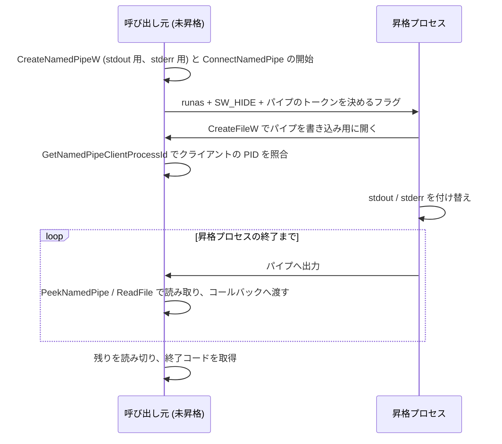

<!--
生成元: agree-before-implement スキル
文書種別: 最終仕様 (design)
最終更新日時: 2026-11-21 13:40:08 JST
最終更新エージェント: claude code (Fable 5.2) / セッション ID: session_01KJc53QHbm2Y49GJVfzP7Rw (追記の下書きと統合は agy の gemini-4-hydrogen-high が実行)
稼働 OS: Windows
上流文書: `261120-source-comment-bl003-remaining-57-overview.md` (全体管理文書)、`261120-source-comment-bl003-remaining-57-discussion.md` (検討用 Markdown)、`261120-source-comment-bl003-remaining-57-lightadr.md` (簡易 ADR)。いずれも削除されている場合があります。
再開手順: このファイルを開いたエージェントは、作業の前に agree-before-implement スキルを読み込んでください。上流文書の全体管理文書が存在する場合は、その再開手順に従って進行位置を確認し、決定事項を簡易 ADR で、判断の経緯を検討用 Markdown の Q&A で確認します。存在しない場合は、この文書を単体の最終仕様として扱います。最終更新エージェントのセッション情報や稼働 OS・最終更新日時が参照可能であれば再開時のコンテキストや環境差分の把握に利用し、別エージェントや別環境・別 OS からの引き継ぎ、担当変更によりセッションが見つからない場合も異常とせず、文書の記載から継続してください。
-->

# 値と分岐の根拠が未確定の 57 件の対処 最終仕様

## 目的と範囲

`app/` 配下の第一者の C ソースには、値の選定理由、OS や外部 API の仕様との照合、分岐条件の選択について、根拠または契約が確定していない箇所が 57 件ありました。  
この仕様は、この 57 件の対処に加えて、調査の過程で明らかになった追加の修正、共通のコーディング規範における名前付きの整数定数の規範の改定、および全 app の製品コードの新しい規範への適合の修正について、変更する内容を定めます。  
保守者が、値と分岐を変更できる範囲、およびプログラムの契約と安全性の根拠を、コードと文書から判断できる状態にすることが目的です。

対象は、次の 3 つの群に分かれます。

| 群 | 区分 | 内容 | 件数 |
| --- | --- | --- | --- |
| 未確定の 57 件 | 動作を変える修正 | 実装を修正し、失敗時または境界のテストを追加する。 | 11 |
| 未確定の 57 件 | 動作を変えない変更 | 確認できた事実の記載、直値の名前付き定数化、現在の動作の契約としての明記、重複している処理の削除を行う。 | 45 |
| 未確定の 57 件 | 変更しない | 名前付き定数と意味のコメントがすでにあり、変更しない。 | 1 |
| 追加の修正 | `app/cplat` の修正 | パス上限対応、結果コード統一、UTF-8 境界切り詰め、名前付きパイプ化、契約補完、定数化、文書追記を行う。 | 15 |
| 追加の修正 | サンプルの app と `app/porter` の修正 | `app/service-sample` (3 件)、`app/porter` (4 件: 証明書認証時の待機上限、設計文書修正、重複ゼロ代入削除の拡大、`POTR_NACK_DEDUP_SLOTS` の式変更)、`app/struct-meta` (2 件) の修正と改善を行う。 | 9 |
| 規範の改定と適合 | 規範の改定と全 app 製品コードの修正 | `app/general/docs/coding-guideline.md` を改定し、`app/` 配下の製品コード (既存 7 app の 629 箇所と `app/porter` の 264 箇所、計 893 箇所) を規範へ適合させる。 | 893 |

Table: 対処の対象と件数

未確定の 57 件は、枝番号 (3 桁の数字) で識別します。  
動作を変える変更は、未確定の 57 件の 11 件 (015、020、036、037、063、084、102、105、124、129、159) に、`app/porter` の定数確認から加えた `POTR_NACK_DEDUP_SLOTS` の 1 件を合わせた 12 件です (`POTR_NACK_DEDUP_SLOTS` は `app/porter` の規範適合 264 箇所のうちの 1 件でもあります)。  
変更しない 1 件は、013 です。  
084 は、動作を変える修正 (非有限値の検証) と、動作を変えない変更 (ロケールの前提の明記) の両方を含みます。

追加の修正では、`app/cplat` の 15 項目は重複する対象 (パス上限と UTF-8 パス最大長、固定プロンプトと通常プロンプトの結果コード、API チート シートのパス操作と連結) を統合し、本章では 14 の節で定めます。

対象の app は、`app/cplat`、`app/porter`、`app/service-sample`、`app/calc`、`app/string-catalog-sample`、`app/struct-meta`、`app/override-sample`、`app/subfolder-sample`、および共通規範を置く `app/general` とテスト用 mock を追加する `framework/testfw` です。

> [!IMPORTANT]
> フロー制御を追加する別の作業の変更は、すでに `app/porter` へ取り込み済みです。`app/porter` の通信ライブラリの 4 件 (141、143、145、146)、追加の修正、`POTR_NACK_DEDUP_SLOTS`、および `app/porter` 全体の整数定数規範への適合は、取り込み後の現在のコードで確認済みです。  
> ただし、`app/porter` の変更に着手する前に、フロー制御の作業の担当へ連絡し、`docs/health-check.md` に書くフロー制御に関する文面を先方の担当へ確認します。

行番号は、調査および再照合の時点 (ルートは `ee1dc888`、`app/cplat` は `a3c169bc`、`app/porter` は `a16f6ef`) のものです。  
変更の時点でずれている場合は、関数名と現在のコードで対象を特定します。

## 共通の規則

### 記載の原則

コメント、Doxygen、文書には、コード、履歴、一次資料で確認できた事実だけを書きます。  
値や分岐を選んだ理由が見つからなかった箇所には、理由を創作せず、値の役割、値が満たすべき制約、値を変えたときの影響を書きます。

57 件のうち、値や分岐を選んだ理由が履歴または文書から見つかったのは、003 と 153 の 2 件だけです。  
003 と 004 の理由 (シェルが `*` をファイル名へ展開するため、乗算は `x` で受け付ける) は、設計者が正式な採用理由として確定しました。

実装コメントは常体、Doxygen は敬体とし、既存のコメントの書式に合わせます。

### 定数の表現

コンパイル時に値が決まる整数の定数は、C の公開ヘッダーと製品コードの `.c` の双方において、オブジェクト形式マクロ (`#define`) で定義します。C++ の製品コードでは、`constexpr` (ファイルの中だけで使うものは無名の名前空間) で定義します。定数名は、同じファイルの既存の定数の接頭辞に合わせます。  
状態や種別のように互いに排他的な値の集合は、内部でも公開ヘッダーでも `enum` で表します。

共通のコーディング規範 (`app/general/docs/coding-guideline.md`) を改め、整数定数に関する規範を次章のとおり定めます。

### 外部資料の参照

実装コメントの外部資料は `see: <URL>` の形式、Doxygen の外部資料は既存の書式 (`@see` または本文の `see:`) に合わせます。  
この仕様に載せた URL は、2026-11-20 および 2026-11-21 に取得し、コメントに書く内容がページにあることを確かめました。

### 公開ヘッダーの変更に伴う文書

`app/cplat` の公開ヘッダーの契約を変える項目は、同じ変更で `docs/api-cheatsheet.md` の該当箇所を直します。  
利用側が守る条件、または利用側から見える結果を変える項目は、機能仕様 (`docs/functional-spec/`) へも書きます。機能仕様には、関数名、型名、実装方式を書きません。

`app/cplat` と `app/porter` の `docs/doxybook2_*` などの生成物は、手で変更しません。

## 名前付きの整数定数の規範

共通のコーディング規範 (`app/general/docs/coding-guideline.md`) の「マクロにしてよい用途」節の後に、新たに「名前付きの整数定数」の節を設けて次の規範を加えます。

あわせて、既存の「マクロにしてよい用途」の節の本文、表「マクロの新設が許容される用途一覧」の「コンパイル時整数定数」の行、および直下の NOTE のうち、`#if` 分岐・他マクロへの埋め込み・公開ヘッダーの整数定数以外の定数を `enum` や `static const` へ導く記載を改め、コンパイル時に決まる整数の定数は公開ヘッダーと `.c` の双方で `#define` を正とすることへ統一します。なお、同節の `static inline` 関数の優先、関数形式マクロの規律、`.c` 内の読み取り専用データへの `static const` の使用、および結果コードを `#define` と `int` で表す方針は維持します。

### 表現

- C では、コンパイル時に値が決まる整数の定数をオブジェクト形式マクロ (`#define`) で定義します。C では、`static const` の変数は定数式にならず、`enum` の定数は `int` に限られるためです。
- C++ の製品コードでは、定数を `constexpr` で定義します。ファイルの中だけで使う定数は、無名の名前空間の中に定義します。R1 から R5 の規則は、C と同じく適用します。
- 状態や種別のように、互いに排他的な値の集合は、内部でも公開ヘッダーでも `enum` で表します。公開の関数の引数と構造体のメンバーの型は、`int` のままとします (`enum` の型の大きさがコンパイラに依存するため)。
- `.c` 内の読み取り専用のデータ (配列、構造体) は、`static const` で表します。

### R1 型を合わせる

- 置換リストは、整数定数式とします。演算子を含む置換リストは、全体を括弧で囲みます。
- 定数を比較、代入、引数に使う相手の型と符号に合う接尾辞を付けます。大きさと個数を表す定数には、公開ヘッダーの定数を含めて `U` を付けます。
- 相手の型が複数ある場合は、主な相手に合わせ、ほかの使用箇所は明示のキャストを書きます。
- 接尾辞を付けた結果、書式指定 (`%d` など) や、符号付きの値との比較と合わなくなる使用箇所は、同じ変更で直します。

### R2 制約を静的に検査する

- 値が満たすべき制約 (下限と上限、ほかの定数との大小、換算後に型へ収まること、2 のべき乗、配列の要素数との一致) は、定義の近くに `static_assert` で書きます。
- 表記は `static_assert` (`<assert.h>`) とします。既存の `_Static_assert` は、`static_assert` へ直します。
- OS や外部ライブラリの型に依存する制約は、その型が見える `.c` に書きます。

### R3 同じ値を 2 か所に書かない

- ほかの定数から決まる値は、その定数を使う式で定義します。
- 同じ意味の値を、別の定数、文字列リテラル、別のファイルへ重ねて書きません。文面に値が要る場合は、定数から書式化して組み立てます。
- 文字列リテラルの長さから決まる値は、直値で書かず、`sizeof(リテラル) - 1`、またはリテラルと長さを組にした名前付き定数で求めます。
- 文字符号の規格が定める値 (UTF-8 のマスク、サロゲートの範囲、置換文字など) は、名前付き定数として 1 か所に定義し、各ファイルから使います。定義する場所は、app の規範で定めます。 `app/cplat` では、公開ヘッダー `cplat/base/char_code.h` に定義します (`app/cplat` の規範に書きます)。
- C 以外のファイル (メッセージ定義、unit の文字列、文書) と同じ値を持ち、組み立てられない場合は、双方に相手の場所をコメントで書きます。
- プリプロセッサで片方から変換できない重複 (GUID の数値の組と文字列など) は、双方の定義場所をコメントで相互参照し、一致を確かめるテストを設けます。
- コメントの中の値は、この規則の対象外です。

### R4 役割と単位を書く

- 定義の直前のコメント (または Doxygen) に、値の役割を書きます。単位を持つ値は、名前の接尾辞 (`_MS`、`_BYTES` など) またはコメントの `[ms]` などで単位を示します。
- 値を選んだ理由を確認できる場合は理由を、確認できない場合は、値が満たすべき制約と、値を変えたときの影響を書きます (新しく定義する定数に適用します)。

### R5 意味を持つ直値を書かない

容量、回数、時間、しきい値、倍率 (2 倍の拡張を含む) などの意味を持つ数値を、式、引数、初期化子、配列の要素数へ直接書きません。名前付き定数にします。

直値で書ける例外は、次のとおりです。

1. 0 と 1 のうち、初期値、増分、添字の調整、終端の 1 [byte]、真偽を表すもの。状態や種別を表す値は、0 と 1 でも例外にせず、`enum` にします。
2. 半分 (中点、平均) を求める 2。
3. 基数の 10 と 16 (数値の変換)。
4. API や書式が定める値で、その場で意味が明らかなもの (`memset` の埋める値、書式文字列の幅と精度、`struct tm` の 1900 など)。
5. ビット演算のシフト量とマスクで、同じ式の中で意味が明らかなもの (文字符号の値を除く)。
6. 単位の換算の係数 (1000、60、1024 など) で、同じ行のコメントまたは変数名で単位が分かるもの。
7. 配列や表の初期化子のデータ。
8. 構造体の予約領域と、明示のパディングの要素数。
9. `static_assert` の期待値。
10. 出典 (`see:`) を示した公開アルゴリズムの写しの中の値。
11. OS のヘッダーにないマクロを `#ifndef` で補う定義 (`see:` を付ける)。
12. サンプルの表示例として渡す値で、コメントで表示例と分かるもの。

次の値は、例外ではありません。

- 型の幅から決まる値 (バイト数、桁数) は、`sizeof` や標準の定数から求めるか、名前付き定数にします。
- OS や外部の仕様が定める番号 (ETW のレベルなど) は、OS のヘッダーの名前を使います。名前がない場合は、名前付き定数にします。
- 外部の仕様が定める値 (プロトコル、ファイル形式) は、名前付き定数にします。

### 適用範囲

対象は、各 app の製品コード (`prod` 配下の `.c`、`.h`、および `.cc`) です。  
テスト コードは対象外です。テスト コードでは、期待値と入力を直値で書くことが適しているためです。  
framework、外部由来のコード、生成されたコード、生成器が出力するコードのひな形の文字列も、対象外です。

## 動作を変える 12 件

### 名前解決の失敗の結果コード (015)

対象は、`app/cplat/prod/libsrc/cplat/base/error.c` の `cplat_internal_error_report_gai_error` です。

結果コードを、要因 (cause) で判定するように変えます。

| 要因 | 該当する `getaddrinfo` の結果 | 変更前 | 変更後 |
| --- | --- | --- | --- |
| 見つからない | `EAI_NONAME`、`EAI_NODATA`、`EAI_SYSTEM` で errno が `ENOENT` など | `CPLAT_ERR_NOT_FOUND` | `CPLAT_ERR_NOT_FOUND` |
| 一時的な失敗 | `EAI_AGAIN`、`EAI_SYSTEM` で errno が `EAGAIN`、`EBUSY` など | `CPLAT_ERR_UNKNOWN` | `CPLAT_ERR_BUSY` |
| メモリ不足 | `EAI_MEMORY`、`EAI_SYSTEM` で errno が `ENOMEM` | `CPLAT_ERR_UNKNOWN` | `CPLAT_ERR_OUT_OF_MEMORY` |
| ほか | `EAI_FAMILY`、`EAI_SOCKTYPE`、`EAI_SERVICE`、`EAI_BADFLAGS`、その他 | `CPLAT_ERR_UNKNOWN` | `CPLAT_ERR_UNKNOWN` |

Table: 名前解決の失敗の結果コード

`EAI_SYSTEM` は Linux の値で、要因は errno から決まります。  
`EAI_FAMILY`、`EAI_SOCKTYPE`、`EAI_BADFLAGS` を `CPLAT_ERR_INVALID_ARGUMENT` にしないのは、呼び出し元の `cplat_ipv4_resolve` が検索の条件を内部で固定しており、利用者の引数の誤りと区別できなくなるためです。

実装は、`error_cause_from_gai_error(error_code)` の結果を 1 回だけ求め、要因ごとに結果コードを決めます。

一緒に直す箇所は、次のとおりです。

- `prod/include_internal/cplat/base/error_internal.h` の `@return` を、「0 は `CPLAT_OK`、要因が見つからない場合は `CPLAT_ERR_NOT_FOUND`、一時的な失敗の場合は `CPLAT_ERR_BUSY`、メモリ不足の場合は `CPLAT_ERR_OUT_OF_MEMORY`、それ以外は `CPLAT_ERR_UNKNOWN` を返します」とします。
- `prod/include/cplat/net/endpoint.h` の `cplat_ipv4_resolve` の `@return` を、「`@ref CPLAT_OK`、`@ref CPLAT_ERR_INVALID_ARGUMENT`、`@ref CPLAT_ERR_NOT_FOUND`、`@ref CPLAT_ERR_BUSY`、`@ref CPLAT_ERR_OUT_OF_MEMORY`、`@ref CPLAT_ERR_UNKNOWN`、または Windows ソケット初期化の結果コードを返します。」とします。本文に、「ホスト名が見つからない場合は `CPLAT_ERR_NOT_FOUND`、名前解決が一時的に失敗した場合は `CPLAT_ERR_BUSY`、名前解決でメモリが不足した場合は `CPLAT_ERR_OUT_OF_MEMORY` を返します。Windows でソケットの初期化に失敗した場合は、その失敗に対応する結果コードを返し、`@p detail_out` には `@ref CPLAT_ERROR_DOMAIN_WINSOCK` ドメインのエラー コードを格納します。」と書きます。
- `docs/api-cheatsheet.md` の「IPv4 アドレス」の表の後に、`cplat_ipv4_resolve` が返す 4 つの結果コードと条件、および Windows でソケット初期化に失敗した場合は対応する結果コードを返すことを 1 文で書きます。
- `app/porter/prod/libsrc/porter/api/api_open_paths_common.c` のコメントの「`CPLAT_ERR_INVALID_ARGUMENT` または `CPLAT_ERR_UNKNOWN` のみを返し」を、「`CPLAT_ERR_INVALID_ARGUMENT` 以外の失敗は、結果コードの種類によらず `POTR_ERR_IO` とする」に直します。`app/porter` の動作は変わりません。このコメントは通信ライブラリの 4 件と重ならないファイルにあり、`app/cplat` の変更と同じ時期に直します。

機能仕様 (`docs/functional-spec/net.md`) は、「名前解決の失敗は他のソケット エラーと区別します」とだけ定めており、変更しません。

テストは、次のとおりです。

| テスト | ファイル | 内容 |
| --- | --- | --- |
| `report_gai_error_maps_standard_codes_and_unknown_code` (Linux) | `errorTest.cc` | `EAI_AGAIN` と `EAI_MEMORY` の期待値を、`CPLAT_ERR_BUSY` と `CPLAT_ERR_OUT_OF_MEMORY` へ直す。 |
| `report_gai_error_classifies_system_error_by_errno` (Linux) | `errorTest.cc` | `EAI_SYSTEM` で errno が `ENOMEM` の期待値を `CPLAT_ERR_OUT_OF_MEMORY` へ直す。errno が `EAGAIN` の場合 (`CPLAT_ERR_BUSY`) の確認を足す。 |
| `resolve_reports_lookup_failure` (両 OS) | `endpointTest.cc` | `EAI_AGAIN` の期待値を `CPLAT_ERR_BUSY` へ直す。 |
| `resolve_reports_system_error_without_retry` (Linux) | `endpointTest.cc` | 注入している errno に合わせて、期待値を直す。 |
| `resolve_reports_out_of_memory` (両 OS。追加) | `endpointTest.cc` | `getaddrinfo` の mock から `EAI_MEMORY` を返し、`CPLAT_ERR_OUT_OF_MEMORY` が返ることを確かめる。Windows での確認は、このテストが担う。 |

Table: 015 のテスト

### 標準ストリームの再接続の失敗の扱い (020)

対象は、`app/cplat/prod/libsrc/cplat/console/console.c` の `reopen_crt_std_fd` と `cplat_console_attach_parent` (Windows) です。

`cplat_console_attach_parent` は、昇格したプロセスを親のコンソールへ接続した後、標準ストリーム 3 本 (`stdout`、`stderr`、`stdin`) を親のコンソールへ接続します。  
1 本ごとに、Win32 の標準ハンドルの付け替え (`CreateFileW`、`SetStdHandle`) と、CRT のストリームの開き直し (`reopen_crt_std_fd`) を行います。

変更の内容は、次の 3 つです。

1. `reopen_crt_std_fd` は、引数が不正な場合に `CPLAT_ERR_INVALID_ARGUMENT` を返し、`_fileno` または `_open_osfhandle` の失敗、あるいは開き直した FD 番号が元の番号と一致しない場合に `CPLAT_ERR_UNKNOWN` を返します。成功時は `CPLAT_OK` を返します。開き直した FD は閉じません。
2. `cplat_console_attach_parent` は、`reopen_crt_std_fd(...) == CPLAT_OK` で判定し、標準ストリームの接続で検出できる失敗が 1 つでもあれば、`CPLAT_ERR_UNKNOWN` を返します。3 本とも最後まで試みてから返します。
3. `attached_out` は、戻り値によらず有効とします。コンソールへ接続できていれば 1、できていなければ 0 を格納します。

| 段階 | 検出できる失敗 | 変更前 | 変更後 |
| --- | --- | --- | --- |
| コンソールへの接続 | `AttachConsole` が 1 度も成功しない | 失敗 | 失敗 |
| Win32 のハンドル | `CONOUT$` / `CONIN$` を開けない | 成功 | 失敗 |
| Win32 のハンドル | `SetStdHandle` の失敗 | 成功 | 失敗 |
| CRT のストリーム | `_fileno` の失敗 | 成功 | 失敗 |
| CRT のストリーム | `_open_osfhandle` の失敗 | 成功 | 失敗 |
| CRT のストリーム | 開き直した FD 番号の不一致 | 成功 | 失敗 |

Table: cplat_console_attach_parent の戻り値

| 状態 | 戻り値 | `attached_out` |
| --- | --- | --- |
| 引き継ぎの指定がない (何もしない) | `CPLAT_OK` | 0 |
| 3 本とも接続できた | `CPLAT_OK` | 1 |
| コンソールへ接続できなかった | `CPLAT_ERR_UNKNOWN` | 0 |
| コンソールへ接続したが、標準ストリームの接続に失敗がある | `CPLAT_ERR_UNKNOWN` | 1 |

Table: 戻り値と attached_out の組み合わせ

> [!NOTE]
> 標準ストリームの接続に失敗した場合でも、コンソールへの接続は成功しており、取り消せません。  
> 利用側は、戻り値が失敗で `attached_out` が 1 の場合に、Win32 のハンドルへ直接書く `cplat_console_write()` へ切り替える、終了するなどの対処を選べます。  
> 原因が特定できていない書き込みの失敗 (021) は、この検査では検出できず、既知の制限として残ります。

`reopen_crt_std_fd` の番号の不一致の分岐には、次のコメントを置きます。

```c
    /*
     * _open_osfhandle() は、空いている fd のうち最小の番号を返す。
     * 根拠は Windows SDK の UCRT のソース (ucrt/lowio/osfinfo.cpp の _alloc_osfhnd()) で、
     * Microsoft Learn の説明は、返す番号の規則を記載していない。
     * 番号が expected_fd と異なるのは、expected_fd より小さい fd が空いていた場合と、
     * _close() から _open_osfhandle() までの間に別のスレッドが fd を割り当てた場合である。
     * このとき stream は閉じた expected_fd を指したままになるため、失敗として返す。
     * new_fd は閉じない。_close() は fd に関連付けた Win32 ハンドルも閉じるため、
     * 呼び出し元が SetStdHandle() へ渡したハンドルが無効になる。
     * see: https://learn.microsoft.com/en-us/cpp/c-runtime-library/reference/open-osfhandle
     */
```

`reopen_crt_std_fd` の Doxygen の `@return` は、「成功時は `@ref CPLAT_OK`、引数が不正な場合は `@ref CPLAT_ERR_INVALID_ARGUMENT`、fd の取得、開き直し、番号の一致のいずれかに失敗した場合は `@ref CPLAT_ERR_UNKNOWN` を返します。」とします。本文の「異なる番号が返った場合は診断ログに記録する」は、「異なる番号が返った場合は、診断ログに記録して失敗を返す」とします。  
`_close` の戻り値の破棄の理由コメントは、「閉じられなかった場合は、直後の `_open_osfhandle()` が別の番号を返し、fd の比較で失敗として返るため、戻り値は明示的に破棄する」とします。

`cplat_console_attach_parent` は、標準ストリームの接続の失敗を 1 つの変数 `stream_failed` に集計します。  
`CreateFileW` の失敗、`SetStdHandle` の失敗、`reopen_crt_std_fd(...) != CPLAT_OK` の各分岐で、既存の診断ログに加えて、`stream_failed = 1;` とします。  
コンソールへ接続できた時点で、`attached_out` に 1 を格納します。関数の末尾で、失敗が集計されていれば `CPLAT_ERR_UNKNOWN` を返します。  
`setvbuf` の戻り値の破棄には、「バッファリングを変更できなくても、標準ストリームの接続の結果は変わらないため、戻り値は明示的に破棄する」と書きます。  
親コンソールへ再接続したことの記録 (`s_attached_parent`) は、標準ストリームの失敗があっても行います。終了時の待ち合わせに使うためです。

一緒に直す箇所は、次のとおりです。

- `prod/include/cplat/console/console.h` の `cplat_console_attach_parent` の Doxygen。`attached_out` の説明を、「親コンソールへ接続した場合は 1、接続していない場合は 0 の格納先。NULL 可。戻り値によらず有効です」とします。本文に、「標準入力、標準出力、標準エラー出力のいずれかを親コンソールへ接続できなかった場合は、3 つとも接続を試みた上で `CPLAT_ERR_UNKNOWN` を返します。このとき `attached_out` には 1 を格納します」と書きます。
- `docs/api-cheatsheet.md` の `cplat_console_attach_parent` の行に、失敗を返す条件と `attached_out` の扱いを書きます。
- 機能仕様 `docs/functional-spec/console.md` の「親コンソールへの再接続」に、「標準入力、標準出力、標準エラー出力のいずれかを接続できなかった場合は、失敗を返します。親コンソールへ接続済みかどうかは、失敗の場合も結果から分かります」と書きます。
- `app/service-sample/prod/src/cmd/service-sample/service-sample.c` は、この関数の戻り値を破棄しています。破棄の理由コメントが新しい契約でも成り立つかを確かめ、成り立たない場合は文面を直します。動作は変えません。

テストは、`test/src/libcplatTest/console/consoleTest/consoleFailureTest.cc` (Windows だけで実行) に置きます。  
既存の mock (`Mock_unistd` の `_open_osfhandle` と `_close`、`Mock_stdio` の `_fileno` と `setvbuf`、`Mock_windows` の `FreeConsole`、`AttachConsole`、`CreateFileW`、`SetStdHandle`) で差し替えます。

| テスト | 内容 |
| --- | --- |
| `attach_parent_returns_failure_when_set_std_handle_fails` (`attach_parent_logs_set_std_handle_failures` を改名) | 期待値を、戻り値 `CPLAT_ERR_UNKNOWN`、`attached` 1 とする。 |
| `attach_parent_succeeds_when_all_streams_are_reconnected` (追加) | すべての段階が成功する場合に、戻り値 `CPLAT_OK`、`attached` 1 であること。 |
| `attach_parent_returns_failure_when_fd_mismatch` (追加) | `_fileno()` が 100、`_open_osfhandle()` が 101 を返す場合に、戻り値 `CPLAT_ERR_UNKNOWN`、`attached` 1 であること。`setvbuf()` が呼ばれず、101 を指定した `_close()` が呼ばれないこと。診断ログに番号の不一致の行があること。 |
| `attach_parent_returns_failure_when_open_osfhandle_fails` (追加) | `_open_osfhandle()` が -1 を返す場合に、戻り値 `CPLAT_ERR_UNKNOWN`、`attached` 1 であること。 |
| `attach_parent_returns_failure_when_console_device_cannot_be_opened` (追加) | `CreateFileW()` が `INVALID_HANDLE_VALUE` を返す場合に、戻り値 `CPLAT_ERR_UNKNOWN`、`attached` 1 であること。 |
| `attach_parent_tries_all_streams_after_one_fails` (追加) | `stdout` の開き直しだけが失敗する場合に、`stderr` と `stdin` の開き直しが行われること。 |

Table: 020 のテスト

`_fileno` の失敗と、`AttachConsole` が 1 度も成功しない場合 (`attached` 0) のテストは、既存の mock で書ける場合に足します。書けない場合は、理由を記録します。

### 未設定の行のセンチネル値 (036)

対象は、`app/cplat/prod/libsrc/cplat/prompt/pinned_prompt.c` の `PINNED_PROMPT_ROW_UNSET` です。

値を `INT_MAX` とし、`<limits.h>` を取り込みます。  
9999 のままでは、端末が 10002 行以上のとき、初回の描画で通常出力の領域を余分に消去します。

```c
/*
 * prev_main_bottom_row が未設定であることを表す値。
 * pinned_prompt_clear_control_area() が、今回の main_bottom_row と比べて小さいほうを採るためだけに参照する。
 * INT_MAX はどの行番号よりも小さくならないため、未設定のときは今回の main_bottom_row が採られる。
 */
#define PINNED_PROMPT_ROW_UNSET INT_MAX
```

構造体のメンバーの後置コメントは、「`PINNED_PROMPT_ROW_UNSET` = 未設定」とします。  
公開ヘッダー、`api-cheatsheet.md`、機能仕様に、この値の記載はありません。

テストは、`pinnedPromptCoverageTest.cc` (両 OS) です。

- `pinned_prompt.inject.c` と `pinned_prompt.inject.h` に、定数を返すアクセサー `test_pinned_prompt_row_unset()` を足します。
- `layout_and_view_cover_narrow_and_status_boundaries` が直値 9999 を渡している 2 か所を、アクセサーへ直します。
- `clear_control_area_uses_current_row_when_previous_row_is_unset` を足します。行数 10002、前回の行が未設定の状態で、消去の開始が 10001 行目 (`"\033[10001;1H\033[J"`) であることを確かめます。

### 固定プロンプトの内部関数の結果コード (037)

対象は、`app/cplat/prod/libsrc/cplat/prompt/pinned_prompt.c` の `pinned_prompt_set_prompt`、`pinned_prompt_format_prompt`、および `pinned_prompt_readline_core` です。

`pinned_prompt_set_prompt` と `pinned_prompt_format_prompt` の戻り値を、`CPLAT_OK`、`CPLAT_ERR_OUT_OF_MEMORY`、および書式化失敗時 (`vsnprintf` が負を返した場合) の `CPLAT_ERR_UNKNOWN` へ統一します。  
公開 API から見える動作は、次のとおりです。

| 経路 | 変更前 | 変更後 |
| --- | --- | --- |
| プロンプト文字列または入力履歴を保持するメモリを確保できない (`pinned_prompt_set_prompt` または履歴確保の失敗) | `CPLAT_ERR_UNKNOWN` | `CPLAT_ERR_OUT_OF_MEMORY`。端末の設定の復元にも失敗した場合は `CPLAT_ERR_UNKNOWN` |
| 書式付きの API で、書式化に失敗した、または書式バッファーの確保・再確保ができない (`pinned_prompt_format_prompt` の失敗) | 再確保失敗時はバイト単位で切り詰め、初回失敗時は空のプロンプトで継続 | 空のプロンプトで入力を続ける (初回確保失敗・再確保失敗・書式化失敗のいずれも同じ) |

Table: 037 の公開 API の動作

1 行目の「復元にも失敗した場合」は、公開ヘッダーが定める既存の規則 (端末の設定の復元の失敗は、入力の結果より優先して `CPLAT_ERR_UNKNOWN` を返す) に合わせるものです。初期値の確保の失敗の経路と、同じ形にします。

公開ヘッダー `prod/include/cplat/prompt/pinned_prompt.h` は、次のとおり定めます。

- `cplat_pinned_prompt_readline`、`cplat_pinned_prompt_readline_fmt`、`cplat_pinned_prompt_readline_at`、`cplat_pinned_prompt_readline_fmt_at` の `@return` に `CPLAT_ERR_OUT_OF_MEMORY` を足し、本文に「プロンプト文字列または入力履歴を保持するメモリを確保できない場合は `@ref CPLAT_ERR_OUT_OF_MEMORY` を返します (端末復元失敗時は `@ref CPLAT_ERR_UNKNOWN` を優先)。」と書きます。
- 初期値付きの 2 つの関数 (`cplat_pinned_prompt_readline_with_initial`、`cplat_pinned_prompt_readline_with_initial_at`) は、「プロンプト文字列、入力履歴、または初期値のためのメモリを確保できない場合は `@ref CPLAT_ERR_OUT_OF_MEMORY` を返します (端末復元失敗時は `@ref CPLAT_ERR_UNKNOWN` を優先)。」とします。
- 書式付きの 2 関数 (`cplat_pinned_prompt_readline_fmt`、`cplat_pinned_prompt_readline_fmt_at`) の本文に、「書式化に失敗した場合、または書式化のためのメモリを確保できない場合は、空のプロンプトで入力を続けます。」と書きます。

`api-cheatsheet.md` と機能仕様に、固定プロンプトの結果コードの記載はありません。

テストは、`pinnedPromptCoverageTest.cc` (両 OS) の期待値を直します。

- `internal_state_handles_inactive_mutex_and_prompt_failure`、`layout_and_view_cover_narrow_and_status_boundaries`、`format_helper_handles_allocation_and_format_failures`、`format_helper_grows_buffer_when_realloc_succeeds` の、内部関数の戻り値の期待値を、`CPLAT_OK`、`CPLAT_ERR_OUT_OF_MEMORY` (書式バッファー初回確保・再確保失敗時)、`CPLAT_ERR_UNKNOWN` (`format_failure` 時) へ直します。
- `readline_reports_setup_failures` の、プロンプト文字列の確保と入力履歴の確保の失敗の期待値を、`CPLAT_ERR_OUT_OF_MEMORY` へ直します。
- `readline_fmt_uses_empty_prompt_when_format_allocation_fails` は、変更しません。
- `pinnedFailureTest.cc` に、`restoration_failure_overrides_prompt_allocation_failure` を足します。プロンプト文字列の確保と端末の設定の復元の両方が失敗する場合に、`CPLAT_ERR_UNKNOWN` が返ることを確かめます。

再確保失敗、書式化失敗、入力履歴確保失敗に伴う追加テストは、「app/cplat の追加の修正」の章の「固定プロンプトと通常プロンプトの失敗時の結果コード統一」で定めます。

### 行幅を超える定数を持つ外部イメージ (063)

対象は、`app/cplat/prod/libsrc/cplat/string_catalog/filter/filter_image.c` の `string_catalog_filter_check_record` です。

外部から与えられたフィルターのイメージの検証で、長さが行幅を超える定数を拒否します (`CPLAT_ERR_CORRUPT_DESCRIPTOR`)。  
条件式をコンパイルする経路は、行幅を超える条件式を拒否するため、正規のイメージの定数の長さは行幅を超えません。

定数をたどるループの中に、次の判定を足します。長さを持つ 4 種類の定数 (文字列、パターン、識別子、引数名) のすべてに掛かります。

```c
        /*
         * コンパイルは行幅を超える条件式を拒否するため、条件式から生成した定数の長さは行幅を超えない。
         * 説明文の作業配列 (filter_describe.c の CONSTANT_TEXT_MAX) は、この上限を前提とする。
         */
        if (constant.header.length > line_width)
        {
            return CPLAT_ERR_CORRUPT_DESCRIPTOR;
        }
```

`filter_describe.c` の `CONSTANT_TEXT_MAX` のコメントは、次の文面にします。

```c
/**
 *  定数 1 個の表記の最大バイト数です。
 *
 *  検証 (string_catalog_filter_check_record) は、長さが行幅を超える定数を拒否します。
 *  書き出しは 1 [byte] を最大 4 [byte] (`\xHH`) にするため、行幅の上限の 4 倍に、引用符 2 [byte] と
 *  終端 NUL を加えた大きさに収まります。
 */
```

同じファイルの、書式化の戻り値を破棄する理由コメントは、「検証済みのレコードの定数は表記が `CONSTANT_TEXT_MAX` に収まり、切り詰めが起きないため、戻り値は明示的に破棄する」に直します。

一緒に直す箇所は、次のとおりです。

- 公開ヘッダー `prod/include/cplat/string_catalog/filter.h` の `cplat_string_catalog_filter_validate` の説明に、「定数の長さが行幅以下であることも確認します」と足します。
- 設計の正本 `docs/proposals/string-catalog-filter-design.md` の、検証する項目の列挙に、「定数の長さが行幅以下であること」を足します。

テストは、`stringCatalogFilterStructureTest.cc` (両 OS) に 2 件を足します。既存の `unknown_constant_kind_is_rejected` と同じく、コンパイルしたイメージの定数を書き換えて、ハッシュを計算し直す方式です。

- `string_constant_as_long_as_line_width_is_accepted`: 定数の長さを行幅 (160) と同じにした場合に、検証が `CPLAT_OK` を返すこと。
- `string_constant_longer_than_line_width_is_rejected`: 定数の長さを 161 にした場合に、検証が `CPLAT_ERR_CORRUPT_DESCRIPTOR` を返すこと。

### 非有限値の定数とロケールの前提 (084)

対象は、`filter_image.c` の `string_catalog_filter_read_constant` と、公開ヘッダー `filter.h` です。

外部イメージの読み取りで、NaN と無限大の浮動小数点の定数を拒否します (`CPLAT_ERR_CORRUPT_DESCRIPTOR`)。  
条件式をコンパイルする経路は、非有限値を字句の誤りとして拒否します。

`<math.h>` を取り込み、値を複写した後に判定を足します。

```c
        /* コンパイルは NaN と無限大を字句の誤りとして拒否するため、有限値だけを正規の形とする。 */
        if (!isfinite(constant_out->real))
        {
            return CPLAT_ERR_CORRUPT_DESCRIPTOR;
        }
```

ロケールの前提は、動作を変えずに、公開ヘッダー `filter.h` のファイルの説明へ書きます。

```c
 *  浮動小数点数の定数は、C 標準ライブラリの `strtod` と `snprintf` で読み書きします。\n
 *  これらの関数は小数点の文字を `LC_NUMERIC` から決めるため、条件式のコンパイル、復元、
 *  説明文の生成は、`LC_NUMERIC` が C ロケール (小数点が `.`) であることを前提とします。
```

一緒に直す箇所は、次のとおりです。

- `filter.h` の `cplat_string_catalog_filter_validate` の説明に、063 の文に続けて、「浮動小数点数の定数が有限値であることも確認します」と足します。
- `docs/proposals/string-catalog-filter-design.md` の検証する項目に、「浮動小数点数の定数が有限値であること」を足します。浮動小数点数の表記の説明の後に、`LC_NUMERIC` の前提を 1 文で足します。

テストは、`stringCatalogFilterStructureTest.cc` (両 OS) に、`non_finite_float_constant_is_rejected` を足します。  
浮動小数点の定数を持つ条件式をコンパイルし、定数の値を NaN、正の無限大、負の無限大へ順に書き換えて、3 回とも `CPLAT_ERR_CORRUPT_DESCRIPTOR` が返ることを確かめます。

### ETW の構造体と配列のプロパティ (102)

対象は、`app/cplat/prod/libsrc/cplat/trace/backends/etw/trace_etw_session.c` の `extract_event_fields` (Windows) です。

構造体、配列、名前なし、カスタム スキーマ、および長さの属性を持つプロパティに出会ったら、読み取りを打ち切ります。  
cplat 自身が書くイベントは、文字列 2 個と整数 1 個だけで、これらを含みません。

```c
        /*
         * 構造体、配列、名前なし、カスタム スキーマ、および長さの属性を持つプロパティは、
         * UserData 上の大きさをこの関数では求められないため、読み取りを打ち切る。
         * - 構造体は PropertyStruct が立ち、メンバーは StructStartIndex から NumOfStructMembers 個の要素で表される。
         * - 配列は PropertyParamCount または PropertyParamFixedCount が立つか、count が 2 以上になる。
         * - NameOffset が 0 の場合の仕様は定義されておらず、スキップに必要なサイズも確定できない。
         * - PropertyHasCustomSchema が立つ場合、nonStructType ではなく customSchemaType が使用される。
         * - PropertyParamLength や PropertyParamFixedLength が立つ文字列、または length != 0 の文字列は NUL 終端ではない。
         * cplat_etw_provider_write() が書くイベントは、ANSI 文字列と uint32 だけを持つ。
         * see: https://learn.microsoft.com/en-us/windows/win32/api/tdh/ns-tdh-event_property_info
         * see: https://learn.microsoft.com/en-us/windows/win32/api/tdh/ne-tdh-property_flags
         */
        if (((prop->Flags & (PropertyStruct | PropertyParamCount | PropertyParamFixedCount | PropertyParamLength |
                             PropertyParamFixedLength | PropertyHasCustomSchema)) != 0) ||
            (prop->count > 1U) || (prop->NameOffset == 0U))
        {
            break;
        }
```

さらに、`TDH_INTYPE_ANSISTRING` を読み取る分岐の冒頭にも `if (prop->length != 0U) { break; }` を追加します。  
配列の判定を「`count` が 2 以上」とするのは、資料が、配列でないプロパティの `count` を 1 と定めているためです。  
`count` が 1 でないことを条件にすると、`count` が 0 で返るイベントで、既存の読み取りができなくなります。

公開ヘッダー `prod/include/cplat/trace/etw.h` の `cplat_etw_event` の `service` と `message` の説明を、「存在しない場合、または読み取れないプロパティ (構造体、配列、名前のないプロパティ、長さの属性を持つ文字列、カスタム スキーマ) かその後ろにある場合は NULL。」とします。

テストは、新しいディレクトリ `test/src/libcplatTest/trace/trace_etw_sessionTest/` に置きます (Windows だけで実行)。  
ファイル内に閉じた関数を、既存の inject の方式 (`<対象ソース名>.inject.c` のアクセサー) で呼びます。関数はイベントの情報を引数で受け取るため、TDH の API の差し替えは要りません。テストは、偽のイベントの情報を組み立てて渡します。

| テスト | 内容 |
| --- | --- |
| `extract_reads_service_message_and_process_id` | 文字列 2 個と整数 1 個のイベントで、3 つの値が得られること。 |
| `extract_stops_at_struct_property` | 構造体のプロパティの後ろの文字列を読まず、NULL のままであること。 |
| `extract_stops_at_fixed_count_array_property` | 固定の要素数の配列の後ろを読まないこと。 |
| `extract_stops_at_variable_count_array_property` | 要素数を別のプロパティに持つ配列の後ろを読まないこと。 |

Table: 102 のテスト

名前なしプロパティと長さ指定文字列のテスト 3 件は、「app/cplat の追加の修正」の章の「ETW イベント読み取りでの名前なしプロパティと長さ指定文字列の打ち切り」で定めます。  
実際のセッションを使う既存の結合テスト (`etwSessionIntegrationTest`) は変更しません。このテストが、通常のイベントの読み取りの回帰を検出します。

### 強制出力のレベルの EventLog への対応 (105)

対象は、`app/cplat/prod/libsrc/cplat/trace/tracer.c` の `write_os_backends` と、`backends/eventlog/trace_eventlog.c` の `map_level` (Windows) です。

強制出力のトレース レベル (`CPLAT_TRACE_LEVEL_FORCE_*`、値は -7 から -1) を、ETW、syslog と同じ規則で通常のレベルへ変換してから、EventLog の書き込みへ渡します。

| 強制出力のレベル | 変換後のレベル (EventLog の種別、イベント ID、カテゴリを決める) |
| --- | --- |
| `CPLAT_TRACE_LEVEL_FORCE_CRITICAL` | CRITICAL |
| `CPLAT_TRACE_LEVEL_FORCE_ERROR` | ERROR |
| `CPLAT_TRACE_LEVEL_FORCE_WARNING` | WARNING |
| `CPLAT_TRACE_LEVEL_FORCE_INFO` | INFO |
| `CPLAT_TRACE_LEVEL_FORCE_VERBOSE` | INFO |
| `CPLAT_TRACE_LEVEL_FORCE_DEBUG` | INFO |
| `CPLAT_TRACE_LEVEL_FORCE_NONE` | INFO |

Table: 強制出力のレベルの変換

> [!NOTE]
> 変換は、ETW と syslog の変換 (`to_etw_level`、`to_syslog_level`) と同じ `tracer.c` に、`to_eventlog_level` として置きます。  
> EventLog の書き込みの関数 (`cplat_eventlog_sink_write`) の引数の契約 (レベルは 0 から 5) は変えません。  
> `CPLAT_TRACE_LEVEL_FORCE_NONE` を INFO とするのは、ETW と syslog の変換と同じ扱いです。

`to_eventlog_level` は、定義されていない値を変換せずに返します。  
`map_level` の動作は変えず、Doxygen に次の内容を書きます。

```c
 *  @p level が 0 から 5 の範囲にない場合は、イベント タイプを Information、カテゴリを 0、
 *  イベント ID を 0 にします。\n
 *  メッセージ定義 (eventlog_messages.mc) に、ID が 0 のカテゴリとイベントはありません。\n
 *  強制出力のレベルは、呼び出し元の tracer.c が通常のレベルへ変換してから渡します。
```

一緒に直す箇所は、次のとおりです。

- 公開ヘッダー `prod/include/cplat/trace/tracer.h` の、強制出力のレベルの対応表に、EventLog の列を足します。値は、上の表の変換後のレベルです。表題と本文に、EventLog を足します。
- `prod/libsrc/cplat/trace/README.md` の「トレース レベル」の、強制出力の VERBOSE と DEBUG の扱いの文に、EventLog を足します。
- `prod/libsrc/cplat/trace/backends/eventlog/README.md` の「レベルとイベント属性の対応」に、「強制出力のレベルは、対応する通常のレベルと同じ行の属性で記録します。強制出力の `VERBOSE` と `DEBUG` は `INFO` の行の属性で記録します」と足します。

機能仕様 (`docs/functional-spec/trace.md`) は、「OS のログ基盤と ETW へ渡す重大度は、常時記録の対象となる範囲へ収めます」とすでに定めており、変更しません。

テストは、Windows だけで実行されます。

- `traceTest.cc` に、`write_routes_force_levels_to_eventlog_as_normal_levels` を足します。6 つの強制出力のレベルで書き込み、EventLog の書き込みの mock が、順に CRITICAL、ERROR、WARNING、INFO、INFO、INFO で呼ばれることを確かめます。
- `tracer.inject.c` と `tracer.inject.h` に、`to_eventlog_level` のアクセサーを足します。`traceCoverageTest.cc` に、`to_eventlog_level_maps_force_levels` を足し、7 つの強制出力のレベルの変換と、定義されていない値 (-8) がそのまま返ることを確かめます。

### huge 測定の省略の通知 (124)

対象は、`app/cplat/prod/src/cmd/bench-io/bench-io.c` の `main` です。

`--huge` (1 [GiB] の測定) は、それまでの処理の失敗が 0 件の場合だけ行います。この条件は変えません。  
省略した場合に、標準エラー出力へ次の 1 行を出します。

```text
error: --huge skipped due to earlier failures
```

失敗の件数は、通常サイズの測定の失敗のほかに、`--sizes` の不正な指定でも増えます。  
省略の分岐には、次のコメントを置きます。省略する理由は履歴になく、書きません。

```c
    /*
     * それまでの処理に失敗が 1 件でもある場合は、--huge の測定を省略する。
     * 指定したオプションが通知なく無視されないよう、省略したことを標準エラー出力へ通知する。
     */
```

通知の出力の戻り値は、同じファイルの既存の診断の出力と同じ扱い (理由コメント付きの明示的な破棄) にします。

`prod/src/cmd/bench-io/benchmark-method.md` の「ファイル サイズ」に、「`--huge` の測定は、それまでの処理がすべて成功した場合だけ行います。失敗が 1 件でもある場合は `--huge` の測定を省略し、省略したことを標準エラー出力へ通知します」と足します。

テストは、`bench-ioTest.cc` (両 OS) に 2 件を足します。失敗は、`cplat_fopen` の mock で注入します。

- `main_reports_huge_skip_when_earlier_size_fails`: 通常サイズのファイルの作成を失敗させ、`--huge` を指定した場合に、通知の行が出ること。書き込み用に開く呼び出しが 1 回だけで、1 [GiB] のファイルを作らないこと。
- `main_does_not_report_huge_skip_without_huge_option`: 同じ失敗で `--huge` を指定しない場合に、通知の行が出ないこと。

### CPU 名の先頭の空白 (129)

対象は、`app/cplat/prod/src/cmd/bench-io/bench_report.c` の `collect_cpu_model` (Linux) です。

`/proc/cpuinfo` から取得する CPU 名の、先頭の空白とタブを除去します。  
この値は、CSV のコメント行、CSV の `cpu_model` 列、標準出力の見出しに出力されます。Windows 側の値には、先頭の空白が入りません。

```c
                /* /proc/cpuinfo の行は "model name<TAB>: 値" の形であり、コロンと値の間の空白とタブを値に含めない。 */
```

テストは、新しいディレクトリ `test/src/benchReportTest/` に置きます (Linux だけで実行。CI で確かめます)。  
`cplat_fopen` の mock で、`/proc/cpuinfo` の読み取りを一時ファイルへ向け、公開関数 `bench_report_collect_environment` の結果を確かめます。

| テスト | 入力の行 | 期待する CPU 名 |
| --- | --- | --- |
| `collect_environment_trims_leading_space_of_cpu_model` | `model name<TAB>: Test CPU @ 2.00GHz` | `Test CPU @ 2.00GHz` |
| `collect_environment_trims_leading_tabs_and_spaces_of_cpu_model` | `model name<TAB>:<TAB>  Test CPU` | `Test CPU` |
| `collect_environment_keeps_cpu_model_without_leading_space` | `model name:Test CPU` | `Test CPU` |

Table: 129 のテスト

`bench-ioTest/makepart.mk` の、各ソースのカバレッジを担うテストを挙げたコメントに、`benchReportTest` を足します。

### サービスの停止の経路の checkpoint (159)

対象は、`app/service-sample/prod/src/cmd/service-sample/service-sample_windows.c` です。

`on_run` から戻った後に通知する `SERVICE_STOP_PENDING` の checkpoint を、2 とします。  
停止の要求を受けた場合は、制御ハンドラーが checkpoint 1 で `SERVICE_STOP_PENDING` を通知済みです。Microsoft の資料は、`dwWaitHint` の時間内に、checkpoint を増やすか、状態を変えて通知することを求めています。

`dwWaitHint` の直値 4 か所を、役割ごとの 3 個の定数にします。`set_service_status()` の第 4 引数が `DWORD` 型であるため、`U` 接尾辞を付け、`<assert.h>` の `static_assert` で正値であることを検査します。

| 定数 | 値 | 使う箇所 |
| --- | --- | --- |
| `SVC_ON_START_WAIT_HINT_MS` | `3000U` | 起動開始の `SERVICE_START_PENDING` の通知 |
| `SVC_ON_RUN_RETURN_WAIT_HINT_MS` | `5000U` | 制御ハンドラーの `SERVICE_STOP_PENDING` の通知 (停止、シャットダウン、シャットダウン前の 2 か所) |
| `SVC_ON_STOP_WAIT_HINT_MS` | `3000U` | `on_run` の復帰後の `SERVICE_STOP_PENDING` の通知 |

Table: dwWaitHint の定数

各定数の説明には、単位 `[ms]`、通知する状態と次の通知を行う時点 (どのコールバックから戻った後か)、満たすべき制約 (1 以上)、および値を変えたときの影響を書きます。

```c
    /*
     * 停止要求を受けた場合は、制御ハンドラーが checkpoint 1 で SERVICE_STOP_PENDING を通知済みである。
     * 同じ状態を続けて通知するときは checkpoint を増やすため、ここでは 2 を通知する。
     * on_run() が停止要求なしに戻った場合は、この通知が最初の SERVICE_STOP_PENDING になる。
     * see: https://learn.microsoft.com/en-us/windows/win32/api/winsvc/ns-winsvc-service_status
     */
    set_service_status(SERVICE_STOP_PENDING, 0, 2, SVC_ON_STOP_WAIT_HINT_MS);
```

> [!NOTE]
> `on_run` が停止の要求なしに戻った場合 (失敗の戻り値など) は、checkpoint 2 の通知が、最初の `SERVICE_STOP_PENDING` になります。  
> 直前の状態 (`SERVICE_RUNNING`、checkpoint 0) からは増えています。

`service-sample.h` のファイルの説明に、次の内容を足します。

```c
 *  @par            Windows の SCM へ通知する所要時間の見積もり
 *  Windows のサービスでは、起動中と停止中の状態を SCM へ通知するときに、
 *  次の通知までの所要時間の見積もり (SERVICE_STATUS の dwWaitHint) を固定値で渡します。\n
 *  dwWaitHint は見積もりであり、on_start()、停止要求の後の on_run()、on_stop() が
 *  これより長くかかる場合の進捗の通知 (checkpoint の更新) には対応していません。\n
 *  see: https://learn.microsoft.com/en-us/windows/win32/api/winsvc/ns-winsvc-service_status
```

`app/service-sample/docs/service-events.md` の「service-sample の Windows 対応範囲」に、次の内容を足します。

```markdown
`SERVICE_START_PENDING` と `SERVICE_STOP_PENDING` の通知には、進捗を表す checkpoint と、次の通知までの見積もり (`dwWaitHint`) を付けます。  
起動開始は checkpoint 1 と 3000 [ms]、停止要求の受け付けは checkpoint 1 と 5000 [ms]、`on_run` の復帰後は checkpoint 2 と 3000 [ms] です。  
`dwWaitHint` は見積もりであり、コールバックがこれより長くかかる場合の checkpoint の更新には対応していません。
```

テストは、`service-sampleWindowsTest.cc` (Windows だけで実行) に 2 件を足します。`SetServiceStatus`、`RegisterServiceCtrlHandlerExU`、`StartServiceCtrlDispatcherU` の既存の mock を使います。

- `stop_path_increments_checkpoint_on_second_stop_pending`: `on_run` の中で停止の要求を届けた場合に、通知が順に、START_PENDING (1、3000)、RUNNING (0、0)、STOP_PENDING (1、5000)、STOP_PENDING (2、3000)、STOPPED (0、0) であること。
- `stop_pending_uses_checkpoint_2_when_run_returns_without_stop_request`: `on_run` が停止の要求なしに戻った場合に、3 回目の通知が STOP_PENDING (2、3000) であること。

### NACK 重複抑制リング バッファーのスロット数 (POTR_NACK_DEDUP_SLOTS)

対象は、`app/porter/prod/include_internal/porter/potr_context.h` (146-147 行目)、`app/porter/prod/libsrc/porter/thread/thread_recv_window.c` (390、403 行目)、`app/porter/docs/architecture.md` (526 行目)、`app/porter/docs/protocol.md` (515 行目) です。

#### 問題

`potr_context.h` 146 行目のコメントは「NACK 重複抑制リング バッファーのスロット数 (POTR_MAX_PATH × 2)。」と説明していますが、147 行目の定義は `#define POTR_NACK_DEDUP_SLOTS 8U` となっています。  
履歴を確認したところ、移行時 (`905a95a`) は `POTR_MAX_PATH` が `4U` であり、値 `8U` はコメントの `POTR_MAX_PATH × 2` と一致していました。その後 `a98cef4` (2026-11-14) で `POTR_MAX_PATH` が `8U` へ変更された際、`POTR_NACK_DEDUP_SLOTS` が更新されず、値とコメントが食い違っています。

#### 変更

意図した値は `POTR_MAX_PATH` の 2 倍であるため、定義を `POTR_MAX_PATH` を使う式に改め、値と型・制約を検査する `static_assert` を追加します。値は `16U` になります。

```c
/** NACK 重複抑制リング バッファーのスロット数 (POTR_MAX_PATH × 2)。 */
#define POTR_NACK_DEDUP_SLOTS (POTR_MAX_PATH * 2U)

static_assert(POTR_NACK_DEDUP_SLOTS >= 1U && POTR_NACK_DEDUP_SLOTS <= UINT8_MAX,
              "POTR_NACK_DEDUP_SLOTS must fit in uint8_t");
```

あわせて、`docs/architecture.md` 526 行目の `(8 要素)` と `docs/protocol.md` 515 行目の「直近 8 エントリのリング バッファー」を、`16 要素` および「直近 16 エントリのリング バッファー」へ更新します。

#### 影響する配列とループ

`git grep` で使用箇所を確認した結果は、次のとおりです。

| ファイルと行 | 対象 | 変更後の影響 |
| --- | --- | --- |
| `potr_context.h` 212 行目 | `potr_internal_peer_context::nack_dedup_buf[POTR_NACK_DEDUP_SLOTS]` | 要素数が 8 から 16 に増え、1 ピアあたりの配列長が 128 [byte] から 256 [byte] に増える (`potr_internal_nack_dedup_entry` は 16 [byte])。後続の `nack_dedup_next` と `_pad_reorder[3]` により 4 [byte] 境界の整列は維持される。 |
| `potr_context.h` 402 行目 | `potr_context::nack_dedup_buf[POTR_NACK_DEDUP_SLOTS]` | 要素数が 8 から 16 に増え、配列長が 128 [byte] から 256 [byte] に増える。後続の `nack_dedup_next` と `_pad_nack_dedup[7]` により整列は維持される。 |
| `thread_recv_slot.c` 38-39、72-73 行目 | `slot->nack_dedup_buf`、`slot->nack_dedup_next` | 先頭要素のアドレスとインデックスのポインターを設定するだけであり、変更は不要。 |
| `thread_recv_window.c` 390 行目 | `for (dedup_idx = 0; dedup_idx < (int)POTR_NACK_DEDUP_SLOTS; dedup_idx++)` | `nack_is_duplicate()` の重複探索ループの上限が 8 から 16 に増える。 |
| `thread_recv_window.c` 403 行目 | `*slot->nack_dedup_next = (uint8_t)((*slot->nack_dedup_next + 1U) % POTR_NACK_DEDUP_SLOTS);` | リング バッファーの書き込み位置の剰余周期が 8 から 16 になる。 |

Table: POTR_NACK_DEDUP_SLOTS が影響する配列とループ

`sizeof(potr_context)` や `sizeof(potr_internal_peer_context)` の固定値を検査する `static_assert` は、コードベースにありません。

#### テスト

`app/porter/test/` 全体を検索した結果、`POTR_NACK_DEDUP_SLOTS` の値 8 に依存する既存のテストはありません (`threadRecvWindowRejectTest.cc` 161-162 行目はスロットのポインターを接続するだけで境界値を使わず、`threadRecvWindowTest.cc` は `test_reorder_gap_ready` だけを実行しています)。

`app/porter/test/src/libporter/threadRecvWindowTest/threadRecvWindowTest.cc` (両 OS で実行) へ、境界のテストを 2 件追加します (`thread_recv_window.inject.c` / `.h` に `nack_is_duplicate()` を呼ぶアクセサー `test_nack_is_duplicate()` を追加し、`cplat_clock_get_monotonic_ms` の mock で同じ時刻を返して検証します)。

- `nack_dedup_retains_slot_count_of_potr_nack_dedup_slots`: 異なる `ack_num` (`1` から `POTR_NACK_DEDUP_SLOTS` = `16`) を順に登録した直後に、先頭 (`1`) から末尾 (`16`) を再入力し、16 件すべてが重複 (`1`) として抑制されることを確かめます (従来の 8 個では先頭の `1` から `8` が上書きされて `0` になるため、変更前は失敗します)。
- `nack_dedup_evicts_oldest_after_potr_nack_dedup_slots`: 異なる `ack_num` を `1` から `POTR_NACK_DEDUP_SLOTS` (`16`) まで登録した後、さらに 17 件目 (`17`) を登録した時点で、最も古い `1` だけがリング バッファーから押し出されて重複と判定されず (`0`)、2 番目に古い `2` は依然として重複 (`1`) として抑制されることを確かめます。

## 動作を変えない 46 件

この章の変更は、実行時の動作を変えません。  
コメントの文面は、対象の箇所の既存の書式 (前置コメント、Doxygen、後置コメント) に合わせて配置します。

### app/cplat の基盤とパス (007、008、012、059)

| 枝番号 | 対象 | 変更内容 |
| --- | --- | --- |
| 007 | `prod/include/cplat/base/dll_exports.h` の `__INTELLISENSE__` の分岐 | 公開修飾を空にする `#define` の直前に、事実と `see:` だけを書く。分岐を入れた理由は履歴になく、書かない。 |
| 008 | `prod/include/cplat/crt/path.h` の `cplat_path_concat` と `cplat_path_join` | `@param ...` を「連結する UTF-8 文字列断片。1 個以上 16 個以下を指定してください」とする。本文に、「断片が 16 個を超える場合は `cplat_path_concat_n()` (または `cplat_path_join_n()`) を使用してください」と足す。 |
| 012 | `prod/include_internal/cplat/base/error_message_internal.h` | `@hideincludedbygraph` を削除する。このヘッダーを取り込む製品のファイルは 2 つだけである。 |
| 012 | `prod/include/cplat/base/error.h` | ほかの 72 件と同じ文面のコメントを足す。 |
| 059 | `prod/libsrc/cplat/runtime/module.c` のファイル冒頭の `@note` | `path_buf[4096]` の廃止に伴い、ファイルの冒頭の注記を現在の実装 (OS の拡張パス上限 32767 文字まで取得できる旨) に合わせる。 |

Table: 基盤とパスの変更内容

007 の文面:

```c
            /*
             * IntelliSense の解析時は、公開修飾を空にする。
             * see: https://learn.microsoft.com/en-us/cpp/preprocessor/predefined-macros?view=msvc-170
             */
```

012 の `error.h` へ足す文面:

```c
/*
 * このヘッダーは多数のソース ファイルから参照されるため、
 * @hideincludedbygraph によって "Included by" グラフを無効にする。
 */
```

059 のファイル冒頭の `@note` の Windows の記載は、「Windows はヒープ領域を使用して OS の拡張パス上限 (32767 文字) までのパスを取得できます。パスに `\\?\` が含まれる場合も区切り文字は `'/'` へ正規化されます。」とします。

### app/cplat の引数パーサー (013、014)

013 (`argparser.c` の説明列 28) は、変更しません。名前付き定数と意味のコメントがすでにあり、28 を導く式はありません。

014 は、`ARGPARSER_ERROR_MESSAGE_BYTES` (`512U`) の定義のコメントを、次の文面にします。

```c
/*
 * print_error_messages と print_register_error_messages が、エラー メッセージを組み立てるスタック上の
 * バッファーの大きさ [byte]。メッセージは長さに上限のない対象文字列を含むため、512 は上限の保証ではない。
 * 超過分は切り詰めて出力する。解析エラーの出力は、切り詰めた場合に CPLAT_ERR_BUFFER_TOO_SMALL を返す。
 * 登録エラーの出力は、1 件でも失敗した場合に、最初に起きた失敗の結果コードを返す。
 */
#define ARGPARSER_ERROR_MESSAGE_BYTES 512U
```

公開ヘッダー `argparser.h` の、登録エラーを出力する関数 (`cplat_argparser_handle_print_register_error_messages`) の `@return` は、「`@ref CPLAT_ERR_BUFFER_TOO_SMALL` の場合、切り詰めたメッセージを出力した上で返します。複数のメッセージのうち 1 件でも切り詰めた場合、または組み立てに失敗した場合は、最初に起きた失敗の結果コードを返します。残りのメッセージの出力は続けます。」とします。

### app/cplat の時刻 (017)

対象は、`prod/libsrc/cplat/clock/clock.c` の、ローカル時刻と UTC の差を分で求める処理と、公開ヘッダー `clock.h` です。

- 実装のコメントに、「UTC との差が分の倍数でない場合、C の整数除算により、分未満を 0 方向へ切り捨てる」と足します。
- `clock.h` の、ローカル時刻の ISO 8601 形式へ変換する関数の説明に、「UTC との差が分の倍数でない場合、分未満を 0 方向へ切り捨てます」と足します。
- 機能仕様は、「機能仕様への追記」の章のとおりです。

テストは、`clockTest.cc` (両 OS) に `format_realtime_iso8601_local_truncates_sub_minute_offset_toward_zero` を足します。  
`cplat_localtime()` と `cplat_gmtime()` の mock で、分解済みの時刻を注入します。丸め方を 1 つに特定するため、負の差と正の差の 2 回を確かめます。

| 注入する差 | 期待する表記の末尾 | 四捨五入の場合の結果 |
| --- | --- | --- |
| -04:27:44 | `-04:27` | `-04:28` |
| +00:19:32 | `+00:19` | `+00:20` |

Table: 017 のテストの入力と期待値

### app/cplat のコンソール (021、022)

021 は、コンソールへの再接続の後の書き込みの失敗の記載です。実機での再現は行わず、原因が未特定の既知の制限として記載します。  
記録には 2 つの現象があり、分けて記載します。

| 現象 | `cplat_console_write()` への影響 |
| --- | --- |
| CRT のストリーム (`printf`、`fprintf`) を経由した書き込みが失敗する。 | 影響を受けない (CRT のストリームを経由しないため)。 |
| 書き込みが `ERROR_INVALID_HANDLE` で間欠的に失敗する。一度失敗すると、再試行しても同じエラーで失敗する。 | 発生する。 |

Table: 再接続後の書き込みの失敗の 2 つの現象

記載の規則は、次のとおりです。

- どちらの現象も、「実機で確認した。原因は特定できていない」と書きます。「原因は conhost 側にあると推測されます」という推測の記載は、削除します。
- 現在の方式での失敗に、errno の値は書きません。`EACCES` と `EBADF` は、別の方式 (`freopen`、`_dup2`、複製したハンドル) を試したときの失敗の記録であり、その記録の箇所だけに残します。
- 書き込みに使う API は、`WriteConsoleA` ではなく、実装のとおり (`WriteConsoleU` を呼び、失敗時に `WriteFile` へ切り替える) に書きます。公開ヘッダーでは、API の名前を書かず、「Win32 のハンドルへ直接書き込む」と書きます。
- 確実に表示する必要がある場合の手段 (`cplat_elevated_process_run_piped()`、`cplat_elevated_process_run_with_result()`) の案内は、維持します。

直す箇所は、`console.c` (関数のコメントと、標準ストリームを再接続する箇所の前置コメント)、公開ヘッダー `console.h` (`cplat_console_write` の説明)、console の README (「既知の制限」の節)、runtime の README、公開ヘッダー `elevated_process.h`、`docs/api-cheatsheet.md` の 6 つです。

022 は、`console.c` の標準ストリームを再接続する箇所の前置コメントに、次の 2 行を足します。

```c
     * stdout と stderr は、再接続の直後から表示するため無バッファーにする。stdin は変更しない。
     * see: https://learn.microsoft.com/en-us/cpp/c-runtime-library/reference/setvbuf
```

020、021、022 は、同じファイルの同じ関数のコメントを変更します。3 件を 1 回の変更にまとめます。

### app/cplat のディレクトリの作成 (028、029)

028 は、`cplat_makedirs` の Windows のパスの解析です。区切りを正規化した後、`\\?\UNC\srv\share\` を、`?` がサーバー名、`UNC` が共有名のパスとして扱います。

- 公開ヘッダー `prod/include/cplat/crt/sys/stat.h` の `cplat_makedirs` の説明に、「Windows では、`\\?\` と `\\.\` で始まるパスの動作は保証しません」と足します。
- `sys_stat.c` の `path_root_prefix_len` の関数コメントに、次の 2 行を足します。

```c
 * 区切りの正規化後に "//?/" または "//./" で始まるパスは解析の対象外で、'?' または '.' をサーバー名として扱う。
 * see: https://learn.microsoft.com/en-us/windows/win32/fileio/naming-a-file
```

- `docs/api-cheatsheet.md` の `cplat_makedirs` の行に、同じ制約を足します。
- Doxygen の `\\?\` の表記は、生成結果で意図どおりに出力されることを確かめます。

029 は、`cplat_mkdir` が作るディレクトリの権限です。

- `stat.h` の `cplat_mkdir` の説明に、「Linux では `mkdir()` へ 0755 を指定し、プロセスの umask が適用されます。Windows では権限を指定しません」と足し、`@see https://man7.org/linux/man-pages/man2/mkdir.2.html` を付けます。
- `cplat_makedirs`、`cplat_mkdir_fmt`、`cplat_vmkdir_fmt` の説明に、「作成するディレクトリの権限は `cplat_mkdir()` と同じです」と足します。
- `docs/api-cheatsheet.md` の `cplat_mkdir` の行を、「パスは UTF-8。Linux は 0755 を指定し、umask が適用される。Windows は権限を指定しない」とします。

### app/cplat の暗号とネットワーク (030、031、034)

| 枝番号 | 対象 | コメントの文面 |
| --- | --- | --- |
| 030 | `crypto_linux.c` の、パスフレーズが NULL の場合の置き換え | OpenSSL の資料は、長さ 0 のときのポインターの扱いを定めていないため、`EVP_DigestUpdate()` へ NULL を渡さない。`see: https://docs.openssl.org/master/man3/EVP_DigestInit/` |
| 031 | `crypto_windows.c` の、同じ置き換え | Microsoft の資料と `bcrypt.h` の注釈は、`BCryptHashData()` の `pbInput` を省略可能としていないため、NULL を渡さない。`see: https://learn.microsoft.com/en-us/windows/win32/api/bcrypt/nf-bcrypt-bcrypthashdata` |
| 034 | `endpoint_linux.c` の `ai_socktype` の指定 | ソケット種別を 1 つに絞る。0 を指定すると、同じサービスが複数のソケット種別で提供される場合に、種別ごとに結果が返る。`see: https://man7.org/linux/man-pages/man3/getaddrinfo.3.html` |
| 034 | `endpoint_windows.c` の `ai_socktype` の指定 | ソケット種別を 1 つに絞る。0 を指定すると、どの種別の結果も返り得る。`see: https://learn.microsoft.com/en-us/windows/win32/api/ws2tcpip/nf-ws2tcpip-getaddrinfo` |

Table: 暗号とネットワークのコメント

034 で `SOCK_DGRAM` を選んだ理由は、履歴にも資料にもなく、書きません。

### app/cplat の固定プロンプトの初期容量 (039、040)

`pinned_prompt.c` の既存の定数の後に、3 つの定数を足し、直値を置き換えます。`<assert.h>` を取り込み、`static_assert` で制約を検査します。

```c
#include <assert.h>

/*
 * 履歴コンテキスト配列の初期容量 [個]。
 * 制約: 1 以上とすること。変更時は初回確保量と再確保の回数だけが変わる。
 */
#define PINNED_PROMPT_HISTORY_CTX_INITIAL_CAPACITY 4U

/*
 * 履歴コンテキスト配列の拡張倍率。不足時は現在の容量にこの倍率を掛けて拡張する。
 * 制約: 2 以上とすること。変更時は拡張時の容量増加率と再確保回数だけが変わる。
 */
#define PINNED_PROMPT_HISTORY_CTX_GROWTH_FACTOR 2U

/*
 * プロンプトの書式化バッファーの初期容量 [byte]。
 * 書式化後が (PINNED_PROMPT_FMT_INITIAL_CAPACITY - 1) [byte] 以下なら再確保しない。
 * 制約: 1 以上とすること。変更時は初回の確保量と再確保のしきい値だけが変わる。
 */
#define PINNED_PROMPT_FMT_INITIAL_CAPACITY 256U

static_assert(PINNED_PROMPT_HISTORY_CTX_INITIAL_CAPACITY >= 1U, "initial context capacity must be at least 1");
static_assert(PINNED_PROMPT_HISTORY_CTX_GROWTH_FACTOR >= 2U, "growth factor must be at least 2");
static_assert(PINNED_PROMPT_FMT_INITIAL_CAPACITY >= 1U, "initial format buffer capacity must be at least 1");
```

`PINNED_PROMPT_FMT_INITIAL_CAPACITY` は、同じ値の既存の定数 (入力バッファー用の `CPLAT_INTERNAL_PROMPT_INPUT_INITIAL_DEFAULT`) とは統合しません。用途が違うためです。

### app/cplat の異常終了と昇格 (041、042、049)

041 は、`abort.c` の、別のスレッドが異常終了を処理中のときの待機 (1000 [ms]) です。直値を名前付き定数 `ABORT_WAIT_INTERVAL_MS` (`cplat_sleep_ms()` の引数型 `int` に合わせて `1000`) にし、`static_assert` と役割・単位・制約・変更影響および根拠資料のコメントを置きます。

```c
#include <assert.h>

/*
 * 別のスレッドが異常終了を処理中のときに、待機するスレッドが起床する間隔 [ms]。
 * 制約: 1 以上かつ int の範囲とすること。変更時は待機中のスレッドの起床頻度だけが変わり、終了の時刻に影響しない。
 */
#define ABORT_WAIT_INTERVAL_MS 1000

static_assert(ABORT_WAIT_INTERVAL_MS > 0, "abort wait interval must be positive");
```

```c
        /*
         * 別のスレッドが異常終了の処理中。プロセスは、処理中のスレッドの abort() で終了する。
         * ABORT_WAIT_INTERVAL_MS は待機するスレッドの起床の頻度だけを決め、終了の時刻に影響しない。
         * see: https://man7.org/linux/man-pages/man3/abort.3.html
         * see: https://learn.microsoft.com/en-us/cpp/c-runtime-library/reference/abort
         */
        for (;;)
        {
            cplat_sleep_ms(ABORT_WAIT_INTERVAL_MS);
        }
```

042 は、`elevated_process.c` の、昇格したプロセスへ出力のパイプを渡す方法のコメント、および `runtime/README.md` と `console/README.md` の説明です。「UAC 昇格ではハンドルを継承できない」という断定を、資料で確認できる 2 つの事実に分けます。名前付きパイプへの方式変更に伴い、`elevated_process.c` のパイプ作成直前のコメントと `runtime/README.md` の段落および図は、「app/cplat の追加の修正」の章の「昇格の出力の受け渡しの名前付きパイプ化」で定める文面とし、`console/README.md` の `cplat_console_attach_parent` 側の断定文も 2 つの事実の文に直します。

049 は、`elevated_process.c` の、セッション 0 では昇格を試みない処理です。

- 短いコメント 3 か所の「セッション 0 (非対話セッション) では UAC ダイアログを表示できないため」を、「セッション 0 にはユーザーが操作できるデスクトップがないため、昇格を試みない」にそろえます。
- 判定の関数のコメントに、「判定は、セッション ID が 0 かどうかだけで行います」と足します。
- 公開ヘッダー `elevated_process.h` の「UAC ダイアログを表示できる対話デスクトップを持たないセッション」を、「ユーザーが操作できるデスクトップがないセッション」にそろえます。契約の内容は変わりません。

### app/cplat のプロセス間の同期 (098、099、100)

098 は、`prod/include_internal/cplat/sync/sync_descriptor.h` の、形式の説明の後に、「予約領域 (offset 7、offset 12-19) の用途は未定です。書き出しは 0 を格納し、読み込みは検査しません」と足します。

099 は、プロセス間ロックの識別子の契約です。`FILE_SHARE_DELETE` の指定は変えません。

- 公開ヘッダー `sync.h` の `cplat_interprocess_lock_open` と `cplat_interprocess_rwlock_open` の `@param[in] identity` の説明を、「ロックを識別する名前文字列。ロック ファイルのパスとして使用します。NULL および空文字列を渡してはなりません。」とします。`@return` は、「`@ref CPLAT_OK`、`@ref CPLAT_ERR_INVALID_ARGUMENT`、`@ref CPLAT_ERR_OUT_OF_MEMORY`、`@ref CPLAT_ERR_UNKNOWN` のいずれかを返します。\n `@p identity` が NULL または空文字列の場合、および `@p lock` が NULL の場合は `@ref CPLAT_ERR_INVALID_ARGUMENT` を返します。」とします。
- 2 つの関数の本文に、「`identity` はファイル パスになります。ファイルが存在しない場合は、その位置に作成します。同じロックに参加するプロセスが開いている間は、このファイルを削除または名前変更しないでください」と足します。
- `docs/api-cheatsheet.md` の該当の 2 行に、同じ契約を足します。Windows の実装を「名前付き `Mutex`」としている記載を、実装のとおり (ロック ファイル) に直します。
- 機能仕様は、「機能仕様への追記」の章のとおりです。

> [!NOTE]
> 参加するプロセスがロックを保持している間に、外部の操作がロック ファイルを削除または名前変更すると、後から開くプロセスは新しいファイルを作り、2 つのプロセスが同時に排他ロックを取得します。  
> Linux では OS の側で防げないため、利用側が守る契約として明記します。

100 は、`sync_windows.c` の、ロックする範囲の定数の直前に、次のコメントを足します。

```c
    /*
     * ロックするバイト範囲の長さ (下位 32 bit と上位 32 bit)。全参加者が、先頭から 1 [byte] の同じ範囲を指定する。
     * ロック ファイルは空のままで、終端を超える範囲のロックは許される。
     * 長さ 0 の扱いは資料に記載がないため、1 [byte] とする。
     * see: https://learn.microsoft.com/en-us/windows/win32/api/fileapi/nf-fileapi-lockfileex
     */
```

### app/cplat のトレースとコンソールへの書き込み (107、116)

107 は、`trace_eventlog.c` の、識別子を書式化する 32 [byte] の作業配列 (`file_id`、`instance_id`) の直値を名前付き定数 `EVENTLOG_IDENTIFIER_TEXT_SIZE` (`32U`) にし、役割・単位 `[byte]`・制約・変更影響のコメントと `static_assert` を定義します。

```c
#include <assert.h>

/*
 * int64_t の識別子を 10 進文字列へ書式化する作業配列の大きさ [byte] (終端 NUL を含む)。
 * int64_t の 10 進表記は符号を含めて最大 20 文字であり、終端 NUL を含めて最小 21 [byte] を要する。
 * 制約: 21 以上とすること。変更時は作業配列のスタック消費量だけが変わる。
 */
#define EVENTLOG_IDENTIFIER_TEXT_SIZE 32U

static_assert(EVENTLOG_IDENTIFIER_TEXT_SIZE >= 21U, "identifier text buffer must fit int64_t and NUL");
```

116 は、`prod/libsrc/cplat/win32/file_api.c` の `WriteConsoleU` です。現在の契約 (部分書き込みでは、書き込んだバイト数に 0 を格納して TRUE を返す) は変えません。  
全量を書けたかを判定する箇所の直前に、次のコメントを足します (「コンソール出力での長さを指定した UTF-8 変換」の変更後は、判定の比較先を `(DWORD)wcount` とします)。

```c
    /*
     * WriteConsoleW() は、書き込んだ UTF-16 の単位数を返す。
     * UTF-16 の単位数と UTF-8 のバイト数は比例しないため、書き込んだ単位数からバイト数を換算せず、
     * 部分書き込みでは 0 を格納する。
     * see: https://learn.microsoft.com/en-us/windows/console/writeconsole
     */
```

### app/cplat のコマンド (117、118、128、132、134、135)

| 枝番号 | 対象 | 変更内容 |
| --- | --- | --- |
| 117 | `bench-hashtable.c` の `lifetime = 5` | 定数 `BENCH_LIFETIME` (`5U`) にする。役割・制約 (`2` 以上かつ `CPLAT_HASHTABLE_LIFETIME_INFINITE` 未満)・変更影響のコメントと、`static_assert` を付ける。説明は、「削除済みレコードの寿命です。加齢の処理を呼び出さないため、3 以上なら測定結果に影響しません」とする。 |
| 118 | `bench-hashtable.c` の既定の上限 16384 | 定数 `BENCH_DEFAULT_MAX_CAPACITY` (`16384U`) にする。説明には、既定の測定点 (256、1024、4096、16384)、制約 (`BENCH_MIN_CAPACITY` 以上かつ `INT_MAX` 以下)、変更時の影響を書く。`static_assert` で制約を検査し、ヘルプの文面は実行時に定数から組み立てる。 |
| 128、132 | `bench_mmap.c` と `bench_stdio.c` の `accumulate()` | Doxygen を、2 つのファイルで同じ文面にする。 |
| 134 | `bench_timer.h` の `bench_timing` | 構造体の説明に、「試行が偶数件のときは、中央の 2 値のうち大きいほうを `median_ns` に格納します」と足す。 |
| 135 | `compress-cli.c` の、出力の容量の式 | 直値 `2u` と `256u` を定数 `COMPRESS_CLI_CAPACITY_FACTOR` (`2U`) と `COMPRESS_CLI_MIN_CAPACITY` (`256U`) にし、役割・制約・変更影響のコメントと `static_assert` を付ける。コメントを、zlib の上界との照合の結果に書き換える。 |

Table: コマンドの変更内容

128 と 132 の Doxygen の本文:

```c
 *  読み取った内容が最適化で除去されないよう、呼び出し側で加算して保持します。\n
 *  集計値は出力も比較もしません。\n
 *  value_a と value_b は bench_fill_record() が設定する 0 から 65535 の値で、符号の扱いは結果に影響しません。
```

135 の定数定義とコメント:

```c
#include <assert.h>

/*
 * 非圧縮時の膨張を見込む出力容量の倍率。
 * 制約: 2 以上とすること (deflateBound() の上界以上を保証するため)。変更時は確保容量だけが変わる。
 */
#define COMPRESS_CLI_CAPACITY_FACTOR 2U

/*
 * 小さい入力に対する圧縮用バッファーの最小容量 [byte]。
 * 制約: 256 以上とすること。変更時は小入力の確保容量だけが変わる。
 */
#define COMPRESS_CLI_MIN_CAPACITY 256U

static_assert(COMPRESS_CLI_CAPACITY_FACTOR >= 2U, "capacity factor must be at least 2");
static_assert(COMPRESS_CLI_MIN_CAPACITY >= 256U, "minimum capacity must be at least 256");
```

```c
    /*
     * 出力の容量は、入力長の COMPRESS_CLI_CAPACITY_FACTOR 倍とヘッダー長の和とし、
     * COMPRESS_CLI_MIN_CAPACITY [byte] を下限とする。
     * cplat_compress() と同じ設定 (raw DEFLATE、windowBits 15、memLevel 8) での deflateBound() の上界は、
     * 入力長 n に対して n + (n >> 12) + (n >> 14) + (n >> 25) + 7 [byte] である。
     * ヘッダーを除いた容量は、n が 7 以上では 2n 以上でこの上界以上になり、
     * n が 6 以下では 248 [byte] で上界 (最大 13 [byte]) 以上になる。
     * see: https://zlib.net/manual.html
     */
```

上界の式は、zlib のソース (`deflate.c` の `deflateBound()`) にあります。zlib Manual は、`deflateBound()` が上界を返すことを述べています。

文書は、次のとおり足します。

- `bench-hashtable/benchmark-method.md` の「測定対象」に、「`lifetime` は削除済みレコードの寿命です。このベンチマークは加齢の処理 (`cplat_hashtable_push_deleted`) を呼び出さないため、3 以上なら測定結果に影響しません。2 を指定すると、削除したレコードが直ちに空へ戻ります」と足します。
- 同じ文書の「capacity」に、「共有する結果表は、既定の 4 点 (256、1024、4096、16384) です」と、結果表の文書へのリンク付きで足します。
- `bench-io/benchmark-method.md` の「計測の仕組み」に、「試行が偶数件のときは、中央の 2 値のうち大きいほうを中央値とします」と足します。

### app/calc (003、004)

`calc.c` と `shared-and-static-calc.c` の、演算子で分岐する `switch` の直前に、次の文を書きます。

```c
    /* シェルが '*' をファイル名へ展開するため、乗算は 'x' で受け付ける。 */
```

`shared-and-static-calc.c` は、`switch` の直前に既存のコメントがあるため、複数行のコメントにまとめます。

### app/string-catalog-sample (169、173)

対象は、`string-catalog-library-sample.c` です。

- 169: メッセージの引数 4096 と 1024 のコメントに、「4096 と 1024 は表示例であり、ライブラリの実際の上限ではない」と足します (表示例の直値であるため、定数化は不要)。
- 173: 標準エラー出力のしきい値を DEBUG に設定する箇所の直前に、「このサンプルは VERBOSE のトレースを出力するため、すべてのレベルを表示する」と書きます。`README.md` の「実行例」に、「このサンプルは VERBOSE のトレースを出力するため、標準エラー出力にはすべてのレベルを表示します」と足します。

### app/struct-meta (181、182)

181 は、索引の容量 (件数の 2 倍) です。`docs/architecture.md` の「検索の索引」に、次の節を足します。

```markdown
### 索引の容量

名前から引き当てる索引 (フィールド名の表、型名の索引、生成カタログの型名テーブル) は、ハッシュ テーブルの `capacity` に件数の 2 倍を指定します。  
`capacity` はバケット数と格納できる件数を兼ねるため、件数以上が必須です。  
2 倍は占有率を 50 [%] 以下にする選択で、測定に基づく値ではありません。
```

`app/struct-meta/prod/include_internal/struct_meta/meta/index_internal.h` に、3 か所で共有する容量倍率定数 `STRUCT_META_INDEX_CAPACITY_FACTOR` (`2U`) を定義し、`static_assert` で 1 以上であることを検査します。

```c
#include <assert.h>

/*
 * 名前から引き当てるハッシュ テーブル索引の容量倍率。
 * 制約: 1 以上とすること (capacity が件数以上である必要があるため)。変更時は占有率の上限とメモリ消費量が変わる。
 */
#define STRUCT_META_INDEX_CAPACITY_FACTOR 2U

static_assert(STRUCT_META_INDEX_CAPACITY_FACTOR >= 1U, "index capacity factor must be at least 1");
```

3 か所 (`struct_meta_gen_emit.c`、`catalog.c`、`index.c`) で `index_internal.h` を取り込み、`* 2U` を `* STRUCT_META_INDEX_CAPACITY_FACTOR` に置換し、代入の直前に「件数の `STRUCT_META_INDEX_CAPACITY_FACTOR` 倍とする。正本は `app/struct-meta/docs/architecture.md` の「索引の容量」節である」と書きます。

182 は、`struct_meta_gen_emit.c` と `catalog.c` の `lifetime` の代入の直前に、次のコメントを書きます。

```c
    /*
     * 索引は構築後に削除しないため、lifetime は動作に影響しない。
     * 構成検査が 2 以上を求めるため、値を指定する。
     */
```

### app/service-sample (157、158)

157 は、Linux の unit の `RestartSec=5` と `WatchdogSec=30` です。`docs/service-events.md` の「service-sample の Linux 対応範囲」を、次のとおり定めます。

- unit の例の直後に、「`RestartSec=5` と `WatchdogSec=30` は、このサンプルの例示値です」と足し、`ExecReload=` が `on_reload` がある場合だけ書き込まれる条件を明記します。
- 表の watchdog の行の説明は、次の文面とし、根拠資料は `sd_watchdog_enabled` と `systemd.service` とします。

```markdown
`WatchdogSec=30` に対し、イベント監視スレッドのタイマーが、期限の 1/4 (7.5 [s]) の周期で `on_run` の進行を確かめます。`on_run` が `svc_wait_for_stop()` で待機中の場合と、前回の確認の後に `svc_wait_for_stop()` を呼んでいた場合にだけ、`WATCHDOG=1` を送ります。送るのは、`READY=1` の後から、停止の要求が届くか `on_run` が戻るまでの間です。`on_run` が期限内に `svc_wait_for_stop()` へ戻らない場合と、イベント監視スレッドが止まった場合は、通知が途絶え、systemd がサービスを失敗として SIGABRT で終了させます。
```

158 は、`service-sample_linux_events.c` の `SVC_EVENTS_JOIN_TIMEOUT_MS` の値を `30000` とし、D-Bus の同期呼び出し (25 [s]) と systemd の停止タイムアウト (90 [s]) との関係を示す定数および `static_assert` と合わせて、次の定義とします。

```c
#include <assert.h>

/**
 *  sd-bus の同期呼び出し (sd_bus_call_method) の既定のタイムアウト [ms] です。
 *  see: https://www.freedesktop.org/software/systemd/man/latest/sd_bus_call.html
 */
#define SVC_SD_BUS_DEFAULT_CALL_TIMEOUT_MS 25000

/**
 *  systemd の既定の停止タイムアウト (DefaultTimeoutStopSec=) [ms] です。
 *  unit に TimeoutStopSec= を指定していないため、この既定値が適用されます。
 *  see: https://www.freedesktop.org/software/systemd/man/latest/systemd-system.conf.html
 */
#define SVC_SYSTEMD_DEFAULT_TIMEOUT_STOP_MS 90000

/**
 *  イベント監視スレッドの終了を待機する時間 [ms]。
 *
 *  スレッドの中の D-Bus の同期呼び出しが既定のタイムアウト (25 [s]) で戻るのを待てるよう、25 [s] より大きくします。\n
 *  systemd の停止タイムアウト (TimeoutStopSec=。unit で指定していないため、既定の 90 [s]) より小さくします。\n
 *  この時間内に終了しない場合は、資源を解放せずにプロセスを異常終了させます。\n
 *  see: https://www.freedesktop.org/software/systemd/man/latest/sd_bus_set_method_call_timeout.html \n
 *  see: https://www.freedesktop.org/software/systemd/man/latest/systemd.service.html \n
 *  see: https://www.freedesktop.org/software/systemd/man/latest/systemd-system.conf.html
 */
#define SVC_EVENTS_JOIN_TIMEOUT_MS 30000

static_assert(SVC_EVENTS_JOIN_TIMEOUT_MS > SVC_SD_BUS_DEFAULT_CALL_TIMEOUT_MS,
              "join timeout must exceed the sd-bus call timeout");
static_assert(SVC_EVENTS_JOIN_TIMEOUT_MS < SVC_SYSTEMD_DEFAULT_TIMEOUT_STOP_MS,
              "join timeout must be shorter than TimeoutStopSec");
```

### app/porter の tcpServer (153、154、155、156)

対象は、サンプルのコマンド `prod/src/cmd/tech-sample/tcpServer/` です。フロー制御の作業と重ならないため、通信ライブラリの 4 件より先に変更します。

153 と 154 は、`listen()` の backlog 128 を、`tcpServer.h` の共通の定数にします。

```c
/** listen() に指定する backlog (接続を待たせるキューの長さ)。 */
#define LISTEN_BACKLOG 128
```

`listen()` の呼び出しの直前に、OS ごとのコメントを書きます。

```c
    /*
     * backlog は、接続を待たせるキューの長さである。prefork モードでは、全ワーカーが処理中のときの接続が、ここで待つ。
     * /proc/sys/net/core/somaxconn を超える分は切り詰められる。
     * see: https://man7.org/linux/man-pages/man2/listen.2.html
     */
```

```c
    /*
     * backlog は、接続を待たせるキューの長さである。prefork モードでは、全ワーカーが処理中のときの接続が、ここで待つ。
     * 指定値は、下位のサービス プロバイダーが制限する。実際の値を得る標準の手段はない。
     * see: https://learn.microsoft.com/en-us/windows/win32/api/winsock2/nf-winsock2-listen
     */
```

155 と 156 は、`tcpServer_windows.c` の 10 [ms] (接続が 0 本のときの待機と、`select()` のタイムアウト) を、1 つの定数にします。

```c
    /**
     * 多重接続のワーカーが名前付きパイプを確認する周期 [ms]。新しい接続の受け取りの、待機による遅れの上界になる。
     * select() の tv_usec へ換算して渡すため、1000 [ms] 未満とする。
     */
    #define TCPSERVER_WORKER_PIPE_POLL_MS 10
```

2 か所の直値を定数へ置き換え、コメントの「10 [ms]」を「パイプを確認する周期」に直します。

### app/porter の通信ライブラリ (141、143、145、146)

この 4 件は、フロー制御の変更を取り込んだ `app/porter` (`a16f6ef`) で対象の行を確認済みです。着手の前に、フロー制御の作業の担当へ連絡します。

141 は、`potr_service_open.c` の `send_queue_depth` の下限 2 です (198-204 行目)。下限の検査は変えません。

- `docs/config.md` (56 行目) の「global オブジェクト」の表の `send_queue_depth` の説明を、「非同期送信キューの最大エントリ数 (2 以上)。メッセージがフラグメント化される場合、1 メッセージが複数エントリを占有します。2 未満の場合、サービスを開く処理は、通信種別と役割にかかわらず設定エラー (`POTR_ERR_INVALID_ARGUMENT`) を返します」とします。
- 検査の直前に、「`send_queue_depth` の下限の正本は `app/porter/docs/config.md` の「global オブジェクト」節である」と書きます。
- `potrServiceOpenTest.cc` (3196 行目の後) に、`rejects_send_queue_depth_below_min` を足します。`send_queue_depth` が 1 の場合に、`POTR_ERR_INVALID_ARGUMENT` が返り、ハンドルが NULL のままで、ERROR のログが 1 回出ることを確かめます。

143 は、`potr_service_open.c` の、ゼロ初期化と重複している原子変数への 0 の格納、および `potr_peer_table.c`・`potr_send_queue.c` に含まれる重複したゼロの代入の削除です。  
コンテキストは、確保の直後に `memset` でゼロ初期化します。`cplat_atomic_*` は整数 1 個を持つ通常の構造体で、ゼロ初期化が契約で許されています。  
削除の条件は、「初期化 (`memset` または `cplat_calloc`) からその行までに、対象の変数へ書き込む処理がないこと」とします。`potr_service_open.c` の 143 対象箇所、および追加修正で扱う `alloc_context_buffers()` の `send_has_data`、`potr_peer_table.c`、`potr_send_queue.c` について現在のソースを 1 行ずつ確かめた結果は、「サンプルの app と app/porter の追加の修正」の章の「app/porter のコンテキスト確保等における重複するゼロ代入の削除」に表としてまとめます。143 の対象箇所 (次の 3 か所) は、いずれも条件を満たすため削除します。

| ファイル・関数と行 | 対象の変数 | 初期化からその行までの状態 | 処置 |
| --- | --- | --- | --- |
| `potr_service_open.c` `generate_session()` 76、80 行目 | `last_ping_send_ms[]`、`last_valid_data_send_ms[]` | 577 行目の `memset` から 653 行目の呼び出しまで書き込みなし。スレッドは未起動。 | 削除する |
| `potr_service_open.c` `alloc_context_buffers()` 291、292 行目 | `tcp_peer_fin_received`、`tcp_sent_after_peer_fin` | 577 行目の `memset` から 667 行目の呼び出しまで書き込みなし。スレッドは未起動。 | 削除する |
| `potr_service_open.c` `start_threads_udp()` 504 行目 | `health_send_immediate[0]` | 492 行目で起動済みの送信スレッドは参照せず、504 行目まで書き込みなし。ヘルス チェック スレッドは 511 行目で起動する。 | 削除する (`if` 分岐の 1 設定は維持) |

Table: 143 で削除する 0 の格納

`potr_peer_table.c` と `potr_send_queue.c` の判定結果も、同章の表に従って削除または維持します。テストの変更は要りません。既存のサービスを開くテスト (`potrServiceOpenTest`)、ピア テーブルのテスト (`potrPeerTableTest`)、および送信キューのテスト (`potrSendQueueTest`) で確かめます。

145 は、`potr_recv_thread.c` の受信スレッド (`recv_thread_func()`) の待機の上限です (238、239、241、246 行目)。3 つの直値を定数にします (`<assert.h>` を取り込み、`static_assert` で下限・大小関係を検査します)。

```c
/**
 * 受信期限を監視する場合の、待機の上限を求める除数。待機の上限は health_timeout_ms をこの値で割った値とする。
 * 受信期限は待機から戻るたびに確認するため、待機による無受信の検出の遅れは、待機の上限を超えない。
 */
#define POTR_RECV_POLL_HEALTH_TIMEOUT_DIVISOR 3U

/**
 * 受信期限を監視する場合の、待機の上限の下限 [ms]。
 * health_timeout_ms が 300 [ms] 未満の場合は、待機の上限がこの値になり、health_timeout_ms の 3 分の 1 より長くなる。
 */
#define POTR_RECV_POLL_MIN_MS 100U

/**
 * 受信期限を監視しない場合の、待機の上限 [ms]。
 * 停止の指示は待機から戻るたびに読み直すため、待機による停止の遅れは、この値を超えない。
 */
#define POTR_RECV_POLL_UNMONITORED_MS 500U
```

500 [ms] になるのは、`health_timeout_ms` が 0 の場合と、役割が SENDER で種別が `unicast_bidir` 以外の場合です。  
`docs/health-check.md` (199-201 行目) の「タイムアウト検出 (受信スレッド)」の文を、待機から戻るたびに受信期限を確認して停止の指示を読み直すこと、現在の `potr_recv_thread.c` に存在する次の 6 つの条件をすべて載せた待機の上限の表、および `health_timeout_ms` が 300 [ms] 未満の場合の注記に書き換えます。文の中の関数名は、現在のコードの名前に直します。あわせて、`docs/health-check.md` に書くフロー制御に関する文面は、フロー制御の作業の担当へ確認します。

| 条件 (`recv_thread_func()` 内の適用順) | 対象となる構成 | 待機の上限 [ms] |
| --- | --- | --- |
| 受信期限の監視 | 受信者、または `unicast_bidir` で `health_timeout_ms > 0` の場合 | `max(health_timeout_ms / 3, 100)` (`health_timeout_ms < 300` のときは `100` が下限) |
| (受信期限を監視しない場合) | `health_timeout_ms == 0`、または `unicast_bidir` 以外の送信者 | `500` |
| 順序の入れ替えの待ち時間 | 受信者、または `unicast_bidir` で `reorder_timeout_ms > 0` の場合 | 上の値と `reorder_timeout_ms` の小さいほう |
| 証明書の認証 | 証明書方式 (`POTR_AUTH_CERT`) で認証する場合 | 上の値と `100` の小さいほう |
| 受信報告の送信の時刻 | 片方向通常モードの受信者で、次の受信報告の予定時刻 (`next_report_ms`) が現在時刻より後の場合 | 上の値と「次の報告予定時刻 − 現在時刻」の小さいほう |
| `multicast` と `broadcast` の送信側の監視の時刻 | `multicast` または `broadcast` の送信者で、次の監視対象一覧の送出予定時刻 (`flow_monitor_next_ms`) が現在時刻より後の場合 (詳細は [設定仕様](config.md#multicast-と-broadcast-の監視対象) および [プロトコル仕様](protocol.md#監視対象の一覧のパケット) を参照) | 上の値と「次の送出予定時刻 − 現在時刻」の小さいほう |
| フロー制御が有効な受信側の要求の間隔 | フロー制御が有効な受信側 (`flow_control != NULL`) の場合 (詳細は [設定仕様](config.md#再送周期と有効期限) を参照) | 上の値と `flow_control_request_interval_ms` の小さいほう |

Table: 受信スレッド (`recv_thread_func()`) の待機の上限を決める 6 つの条件

なお、TCP の受信スレッド (`tcp_recv_thread_func()`、766-801 行目) についても、「タイムアウト検出 (recv スレッド)」(231 行目) にフロー制御が有効な受信側では `flow_control_request_interval_ms` により待機上限が短縮される旨を補います。

146 は、`potr_send_thread.c` (213 行目) の、TCP の送信バッファー満杯の警告の抑制回数 10 です。  
テストと共有する内部ヘッダー `potr_send_thread.h` に、定数を足します。

```c
/**
 *  @brief          TCP の送信バッファー満杯の警告を抑制する回数です。
 *
 *  送信スレッドは、path を飛ばした警告を出力した後、その path を書き込み可能と判定した回数の累計が
 *  この値に達するまで、同じ path の警告を出力しません。書き込み不可の判定は数えません。
 */
#define POTR_TCP_BUF_FULL_SUPPRESS_COUNT 10
```

- `potr_send_thread.c` (213 行目) の比較の直値を定数にし、「警告の後は、書き込み可能の判定を数え、`POTR_TCP_BUF_FULL_SUPPRESS_COUNT` 回で抑制を解く」と書きます。
- `potr_context.h` (479-480 行目) のメンバーの説明の「1-10: 抑制中」を、定数の名前で書きます。
- `potrSendThreadTest.cc` の 2 件 (`suppress_counter_below_limit_reaches_limit` 323-335 行目、`suppress_counter_exceeding_limit_resets` 340-352 行目) の直値 9 と 10 を、定数から求める式に直します。
- `docs/architecture.md` (366-370 行目) の「送信スレッドのバッファー満杯対策」の段落を、実装に合わせて書き直します。直す点は、ログのレベル (ERROR ではなく WARNING)、抑制を解く条件 (連続ではなく累計)、関数名、書き込み可能の確認に使う関数、path を飛ばす条件 (ほかの path へ書き込めた場合だけ)、警告を出す条件 (path を飛ばし、かつ抑制中でないとき) の 6 つです。同じ文書の TCP SENDER の表 (267 行目) とフィールドの表 (544 行目) の「ERROR ログ」も直します。

## app/cplat の追加の修正

### モジュールのパスと実行ファイルのパスの OS 上限対応および UTF-8 パスの最大長

対象は、公開ヘッダーが `app/cplat/prod/include/cplat/crt/path.h`、`app/cplat/prod/include/cplat/crt/stdio.h`、`app/cplat/prod/include/cplat/runtime/module.h`、`app/cplat/prod/include/cplat/runtime/process.h`、実装が `app/cplat/prod/libsrc/cplat/crt/path.c`、`sys_stat.c`、`stdio_format.c`、`fcntl_format.c`、`unistd_format.c`、`sys_stat_format.c`、`app/cplat/prod/libsrc/cplat/runtime/module.c` (`get_self_path_posix`、`get_self_path_w`、`cplat_module_get_path`、`cplat_module_get_basename`)、`process.c` (`cplat_process_get_executable_path`)、`elevated_process.c` (`start_elevated_self`、`cplat_elevated_process_run_if_needed`、`cplat_elevated_process_run_with_result`、`cplat_elevated_process_extract_result_target`、`s_result_target_path`)、`app/cplat/prod/libsrc/cplat/trace/tracer.c` (`get_process_basename` の呼び出し元、`build_default_file_path`、`open_file_sink_with`)、`trace_file.c` (`build_registry_key`、`rotate_file`、`create_new_sink`、`cplat_trace_file_sink_create`)、`trace_eventlog.c` (`init_executable_path_cache`)、`app/cplat/prod/src/cmd/compress-cli/compress-cli.c` (`main`)、`eventlog-register/eventlog-register.c` (`do_install`)、`bench-io/bench_report.c` (`root`)、文書が `app/cplat/prod/libsrc/cplat/crt/README.md`、`app/cplat/docs/coding-guideline.md`、`app/cplat/docs/api-cheatsheet.md`、`app/cplat/docs/functional-spec/crt.md` です。

Windows の `PLATFORM_PATH_MAX` は `MAX_PATH` (260) で、単位は UTF-16 の文字数です。  
Windows で UTF-16 の上限 (`MAX_PATH`) に収まるパスは UTF-8 のバイト数によらず通るようにし、さらに OS が決めるモジュールのパス取得 (`cplat_module_get_path`、`cplat_module_get_basename`) と実行ファイルのパス取得 (`cplat_process_get_executable_path`) は Windows の拡張パス上限 (32767 文字) までヒープ確保で取得できるようにします。ファイルを扱う関数について、`MAX_PATH` を超える長いパスへの対応は広げません。  
また、Linux 側の `get_self_path_posix` が `cplat_path_get_full` から受け取る `CPLAT_CAUSE_OUT_OF_MEMORY` も、`CPLAT_ERR_OUT_OF_MEMORY` として返すように改めます。

1. `prod/include/cplat/crt/path.h` へ公開マクロ `PLATFORM_PATH_UTF8_MAX` を追加します。UTF-16 の 1 単位は UTF-8 で最大 3 [byte] (サロゲート ペアは 2 単位で 4 [byte]) のため、Windows では `MAX_PATH` の 3 倍、Linux では `PATH_MAX` とします。

```c
#ifdef DOXYGEN
    /**
     *  @brief          OS 固有のパス最大長です (終端 NUL を含む)。
     *                  Linux では PATH_MAX [byte]、Windows では MAX_PATH (UTF-16 の文字数) です。
     *                  UTF-8 のパスを受け取るバッファーの大きさには @ref PLATFORM_PATH_UTF8_MAX を使用してください。
     */
    #define PLATFORM_PATH_MAX 4096

    /**
     *  @brief          PLATFORM_PATH_MAX の長さのパスを UTF-8 で格納できるバッファーの大きさ [byte] です (終端 NUL を含む)。
     *                  Linux では PATH_MAX、Windows では MAX_PATH の 3 倍です。
     */
    #define PLATFORM_PATH_UTF8_MAX 4096U
#else /* !DOXYGEN */
    #if defined(PLATFORM_LINUX)
        #include <limits.h>
        #define PLATFORM_PATH_MAX PATH_MAX
        #define PLATFORM_PATH_UTF8_MAX (PATH_MAX * 1U)
    #elif defined(PLATFORM_WINDOWS)
        #include <cplat/base/windows_sdk.h>
        #define PLATFORM_PATH_MAX MAX_PATH
        #define PLATFORM_PATH_UTF8_MAX (MAX_PATH * 3U)
    #endif /* PLATFORM_ */
#endif     /* DOXYGEN */
```

2. `path.c` に `<assert.h>` を取り込み、`static_assert(PLATFORM_PATH_UTF8_MAX >= PLATFORM_PATH_MAX, "PLATFORM_PATH_UTF8_MAX must be at least PLATFORM_PATH_MAX");` を追加します。
3. `path.c` の `cplat_path_get_full` (314-332 行目) は、`normalized_input` を削除し、先頭で `crt_check_wpath_length(path, detail_out)` (UTF-16 要素数が `PLATFORM_PATH_MAX` 以下かの検査) を呼びます。そのうえで `cplat_utf8_to_wpath` で `wpath` へ直接変換し、`\\` から `/` への正規化を `wpath` 上で行います (`\\?\` で始まる入力の動作を変えないため、正規化は維持します)。
4. `sys_stat.c` の `cplat_makedirs` (205、216 行目) は、`buf` の大きさを `PLATFORM_PATH_UTF8_MAX` に変え、`path_len >= (size_t)PLATFORM_PATH_UTF8_MAX` で `ENAMETOOLONG` を返します。また、Windows では先頭で `crt_check_wpath_length(path, detail_out)` を呼びます。
5. 以下の UTF-8 パス用ローカル配列と判定を `PLATFORM_PATH_UTF8_MAX` へ変更します。
    - `crt/path.c` 364、365 行目 (`cplat_path_equal` の `lhs_full`、`rhs_full`)
    - `crt/stdio_format.c` 23、59 行目、`fcntl_format.c` 21 行目、`unistd_format.c` 21 行目、`sys_stat_format.c` 24、58 行目 (`filename` 配列 6 か所)
    - `runtime/elevated_process.c` 54 行目 (`s_result_target_path`)、109、443、744 行目 (`exe_path`)、745 行目 (`result_path`)
    - `trace/tracer.c` 695、746、817、1058 行目 (`path_buf` 4 か所。256 から変更)、864、865 行目 (`exe_path`、`exe_dir`)、909 行目 (`default_path`)
    - `trace/backends/file/trace_file.c` 180、479、480、654 行目 (`full`、`old_path`、`new_path`、`dir`)、および 773 行目の長さ判定の上限 (`PLATFORM_PATH_MAX` から `PLATFORM_PATH_UTF8_MAX` へ変更)
    - `trace/backends/eventlog/trace_eventlog.c` 192 行目 (`path`)
    - `cmd/compress-cli/compress-cli.c` 407、408 行目 (`input_full`、`output_full`)
    - `cmd/eventlog-register/eventlog-register.c` 138、139、140 行目 (`module_path`、`directory`、`message_file`)
    - `cmd/bench-io/bench_report.c` 190 行目 (`root`)。なお 189 行目の `fs_name` はファイル システム名であり、パスではないため変更しません。
6. `module.c` に、`GetModuleFileNameW` へ渡す中間バッファーの要素数定数 `MODULE_WIN32_EXTENDED_PATH_CAP` (`32768U`) を `#define` で定義し、`static_assert` で範囲を検査します。`cplat_module_get_path` の Windows 側は、`GetModuleFileNameW` でヒープ領域へワイド文字列を取得し、`GetFullPathNameW(wpath, 0, NULL, NULL)` で必要な文字数 (終端を含む) を得てから再度 `GetFullPathNameW` を呼んで絶対化します (`cplat_path_get_full` は経由しません)。その後 `WideCharToMultiByte(CP_UTF8, 0, wfull, -1, NULL, 0, NULL, NULL)` で必要なバイト数を得て、`path_size` に収まらない場合だけ `CPLAT_ERR_BUFFER_TOO_SMALL` を返します。収まる場合は `cplat_wpath_to_utf8` で格納し、`/` 区切りへ正規化します。`get_self_path_w` も `wchar_t` のヒープ確保を使うか、共通の内部ヘルパーへ統合します。`cplat_module_get_basename` は `path_buf[4096]` の固定配列を廃止し、パス全体を格納できる領域をヒープへ確保して取得します。ヒープ確保の失敗時は `CPLAT_ERR_OUT_OF_MEMORY` を返し、`GetModuleFileNameW` の戻り値が 0 または確保した要素数以上の場合は `CPLAT_ERR_UNKNOWN` を返します。

```c
#if defined(PLATFORM_WINDOWS)
    #include <assert.h>

/*
 * Windows の拡張パス (\\?\ 接頭辞) の最大長 32767 文字と終端 NUL を合わせた文字数 [wchar_t]。
 * GetModuleFileNameW() の nSize 引数と同じ DWORD 型に合わせて符号なしとし、上限確認に使用する。
 * see: https://learn.microsoft.com/en-us/windows/win32/fileio/maximum-file-path-limitation
 */
#define MODULE_WIN32_EXTENDED_PATH_CAP 32768U

static_assert(MODULE_WIN32_EXTENDED_PATH_CAP == 32767U + 1U, "extended path capacity must include NUL");
static_assert(MODULE_WIN32_EXTENDED_PATH_CAP <= (size_t)INT_MAX, "must fit in int for WideCharToMultiByte");
#endif /* PLATFORM_WINDOWS */
```

7. `module.c` の Linux 側の `get_self_path_posix` に `CPLAT_CAUSE_OUT_OF_MEMORY` の判定を追加し、`CPLAT_ERR_OUT_OF_MEMORY` を返します。`cplat_module_get_basename` は `cplat_module_get_path` の結果をそのまま返すため、同じ結果コードになります。

```c
    if (cplat_error_is(&err, CPLAT_CAUSE_NAME_TOO_LONG))
    {
        return CPLAT_ERR_BUFFER_TOO_SMALL;
    }
    else if (cplat_error_is(&err, CPLAT_CAUSE_OUT_OF_MEMORY))
    {
        return CPLAT_ERR_OUT_OF_MEMORY;
    }
    else
    {
        return CPLAT_ERR_UNKNOWN;
    }
```

8. `process.c` の `cplat_process_get_executable_path` の Windows 側 (1175-1206 行目) を、拡張パスの最大長に対応するヒープ確保へ変更します。`<assert.h>` を取り込み、定数と実装を次のとおりにします。

```c
/* Windows の拡張パス最大長 (32767 文字と終端 NUL) に合わせた中間 wchar_t 配列の要素数 [wchar_t]。 */
#define CPLAT_PROCESS_LONG_PATH_WCHAR_CAP 32768U

static_assert(CPLAT_PROCESS_LONG_PATH_WCHAR_CAP > PLATFORM_PATH_MAX,
              "long path buffer must exceed PLATFORM_PATH_MAX");
```

```c
        wchar_t *wbuf;
        DWORD n;
        int result;

        wbuf = (wchar_t *)cplat_malloc((size_t)CPLAT_PROCESS_LONG_PATH_WCHAR_CAP * sizeof(wchar_t));
        if (wbuf == NULL)
        {
            path_out[0] = '\0';
            return CPLAT_ERR_OUT_OF_MEMORY;
        }

        n = GetModuleFileNameW(NULL, wbuf, (DWORD)CPLAT_PROCESS_LONG_PATH_WCHAR_CAP);
        if (n == 0)
        {
            DWORD err_code = GetLastError();
            cplat_free(wbuf);
            path_out[0] = '\0';
            return cplat_internal_result_from_windows_error(err_code);
        }

        if (n >= (DWORD)CPLAT_PROCESS_LONG_PATH_WCHAR_CAP)
        {
            cplat_free(wbuf);
            path_out[0] = '\0';
            return CPLAT_ERR_BUFFER_TOO_SMALL;
        }

        wbuf[n] = L'\0';

        if (cplat_wpath_to_utf8(path_out, path_size, wbuf) < 0)
        {
            result = cplat_internal_result_from_windows_error(GetLastError());
            cplat_free(wbuf);
            path_out[0] = '\0';
            return result;
        }

        cplat_free(wbuf);
        return CPLAT_OK;
```

> [!NOTE]
> `\\?\` 接頭辞が付いたパスを `GetModuleFileNameW` が返した場合、`cplat_wpath_to_utf8` が区切り文字を `/` へ正規化するため、`//?/C:/...` の形式で返ります。この形式の既存の動作は維持し、Win32 のファイル API へそのまま渡せないことを契約へ明記します。

公開の契約と文書の変更は、次のとおりです。

- `prod/include/cplat/crt/path.h`: `PLATFORM_PATH_MAX` と `PLATFORM_PATH_UTF8_MAX` の Doxygen を上記のとおり更新・追加します。また、`cplat_path_get_full` と `cplat_path_equal` の本文に、「Windows では、入力または結果が UTF-16 で @ref PLATFORM_PATH_MAX 文字 (終端を含む) を超える場合に @ref CPLAT_ERR_BUFFER_TOO_SMALL を返します。」を足します。
- `prod/include/cplat/crt/stdio.h`: 485 行目 (`cplat_fopen_temp` の `path_size`) の「`PLATFORM_PATH_MAX` 以上を推奨します」を「`PLATFORM_PATH_UTF8_MAX` 以上を推奨します」に直します。
- `prod/include/cplat/runtime/module.h`: `cplat_module_get_path` と `cplat_module_get_basename` の `@return` に `@ref CPLAT_ERR_OUT_OF_MEMORY` を足します。本文に「メモリを確保できない場合は @ref CPLAT_ERR_OUT_OF_MEMORY を返します。」「Windows では OS の拡張パス上限 (32767 文字) までの非 ASCII パスを取得できます。`\\?\` 接頭辞を含むパスも区切り文字は `'/'` へ正規化されるため (`//?/C:/...`)、そのまま Win32 のファイル API へ渡すことはできません。」「`@ref CPLAT_ERR_BUFFER_TOO_SMALL` は、呼び出し元が渡した出力バッファーの容量が不足した場合に返します。」と書きます。
- `prod/include/cplat/runtime/process.h`: `cplat_process_get_executable_path` の `@retval` に `@retval CPLAT_ERR_OUT_OF_MEMORY 中間バッファーのメモリ確保に失敗しました。` を足し、Windows での拡張パス対応と `//?/` 正規化について同様に書きます。
- `prod/libsrc/cplat/runtime/module.c`: ファイル冒頭の `@note` を 059 の文面へ改め、`get_self_path_posix` (90 行目) の `@return` に `@ref CPLAT_ERR_OUT_OF_MEMORY` を足します。
- `prod/libsrc/cplat/crt/README.md`: 33 行目に `PLATFORM_PATH_UTF8_MAX` を足し、40 行目の `PLATFORM_PATH_MAX` を `PLATFORM_PATH_UTF8_MAX` に直します。
- `app/cplat/docs/coding-guideline.md`: 1155 行目の「接頭辞 CPLAT_ を付けない汎用ヘルパー マクロ」の表へ `PLATFORM_PATH_UTF8_MAX` を足します。
- `app/cplat/docs/functional-spec/crt.md`: 94 行目 (「前提と制約」) の「パスの長さは、cplat が対応対象として定める最大パス長を上限とします。」に続けて「Windows では UTF-16 の文字数で数えます。」を足します。
- `app/cplat/docs/api-cheatsheet.md`: 「モジュール / プロセス情報」の表で、`cplat_module_get_path(...)` と `cplat_process_get_executable_path(...)` の差異の要点に、Windows で拡張パス上限まで取得できることと、確保失敗時に `CPLAT_ERR_OUT_OF_MEMORY` を返すことを書きます。「パスの操作」の節は、本章の末尾の節で定めます。

テストは、次のとおりです。

- `app/cplat/test/src/libcplatTest/trace/trace_fileTest/traceFileCoverageTest.cc`: 既存の `create_rejects_lock_failure_and_long_path` (514 行目) の入力長さを `PLATFORM_PATH_MAX` から `PLATFORM_PATH_UTF8_MAX` へ直します。
- `app/cplat/test/src/libcplatTest/runtime/moduleTest/moduleTest.cc`:
    - Windows のみ実行 (`Mock_windows` の `GetModuleFileNameW` と `Mock_cplat` を使用): `get_path_returns_non_ascii_path_over_260_bytes_windows`、`get_path_returns_path_over_max_path_windows`、`get_path_returns_buffer_too_small_for_caller_buffer_windows`、`get_path_returns_unknown_when_module_file_name_fails_windows`、`get_path_returns_out_of_memory_when_allocation_fails_windows`、`get_basename_handles_path_over_internal_buffer_windows` の 6 件を追加します。
    - 既存の `get_path_returns_unknown_when_normalization_fails` と `get_path_returns_buffer_too_small_when_normalization_reports_long_name` は `cplat_path_get_full` の mock に依存するため、`#if defined(PLATFORM_LINUX)` の配下へ移します。
    - Linux のみ実行 (`Mock_cplat` を使用): `get_path_returns_out_of_memory_when_normalization_reports_out_of_memory` (`cplat_path_get_full` が `ENOMEM` と `CPLAT_ERR_OUT_OF_MEMORY` を返す場合に `CPLAT_ERR_OUT_OF_MEMORY` が返ること) を追加します。
- Windows のみで実行する追加テスト 11 件は、次のとおりです。

| 配置先 | テスト名 | 手順と期待結果 |
| --- | --- | --- |
| `pathTest/pathGetFullTest.cc` | `returns_full_path_for_non_ascii_path_over_260_bytes_windows` | `"C:/"` に「あ」100 文字を続けたパス (300 [byte] 超、UTF-16 で 103 文字) を `PLATFORM_PATH_UTF8_MAX` の出力先で取得する。戻り値が `CPLAT_OK` であること。 |
| `pathTest/pathGetFullTest.cc` | `returns_enametoolong_when_wide_length_exceeds_limit_windows` | ASCII 300 文字の絶対パスを渡す。戻り値が `CPLAT_ERR_BUFFER_TOO_SMALL`、詳細の要因が `CPLAT_CAUSE_NAME_TOO_LONG` であること。 |
| `pathTest/pathsEqualTest.cc` | `compares_non_ascii_paths_over_260_bytes_windows` | 「あ」100 文字を含む同一のパスを `/` 区切りと `\` 区切りで渡す。戻り値が `CPLAT_OK`、比較結果が 1 であること。 |
| `sysStatTest/makedirsTest.cc` | `creates_non_ascii_directory_over_260_bytes_windows` | 一時ディレクトリの下に「あ」90 文字の名前を作って呼び出し、後始末で削除する。戻り値が `CPLAT_OK` であること。 |
| `stdioFormatTest/stdioFormatTest.cc` | `fopen_fmt_accepts_non_ascii_path_over_260_bytes_windows` | 書式の結果が 260 [byte] 以上、UTF-16 で 260 文字未満のパスを指定し、下位の `cplat_fopen` の mock で受ける。書式展開されたパスで `cplat_fopen` が呼ばれること。 |
| `sysStatFormatTest/sysStatFormatTest.cc` | `mkdir_fmt_accepts_non_ascii_path_over_260_bytes_windows` | 同じ条件のパスを指定し、下位の `cplat_mkdir` の mock で受ける。書式展開されたパスで `cplat_mkdir` が呼ばれること。 |
| `processTest/processTest.cc` | `ExecutablePathReturnsNonAsciiPathOver260Bytes` | `Mock_windows` の `GetModuleFileNameW` が非 ASCII のパス (260 [byte] 超) を返す。`PLATFORM_PATH_UTF8_MAX` の出力先で戻り値が `CPLAT_OK` であること。 |
| `processTest/processTest.cc` | `ExecutablePathReturnsPathOverMaxPath` | `Mock_windows` の `GetModuleFileNameW` が `\\?\` 付きの 300 文字超のパスを返す。1024 [byte] の出力先で `CPLAT_OK` と正規化済みパスが得られること。 |
| `processTest/processTest.cc` | `ExecutablePathReturnsBufferTooSmallForCallerBufferWindows` | 長いパスに対し呼び出し元の出力先が不足する場合に `CPLAT_ERR_BUFFER_TOO_SMALL` が返ること。 |
| `processTest/processTest.cc` | `ExecutablePathReportsOutOfMemory` | `Mock_cplat` の `cplat_malloc` が `nullptr` を返す。戻り値が `CPLAT_ERR_OUT_OF_MEMORY`、出力先の先頭が `'\0'` であること。 |
| `traceTest/traceTest.cc` | `default_file_path_uses_executable_directory_for_long_path` | `Mock_cplat` の `cplat_process_get_executable_path` が 300 [byte] のパスを返す状態で `cplat_tracer_start` を呼ぶ。`log/` 相対への切り替えが起きず、実行ファイルのディレクトリ配下の `log/` が渡ること。 |

Table: モジュール・実行ファイル パスと UTF-8 パス最大長の追加テスト一覧

実機での検証と CI での確認事項: 32767 文字付近の長いパスや `MAX_PATH` を超えるパスに配置したモジュール・実行ファイルを実際に読み込んで起動する動作は、`longPathAware` マニフェストとレジストリ設定を備えた Windows 実機でしか確かめられません。Linux 側へ限定する既存テスト、`get_path_returns_out_of_memory_when_normalization_reports_out_of_memory`、および両 OS テストの Linux 実行は CI で確かめます。

### 固定プロンプトと通常プロンプトの失敗時の結果コード統一

対象は、`app/cplat/prod/libsrc/cplat/prompt/pinned_prompt.c` (`pinned_prompt_format_prompt`、`pinned_prompt_readline_core`)、`app/cplat/prod/libsrc/cplat/prompt/prompt.c` (`cplat_prompt_readline_fmt_at`)、公開ヘッダー `app/cplat/prod/include/cplat/prompt/pinned_prompt.h` および `app/cplat/prod/include/cplat/prompt/prompt.h` です。

枝番号 037 で定めたプロンプト文字列の確保失敗の統一に合わせ、書式バッファーの再確保失敗、入力履歴コンテキストの確保失敗、および `vsnprintf` による書式化エラーを次のとおり統一します。

1. **書式バッファーの再確保失敗**: `pinned_prompt_format_prompt` で `cplat_realloc` が `NULL` を返した場合、`screen->fmt_buf[0] = '\0';` を設定して `CPLAT_ERR_OUT_OF_MEMORY` を返します。呼び出し元の `cplat_pinned_prompt_readline_fmt_at` は既存の分岐 (`if (rc != CPLAT_OK)`) で空のプロンプト `""` を渡して入力を続けます。同様に、`prompt.c` の `cplat_prompt_readline_fmt_at` で `cplat_realloc` が `NULL` を返した場合、`p->prompt_fmt_buf[0] = '\0';` を設定してループを抜け、空のプロンプトで `cplat_prompt_readline_at` を呼び出して入力を続けます。
2. **書式化エラー (`vsnprintf` の負値)**: `pinned_prompt_format_prompt` (`pinned_prompt.c` 1043-1047 行目) で `needed < 0` の場合、`screen->fmt_buf[0] = '\0';` を設定して `CPLAT_ERR_UNKNOWN` を返します (`cplat_vsnprintf` の書式化失敗時の結果コードに合わせます)。呼び出し元の `cplat_pinned_prompt_readline_fmt_at` は空のプロンプトで入力を続けます。`prompt.c` の 997 行目のコメントも「書式化の失敗: 空のプロンプトで続行」に直します。
3. **固定プロンプトの入力履歴確保失敗**: `pinned_prompt_readline_core` で `pinned_prompt_find_or_create_history_ctx` が `NULL` を返した場合 (メモリ不足に限られます)、`CPLAT_ERR_OUT_OF_MEMORY` を返し、端末設定の復元 (`prompt_platform_leave_raw`) にも失敗した場合は公開の優先規則に従って `CPLAT_ERR_UNKNOWN` を返します。

```c
        new_buf = (char *)cplat_realloc(screen->fmt_buf, (size_t)needed + 1U, 1U);
        if (new_buf == NULL)
        {
            /* 書式化後の全体を保持できない。切り詰めた文字列は UTF-8 の文字の途中で切れ得るため、表示に使わない。 */
            screen->fmt_buf[0] = '\0';
            return CPLAT_ERR_OUT_OF_MEMORY;
        }
```

```c
        if (needed < 0)
        {
            /* 書式化の失敗 (エンコード エラーなど)。途中まで書かれた内容は表示に使わない。 */
            screen->fmt_buf[0] = '\0';
            return CPLAT_ERR_UNKNOWN;
        }
```

```c
            if (new_buf == NULL)
            {
                /* 書式化後の全体を保持できない。切り詰めた文字列は UTF-8 の文字の途中で切れ得るため、空にして続行する。 */
                p->prompt_fmt_buf[0] = '\0';
                break;
            }
```

```c
    history_ctx = pinned_prompt_find_or_create_history_ctx(screen, file, line);
    if (history_ctx == NULL)
    {
        pinned_prompt_unlock(screen);
        if (prompt_platform_leave_raw(&screen->platform) != 0)
        {
            return CPLAT_ERR_UNKNOWN;
        }

        return CPLAT_ERR_OUT_OF_MEMORY;
    }
```

`pinned_prompt_format_prompt` の関数コメント (1010 行目) は、「成功時は CPLAT_OK、メモリ不足時は CPLAT_ERR_OUT_OF_MEMORY、書式化の失敗時は CPLAT_ERR_UNKNOWN を返す」に直します。

公開の契約と文書の変更は、次のとおりです。

- `prod/include/cplat/prompt/pinned_prompt.h`: 枝番号 037 に記載のとおり、プロンプト文字列・入力履歴の確保失敗の `@return` と本文、および書式化失敗・メモリ不足時の空プロンプト継続の契約を記載します。
- `prod/include/cplat/prompt/prompt.h`: `cplat_prompt_readline_fmt` と `cplat_prompt_readline_fmt_at` の本文に、「書式化に失敗した場合、または書式化のためのメモリを確保できない場合は、空のプロンプトで入力を続けます。」を追記します。
- `docs/api-cheatsheet.md` と機能仕様に変更はありません。

テストは、両 OS (一部は Linux のみ) で実行します。

- `app/cplat/test/src/libcplatTest/prompt/pinnedPromptTest/pinned_prompt.inject.h` と `pinned_prompt.inject.c`: 保持しているプロンプト文字列を参照するアクセサー `test_pinned_prompt_prompt_text(const cplat_pinned_prompt *screen)` を追加します。
- `app/cplat/test/src/libcplatTest/prompt/pinnedPromptTest/pinnedPromptCoverageTest.cc`:
    - `format_helper_handles_allocation_and_format_failures` (変更、両 OS): 枝番号 037 に記載のとおり、再確保失敗時は `CPLAT_ERR_OUT_OF_MEMORY`、`format_failure` の期待値は `CPLAT_ERR_UNKNOWN` へ変更します。
    - `readline_reports_setup_failures` (変更、Linux のみ): `history_failure` の期待値を `CPLAT_ERR_OUT_OF_MEMORY` へ変更します。
    - `readline_fmt_uses_empty_prompt_when_format_reallocation_fails` (追加、両 OS): 1 回目の呼び出しで書式バッファーを確保し、2 回目に 300 文字の書式結果と `Mock_cplat` の `cplat_realloc` 失敗を与えます。入力が読め、`test_pinned_prompt_prompt_text()` が空文字列 `""` であることを確かめます。
    - `readline_fmt_uses_empty_prompt_when_formatting_fails` (追加、両 OS): `Mock_stdio` の `vsnprintf` が 1 回目に -1 を返す状態で `cplat_pinned_prompt_readline_fmt_at` を呼び、`CPLAT_OK` で入力が読めることと、プロンプト文字列が空文字列であることを確かめます。
- `app/cplat/test/src/libcplatTest/prompt/pinnedPromptTest/pinnedFailureTest.cc`:
    - `restoration_failure_overrides_history_context_allocation_failure` (追加、両 OS): `test_pinned_prompt_failures(2, -1)` で端末復元を失敗させ、`Mock_cplat` の `cplat_realloc` が `nullptr` を返す状態で新しい呼び出し位置から入力関数を呼び、端末復元失敗が優先されて `CPLAT_ERR_UNKNOWN` が返ることを確かめます。
- `app/cplat/test/src/libcplatTest/prompt/promptTest/promptAllocFailureTest.cc`:
    - `readline_fmt_truncates_prompt_when_reallocation_fails` (変更、両 OS): テスト名を `readline_fmt_uses_empty_prompt_when_reallocation_fails` へ改名し、`p->prompt_fmt_buf` が空文字列であることを `prompt.inject.h` のアクセサー等で確認するか、表示出力が空であることを確認する形へ更新します。
- `app/cplat/test/src/libcplatTest/prompt/promptTest/promptCoverageTest.cc`:
    - `readline_fmt_handles_null_error_and_growth` (変更、両 OS): 1 回目の呼び出し (`vsnprintf` が -1 を返す) の直後に `prompt_->prompt_fmt_buf` が空文字列であることの確認を足します。

実機でしか確かめられない事項は、ありません。Linux/GCC でのビルドと単体テストの結果は、CI で確かめます。

### 引数パーサーのエラー メッセージの UTF-8 文字境界での切り詰め

対象は、`app/cplat/prod/include/cplat/base/char_code.h` (新設)、`app/cplat/prod/include_internal/cplat/crt/utf8.h` (新設)、`app/cplat/prod/libsrc/cplat/crt/utf8.c` (新設)、`app/cplat/prod/libsrc/cplat/argparser/argparser.c` (`cplat_argparser_handle_get_error_message`、`cplat_argparser_handle_get_register_error_message`)、`app/cplat/prod/include/cplat/argparser/argparser.h` です。

現在は、`cplat_argparser_handle_get_error_message` と `cplat_argparser_handle_get_register_error_message` が `snprintf` で固定長バッファーへメッセージを書いた後、`written >= buffer_size` の場合にそのまま `CPLAT_ERR_BUFFER_TOO_SMALL` を返しています。そのため、対象文字列が非 ASCII で切り詰めが起きると、UTF-8 の多バイト文字の途中で切れた不正な文字列が出力先へ残ります。

文字符号の定数を公開ヘッダーへ集約し、末尾の不完全な文字を除く共有の内部関数を新設して、両関数から呼び出します。

1. `prod/include/cplat/base/char_code.h` を新設し、RFC 3629 が定める UTF-8 のバイト種別マスク・判定値・最大バイト数 (および「規範への適合の修正」の章で集約する ASCII・UTF-8・UTF-16・置換文字の定数) を `#define` で定義します (整数定数の規範に従い、`U` 接尾辞、役割コメント、RFC 3629 の `see:`、`static_assert` を備えます)。
2. `prod/include_internal/cplat/crt/utf8.h` と `prod/libsrc/cplat/crt/utf8.c` を新設し、共有の内部関数 `cplat_internal_utf8_trimmed_length(const char *text, size_t len)` を実装します。`cplat/base/char_code.h` の定数を用い、長さ `len` のバイト列の末尾から最大 3 [byte] の後続バイト (`10xxxxxx`) をさかのぼり、先頭バイトが示す文字バイト長 (2、3、または 4 [byte]) に満たない場合に、その先頭バイトの直前までの長さを返します。先頭バイトがない後続バイトの並びなど、UTF-8 として不正な並びは変更しません。
3. `argparser.c` の `cplat_argparser_handle_get_error_message` と `cplat_argparser_handle_get_register_error_message` で、`if ((size_t)written >= buffer_size)` の分岐内、`CPLAT_ERR_BUFFER_TOO_SMALL` を返す直前に `cplat_internal_utf8_trimmed_length(buffer, buffer_size - 1U)` を呼び、その位置へ `'\0'` を設定します。

`cplat/base/char_code.h` に置く UTF-8 境界判定用の定数の構成例は、次のとおりです。

```c
/**
 *  @brief  UTF-8 の 1 文字の最大バイト数です。
 *  see: https://datatracker.ietf.org/doc/html/rfc3629
 */
#define CPLAT_UTF8_MAX_BYTES 4U

/** @brief UTF-8 の 1 文字に含まれる後続バイトの最大数です (4 [byte] 文字の 2〜4 バイト目)。 */
#define CPLAT_UTF8_MAX_CONT_BYTES 3U

/** @brief UTF-8 の後続バイトを判定するビット マスクです (上位 2 bit)。 */
#define CPLAT_UTF8_CONT_MASK 0xC0U

/** @brief UTF-8 の後続バイトの上位 2 bit の値です (`10xxxxxx`)。 */
#define CPLAT_UTF8_CONT_VALUE 0x80U

/** @brief UTF-8 の 2 バイト文字の先頭バイトを判定するビット マスクおよび値です (`110xxxxx`)。 */
#define CPLAT_UTF8_LEAD2_MASK  0xE0U
#define CPLAT_UTF8_LEAD2_VALUE 0xC0U

/** @brief UTF-8 の 3 バイト文字の先頭バイトを判定するビット マスクおよび値です (`1110xxxx`)。 */
#define CPLAT_UTF8_LEAD3_MASK  0xF0U
#define CPLAT_UTF8_LEAD3_VALUE 0xE0U

/** @brief UTF-8 の 4 バイト文字の先頭バイトを判定するビット マスクおよび値です (`11110xxx`)。 */
#define CPLAT_UTF8_LEAD4_MASK  0xF8U
#define CPLAT_UTF8_LEAD4_VALUE 0xF0U
```

`argparser.c` の切り詰め境界補正の例は、次のとおりです。

```c
    if ((size_t)written >= buffer_size)
    {
        /* 切り詰め位置が UTF-8 の多バイト文字の途中の場合、不完全な末尾文字を除いて終端する。 */
        size_t safe_len = cplat_internal_utf8_trimmed_length(buffer, buffer_size - 1U);
        buffer[safe_len] = '\0';
        return CPLAT_ERR_BUFFER_TOO_SMALL;
    }
```

公開の契約と文書の変更は、次のとおりです。

- `prod/include/cplat/argparser/argparser.h`: `cplat_argparser_handle_get_error_message` と `cplat_argparser_handle_get_register_error_message` の `@return` を、「@ref CPLAT_ERR_BUFFER_TOO_SMALL の場合、@p buffer には切り詰めたメッセージを格納します。UTF-8 の文字の途中では切りません。」とします。
- `prod/include/cplat/base/char_code.h`: Doxygen コメントにファイル概要および各定数の役割と RFC 3629 の出典を記載します。

テストは、両 OS で実行します。

- `app/cplat/test/src/libcplatTest/crt/utf8Test/utf8Test.cc` (新設ディレクトリ):
    - `trimmed_length_handles_utf8_boundaries_and_invalid_sequences` (追加): 2、3、4 [byte] 文字の各途中位置での切り詰め、ちょうど末尾が完結している場合、先頭バイトのない孤立後続バイトなどの不正な並び、空文字列と長さ 0 を表にして一括検証します。
- `app/cplat/test/src/libcplatTest/argparser/argparserTest/argparserTest.cc`:
    - `error_message_truncates_at_utf8_character_boundary` (追加): 「あ」を並べた未知のオプションで解析エラーを起こし、文字の 2 [byte] 目で切れる大きさのバッファーを渡します。戻り値が `CPLAT_ERR_BUFFER_TOO_SMALL` で、内容が完結した文字で終わることを確かめます。
    - `register_error_message_truncates_at_utf8_character_boundary` (追加): 長い非 ASCII 名の登録エラーで同じ確認をします。
    - `error_message_keeps_complete_character_at_buffer_end` (追加): 文字がちょうど収まる大きさでは、末尾の文字を取り除かないことを確かめます。

実機でしか確かめられない事項は、ありません。Linux/GCC でのビルドと単体テストの結果は、CI で確かめます。

### 通常プロンプトの初期容量と拡張倍率の定数化

対象は、`app/cplat/prod/libsrc/cplat/prompt/prompt.c` の `find_or_create_ctx` と `cplat_prompt_readline_fmt_at` です。

現在は、`find_or_create_ctx` で履歴コンテキスト配列の初期容量 `4` と拡張倍率 `2` が、`cplat_prompt_readline_fmt_at` で書式化バッファーの初期容量 `256U` が直値のまま使われています。

これらの直値を `#define` による名前付き定数へ置き換え、整数定数の規範に従って型に合う接尾辞 (`U`)、役割・制約・変更影響のコメント、および `static_assert` を設けます。動作と公開の契約は変わりません。

```c
#include <assert.h>

/*
 * 履歴コンテキスト配列の初期容量 [個]。
 * 制約: 1 以上とすること。変更時は初回確保量と再確保の回数だけが変わる。
 */
#define PROMPT_HISTORY_CTX_INITIAL_CAPACITY 4U

/*
 * 履歴コンテキスト配列の拡張倍率。不足時は現在の容量にこの倍率を掛けて拡張する。
 * 制約: 2 以上とすること。変更時は拡張時の容量増加率と再確保回数だけが変わる。
 */
#define PROMPT_HISTORY_CTX_GROWTH_FACTOR 2U

/*
 * プロンプトの書式化バッファーの初期容量 [byte]。書式化後が (PROMPT_FMT_INITIAL_CAPACITY - 1) [byte] 以下なら再確保しない。
 * 制約: 1 以上とすること。変更時は初回の確保量と再確保のしきい値だけが変わる。
 */
#define PROMPT_FMT_INITIAL_CAPACITY 256U

static_assert(PROMPT_HISTORY_CTX_INITIAL_CAPACITY >= 1U, "initial context capacity must be at least 1");
static_assert(PROMPT_HISTORY_CTX_GROWTH_FACTOR >= 2U, "growth factor must be at least 2");
static_assert(PROMPT_FMT_INITIAL_CAPACITY >= 1U, "initial format buffer capacity must be at least 1");
```

公開の契約、文書、テストの変更は、ありません。既存の `promptAllocFailureTest.cc` の `readline_fmt_continues_with_empty_prompt_when_allocation_fails` が `cplat_malloc(256u)` で書式バッファーの確保を検証しており、値を変えないためそのまま成り立ちます。

実機でしか確かめられない事項は、ありません。Linux/GCC でのビルドと単体テストの結果は、CI で確かめます。

### Windows 暗号化の空入力のコメント修正

対象は、`app/cplat/prod/libsrc/cplat/crypto/crypto_windows.c` の `cplat_crypto_encrypt` です。

現在は、`src` が NULL で `src_len` が 0 の場合に空バッファー `empty_src` へ差し替える直前のコメントに、「BCrypt は src が NULL だと受け付けないため、空のバッファーを用意する。」と断定が書かれています。  
しかし、Microsoft の資料は `pbInput` と `pbOutput` の両方が NULL の場合の扱いだけを定めており、`pbInput` だけが NULL の場合の扱いは定めていません。また、Windows SDK の `shared/bcrypt.h` は `pbInput` を `_In_reads_bytes_opt_(cbInput)` として省略可能と注釈しています (`cplat_crypto_encrypt` は `dst` が NULL の場合を事前に拒否するため、`pbOutput` は NULL になりません)。

コードの動作は変えず、コメントを資料と SDK ヘッダーで確認できた事実に改めます。

```c
        /*
         * Microsoft の資料は、pbInput と pbOutput の両方が NULL の場合の扱いだけを定めている
         * (認証付きの暗号では、長さ 0 のデータの暗号化として扱う)。
         * pbInput だけが NULL の場合の扱いは資料になく、bcrypt.h の注釈は pbInput を省略可能としている。
         * 資料で確認できない動作に依存しないよう、src が NULL のときは、長さ 0 でも有効なポインターを渡す。
         * see: https://learn.microsoft.com/en-us/windows/win32/api/bcrypt/nf-bcrypt-bcryptencrypt
         */
```

公開の契約、文書、テストの変更は、ありません。既存の `cryptoTest.cc` の `round_trip_of_empty_plain_text` が、`src` が NULL で長さ 0 の経路を両 OS で確認しています。

実機でしか確かめられない事項は、ありません。Linux/GCC でのビルドと単体テストの結果は、CI で確かめます。

### コンソール出力での長さを指定した UTF-8 変換

対象は、`app/cplat/prod/libsrc/cplat/win32/file_api.c` の `WriteConsoleU` です (Windows 専用)。

現在の `WriteConsoleU` は、`nNumberOfCharsToWrite` バイトを複製して末尾へ NUL を補い、`cplat_utf8_to_wstr_alloc` で NUL 終端文字列として UTF-16 へ変換してから `wcslen(wtext)` で文字数を求めて `WriteConsoleW` へ渡しています。  
そのため、入力の途中に NUL (`'\0'`) が含まれると、NUL 以降が変換も出力もされないまま、`wwritten == (DWORD)wcslen(wtext)` が成り立つと全量 `nNumberOfCharsToWrite` を書いた扱いになります。

入力の複製と `cplat_utf8_to_wstr_alloc` による NUL 終端変換をやめ、`MultiByteToWideChar` へ入力のバイト数 `nNumberOfCharsToWrite` を直接指定して変換します。

1. `nNumberOfCharsToWrite > (DWORD)INT_MAX` の場合は `SetLastError(ERROR_INVALID_PARAMETER)` を設定して `FALSE` を返します (`MultiByteToWideChar` の `cbMultiByte` が `int` 型であるため)。
2. `nNumberOfCharsToWrite == 0U` の場合は、`MultiByteToWideChar` が 0 バイト入力を受け付けないため、直接 `WriteConsoleW(hConsoleOutput, L"", 0, &wwritten, lpReserved)` を呼び出してその結果を返します。
3. `MultiByteToWideChar(CP_UTF8, 0, lpBuffer, (int)nNumberOfCharsToWrite, NULL, 0)` で必要な UTF-16 文字数 `wcount` を取得し、`wcount <= 0` なら `ERROR_INVALID_PARAMETER` で `FALSE` を返します。
4. `wcount` 要素の `wchar_t` 配列を確保 (失敗時は `ERROR_NOT_ENOUGH_MEMORY`) して変換を実行し、`WriteConsoleW(hConsoleOutput, wtext, (DWORD)wcount, &wwritten, lpReserved)` を呼び出します。
5. `result && lpNumberOfCharsWritten != NULL && wwritten == (DWORD)wcount` が成り立つ場合に、`*lpNumberOfCharsWritten = nNumberOfCharsToWrite;` を格納します。

```c
    /*
     * 入力は NUL 終端とは限らず、途中に NUL を含み得るため、バイト数を直接指定して変換する。
     * see: https://learn.microsoft.com/en-us/windows/win32/api/stringapiset/nf-stringapiset-multibytetowidechar
     */
    wcount = MultiByteToWideChar(CP_UTF8, 0, lpBuffer, (int)nNumberOfCharsToWrite, NULL, 0);
```

公開の契約と文書の変更は、ありません (`prod/include/cplat/win32/win32.h` の契約「指定したバイト数を書き込む」に実装が一致します)。枝番号 116 のコメント (部分書き込み時に `*lpNumberOfCharsWritten` へ 0 を格納する理由) も、判定の比較先を `(DWORD)wcslen(wtext)` から `(DWORD)wcount` へ変えてそのまま維持します。

テストは、新しいディレクトリ `app/cplat/test/src/libcplatTest/win32/fileApiTest/` に `makepart.mk` と `fileApiTest.cc` を新設して配置します (Windows だけで実行、`TEST_SRCS` は `$(MYAPP_DIR)/prod/libsrc/cplat/win32/file_api.c`、`LIBS += mock_libc mock_cplat`)。あわせて、`framework/testfw/include/mock_windows.h` と `framework/testfw/libsrc/mock_libc/mock_windows.cc` に `WriteConsoleW` の mock を追加します。

| テスト名 | 手順と期待結果 |
| --- | --- |
| `write_console_passes_characters_after_embedded_nul` | `"ab\0cd"` の 5 [byte] を渡します。`WriteConsoleW` の mock が受け取る文字数が 5 で内容が `L"ab\0cd"` と一致し、書き込めたバイト数が 5 であることを確かめます。 |
| `write_console_converts_buffer_without_terminator` | NUL 終端のない領域の先頭 6 [byte] (「あい」) を渡します。`WriteConsoleW` へ文字数 2 が渡り、書き込めたバイト数が 6 であることを確かめます。 |
| `write_console_stores_zero_on_partial_write` | `WriteConsoleW` の mock が要求より少ない文字数を返して `TRUE` にします。戻り値が `TRUE` で、書き込めたバイト数が 0 であることを確かめます。 |
| `write_console_accepts_zero_length` | 長さ 0 を渡し、`WriteConsoleW` が文字数 0 で呼ばれることを確かめます。 |
| `write_console_rejects_null_buffer` | `lpBuffer` に `NULL` を渡し、戻り値が `FALSE` で `GetLastError()` が `ERROR_INVALID_PARAMETER` であることを確かめます。 |

Table: WriteConsoleU のテスト

実機でしか確かめられない事項: 途中の NUL 文字が実物の Windows コンソール画面上でどのように表示されるかは Microsoft の資料に記載がなく、実機コンソールでのみ確認できます。

### GetModuleFileNameU の切り詰め時の戻り値と境界修正

対象は、実装が `app/cplat/prod/libsrc/cplat/win32/file_api.c` (`GetModuleFileNameU`)、公開ヘッダーが `app/cplat/prod/include/cplat/win32/win32.h`、文書が `app/cplat/docs/api-cheatsheet.md` です。

`GetModuleFileNameU` は、中間バッファーとしてスタック上に `wchar_t wbuf[32768]` (64 [KiB]) を確保しています。  
また、UTF-8 文字列が `nSize` に収まらない場合、`memcpy` で `nSize - 1` バイトをコピーするため UTF-8 のマルチバイト文字の途中で切れることがあります。さらに、戻り値として `nSize - 1` を返すため、ちょうど収まった場合と切り詰められた場合を戻り値だけでは区別できません (`GetModuleFileNameW` の契約である「切り詰め時は `nSize` を返す」と異なっています)。

変更の内容は、次の 3 つです。

1. `file_api.c` に `<assert.h>` を取り込み、拡張パスの最大長に合わせた定数 `CPLAT_WIN32_LONG_PATH_WCHAR_CAP` を定義し、中間バッファーを `cplat_malloc` によるヒープ確保へ移します。確保の失敗時は `SetLastError(ERROR_OUTOFMEMORY)` を設定して 0 を返します。

```c
/* Windows の拡張パス最大長 (32767 文字と終端 NUL) に合わせた中間 wchar_t 配列の要素数 [wchar_t]。 */
#define CPLAT_WIN32_LONG_PATH_WCHAR_CAP 32768U

static_assert(CPLAT_WIN32_LONG_PATH_WCHAR_CAP > PLATFORM_PATH_MAX,
              "long path buffer must exceed PLATFORM_PATH_MAX");
```

2. 切り詰め時は、「引数パーサーのエラー メッセージの UTF-8 文字境界での切り詰め」で新設する共有内部関数 `cplat_internal_utf8_trimmed_length` (`<cplat/crt/utf8.h>`) を用いて文字の境界で切り詰めます。
3. 切り詰め時の戻り値を、`GetModuleFileNameW` と同じ `nSize` に変更します。`SetLastError(ERROR_INSUFFICIENT_BUFFER)` を設定します。

```c
    if (utf8_len >= (size_t)nSize)
    {
        size_t keep = cplat_internal_utf8_trimmed_length(utf8, (size_t)nSize - 1U);

        memcpy(lpFilename, utf8, keep);
        lpFilename[keep] = '\0';
        cplat_free(utf8);
        SetLastError(ERROR_INSUFFICIENT_BUFFER);
        return nSize;
    }
```

公開の契約と文書の変更は、次のとおりです。

- `app/cplat/prod/include/cplat/win32/win32.h` (114-120 行目) の `GetModuleFileNameU` の説明と `@return` を次のように直します。関数のシグネチャは変わらないため `exportTest.cc` の変更は不要です。

```c
 *                  lpFilename のサイズが不足する場合は、UTF-8 の文字の境界で切り詰め、
 *                  SetLastError(ERROR_INSUFFICIENT_BUFFER) を設定して nSize を返します (W 版と同じ)。
 *                  格納するバイト数は nSize - 1 以下です。\n
 *                  メモリを確保できない場合は SetLastError(ERROR_OUTOFMEMORY) を設定して 0 を返します。\n
 *                  変換失敗時は 0 を返します。
 *  @param[in]      hModule                   モジュールのハンドル。NULL のとき呼び出し元プロセスの実行ファイル。
 *  @param[out]     lpFilename                パスの書き込み先バッファー (UTF-8)。
 *  @param[in]      nSize                     lpFilename のサイズ [byte]。W 版の UTF-16 単位数とは異なります。
 *  @return         書き込んだバイト数 (NUL 終端を除く)。切り詰めた場合は nSize。失敗時は 0。
```

- `app/cplat/docs/api-cheatsheet.md` 245 行目の後に、「`GetModuleFileNameU` は、出力先が不足する場合に UTF-8 の文字の境界で切り詰め、W 版と同じく `nSize` を返します。」を足します。

テストは、前節で新設する `app/cplat/test/src/libcplatTest/win32/fileApiTest/fileApiTest.cc` へ次の 6 件を追加します (Windows だけで実行、`Mock_windows` の `GetModuleFileNameW` で返すパスを差し替えます)。

| テスト名 | 手順と期待結果 |
| --- | --- |
| `get_module_file_name_truncates_at_utf8_character_boundary` | `C:\あいう.exe` を返し、「い」の途中で切れる `nSize` を渡す。格納された文字列が `C:\あ`、戻り値が `nSize`、最終エラーが `ERROR_INSUFFICIENT_BUFFER` であること。 |
| `get_module_file_name_keeps_complete_character_at_buffer_end` | 文字の境界で切れる `nSize` を渡す。`nSize - 1` [byte] が格納され、戻り値が `nSize` であること。 |
| `get_module_file_name_returns_length_when_path_fits_exactly` | ちょうど `nSize - 1` [byte] のパスを返す。全体が格納され、戻り値が `nSize - 1` であること。 |
| `get_module_file_name_reports_out_of_memory_when_allocation_fails` | `Mock_cplat` の `cplat_malloc` が `nullptr` を返す。戻り値が 0、最終エラーが `ERROR_OUTOFMEMORY` であること。 |
| `get_module_file_name_rejects_null_buffer_and_zero_size` | `lpFilename` が `nullptr` または `nSize` が 0 の呼び出しを行う。戻り値が 0、最終エラーが `ERROR_INVALID_PARAMETER` であること。 |
| `get_module_file_name_propagates_native_failure` | `Mock_windows` の `GetModuleFileNameW` が 0 を返す。戻り値が 0 であること。 |

Table: GetModuleFileNameU の修正で追加するテスト一覧 (Windows のみ)

実機でしか確かめられない事項は、ありません (テスト対象が Windows 専用 API であり、Windows の単体テストで検証できます)。

### ハッシュ テーブル ベンチマークでの 256 未満の上限指定の拒否

対象は、`app/cplat/prod/src/cmd/bench-hashtable/bench-hashtable.c` の `main` と、`app/cplat/prod/src/cmd/bench-hashtable/benchmark-method.md` です。

現在は、`options.max_capacity` が 0 の場合に既定値 16384 を使い、1 から 255 が指定された場合は `for (capacity = 256u; capacity <= max_capacity; ...)` が 1 回も回らないため、測定を 1 件も行わずに表の見出し (および `--csv` 指定時は見出しだけの CSV ファイル) を出力して `EXIT_SUCCESS` で終了します。また、`--max-capacity 0` の意味はヘルプに記載がありません。

`--max-capacity` に 256 未満を指定した場合 (0 を含む) はすべて誤った指定として失敗にし、測定の省略や空の CSV 作成を防ぎます。

1. `main` 内の `options` 初期化時に `options.max_capacity = (int)BENCH_DEFAULT_MAX_CAPACITY;` を設定し、`--max-capacity` が省略された場合だけ既定値になるようにします。
2. `cplat_argparser_parse()` のエラー検査の直後、CSV ファイルを開く前に `if (options.max_capacity < (int)BENCH_MIN_CAPACITY)` を検査します。256 未満が指定された場合は標準エラー出力へ `"max capacity must be at least %u.\n"` (`BENCH_MIN_CAPACITY`) を出力して `EXIT_FAILURE` を返します (既存の負数検査 `options.max_capacity < 0` はこの検査へ統合します)。
3. `bench_hashtable_options` の `max_capacity` のコメント「0 なら既定値です」を、「既定値は `BENCH_DEFAULT_MAX_CAPACITY` です」へ改めます。

```c
    if (options.max_capacity < (int)BENCH_MIN_CAPACITY)
    {
        /* 診断の出力先がほかにないため、戻り値は明示的に破棄する。 */
        (void)fprintf(stderr, "max capacity must be at least %u.\n", BENCH_MIN_CAPACITY);
        return EXIT_FAILURE;
    }
```

公開の契約と文書の変更は、次のとおりです。

- `prod/src/cmd/bench-hashtable/benchmark-method.md`: 「capacity」節に、「`--max-capacity` に 256 未満を指定すると、エラーで終了します。」を足します。なお、共有する結果表の測定点 (256、1024、4096、16384) は変わらないため、`prod/libsrc/cplat/hashtable/hashtable-storage-allocator.md` の変更は要りません。

テストは、`app/cplat/test/src/cmd/bench-hashtableTest/bench-hashtableTest.cc` (両 OS で実行) に置きます。

- 既存の 4 件 (`main_returns_failure_when_final_flush_fails`、`main_returns_failure_when_final_stream_has_error`、`main_returns_failure_when_csv_stream_has_error`、`main_returns_failure_when_csv_close_fails`): 引数の `"--max-capacity", "1"` を `"--max-capacity", "256"` へ変更します。
- `main_returns_failure_when_max_capacity_is_below_minimum` (追加): `--max-capacity 255` と `--csv` を指定し、`EXIT_FAILURE` が返り、標準エラー出力に `max capacity must be at least 256.` が含まれ、CSV ファイルが作られないことを確かめます。
- `main_returns_failure_when_max_capacity_is_zero` (追加): `--max-capacity 0` を指定し、`EXIT_FAILURE` が返り、標準エラー出力に同じ診断が含まれることを確かめます。

実機でしか確かめられない事項は、ありません。Linux/GCC でのビルドと単体テストの結果は、CI で確かめます。

### ハッシュ テーブル ベンチマークのヘルプ文面の実行時組み立てとループ定数化

対象は、`app/cplat/prod/src/cmd/bench-hashtable/bench-hashtable.c` の定数定義、`register_options`、`main` です。

現在の `bench-hashtable.c` では、測定の開始値 `256u` と倍率 `4u` が `main` のループに直値で書かれています。また、`--max-capacity` のヘルプ説明文が `"largest number of slots to measure (default 16384)"` という文字列リテラルのまま記述されており、既定値や最小値を定数化してもヘルプ文面との値が分離してしまいます。

開始値と倍率を `#define` の名前付き定数にし、整数定数の規範に従って型に合う接尾辞 (`U`)、役割・制約・変更影響のコメント、`static_assert` を定義します。さらに、`register_options` 内で定数から実行時にヘルプ文面を組み立てて `cplat_argparser_register_option_int` へ渡します (`argparser` は登録時に文字列を複製するため、ローカル配列で組み立てて安全に渡せます)。文面には最小値 (256) も含めます。

```c
#include <assert.h>

/**
 *  @brief  測定を始める capacity です。--max-capacity には、この値以上を指定します。
 *          制約: 1 以上かつ 2 のべき乗であること。変更時は最小測定点とヘルプの最小値表記が変わる。
 */
#define BENCH_MIN_CAPACITY 256U

/**
 *  @brief  capacity を増やす倍率です。
 *          制約: 2 以上であること。変更時は測定点の間隔が変わる。
 */
#define BENCH_CAPACITY_GROWTH_FACTOR 4U

/**
 *  @brief  測定する capacity の上限の既定値です。
 *          既定では 256、1024、4096、16384 の 4 点を測定します。
 *          制約: BENCH_MIN_CAPACITY 以上かつ INT_MAX 以下 (options.max_capacity が int のため)。
 *          変更時は省略時の最大測定点とヘルプの既定値表記が変わる。
 */
#define BENCH_DEFAULT_MAX_CAPACITY 16384U

/** @brief --max-capacity のヘルプ説明文を組み立てる作業配列の大きさ [byte] です。 */
#define BENCH_HELP_DESC_BYTES 128U

static_assert(BENCH_MIN_CAPACITY >= 1U, "minimum capacity must be at least 1");
static_assert((BENCH_MIN_CAPACITY & (BENCH_MIN_CAPACITY - 1U)) == 0U, "minimum capacity must be power of 2");
static_assert(BENCH_CAPACITY_GROWTH_FACTOR >= 2U, "capacity growth factor must be at least 2");
static_assert(BENCH_DEFAULT_MAX_CAPACITY >= BENCH_MIN_CAPACITY, "default max capacity must be >= min");
static_assert(BENCH_DEFAULT_MAX_CAPACITY <= (size_t)INT_MAX, "default max capacity must fit in int");
```

```c
static int register_options(bench_hashtable_options *options)
{
    char max_cap_desc[BENCH_HELP_DESC_BYTES];

    /*
     * 書式結果の最大長は固定文言 64 [byte] + uint 最大 10 桁 × 2 + NUL 1 = 85 [byte] であり、
     * BENCH_HELP_DESC_BYTES (128) に収まって切り詰めが起きないため、戻り値は明示的に破棄する。
     */
    (void)snprintf(max_cap_desc, sizeof(max_cap_desc),
                   "largest number of slots to measure (default %u, minimum %u)",
                   BENCH_DEFAULT_MAX_CAPACITY, BENCH_MIN_CAPACITY);
    ...
    (void)cplat_argparser_register_option_int(
        NULL, "--max-capacity", "N", max_cap_desc, 0, &options->max_capacity);
```

`main` のループは `for (capacity = BENCH_MIN_CAPACITY; capacity <= max_capacity; capacity *= BENCH_CAPACITY_GROWTH_FACTOR)` へ置き換えます。

公開の契約と文書の変更は、ありません (`benchmark-method.md` の「256 から始めて 4 倍ずつ増やし」は値を変えないため維持します)。

テストは、`app/cplat/test/src/cmd/bench-hashtableTest/bench-hashtableTest.cc` (両 OS で実行) に 1 件追加します。

- `main_help_shows_default_and_minimum_capacity` (追加): `--help` を与えて `__real_main` を呼び出し、標準出力に `default 16384` と `minimum 256` が含まれることを確かめます。

実機でしか確かめられない事項は、ありません。Linux/GCC でのビルドと単体テストの結果は、CI で確かめます。

### 引数パーサーの登録エラー出力での最初の失敗の保持

対象は、`app/cplat/prod/libsrc/cplat/argparser/argparser.c` の `cplat_argparser_handle_print_register_error_messages` と、`app/cplat/prod/include/cplat/argparser/argparser.h` です。

現在は、`cplat_argparser_handle_print_register_error_messages` が登録エラーのループ内で `result = cplat_argparser_handle_get_register_error_message(...)` を毎回上書きしています。そのため、途中のメッセージが切り詰め (`CPLAT_ERR_BUFFER_TOO_SMALL`) や組み立て失敗 (`CPLAT_ERR_INVALID_ARGUMENT`) になっても、最後のメッセージが収まれば戻り値が `CPLAT_OK` で上書きされます。

最初の失敗を保持し、残りのメッセージ出力を最後まで続けた上でその最初の失敗を返すように変更します。全件が切り詰めなく出力できた場合だけ `CPLAT_OK` を返します。

```c
    int first_failure = CPLAT_OK;

    /* 書き込みの失敗はストリームに残り、呼び出し元が検査するため、この関数の fprintf の戻り値は明示的に破棄する。 */
    for (size_t i = 0; i < parser->register_error_count; i++)
    {
        char message[ARGPARSER_ERROR_MESSAGE_BYTES];
        int result = cplat_argparser_handle_get_register_error_message(parser, i, message, sizeof(message));
        if (result != CPLAT_OK && first_failure == CPLAT_OK)
        {
            first_failure = result;
        }
        if (result == CPLAT_OK || result == CPLAT_ERR_BUFFER_TOO_SMALL)
        {
            (void)fprintf(stream, "error: %s\n", message);
        }
    }

    if (parser->register_error_count > 0)
    {
        (void)fprintf(stream, "\n");
    }

    return first_failure;
```

公開の契約と文書の変更は、枝番号 014 で定めたとおり、`argparser.h` の `cplat_argparser_handle_print_register_error_messages` の `@return` と `argparser.c` の `ARGPARSER_ERROR_MESSAGE_BYTES` のコメントへ記載します。

テストは、`app/cplat/test/src/libcplatTest/argparser/argparserTest/argparserTest.cc` (両 OS で実行、`Mock_stdio` の `snprintf` と `fprintf` を使用) に 2 件追加します。

- `print_register_error_messages_returns_truncation_when_later_message_fits` (追加): 1 件目に 600 文字の対象名、2 件目に短い対象名の登録エラーを起こし、戻り値が `CPLAT_ERR_BUFFER_TOO_SMALL` で 2 件とも出力されることを確かめます。
- `print_register_error_messages_keeps_first_failure` (追加): 1 件目を切り詰めさせ、2 件目の `snprintf` を -1 にした状態で、最初に起きた `CPLAT_ERR_BUFFER_TOO_SMALL` が返ることを確かめます。

実機でしか確かめられない事項は、ありません。Linux/GCC でのビルドと単体テストの結果は、CI で確かめます。

### コンソール再接続の内部関数の結果コード統一

対象は、`app/cplat/prod/libsrc/cplat/console/console.c` の `reopen_crt_std_fd` と `cplat_console_attach_parent` です (Windows 専用)。

枝番号 020 の変更 (FD 番号不一致の失敗化と呼び出し元での失敗集計) に合わせて、`reopen_crt_std_fd` の戻り値と呼び出し元の比較を共通の結果コード (`CPLAT_OK` / `CPLAT_ERR_*`) へ統一します。

| 条件 | 変更前 | 変更後 |
| --- | --- | --- |
| 成功 | 0 | `CPLAT_OK` |
| `handle` が無効、`stream` または `name` が `NULL` | -1 | `CPLAT_ERR_INVALID_ARGUMENT` |
| `_fileno` の失敗、`_open_osfhandle` の失敗、FD 番号の不一致 (枝番号 020) | -1 | `CPLAT_ERR_UNKNOWN` |

Table: reopen_crt_std_fd の戻り値

呼び出し元の `cplat_console_attach_parent` は、次のように `== CPLAT_OK` で判定します。`CreateFileW` が失敗した場合は `CPLAT_ERR_INVALID_ARGUMENT` が返りますが、これは `CreateFileW` の分岐ですでに失敗を集計済みのため、公開 API の戻り値は変わりません。

```c
    if (reopen_crt_std_fd(h_out, stdout, "stdout", _O_TEXT | _O_RDWR) == CPLAT_OK)
    {
        /* バッファリングを変更できなくても、標準ストリームの接続の結果は変わらないため、戻り値は明示的に破棄する。 */
        (void)setvbuf(stdout, NULL, _IONBF, 0);
    }
    else
    {
        stream_failed = 1;
    }
```

公開の契約と文書の変更は、ありません (`reopen_crt_std_fd` の Doxygen `@return` は枝番号 020 で定めた文面とします)。

テストの追加は、ありません。関数は `console.c` 内に閉じており、枝番号 020 の `consoleFailureTest.cc` (Windows のみ実行) が失敗の条件と呼び出し元の集計を確認します。

実機でしか確かめられない事項は、ありません。

### 昇格の出力の受け渡しの名前付きパイプ化

対象は、実装が `app/cplat/prod/libsrc/cplat/runtime/elevated_process.c` (`extract_output_pipes_arg`、`pump_output_pipe`、`cplat_elevated_process_run_piped`、`cplat_elevated_process_attach_output_pipes`) と `app/cplat/prod/src/cmd/eventlog-register/eventlog-register.c` (`ensure_elevated`)、公開ヘッダーが `app/cplat/prod/include/cplat/runtime/elevated_process.h` (`cplat_elevated_process_run_piped`、`cplat_elevated_process_attach_output_pipes`)、文書が `app/cplat/prod/libsrc/cplat/runtime/README.md`、`app/cplat/prod/libsrc/cplat/console/README.md`、`app/cplat/docs/api-cheatsheet.md`、`app/cplat/docs/functional-spec/runtime.md` です。

呼び出し元 (`cplat_elevated_process_run_piped`) は、継承不可の無名パイプを 2 組作り、自分のプロセス ID と書き込み側のハンドル値を `--cplat-output-pipes={親 PID}:{stdout ハンドル値}:{stderr ハンドル値}` の形式で昇格プロセスへ渡しており、昇格したプロセス (`cplat_elevated_process_attach_output_pipes`) は `OpenProcess(PROCESS_DUP_HANDLE, FALSE, parent_pid)` と `DuplicateHandle` でハンドルを複製しています。  
標準ユーザーが UAC の画面で別の管理者アカウントの資格情報を入力して昇格すると、昇格したプロセスは別のユーザーで動くため、親プロセスのアクセス許可によっては `OpenProcess` が失敗する可能性があります。さらに、`eventlog-register.c` の `ensure_elevated` は、昇格したプロセスが 0 以外で終了した場合に診断を出さず、利用者には失敗の原因が表示されません。

無名パイプと `OpenProcess` によるハンドルの複製をやめ、名前付きパイプで出力を受け渡す方式へ変えます。

`elevated_process.c` の変更点は、次のとおりです。

1. パイプの名前とトークンの形式を定めます。
    - パイプの名前は、`\\.\pipe\cplat-elevated-{トークン}-out` と `\\.\pipe\cplat-elevated-{トークン}-err` の 2 つにします。
    - トークンは `{呼び出し元の PID の 10 進数}-{乱数 16 [byte] の 16 進数 32 桁}` にします。乱数は `cplat_random_bytes()` (`<cplat/crypto/random.h>`) で生成します。
    - 内部フラグは `--cplat-output-pipes={トークン}` にします。フラグの名前 (`--cplat-output-pipes`) は変えません。完全なパスは渡しません。
    - 昇格したプロセス側は、`extract_output_pipes_arg` でトークンの長さが上限以下で、文字が数字、小文字の `'a'` から `'f'`、および `'-'` だけであることを検査し、パイプの名前を自分で組み立てます。コマンド ラインは未昇格の側が決めるため、任意のファイルを開かせないための必須の検査です。
2. 新設する定数は、`<assert.h>` を取り込み、次のように定義します。

```c
/* パイプのトークンに付与する暗号論的乱数のバイト数 [byte] (16 進数で 32 桁)。 */
#define CPLAT_ELEVATED_PIPE_TOKEN_RANDOM_BYTES 16U

/* Windows の DWORD (32 bit 符号なし整数) の 10 進表記の最大桁数。 */
#define CPLAT_ELEVATED_PIPE_PID_MAX_DIGITS 10U

/* トークン文字列 ("{PID}-{乱数 32 桁}") の最大文字数。 */
#define CPLAT_ELEVATED_PIPE_TOKEN_MAX_LEN \
    (CPLAT_ELEVATED_PIPE_PID_MAX_DIGITS + 1U + (CPLAT_ELEVATED_PIPE_TOKEN_RANDOM_BYTES * 2U))

/* 名前付きパイプの作成時に指定する受信バッファーの助言サイズ [byte]。 */
#define CPLAT_ELEVATED_PIPE_IN_BUFFER_BYTES 65536U

/* 名前付きパイプの作成時に指定する送信バッファーの助言サイズ [byte] (片方向受信のため 0)。 */
#define CPLAT_ELEVATED_PIPE_OUT_BUFFER_BYTES 0U

/* 名前付きパイプの最大インスタンス数 (先取りの検出と後続の接続拒否のため 1 に固定)。 */
#define CPLAT_ELEVATED_PIPE_MAX_INSTANCES 1U

/* 名前付きパイプの接頭辞と接尾辞 (ワイド文字列)。 */
#define CPLAT_ELEVATED_PIPE_NAME_PREFIX L"\\\\.\\pipe\\cplat-elevated-"
#define CPLAT_ELEVATED_PIPE_STDOUT_SUFFIX L"-out"
#define CPLAT_ELEVATED_PIPE_STDERR_SUFFIX L"-err"

/* CreateNamedPipeW が許すパイプ名全体の最大文字数 (終端 NUL を含む上限の目安)。 */
#define CPLAT_ELEVATED_PIPE_NAME_API_MAX_CHARS 256U

/* パイプ名バッファーの要素数 [wchar_t] (接頭辞 + トークン + 接尾辞 + 終端 NUL)。 */
#define CPLAT_ELEVATED_PIPE_NAME_CAP \
    ((sizeof(CPLAT_ELEVATED_PIPE_NAME_PREFIX) / sizeof(wchar_t) - 1U) + CPLAT_ELEVATED_PIPE_TOKEN_MAX_LEN + \
     (sizeof(CPLAT_ELEVATED_PIPE_STDERR_SUFFIX) / sizeof(wchar_t)))

static_assert(sizeof(CPLAT_ELEVATED_PIPE_STDOUT_SUFFIX) == sizeof(CPLAT_ELEVATED_PIPE_STDERR_SUFFIX),
              "pipe suffix sizes must match");
static_assert(CPLAT_ELEVATED_PIPE_NAME_CAP <= CPLAT_ELEVATED_PIPE_NAME_API_MAX_CHARS,
              "pipe name must fit within CreateNamedPipeW limit");
```

3. 呼び出し元は、`CreateNamedPipeW` を `PIPE_ACCESS_INBOUND | FILE_FLAG_FIRST_PIPE_INSTANCE | FILE_FLAG_OVERLAPPED` と `PIPE_TYPE_BYTE | PIPE_READMODE_BYTE | PIPE_WAIT | PIPE_REJECT_REMOTE_CLIENTS` で呼び出します。`nMaxInstances` は `CPLAT_ELEVATED_PIPE_MAX_INSTANCES` (1)、`nOutBufferSize` は `CPLAT_ELEVATED_PIPE_OUT_BUFFER_BYTES` (0)、`nInBufferSize` は `CPLAT_ELEVATED_PIPE_IN_BUFFER_BYTES` (65536)、`nDefaultTimeOut` は 0 とします。同じ名前のパイプが先に存在する場合は、`ERROR_ACCESS_DENIED` で失敗し、再試行せずに UAC を出す前に `CPLAT_ERR_UNKNOWN` を返します (`*handled_out` は 0、`*exit_code_out` は `EXIT_FAILURE`)。
4. 名前付きパイプには、次の 3 つの保護を入れます。
    - **アクセス許可の明示**: 呼び出し元は、パイプの既定の DACL に頼らず、LocalSystem (全権 `GENERIC_ALL`)、`BUILTIN\Administrators` (`FILE_GENERIC_WRITE`)、および呼び出し元のユーザー (`OpenProcessToken` と `GetTokenInformation(TokenUser)` で得た SID へ全権 `GENERIC_ALL`) の 3 つの ACE を持つ DACL を構築して `SECURITY_ATTRIBUTES` (`bInheritHandle = FALSE`) へ渡します。整合性レベルのラベルは付けません。DACL の構築に失敗した場合は、UAC を出さず `CPLAT_ERR_UNKNOWN` を返します (`*handled_out` は 0)。なお、`<cplat/base/windows_sdk.h>` が `#pragma comment(lib, "Advapi32.lib")` をすでに記載しているため、リンク設定の変更は不要です。
    - **匿名の偽装レベル**: 昇格したプロセス側は、パイプを `CreateFileW(pipe_name, GENERIC_WRITE, 0, NULL, OPEN_EXISTING, SECURITY_SQOS_PRESENT | SECURITY_ANONYMOUS, NULL)` で開きます。サーバー (未昇格の呼び出し元) が昇格したプロセスへなりすますことを防ぎます。`OPEN_EXISTING` により新規作成せず、開いた後の `GetFileType() == FILE_TYPE_PIPE` の検査を維持します。`ERROR_PIPE_BUSY` などの失敗時は再試行せず `CPLAT_ERR_UNKNOWN` を返します。1 つ目 (`-out`) だけ開けて 2 つ目 (`-err`) が失敗した場合は、1 つ目のハンドルを閉じます。
    - **接続したプロセスの照合**: 呼び出し元は、`ShellExecuteExW` が返したプロセス ハンドルから `GetProcessId` で起動したプロセスの ID を取得します。`stdout` と `stderr` の各パイプで接続が完了した時点で `GetNamedPipeClientProcessId` を呼び、取得したクライアントのプロセス ID が起動したプロセス ID と一致することを確かめます。取得に失敗した場合または一致しない場合は、そのパイプから読み取らず、接続の取り消しと後始末を行い、`CPLAT_ERR_UNKNOWN` と `*exit_code_out = EXIT_FAILURE` を返します。
5. 重複 I/O による接続待機と読み取りを行います。
    - パイプごとに手動リセットのイベント (`CreateEventW(NULL, TRUE, FALSE, NULL)`) を作り、`ShellExecuteExW` の前に `ConnectNamedPipe(pipe, &overlapped)` を呼びます。戻り値が 0 で `GetLastError()` が `ERROR_IO_PENDING` の場合は待機中とし、`ERROR_PIPE_CONNECTED` の場合は接続済みとしてクライアントのプロセス ID を照合します。それ以外のエラーは失敗として後始末し、`CPLAT_ERR_UNKNOWN` を返します。
    - `ShellExecuteExW` が失敗した場合 (UAC の取り消しを含む) は、`CancelIoEx` と `GetOverlappedResult(..., TRUE)` で未完了の `ConnectNamedPipe` の完了を待ってからパイプとイベントを閉じ、`CPLAT_ERR_UNKNOWN` と `*exit_code_out = EXIT_FAILURE` を返します。
    - 10 [ms] 周期のループの各周回で、未接続のパイプは `GetOverlappedResult(..., FALSE)` で接続完了を確かめます (`ERROR_IO_INCOMPLETE` なら未接続のまま継続)。接続済みのパイプは `pump_output_pipe` で読み取ります。
    - `pump_output_pipe` は `PeekNamedPipe` で読み取り可能な量を確認してから `OVERLAPPED` を指定して `ReadFile` を呼びます。`ReadFile` が `ERROR_IO_PENDING` の場合は `GetOverlappedResult(..., TRUE)` で完了を待ちます。`PeekNamedPipe` または `ReadFile` が `ERROR_BROKEN_PIPE` を返した場合は終端として正常に終了します。`ERROR_BROKEN_PIPE` 以外のエラーで失敗した場合は、異常として残りの読み取りを打ち切り、関数の戻り値を `CPLAT_ERR_UNKNOWN`、`*exit_code_out` を `EXIT_FAILURE` にします。
    - 子プロセスの終了後に未接続のパイプがある場合は、`CancelIoEx` と `GetOverlappedResult(..., TRUE)` で接続を取り消して閉じ、`CPLAT_ERR_UNKNOWN` と `*exit_code_out = EXIT_FAILURE` を返します。
    - 接続済みのパイプは、子の終了後に残りを読み切って閉じます。

`elevated_process.c` の主要なコメントは、次の文面にします。

パイプ作成の直前のコメント:

```c
        /*
         * ShellExecuteExW() へ渡す SHELLEXECUTEINFOW には、ハンドルの継承を指定するメンバーがない。
         * see: https://learn.microsoft.com/en-us/windows/win32/api/shellapi/ns-shellapi-shellexecuteinfow
         * そのため、名前付きパイプを作成してトークンを内部フラグで渡し、昇格プロセス側が名前で開く。
         * 整合性レベルが低い主体は、既定では、整合性レベルが高いオブジェクトへ書き込めない。
         * パイプは未昇格の本プロセスが作成し、昇格プロセスが書き込むため、この制限を受けない。
         * see: https://learn.microsoft.com/en-us/windows/win32/secauthz/mandatory-integrity-control
         * 同じ名前のパイプが先に存在する場合は作成を失敗させ、インスタンスを 1 つに限り、
         * リモートからの接続を拒否する。
         * see: https://learn.microsoft.com/en-us/windows/win32/api/namedpipeapi/nf-namedpipeapi-createnamedpipew
         */
```

DACL 構築の直前のコメント:

```c
        /*
         * 昇格プロセスは、別の管理者アカウントで動く場合がある。パイプの既定の ACL に頼らず、
         * Administrators グループへ書き込みを許可する。
         * see: https://learn.microsoft.com/en-us/windows/win32/ipc/named-pipe-security-and-access-rights
         */
```

昇格プロセス側の `CreateFileW` の直前のコメント:

```c
        /*
         * パイプのサーバー (未昇格の呼び出し元) が本プロセスになりすませないよう、偽装レベルを指定して開く。
         * 指定しない場合、サーバーは SecurityImpersonation のレベルで偽装できる。
         * see: https://learn.microsoft.com/en-us/windows/win32/ipc/impersonating-a-named-pipe-client
         * フラグの値は未昇格の側が決めるため、トークンの文字を検査し、パスは本関数で組み立てる。
         */
```

また、同じファイルのフラグ定数の説明 (`CPLAT_PROCESS_OUTPUT_PIPES_FLAG`)、`pump_output_pipe` のコメント (「無名パイプの読み取りハンドルにも使えます」を削除し、重複 I/O と `ERROR_BROKEN_PIPE` の扱いを書く)、`extract_output_pipes_arg` のコメントも新しい方式に合わせて直します。

`eventlog-register.c` の `ensure_elevated` の変更点は、次のとおりです。

```c
static int ensure_elevated(const char *command, int *handled)
{
    int exit_code;
    int ret;

    if (handled == NULL)
    {
        return -1;
    }

    exit_code = 1;
    ret = cplat_elevated_process_run_piped(command, NULL, NULL, &exit_code, handled);
    if (ret != 0)
    {
        /* 診断の出力先がほかにないため、戻り値は明示的に破棄する。 */
        (void)fprintf(stderr, "管理者権限での実行に失敗しました。\n");
        return -1;
    }

    if (*handled != 0 && exit_code != 0)
    {
        /*
         * 昇格プロセスの診断は、出力の接続に失敗すると届かない。
         * 利用者に失敗が必ず見えるよう、終了コードを呼び出し元の側で表示する。
         * 診断の出力先がほかにないため、戻り値は明示的に破棄する。
         */
        (void)fprintf(stderr, "昇格したプロセスが失敗しました (終了コード: %d)。\n", exit_code);
        return -1;
    }

    return 0;
}
```

`ensure_elevated` の関数コメントの「無名パイプで受け取り」は、「名前付きパイプで受け取り」に直します。

公開の契約と文書の変更は、次のとおりです (`exportTest.cc` と `mock_cplat` の変更は要りません)。

- `app/cplat/prod/include/cplat/runtime/elevated_process.h` の `cplat_elevated_process_run_piped` の本文を次の文面にします。

```c
     *  Windows では、未昇格の場合に標準出力用と標準エラー出力用の名前付きパイプを作成し、
     *  UAC を要求して現在の実行ファイルを @p arguments 付きで再起動します。
     *  子プロセスの終了まで待機し、その間にパイプから読み取った出力を @p output_fn へ渡します。\n
     *  すでに昇格済みの場合は何もしません。\n
     *  昇格プロセスは親のコンソールへ接続し直さないため、cplat_elevated_process_run_if_needed() で
     *  発生する間欠的な書き込み不能 (`ERROR_INVALID_HANDLE`) の影響を受けません。
     *  また、呼び出し元の標準出力がリダイレクトされている場合も、昇格プロセスの出力はそのリダイレクト先へ届きます。\n
     *  昇格プロセス側は起動直後に cplat_elevated_process_attach_output_pipes() を呼び出してください。
     *  呼び出さない場合、本関数は失敗を返します。\n
     *  未昇格かつセッション 0 (ユーザーが操作できるデスクトップがないセッション) の場合は、昇格を試みず失敗を返します。\n
     *  Linux では cplat_elevated_process_run_if_needed() と同じ判定を行い、@p output_fn は呼び出しません。
     *
     *  @attention      昇格プロセスは、呼び出し元プロセスが作成したパイプを名前で開きます。開けない場合、
     *                  cplat_elevated_process_attach_output_pipes() は @ref CPLAT_ERR_UNKNOWN を返します。\n
     *                  昇格プロセスがパイプへ接続しないまま終了した場合、および出力の読み取り中に接続以外の異常が起きた場合、
     *                  本関数は @ref CPLAT_ERR_UNKNOWN を返し、@p exit_code_out へ `EXIT_FAILURE` を格納します。\n
     *                  動作を確認しているのは、同じユーザーのまま昇格する場合だけです。
     *                  別のアカウントの資格情報を入力して昇格する場合の動作は、実機で確認していません。
```

- `elevated_process.h` の `cplat_elevated_process_attach_output_pipes` の本文の「呼び出し元プロセスが作成したパイプを本プロセスへ複製し、」を「呼び出し元プロセスが作成した名前付きパイプを開き、」に、「パイプの複製と付け替えに失敗した場合は」を「パイプを開く処理と付け替えに失敗した場合は」に直します。
- `app/cplat/prod/libsrc/cplat/runtime/README.md` の 61 行目の「無名パイプで受け取ります」を「名前付きパイプで受け取ります」にします。68 行目の段落を次の文面にします。

```markdown
昇格プロセスの出力を逐次、そのまま表示したい場合は `cplat_elevated_process_run_piped()` を使ってください。`ShellExecuteExW()` へ渡す `SHELLEXECUTEINFOW` には、ハンドルの継承を指定するメンバーがありません。そこで呼び出し元は、stdout 用と stderr 用の名前付きパイプを作成し、パイプの名前を決めるトークン文字列を内部フラグとして昇格プロセスへ渡します。昇格プロセス側は、起動直後に呼び出す `cplat_elevated_process_attach_output_pipes()` で、パイプを名前で書き込み用に開きます。整合性レベルが低い主体は、既定では、整合性レベルが高いオブジェクトへ書き込めませんが、パイプは未昇格の呼び出し元が作成するため、昇格プロセスからの書き込みはこの制限を受けません。そのうえで、Win32 の標準ハンドルと CRT の stdout / stderr を付け替えます。

パイプの名前は、呼び出し元のプロセス ID と乱数から作ります。同じ名前のパイプが先に存在する場合、呼び出し元は UAC を要求する前に失敗を返します。パイプには LocalSystem、Administrators、および呼び出し元のユーザーに対するアクセス許可を明示し、接続してきたクライアントのプロセス ID を起動したプロセス ID と照合します。昇格プロセスは、呼び出し元が昇格プロセスになりすませないよう、匿名の偽装レベルを指定してパイプを開きます。昇格プロセスがパイプを開けない場合、`cplat_elevated_process_attach_output_pipes()` は失敗を返します。昇格プロセスがパイプへ接続しないまま終了した場合、呼び出し元は `CPLAT_ERR_UNKNOWN` を返します。動作を確認しているのは、同じユーザーのまま昇格する場合だけです。別のアカウントの資格情報を入力して昇格する場合の動作は、実機で確認していません。
```

- `app/cplat/prod/libsrc/cplat/runtime/README.md` の図 (72 から 88 行目) を次の図とキャプションにします。

````markdown


Figure: 名前付きパイプによる昇格プロセスの出力の受け渡し
````

- `app/cplat/prod/libsrc/cplat/console/README.md` の 90 行目の「無名パイプで」を「名前付きパイプで」にします。
- `app/cplat/docs/api-cheatsheet.md` の 864 行目の後に、次の 2 行を足します。

```markdown
昇格プロセスは、呼び出し元が作成した名前付きパイプを名前で開きます。開けない場合、`cplat_elevated_process_attach_output_pipes` は失敗を返します。  
動作を確認しているのは、同じユーザーのまま昇格する場合だけです。別のアカウントの資格情報を入力して昇格する場合の動作は、実機で確認していません。
```

- `app/cplat/docs/functional-spec/runtime.md` の 70 行目の後に「権限昇格したプロセスが出力の受け渡しに接続しないまま終了した場合、呼び出し元は失敗を受け取ります。」を足します。「前提と制約」(173 行目の後) に「権限昇格したプロセスの出力を受け取る場合は、権限昇格したプロセスが、起動の直後に出力の受け渡しへ接続する必要があります。」を足します。

テストは、Windows の名前付きパイプの API (`CreateNamedPipeW`、`ConnectNamedPipe`、`PeekNamedPipe`、`GetOverlappedResult`、`CancelIoEx`、`CreateEventW`) を mock にせず、実物の名前付きパイプをテストのプロセスの中で動かします。  
一方、UAC 昇格の起動とトークン・セッション判定、およびクライアント PID の照合不一致の注入のため、`framework/testfw` へ次の 4 つの mock を追加します。

| 関数 | 追加先 | 用途 |
| --- | --- | --- |
| `ShellExecuteExW` | 新設の `include/mock_shellapi.h`、新設の `include_override/shellapi.h` (`bcrypt.h` と同じ形式)、`libsrc/mock_libc/` の実装 | 実際の UAC を出さず、テスト内で昇格プロセスの役として実物の `CreateFileW` でパイプへ書き込む。 |
| `GetTokenInformation` | `include/mock_windows.h`、`libsrc/mock_libc/mock_windows.cc` | `TokenElevation` の問い合わせを未昇格状態へ差し替える (`TokenUser` の問い合わせは実物へ委譲する)。 |
| `ProcessIdToSessionId` | `include/mock_windows.h`、`libsrc/mock_libc/mock_windows.cc` | 対話セッションの状態を作る。 |
| `GetNamedPipeClientProcessId` | `include/mock_windows.h`、`libsrc/mock_libc/mock_windows.cc` | クライアントの PID の不一致を注入する (既定は実物へ委譲する)。 |

Table: 名前付きパイプ化のテストのため framework/testfw へ追加する mock

既存のテスト (`app/cplat/test/src/libcplatTest/runtime/elevatedProcessTest/elevatedProcessTest.cc`) は、次の 5 件、サブ手順 1 個、およびリンク用 fake 1 個を直します (Windows で実行)。

| 対象 | 直す内容 |
| --- | --- |
| リンク用の fake `cplat_internal_process_adopt_native` | `nullptr` ではなく、偽の `cplat_process` のポインターを返す。 |
| `attach_output_pipes_removes_malformed_flag_and_fails` | フラグの値 `123:abc` を、新しい形式の不正な値に変える。 |
| `attach_output_pipes_rejects_non_pipe_handles` | 名前を `attach_output_pipes_rejects_non_pipe_object` に変え、`CreateFileW` の mock が返したハンドルに対し `GetFileType` が `FILE_TYPE_DISK` を返す形へ書き換える。 |
| サブ手順 `setup_attach_output_pipes_mocks` | `OpenProcess` と `DuplicateHandle` の設定を除き、`CreateFileW` を名前で分けて `-out`、`-err`、`NUL` に別の偽のハンドルを返す。 |
| `attach_output_pipes_succeeds_when_all_steps_succeed` | フラグの値を新しい形式へ変え、`CreateFileW` の引数 (名前、`GENERIC_WRITE`、`OPEN_EXISTING`、`SECURITY_SQOS_PRESENT \| SECURITY_ANONYMOUS`) の確認を足す。 |
| `attach_output_pipes_fails_when_set_std_handle_fails`、`attach_output_pipes_fails_when_setvbuf_fails` | フラグの値を新しい形式へ変える。前者は「親プロセス ハンドルを閉じる呼び出しを許す」の説明を直す。 |

Table: elevatedProcessTest.cc で変更する既存のテストと補助関数

追加するテストは、`elevatedProcessTest.cc` に 11 件、`app/cplat/test/src/cmd/eventlog-registerTest/eventlog-registerTest.cc` に 2 件の計 13 件です。すべて Windows だけで実行されます。

| 配置先 | テスト名 | 手順と期待結果 |
| --- | --- | --- |
| `elevatedProcessTest.cc` | `attach_output_pipes_fails_when_pipe_cannot_be_opened` | `-out` の `CreateFileW` から `INVALID_HANDLE_VALUE` を返す。戻り値が `CPLAT_ERR_UNKNOWN`、`attached` が 0、フラグが除かれ、`SetStdHandle` が呼ばれないこと。 |
| `elevatedProcessTest.cc` | `attach_output_pipes_closes_stdout_pipe_when_stderr_pipe_cannot_be_opened` | `-err` の `CreateFileW` だけ失敗させる。戻り値が `CPLAT_ERR_UNKNOWN`、stdout 用のハンドルの `CloseHandle` が 1 回呼ばれること。 |
| `elevatedProcessTest.cc` | `attach_output_pipes_rejects_flag_value_with_path_characters` | フラグの値に `\`、`/`、`:`、`.` を含める。戻り値が `CPLAT_ERR_UNKNOWN`、`CreateFileW` が呼ばれないこと、フラグが除かれること。 |
| `elevatedProcessTest.cc` | `run_piped_delivers_output_through_named_pipes` | `ShellExecuteExW` の mock がテスト自身のプロセス ハンドルを `hProcess` に返し、実物のパイプを開いて stdout と stderr へ別の文字列を書いて閉じる。`cplat_process_timed_wait` は `CPLAT_ERR_TIMEOUT` を 2 回の後 `CPLAT_OK`、終了コードは 0 とする。戻り値が `CPLAT_OK`、`handled` が 1、コールバックがストリームごとの内容を受け取り、`lpVerb` が `runas`、`nShow` が `SW_HIDE`、引数がフラグを含むこと。 |
| `elevatedProcessTest.cc` | `run_piped_fails_when_pipe_name_already_exists` | `cplat_random_bytes` を固定値にし、同じ名前の実物のパイプを先に作る。戻り値が `CPLAT_ERR_UNKNOWN`、`handled` が 0、`ShellExecuteExW` が呼ばれないこと。 |
| `elevatedProcessTest.cc` | `run_piped_fails_without_waiting_when_elevation_is_cancelled` | `ShellExecuteExW` から `FALSE` を返す。戻り値が `CPLAT_ERR_UNKNOWN`、`handled` が 1、終了コードが `EXIT_FAILURE` で関数が戻ること。 |
| `elevatedProcessTest.cc` | `run_piped_reports_child_that_exits_without_connecting` | `ShellExecuteExW` の mock はパイプを開かない。`cplat_process_timed_wait` は `CPLAT_OK` を返す。戻り値が `CPLAT_ERR_UNKNOWN`、終了コードが `EXIT_FAILURE`、コールバックが呼ばれないこと。 |
| `elevatedProcessTest.cc` | `run_piped_receives_output_written_just_before_exit` | 昇格プロセス役の別スレッドが 200 [KiB] を書いて閉じる。`cplat_process_timed_wait` は書き込みの完了後に `CPLAT_OK` を返す。受け取ったバイト数と内容が一致すること。 |
| `elevatedProcessTest.cc` | `run_piped_fails_when_random_bytes_cannot_be_generated` | `cplat_random_bytes` から `CPLAT_ERR_UNKNOWN` を返す。戻り値が `CPLAT_ERR_UNKNOWN`、`handled` が 0、`ShellExecuteExW` が呼ばれないこと。 |
| `elevatedProcessTest.cc` | `run_piped_grants_write_access_to_administrators` | `ShellExecuteExW` の mock 内でパイプを開き、`GetSecurityInfo` で DACL を取得する。`BUILTIN\Administrators` へ書き込み許可の ACE があること。 |
| `elevatedProcessTest.cc` | `run_piped_rejects_client_other_than_launched_process` | `GetNamedPipeClientProcessId` の mock から、起動したプロセスと異なる PID を返す。戻り値が `CPLAT_ERR_UNKNOWN`、終了コードが `EXIT_FAILURE` で、コールバックが呼ばれないこと。 |
| `eventlog-registerTest.cc` | `main_reports_exit_code_when_elevated_process_fails` | 引数 `uninstall` で `cplat_elevated_process_run_piped` から終了コード 3、`handled` 1、`CPLAT_OK` を返す。戻り値が `EXIT_FAILURE`、標準エラー出力に「昇格したプロセスが失敗しました (終了コード: 3)。」が出て、`cplat_eventlog_unregister_source` が呼ばれないこと。 |
| `eventlog-registerTest.cc` | `main_returns_success_without_diagnostic_when_elevated_process_succeeds` | `cplat_elevated_process_run_piped` から終了コード 0、`handled` 1、`CPLAT_OK` を返す。戻り値が `EXIT_SUCCESS`、標準エラー出力が空で、`cplat_eventlog_unregister_source` が呼ばれないこと。 |

Table: 名前付きパイプ化で追加するテスト一覧 (Windows のみ)

実機でしか確かめられない事項: 異なる管理者アカウントによる UAC 昇格およびパイプの作成・接続・後始末は、単体テストでは再現できないため、実装後に Windows 実機で確認します (確認手順は「テストと検証」の章に示します)。

### 同期プリミティブのメモリ確保失敗の結果コード

対象は、実装が `app/cplat/prod/libsrc/cplat/sync/sync_windows.c`、`sync_linux.c`、`sync_descriptor.c`、内部ヘッダーが `app/cplat/prod/include_internal/cplat/sync/sync_descriptor.h`、公開ヘッダーが `app/cplat/prod/include/cplat/sync/sync.h` です。

プロセス間同期およびプロセス内同期のオブジェクト生成処理で、`cplat_malloc`、`cplat_calloc`、`cplat_strdup`、`dup_string` の失敗時 (メモリ不足) に `CPLAT_ERR_UNKNOWN` を返している次の 15 箇所 (プロセス間 7 箇所、プロセス内 8 箇所) の戻り値を、`CPLAT_ERR_OUT_OF_MEMORY` へ変更します。

| 区分 | ファイルと行 | 関数 | 対象の確保 |
| --- | --- | --- | --- |
| プロセス間 | `sync_windows.c` 144-149、151-157 | `app_lock_open_identity` | `dup_string`、`cplat_calloc` |
| プロセス間 | `sync_windows.c` 189-194、196-202 | `interprocess_lock_open_identity` | `dup_string`、`cplat_calloc` |
| プロセス間 | `sync_linux.c` 231-236 | `open_lock_file` | `cplat_strdup` |
| プロセス間 | `sync_linux.c` 260-266、291-297 | `app_lock_open_identity`、`interprocess_lock_open_identity` | `cplat_calloc` |
| プロセス間 | `sync_descriptor.c` 96-100 | `cplat_internal_interprocess_sync_descriptor_import` | `cplat_malloc` |
| プロセス内 | `sync_windows.c` 316-320、419-423、523-527、785-792 | `cplat_local_lock_create`、`cplat_condvar_create`、`cplat_local_rwlock_create`、`cplat_thread_create` | `cplat_calloc`、`cplat_malloc` |
| プロセス内 | `sync_linux.c` 415-419、568-572、685-689、1005-1012 | `cplat_local_lock_create`、`cplat_condvar_create`、`cplat_local_rwlock_create`、`cplat_thread_create` | `cplat_calloc`、`cplat_malloc` |

Table: 同期プリミティブで確保失敗を CPLAT_ERR_OUT_OF_MEMORY へ変える箇所

`cplat_thread_create` (`sync_windows.c` 797-802 行目、`sync_linux.c` 1017-1022 行目) のスレッド起動の失敗は、`CPLAT_ERR_UNKNOWN` のまま維持します。  
`sync_windows.c` の `app_lock_open_identity` (124 行目) と `interprocess_lock_open_identity` (169 行目) のコメントを、「ファイルを開けない場合は CPLAT_ERR_UNKNOWN、メモリを確保できない場合は CPLAT_ERR_OUT_OF_MEMORY を返す」に直します。

公開の契約と文書の変更は、次のとおりです。

- `app/cplat/prod/include/cplat/sync/sync.h` の次の 8 関数の `@return` を更新します。
    - `cplat_local_lock_create` (85 行目)、`cplat_condvar_create` (159 行目)、`cplat_local_rwlock_create` (236 行目)、`cplat_thread_create` (374 行目): 「`@ref CPLAT_OK`、`@ref CPLAT_ERR_INVALID_ARGUMENT`、`@ref CPLAT_ERR_OUT_OF_MEMORY`、`@ref CPLAT_ERR_UNKNOWN` のいずれかを返します。」
    - `cplat_interprocess_lock_open` (446 行目)、`cplat_interprocess_rwlock_open` (543 行目): 枝番号 099 の契約補完と合わせて、「`@ref CPLAT_OK`、`@ref CPLAT_ERR_INVALID_ARGUMENT`、`@ref CPLAT_ERR_OUT_OF_MEMORY`、`@ref CPLAT_ERR_UNKNOWN` のいずれかを返します。」とします。
    - `cplat_interprocess_lock_import_descriptor` (458 行目)、`cplat_interprocess_rwlock_import_descriptor` (555 行目): `@ref CPLAT_ERR_INVALID_ARGUMENT` と `@ref CPLAT_ERR_OUT_OF_MEMORY` を追加します。
- `app/cplat/prod/include_internal/cplat/sync/sync_descriptor.h` (74 行目): 「メモリ確保失敗時 CPLAT_ERR_OUT_OF_MEMORY。」へ直します。
- `docs/api-cheatsheet.md` と機能仕様 `sync.md` には結果コードの記載がないため変更しません。

テストは、既存のテスト 9 件 (および 1 件改名) の期待値を `CPLAT_ERR_OUT_OF_MEMORY` へ直し、新たに 5 件を追加します。

変更する既存のテスト:

- `app/cplat/test/src/libcplatTest/sync/syncTest/syncFailureInjectionTest.cc` (Linux のみ): `local_lock_create_fails_when_allocation_fails` (48 行目)、`interprocess_lock_open_fails_when_identity_duplication_fails` (123 行目)、`interprocess_lock_open_fails_when_allocation_fails` (146 行目)
- `app/cplat/test/src/libcplatTest/sync/syncTest/syncAdditionalFailureTest.cc` (Linux のみ): `condvar_create_reports_allocation_failure` (172 行目)、`local_rwlock_create_reports_allocation_failure` (197 行目)、`thread_create_reports_context_allocation_failure` (832 行目)、`interprocess_rwlock_open_reports_identity_duplication_failure` (1285 行目)、`interprocess_rwlock_open_reports_allocation_failure` (1312 行目)、`thread_apis_cover_context_failure_and_null_detach` (1741 行目)
- `app/cplat/test/src/libcplatTest/sync/syncDescriptorTest/syncDescriptorTest.cc` (両 OS): `reports_unknown_when_identity_allocation_fails` (114 行目) の名前を `reports_out_of_memory_when_identity_allocation_fails` へ変え、期待値を `CPLAT_ERR_OUT_OF_MEMORY` へ直します。

追加するテスト (計 5 件):

| 配置先 | テスト名 | 実行される OS | 手順と期待結果 |
| --- | --- | --- | --- |
| `syncInterprocessLockTest.cc` | `open_reports_out_of_memory_when_identity_duplication_fails_windows` | Windows | `Mock_cplat` の `cplat_malloc` (1 回目の `dup_string` 内) が `nullptr` を返す。戻り値が `CPLAT_ERR_OUT_OF_MEMORY`、`lock` が `nullptr` であること。 |
| `syncInterprocessLockTest.cc` | `open_reports_out_of_memory_when_allocation_fails_windows` | Windows | `Mock_cplat` の `cplat_calloc` が `nullptr` を返す。戻り値が `CPLAT_ERR_OUT_OF_MEMORY`、`lock` が `nullptr` であること。 |
| `syncInterprocessRwlockTest.cc` | `open_reports_out_of_memory_when_identity_duplication_fails_windows` | Windows | `Mock_cplat` の `cplat_malloc` が `nullptr` を返す。戻り値が `CPLAT_ERR_OUT_OF_MEMORY`、`lock` が `nullptr` であること。 |
| `syncInterprocessRwlockTest.cc` | `open_reports_out_of_memory_when_allocation_fails_windows` | Windows | `Mock_cplat` の `cplat_calloc` が `nullptr` を返す。戻り値が `CPLAT_ERR_OUT_OF_MEMORY`、`lock` が `nullptr` であること。 |
| `syncInterprocessLockTest.cc` | `import_descriptor_propagates_out_of_memory` | 両 OS | `stub_cplat` の `cplat_internal_interprocess_sync_descriptor_import` が `CPLAT_ERR_OUT_OF_MEMORY` を返す状態で `cplat_interprocess_lock_import_descriptor` を呼ぶ。戻り値が `CPLAT_ERR_OUT_OF_MEMORY` であること。 |

Table: 同期プリミティブの確保失敗で追加するテスト一覧

実機でしか確かめられない事項は、ありません (Linux の `syncTest` の変更と両 OS テストの Linux 実行は CI で確認します)。

### 公開ヘッダーの戻り値仕様と利用契約の補完

対象は、`app/cplat/prod/include/cplat/sync/sync.h` (`cplat_interprocess_lock_open`、`cplat_interprocess_rwlock_open`)、`app/cplat/prod/include/cplat/net/endpoint.h` (`cplat_ipv4_resolve`)、`app/cplat/docs/api-cheatsheet.md` です。

現在、以下の 2 か所で公開ヘッダーの Doxygen と実装が合っていません。

1. `sync.h` の `cplat_interprocess_lock_open` と `cplat_interprocess_rwlock_open` は、`@return` に `CPLAT_OK` と `CPLAT_ERR_UNKNOWN` だけを記載し、`@param[in] identity` に空文字列の禁止を記載していません。実際には Windows (`sync_windows.c`) と Linux (`sync_linux.c`) の双方が `identity` の `NULL`・空文字列、および `lock` の `NULL` に対して `CPLAT_ERR_INVALID_ARGUMENT` を返します。
2. `endpoint.h` の `cplat_ipv4_resolve` は、`@return` に Windows のソケット初期化 (`cplat_internal_socket_startup`) 失敗時の結果コードを記載していません。Windows の実装 (`endpoint_windows.c`) は `cplat_internal_socket_startup` の失敗をそのまま返し、`detail_out` へ `CPLAT_ERROR_DOMAIN_WINSOCK` ドメインの値を格納します。

動作は変えず、公開ヘッダーの Doxygen と `api-cheatsheet.md` を現在の実装および枝番号 015・099・前節の変更と合わせて更新します。`sync.h` と `endpoint.h` の `@return` と本文の文面は、枝番号 099、015、および前節に記載したとおりです。

テストの追加は、ありません。記載した契約は、次の既存テストにより両 OS または Windows で検証済みです。

- `app/cplat/test/src/libcplatTest/sync/syncTest/syncAdditionalFailureTest.cc` (両 OS 実行): `lock_apis_reject_null_arguments` が `cplat_interprocess_lock_open` と `cplat_interprocess_rwlock_open` の `nullptr` および `""` に対して `CPLAT_ERR_INVALID_ARGUMENT` が返ることを検証しています。
- `app/cplat/test/src/libcplatTest/net/endpointTest/endpointTest.cc` (Windows のみ実行): `resolve_propagates_startup_failure` がソケット初期化の失敗 (`WSASYSNOTREADY`) 時に `CPLAT_ERR_UNKNOWN` と `CPLAT_ERROR_DOMAIN_WINSOCK` が返ることを検証しています。

実機でしか確かめられない事項は、ありません。Linux/GCC でのビルドと単体テストの結果は、CI で確かめます。

### ETW イベント読み取りでの名前なしプロパティと長さ指定文字列の打ち切り

対象は、`app/cplat/prod/libsrc/cplat/trace/backends/etw/trace_etw_session.c` の `extract_event_fields` と、`app/cplat/prod/include/cplat/trace/etw.h` の `cplat_etw_event` です (Windows 専用)。

枝番号 102 と同じ方針で、`extract_event_fields` が読み取れない形式のプロパティ (`prop->NameOffset == 0U` の名前なしプロパティ、`PropertyParamLength`、`PropertyParamFixedLength`、`PropertyHasCustomSchema` の各フラグ、および `TDH_INTYPE_ANSISTRING` 分岐内の `prop->length != 0U`) に出会った場合は、読み取りをそこで打ち切ります。打ち切りの判定条件、コメント、および `etw.h` のメンバー説明文面は、枝番号 102 で統合して定めたとおりです。

テストは、枝番号 102 で新設する `app/cplat/test/src/libcplatTest/trace/trace_etw_sessionTest/` に 3 件追加します (Windows だけで実行、`trace_etw_session.inject.c` のアクセサーへ偽のイベント情報を渡します)。

| テスト名 | 手順と期待結果 |
| --- | --- |
| `extract_stops_at_unnamed_property` | `Service`、名前のない文字列、`Message` の順でデータ `"svc\0skip\0msg\0"` を渡します。`Service` が `"svc"`、`Message` が `NULL` であることを確かめます。 |
| `extract_stops_at_string_with_length_property` | 長さを持つ `uint32` と、`PropertyParamLength` が立つ `Service` を並べ、データ `3`、`"abc"`、`"msg\0"` を渡します。`Service` が `NULL` であることを確かめます。 |
| `extract_stops_at_fixed_length_string` | `PropertyParamFixedLength` が立ち、`length` が 3 の `Service` を渡し、`Service` が `NULL` であることを確かめます。 |

Table: ETW プロパティ打ち切りの追加テスト

実機でしか確かめられない事項: cplat 自身が発行するイベント (`TraceLoggingString` 2 個と `TraceLoggingUInt32` 1 個) に対して実機の TDH が返す `Flags` と `length` の値はコードからは確認できないため、既存の結合テスト `etwSessionIntegrationTest` (Windows 実機) を実行して通常のイベント読み取りが回帰していないことを確かめます。

### API チート シートへのパス操作 API とパス連結 API の追記

対象は、`app/cplat/docs/api-cheatsheet.md` です。

現在、`app/cplat/docs/api-cheatsheet.md` には、`cplat/crt/path.h` の API が「公開関数名の補助索引」の 940 行目にある関数 12 個の一覧しかなく、「プラットフォーム抽象ラッパー」の章の中にパス操作の節がありません。また、`PLATFORM_PATH_MAX`、`PLATFORM_PATH_UTF8_MAX`、`PLATFORM_PATH_SEP`、`PLATFORM_PATH_SEP_CHR`、`PLATFORM_NULL_DEVICE_PATH`、および可変長マクロ `cplat_path_concat` と `cplat_path_join` の記載が文書のどこにもありません。

`api-cheatsheet.md` の「ファイル システム」の節の後 (179 行目の後) に、「パスの操作」の節 (パスの連結 API の表を含む) を足します。また、940 行目の「公開関数名の補助索引」のパスの行に `cplat_path_concat` と `cplat_path_join` を足します。実装コードへの変更はありません。

```markdown
### パスの操作

対象ヘッダー: `cplat/crt/path.h`

| 生 API | cplat 代替 | 差異の要点 |
|---|---|---|
| `PATH_MAX` (POSIX) / `MAX_PATH` (Win32) | `PLATFORM_PATH_MAX` | OS 固有のパス最大長 (終端を含む)。Linux は `PATH_MAX` [byte]、Windows は `MAX_PATH` (UTF-16 の文字数) |
| (UTF-8 のバッファーの大きさ) | `PLATFORM_PATH_UTF8_MAX` | `PLATFORM_PATH_MAX` の長さのパスを UTF-8 で格納できる大きさ [byte] |
| `"/"` / `"\\"` | `PLATFORM_PATH_SEP` / `PLATFORM_PATH_SEP_CHR` | 区切りの文字列 `"/"` と文字 `'/'`。全プラットフォームで同じ |
| `"/dev/null"` (POSIX) / `"NUL"` (Win32) | `PLATFORM_NULL_DEVICE_PATH` | 標準入出力を破棄する null device のパス |
| (区切りの置換) | `cplat_path_normalize_sep(path)` | `\` を `/` へその場で置き換え、`path` を返す。環境変数や設定ファイルから得たパスに使う |
| `realpath` (POSIX) / `GetFullPathNameW` (Win32) | `cplat_path_get_full(path_out, path_size, detail_out, path)` | 絶対パスにし、区切りを `/` にする。Linux はシンボリック リンクを可能な範囲で解決し、できない場合は `.` と `..` を解消した文字列を返す |
| (同じ実体を指すかの比較) | `cplat_path_equal(lhs, rhs, equal_out, detail_out)` | 両方を `cplat_path_get_full` で絶対パスにして比較する。Windows は大文字と小文字を区別しない |
| `getenv("TMPDIR")` (POSIX) / `GetTempPathW` (Win32) | `cplat_path_get_temp_dir(path_out, path_size, detail_out)` | 一時ディレクトリの絶対パス。末尾の区切りは付かない。Linux は `TMPDIR` が未設定または空なら `/tmp` |
| `basename` (GNU) | `cplat_path_basename(path)` | 最後の区切りの次を指すポインターを返す。入力を変更せず、複製もしない |
| `dirname` (POSIX) | `cplat_path_dirname(path_out, path_size, detail_out, path)` | 親ディレクトリを `path_out` へ格納する。入力を変更しない。区切りがなければ `"."` |
| (拡張子の取得) | `cplat_path_extension(path)` | ベース名の最後の `.` 以降を指すポインターを返す (`.` を含む)。先頭が `.` の名前のその `.` は、拡張子としない |
| (拡張子の除去) | `cplat_path_strip_extension(path_out, path_size, detail_out, path)` | 拡張子を除いた文字列を `path_out` へ格納する |

Table: パスの操作 API と cplat 代替ラッパーの差異

出力するパスの区切りは、全プラットフォームで `/` です。入力は `/` を推奨し、Windows では `\` も受け付けます。  
`cplat_path_basename`、`cplat_path_dirname`、`cplat_path_extension`、`cplat_path_strip_extension` は、Linux でも `\` を区切りとして扱います。`__FILE__` など Windows 由来のパスを解析できるようにするための例外です。  
ポインターを返す `cplat_path_normalize_sep`、`cplat_path_basename`、`cplat_path_extension` は、共通結果コードの適用対象外です。

パスの連結には、次の API を使用します。

| 用途 | cplat API | 要点 |
|---|---|---|
| 断片をそのまま連結する | `cplat_path_concat(path_out, path_size, detail_out, ...)` | 可変長マクロ。断片は 1 個以上 16 個以下。区切りは補わない |
| 区切りを補って連結する | `cplat_path_join(path_out, path_size, detail_out, ...)` | 可変長マクロ。断片は 1 個以上 16 個以下。断片の間の区切りを 1 つにする。断片の途中の `\` は正規化しない |
| 断片が 17 個以上、または個数を実行時に決める | `cplat_path_concat_n` / `cplat_path_join_n` | 個数を引数で渡す |
| `va_list` で渡す | `cplat_vpath_concat_n` / `cplat_vpath_join_n` | ラッパーを作る場合に使う |

Table: パスの連結 API

結果が `path_out` に収まらない場合は、`CPLAT_ERR_BUFFER_TOO_SMALL` を返します。
```

テストの追加と変更はありません。変更後に `text_style_jp.py --dry-run` および `--in-place` で Markdown の書式を確認します。実機でしか確かめられない事項は、ありません。

## サンプルの app と app/porter の追加の修正

### service-sample のイベント監視スレッドの起動失敗とループ異常終了の扱い

対象は、`app/service-sample/prod/src/cmd/service-sample/service-sample_linux.c` の `svc_os_run_service`、`service-sample_linux_events.c` の `svc_linux_events_start`、`events_thread_func`、`svc_linux_events_stop`、`release_local_resources`、`service-sample_linux_events.h`、および `service-sample.h` です。

現在の `svc_os_run_service()` は `svc_linux_events_start()` の戻り値を破棄しており、`svc_linux_events_start()` 自身もイベント監視スレッドの初期化の完了を待たずに `0` を返します。そのため、`sd_event_new()` や監視登録、watchdog 設定に失敗してもサービスが `on_start()` と `READY=1` の通知へ進み、unit の `WatchdogSec=30` に達して `SIGABRT` で強制終了し、再起動を繰り返す経路があります。実行中に `sd_event_loop()` がエラーを返した場合も、サービス本体へ通知されません。

変更の内容は、次のとおりです。

1. `svc_linux_events_ctx` に、起動待ち合わせ用の `init_lock` (`cplat_local_lock *`)、`init_cv` (`cplat_condvar *`)、初期化状態 `init_state` (待機中、成功、失敗を表す `enum`)、および実行中のループ異常終了を記録する原子変数 (`cplat_atomic_i32`) を追加します。
2. `svc_linux_events_start()` は、待ち合わせ用の lock と条件変数を作り、スレッドを生成した後、`init_state` が待機中でなくなるまで `cplat_condvar_wait()` で無期限に待ちます。スレッド内の呼び出しには D-Bus の同期呼び出し (既定 25 [s]) など個別の時間上限があり、全体は systemd の `TimeoutStartSec=` (既定 90 [s]) が打ち切ります。
3. スレッドは、必須の初期化 (`sd_event_new()`、watchdog が要求されている場合のタイマー登録、停止監視の登録、およびリロードの準備) のいずれかが失敗した場合、ERROR のトレースを出して自身が確保した資源を解放し、`init_state` へ失敗を設定して通知した上で終了します。任意の初期化 (`setup_bus_monitoring()` による D-Bus 接続、シグナル購読、inhibitor lock 取得、ループ接続) の失敗は従来どおり WARNING を出して該当機能だけを無効にし、`sd_event_loop()` の直前で `init_state` へ成功を設定して通知します。
4. `svc_linux_events_start()` は、`init_state` が失敗の場合に `cplat_thread_join()` でスレッド終了を待ってから `release_local_resources()` を呼び、`-1` を返します。`init_lock` と `init_cv` の破棄は、スレッドが通知を終えた後に破棄するため、終了待ちの後の `release_local_resources()` で行います。
5. `svc_os_run_service()` は、`svc_linux_events_start(def) != 0` の場合に ERROR のトレースを出して `svc_run_lifecycle()` を呼ばずに `EXIT_FAILURE` を返します。`on_start()` を呼ばず、`READY=1` も送りません。

```c
    /* イベント監視スレッドの必須の初期化に失敗した場合は、サービスを開始しない。 */
    if (svc_linux_events_start(def) != 0)
    {
        /* トレースは補助の記録であり、出力の失敗で処理を変えないため、戻り値は明示的に破棄する。 */
        (void)cplat_tracer_write(svc_get_tracer(), CPLAT_TRACE_LEVEL_ERROR, NULL,
                                 "イベント監視スレッドを起動できないため、サービスを開始しません。");
        return EXIT_FAILURE;
    }
```

6. 実行中に `sd_event_loop()` が負を返した場合、またはタイマーの再設定に失敗した場合は、ERROR のトレースを出してループ異常終了フラグを立て、`svc_request_stop()` を呼びます。`on_start()` の実行中に起きた場合は `svc_os_notify_ready()` が `READY=1` を送らないようにします。`svc_linux_events_stop()` の戻り値を `int` に変え、異常終了を記録していれば `-1` を返します。`svc_os_run_service()` は、ライフサイクルのコールバックが成功していても `svc_linux_events_stop() != 0` なら `EXIT_FAILURE` を返します。

公開の契約と文書の変更は、次のとおりです。

- `service-sample.h` の `svc_os_run_service` の説明で、Linux ではイベント監視スレッドを起動できない場合に `on_start()` を呼ばず失敗を返すことを追記します。あわせて `svc_on_start_fn` の説明に、Linux の起動タイムアウト (`TimeoutStartSec=`、既定 90 [s]) 未満で戻る必要があることを記載します。
- `service-sample_linux_events.h` のファイル説明と `svc_linux_events_start` の Doxygen から「失敗時もサービス本体の動作には影響しません (該当機能が無効になるだけ)」を削除し、必須の初期化が失敗した場合に `-1` を返すことを記載します。`svc_linux_events_stop` の戻り値を `int` に変更し、実行中のイベント ループの異常終了時は `-1` を返すことを記載します。
- `service-sample_linux.c` のファイル説明 (10 行目) と 287 から 292 行目のコメントを、起動失敗時にサービスを終了する内容へ直します。
- `app/service-sample/docs/service-events.md` の「service-sample の Linux 対応範囲」の表に起動失敗とループ異常終了の扱いを追記し、234 から 235 行目の段落で D-Bus 接続以外の必須初期化の失敗は起動の失敗になることを明記します。

テストは、新しい libsystemd の mock を `app/service-sample/test/` 配下へ導入して行います。`app/service-sample/test/include_override/systemd/` に `<systemd/sd-event.h>` と `<systemd/sd-daemon.h>` の使用する関数だけを差し替える override ヘッダーを置き、`app/service-sample/test/libsrc/mock_systemd/` に実関数へ既定委譲するモック ライブラリを作ります (`sd-bus.h` は可変長引数の関数を持つため対象外)。`app/service-sample/test/src/cmd/linux/service-sampleLinuxTest/makepart.mk` で `service-sample_linux_events.c` を `ADD_SRCS` から `TEST_SRCS` へ移し、`mock_systemd` をリンクします。環境変数 `NOTIFY_SOCKET` はテスト用の UNIX ドメイン ソケット (`SOCK_DGRAM`) へ向け、スレッド起動前に設定します。

| テスト | 配置先 | 手順と期待結果 |
| --- | --- | --- |
| `run_service_fails_when_events_thread_cannot_start` | `service-sampleLinuxTest.cc` | `cplat_thread_create` の mock から `CPLAT_ERR_UNKNOWN` を返す。`EXIT_FAILURE` が返り、`on_start` が呼ばれず、`READY=1` が届かず、ERROR のトレースが出る。 |
| `run_service_fails_when_watchdog_setting_is_invalid` | 同上 | `WATCHDOG_USEC=abc` を設定する。同上。 |
| `run_service_fails_when_event_loop_cannot_be_created` | 同上 | `sd_event_new` の mock から `-ENOMEM` を返す。同上。 |
| `run_service_fails_when_stop_watch_cannot_be_registered` | 同上 | `sd_event_add_io` の mock から `-ENOMEM` を返す。同上。 |
| `run_service_fails_when_watchdog_timer_cannot_be_registered` | 同上 | `WATCHDOG_USEC` を設定し、`sd_event_add_time` の mock から `-ENOMEM` を返す。同上。 |
| `run_service_fails_when_event_loop_ends_abnormally` | 同上 | `sd_event_loop` の mock から `-EIO` を返す。`on_run` が戻り、`on_stop` が呼ばれ、`EXIT_FAILURE` が返る。 |

Table: イベント監視スレッドの起動失敗とループ異常終了のテスト (すべて Linux だけで実行)

Linux だけのコードのビルドと上記の 6 件のテストは、CI でのみ実行されます。また、CI はコンテナーで実行し systemd がサービスを管理しないため、`READY=1` 前の非 0 終了による起動失敗の記録および `Restart=on-failure` による再起動は、systemd が動く Linux 実機での手動確認が必要です。

### service-sample の Linux における on_run の生存に結び付けた watchdog 監視

対象は、`app/service-sample/prod/src/cmd/service-sample/service-sample.c` (`svc_wait_for_stop`)、`service-sample.h` (`svc_on_run_fn`、`svc_on_start_fn`、`svc_on_stop_fn`、`svc_wait_for_stop`)、`service-sample_linux_events.c`、`service-sample_linux_events.h`、および `service-sample-impl.c` (`on_run`) です。

現在の実装は、`sd_event_set_watchdog()` により `READY=1` を送る前からイベント監視スレッドが自動で `WATCHDOG=1` を送信しており、`on_run` が停止しても通知が止まりません。

変更の内容は、次のとおりです。

1. 共通の `service-sample.c` の `svc_wait_for_stop()` に、`<cplat/sync/atomic.h>` の原子変数 `s_wait_count` (`cplat_atomic_u32`) と `s_wait_depth` (`cplat_atomic_i32`) を置きます。`svc_wait_for_stop()` の入口で `s_wait_count` と `s_wait_depth` を 1 ずつ加算し、出口で `s_wait_depth` を 1 減算して `s_wait_count` を 1 加算します。あわせて内部共有関数 `int svc_on_run_made_progress(uint32_t *seen_count)` を追加し、`s_wait_depth` が正 (待機中) の場合、または `s_wait_count` が `*seen_count` と異なる場合に `*seen_count` を更新して `1` を返し、それ以外は `0` を返します。これにより、`svc_wait_for_stop()` で待機している間も生存として扱い、待機の時間 (`timeout_ms`) に対する制約を不要にします。この記録は Windows でもコンパイルされテストできますが、通知の判定には Linux だけが使用します。
2. `service-sample_linux_events.c` では、`sd_event_set_watchdog()` の呼び出しを削除します。代わりに `sd_watchdog_enabled(0, &usec)` を呼び、戻り値が正の場合だけ `sd_event_now(event, CLOCK_MONOTONIC, &now)` と `sd_event_add_time()` でタイマーを登録します (Oracle Linux 8 の systemd 239 で使える API に合わせるため、`sd_event_add_time_relative()` は使用しません)。精度の引数には既定の 250 [ms] を表す `0` を渡します。
3. 確認の周期を求める除数として定数 `SVC_WATCHDOG_CHECK_DIVISOR` を定義し、期限の 1/4 (`WatchdogSec=30` の場合に 7.5 [s]) でタイマーを駆動します。これにより、`on_run` の周期処理の上限 (期限の 1/2 未満) と合わせて、通知間隔の最大値が期限の 3/4 未満になり、残り 1/4 がタイマー精度とイベント監視スレッドの遅延の余裕になります。

```c
/**
 *  watchdog の確認周期を求めるための除数です (期限の 1/4)。
 *  on_run() の呼び出し間隔の上限 (期限の 1/2 未満) と合わせて、通知間隔の最大値を期限の 3/4 未満に保ちます。
 */
#define SVC_WATCHDOG_CHECK_DIVISOR 4U

static_assert(SVC_WATCHDOG_CHECK_DIVISOR >= 2U, "watchdog check interval must be at most half of WatchdogSec");
```

4. サービスの動作段階を表す `enum` (起動中、動作中、停止中) を原子変数で保持します。`svc_os_notify_ready()` は比較交換で起動中から動作中へ進め (リロード後の `READY=1` 再送で状態が戻らないようにするため)、`svc_os_notify_stopping()` は停止中へ設定します。
5. タイマーのハンドラーは、「段階が動作中」「`svc_stop_requested()` が 0」「`svc_on_run_made_progress()` が 1」の 3 つをすべて満たす場合だけ `sd_notify(0, "WATCHDOG=1")` を呼び、次回を `sd_event_source_set_time()` と `sd_event_source_set_enabled(source, SD_EVENT_ONESHOT)` で設定します。`sd_notify()` が負を返した場合は WARNING を出して次回再試行します。動作中かつ停止要求前でありながら `svc_on_run_made_progress()` が `0` を返した場合は、最初の 1 回だけ WARNING のトレースを出力し、`WATCHDOG=1` を送りません。
6. 停止時の競合の扱い: systemd が `SIGTERM` を送ってからプロセスが停止要求を記録するまでの間に `WATCHDOG=1` が届いた場合、systemd 側で止まっていた watchdog が再び有効になり、その場合は `on_stop()` の時間の上限が `WatchdogSec=` 未満になります。

公開の契約と文書の変更は、次のとおりです。

- `service-sample.h` の `svc_on_run_fn` の説明 (`@param` の前) に、次の契約を追記します。

```c
     *  @par            Linux の watchdog との関係
     *  systemd が watchdog を要求している場合 (unit の WatchdogSec=) は、この関数の進行を watchdog の通知に結び付けます。\n
     *  フレームワークは、この関数が svc_wait_for_stop() で待機している間と、
     *  svc_wait_for_stop() の呼び出しを続けている間だけ、WATCHDOG=1 を送ります。\n
     *  svc_wait_for_stop() から戻った後は、watchdog の期限の半分より短い時間で、次の svc_wait_for_stop() を
     *  呼んでください (install が生成する unit は WatchdogSec=30 のため、15 [s] 未満)。\n
     *  この関数の開始から最初の呼び出しまでも同じです。\n
     *  svc_wait_for_stop() は、この関数を実行しているスレッドから呼んでください。\n
     *  期限内に呼ばない場合は、systemd がサービスを失敗として SIGABRT で終了させ、Restart=on-failure により再起動します。\n
     *  Windows の SCM には、動作中のサービスの生存を確かめる仕組みがないため、この条件は Linux だけに適用します。\n
     *  watchdog が要求されていない場合 (WatchdogSec= がない、systemd の外で実行した場合) も適用しません。
```

- `service-sample.h` の `svc_on_stop_fn` の説明に、Linux の停止所要時間の上限 (`on_run` 復帰と `on_stop` の合計が 60 [s] 未満、停止開始直前に watchdog が再有効化された競合時は `WatchdogSec=` 未満) を追記します。`svc_wait_for_stop` の Doxygen に `on_run` の進行を記録する旨を追記し、新しい内部共有関数 `svc_on_run_made_progress` の Doxygen を追加します。
- `service-sample-impl.c` の `on_run()` の説明と 69 行目の前のコメントに、1000 [ms] (`SAMPLE_CYCLE_INTERVAL_MS`) の周期処理が watchdog の契約を満たすことを書きます。
- `service-sample_linux_events.h` と `service-sample_linux_events.c` のファイル説明および `docs/service-events.md` (106 行目、208 から 209 行目、および枝番号 157 の表) を更新します。
- `app/service-sample/prod/src/cmd/service-sample/README.md` のコールバック一覧の `on_run` の行 (28 行目) へ、watchdog の契約への参照を追加します。

| テスト | 配置先 | 実行される OS | 手順と期待結果 |
| --- | --- | --- | --- |
| `on_run_progress_is_alive_while_waiting` | `service-sampleTest.cc` | 両方 | `cplat_condvar_timed_wait` の mock の中で `svc_on_run_made_progress()` を呼ぶ。`1` が返る。 |
| `on_run_progress_is_alive_once_after_wait` | 同上 | 両方 | `svc_wait_for_stop(0)` の後に 2 回呼ぶ。1 回目が `1`、2 回目が `0` になる。 |
| `on_run_progress_is_not_alive_without_wait` | 同上 | 両方 | 待機を呼ばずに呼ぶ。`0` が返る。 |
| `run_service_notifies_ready_and_stopping_in_order` | `service-sampleLinuxTest.cc` | Linux | `on_run` がすぐ戻る定義で watchdog を要求しない。`EXIT_SUCCESS`、3 コールバックが順に 1 回、`READY=1` と `STOPPING=1` が順に届き、`WATCHDOG=1` が届かず、`cplat_close` が eventfd の数だけ呼ばれる。 |
| `run_service_sends_watchdog_while_on_run_waits` | 同上 | Linux | `WATCHDOG_USEC=2000000` (周期 500 [ms]) で `on_run` が `svc_wait_for_stop(100)` を繰り返す。`READY=1` の後に `WATCHDOG=1` が 1 回以上届く。 |
| `run_service_does_not_send_watchdog_while_on_run_is_blocked` | 同上 | Linux | `WATCHDOG_USEC=2000000` で `on_run` が待機を呼ばずに 1500 [ms] 止まる。その間に `WATCHDOG=1` が届かず、WARNING のトレースが 1 回出る。 |
| `run_service_does_not_send_watchdog_outside_running` | 同上 | Linux | `WATCHDOG_USEC=2000000` で `on_start` と `on_stop` が 1500 [ms] 止まる。`READY=1` の前と `STOPPING=1` の後に `WATCHDOG=1` が届かない。 |

Table: watchdog 監視と生存記録のテスト

Linux だけの 4 件のテストは CI で実行されます。実際に systemd が `WATCHDOG=1` の途絶を検知して `SIGABRT` で終了させ、再起動を行う動作は、systemd が動く Linux 実機での手動確認が必要です。

### service-sample の Linux におけるイベント監視スレッド停止のタイムアウト時の異常終了

対象は、`app/service-sample/prod/src/cmd/service-sample/service-sample_linux_events.c` の `SVC_EVENTS_JOIN_TIMEOUT_MS`、`svc_linux_events_stop`、`events_thread_func`、`on_stop_requested`、`service-sample_linux_events.h`、および `service-sample.h` です。

現在の `svc_linux_events_stop()` は、`SVC_EVENTS_JOIN_TIMEOUT_MS` (5000 [ms]) 以内にイベント監視スレッドが終了しない場合、`cplat_thread_detach()` でスレッドを切り離して `release_local_resources()` で資源を解放します。そのため、D-Bus の同期呼び出し (既定タイムアウト 25 [s]) や利用側のコールバックが停滞していると、切り離したスレッドが解放済みの `s_ctx.def` を参照して NULL ポインター参照を起こすか、破棄最中の `svc_get_tracer()` に書き込む危険があります。

変更の内容は、次のとおりです。

1. `SVC_EVENTS_JOIN_TIMEOUT_MS` を `30000` (30 [s]) へ変更し、D-Bus の既定タイムアウト (25 [s]) と systemd の既定停止タイムアウト (90 [s]) の定数および `static_assert` を定義します (枝番号 158 の定義)。unit ファイルへ `TimeoutStopSec=` は明示せず、既定値 90 [s] を前提とします。
2. `events_thread_func()` で停止指示 (`stop_fd`) のイベント ソースを登録する際、`sd_event_source_set_priority(stop_source, SD_EVENT_PRIORITY_IMPORTANT)` を設定し、同じ優先度の D-Bus シグナルが並んでいても停止指示を優先して処理できるようにします。
3. `svc_linux_events_stop()` で `cplat_thread_timed_join()` が `CPLAT_OK` 以外を返した場合は、`cplat_thread_detach()` と `release_local_resources()` を呼ばず、ERROR のトレースを出した上で `<cplat/runtime/abort.h>` の `CPLAT_ABORT()` でプロセスを異常終了させます。この措置は利用側コールバックの停滞も含むため、共通のコーディング規範の「プロセスの継続が危険な場合」に当たる理由をコメントと Doxygen に明記します。規範自体は変更しません。

```c
        result = cplat_thread_timed_join(s_ctx.thread, SVC_EVENTS_JOIN_TIMEOUT_MS);
        if (result != CPLAT_OK)
        {
            /*
             * スレッドが動いたまま終了を続けると、スレッドが解放済みのサービス定義とトレースを参照する。
             * 続行が危険なため、資源を解放せずにプロセスを異常終了させる。
             * トレースは補助の記録であり、出力の失敗で処理を変えないため、戻り値は明示的に破棄する。
             */
            (void)cplat_tracer_writef(svc_get_tracer(), CPLAT_TRACE_LEVEL_ERROR, NULL,
                                      "イベント監視スレッドが %d [ms] 以内に終了しないため、資源を解放せずに"
                                      "プロセスを異常終了します (結果コード: %d)。",
                                      SVC_EVENTS_JOIN_TIMEOUT_MS, result);
            CPLAT_ABORT("イベント監視スレッドが時間内に終了しません");
        }
```

公開の契約と文書の変更は、次のとおりです。

- `service-sample.h` の `svc_os_run_service` に `@attention` を追加し、停止時にスレッドが 30 [s] 以内に終了しない場合はプロセスを異常終了させることを記載します。
- `service-sample_linux_events.h` の `svc_linux_events_stop` の説明から「切り離して継続します」を削除し、時間内に終了しない場合は資源を解放せず異常終了させる `@attention` を追加します。
- `service-sample_linux_events.c` の 397 から 399 行目 (`on_stop_requested`) の「スレッドを切り離す」を「待機の上限の後にプロセスを異常終了させる」に直します。
- `app/service-sample/docs/service-events.md` の「service-sample の Linux 対応範囲」の表に、停止待機の時間切れで異常終了させることを追記します。

テストは、`app/service-sample/test/src/cmd/linux/service-sampleLinuxTest/service-sampleLinuxTest.cc` に 1 件を追加します (Linux だけで実行)。

- `run_service_aborts_when_events_thread_does_not_stop`: `cplat_thread_timed_join` の mock から `CPLAT_ERR_TIMEOUT` を返し、`cplat_abort_at` を呼び出し元の関数名を標準エラー出力へ出して `std::_Exit(3)` で終了する動作へ置き換え、`EXPECT_DEATH` で `svc_linux_events_stop` からの異常終了と、`cplat_thread_detach` および `cplat_close` が呼ばれないことを確かめます。

Linux だけのテストは CI で実行されます。実際に 30 [s] の待機超過でコア ダンプが出力されること、および停止所要時間が 90 [s] (`TimeoutStopSec=`) を超えた場合に systemd が `SIGKILL` を送ることは、systemd が動く Linux 実機での手動確認が必要です。

### service-sample の Linux における SIGHUP とイベント配送期間の修正

対象は、`app/service-sample/prod/src/cmd/service-sample/service-sample_linux.c` (`svc_os_install`)、`service-sample_linux_events.c` (`svc_linux_events_start`、`events_thread_func`、`on_prepare_for_sleep`、`on_prepare_for_shutdown`、`dispatch_session_signal`、`on_reload_requested`)、`service-sample.h` (`svc_on_event_fn`、`svc_on_reload_fn`、`svc_definition`)、および `app/service-sample/docs/service-events.md` です。

現在の実装には、2 つの問題があります。1 つ目は、`svc_os_install()` が `on_reload` の有無によらず unit に `ExecReload=/bin/kill -HUP $MAINPID` を書き込む一方、`on_reload` が NULL の場合や SIGHUP 準備に失敗した場合に SIGHUP ハンドラーがなく、SIGHUP の既定動作 (`Term`) でプロセスが終了し、`Restart=on-failure` の再起動対象にもならない点です。また、ハンドラー設定後にループへの登録に失敗した場合は、SIGHUP が無視されてリロードが成功扱いになります。2 つ目は、イベント監視スレッドが `on_start()` の前に起動し `on_stop()` の後に停止するため、`on_event` と `on_reload` が `on_start()` の完了前や `on_run()` の復帰後にも呼ばれうる点です。Windows 側は `SERVICE_RUNNING` の通知から停止通知までの間だけ受け付けています。

変更の内容は、次のとおりです。

1. `svc_os_install()` は、`def->on_reload != NULL` の場合だけ unit ファイルに `ExecReload=/bin/kill -HUP $MAINPID\n` を書き込みます。
2. `svc_linux_events_start()` と `events_thread_func()` は、`def->on_reload` の有無に関係なく、常にリロード用の eventfd、SIGHUP の `sigaction`、および `sd_event_add_io` による監視を設定します。いずれかの準備に失敗した場合は、起動の失敗として扱います。
3. `on_reload_requested()` では、`def->on_reload == NULL` の場合に WARNING のトレースを出力して何もしません。
4. `on_event` の配送箇所 (`on_prepare_for_sleep` の 2 か所、`on_prepare_for_shutdown`、`dispatch_session_signal`) および `on_reload_requested()` では、watchdog 監視と同じ動作段階の原子変数を確認し、段階が「動作中」 (`READY=1` の通知後から `STOPPING=1` の通知前まで) の場合に限り `svc_dispatch_event()` と `svc_dispatch_reload()` を呼びます。段階外の場合は配送せずにトレースを出力します。サスペンドの inhibitor lock の解放は継続します。すでに開始された呼び出しと `on_stop()` との並行実行は残します (排他にするとコールバックの停滞が停止を止めるため)。

公開の契約と文書の変更は、次のとおりです。

- `service-sample.h` の `svc_on_event_fn` と `svc_on_reload_fn` の Doxygen に、「`on_start()` の成功後から `on_run()` が戻るまでの間に呼び出しを始めます。開始済みの呼び出しは、`on_stop()` と並行して実行中のことがあります」を記載します。
- `service-sample.h` の `svc_definition` の `on_reload` 説明 (213 行目) を、NULL の場合は unit へ `ExecReload=` を書き込まず、SIGHUP を受信しても記録して無視する旨に直します。
- `app/service-sample/docs/service-events.md` の 137 から 141 行目の `on_event` と `on_reload` の契約、196 から 206 行目の unit の例の `ExecReload=` の条件、234 行目の記載を更新します。

テストは、`app/service-sample/test/src/cmd/linux/service-sampleLinuxTest/service-sampleLinuxTest.cc` に 6 件を追加します (Linux だけで実行)。

| テスト | 手順と期待結果 |
| --- | --- |
| `run_service_fails_when_sighup_handler_cannot_be_installed` | `sigaction` の mock から `-1` を返す。`EXIT_FAILURE` が返り、`on_start` が呼ばれず、`READY=1` が届かず、ERROR のトレースが出る。 |
| `reload_is_dispatched_only_while_running` | `on_start` と `on_run` の中で `raise(SIGHUP)` を呼ぶ。`on_start` の分は `on_reload` が呼ばれず、`on_run` の分は 1 回呼ばれ、`RELOADING=1` と `READY=1` が届く。 |
| `event_is_not_dispatched_outside_running` | inject のアクセサーで動作段階を変え、配送の関数を直接呼ぶ。動作中の段階だけ `on_event` を呼ぶ。 |
| `sighup_without_on_reload_is_traced` | `on_reload` を NULL にして `on_run` の中で `raise(SIGHUP)` を呼ぶ。プロセスが終了せず、WARNING のトレースが出る。 |
| `install_omits_exec_reload_without_on_reload` | `on_reload` が NULL の定義で `svc_os_install()` を呼ぶ。生成された unit に `ExecReload=` がない。 |
| `install_writes_exec_reload_with_on_reload` | `on_reload` がある定義で `svc_os_install()` を呼ぶ。生成された unit に `ExecReload=` がある。 |

Table: SIGHUP とイベント配送期間のテスト (すべて Linux だけで実行)

Linux だけのテスト 6 件は CI で実行されます。`on_event` の D-Bus シグナル配送は実バスを使うテストがないため、段階の判定だけを inject で確かめます。`ExecReload=` がない unit に対して `systemctl reload` が拒否される動作は、systemd が動く Linux 実機での手動確認が必要です。

### service-sample の Linux 実装で設計時に具体化した事項

`service-sample` の Linux 実装について、設計時に具体化した事項の一覧は、次のとおりです。

| 項目 | 定めた内容 |
| --- | --- |
| 進行記録の置き場所 | `on_run` の進行の記録 (`s_wait_count` と `s_wait_depth`、および `svc_on_run_made_progress()`) は共通の `service-sample.c` へ置き、Windows でもコンパイルと単体テストを行えるようにする。 |
| watchdog の確認周期 | `sd_watchdog_enabled()` で得た期限の 1/4 (`SVC_WATCHDOG_CHECK_DIVISOR = 4U`、`WatchdogSec=30` のとき 7.5 [s]) とする。 |
| イベント ループの異常終了 | ループの異常終了時は ERROR のトレースを出して原子変数へ記録し、`svc_request_stop()` を呼ぶ。`svc_linux_events_stop()` の戻り値を `int` に変えて異常終了を返し、`svc_os_run_service()` は `EXIT_FAILURE` を返す。 |
| libsystemd の mock | `app/service-sample/test/include_override/systemd/` と `test/libsrc/mock_systemd/` に、`sd-event.h` と `sd-daemon.h` の使用関数だけの mock を追加する (`sd-bus.h` は対象外)。`service-sample_linux_events.c` を `TEST_SRCS` へ移し、停止監視のイベント ソースの優先度を `SD_EVENT_PRIORITY_IMPORTANT` へ上げる。 |
| `static_assert` と `TimeoutStopSec=` | 25 [s] と 90 [s] を整数定数として定義し、`static_assert` で `25 [s] < 30 [s] < 90 [s]` を静的に検査する。unit には `TimeoutStopSec=` を明示せず既定の 90 [s] を用いる。 |
| 起動の待ち合わせ | `svc_linux_events_start()` は lock と条件変数を用いて、スレッドの初期化完了まで無期限に待つ。全体の打ち切りは systemd の `TimeoutStartSec=` に委ねる。 |
| `on_start` と `on_stop` の上限 | `service-sample.h` と `docs/service-events.md` に、`on_start()` の上限 (既定 90 [s] 未満) と `on_stop()` の上限 (復帰と合わせ 60 [s] 未満、停止開始直前の競合時は `WatchdogSec=` 未満) を記載する。 |
| 異常終了と共通規範の関係 | コールバックの停滞を含む時間切れでの `CPLAT_ABORT()` 呼び出しは、共通のコーディング規範の「プロセスの継続が危険な場合」に当たる理由をソース コメントと Doxygen へ記載し、共通の規範自体は変更しない。 |

Table: service-sample の Linux 実装で設計時に具体化した事項

### app/porter の受信スレッドにおける証明書認証時の待機上限の定数化

> [!IMPORTANT]
> フロー制御の変更を取り込んだ `app/porter` (`a16f6ef`) で対象の行を確認済みです。着手の前に、フロー制御の作業の担当へ連絡し、`docs/health-check.md` の文面を確認します。

対象は、`app/porter/prod/libsrc/porter/thread/potr_recv_thread.c` の `recv_thread_func()` (285、287 行目) と、`app/porter/docs/health-check.md` です。

現在、`recv_thread_func()` の中で `potr_internal_certificate_tick()` を呼んだ直後に、`ctx->service.auth == POTR_AUTH_CERT && wait_ms > 100U` の待機上限が直値 `100U` で書かれています。この値は相互認証や DTLS 再送、周期的な再試行の遅れの上界を表し、145 で定数化する受信期限監視の最小値 (`POTR_RECV_POLL_MIN_MS`) とは役割が異なります。

変更の内容は、145 で定義する 3 つの定数の直後に次の定数と `static_assert` を追加し (必要な場合は `<assert.h>` と `<limits.h>` を取り込みます)、285 行目と 287 行目の直値を置き換えることです。`wait_ms` が `uint32_t` 型であるため、定数には `U` 接尾辞を付けます。動作は変わりません。

```c
/**
 *  証明書で認証する場合の、待機の上限 [ms] です。受信期限の監視の有無によらず適用します。
 *  相互認証の開始、DTLS の再送、周期的な再試行は、待機から戻るたびに処理するため、
 *  待機によるこれらの処理の遅れは、この値を超えません。
 *  制約の記載は app/porter/docs/health-check.md の「タイムアウト検出 (受信スレッド)」を参照してください。
 */
#define POTR_RECV_POLL_CERT_MS 100U

static_assert(POTR_RECV_POLL_CERT_MS > 0U, "cert poll interval must be positive");
static_assert(POTR_RECV_POLL_CERT_MS <= (uint32_t)INT_MAX, "cert poll interval must fit in int");
```

文書の変更として、`app/porter/docs/health-check.md` (199-201 行目) の「タイムアウト検出 (受信スレッド)」へ 145 で追加する待機上限の表に、「証明書の認証」の行に加え、`next_report_ms` による待機短縮 (296-299 行目) およびフロー制御で加わった `flow_monitor_next_ms` (305-313 行目) と `flow_control_config.request_interval_ms` (315-323 行目) を含む全 6 条件を揃えて記載します。文面はフロー制御の作業の担当へ確認します。

変更は既存の定数と置き換えるだけであり、新しいテストは追加しません。既存のビルドとテストで動作を確認します。

### app/porter の設計文書における廃止済み関数名とメンバー名の修正

> [!IMPORTANT]
> フロー制御の変更を取り込んだ `app/porter` (`a16f6ef`) で、対象の行と関数名をすべて確認済みです。着手の前に、フロー制御の作業の担当へ連絡します。

対象は、`app/porter/docs/` 配下の `health-check.md`、`protocol.md`、`sequence-bidir.md`、`sequence-health.md`、`architecture.md`、`fin-ordering.md`、`config.md`、および `path-event.md` です。

これらの文書には、リファクタリング前の関数名 (`check_health_timeout()`、`n1_check_health_timeout()`、`tcp_send_all()`、`poll()` 等)、古い構造体メンバー名 (`last_recv_tv_sec` 等)、および古いソース ファイル パスが残っています。

変更の内容は、現在のコードに合わせて次の名前へ一括で書き換えることです。145 と 146 で書き換える箇所 (`health-check.md` 201 行目と `architecture.md` 368-370 行目、544 行目) は、それぞれの修正へ委ね、`POTR_NACK_DEDUP_SLOTS` に伴うエントリ数表記 (`architecture.md` 526 行目、`protocol.md` 515 行目) は「動作を変える 12 件」の章で定めたとおりに更新します。`architecture.md` 267 行目の「バッファー満杯の path はスキップします」は、146 で確認した「他 path へ書き込めた場合だけ飛ばす」条件と合わせて直します。`linux-signal.md` 180 行目の OS 関数としての `poll()` や、移行の経緯の説明は対象外とします。

| 対象ファイルと行 | 文書の古い記載 | 現在のコードに基づく記載 |
| --- | --- | --- |
| `health-check.md` 69、282、`protocol.md` 699、708、`sequence-bidir.md` 135 | `check_health_timeout()` | `thread_recv_health_check_service()` (`thread/thread_recv_health.c`) |
| `health-check.md` 69、283 | `n1_check_health_timeout()` | `thread_recv_health_check_peers()` (`thread/thread_recv_health.c`) |
| `architecture.md` 885、`fin-ordering.md` 15 | `tcp_send_all()` | `tcp_write_all_paths()` -> `tcp_write_path()` (`fin-ordering.md` は `tcp_write_path()`) |
| `architecture.md` 267、885 | `poll()` | `cplat_socket_timed_wait_writable()` |
| `health-check.md` 67、68 | `update_path_health()` / `n1_update_path_health()` | `thread_recv_update_path_health()` (`thread/thread_recv_session.c`) |
| `health-check.md` 141、152、163、164、`architecture.md` 849、`protocol.md` 202 | `deliver_payload_elem()` / `n1_deliver_payload_elem()` | `thread_recv_slot_deliver_payload_elem()` (`thread/thread_recv_slot.c`) |
| `sequence-health.md` 35、`health-check.md` 193 | `notify_health_alive()` / `n1_notify_health_alive()` | `thread_recv_sync_path_state()` (`thread/thread_recv_session.c`) |
| `fin-ordering.md` 154、`protocol.md` 565 | `drain_recv_window()` | `slot_drain_recv_window()` (`thread/thread_recv_window.c`) |
| `architecture.md` 966 | `tcp_read_first_packet()`、`tcp_session_compare()` | `thread_connect_read_first_packet()`、`thread_connect_session_compare()` (`thread/thread_connect_prepare.c`) |
| `health-check.md` 233 | `get_ms()` | `cplat_clock_get_monotonic_ms()` で得た現在時刻 |
| `architecture.md` 847 | `is_tcp` フラグ | `is_tcp_type()` の判定 |
| `config.md` 101 | `process_outer_pkt` | `thread_recv_window_accept_outer()` (`thread/thread_recv_window.c`) |
| `fin-ordering.md` 182、183、`path-event.md` 176 | 旧ファイル パス (`config.c`、`potr_context.h`、`porter_type.h` の位置) | `config_load_global.c`、`include_internal/porter/potr_context.h`、`include/porter/porter_type.h` |
| `health-check.md` 205、209、211、265、`protocol.md` 698-731、`sequence-bidir.md` 123、135、`sequence-health.md` 34 | `last_recv_tv_sec` / `_nsec` / `last_recv_tv`、`path_last_recv_sec` / `_nsec` | `last_recv_ts`、`path_last_recv_ts` |

Table: 設計文書で更新する廃止済みの名前

文書だけの修正であり、公開の契約は変わらず、テストの追加はありません。変更した各 Markdown ファイルに対して `text_style_jp.py --dry-run` と `--in-place` を実行します。

### app/porter のコンテキスト確保等における重複するゼロ代入の削除

> [!IMPORTANT]
> フロー制御の変更を取り込んだ `app/porter` (`a16f6ef`) で、対象 3 ファイルの初期化から該当行までの経路を 1 行ずつ確認済みです。着手の前に、フロー制御の作業の担当へ連絡します。

対象は、`app/porter/prod/libsrc/porter/api/potr_service_open.c` (`alloc_context_buffers()` 290 行目の `ctx->send_has_data = 0;` および 143 対象箇所)、`app/porter/prod/libsrc/porter/potr_peer_table.c` (`potr_internal_peer_create()` 364、406、407 行目等)、および `app/porter/prod/libsrc/porter/infra/potr_send_queue.c` (`potr_internal_send_queue_init()` 50、51 行目等) です。

各ファイルの現在のソースを、ゼロ初期化 (`memset` または `cplat_calloc`) から該当行までの間に同じ変数へ書き込む処理がないか 1 行ずつ確認した結果は、次のとおりです (143 で定めた `potr_service_open.c` 76、80、291、292、504 行目の確認結果は、「動作を変えない 46 件」の章の 143 の表に示しています)。

| ファイル・関数と行 | 対象の代入 | 初期化と途中の確認結果 | 処置 |
| --- | --- | --- | --- |
| `potr_service_open.c` `alloc_context_buffers()` 290 行目 | `ctx->send_has_data = 0;` | 577 行目の `memset(ctx, 0, sizeof(*ctx))` 後、667 行目で呼ばれ、スレッド起動 (697、701 行目) より前。間に書き込みなし。 | 削除する |
| `potr_peer_table.c` `potr_internal_peer_create()` 364 行目 | `peer->send_has_data = 0;` | 349 行目の `memset(peer, 0, sizeof(*peer))` 後、351-355 行目で書くのは `peer_id`、`active`、`session_id`、`tx_session`、`session_ts` のみ。間に書き込みなし。 | 削除する |
| `potr_peer_table.c` `potr_internal_peer_create()` 406 行目 | `peer->frag_buf_len = 0;` | 349 行目の `memset` 後、367-394 行目のウィンドウ初期化・ロック作成・`frag_buf` 確保は対象変数を触らない。間に書き込みなし。 | 削除する |
| `potr_peer_table.c` `potr_internal_peer_create()` 407 行目 | `peer->frag_compressed = 0;` | 同上、間に書き込みなし。 | 削除する |
| `potr_peer_table.c` `potr_internal_peer_create()` 414 行目 | `peer->path_last_recv_ts[path_idx].tv_sec = 0;` | 349 行目の `memset` 後、間に書き込みはないが、`/* n1_update_path_recv() で更新される */` の契約を明示する行。 | 削除する (契約の注記が必要ならコメントで残す) |
| `potr_peer_table.c` `potr_internal_peer_table_init()` 182 行目 | `ctx->peers[i].active = 0;` | 171 行目の `cplat_calloc` で確保領域全体が 0 初期化済み。間に書き込みなし。 | 削除する |
| `potr_peer_table.c` `potr_internal_peer_table_init()` 194 行目 | `ctx->n_peers = 0;` | 関数内で `ctx` 自体は 0 初期化していない (呼び出し元の `potr_service_open()` が 0 初期化しているが、関数単体では再利用済み `ctx` で非 0 の可能性がある)。 | 削除しない (関数単体で初期化が保証されないため) |
| `potr_send_queue.c` `potr_internal_send_queue_init()` 50 行目 | `q->entries[i].flags = 0;` | 32 行目の `cplat_calloc` で `q->entries` 全体が 0 初期化済み。49 行目は `peer_id` のみ設定し、間に `flags` への書き込みなし。 | 削除する |
| `potr_send_queue.c` `potr_internal_send_queue_init()` 51 行目 | `q->entries[i].payload_len = 0;` | 32 行目の `cplat_calloc` 後、間に `payload_len` への書き込みなし。 | 削除する |
| `potr_send_queue.c` `potr_internal_send_queue_init()` 39-40 行目 | `q->entries = NULL; q->payload_pool = NULL;` | 32-33 行目で `cplat_calloc` の戻り値を書き込んだ後の失敗時解放 (`free` 後の NULL クリア)。間に書き込みがある。 | 削除しない (直前で非 NULL が格納され得るため) |

Table: potr_service_open.c、potr_peer_table.c、potr_send_queue.c のゼロ代入の判定結果

動作、公開の契約、文書は変わりません。テストの追加は不要であり、既存のサービスを開くテスト (`potrServiceOpenTest`)、ピア テーブルのテスト (`potrPeerTableTest`)、送信キューのテスト (`potrSendQueueTest`)、およびビルドで確認します。

### app/struct-meta のフィールド名索引における削除済みレコード寿命の理由記載

対象は、`app/struct-meta/prod/libsrc/struct_meta/meta/index.c` の `build_field_names()` (129 行目) です。

現在の `build_field_names()` は、129 行目で `config.lifetime = CPLAT_HASHTABLE_LIFETIME_INFINITE;` を指定していますが、理由のコメントがありません。このファイルで `cplat_hashtable_delete()` を呼ぶのは登録簿に対する 219 行目の 1 件だけであり、フィールド名の表は登録解除時に表ごと `cplat_hashtable_dispose()` で破棄します。

変更の内容は、129 行目の代入の直前に、182 と同じ次のコメントを記載することです。動作、公開の契約、文書は変わりません。テストの追加は不要であり、ビルドと既存のテストで確認します。

```c
    /*
     * 索引は構築後に削除しないため、lifetime は動作に影響しない。
     * 構成検査が 2 以上を求めるため、値を指定する。
     */
```

### app/struct-meta の記述子登録簿における削除済みレコード寿命の修正

対象は、`app/struct-meta/prod/libsrc/struct_meta/meta/index.c` の `ensure_registry()` (66 行目) です。

現在の登録簿 `s_registry` は、自動拡張の上限なし (`growth = {0}`)、`reuse_deleted = 0`、かつ `config.lifetime = CPLAT_HASHTABLE_LIFETIME_INFINITE` で生成されており、加齢処理 (`cplat_hashtable_push_deleted()`) も掃除処理 (`cplat_hashtable_purge_deleted()`) も呼びません。そのため、実行時カタログの構築と破棄のように異なるアドレスの記述子で登録と登録解除を繰り返すと、削除済みレコードが空へ戻らずに残り続け、容量 16、32、64、128 と上限なしに拡張を続けて最終的にメモリ不足へ至ります。

変更の内容は、`<assert.h>` を取り込んだ上で定数 `STRUCT_META_INDEX_REGISTRY_LIFETIME` (`2U`) と `static_assert` を定義し、66 行目の `config.lifetime` をこの定数へ置き換えることです。`lifetime` が `2` のとき、`cplat_hashtable_delete()` はレコードを直ちに空へ戻します。`unregister_descriptor()` は削除の前に必要な値をローカル変数へ複写しているため、削除後の参照はありません。

```c
/**
 *  登録簿の削除済みレコードの寿命です。最小値の 2 で、削除したレコードを直ちに空へ戻します。
 *  値の範囲 (2 から 254 が有限、255 が無限) は cplat/hashtable/hashtable.h に従います。
 */
#define STRUCT_META_INDEX_REGISTRY_LIFETIME 2U

static_assert(STRUCT_META_INDEX_REGISTRY_LIFETIME >= 2U &&
                  STRUCT_META_INDEX_REGISTRY_LIFETIME < CPLAT_HASHTABLE_LIFETIME_INFINITE,
              "registry lifetime must be finite and at least 2");
```

```c
    /*
     * 登録簿は永続化せず、削除済みのレコードを参照する処理がないため、解除したレコードを残さない。
     * 残すと、異なるアドレスの記述子の登録と解除を繰り返すたびに、登録簿が大きくなり続ける。
     */
    config.lifetime = STRUCT_META_INDEX_REGISTRY_LIFETIME;
```

公開ヘッダー `index.h` と `app/struct-meta/docs/architecture.md` に登録簿の `lifetime` の記載はないため、公開の契約と文書の変更は不要です。

テストは、`app/struct-meta/test/src/structMetaIndexTest/` に `index.inject.c` と `index.inject.h` を足して登録簿ハンドルを返すアクセサー `test_struct_meta_index_registry()` を追加し、`structMetaIndexTest.cc` に次の 1 件を追加します (両 OS で実行)。実物の cplat とリンクするため mock は不要です。

- `repeated_register_and_unregister_does_not_grow_registry`: ネスト先のない記述子を 100 個配列に用意し (すべて異なるアドレス)、1 個ずつ `struct_meta_index_register()` と `struct_meta_index_unregister()` を繰り返し呼びます。その後、`cplat_hashtable_count_status()` で登録簿の件数を取得し、削除済みが `0` 件、使用中がループ前と同数、3 値の合計 (容量) が `16` であることを確かめます (変更前は削除済みが 100 件以上、容量が 128 に増えます)。

## 規範への適合の修正

### 方針

共通のコーディング規範へ加えた「名前付きの整数定数」の節 (R1 から R5 および表現の規則。C++ の製品コードにおける `constexpr` の定めを含む) に基づき、`app/` 配下の全 app (`app/cplat`、`app/porter`、`app/calc`、`app/override-sample`、`app/service-sample`、`app/string-catalog-sample`、`app/struct-meta`、`app/subfolder-sample`) の製品コード (`prod/` 配下の `.c`、`.h`、および `.cc`) について適合を確認し、不適合をこの案件で修正します。

- テスト コード、framework、外部由来のコード、生成されたコード、および生成器が出力するコードのひな形の文字列は対象外とします。
- 修正により型が変わる定数については、`app/` 配下の全 app (`prod/` と `test/`) の使用箇所を検索し、書式指定、符号付き比較・代入への影響を同じ変更で修正します。
- `app/porter` については、フロー制御の変更を取り込んだ現在のコード (`a16f6ef`) を対象に、ライブラリ 93 ファイルおよびコマンド 7 ファイルの全行を確認済みであり、この案件で修正します。`app/porter` の変更に着手する前に、フロー制御の作業の担当へ連絡します。

### 規則ごとの件数

確認した全 app の製品コードにおける規則ごとの判定件数は、次のとおりです (同じ箇所が複数の規則に該当する場合は、規則ごとに計上しています)。

既存 7 app (`app/cplat` および `app/calc` 等 6 app) の件数は 629 件 (修正 623 件、設計判断後に方針を確定した 6 件。ほかに例外・対象外が 37 件)、`app/porter` の件数はライブラリ 83 件 (31 ファイル)、コマンド 181 件 (6 ファイル) の計 264 件であり、全 app の修正対象の合計は **893 件** (例外・対象外 37 件を含めた総確認件数は 930 件) です。

| 規則 | 既存 7 app (修正 + 判断後) | `app/porter` ライブラリ | `app/porter` コマンド | 修正対象 合計 | 既存 7 app 例外・対象外 | 総計 |
| --- | ---: | ---: | ---: | ---: | ---: | ---: |
| 表現 (`enum` 化) | (下表に 9 箇所を別掲) | 6 | 0 | 6 | 0 | 6 |
| R1 型を合わせる | 67 | 0 | 6 | 73 | 2 | 75 |
| R2 制約を静的に検査する | 79 | 19 | 14 | 112 | 1 | 113 |
| R3 同じ値を 2 か所に書かない | 47 (45 + 2) | 29 | 22 | 98 | 7 | 105 |
| R4 役割と単位を書く | 37 (36 + 1) | 4 | 3 | 44 | 1 | 45 |
| R5 意味を持つ直値を書かない | 399 (396 + 3) | 25 | 136 | 560 | 26 | 586 |
| 合計 | 629 (623 + 6) | 83 | 181 | 893 | 37 | 930 |

Table: 整数定数規範の規則ごとの判定件数 (全 app)

`app/porter` のうち確認時に判断を保留していた項目は、次のとおりすべて方針を確定しました。

- ライブラリ R4 の 1 件 (`potr_context.h` の `POTR_NACK_DEDUP_SLOTS`): 履歴の確認により意図した値が `POTR_MAX_PATH * 2U` (= `16U`) と確定したため、「動作を変える 12 件」の章に定めたとおり式で定義し、境界のテストを追加します。
- コマンドの `porter-bench.cc` (C++17) における 120 件 (R1 の `P2Context::kNumClients` 1 件、R3 のヘルプ・エラー文面組み立て 12 件、R5 の直値定数化 107 件): C++ の製品コードの定めに従い、`constexpr` 定数による定義および `constexpr` 定数からの書式組み立てとして修正します (`P2Context::kNumClients` は `static constexpr` を維持し、役割コメントと `static_assert` を足します)。

上表の「判断対象」6 件のうち、次の 4 件は方針が確定しています。

1. `app/cplat/prod/include/cplat/trace/tracer.h` の `CPLAT_TRACER_DEFAULT_PROVIDER_GUID` (R3、タプル形式と文字列形式の重複): C プリプロセッサで相互変換できないため 2 つの表記を残し、互いの定義場所をコメントで相互参照した上で、双方の一致を確かめるテストを追加します。
2. `app/cplat/prod/include/cplat/base/shared_lib_lifecycle.h` の UTF-8 境界値・バイト長 (R5): 文字符号の規格の定数は公開ヘッダー `prod/include/cplat/base/char_code.h` へ集約し、公開ヘッダーとライブラリ内部の双方から参照します。
3. `app/cplat/prod/libsrc/cplat/runtime/elevated_process.c` 530 行目の `49` (R5、コメントの内訳 `1 + 1 + 10 + 1 + 20 + 1 = 34` に対する余裕 +15): コメントの内訳の各項目を名前付き定数にし、合計の式で定義します。
4. `app/string-catalog-sample/prod/src/cmd/string-catalog-filter-sample/sample_filter_file.c` 54 行目の `8U` (R5、コメントの内訳 BOM 3 + 改行 2 + NUL 1 = 6 に対する余裕 +2): 内訳の各項目を定数にした合計の式 (`READ_ROW_EXTRA_BYTES`) で定義します。

残る次の 2 件の扱いは、次のとおりです。

- `app/cplat/prod/libsrc/cplat/trace/backends/syslog/trace_syslog.c` の `SYSLOG_BUF_SIZE` (2048): 値は変えません。定義の直前のコメントは RFC 3164 を出典としていますが、RFC 3164 の上限は 1024 [byte] です。実装の時に RFC 3164 と RFC 5424 の該当の記載を確かめ、コメントの出典を、確かめた事実に合わせて直します。
- `app/cplat/prod/src/cmd/bench-io/bench_case.h` の `char name[40];`: 構造体の大きさを合わせるための要素数であり、直値のまま残します。`static_assert(sizeof(bench_record) == BENCH_RECORD_SIZE, ...)` を足して、大きさの一致を検査します。

また、「app/cplat の追加の修正」における設計統合に伴い、`module.c` の `path_buf[4096]` はヒープ確保へ置き換わって廃止されるため、旧配列向けの定数新設は不要となりました。`file_api.c` の 78 行目 (`32768`) は、`GetModuleFileNameU` の修正で定めた `CPLAT_WIN32_LONG_PATH_WCHAR_CAP` (`32768U`) へ統一します。

### 複数ファイルで共有する新しい定数

複数のファイルで重複していた値および文字符号の規格が定める値は、次のヘッダーへ集約します。

| 配置先ヘッダー | 定数名 | 値 | 役割と共有する主なファイル |
| --- | --- | --- | --- |
| `app/cplat` / `prod/include/cplat/base/char_code.h` (公開・新設) | `CPLAT_ASCII_ETX`、`CPLAT_ASCII_BS`、`CPLAT_ASCII_ESC`、`CPLAT_ASCII_PRINTABLE_MIN`、`CPLAT_ASCII_DEL`、`CPLAT_ASCII_BOUND_U8` | `0x03U`、`0x08U`、`0x1BU`、`0x20U`、`0x7FU`、`0x80U` | ASCII 制御文字と印字可能範囲の境界 (`prompt_edit.c`、`prompt.c`、`filter_describe.c`、`filter_image.c`、`string_catalog_render.c`) |
| 同上 | `CPLAT_UTF8_MAX_BYTES`、`CPLAT_UTF8_MAX_CONT_BYTES`、`CPLAT_UTF8_CONT_MASK`、`CPLAT_UTF8_CONT_VALUE`、`CPLAT_UTF8_LEAD2_MASK` / `_VALUE`、`CPLAT_UTF8_LEAD3_MASK` / `_VALUE`、`CPLAT_UTF8_LEAD4_MASK` / `_VALUE`、`CPLAT_UTF8_ASCII_MASK`、復号マスク・シフト・符号長・コード ポイント上限・先頭バイト有効範囲 | `4U`、`3U`、`0xC0U`、`0x80U` 他 | UTF-8 の判定・符号化・復号・切り詰め (`utf8.c`、`shared_lib_lifecycle.h`、`prompt_edit.h`、`prompt_edit.c`、`tracer.c`、`regex_utf8.cc`、`filter_describe.c`) |
| 同上 | `CPLAT_UTF16_HIGH_SURROGATE_MIN` / `_MAX`、`CPLAT_UTF16_LOW_SURROGATE_MIN` / `_MAX`、`CPLAT_UTF16_SURROGATE_BASE` / `_SHIFT`、`CPLAT_UNICODE_REPLACEMENT_CHAR` | `0xD800U`〜`0xDFFFU`、`0x10000U`、`10U`、`0xFFFDU` | UTF-16 サロゲート ペア範囲と置換文字 (`prompt_edit.c`、`regex_utf8.cc`、`regex.cc`) |
| `app/cplat` / `prod/libsrc/cplat/clock/clock_internal.h` (新設、または `include_internal/cplat/clock/clock_units.h`) | `CLOCK_MSEC_PER_SEC`、`CLOCK_NSEC_PER_MSEC`、`CLOCK_NSEC_PER_SEC` | `1000LL`、`1000000LL`、両者の積 | 時刻の換算係数 (`clock.c`、`timespec.c`) |
| `app/cplat` / `prod/libsrc/cplat/crt/crt.h` (既存) | `CRT_WMODES_CAPACITY` | `64U` | Windows `_wfsopen()` 用のモード変換ワイド文字列要素数 (`stdio.c`、`stdio_temp.c`) |
| `app/cplat` / `prod/include_internal/cplat/prompt/prompt_edit.h` (既存) | `CPLAT_INTERNAL_PROMPT_INPUT_INITIAL_DEFAULT`、`CPLAT_PROMPT_EDIT_CAPACITY_MIN_BYTES` | `256U`、`2U` | 入力バッファー初期容量と NUL 終端を含む最小バイト数 [byte] (`pinned_prompt.c`、`prompt.c`、`prompt_edit.c`) |
| `app/cplat` / `prod/libsrc/cplat/string_catalog/filter/filter.h` (既存) | `STRING_CATALOG_FILTER_FNV1A_64_OFFSET_BASIS`、`STRING_CATALOG_FILTER_FNV1A_64_PRIME`、`STRING_CATALOG_FILTER_BETWEEN_OPERAND_COUNT`、`STRING_CATALOG_FILTER_BINARY_OPERAND_COUNT`、`STRING_CATALOG_FILTER_CONSTANT_BYTES_PER_WIDTH` | `14695981039346656037ULL`、`1099511628211ULL`、`2U`、`2U`、`8U` | フィルターの FNV-1a ハッシュ定数、演算子要素数、定数領域係数 (`filter_image.c`、`filter_source.c` 等) |
| `app/service-sample` / `prod/src/cmd/service-sample/service-sample_internal.h` (新設) | `SVC_EXEC_PATH_MAX`、`SVC_FAILURE_RESTART_DELAY_SEC` | `4096U`、`5U` | 実行ファイル パス格納配列長 [byte] と異常終了からの再起動遅延 [s] (`service-sample_linux.c`、`service-sample_windows.c`) |
| `app/struct-meta` / `prod/include_internal/struct_meta/meta/index_internal.h` (新設) | `STRUCT_META_INDEX_CAPACITY_FACTOR` | `2U` | ハッシュ表索引の容量倍率 (`catalog.c`、`index.c`、`struct_meta_gen_emit.c`) |
| `app/struct-meta` / `prod/include_internal/struct_meta/meta/integer.h` (既存) | `STRUCT_META_SCALAR_TEXT_BYTES` | `64U` | スカラー値の文字列表現を格納する配列の大きさ [byte] (`patch.c`、`print.c`) |
| `app/porter` / `prod/include_internal/porter/potr_context.h` (既存) | `POTR_DEFAULT_MAX_PEERS` | `1024U` | 最大ピア数の既定値 (`config_load_service.c` から昇格し `api_open_paths_udp.c`、`receiver_report.c`、`certificate.c` と共有) |
| `app/porter` / `prod/include_internal/porter/potr_flow_control.h` (既存) | `POTR_INTERNAL_FLOW_RECHECK_MS` | `50` | 送信抑制状態の再確認間隔 [ms] (`potr_service_send.c`、`potr_flow_control.c`、`potr_send_thread.c` の各 50 を統合) |
| `app/porter` / `prod/include_internal/porter/potr_flow_control.h` (既存) | `POTR_PERCENT_MAX`、`POTR_PERCENT_CEIL_OFFSET` | `100U`、`POTR_PERCENT_MAX - 1U` | 百分率上限と切り上げ補数 (`receiver_report.h`、`potr_flow_control.c`) |
| `app/porter` / `prod/include_internal/porter/protocol/config_parse_common.h` (既存) | `POTR_INT64_STR_BUF_SIZE` | `32U` | 64 bit 整数十進文字列バッファーの大きさ [byte] (`config_parse_common.h`、`config_load_global.c`、`config_load_service.c`) |
| `app/porter` / `prod/include_internal/porter/protocol/packet.h` (既存) | `POTR_PACKET_FLAGS_OFFSET` | `32U` | ワイヤー ヘッダー内の `flags` オフセット [byte] (`receiver_report.c`、`thread_recv_validate.c`) |
| 同上 | `POTR_PKT_OFF_*`、`POTR_PKT_SIZE_*` | 0〜64、2〜8 | パケット ワイヤー ヘッダー全 14 項目のオフセットとサイズ [byte] (`packet.c`、`packet_seal.c`) |
| 同上 | `POTR_ELEM_HDR_FLAGS_SIZE`、`POTR_ELEM_HDR_PLEN_OFF`、`POTR_ELEM_HDR_PLEN_SIZE` | `2U`、`2U`、`4U` | パック コンテナー内要素ヘッダーのオフセットと幅 [byte] (`packet.c`、`potr_send_thread.c`) |
| 同上 | `POTR_IDENTITY_TV_SEC_OFF` / `_SIZE`、`POTR_IDENTITY_ID_OFF` / `_SIZE`、`POTR_IDENTITY_TV_NSEC_OFF` / `_SIZE`、`POTR_IDENTITY_SIZE` | `0U` / `8U`、`8U` / `4U`、`12U` / `4U`、`16U` | セッション識別子のワイヤー配置と全体長 [byte] (`packet.h`、`packet.c`、`certificate.h`、`certificate.c`) |
| `app/porter` / `prod/include_internal/porter/protocol/packet_seal.h` (既存) | `POTR_REPLAY_WINDOW_WORD_BITS`、`POTR_REPLAY_WINDOW_BITS`、`POTR_REPLAY_WINDOW_WORDS` | `64U`、`256U`、`POTR_REPLAY_WINDOW_BITS / POTR_REPLAY_WINDOW_WORD_BITS` | リプレイ保護ウィンドウのビット幅と配列要素数 (`packet_seal.h`、`packet_seal.c`、`potr_send_thread.c`) |
| `app/porter` / `prod/include_internal/porter/thread/potr_send_thread.h` (既存) | `POTR_TCP_BATCH_MIN_PACKETS`、`POTR_TCP_BUF_FULL_SUPPRESS_COUNT` | `2U`、`10` | TCP まとめ送り最小パケット数 (`potr_service_open.c`、`potr_send_thread.c`) と送信バッファー満杯警告の抑制回数 (`potr_send_thread.c`、`potrSendThreadTest.cc`) |
| `app/porter` / `prod/src/cmd/tech-sample/tcpServer/tcpServer.h` (既存) | `CONNS_PER_WORKER_SEQUENTIAL`、`LISTEN_BACKLOG`、`PORT_MIN`、`PORT_MAX` | `1`、`128`、`1`、`UINT16_MAX` | 逐次処理モード接続数と `listen()` backlog (`tcpServer_linux.c`、`tcpServer_windows.c`)、有効ポート範囲 (`tcpServer.c`、`tcpServer.h`) |

Table: 複数のファイルで共有する新しい定数の一覧

### enum にする値の集合

状態や種別のように互いに排他的な値の集合を `#define` や直値で表している次の 9 箇所を `enum` へ改めます。公開の関数の引数と構造体のメンバーの型は、ABI 維持のため `int` (または既存の `uint8_t`) のままとします。

| app | ファイル | 現在の表現 | 変更後の enum と列挙子 | 公開ヘッダーか |
| --- | --- | --- | --- | --- |
| `app/cplat` | `prod/include/cplat/runtime/sym_loader.h` | `#define CPLAT_SYM_LOADER_REJECT_EMPTY_NAME (-1)` ほか 6 件 (`-1` から `-7`) | `typedef enum cplat_sym_loader_reject_reason` (`CPLAT_SYM_LOADER_REJECT_EMPTY_NAME = -1` から `CPLAT_SYM_LOADER_REJECT_DUPLICATE_KEY = -7`、`int *reason` の型は `int` のまま維持) | 公開ヘッダー |
| `app/cplat` | `prod/include_internal/cplat/sync/sync_descriptor.h` | `#define CPLAT_INTERPROCESS_SYNC_KIND_LOCK 1U`、`RWLOCK 2U` | `typedef enum cplat_internal_interprocess_sync_kind` (`CPLAT_INTERPROCESS_SYNC_KIND_LOCK = 1`、`CPLAT_INTERPROCESS_SYNC_KIND_RWLOCK = 2`、`uint8_t kind` 引数は維持し呼び出し側で `(uint8_t)` キャスト) | 内部ヘッダー |
| `app/cplat` | `prod/libsrc/cplat/runtime/process.c` | `stdio_handles[0..2]` / `inherit_handles[0..2]` | `enum process_stdio_index` (`PROCESS_STDIO_INDEX_STDIN = 0`、`PROCESS_STDIO_INDEX_STDOUT = 1`、`PROCESS_STDIO_INDEX_STDERR = 2`) | `.c` 内部 |
| `app/cplat` | `prod/libsrc/cplat/runtime/sym_loader_resolve.c` | `lock_state` の `0`、`1`、`2` | `enum sym_loader_lock_state` (`SYM_LOADER_LOCK_UNINITIALIZED = 0`、`SYM_LOADER_LOCK_INITIALIZING = 1`、`SYM_LOADER_LOCK_INITIALIZED = 2`) | `.c` 内部 |
| `app/cplat` | `prod/libsrc/cplat/sync/sync_linux.c`、`sync_windows.c` | `cplat_once_flag::state` の `0`、`1`、`2` | `enum cplat_internal_once_state` (`CPLAT_ONCE_STATE_UNINITIALIZED = 0`、`CPLAT_ONCE_STATE_RUNNING = 1`、`CPLAT_ONCE_STATE_DONE = 2`) | 共有内部ヘッダー (`prod/include_internal/cplat/sync/sync_internal.h`) |
| `app/cplat` | `prod/libsrc/cplat/trace/backends/eventlog/trace_eventlog.c` | `map_level` の `case 0:` .. `case 5:` | 既存の公開 `enum cplat_trace_level` (`CPLAT_TRACE_LEVEL_CRITICAL` .. `CPLAT_TRACE_LEVEL_DEBUG`) を `<cplat/trace/tracer.h>` から再利用 | 既存公開 `enum` の利用 |
| `app/cplat` | `prod/libsrc/cplat/string_catalog/filter/filter_describe.c`、`filter_image.c` | `#define PRECEDENCE_OR 1` .. `PRECEDENCE_PREDICATE 4` | `enum string_catalog_filter_precedence` (`STRING_CATALOG_FILTER_PRECEDENCE_OR = 1`、`_AND = 2`、`_NOT = 3`、`_PREDICATE = 4`) | 内部ヘッダー (`prod/libsrc/cplat/string_catalog/filter/filter.h`) |
| `app/struct-meta` | `prod/libsrc/struct_meta/catalog/build.c` | `#define BUILD_STATE_PENDING 0`、`BUILD_STATE_ACTIVE 1`、`BUILD_STATE_DONE 2` | `typedef enum build_state` (`BUILD_STATE_PENDING = 0`、`BUILD_STATE_ACTIVE = 1`、`BUILD_STATE_DONE = 2`) | `.c` 内部 |
| `app/calc` | `prod/include/calc/calc_const.h` | `#define CALC_KIND_ADD 1`、`CALC_KIND_SUBTRACT 2`、`CALC_KIND_MULTIPLY 3`、`CALC_KIND_DIVIDE 4` | `typedef enum calc_kind` (`CALC_KIND_ADD = 1`、`CALC_KIND_SUBTRACT = 2`、`CALC_KIND_MULTIPLY = 3`、`CALC_KIND_DIVIDE = 4`、`calc_handler` の引数 `int kind` は ABI 維持のため `int` のまま) | 公開ヘッダー |
| `app/porter` | `prod/include/porter/porter_const.h` (194 行目) | `#define POTR_PING_STATE_UNDEFINED 0U`、`NORMAL 1U`、`ABNORMAL 2U` | `typedef enum potr_ping_state` (`POTR_PING_STATE_UNDEFINED = 0`、`NORMAL = 1`、`ABNORMAL = 2`、既存の `uint8_t` 配列・引数は維持) | 公開ヘッダー |
| `app/porter` | `prod/include/porter/porter_const.h` (213 行目) | `#define POTR_FLOW_CONTROL_STATE_SUPPRESS 1U`、`RESUME 2U`、`MONITOR 3U` | `typedef enum potr_flow_control_state` (`POTR_FLOW_CONTROL_STATE_SUPPRESS = 1`、`RESUME = 2`、`MONITOR = 3`、既存の `uint8_t` 型は維持) | 公開ヘッダー |
| `app/porter` | `prod/libsrc/porter/thread/thread_connect_prepare.h` (21 行目) | `#define TCP_SESSION_OLD (-1)`、`SAME 0`、`NEW 1` | `typedef enum tcp_session_cmp` (`TCP_SESSION_OLD = -1`、`TCP_SESSION_SAME = 0`、`TCP_SESSION_NEW = 1`、関数戻り値型と各列挙子コメントを整備) | 内部ヘッダー |
| `app/porter` | `prod/libsrc/porter/thread/thread_recv_fin.h` (24 行目) | `#define THREAD_RECV_FIN_IGNORED 0`、`PENDING 1`、`FIRE 2` | `typedef enum thread_recv_fin_result` (`THREAD_RECV_FIN_IGNORED = 0`、`PENDING = 1`、`FIRE = 2`、関数戻り値型と整合) | 内部ヘッダー |
| `app/porter` | `prod/libsrc/porter/potr_handle.c` (26 行目) | `int state` の `0` (OPEN)、`1` (CLOSING)、`2` (CLOSED) | `typedef enum handle_entry_state` (`HANDLE_STATE_OPEN = 0`、`CLOSING = 1`、`CLOSED = 2`) | `.c` 内部 |
| `app/porter` | `prod/libsrc/porter/thread/potr_recv_thread.c` (451 行目) | `tcp_wait_readable()` の `-1` (ERROR)、`0` (TIMEOUT)、`1` (READY) | `typedef enum tcp_wait_status` (`TCP_WAIT_ERROR = -1`、`TIMEOUT = 0`、`READY = 1`) | `.c` 内部 |

Table: enum へ変更する値の集合の一覧 (計 15 集合)

`app/porter` の公開ヘッダーにおける `POTR_PING_STATE_*` と `POTR_FLOW_CONTROL_STATE_*` の `enum` 化について、`app/` 全体を検索した結果、`app/porter` 以外の app に `POTR_*` のコード参照はありませんでした。`app/porter/prod/libsrc` 内は `(uint8_t)` キャストまたは `uint8_t` 比較で整合しています。一方、`app/porter/test/` の C++ テストでは型が `unsigned int` から `enum` へ変わるため、次の 6 ファイル (`porterSendRecvTest.cc`、`packetEmissionTest.cc`、`potrConnectedThreadsTest.cc`、`threadRecvReportTest.cc`、`receiverReportTest.cc`、`threadRecvWindowRejectTest.cc`) の該当箇所について、ビルド時の警告や型不一致の有無を確認し、必要に応じて `(uint8_t)` 等を補います。

なお、`app/cplat/prod/libsrc/cplat/hashtable/hashtable.h` 210 行目の無名 `enum` (`ENTRY_TIMESTAMP_PAD` 等 3 個) は、排他的な状態や種別ではなくバイト幅・オフセット定数であるため、`#define` (`U` 接尾辞付き) へ改めます。

### 公開ヘッダーの定数への U 付与と使用箇所の修正

`app/cplat` の公開ヘッダーにおける大きさと個数を表す次の 7 個の定数について、定義へ `U` 接尾辞を付けます。

| 定数名 | ヘッダー | 変更前 | 変更後 |
| --- | --- | --- | --- |
| `CPLAT_PROMPT_HISTORY_DEFAULT` | `prod/include/cplat/prompt/prompt.h` | `64` | `64U` |
| `CPLAT_PROMPT_INPUT_BYTES_DEFAULT` | `prod/include/cplat/prompt/prompt.h` | `4096` | `4096U` |
| `CPLAT_CLOCK_ISO8601_LOCAL_MSEC_LEN` | `prod/include/cplat/clock/clock.h` | `29` | `29U` |
| `CPLAT_CLOCK_ISO8601_UTC_MSEC_LEN` | `prod/include/cplat/clock/clock.h` | `24` | `24U` |
| `CPLAT_ELEVATED_PROCESS_RESULT_MESSAGE_SIZE` | `prod/include/cplat/runtime/elevated_process.h` | `4096` | `4096U` |
| `CPLAT_HASHTABLE_VALUE_ALIGN_MAX` | `prod/include/cplat/hashtable/hashtable.h` | `16` | `16U` |
| `CPLAT_TRACER_MESSAGE_MAX_BYTES` | `prod/include/cplat/trace/tracer.h` | `1024` | `1024U` |

Table: 公開ヘッダーで U を付与する定数 7 個

`app/` 配下の全 app (`prod/` と `test/`) を検索した結果、上記 7 定数および派生マクロ (`MAX_BODY` 等) について、書式指定 (`%d`) や符号付きの値との比較・代入により修正が必要になる使用箇所はありませんでした (`clock.c` 133・158 行目の `+ 1` は `1U` へそろえます)。

一方で、同じく公開ヘッダーの大きさと個数を表す定数のうち `CPLAT_STRING_CATALOG_ARGUMENT_MAX` (`argument.h`、`50` -> `50U`) と `CPLAT_EVENTLOG_LEVEL_COUNT` (`eventlog.h`、`6` -> `6U`) については、`int` 型の値との比較で符号の不一致が生じるため、次の使用箇所 (`prod` 3 件と `test` 2 件) に `(int)` キャストを合わせて適用します。

- `app/cplat/prod/libsrc/cplat/string_catalog/string_catalog_format.c` (79、172 行目)
- `app/cplat/prod/libsrc/cplat/string_catalog/string_catalog_argument.c` (34 行目)
- `app/cplat/prod/libsrc/cplat/trace/backends/eventlog/trace_eventlog.c` (124 行目)
- `app/string-catalog-sample/test/src/cmd/sampleMessagesTest/sampleMessagesTest.cc` (130 行目)
- `app/string-catalog-sample/test/src/integration/catalogIntegrationTest/catalogIntegrationTest.cc` (317、338 行目)

### porter-bench.cc の constexpr の定数

`app/porter/prod/src/cmd/porter-bench/porter-bench.cc` (C++17) では、C++ の製品コードの定めに従って次のとおり修正します。

- 既存のクラス内定数 `P2Context::kNumClients` (`static constexpr uint32_t kNumClients = 4U;`) は `constexpr` の表現を維持し、役割コメントと `static_assert(kNumClients >= 1U, ...)` を追加します。
- 意味を持つ直値 107 箇所は、無名の名前空間に `constexpr` 定数 56 個 (整数定数 46 個と `std::chrono` 期間定数 10 個) を定義して置き換えます。
- `print_usage()` (8 箇所) とエラー メッセージ `"--bytes must be >= 16\n"` (4 箇所) の計 12 箇所の文面直書きは、これらの `constexpr` 定数 (`kPayloadHeaderBytes` 等) から書式化して組み立てます。
- 型の幅から決まる反復回数 (`sizeof(uint64_t)`、`sizeof(uint32_t)`) 4 箇所は、`sizeof` 式へ置き換えます。

`porter-bench.cc` の `constexpr` の定数 56 個の定義・型・役割の一覧は、付録の別文書 (`261120-source-comment-bl003-remaining-57-design-appendix-constants.md`) に置きます。

### 付録

規範への適合の修正におけるファイル単位・行単位の全 893 件 (既存 7 app の 629 件と `app/porter` のライブラリ 83 件・コマンド 181 件、および `porter-bench.cc` の `constexpr` の定数 56 個を含む) の一覧は、付録の別文書 `261120-source-comment-bl003-remaining-57-design-appendix-constants.md` に記載します。

## 機能仕様への追記

`app/cplat/docs/functional-spec/` へ、次の文を足します。関数名、型名、実装方式は書きません。

| 対象項目 | ファイルと節 | 足す文 |
| --- | --- | --- |
| 017 | `clock.md` の「時刻の計算と整形」 | ローカル時刻の整形では、UTC との差を分単位で表します。差が分の倍数でない場合は、分未満を 0 方向へ切り捨てます。 |
| 020 | `console.md` の「親コンソールへの再接続」 | 標準入力、標準出力、標準エラー出力のいずれかを接続できなかった場合は、失敗を返します。親コンソールへ接続済みかどうかは、失敗の場合も結果から分かります。 |
| 028 | `crt.md` の「前提と制約」 | Windows のデバイス名前空間のパスに対する、中間ディレクトリを含む作成は保証しません。 |
| UTF-8 パスの最大長 | `crt.md` の「前提と制約」 (94 行目) | 「パスの長さは、cplat が対応対象として定める最大パス長を上限とします。」に続けて「Windows では UTF-16 の文字数で数えます。」を足す。 |
| 名前付きパイプ化 | `runtime.md` (70 行目の後) | 権限昇格したプロセスが出力の受け渡しに接続しないまま終了した場合、呼び出し元は失敗を受け取ります。 |
| 名前付きパイプ化 | `runtime.md` の「前提と制約」 (173 行目の後) | 権限昇格したプロセスの出力を受け取る場合は、権限昇格したプロセスが、起動の直後に出力の受け渡しへ接続する必要があります。 |
| 099 | `sync.md` の「前提と制約」 | プロセス横断ロックの識別子は、ファイル システム上の位置を表します。参加するプロセスがロックを開いている間は、その位置のファイルを削除または名前変更しないでください。 |

Table: 機能仕様へ足す文

要件 ID と UUID は、追加も変更もしません。既存の要件の範囲の中の、前提と振る舞いの明記です。

## テストと検証

### 追加と変更のテスト

動作を変える変更には、すべて失敗時または境界のテストを付けます。動作を変えない項目では、契約を固定する項目および定数の変更に伴う検証にテストを付けます。

| 対象 | テストの配置先 | 追加 | 変更 | 実行される OS |
| --- | --- | ---: | ---: | --- |
| 015 | `cplat` の `errorTest`、`endpointTest` | 1 | 4 | 両方 (一部は Linux だけ) |
| 017 | `cplat` の `clockTest` | 1 | 0 | 両方 |
| 020 | `cplat` の `consoleTest` | 5 | 1 | Windows |
| 036 | `cplat` の `pinnedPromptTest` | 1 | 1 | 両方 |
| 037・プロンプト失敗統一・書式化エラー | `cplat` の `pinnedPromptTest`、`promptTest` | 3 | 7 | 両方 (一部は Linux だけ) |
| 063 | `cplat` の `stringCatalogFilterImageTest` (`stringCatalogFilterStructureTest.cc`) | 2 | 0 | 両方 |
| 084 | `cplat` の `stringCatalogFilterImageTest` (`stringCatalogFilterStructureTest.cc`) | 1 | 0 | 両方 |
| 102・ETW 打ち切り追加 | `cplat` の `trace_etw_sessionTest` (新設) | 7 | 0 | Windows |
| 105 | `cplat` の `traceTest` | 2 | 0 | Windows |
| 124 | `cplat` の `bench-ioTest` | 2 | 0 | 両方 |
| 129 | `cplat` の `benchReportTest` (新設) | 3 | 0 | Linux |
| モジュール・実行ファイル パス上限と UTF-8 パス長 | `cplat` の `moduleTest`、`processTest`、`pathTest`、`sysStatTest`、`stdioFormatTest`、`sysStatFormatTest`、`traceTest`、`trace_fileTest` | 18 | 3 | Windows (一部は Linux) |
| 引数パーサー UTF-8 境界・登録エラー | `cplat` の `utf8Test` (新設)、`argparserTest` | 6 | 0 | 両方 |
| `WriteConsoleU`・`GetModuleFileNameU` | `cplat` の `fileApiTest` (新設) | 11 | 0 | Windows |
| `bench-hashtable` 上限拒否・ヘルプ組立 | `cplat` の `bench-hashtableTest` | 3 | 4 | 両方 |
| 昇格出力の名前付きパイプ化 | `cplat` の `elevatedProcessTest`、`eventlog-registerTest` | 13 | 5 | Windows |
| 同期プリミティブの確保失敗 | `cplat` の `syncTest`、`syncDescriptorTest` | 5 | 10 | 両方・Windows・Linux |
| `CPLAT_TRACER_DEFAULT_PROVIDER_GUID` 一致検証 | `cplat` の `traceTest` (または `trace_etwTest`) | 1 | 0 | 両方または Windows |
| `CPLAT_STRING_CATALOG_ARGUMENT_MAX` の `U` 化 | `string-catalog-sample` の `sampleMessagesTest`、`catalogIntegrationTest` | 0 | 2 | 両方 |
| `service-sample` Linux イベント監視起動・異常終了・SIGHUP | `service-sample` の `service-sampleLinuxTest` | 13 | 0 | Linux |
| `service-sample` `on_run` 進行記録・watchdog | `service-sample` の `service-sampleTest`、`service-sampleLinuxTest` | 7 | 0 | 両方・Linux |
| 159 | `service-sample` の `service-sampleWindowsTest` | 2 | 0 | Windows |
| `struct-meta` 登録簿寿命修正 | `struct-meta` の `structMetaIndexTest` | 1 | 0 | 両方 |
| 141 | `porter` の `potrServiceOpenTest` | 1 | 0 | 両方 |
| 146 | `porter` の `potrSendThreadTest` | 0 | 2 | 両方 |
| `POTR_NACK_DEDUP_SLOTS` 変更 | `porter` の `threadRecvWindowTest` | 2 | 0 | 両方 |
| `tcpServer` 定数 `U` 付与 (`BUFFER_SIZE`) | `porter` の `tcpServerWindowsTest` | 0 | 1 | Windows |
| `POTR_PING_STATE_*` / `POTR_FLOW_CONTROL_STATE_*` `enum` 化 | `porter` の `porterSendRecvTest`、`packetEmissionTest`、`potrConnectedThreadsTest`、`threadRecvReportTest`、`receiverReportTest`、`threadRecvWindowRejectTest` (型整合の確認・必要時のキャスト補完) | 0 | 6 | 両方 |

Table: テストの追加と変更の一覧

テストの配置、命名、エビデンスのコメントは、同じディレクトリの既存のテストと、テスト フレームワークの規範に合わせます。  
ファイル内に閉じた関数は、既存の inject の方式で呼びます。製品のリンケージは変えません。

### 実行する検証

検証は、変更した app ごとに行います。

- Windows/MSVC で、変更した app の `make`、変更したテストのディレクトリの `make test`、Doxygen を変えた app の `make doxy` を実行します。
- ビルドの後に、対象の範囲の内容のある `.warn` がないことを確かめます。
- 変更した Markdown は、ファイルごとに `text_style_jp.py --dry-run` を実行し、問題がなければ `--in-place` を実行します。
- Linux/GCC は、プッシュの後の CI で確かめます。Linux だけで実行されるテストと、Linux 固有のコードの変更は、CI で確かめるまで未確認として扱います。
- 028 の Doxygen の `\\?\` の表記は、`make doxy` の生成結果で確かめます。

コミットとプッシュは、ユーザーの指示を受けてから行います。

### 実機での確認が要る事項

単体テストの mock や結合環境ではなく、実機環境での確認が必要な事項は次のとおりです。

#### Windows 実機での確認事項

1. **長いパス (`MAX_PATH` 超、32767 文字付近) でのモジュールおよび実行ファイルの読み込み**: `longPathAware` マニフェストとレジストリ設定を備えた Windows 実機にモジュールと実行ファイルを配置し、`cplat_module_get_path` と `cplat_process_get_executable_path` がパスを取得できることを確認します。
2. **`WriteConsoleU` における途中 NUL 文字の表示**: 実物の Windows コンソール画面上で、途中に NUL (`'\0'`) を含む UTF-8 バイト列を渡した際の表示を確認します。
3. **cplat 発行 ETW イベントのプロパティ属性**: 既存の結合テスト `etwSessionIntegrationTest` を Windows 実機で実行し、実機の TDH が返す `Flags` と `length` に対して通常のイベント読み取り (`TraceLoggingString` 2 個と `TraceLoggingUInt32` 1 個) が回帰していないことを確認します。
4. **昇格出力の名前付きパイプ化 (同じユーザーおよび別の管理者アカウントでの UAC 昇格)**: `eventlog-register.exe`、`libcplat.dll`、`libcplat_eventlog_messages.dll` をどのアカウントからも読めるフォルダーへ配置し、次の手順を実行します (確認後は `uninstall` で登録を削除します)。

| 手順番号 | 実行条件 | 手順 | 期待結果 |
| --- | --- | --- | --- |
| 1 | 同じユーザーでの昇格 (管理者アカウントで、未昇格のコンソールから実行) | `eventlog-register.exe install` を実行し、UAC を承認する。 | 「イベント ソース 'cplat.tracer' を登録しました。」と DLL のパスが同じコンソールに出ること、終了コードが 0 であること。 |
| 2 | 同上 | `eventlog-register.exe uninstall > out.txt 2> err.txt` を実行する。 | `out.txt` に結果が入り、別のウインドウが出ないこと。 |
| 3 | 同上 | `eventlog-register.exe install` を実行し、UAC を取り消す。 | すぐに関数が戻り、「管理者権限での実行に失敗しました。」が出て、終了コードが 0 以外であること。 |
| 4 | 同上 | 終了の直前に数百 [KiB] を出力する一時的な確認用の実行ファイルで実行する。 | 出力が欠けずに呼び出し元へ届くこと。 |
| 5 | 同上 | `libcplat_eventlog_messages.dll` を一時的に外して `install` を実行する。 | 昇格したプロセスの診断 (DLL を確認できない旨) と、「昇格したプロセスが失敗しました (終了コード: 1)。」の両方が出ること。 |
| 6 | 同上 | UAC の画面を出したまま、別の PowerShell で `[System.IO.Directory]::GetFiles('\\.\pipe\') \| Select-String cplat-elevated` を実行し、承認後および終了後にも再実行する。 | 実行中はパイプが 2 つ存在し、終了後に消えること。 |
| 7 | 別の管理者アカウントでの昇格 (標準ユーザーでサインインし、未昇格のコンソールから実行) | `eventlog-register.exe install` を実行し、UAC の画面で別の管理者アカウントの資格情報を入力する。 | 手順 1 と同じ表示と終了コードになること。失敗する場合は表示された診断と終了コードを記録する。 |
| 8 | 同上 | 同じ環境で `uninstall` を実行する。あわせて手順 6 の状態で、`accesschk.exe \pipe\cplat-elevated-...` などでパイプの ACL を記録する。 | 手順 2 と同じ結果になること。また、LocalSystem、Administrators、呼び出し元のユーザーへの許可が意図どおり設定されていること。 |
| 9 | 両方の条件 (手順 1 と手順 7) | 一時的な診断出力により、`ShellExecuteExW` が返したハンドルに対する `GetProcessId` の値と、`GetNamedPipeClientProcessId` の値を確認する。 | `GetProcessId` が成功し、パイプのクライアントのプロセス ID と一致すること。 |

Table: 名前付きパイプ化の実機確認手順

#### Linux 実機 (systemd 環境) での確認事項

`service-sample` の unit と systemd 間の振る舞いは、systemd が動作する Linux 環境で次の手順を手動で確認します。

1. イベント監視スレッドの必須初期化を失敗させた状態 (不正な `WATCHDOG_USEC` など) で `systemctl start` を実行し、`READY=1` の前に非 0 で終了して起動が失敗として記録され、`RestartSec=5` 後に再起動されること。
2. `on_run` が `svc_wait_for_stop()` を呼ばず停止した状態で実行し、`WatchdogSec=30` の超過で systemd がサービスを失敗として `SIGABRT` で終了させ、再起動すること。
3. `on_reload` を NULL にして `service-sample install` を実行し、生成された unit に `ExecReload=` がなく、`systemctl reload` が systemd により拒否されること。
4. イベント監視スレッドが停止指示で終了しない状態を作り、`systemctl stop` を実行し、30 [s] 経過後に ERROR のトレースを残して `CPLAT_ABORT` で異常終了し、コア ダンプが生成されること (および停止所要時間が 90 [s] の `TimeoutStopSec=` を超えた場合に systemd が `SIGKILL` を送ること)。

### CI でも確かめられない事項

Linux/GCC でのビルドと Linux 向け単体テストは CI で実行できますが、次の事項は CI の実行環境 (コンテナーおよび mock ベースの単体テスト) でも確かめられません。これらは前節の実機確認で担保します。

- **systemd と unit 間の実動作**: CI はコンテナーで実行するため systemd がサービスを管理せず、`READY=1` 前の起動失敗の記録、`Restart=on-failure` の再起動、watchdog 途絶による `SIGABRT` 終了、`ExecReload=` 省略時の `systemctl reload` 拒否、30 [s] 待機超過時のコア ダンプ出力や `TimeoutStopSec=` 超過時の `SIGKILL` 送信は確かめられません。また、`on_event` の D-Bus シグナル配送も実バスを使うテストがなく、段階の判定だけを inject で確かめます。
- **Windows 実機の UAC 昇格・長いパス・コンソール・ETW 実セッション**: 別アカウントでの UAC 昇格やパイプ ACL の実動作、`longPathAware` 環境での実モジュール・実行ファイル起動、実コンソール画面での途中 NUL 文字の表示、および実機 TDH が返すイベント属性は、CI でも単体テストでも再現できません。

## 知見の反映計画

この案件で確定した契約、事実、および規範は、次の正本へ反映します。反映は、各項目の変更と同じ変更で行います。

| 知見 | 反映先 |
| --- | --- |
| 名前付きの整数定数の規範 (`#define` の使用、型整合、静的検査、重複排除、役割と単位、直値禁止と例外、排他的値集合の `enum`) | `app/general/docs/coding-guideline.md` |
| 親コンソールへの再接続が、標準ストリームの接続の失敗を失敗として返すこと。接続済みかどうかが、失敗の場合も分かること。 | `cplat` の公開ヘッダー `console.h`、`api-cheatsheet.md`、機能仕様 `console.md` |
| 再接続後の書き込みの失敗の 2 つの現象と、原因が未特定であること。 | `console.c`、`console.h`、console の README、runtime の README、`elevated_process.h`、`api-cheatsheet.md` |
| 名前解決の失敗の結果コードを、要因で決めること。および Windows ソケット初期化失敗時の結果コード。 | `error_internal.h`、公開ヘッダー `endpoint.h`、`api-cheatsheet.md` |
| 強制出力のレベルの、EventLog への対応。 | 公開ヘッダー `tracer.h` の対応表、trace の README、eventlog の README |
| フィルターの外部イメージの検証の項目 (定数の長さ、有限値) と、ロケールの前提。 | 公開ヘッダー `filter.h`、`docs/proposals/string-catalog-filter-design.md` |
| ローカル時刻の整形の、分未満の扱い。 | 公開ヘッダー `clock.h`、機能仕様 `clock.md` |
| デバイス名前空間のパスを保証しないこと、作成するディレクトリの権限、および UTF-8 パスの最大長 (`PLATFORM_PATH_UTF8_MAX`)・UTF-16 文字数による制限。 | 公開ヘッダー `path.h`、`stdio.h`、`stat.h`、`crt/README.md`、`cplat/docs/coding-guideline.md`、`api-cheatsheet.md`、機能仕様 `crt.md` |
| モジュール・実行ファイルの拡張パス上限 (32767 文字) 対応、`//?/` 正規化、および Linux 側のメモリ不足結果コード。 | 公開ヘッダー `module.h`、`process.h`、`module.c`、`api-cheatsheet.md` |
| プロンプトの書式化失敗・再確保失敗・入力履歴確保失敗の結果コードと空プロンプト継続。 | 公開ヘッダー `pinned_prompt.h`、`prompt.h` |
| 引数パーサーの UTF-8 境界切り詰めと登録エラーの最初の失敗保持、`GetModuleFileNameU` の `nSize` 返却と境界切り詰め。 | 公開ヘッダー `argparser.h`、`win32.h`、`char_code.h`、`api-cheatsheet.md` |
| ETW イベント読み取りの打ち切り条件 (構造体・配列・名前なし・長さ指定・カスタム スキーマ)。 | 公開ヘッダー `etw.h` |
| 昇格出力の名前付きパイプ化、接続しない場合の失敗返却、および別アカウント昇格の未確認範囲。 | 公開ヘッダー `elevated_process.h`、`runtime/README.md`、`console/README.md`、`api-cheatsheet.md`、機能仕様 `runtime.md` |
| プロセス横断ロックの識別子がファイル システム上の位置であること、空文字列禁止、および同期プリミティブの確保失敗結果コード (`CPLAT_ERR_OUT_OF_MEMORY`)。 | 公開ヘッダー `sync.h`、内部ヘッダー `sync_descriptor.h`、`api-cheatsheet.md`、機能仕様 `sync.md` |
| ベンチマークの `lifetime`、既定の測定点、`--max-capacity` 256 未満拒否、中央値の定義、`--huge` の省略の条件。 | `bench-hashtable` と `bench-io` の `benchmark-method.md` |
| 索引の容量の決め方。 | `struct-meta` の `docs/architecture.md` |
| サービスの状態の通知の checkpoint と `dwWaitHint`、Linux の起動失敗・イベント監視スレッド異常終了・`on_run` 生存監視の watchdog・`ExecReload=` 条件。 | `service-sample` の `service-sample.h`、`service-sample_linux_events.h`、`cmd/service-sample/README.md`、`docs/service-events.md` |
| 送信キューの下限、受信スレッドの待機の上限 (証明書認証時を含む)、送信バッファー満杯の警告の抑制、設計文書の最新化。 | `porter` の `docs/config.md`、`docs/health-check.md`、`docs/architecture.md`、`protocol.md`、`sequence-bidir.md`、`sequence-health.md`、`fin-ordering.md`、`path-event.md` |

Table: 知見の反映先

## 作業の順序

1. 共通のコーディング規範 (`app/general/docs/coding-guideline.md`) へ「名前付きの整数定数」の規範 (C++ の製品コードにおける `constexpr` の定めを含む) を反映し、既存の「マクロにしてよい用途」の記載を改めます。
2. `app/cplat` の公開ヘッダー・基盤 (`char_code.h`、`utf8.h`/`utf8.c`、`PLATFORM_PATH_UTF8_MAX`、公開定数 7 個への `U` 付与等) および `framework/testfw` の mock 追加 (`WriteConsoleW`、`ShellExecuteExW`、`GetTokenInformation`、`ProcessIdToSessionId`、`GetNamedPipeClientProcessId`) を整備します。
3. `app/cplat` の動作を変える 8 件 (015、020、036、037、063、084、102、105) と、関連する追加修正 (パス上限対応、プロンプト失敗統一、引数パーサー、コンソール内部結果コード、名前付きパイプ化、同期プリミティブ確保失敗、`WriteConsoleU` / `GetModuleFileNameU`、ETW 打ち切り、公開ヘッダー補完) を、実装、文書、テストの順で変更します。
4. `app/cplat` のコマンドの 2 件 (124、129) と関連する追加修正 (`bench-hashtable` 256 未満拒否・ヘルプ組立、パス操作・連結のチート シート追記)、および動作を変えない 6 件 (117、118、128、132、134、135) を変更します。
5. `app/cplat` の残りの動作を変えない項目 (007、008、012、014、017、028、029、030、031、034、041、042、049、059、098、099、100、107、116)、機能仕様への追記、および `app/cplat` の規範適合修正 (付録一覧の箇所と 2 件の要判断事項の確定後) を変更します。
6. `app/service-sample` (157、158、159 および追加修正 3 件と規範適合修正)、`app/calc` (003、004 および規範適合修正)、`app/string-catalog-sample` (169、173 および規範適合修正)、`app/struct-meta` (181、182、追加修正 2 件および規範適合修正)、`app/override-sample` と `app/subfolder-sample` (規範適合修正) を変更します。
7. `app/porter` の作業に着手する前に、フロー制御の作業の担当へ連絡し、`docs/health-check.md` に書くフロー制御に関する文面を確認します。その後、`tcpServer` の 4 件 (153、154、155、156) と 015 に伴うコメント 1 か所を変更します。
8. `app/porter` の通信ライブラリの 4 件 (141、143、145、146)、`POTR_NACK_DEDUP_SLOTS` の変更、追加修正 (`potr_peer_table.c` と `potr_send_queue.c` の重複ゼロ代入削除を含む)、および `app/porter` 全体の規範適合修正 (264 件) を変更します。
9. 1 から 8 の Windows/MSVC ビルド、単体テスト、`make doxy`、`text_style_jp.py` 検証を行い、Linux/GCC の CI および Windows/Linux の実機手動確認を進めます。

1 から 6 は、ほかの作業と重なりません。  
7 から 9 が終わるまで、この案件は完了しません。

## 受入条件

1. 未確定の 57 件のすべてについて、この仕様の変更内容が反映されていること (013 は変更されていないこと)。
2. 追加の修正 (`app/cplat` 15 項目統合分、`app/service-sample` 3 件、`app/porter` 4 件 (重複ゼロ代入削除の拡大および `POTR_NACK_DEDUP_SLOTS` を含む)、`app/struct-meta` 2 件) が反映されていること。
3. `app/general/docs/coding-guideline.md` へ名前付きの整数定数の規範が反映され、対象の全 app (`app/porter` を含む) の製品コードが規範に適合していること。また、`app/porter` の `docs/health-check.md` の文面についてフロー制御の作業の担当の確認を得ていること。
4. 動作を変える変更のすべてに、変更前は失敗し変更後は成功するテストがあること。
5. 変更した app の Windows/MSVC のビルドと、変更したテストのディレクトリのテストが成功し、内容のある `.warn` がないこと。
6. Linux/GCC の CI が成功し、警告のアーティファクトがないこと。
7. 公開ヘッダーの契約を変えた項目は、`api-cheatsheet.md` と機能仕様の記載が一致していること。
8. コメント、Doxygen、文書に、確認していない推測の理由が書かれていないこと。`see:` の URL は、確認済みの一次資料であること。
9. Windows 実機確認および Linux systemd 実機確認の項目がすべて確認されていること。
10. 変更した Markdown が、`text_style_jp.py --dry-run` で指摘されないこと。

## 変更するファイル

パスは、各単位のルートからの相対パスです (テストの配置先は「テストと検証」の章にも記載しています)。

`app/general` と `framework/testfw`:

| 単位 | 区分 | ファイル | 変更内容 |
| --- | --- | --- | --- |
| `app/general` | 規範文書 | `docs/coding-guideline.md` | 名前付きの整数定数の規範の追加、マクロ用途節の改定 |
| `framework/testfw` | mock ヘッダー | `include/mock_windows.h`、`include/mock_shellapi.h` (新設) | `WriteConsoleW`、`GetTokenInformation`、`ProcessIdToSessionId`、`GetNamedPipeClientProcessId`、`ShellExecuteExW` の mock 宣言 |
| `framework/testfw` | override ヘッダー | `include_override/shellapi.h` (新設) | `ShellExecuteExW` の差し替え用 override ヘッダー |
| `framework/testfw` | mock 実装 | `libsrc/mock_libc/mock_windows.cc`、`mock_shellapi` 実装ファイル | 上記 5 関数の mock 実装と既定委譲 |

Table: app/general と framework/testfw の変更するファイル

`app/cplat`:

| 区分 | ファイル | 対象・枝番号 |
| --- | --- | --- |
| 公開ヘッダー (`prod/include/cplat/`) | `base/char_code.h` (新設) | UTF-8 境界切り詰め、文字符号・ASCII 定数集約 |
| | `base/compiler.h`、`base/platform.h`、`base/shared_lib_lifecycle.h` | 規範適合 |
| | `base/dll_exports.h`、`base/error.h` | 007、012 |
| | `argparser/argparser.h` | 014、UTF-8 境界切り詰め、登録エラー保持、規範適合 |
| | `clock/clock.h` | 017、公開定数 U 付与・静的検査 |
| | `compress/compress.h`、`crypto/crypto.h`、`locale/ui_language.h`、`regex/regex.h` | 規範適合 |
| | `console/console.h` | 020、021 |
| | `crt/path.h` | 008、`PLATFORM_PATH_UTF8_MAX`、規範適合 |
| | `crt/stdio.h`、`crt/sys/stat.h`、`crt/unistd.h` | 028、029、UTF-8 パス最大長、規範適合 |
| | `hashtable/hashtable.h` | 公開定数 U 付与・規範適合 |
| | `net/endpoint.h` | 015、公開ヘッダー補完、規範適合 |
| | `prompt/pinned_prompt.h`、`prompt/prompt.h` | 037、プロンプト失敗統一・書式化エラー、公開定数 U 付与 |
| | `runtime/elevated_process.h` | 021、049、名前付きパイプ化、公開定数 U 付与 |
| | `runtime/host.h`、`runtime/shutdown.h`、`runtime/sym_loader.h` | 規範適合 (`sym_loader_reject_reason` enum 化含む) |
| | `runtime/module.h`、`runtime/process.h` | パス上限対応、Linux メモリ不足結果コード |
| | `string_catalog/argument.h`、`string_catalog/catalog.h`、`string_catalog/filter.h` | 063、084、規範適合 |
| | `sync/sync.h` | 099、公開ヘッダー補完、同期確保失敗 |
| | `trace/etw.h`、`trace/eventlog.h`、`trace/tracer.h` | 102、105、ETW 打ち切り、公開定数 U 付与、規範適合 |
| | `win32/win32.h` | `GetModuleFileNameU` |
| 内部ヘッダー (`prod/include_internal/cplat/`) | `base/error_internal.h`、`base/error_message_internal.h` | 015、012 |
| | `console/console_internal.h`、`prompt/prompt_edit.h` | 規範適合 |
| | `crt/utf8.h` (新設) | UTF-8 境界切り詰め、`GetModuleFileNameU` |
| | `sync/sync_descriptor.h`、`sync/sync_internal.h` (新設) | 098、同期確保失敗、規範適合 (enum 化) |
| 実装 (`prod/libsrc/cplat/`) | `base/error.c` | 015 |
| | `argparser/argparser.c` | 014、UTF-8 境界切り詰め、登録エラー保持、規範適合 |
| | `clock/clock.c`、`clock/timespec.c`、`clock/clock_internal.h` (新設または `include_internal`) | 017、規範適合 |
| | `compress/compress.c`、`console/console.c` | 020、021、022、内部結果コード統一、規範適合 |
| | `crt/utf8.c` (新設)、`crt/crt.h`、`crt/file.c`、`crt/file_timestamp.c`、`crt/path.c`、`crt/stdio.c`、`crt/stdio_temp.c`、`crt/stdlib.c`、`crt/sys_stat.c` | 028、UTF-8 境界切り詰め、UTF-8 パス最大長、規範適合 |
| | `crt/stdio_format.c`、`crt/fcntl_format.c`、`crt/unistd_format.c`、`crt/sys_stat_format.c` | UTF-8 パス最大長 |
| | `crypto/crypto_linux.c`、`crypto/crypto_windows.c` | 030、031、空入力コメント、規範適合 (`crypto_linux.c`) |
| | `hashtable/hashtable.h`、`hashtable_arena.c`、`hashtable_create.c`、`hashtable_grow.c`、`hashtable_key.c` | 規範適合 |
| | `locale/ui_language_tag.c`、`net/byteorder.c`、`net/endpoint.c`、`net/endpoint_linux.c`、`net/endpoint_windows.c` | 034、規範適合 |
| | `prompt/pinned_prompt.c`、`prompt/prompt.c`、`prompt/prompt_edit.c`、`prompt/prompt_linux.c`、`prompt/prompt_platform.c`、`prompt/prompt_windows.c` | 036、037、039、040、プロンプト失敗統一、通常プロンプト定数化、規範適合 |
| | `runtime/abort.c`、`runtime/elevated_process.c`、`runtime/memory_lock.c`、`runtime/module.c`、`runtime/process.c`、`runtime/process_priority_linux.c`、`runtime/sym_loader_resolve.c` | 041、042、049、059、パス上限対応、名前付きパイプ化、Linux メモリ不足結果コード、規範適合 |
| | `string_catalog/filter/filter.h`、`filter_compile.c`、`filter_describe.c`、`filter_image.c`、`filter_slot.c`、`filter_source.c`、`string_catalog_argument.c`、`string_catalog_format.c`、`string_catalog_language.c`、`string_catalog_render.c` | 063、084、規範適合 (`U` 付与に伴うキャスト含む) |
| | `sync/sync_descriptor.c`、`sync/sync_linux.c`、`sync/sync_windows.c` | 100、同期確保失敗、規範適合 |
| | `trace/tracer.c`、`trace/backends/etw/trace_etw.c`、`trace_etw_session.c`、`trace/backends/eventlog/trace_eventlog.c`、`trace/backends/file/trace_file.c`、`trace/backends/syslog/trace_syslog.c` | 102、105、107、UTF-8 パス最大長、ETW 打ち切り、規範適合 |
| | `win32/file_api.c` | 116、`WriteConsoleU`、`GetModuleFileNameU`、規範適合 |
| コマンド (`prod/src/cmd/`) | `argparser-sample/argparser-sample.c` | 規範適合 |
| | `bench-hashtable/bench-hashtable.c` | 117、118、256 未満拒否、ヘルプ組立・定数化、規範適合 |
| | `bench-io/bench-io.c`、`bench_case.h`、`bench_mmap.c`、`bench_stdio.c`、`bench_report.c`、`bench_timer.c`、`bench_timer.h` | 124、128、129、132、134、UTF-8 パス最大長、規範適合 |
| | `bench-tracer/bench-tracer.c`、`compress-cli/compress-cli.c`、`etw-viewer/etw-viewer.c`、`etw-viewer.h` | 135、UTF-8 パス最大長、規範適合 |
| | `eventlog-register/eventlog-register.c`、`hashtable-required-size/hashtable-required-size.c`、`pinned-prompt/pinned-prompt.c`、`string-catalog-filter-required-size/string-catalog-filter-required-size.c` | UTF-8 パス最大長、名前付きパイプ化、規範適合 |
| 文書 | `docs/api-cheatsheet.md`、`docs/coding-guideline.md` | 015、020、021、028、029、099、パス上限、名前付きパイプ化、`GetModuleFileNameU`、公開契約補完、パス操作・連結追記 |
| | `docs/functional-spec/clock.md`、`console.md`、`crt.md`、`runtime.md`、`sync.md` | 017、020、028、099、UTF-8 パス最大長、名前付きパイプ化 |
| | `docs/proposals/string-catalog-filter-design.md` | 063、084 |
| | `prod/libsrc/cplat/console/README.md`、`crt/README.md`、`runtime/README.md`、`trace/README.md`、`trace/backends/eventlog/README.md` | 021、042、105、UTF-8 パス最大長、名前付きパイプ化 |
| | `prod/src/cmd/bench-hashtable/benchmark-method.md`、`bench-io/benchmark-method.md` | 117、118、124、134、256 未満拒否 |
| テスト (`test/src/`) | `libcplatTest/argparser/argparserTest/argparserTest.cc` | UTF-8 境界切り詰め、登録エラー保持 |
| | `libcplatTest/clock/clockTest/clockTest.cc` | 017 |
| | `libcplatTest/console/consoleTest/consoleFailureTest.cc` | 020 |
| | `libcplatTest/crt/utf8Test/` (新設)、`pathTest/pathGetFullTest.cc`、`pathsEqualTest.cc`、`sysStatTest/makedirsTest.cc`、`stdioFormatTest/stdioFormatTest.cc`、`sysStatFormatTest/sysStatFormatTest.cc` | UTF-8 境界切り詰め、UTF-8 パス最大長 |
| | `libcplatTest/net/endpointTest/endpointTest.cc`、`base/errorTest/errorTest.cc` | 015 |
| | `libcplatTest/prompt/pinnedPromptTest/pinnedPromptCoverageTest.cc`、`pinnedFailureTest.cc`、`pinned_prompt.inject.c`、`pinned_prompt.inject.h`、`promptTest/promptAllocFailureTest.cc`、`promptCoverageTest.cc` | 036、037、プロンプト失敗統一、書式化エラー |
| | `libcplatTest/runtime/elevatedProcessTest/elevatedProcessTest.cc`、`moduleTest/moduleTest.cc`、`processTest/processTest.cc` | パス上限対応、名前付きパイプ化、Linux メモリ不足結果コード |
| | `libcplatTest/string_catalog/filter/stringCatalogFilterStructureTest.cc` | 063、084 |
| | `libcplatTest/sync/syncDescriptorTest/syncDescriptorTest.cc`、`syncTest/syncAdditionalFailureTest.cc`、`syncFailureInjectionTest.cc`、`syncInterprocessLockTest.cc`、`syncInterprocessRwlockTest.cc` | 同期プリミティブ確保失敗 |
| | `libcplatTest/trace/traceTest/traceTest.cc`、`traceCoverageTest.cc`、`tracer.inject.c`、`tracer.inject.h`、`trace_etw_sessionTest/` (新設)、`trace_fileTest/traceFileCoverageTest.cc` | 102、105、UTF-8 パス最大長、ETW 打ち切り、GUID 一致テスト |
| | `libcplatTest/win32/fileApiTest/` (新設) | `WriteConsoleU`、`GetModuleFileNameU` |
| | `cmd/bench-hashtableTest/bench-hashtableTest.cc`、`cmd/bench-ioTest/bench-ioTest.cc`、`cmd/bench-ioTest/makepart.mk`、`cmd/benchReportTest/` (新設)、`cmd/eventlog-registerTest/eventlog-registerTest.cc` | 124、129、256 未満拒否、ヘルプ組立、名前付きパイプ化 |

Table: app/cplat の変更するファイル

ほかの app:

| app | ファイル | 対象・枝番号 |
| --- | --- | --- |
| `app/calc` | `prod/include/calc/calc_const.h` | 規範適合 (`calc_kind` enum 化含む) |
| | `prod/src/cmd/calc/calc.c`、`prod/src/cmd/shared-and-static-calc/shared-and-static-calc.c` | 003、004 |
| `app/override-sample` | `prod/libsrc/base/sym_loader_libbase.h`、`prod/src/cmd/override-sample/override-sample.c` | 規範適合 |
| `app/service-sample` | `prod/src/cmd/service-sample/service-sample_internal.h` (新設)、`service-sample.h`、`service-sample.c`、`service-sample-impl.c`、`service-sample_windows.c`、`service-sample_linux.c`、`service-sample_linux_events.c`、`service-sample_linux_events.h` | 020、157、158、159、イベント監視起動・異常終了・watchdog・SIGHUP、規範適合 |
| | `prod/src/cmd/service-sample/README.md`、`docs/service-events.md` | 157、159、Linux 実装契約 |
| | `test/include_override/systemd/` (新設)、`test/libsrc/mock_systemd/` (新設)、`test/src/cmd/service-sampleTest/service-sampleTest.cc`、`test/src/cmd/windows/service-sampleWindowsTest/service-sampleWindowsTest.cc`、`test/src/cmd/linux/service-sampleLinuxTest/makepart.mk`、`service-sampleLinuxTest.cc` | 159、watchdog 進行記録、Linux イベント監視・異常終了・SIGHUP |
| `app/string-catalog-sample` | `prod/include/samplecatalog/samplecatalog_context.h`、`prod/libsrc/samplecatalog/samplecatalog.c`、`prod/src/cmd/string-catalog-command-sample/string-catalog-command-sample.c`、`prod/src/cmd/string-catalog-filter-sample/sample_filter_file.c`、`sample_worker_context.h`、`string-catalog-filter-sample.c`、`prod/src/cmd/string-catalog-library-sample/string-catalog-library-sample.c`、`README.md` | 169、173、規範適合 |
| | `test/src/cmd/sampleMessagesTest/sampleMessagesTest.cc`、`test/src/integration/catalogIntegrationTest/catalogIntegrationTest.cc` | `CPLAT_STRING_CATALOG_ARGUMENT_MAX` の `U` 化に伴う修正 |
| `app/struct-meta` | `prod/include_internal/struct_meta/meta/index_internal.h` (新設)、`prod/include_internal/struct_meta/meta/integer.h`、`prod/libsrc/struct_meta/catalog/build.c`、`catalog.c`、`meta/bytes.c`、`meta/index.c`、`meta/validate.c`、`parse/doc.c`、`patch/patch.c`、`print/print.c`、`prod/src/cmd/struct-meta-gen/struct_meta_gen_emit.c`、`struct_meta_gen_emit_array.c`、`prod/src/cmd/struct-meta-sample/struct_meta_sample.c`、`docs/architecture.md` | 181、182、索引寿命理由・登録簿寿命修正、規範適合 |
| | `test/src/structMetaIndexTest/index.inject.c` (新設)、`index.inject.h` (新設)、`structMetaIndexTest.cc` | 登録簿寿命修正 |
| `app/subfolder-sample` | `prod/src/cmd/sample-app/main.c` | 規範適合 |
| `app/porter` (担当連絡後に変更) | `prod/include/porter/porter_const.h`、`porter_export.h` | 規範適合 (`POTR_PING_STATE_*`、`POTR_FLOW_CONTROL_STATE_*` `enum` 化含む) |
| 同上 | `prod/include_internal/porter/potr_context.h`、`potr_flow_control.h`、`protocol/config_parse_common.h`、`protocol/packet.h`、`protocol/packet_seal.h`、`protocol/receiver_report.h`、`security/certificate.h`、`thread/potr_send_thread.h` | 146、`POTR_NACK_DEDUP_SLOTS` 変更、規範適合 (共有定数定義・`static_assert`) |
| 同上 | `prod/libsrc/porter/api/api_open_paths_common.c`、`api_open_paths_udp.c`、`potr_service_open.c`、`potr_service_send.c` | 015、141、143、重複ゼロ代入削除、規範適合 |
| 同上 | `prod/libsrc/porter/infra/potr_send_queue.c`、`potr_trace.c`、`potr_flow_control.c`、`potr_handle.c`、`potr_peer_table.c` | 重複ゼロ代入削除、規範適合 (`handle_entry_state` `enum` 化含む) |
| 同上 | `prod/libsrc/porter/protocol/config_list_service_ids.c`、`config_load_global.c`、`config_load_service.c`、`packet.c`、`packet_seal.c`、`receiver_report.c`、`security/certificate.c`、`potr_auth.c` | 規範適合 |
| 同上 | `prod/libsrc/porter/thread/potr_recv_thread.c`、`potr_send_thread.c`、`thread_connect_prepare.c`、`thread_connect_prepare.h`、`thread_recv_fin.h`、`thread_recv_validate.c`、`thread_recv_window.c` | 145、146、証明書認証時待機上限、`POTR_NACK_DEDUP_SLOTS`、規範適合 (`enum` 化含む) |
| 同上 | `prod/src/cmd/tech-sample/tcpServer/tcpServer.h`、`tcpServer.c`、`tcpServer_linux.c`、`tcpServer_windows.c`、`prod/src/cmd/porter-test/porter-test.c`、`prod/src/cmd/porter-bench/porter-bench.cc` | 153、154、155、156、規範適合 (`constexpr` 定数化含む) |
| 同上 | `docs/config.md`、`health-check.md`、`architecture.md`、`protocol.md`、`sequence-bidir.md`、`sequence-health.md`、`fin-ordering.md`、`path-event.md` | 141、145、146、証明書認証時待機上限、`POTR_NACK_DEDUP_SLOTS`、設計文書廃止名修正 |
| 同上 | `test/src/libporter/potrServiceOpenTest/potrServiceOpenTest.cc`、`test/src/libporter/potrSendThreadTest/potrSendThreadTest.cc`、`test/src/libporter/threadRecvWindowTest/threadRecvWindowTest.cc`、`thread_recv_window.inject.c`/`.h`、`test/src/cmd/windows/tcpServerWindowsTest/tcpServerWindowsTest.cc`、`test/src/integration/porterSendRecvTest/porterSendRecvTest.cc`、`test/src/libporter/packetEmissionTest/packetEmissionTest.cc`、`potrConnectedThreadsTest/potrConnectedThreadsTest.cc`、`threadRecvReportTest/threadRecvReportTest.cc`、`receiverReportTest/receiverReportTest.cc`、`threadRecvWindowTest/threadRecvWindowRejectTest.cc` | 141、146、`POTR_NACK_DEDUP_SLOTS`、規範適合 (`BUFFER_SIZE` `U` 付与および `enum` 化に伴う型整合) |

Table: ほかの app の変更するファイル
