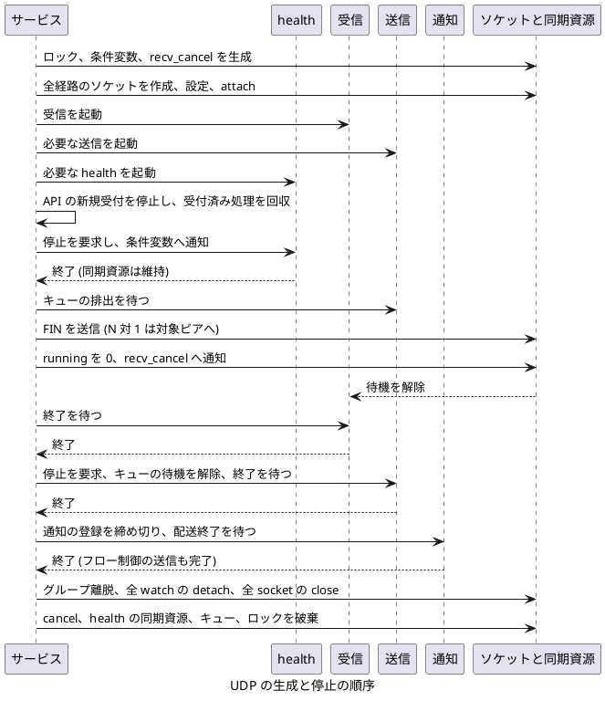
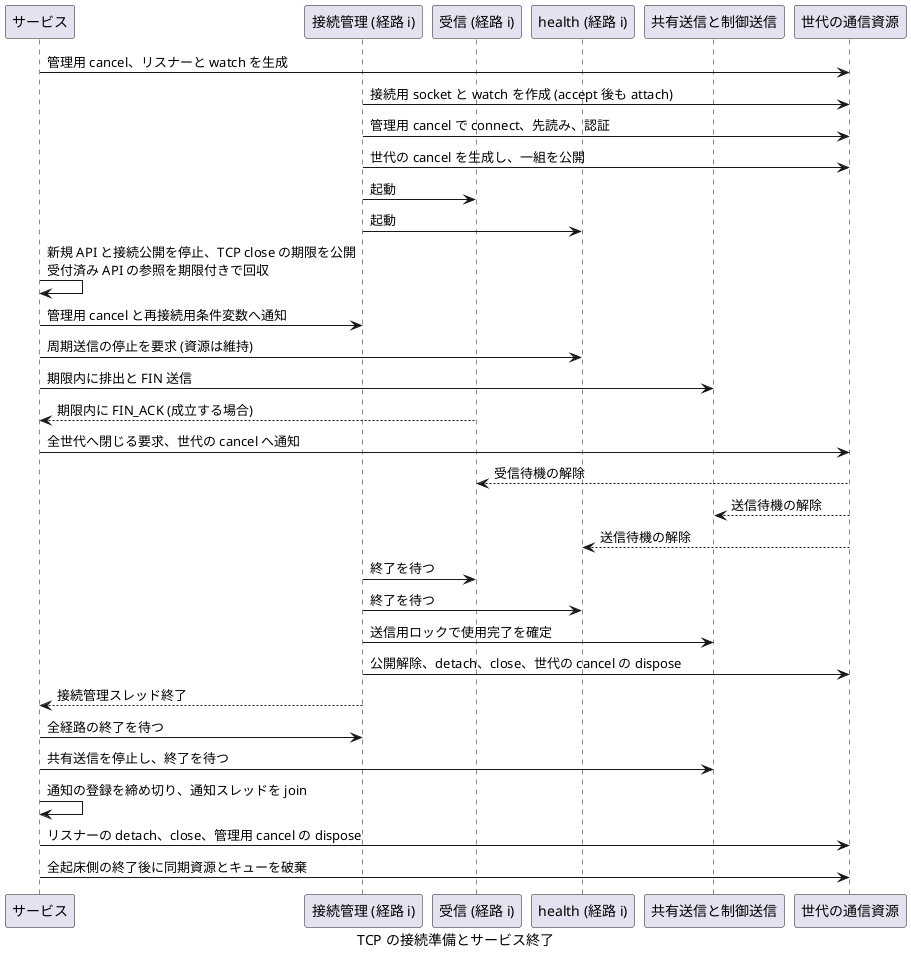
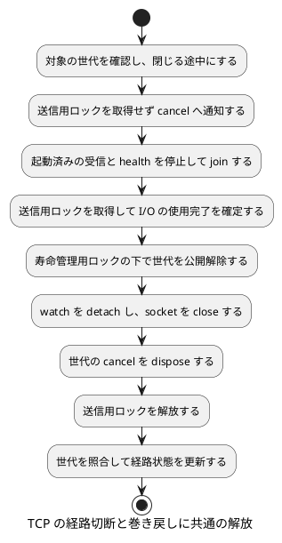
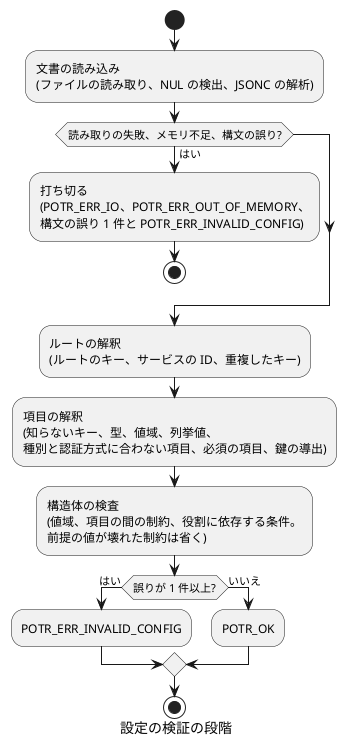
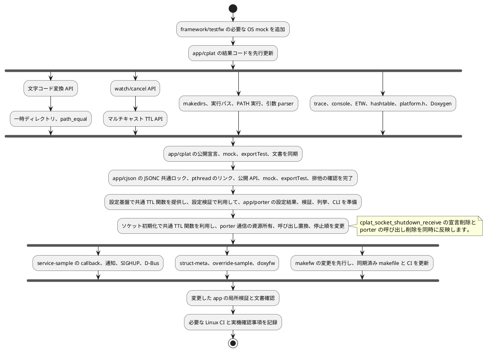

<!--
生成元: agree-before-implement スキル
文書種別: 最終仕様 (design)
最終更新日時: 2026-11-24 06:08:58 JST
最終更新エージェント: claude code (Fable 5.2) / 節の作成は Claude の Opus と Sonnet、codex の GPT-6.1-Sol、まとめは codex の GPT-6-Luna、文章の整理は agy の Gemini 4 Hydrogen、監査と直しは codex の GPT-6.1-Sol と GPT-6-Luna、突き合わせと転記は grok / セッション ID: session_01KJc53Ruv5x7E4gs2vUkZ1o
稼働 OS: Windows
上流文書: `261123-remaining-backlog-items-overview.md` (全体管理文書)、`261123-remaining-backlog-items-discussion.md` (検討用 Markdown)、`261123-remaining-backlog-items-lightadr.md` (簡易 ADR)、`261119-void-discard-reason-and-failure-injection-backlog.md` と `261120-source-comment-bl003-remaining-57-backlog.md` (対策元の残課題一覧)。いずれも削除されている場合があります。
下流文書: `261123-remaining-backlog-items-backlog.md` (残課題一覧)。未作成の場合や、削除されている場合があります。
再開手順: この文書を単体の最終仕様として扱い、実装時は AGENTS.md、該当スキル、対象の正本文書を確認してください。変更順、初動確認、検証、受入条件は本文に従ってください。
-->

# 残課題一覧 (261119 と 261120) の対策 最終仕様

## 概要

この案件は、残課題一覧 2 件から選定した 36 件と、調査で見つかった追加 3 件を対象に、cplat、porter、cJSON、service-sample、struct-meta、override-sample、doxyfw、makefw、CI の仕様をまとめます。  
対処の方式は、変更量と試験量の小ささではなく、堅牢さと正しさで選びます。そのため、公開 API の追加、変更、削除と、動作の破壊的な変更を含みます。  
実装はサブモジュールごとのまとまりを保ち、公開 API、モック、エクスポート検査、正本文書を一緒にそろえます。  
各項目の仕様、変更ファイル、テスト、文書反映、受入条件は領域別の項目に記載します。

## 対象と範囲

| 対応する残課題 ID | 題名 | この文書の節 | 変更の種別 |
| --- | --- | --- | --- |
| A-BL-001 | override-sample の使い方の表示と終了の直前の検査に失敗時のテストがない | `app/cplat` のトレースと基盤、struct-meta、override-sample、doxyfw、規範 / override-sample の失敗時のテスト | テストだけ |
| A-BL-002 | porter の REJECT を受けた経路で割り込みの PING を送るべきかを決める | `app/porter` の通信、停止、トレース、コマンド / 経路の状態の変化に伴う割り込みの PING | 動作の変更、文書も変更 |
| A-BL-003 | porter の設定で、解釈できない値の一部が知らせなく既定値になる | `app/porter` の設定の検証と確認用 CLI / cJSON の JSONC のラッパーの、誤りの種別と位置の報告<br>`app/porter` の設定の検証と確認用 CLI / porter の設定の確認用 CLI (`porter-config-check`)<br>`app/porter` の設定の検証と確認用 CLI / porter の設定の検証の公開関数<br>`app/porter` の設定の検証と確認用 CLI / porter の設定の検証の作り直し<br>`app/porter` の設定の検証と確認用 CLI / porter の設定の誤りの結果コード | 公開 API の追加・変更、文書も変更、動作の変更 |
| A-BL-004 | cplat のトレースのファイルを、ローテーションの後に開けないと書き込みが失敗し続ける | `app/cplat` のトレースと基盤、struct-meta、override-sample、doxyfw、規範 / cplat のトレースのファイルの開き直し | 動作の変更、文書も変更 |
| A-BL-005 | `compress-cli` と `etw-viewer` で、引数の検証の失敗の内容が表示されない | `app/cplat` の公開 API とパスの処理 / cplat の引数パーサーへの独自の検証の誤りの登録 | 公開 API の追加・変更、文書も変更 |
| A-BL-006 | service-sample の `tracer_open()` の Doxygen とコメントが実装と食い違う | `app/service-sample` と `framework/makefw`、CI / トレーサーの開始の失敗 | 動作の変更、文書も変更 |
| A-BL-007 | porter の FIN の受信処理のコメントが動作と合わない | `app/porter` の通信、停止、トレース、コマンド / 経路の状態の変化に伴う割り込みの PING | 動作の変更、文書も変更 |
| A-BL-008 | porter の Windows で、受信を待っているソケットを別のスレッドが閉じている | `app/cplat` の公開 API とパスの処理 / cplat の解除できるソケットの待機<br>`app/porter` の通信、停止、トレース、コマンド / 非ブロッキング通信と待機の解除による安全な停止 | 公開 API の追加・変更、文書も変更 |
| A-BL-009 | cplat の `PATH` を探索する実行で、報告する `errno` が最後の候補のものになる | `app/cplat` の公開 API とパスの処理 / cplat の `PATH` の探索による実行の `errno` | 動作の変更、文書も変更 |
| A-BL-010 | porter の設定ファイルの読み込みで、読み取りの失敗を終端と区別していない | `app/porter` の設定の検証と確認用 CLI / porter の設定の検証の作り直し | 動作の変更、文書も変更 |
| A-BL-011 | 戻り値の破棄を探す走査が、マクロの引数とカンマ式の中の呼び出しを検出できない | `app/cplat` のトレースと基盤、struct-meta、override-sample、doxyfw、規範 / 共通のコーディング規範への記載 (戻り値の破棄の検出) | 文書だけ |
| A-BL-012 | cplat の戻り値のない公開関数の一部に、失敗を通知しないことの記載がない | `app/cplat` のトレースと基盤、struct-meta、override-sample、doxyfw、規範 / cplat の ETW のセッションの停止と、戻り値のない公開関数の記載 | 動作の変更、文書も変更 |
| A-BL-013 | `tcpServer` の Windows で、子プロセスの起動の失敗に診断がない | `app/porter` の通信、停止、トレース、コマンド / `tcpServer` の Windows の子プロセスの起動と長いパス | 動作の変更、文書も変更 |
| A-BL-014 | porter の `potr_tracer_get()` の Doxygen が、`NULL` を返さないと誤って記載している | `app/porter` の通信、停止、トレース、コマンド / トレーサーの生成の失敗後の再試行 | 動作の変更、文書も変更 |
| A-BL-015 | `porter-test` の経路の状態の表示が、最後の経路しか表示しない | `app/porter` の通信、停止、トレース、コマンド / `porter-test` の全経路の状態の表示 | 動作の変更、文書も変更 |
| A-BL-016 | makefw が、app の並列数と各 app の並列度で 1 つの上限を共有しない | `app/service-sample` と `framework/makefw`、CI / Linux の CI のメモリの記録の除去<br>`app/service-sample` と `framework/makefw`、CI / makefw の並列の上限の共有 | 動作の変更、文書も変更 |
| A-BL-017 | Linux の CI に、ビルド中のメモリを記録する処理が残っている | `app/service-sample` と `framework/makefw`、CI / Linux の CI のメモリの記録の除去 | 動作の変更、文書も変更 |
| B-BL-011 | コンソールへの再接続の後に書き込みが失敗する事象の原因が、未特定である | `app/cplat` のトレースと基盤、struct-meta、override-sample、doxyfw、規範 / cplat のコンソールの診断の記録 | 動作の変更、文書も変更 |
| B-BL-023 | `file_api.c` の U 版のラッパーが、メモリ不足を `ERROR_INVALID_PARAMETER` で返す | `app/cplat` の公開 API とパスの処理 / cplat の文字コードの変換の厳密化と U 版のラッパーの最終エラー | 公開 API の追加・変更、文書も変更 |
| B-BL-024 | `tcpServer_windows.c` が、`GetModuleFileNameU` の切り詰めを検査しない | `app/porter` の通信、停止、トレース、コマンド / `tcpServer` の Windows の子プロセスの起動と長いパス | 動作の変更、文書も変更 |
| B-BL-025 | `cplat_process_get_executable_path` の Linux 側が、切り詰めを検出できない | `app/cplat` の公開 API とパスの処理 / `cplat_process_get_executable_path` の Linux の切り詰めの検出 | 動作の変更、文書も変更 |
| B-BL-026 | `cplat_makedirs` が、ディレクトリの作成の失敗をすべて `CPLAT_ERR_UNKNOWN` で返す | `app/cplat` の公開 API とパスの処理 / `cplat_makedirs` の結果コードとディレクトリではないものの扱い | 動作の変更、文書も変更 |
| B-BL-027 | 一時ディレクトリの取得の、戻り値の境界の判定が 2 か所で違う | `app/cplat` の公開 API とパスの処理 / cplat の一時ディレクトリの取得の集約 | 動作の変更、文書も変更 |
| B-BL-028 | `cplat_path_equal` の Windows の比較が、非 ASCII の大文字と小文字を区別する | `app/cplat` の公開 API とパスの処理 / `cplat_path_equal` の Windows の大文字と小文字の比較 | 動作の変更、文書も変更 |
| B-BL-029 | `struct-meta` の索引の登録が、フィールド名の表の作成の失敗を成功として扱う | `app/cplat` のトレースと基盤、struct-meta、override-sample、doxyfw、規範 / struct-meta の索引の登録 | 動作の変更、文書も変更 |
| B-BL-030 | cplat の自動拡張のハッシュ テーブルが、削除済みのレコードを残したまま容量を増やし続ける | `app/cplat` のトレースと基盤、struct-meta、override-sample、doxyfw、規範 / cplat のハッシュ テーブルの説明 | 文書だけ、テストだけ |
| B-BL-031 | `service-sample` の Linux で、D-Bus の同期呼び出しの間は watchdog の通知を送れない | `app/service-sample` と `framework/makefw`、CI / 運転中の D-Bus の呼び出しの非同期化と期限の明示 | 動作の変更、文書も変更 |
| B-BL-032 | `service-sample` の文書の、自動再起動の停止の記載が、既定の制限と合わない可能性がある | `app/service-sample` と `framework/makefw`、CI / unit の起動の回数の制限の明示 | 動作の変更、文書も変更 |
| B-BL-033 | `service-sample` の終了コードの推奨の範囲が、ヘッダーと文書で違う | `app/service-sample` と `framework/makefw`、CI / 終了コードの範囲の記載 | 文書だけ |
| B-BL-034 | `service-sample` の `README` のファイル構成に、記載のないファイルがある | `app/service-sample` と `framework/makefw`、CI / `README` のファイル構成 | 文書だけ |
| B-BL-035 | `service-sample` の Linux で、停止の処理の後の `SIGHUP` でプロセスが終了する | `app/service-sample` と `framework/makefw`、CI / Linux の `SIGHUP` の受信の方式の変更 | 動作の変更、文書も変更 |
| B-BL-036 | `service-sample` で、リロードの実行中に停止が始まると、停止中の通知の後に起動の完了の通知が送られる | `app/service-sample` と `framework/makefw`、CI / リロードの完了の通知と停止の通知の直列化 | 動作の変更、文書も変更 |
| B-BL-037 | `service-sample` の Windows と共通の処理で、コールバックの順序の実装が 2 つある | `app/service-sample` と `framework/makefw`、CI / コールバックの順序と失敗値の採用の集約 | 動作の変更、文書も変更 |
| B-BL-038 | `app/porter` の `potr_service_close.c` の、読まれない 0 の格納 | `app/porter` の通信、停止、トレース、コマンド / 終了処理で読まれない送信時刻の格納の削除 | 動作の変更、文書も変更 |
| B-BL-039 | `platform.h` の静的検査が、`static_assert` への統一の規範に従っていない | `app/cplat` のトレースと基盤、struct-meta、override-sample、doxyfw、規範 / cplat の `platform.h` と `_GNU_SOURCE` | 動作の変更、文書も変更 |
| B-BL-040 | Doxybook2 の生成物で、拡張パスの接頭辞の後に `endiskip` が表示される | `app/cplat` のトレースと基盤、struct-meta、override-sample、doxyfw、規範 / Doxybook2 の生成物の `endiskip` | 動作の変更、文書も変更 |
| 対応する残課題なし | cplat のマルチキャストの送信の TTL の設定 | `app/cplat` の公開 API とパスの処理 / cplat のマルチキャストの送信の TTL の設定 | 公開 API の追加・変更、動作の変更、文書も変更 |
| 対応する残課題なし | マルチキャストの送信の TTL の設定 | `app/porter` の通信、停止、トレース、コマンド / マルチキャストの送信の TTL の設定 | 公開 API の追加・変更、動作の変更、文書も変更 |
| 対応する残課題なし | porter のサービスの識別子の列挙の公開関数 | `app/porter` の設定の検証と確認用 CLI / porter のサービスの識別子の列挙の公開関数 | 公開 API の追加・変更、動作の変更、文書も変更 |

対象外: 実機と実際のネットワークでの確認、および章「残課題一覧へ記録する事項」に挙げた事項の対処は、この案件の対象外です。これらは、この案件の残課題一覧へ記録します。

## 公開 API の変更の一覧

| ライブラリ | 関数、型、結果コード | 追加・変更・削除 | 破壊的か | この文書の節 |
| --- | --- | --- | --- | --- |
| `app/cplat` | `cplat_socket_wait_cancel`、`cplat_socket_wait_cancel_create` / signal / reset / dispose、`cplat_socket_watch`、`cplat_socket_watch_attach` / detach / wait_readable_multi / wait_writable / send / sendto / send_all / recv_all / connect、`CPLAT_SOCKET_WATCH_WAIT_MAX` | 追加 | いいえ | cplat の解除できるソケットの待機 |
| `app/cplat` | `cplat_socket_wait_cancel_signal` | 有効なオブジェクトでは、OS の通知の成否によらず `CPLAT_OK` を返し、`NULL` では `CPLAT_ERR_INVALID_ARGUMENT` だけを返します。OS の起床通知の失敗は、保持した解除状態と有限間隔の確認で吸収します。 | いいえ (新設 API の契約確定) | cplat の解除できるソケットの待機 |
| `app/cplat` | `cplat_socket_watch_wait_writable`、`cplat_socket_watch_send_all`、`cplat_socket_watch_recv_all` | 切断・エラー時も送信待機は両方の OS で `CPLAT_OK` を返します。利用側は送信を再試行して結果を扱います。全量処理は各反復で解除、完了、期限を確認し、終了による起床後の `CPLAT_ERR_WOULD_BLOCK` では `CPLAT_ERR_UNKNOWN` (詳細 `EIO`) を返します。全量入出力は失敗時も処理済みバイト数を返します。 | いいえ (新設 API の契約確定) | cplat の解除できるソケットの待機 |
| `app/cplat` | `CPLAT_ERR_WOULD_BLOCK` (-43)、`CPLAT_ERR_CANCELED` と `CPLAT_ERR_BUSY` の説明およびソケット結果変換 | 追加・変更 | ソケットの戻り値変更ははい | cplat の解除できるソケットの待機 |
| `app/cplat` | `cplat_socket_shutdown_receive` | 削除 | はい | cplat の解除できるソケットの待機 |
| `app/cplat` | `cplat_socket_set_multicast_ttl`、`CPLAT_SOCKET_MULTICAST_TTL_MAX` | 追加 | いいえ | cplat のマルチキャストの送信の TTL の設定 |
| `app/cplat` | `cplat_utf8_to_wstr_alloc`、`cplat_wstr_to_utf8_alloc`、`cplat_utf8_to_wstr`、`cplat_wstr_to_utf8`、`cplat_utf8_to_wpath`、`cplat_wpath_to_utf8`、`CPLAT_ERR_INVALID_ENCODING` | 変更 | はい (6 つとも、戻り値と引数が変わります。不正なバイト列は失敗になります) | cplat の文字コードの変換の厳密化と U 版のラッパーの最終エラー |
| `app/cplat` | `cplat_stat`、`cplat_stat_fmt`、`cplat_vstat_fmt`、`cplat_rmdir`、`cplat_mkdir`、`cplat_mkdir_fmt`、`cplat_vmkdir_fmt`、`cplat_makedirs` | Windows の不正なパスは `CPLAT_ERR_INVALID_ENCODING`、詳細 `EILSEQ`、要因 `CPLAT_CAUSE_OTHER` です。公開宣言と逆引きを同期します。 | はい (厳密化に伴う不正入力の結果変更) | cplat の文字コードの変換の厳密化と U 版のラッパーの最終エラー、`cplat_makedirs` の結果コードとディレクトリではないものの扱い |
| `app/cplat` | `cplat_path_get_temp_dir`、`cplat_path_equal`、`cplat_makedirs`、`cplat_process_get_executable_path`、`cplat_process_start` | 振る舞いとエラー変換の変更 | `cplat_makedirs` の非ディレクトリの拒否と Windows の不正入力の結果変更ははい | cplat の一時ディレクトリの取得の集約、`cplat_path_equal` の Windows の大文字と小文字の比較、`cplat_makedirs` の結果コードとディレクトリではないものの扱い、`cplat_process_get_executable_path` の Linux の切り詰めの検出、cplat の `PATH` の探索による実行の `errno` |
| `app/cplat` | `cplat_argparser_handle_set_validation_error`、`cplat_argparser_set_validation_error` | 追加 | いいえ | cplat の引数パーサーへの独自の検証の誤りの登録 |
| `app/cplat` | `cplat_etw_session_stop`、`cplat_tracer_dispose`、`cplat_argparser_init` の失敗時の契約と Doxygen | 記載の変更 | いいえ | cplat の ETW のセッションの停止と、戻り値のない公開関数の記載 |
| `app/cplat` | `cplat_hashtable_create_growable` の容量成長と削除済みスロットの説明 | Doxygen の変更のみ | いいえ | cplat のハッシュ テーブルの説明 |
| `app/cjson` | `cjson_app_jsonc_status`、`CJSON_APP_JSONC_*`、`cjson_app_cJSON_ParseJSONCWithLengthOpts`、既存の JSONC 解析の直列化、全 cJSON 確保・解放のサイズ管理と消去 | 追加・変更 | はい (全利用側で専用の解放関数を使い、所有領域に通常の確保領域を直接代入せず、ロード後の `cJSON_InitHooks()` の解除・再差し替えを禁止します) | cJSON の JSONC のラッパーの、誤りの種別と位置の報告 |
| `app/porter` | `POTR_ERR_INVALID_CONFIG` (-6)、`POTR_ERR_INVALID_ARGUMENT` の用途変更 | 追加と変更です。構造体の値域・経路・RAW の設定誤りは `POTR_ERR_INVALID_CONFIG`、`NULL` などの呼び出し方の誤りは `POTR_ERR_INVALID_ARGUMENT`、読めない認証ファイルは `POTR_ERR_IO`、確保失敗は `POTR_ERR_OUT_OF_MEMORY` です。 | はい (設定誤りの結果コード変更) | porter の設定の誤りの結果コード |
| `app/porter` | `potr_config_issue_kind`、`potr_config_issue`、`potr_config_file_ref`、`potr_config_issue_fn`、`potr_config_file_fn`、`potr_config_service_fn`、`potr_config_validate_options`、`potr_config_validate_file` | 追加 (`potr_config_validate_options.on_service` で同じ解析結果のサービス ID を通知します) | いいえ (新設 API) | porter の設定の検証の公開関数 |
| `app/porter` | `potr_config_list_service_ids`、`potr_config_service_ids_free` | 追加 | いいえ | porter のサービスの識別子の列挙の公開関数 |
| `app/porter` | `potr_tracer_get` | Doxygen の記載を変更します。宣言と型は維持します。 | いいえ | トレーサーの生成の失敗後の再試行 |
| `app/porter` | `potr_service_close` | 動作を変更します (TCP の `tcp_close_timeout_ms` を、閉じる処理の全体へ適用します。期限が切れた場合は、待機を打ち切り、未送信のデータを破棄します)。宣言と型は維持します。 | はい (これまで期限なしで待っていた区間が、期限で打ち切られます) | 非ブロッキング通信と待機の解除による安全な停止 |
| `app/cplat` | `cplat_trace_file_sink_write()` のローテーション後の戻り値契約 | 戻り値契約の変更 | はい (新しい現在ファイルの開く処理の失敗だけを成功扱いとし、ほかの失敗はエラーを返します) | cplat のトレースのファイルの開き直し |
| `app/struct-meta` | `struct_meta_index_register()` の結果コード `CPLAT_ERR_UNKNOWN` | 戻り値契約の変更 | はい (新たな失敗結果を返す場合があります) | struct-meta の索引の登録 |

## app/cplat の公開 API とパスの処理

### cplat の解除できるソケットの待機

対応する残課題: A-BL-008 (cplat 側)

#### 現状

ソケットの待機 (`cplat_socket_wait_readable*`、`cplat_socket_timed_wait_*`) は、Linux の `poll` と Windows の `WSAPoll` で作られており (`app/cplat/prod/libsrc/cplat/net/socket_linux.c` の `poll_with_deadline`、`wait_single`、`cplat_socket_timed_wait_readable_multi`、`socket_windows.c` の `wait_single`、`cplat_socket_timed_wait_readable_multi`)、別のスレッドから待機を解除する手段を持ちません。

利用側は、待機を解除するために `cplat_socket_shutdown_receive()` を呼びます (`app/cplat/prod/include/cplat/net/socket.h`)。この関数は、Linux では `shutdown(SHUT_RD)` で受信方向を止め、Windows では `closesocket` でソケットを閉じて、呼び出し元の変数へ無効値を書き戻します。Windows では、受信スレッドが待機または受信しているソケットを、別のスレッドが閉じることになります。[closesocket](https://learn.microsoft.com/en-us/windows/win32/api/winsock/nf-winsock-closesocket) の資料は、同じソケットへのほかの Winsock の呼び出しと同時に閉じないよう求めています。

接続の受け付け (`cplat_socket_accept`)、指定の長さの受信 (`cplat_socket_recv_all`)、指定の長さの送信 (`cplat_socket_send_all`)、ブロックする接続 (`cplat_socket_connect`) も、解除できないブロッキングの呼び出しです。

ソケットの 1 回の送受信が「待つ必要がある」(Linux の `EAGAIN` と `EWOULDBLOCK`、Windows の `WSAEWOULDBLOCK`) で失敗した場合、結果コードは `CPLAT_ERR_BUSY` で、詳細エラーの要因が `CPLAT_CAUSE_WOULD_BLOCK` になります (`base/result.c` の `cplat_internal_result_from_errno` と `cplat_internal_result_from_winsock_error`、`base/error.c` の `error_cause_from_socket_errno` と `error_cause_from_winsock_error`)。結果コードだけでは、資源の使用中 (`EBUSY`) と区別できません。

Windows の `accept` が返すソケットは、リスナーの性質 (非ブロッキング、`WSAEventSelect` の登録) を受け継ぎます。Linux の `accept` が返すソケットは、`O_NONBLOCK` などのファイルの状態の旗を受け継ぎません。

> [!IMPORTANT]
> Windows の `WSAEventSelect` は、指定するイベントによらずソケットを非ブロッキングにします。1 つのソケットに結び付けられるイベント オブジェクトは 1 つで、2 回目の呼び出しは前の結び付けと内部の記録を取り消します。利用側の porter は、受信スレッドが待機している間に、別のスレッドが同じソケットで送信します。そのため、待機のたびに結び付けて戻す作りは採れず、ソケットごとの結び付けを cplat が一元管理します。
> see: https://learn.microsoft.com/en-us/windows/win32/api/winsock2/nf-winsock2-wsaeventselect

#### 変更後の仕様

公開 API に、次の 2 つのオブジェクトと、それを使う関数を足します。宣言は `app/cplat/prod/include/cplat/net/socket.h` に置きます。

- 待機の解除のオブジェクト (`cplat_socket_wait_cancel`): 解除の通知を保持します。通知は、リセットまで続きます。待機の開始より前に通知した場合も、待機はすぐに解除されます。
- ソケットの登録のオブジェクト (`cplat_socket_watch`): 1 つのソケットを、解除できる待機の対象にします。登録の間、ソケットは両方の OS で非ブロッキング モードです。

あわせて、次の変更を行います。

- `cplat_socket_shutdown_receive()` を公開 API から削除します。
- 結果コード `CPLAT_ERR_WOULD_BLOCK` を足し、ソケットの 1 回の送受信と接続の受け付けが「待つ必要がある」で失敗した場合に返します。
- `cplat_socket_accept` が返すソケットを、両方の OS で、登録なし、ブロッキング モードにそろえます。

##### 結果コード

`app/cplat/prod/include/cplat/base/result.h` の「制御」の範囲に次を足します。

```{.c caption="app/cplat/prod/include/cplat/base/result.h"}
/**
 *  @brief          非ブロッキングの操作が、待たずには完了できないため、何もせずに戻りました。
 *
 *  - errno: `EAGAIN` / `EWOULDBLOCK` (ソケットの操作に限ります)
 *  - Winsock: `WSAEWOULDBLOCK`
 *
 *  @note           汎用の errno の変換 (`cplat_internal_result_from_errno()`) では、`EAGAIN` は
 *                  資源の上限を表す場合があるため、引き続き @ref CPLAT_ERR_BUSY に変換します。
 *                  ソケットの操作の変換 (`cplat_internal_error_report_socket_errno()`、
 *                  `cplat_internal_result_from_winsock_error()`) だけが本コードを返します。
 *                  非ブロッキングの接続の開始は、従来どおり @ref CPLAT_ERR_IN_PROGRESS を返します。
 */
#define CPLAT_ERR_WOULD_BLOCK (-43)
```

- `CPLAT_ERR_CANCELED` の説明を、「ユーザー操作 (Ctrl+C など) または待機の解除の通知により中断しました。」へ広げます。
- `CPLAT_ERR_BUSY` の `@note` を、`CPLAT_ERR_WOULD_BLOCK` を指す記載へ直し、Winsock の対応表から `WSAEWOULDBLOCK` を除きます。
- `base/result.c` の `cplat_internal_result_from_winsock_error` は、`WSAEWOULDBLOCK` を `CPLAT_ERR_WOULD_BLOCK` に変換します。`base/error.c` の `cplat_internal_error_report_socket_errno` は、`EAGAIN` と `EWOULDBLOCK` を `CPLAT_ERR_WOULD_BLOCK` に変換します。詳細エラーの要因は、従来どおり `CPLAT_CAUSE_WOULD_BLOCK` です。
- `base/error_message.c` に、`CPLAT_ERR_WOULD_BLOCK` の説明の文を足します。

##### 公開 API の宣言

```{.c caption="app/cplat/prod/include/cplat/net/socket.h"}
/** @ref cplat_socket_watch_wait_readable_multi へ一度に指定できる登録の最大数。 */
#define CPLAT_SOCKET_WATCH_WAIT_MAX CPLAT_SOCKET_WAIT_MAX

/** 待機の解除のオブジェクト (不透明型)。 */
typedef struct cplat_socket_wait_cancel cplat_socket_wait_cancel;

/** ソケットの登録のオブジェクト (不透明型)。 */
typedef struct cplat_socket_watch cplat_socket_watch;

/**
 *  @brief          待機の解除のオブジェクトを生成します。
 *  @param[out]     cancel_out 生成したオブジェクトの格納先。失敗時は NULL を格納します。
 *  @param[out]     detail_out エラー詳細の格納先。NULL 可。
 *  @return         @ref CPLAT_OK 、@ref CPLAT_ERR_INVALID_ARGUMENT 、@ref CPLAT_ERR_OUT_OF_MEMORY 、
 *                  OS の失敗に対応する結果コードのいずれかを返します。
 *
 *  生成の直後は、未通知の状態です。\n
 *  Linux は `eventfd` (`EFD_NONBLOCK | EFD_CLOEXEC`)、Windows は手動リセットのイベント オブジェクトで作ります。
 *
 *  @par            スレッド セーフ
 *  本関数はスレッド セーフです。
 */
CPLAT_EXPORT int CPLAT_API cplat_socket_wait_cancel_create(cplat_socket_wait_cancel **cancel_out,
                                                           cplat_error *detail_out);

/**
 *  @brief          待機の解除を通知します。
 *  @param[in]      cancel     対象のオブジェクト。
 *  @param[out]     detail_out エラー詳細の格納先。NULL 可。
 *  @return         有効な @p cancel では必ず @ref CPLAT_OK 、NULL では @ref CPLAT_ERR_INVALID_ARGUMENT を返します。
 *
 *  このオブジェクトを指定して待機しているすべての呼び出しを解除します。
 *  通知は @ref cplat_socket_wait_cancel_reset まで続き、その間に始めた待機もすぐに解除します。\n
 *  通知済みのオブジェクトへの再度の通知は、何もせず @ref CPLAT_OK を返します。\n
 *  通知状態を原子的に保持してから OS へ起床を通知します。OS の通知が失敗しても、待機側の
 *  最大 50 [ms] ごとの状態確認で解除を検出するため、本関数は OS の失敗を返しません。
 *  有効なオブジェクトとは、生成に成功し、破棄されず、リセットと破棄が通知や待機と競合しないものです。
 *
 *  @par            スレッド セーフ
 *  本関数はスレッド セーフです。どのスレッドからも、何度でも呼び出せます。
 */
CPLAT_EXPORT int CPLAT_API cplat_socket_wait_cancel_signal(cplat_socket_wait_cancel *cancel,
                                                           cplat_error *detail_out);

/**
 *  @brief          待機の解除のオブジェクトを、未通知の状態へ戻します。
 *  @param[in]      cancel     対象のオブジェクト。
 *  @param[out]     detail_out エラー詳細の格納先。NULL 可。
 *  @return         @ref CPLAT_OK 、@ref CPLAT_ERR_INVALID_ARGUMENT 、OS の失敗に対応する結果コードのいずれかを返します。
 *
 *  未通知のオブジェクトへの呼び出しは、何もせず @ref CPLAT_OK を返します。\n
 *  このオブジェクトを指定して待機しているスレッドがなく、通知するスレッドもない状態で呼び出してください。
 *  オブジェクトを使い直す (例: 接続ごとに解除して、次の接続で再び使う) ための関数です。
 *
 *  @par            スレッド セーフ
 *  同じオブジェクトへの、ほかの関数との同時の呼び出しはできません。
 */
CPLAT_EXPORT int CPLAT_API cplat_socket_wait_cancel_reset(cplat_socket_wait_cancel *cancel,
                                                          cplat_error *detail_out);

/**
 *  @brief          待機の解除のオブジェクトを破棄します。
 *  @param[in]      cancel 破棄するオブジェクト。NULL の場合は何もしません。
 *
 *  このオブジェクトを指定した待機が、すべて戻った後に呼び出してください。\n
 *  直前エラー (@ref cplat_error_get_last) を保存し、復元してから返ります。
 *
 *  @par            スレッド セーフ
 *  同じオブジェクトへの、ほかの関数との同時の呼び出しはできません。
 */
CPLAT_EXPORT void CPLAT_API cplat_socket_wait_cancel_dispose(cplat_socket_wait_cancel *cancel);

/**
 *  @brief          ソケットを、解除できる待機の対象として登録します。
 *  @param[in]      sock       対象のソケット。
 *  @param[out]     watch_out  登録のオブジェクトの格納先。失敗時は NULL を格納します。
 *  @param[out]     detail_out エラー詳細の格納先。NULL 可。
 *  @return         @ref CPLAT_OK 、@ref CPLAT_ERR_INVALID_ARGUMENT 、@ref CPLAT_ERR_OUT_OF_MEMORY 、
 *                  OS の失敗に対応する結果コードのいずれかを返します。
 *
 *  登録に成功すると、ソケットを非ブロッキング モードにします (両方の OS)。
 *  失敗した場合、ソケットのモードと登録は呼び出し前のままです。\n
 *  登録の間は、次の規則に従ってください。
 *  - @ref cplat_socket_set_nonblocking でブロッキングへ戻さない (Windows では失敗します)。
 *  - 既存の待機の関数 (@ref cplat_socket_wait_readable 、@ref cplat_socket_timed_wait_readable 、
 *    @ref cplat_socket_wait_writable 、@ref cplat_socket_timed_wait_writable 、
 *    @ref cplat_socket_wait_readable_multi 、@ref cplat_socket_timed_wait_readable_multi) を使わない。
 *  - 送信は、登録を受ける関数 (@ref cplat_socket_watch_send 、@ref cplat_socket_watch_sendto 、
 *    @ref cplat_socket_watch_send_all) だけで行う。@ref cplat_socket_send 、@ref cplat_socket_sendto 、
 *    @ref cplat_socket_send_all は使わない (Windows で、送信可能の状態の管理が合わなくなるためです)。
 *  - 接続は @ref cplat_socket_watch_connect で行う。
 *  - 受信は、@ref cplat_socket_recv 、@ref cplat_socket_recvfrom 、@ref cplat_socket_accept 、
 *    @ref cplat_socket_watch_recv_all で行う。@ref cplat_socket_recv_all は使わない。
 *    1 回の受信の関数は、待つ必要がある場合に @ref CPLAT_ERR_WOULD_BLOCK を返します。
 *  - 同じソケットを、ほかの登録のオブジェクトへ重ねて登録しない。
 *
 *  登録の時点で既に受信できるデータや、保留中の接続がある場合も、最初の待機で検出します。\n
 *  ソケットのオプションの設定 (@ref cplat_socket_set_nodelay など) は、登録の間も行えます。
 *
 *  @par            スレッド セーフ
 *  本関数はスレッド セーフです。
 */
CPLAT_EXPORT int CPLAT_API cplat_socket_watch_attach(cplat_socket sock, cplat_socket_watch **watch_out,
                                                     cplat_error *detail_out);

/**
 *  @brief          ソケットの登録を解き、登録のオブジェクトを破棄します。
 *  @param[in]      watch 対象の登録。NULL の場合は何もしません。
 *
 *  ソケットは閉じません。ソケットは非ブロッキング モードのまま残ります。
 *  ブロッキングへ戻す場合は、本関数の後に @ref cplat_socket_set_nonblocking を呼びます。\n
 *  登録を使う関数が、すべて戻った後に呼び出してください。ソケットを閉じる場合は、本関数の後に閉じます。\n
 *  失敗しても通知しません (解放の関数のため)。直前エラーを保存し、復元してから返ります。
 *
 *  @par            スレッド セーフ
 *  同じ登録への、ほかの関数との同時の呼び出しはできません。
 */
CPLAT_EXPORT void CPLAT_API cplat_socket_watch_detach(cplat_socket_watch *watch);

/**
 *  @brief          登録したソケットのいずれかが受信可能になるか、解除が通知されるまで待機します。
 *  @param[in]      watches    登録の配列。NULL の要素を含めても構いません。
 *  @param[in]      count      @p watches の要素数。1 以上 @ref CPLAT_SOCKET_WATCH_WAIT_MAX 以下。
 *  @param[in]      cancel     解除のオブジェクト。NULL の場合は解除できません。
 *  @param[in]      timeout_ms タイムアウト時間 [ms]。@ref CPLAT_WAIT_FOREVER または @ref CPLAT_NO_WAIT も指定できます。
 *  @param[out]     ready_out  各登録が受信可能かどうかを格納する配列。@p count 以上の要素数が必要です。
 *  @param[out]     detail_out エラー詳細の格納先。NULL 可。
 *  @return         受信可能になった場合は @ref CPLAT_OK 、解除された場合は @ref CPLAT_ERR_CANCELED 、
 *                  期限内に何も起きない場合は @ref CPLAT_ERR_TIMEOUT 、
 *                  @ref CPLAT_ERR_INVALID_ARGUMENT 、OS の失敗に対応する結果コードのいずれかを返します。
 *
 *  「受信可能」は、データの到着、接続の要求の到着 (リスナー)、相手の切断、ソケットのエラーを含みます。
 *  切断とエラーは、続く受信の関数で EOF またはエラーとして得られます。\n
 *  受信可能になった登録では、受信の関数 (@ref cplat_socket_recv 、@ref cplat_socket_recvfrom 、
 *  @ref cplat_socket_accept) を少なくとも 1 回呼んでください。Windows は、受信の関数の呼び出しで次の通知を
 *  再開するためです。受信の関数は、受信可能を返した後でも @ref CPLAT_ERR_WOULD_BLOCK を返す場合があります。
 *  利用側は、その場合に待機へ戻ります。\n
 *  解除の通知と受信可能が同時に成り立つ場合は、@ref CPLAT_ERR_CANCELED を返し、@p ready_out をすべて 0 にします。\n
 *  @p watches の全要素が NULL の場合は、@p cancel と期限だけを待ちます。@p cancel も NULL で、@p timeout_ms が
 *  @ref CPLAT_WAIT_FOREVER の場合は @ref CPLAT_ERR_INVALID_ARGUMENT を返します。\n
 *  待機がシグナルで中断された場合や、OS の通知が送信の側のものだった場合は、残り時間を再計算して待機を続けます。
 *  @p timeout_ms より早く @ref CPLAT_ERR_TIMEOUT を返しません。\n
 *  タイムアウトと解除の詳細エラーは、Linux では `ETIMEDOUT` と `ECANCELED`、Windows では `WSAETIMEDOUT` と
 *  `WSA_E_CANCELLED` を格納します。
 *
 *  @par            スレッド セーフ
 *  同じ登録に対して、受信の側の関数 (本関数と @ref cplat_socket_watch_recv_all) を同時に呼べるのは 1 スレッドです。
 *  送信の側の関数を呼ぶ 1 スレッドとは、同時に呼べます。
 */
CPLAT_EXPORT int CPLAT_API cplat_socket_watch_wait_readable_multi(cplat_socket_watch *const *watches, size_t count,
                                                                  cplat_socket_wait_cancel *cancel, int timeout_ms,
                                                                  unsigned char *ready_out, cplat_error *detail_out);

/**
 *  @brief          登録したソケットが送信可能になるか、解除が通知されるまで待機します。
 *  @param[in]      watch      対象の登録。
 *  @param[in]      cancel     解除のオブジェクト。NULL の場合は解除できません。
 *  @param[in]      timeout_ms タイムアウト時間 [ms]。@ref CPLAT_WAIT_FOREVER または @ref CPLAT_NO_WAIT も指定できます。
 *  @param[out]     detail_out エラー詳細の格納先。NULL 可。
 *  @return         送信可能になった場合は @ref CPLAT_OK 、解除された場合は @ref CPLAT_ERR_CANCELED 、
 *                  期限内に送信可能にならない場合は @ref CPLAT_ERR_TIMEOUT 、
 *                  @ref CPLAT_ERR_INVALID_ARGUMENT 、OS の失敗に対応する結果コードのいずれかを返します。
 *
 *  @ref CPLAT_NO_WAIT を指定すると、送信の空きがあるかどうかだけを確かめます。\n
 *  同じ登録で、別のスレッドが @ref cplat_socket_watch_wait_readable_multi で待っている間に呼んでも、
 *  その待機の通知を失わせません。\n
 *  相手の切断またはソケットのエラーも送信可能として @ref CPLAT_OK を返します (両方の OS)。
 *  これは送信の成功を保証せず、続く送信で結果を確認するための通知です。\n
 *  解除と送信可能 (切断とエラーを含む) が同時に成り立つ場合は @ref CPLAT_ERR_CANCELED を返します。
 *
 *  @par            スレッド セーフ
 *  同じ登録に対して、送信の側の関数 (本関数、@ref cplat_socket_watch_send 、@ref cplat_socket_watch_sendto 、
 *  @ref cplat_socket_watch_send_all 、@ref cplat_socket_watch_connect) を同時に呼べるのは 1 スレッドです。
 */
CPLAT_EXPORT int CPLAT_API cplat_socket_watch_wait_writable(cplat_socket_watch *watch,
                                                            cplat_socket_wait_cancel *cancel, int timeout_ms,
                                                            cplat_error *detail_out);

/**
 *  @brief          登録した接続済みソケットへ、待たずに 1 回送信します。
 *  @param[in]      watch      対象の登録。
 *  @param[in]      buf        送信するデータ。
 *  @param[in]      len        @p buf のバイト数。@ref CPLAT_SOCKET_MAX_TRANSFER 以下。
 *  @param[out]     sent_out   送信できたバイト数の格納先。
 *  @param[out]     detail_out エラー詳細の格納先。NULL 可。
 *  @return         @ref CPLAT_OK 、@ref CPLAT_ERR_WOULD_BLOCK 、@ref CPLAT_ERR_INVALID_ARGUMENT 、
 *                  OS の失敗に対応する結果コードのいずれかを返します。
 *
 *  送信の空きがない場合は、何も送らず @ref CPLAT_ERR_WOULD_BLOCK を返します。
 *  @p len の一部だけを送る場合があります。\n
 *  Linux では、切断済みの接続への送信による SIGPIPE を配信しません。
 *  (スレッド セーフは @ref cplat_socket_watch_wait_writable と同じ送信の側の規則です)
 */
CPLAT_EXPORT int CPLAT_API cplat_socket_watch_send(cplat_socket_watch *watch, const void *buf, size_t len,
                                                   size_t *sent_out, cplat_error *detail_out);

/**
 *  @brief          登録したソケットから、指定したエンドポイントへ待たずに 1 回送信します。
 *  (引数は @ref cplat_socket_sendto に、戻り値と規則は @ref cplat_socket_watch_send に準じます)
 */
CPLAT_EXPORT int CPLAT_API cplat_socket_watch_sendto(cplat_socket_watch *watch, const void *buf, size_t len,
                                                     const cplat_ipv4_endpoint *endpoint, size_t *sent_out,
                                                     cplat_error *detail_out);

/**
 *  @brief          登録した接続済みソケットへ、指定したバイト数をすべて送信します。
 *  @param[in]      watch      対象の登録。
 *  @param[in]      buf        送信するデータ。
 *  @param[in]      len        @p buf のバイト数。@ref CPLAT_SOCKET_MAX_TRANSFER 以下。
 *  @param[in]      cancel     解除のオブジェクト。NULL 可。
 *  @param[in]      timeout_ms 全体の期限 [ms]。@ref CPLAT_WAIT_FOREVER も指定できます。
 *  @param[out]     sent_out   送信できたバイト数の格納先。NULL 可。失敗時も、それまでに送ったバイト数を格納します。
 *  @param[out]     detail_out エラー詳細の格納先。NULL 可。
 *  @return         @ref CPLAT_OK 、@ref CPLAT_ERR_CANCELED 、@ref CPLAT_ERR_TIMEOUT 、
 *                  @ref CPLAT_ERR_INVALID_ARGUMENT 、OS の失敗に対応する結果コードのいずれかを返します。
 *
 *  送信の空きがない間は、送信可能になるか、解除、期限まで待ちます。
 *  各反復は解除、全量の完了、全体期限の順で確認してから 1 回送信します。
 *  切断による起床後の再送信も待つ必要がある場合は、@ref CPLAT_ERR_UNKNOWN (詳細 EIO) を返します。
 *  一部を送った後に解除または期限で戻った場合、ストリームは途中で切れています。呼び出し側は接続を閉じてください。\n
 *  Linux では、切断済みの接続への送信による SIGPIPE を配信しません。
 */
CPLAT_EXPORT int CPLAT_API cplat_socket_watch_send_all(cplat_socket_watch *watch, const void *buf, size_t len,
                                                       cplat_socket_wait_cancel *cancel, int timeout_ms,
                                                       size_t *sent_out, cplat_error *detail_out);

/**
 *  @brief          登録した接続済みソケットから、指定したバイト数をすべて受信します。
 *  @param[in]      watch        対象の登録。
 *  @param[out]     buf          受信データの格納先。
 *  @param[in]      len          受信するバイト数。@ref CPLAT_SOCKET_MAX_TRANSFER 以下。
 *  @param[in]      cancel       解除のオブジェクト。NULL 可。
 *  @param[in]      timeout_ms   全体の期限 [ms]。@ref CPLAT_WAIT_FOREVER も指定できます。
 *  @param[out]     received_out 受信したバイト数の格納先。NULL 可。失敗時も、それまでに受けたバイト数を格納します。
 *  @param[out]     detail_out   エラー詳細の格納先。NULL 可。
 *  @return         @ref CPLAT_OK 、@ref CPLAT_ERR_EOF 、@ref CPLAT_ERR_CANCELED 、@ref CPLAT_ERR_TIMEOUT 、
 *                  @ref CPLAT_ERR_INVALID_ARGUMENT 、OS の失敗に対応する結果コードのいずれかを返します。
 *
 *  受信し終える前に相手が送信を終了した場合は @ref CPLAT_ERR_EOF を返します。\n
 *  各反復は解除、全量の完了、全体期限の順で確認してから 1 回受信します。
 *  終了・エラーによる起床後の受信も待つ必要がある場合は、@ref CPLAT_ERR_UNKNOWN (詳細 EIO) を返します。
 *  解除と期限は、途中まで受けた後でも働きます。途中で戻った場合、それまでに受けたデータは @p buf の先頭にあり、
 *  続きは同じ関数で残りの領域を指定して読めます。
 *  (スレッド セーフは @ref cplat_socket_watch_wait_readable_multi と同じ受信の側の規則です)
 */
CPLAT_EXPORT int CPLAT_API cplat_socket_watch_recv_all(cplat_socket_watch *watch, void *buf, size_t len,
                                                       cplat_socket_wait_cancel *cancel, int timeout_ms,
                                                       size_t *received_out, cplat_error *detail_out);

/**
 *  @brief          登録したソケットで接続し、完了するか、解除、期限まで待ちます。
 *  @param[in]      watch      対象の登録 (未接続の TCP ソケット)。
 *  @param[in]      endpoint   接続先のエンドポイント。
 *  @param[in]      cancel     解除のオブジェクト。NULL 可。
 *  @param[in]      timeout_ms 期限 [ms]。@ref CPLAT_WAIT_FOREVER も指定できます。
 *  @param[out]     detail_out エラー詳細の格納先。NULL 可。
 *  @return         接続した場合は @ref CPLAT_OK 、解除された場合は @ref CPLAT_ERR_CANCELED 、
 *                  期限内に完了しない場合は @ref CPLAT_ERR_TIMEOUT 、@ref CPLAT_ERR_INVALID_ARGUMENT 、
 *                  接続の失敗 (拒否、到達不能、OS のタイムアウトなど) に対応する結果コードのいずれかを返します。
 *
 *  接続の失敗の理由は、@p detail_out に OS のエラー (Linux は `SO_ERROR` の値、Windows は
 *  `FD_CONNECT` の通知のエラー) を格納します。\n
 *  @ref CPLAT_OK 以外で戻った場合、ソケットの接続の状態は定まりません。呼び出し側は、登録を解いて
 *  ソケットを閉じてください。同じソケットで接続をやり直すことはできません。
 *  (スレッド セーフは @ref cplat_socket_watch_wait_writable と同じ送信の側の規則です)
 */
CPLAT_EXPORT int CPLAT_API cplat_socket_watch_connect(cplat_socket_watch *watch, const cplat_ipv4_endpoint *endpoint,
                                                      cplat_socket_wait_cancel *cancel, int timeout_ms,
                                                      cplat_error *detail_out);
```

各関数の引数の検査は、既存のソケットの関数と同じく、NULL の必須の引数、範囲外の `count`、負の `timeout_ms`、`CPLAT_SOCKET_MAX_TRANSFER` を超える `len` を `CPLAT_ERR_INVALID_ARGUMENT` (詳細エラーは `EINVAL`) とします。

##### 既存の関数との関係

- `cplat_socket_wait_readable`、`cplat_socket_timed_wait_readable`、`cplat_socket_wait_writable`、`cplat_socket_timed_wait_writable`、`cplat_socket_wait_readable_multi`、`cplat_socket_timed_wait_readable_multi` は残します。登録していないソケットの待機に使います。各関数の Doxygen に、「登録中のソケットには使わない。解除できる待機は `cplat_socket_watch_*` を使う」と書きます。
- `cplat_socket_send`、`cplat_socket_sendto`、`cplat_socket_send_all`、`cplat_socket_recv_all`、`cplat_socket_connect` は残します。各関数の Doxygen に、登録中のソケットでの扱い (上の `cplat_socket_watch_attach` の規則) を書きます。
- `cplat_socket_recv`、`cplat_socket_recvfrom`、`cplat_socket_send`、`cplat_socket_sendto`、`cplat_socket_accept` は、非ブロッキングのソケットで待つ必要がある場合に `CPLAT_ERR_WOULD_BLOCK` を返します (これまでの `CPLAT_ERR_BUSY` から変わります)。`@return` にこの値を足します。
- `cplat_socket_accept` の Windows の実装は、返すソケットについて、`WSAEventSelect(accepted, NULL, 0)` で受け継いだ登録を消し、`ioctlsocket(FIONBIO, 0)` でブロッキングへ戻します。どちらかが失敗した場合は、返すソケットを閉じて、その失敗の結果コードを返し、`sock_out` へ `CPLAT_INVALID_SOCKET` を格納します。Linux の実装は、返すソケットへ `O_NONBLOCK` を付けない (`accept` は受け継がない) ため、変えません。公開ヘッダーに、返すソケットは両方の OS で登録なし、ブロッキングであることを書きます。
- `cplat_socket_shutdown` (送受信の両方向の停止) は残します。

> [!NOTE]
> Linux の `accept` は、返すソケットへ `O_NONBLOCK` を受け継がず、BSD の実装とは異なると資料が明記しています。資料は、受け継ぎに頼らず、返したソケットに必要な旗を明示して設定するよう勧めています。cplat は、両方の OS で返すソケットの性質を固定し、利用側は必要なら登録 (`cplat_socket_watch_attach`) で非ブロッキングにします。
> see: https://man7.org/linux/man-pages/man2/accept.2.html

##### 解除の通知と全量の送受信の共通の手順

- 解除のオブジェクトは、OS の通知とは独立した原子的な通知状態を持ちます。`cplat_socket_wait_cancel_signal` は、通知状態を release の原子操作で公開してから OS の通知を行い、通知状態は成功したリセットまで保持します。同時に通知する呼び出しが複数あっても、各待機者が acquire の原子操作で同じ通知状態を取得できます。通知のためのメモリ確保は行いません。
- 解除を指定した待機は、OS の 1 回の待機時間を、残り時間と内部の確認間隔 50 [ms] の小さい方に制限します。無期限待機にもこの確認間隔を適用します。待機の前後と `EINTR` の再試行前に原子的な通知状態を取得し、通知済みなら `CPLAT_ERR_CANCELED` を返します。内部の確認間隔が満了しただけでは `CPLAT_ERR_TIMEOUT` を返さず、呼び出し全体の期限まで続けます。OS の起床通知の失敗を再試行し続けることには依存しません。待機関数が OS の失敗を返した場合も、失敗を返す直前に通知状態を確認し、通知済みなら解除を優先します。
- Linux の通知は、8 [byte] の値 1 を非ブロッキングの `eventfd` へ書きます。`EAGAIN` は計数がすでに正であるため成功として扱います。`EINTR` を含む書き込みの失敗でも、公開済みの通知状態は取り消しません。Windows の通知は `WSASetEvent` です。失敗時も通知状態を保持し、最大 50 [ms] の内部確認で回収します。いずれも有効なオブジェクトへの通知関数は `CPLAT_OK` を返し、成功の詳細エラーを記録します。
- リセットは、待機者と通知者がいない状態で OS の通知を解除してから、原子的な通知状態を未通知へ戻します。OS のリセットが失敗した場合は通知状態を変更せず、その失敗を返します。利用側は失敗したオブジェクトを再利用せず、破棄して生成し直します。
- 全量の送受信に使う内部の送受信処理は、OS の呼び出しを 1 回だけ行い、`EINTR` を内部で再試行せず全量処理の確認点へ戻します。`cplat_socket_watch_send` の送信可能状態の管理と `MSG_NOSIGNAL` は共通の内部処理へまとめます。解除を受けない既存の受信関数や再試行ヘルパーをそのまま呼んで、解除と期限の確認を迂回しません。
- 全量の送受信は、開始時に単調時計から絶対期限を 1 回だけ求めます。引数検査後に処理済みのバイト数を 0 にし、各反復で「解除の確認、全量の完了の確認、期限の確認、非ブロッキングの送受信 1 回」の順に処理します。`EINTR` の再試行もこの確認へ戻します。少量ずつ成功し続ける場合も確認を省略しません。解除、全量の完了、期限が同じ確認点で成立した場合の優先順位は、この順です。長さ 0 も同じ順で判定します。最後の確認より後の通知は、すでに確定した戻り値を変更しません。
- 1 回の送受信の成功後は、処理済みのバイト数を加算して次の確認点へ戻ります。`CPLAT_ERR_WOULD_BLOCK` の場合は、残り時間で対応する方向を待機します。全量の送受信で `CPLAT_NO_WAIT` を指定した場合は、最初の送受信より前に期限切れとして戻ります (長さ 0 は完了が優先されます)。
- 切断とソケットのエラーを検出した送信待機は、両方の OS で `CPLAT_OK` を返します。全量の送信は、切断後も送信が進む間は処理を続けますが、終了状態による起床後の送信が再び `CPLAT_ERR_WOULD_BLOCK` の場合は、`CPLAT_ERR_UNKNOWN` (詳細 `EIO`) を返し、同じ終了状態による待機と再試行を繰り返しません。OS の送信自体が失敗した場合はその結果を返します。Linux は `POLLERR | POLLHUP`、Windows は保持した終了状態でこの判定を行います。全量の受信でも、終了・エラー状態による起床後に受信が再び `CPLAT_ERR_WOULD_BLOCK` となった場合は `CPLAT_ERR_UNKNOWN` (詳細 `EIO`) で戻り、同じ状態による待機を繰り返しません。実際の受信が EOF または OS のエラーを返した場合は、その結果を返します。無効な記述子の `POLLNVAL` は送信可能にせず、引数の誤りとして返します。

この共通の確認手順を、`cplat_socket_watch_send_all` と `cplat_socket_watch_recv_all` の Doxygen にも記載します。解除の通知と 50 [ms] の確認間隔は、受信、送信、接続の受け付け、接続完了のすべての待機に適用します。

##### 内部の作り (Linux)

- 解除のオブジェクトは、`eventfd(0, EFD_NONBLOCK | EFD_CLOEXEC)` の記述子を持ちます。通知は共通の手順で行います。リセットは 8 [byte] を読み、`EAGAIN` (計数が 0) も成功とします。待機の側は読み出しません (通知がリセットまで続くようにするためです)。
- 登録のオブジェクトは、ソケットの記述子を持ちます。登録は `fcntl(F_GETFL)` と `fcntl(F_SETFL, flags | O_NONBLOCK)` で非ブロッキングにします。登録の解除は、オブジェクトを解放するだけです。
- 待機は、解除の記述子を配列の先頭に置き、登録したソケットを続けて `poll` に渡します (受信は `POLLIN`、送信は `POLLOUT`)。解除を確認する専用の待機ループで、各 `poll` の前後と `EINTR` の再試行前に解除と絶対期限を確認し、残り時間と 50 [ms] の確認間隔から次の待ち時間を求めます。解除を確認しない既存の `poll_with_deadline` の内部で再試行を続けません。解除の記述子に `POLLIN` があれば、ソケットの結果によらず `CPLAT_ERR_CANCELED` を返します。解除の記述子に `POLLERR` または `POLLNVAL` がある場合は `CPLAT_ERR_UNKNOWN` (詳細 `EIO`) とします。ソケットの `POLLIN | POLLERR | POLLHUP` を受信可能、`POLLOUT | POLLERR | POLLHUP` を送信可能とします。`POLLNVAL` は `CPLAT_ERR_INVALID_ARGUMENT` (詳細 `EBADF`) とします。解除の通知状態を最優先で確認します。
- `cplat_socket_watch_send` と `cplat_socket_watch_sendto` は、`MSG_NOSIGNAL` 付きの `send` と `sendto` を 1 回呼び、`EINTR` は再試行します。
- `cplat_socket_watch_send_all` と `cplat_socket_watch_recv_all` は、上の共通の確認手順に従って 1 回の送受信と待機を繰り返します。
- `cplat_socket_watch_connect` は、`connect` を呼び、`EINPROGRESS` なら送信可能を待ち、`getsockopt(SO_ERROR)` で結果を得ます。`connect` がすぐに成功した場合は `CPLAT_OK` です。`EINTR` が返った場合も、接続は非同期に続くため、送信可能の待機へ進みます。

##### 内部の作り (Windows)

- 解除のオブジェクトは、原子的な通知状態と `WSACreateEvent` の手動リセットのイベントを持ちます。通知とリセットは共通の手順に従います。
- 登録のオブジェクトは、ソケット、ネットワーク通知用の `E_s`、受信側の起床用の `E_r`、送信側の起床用の `E_w`、状態を保護する `CRITICAL_SECTION lock` を持ちます。3 つのイベントは `WSACreateEvent` で生成する手動リセットのイベントです。ネットワーク通知は、受信側と送信側の待機処理が共通の内部取得処理で取り出します。登録のための内部スレッドは生成しません。
- 状態は、受信の未消費の通知 `pending` (`FD_READ | FD_ACCEPT`)、送信可能の `writable`、`write_gen`、`connect_done`、`connect_error`、両方向で共有する `closed`、ネットワーク イベントごとのエラー、内部取得処理の失敗の結果と詳細、方向別イベントの使用可否です。状態と使用可否は同じ `lock` で保護します。`writable` の初期値は 1 とし、送信の結果が `WSAEWOULDBLOCK` の場合に解除します。接続の完了判定にはこの初期値を使いません。`closed`、イベント エラー、内部取得処理の失敗は登録の解除まで保持し、片方が確認しても消費しません。
- 登録は、メモリ、ロック、3 つのイベントを先に準備し、`WSAEventSelect(sock, E_s, FD_READ | FD_ACCEPT | FD_CLOSE | FD_WRITE | FD_CONNECT)` で結び付けます。登録中は結び付けを変更しません。準備または登録が失敗した場合は、準備済みの資源をすべて回収し、ソケットのモードと登録を呼び出し前のままにします。
- 受信待機は各登録の `E_r` と `E_s`、送信待機は対象の `E_w` と `E_s` を待機配列へ入れます。解除を指定した場合は、そのイベントをインデックス 0 に置きます。`WSAWaitForMultipleEvents` は `fWaitAll = FALSE`、`fAlertable = FALSE` で呼び出します。共通の `E_s` がどちらのスレッドを起床させるかには依存しません。
- 待機の前に解除状態を確認し、登録ごとの `lock` の中で自分の方向の条件を確認します。受信条件は `pending`、`closed`、保存したエラー、送信条件は `writable`、`closed`、保存したエラーです。内部取得処理の失敗があれば、その失敗を返します。条件が成立していれば待機せず、受信は `pending` を消費して受信可能を返し、送信は `CPLAT_OK` を返します。終了とイベント エラーは両方向の条件として保持します。受信可能な全登録の結果を集め、戻る直前に解除状態を再確認します。解除なら `ready_out` をすべて 0 にします。
- 条件が成立していなければ、同じ `lock` の中で自分の方向のイベントをリセットしてから、ロックを離して待機します。受信側だけが `E_r`、送信側だけが `E_w` をリセットします。`pending` の消費後に残った `E_r` も、次の待機の条件確認とリセットで未通知へ戻します。`E_s` には `WSASetEvent` と `WSAResetEvent` を使いません。
- `E_s` で起床した処理は、`lock` の中で `WSAEnumNetworkEvents(sock, E_s, &ne)` を呼び出します。記録の取得・消去と `E_s` のリセットをこの呼び出しで不可分に行い、得た全方向の通知とエラーを、ロックを離す前に共有状態へ移します。`FD_READ | FD_ACCEPT` は `pending` へ、`FD_WRITE` は `writable = 1` と `write_gen` の加算、`FD_CONNECT` は `connect_done = 1` と `connect_error` の保存および `writable = 1` と `write_gen` の加算、`FD_CLOSE` は `closed = 1` とエラーの保存です。通知ビットのあるイベントの `iErrorCode` だけを読み、0 以外の値を両方向で保持します。
- 状態の更新と方向別イベントの設定は同じ `lock` の中で行います。受信条件があれば `E_r`、送信条件または接続完了条件があれば `E_w` を通知し、終了とエラーでは両方を通知します。その後、自分の方向の条件を確認し、成立していれば戻り、成立していなければ自分のイベントをリセットして待機を続けます。両方向が同じ `E_s` で起床しても、列挙と状態更新はロックで直列化します。後続の列挙が通知なしを返しても、保存済みの状態を消去しません。
- 複数の受信待機では、各反復で全登録の `E_s` を待ち時間 0 で確認し、通知済みの登録を同じ内部取得処理で処理してから、全登録の受信条件を確認します。複数の登録のロックは同時に保持しません。最小インデックスの通知だけを処理してほかの登録の確認を省略しません。確認後に届いた通知は、`E_s` または `E_r` の通知状態として残ります。配列に同じ登録が複数あれば、内部では登録を一意に扱い、結果を対応するすべての要素へ反映します。
- 方向別イベントの設定が失敗しても状態を取り消しません。リセットが失敗した方向別イベントは、ロック内で使用不可にし、その方向の以後の待機配列から外します。すでに使用不可のイベントには設定とリセットを行いません。解除の指定がない場合にも、OS の待機 1 回を残り時間と 50 [ms] の小さい方に制限し、各起床と内部間隔の満了後に状態と `E_s` を確認します。配列が空の場合は `WSAWaitForMultipleEvents` を呼び出さず、同じ有限の時間を `Sleep` で待ちます。内部間隔の満了だけでは公開のタイムアウトを返しません。
- `WSAEnumNetworkEvents` が失敗した場合は、その場で Winsock エラーを取得し、登録の共有する内部取得処理の失敗として保存して両方向を通知します。失敗した列挙は記録と `E_s` を消去しないため、その登録の `E_s` を再び待機・列挙せず、以後の呼び出しも保存した失敗を返します。相手側の起床通知が失敗しても 50 [ms] の状態確認で失敗を検出します。`WSAWaitForMultipleEvents` 自体の失敗は、解除状態を最優先で再確認してから呼び出し元へ返し、反復しません。
- `cplat_socket_watch_send` と `cplat_socket_watch_sendto` は、送信前に `lock` の中で `write_gen` を取得します。`WSAEWOULDBLOCK` では、再度 `lock` を取得し、世代が変わっていなければ `writable = 0` にして、送信条件がなければ `E_w` をリセットします。世代が変わっていれば新しい通知を残します。遅れて取得した古い `FD_WRITE` で送信待機が一度戻る場合も、送信の再試行が `WSAEWOULDBLOCK` なら送信可能を再度解除します。送信を伴わない待機だけで `writable` を消費しません。
- `cplat_socket_watch_connect` は、`connect` が `WSAEWOULDBLOCK` を返した場合に `E_w` と `E_s` で起床し、`connect_done` または共有する終了・エラー・内部取得処理の失敗を確認します。接続中は初期の `writable` を待機とリセットの条件に含めません。接続処理が結果を取り込んだ後は、成功と失敗のどちらでも `connect_done` を通常の送信待機の起床条件から外します。`FD_CONNECT` の失敗は保存したエラーを結果コードへ変換します。`connect` がすぐ成功した場合は `CPLAT_OK` です。接続完了前の終了は保存した Winsock エラー、エラー値がなければ `CPLAT_ERR_UNKNOWN` (詳細 `EIO`) を返します。
- `CPLAT_NO_WAIT` でも、通知済みの `E_s` をロック内の共通処理で取り込みます。受信側と送信側は待ち時間 0 の `WSAPoll` でも現在の状態を確認します。この内部確認は `WSAEventSelect` の結び付けと通知記録を変更しません。受信は `POLLRDNORM`、送信は `POLLWRNORM` を指定し、`POLLERR | POLLHUP` は両方向の条件とします。`POLLNVAL` は引数の誤りとして返します。終了とエラーの検出は `lock` の中で共有状態へ保存し、方向別イベントも同じロックの中で通知します。送信可能を取得した場合も `writable` と `write_gen` を同じロックの中で更新します。接続完了は `FD_CONNECT` の結果で判定します。
- `FD_READ` と `FD_ACCEPT` の次の通知は、それぞれ受信と受け付けの関数の呼び出しで再開します。待機が返した通知に対して、公開契約どおり少なくとも 1 回は該当の関数を呼び出します。列挙と `E_s` のリセットだけで次の通知が再開するとは扱いません。`FD_WRITE` は送信が `WSAEWOULDBLOCK` になった後の空きの回復を待ちます。再開関数のない `FD_CLOSE` と `FD_CONNECT` の結果は共有状態へ保存します。
- 受信待機の対象数は、有効な登録数を `N`、解除の指定ありを `C = 1`、指定なしを `C = 0` として、最大 `2 * N + C` です。現在の `CPLAT_SOCKET_WATCH_WAIT_MAX` は 16 のままで、最大 33 個となります。送信待機と接続待機は最大 3 個です。`static_assert(2U * CPLAT_SOCKET_WATCH_WAIT_MAX + 1U <= WSA_MAXIMUM_WAIT_EVENTS, ...)` で 64 個の上限を確認します。各登録の `E_s` と `E_r` は独立に待ちます。`E_r` は別方向による取得後の起床を保持するために必要です。複数のソケットを同じ `E_s` へ結び付けません。
- 登録の解除は、公開関数がすべて戻った後、`WSAEventSelect(sock, NULL, 0)`、3 つのイベントの解放、`DeleteCriticalSection`、オブジェクトの解放の順に行います。ソケットはこの後に利用側が閉じます。未取得の通知が `E_s` に残っていても、待機者がいないことを前提として登録を解きます。再登録では状態とイベントを新しく生成し、旧登録の状態を引き継ぎません。

通知と待機の順序は次のとおりです。

1. 送信側が条件なしを確認し、ロック内で `E_w` をリセットしてから待機直前で停止します。受信側が `E_s` から `FD_WRITE` を取得すると、同じロック内で送信可能を保存して `E_w` を通知します。受信側は `E_w` をリセットしないため、送信側は待機開始直後に起床し、保存した条件で戻ります。
2. 受信側が条件なしを確認し、ロック内で `E_r` をリセットしてから待機直前で停止します。送信側が `FD_READ` または `FD_ACCEPT` を取得して `pending` と `E_r` を設定すると、受信側は待機開始直後に起床します。送信側は `pending` を消費しません。
3. 一方だけが待機し、他方向の通知を取得した場合は、他方向の状態とイベントを保持してから自分の待機へ戻ります。後から待機を始めた他方向は、ロック内の状態確認で待たずに戻ります。誰も取得していなければ `E_s` が通知状態を保持し、後から始めた待機が取得します。
4. 両方向の待機中に `FD_CLOSE` またはエラーが届くと、先に取得した側が共有状態を保存して `E_r` と `E_w` を通知します。後続の列挙が通知なしでも保存済みの終了とエラーは残り、両方向が戻ります。解除も成立していれば解除が優先されます。
5. 通知直後に登録を解く場合も、解除を通知して公開関数の終了を待ってから登録を解きます。未取得の通知が残っていても、ハンドルを待つ処理と解放処理は競合しません。再登録したソケットの残存データと保留接続は、新しい結び付けと最初の待機で検出します。
6. `FD_WRITE` だけで受信側が起床した場合は、列挙が `E_s` をリセットし、受信条件がなければ `E_r` もロック内でリセットして再待機します。送信側の `E_w` は受信側の待機配列にないため、同じ送信状態による反復起床は起きません。逆方向も同じです。両方向が同じ `E_s` で起床しても、後続側は空の列挙と状態確認の後に再待機します。新しい OS 通知が続く場合の起床と、通知を追加していないのに同じイベントで起床を反復する空回りを区別します。

> [!IMPORTANT]
> Windows の送信可能の状態 (`writable`) は、`FD_WRITE` の通知と、送信が `WSAEWOULDBLOCK` を返したことの両方で決まります。登録中のソケットへ、登録を受けない送信の関数 (`cplat_socket_send` など) で送ると、`WSAEWOULDBLOCK` を状態へ反映できず、送信の待機がすぐに戻り続けます。登録中の送信を登録の関数に限るのは、このためです。
> see: https://learn.microsoft.com/en-us/windows/win32/api/winsock2/nf-winsock2-wsaeventselect

##### 利用側 (porter) の要求との対応

Table: porter の要求と cplat の API の対応

| porter の要求 | cplat の API |
| --- | --- |
| 待機の解除のオブジェクト (生成、通知、リセット、破棄) | `cplat_socket_wait_cancel_create`、`_signal`、`_reset`、`_dispose` |
| 解除できる読み取り可能の待機 (複数のソケット、期限、待ち受けのソケット) | `cplat_socket_watch_wait_readable_multi` |
| 解除できる書き込み可能の待機 (同じソケットの読み取りの待機を壊さない、期限付き) | `cplat_socket_watch_wait_writable` |
| ブロックしない接続の受け付け (返すソケットは登録なし) | 登録したリスナーでの `cplat_socket_accept` (`CPLAT_ERR_WOULD_BLOCK`、返すソケットは登録なし、ブロッキング) |
| ブロックしない受信 | 登録中の `cplat_socket_recv`、`cplat_socket_recvfrom` (`CPLAT_ERR_WOULD_BLOCK`、TCP の EOF は受信 0 [byte]) |
| ブロックしない送信 | `cplat_socket_watch_send`、`cplat_socket_watch_sendto` (`CPLAT_ERR_WOULD_BLOCK`) |
| 解除できる全量の送信 | `cplat_socket_watch_send_all` (一部を送った後の解除は `CPLAT_ERR_CANCELED` と `sent_out`) |
| ブロックしない接続と完了の確認 | `cplat_socket_watch_connect` (結果の取得を含む) |
| `cplat_socket_shutdown_receive()` の削除 | 削除 |
| 「ブロックする」を表す結果コード | `CPLAT_ERR_WOULD_BLOCK` |

> [!NOTE]
> porter は、UDP の送信で `CPLAT_ERR_WOULD_BLOCK` が返った場合に、`cplat_socket_watch_wait_writable` へ期限 100 [ms] と受信の解除のオブジェクトを渡して待ちます。最初の送信から 100 [ms] の期限の中で、待機と再送を繰り返し、期限を超えたら送信の失敗として扱います。TCP の受け付けたソケットは、porter が `cplat_socket_watch_attach` で登録して非ブロッキングにします。porter 側の呼び出しの変更は、porter の通信の節で定めます。

#### 変更するファイル

- 公開ヘッダー: `app/cplat/prod/include/cplat/net/socket.h` (13 関数と 2 つの型と 1 つの定数の追加、`cplat_socket_shutdown_receive` の削除、既存の関数の Doxygen の追記)、`app/cplat/prod/include/cplat/base/result.h` (`CPLAT_ERR_WOULD_BLOCK` の追加、`CPLAT_ERR_CANCELED` と `CPLAT_ERR_BUSY` の説明)。
- 実装: `app/cplat/prod/libsrc/cplat/net/socket_linux.c`、`app/cplat/prod/libsrc/cplat/net/socket_windows.c` (`cplat_socket_accept` の正規化と `cplat_socket_shutdown_receive` の削除を含む)、`app/cplat/prod/libsrc/cplat/base/result.c`、`app/cplat/prod/libsrc/cplat/base/error.c`、`app/cplat/prod/libsrc/cplat/base/error_message.c`。登録と待機の作りが大きい場合は、同じディレクトリのモジュール私有ヘッダーと別のソース (例: `socket_watch_linux.c`、`socket_watch_windows.c`) に分けます。Windows の実装には、3 つのイベント、ロック内の共通取得処理、状態の引き渡しと有限間隔の確認を含めます。
- mock: `app/cplat/test/include/mock_cplat.h`、`app/cplat/test/libsrc/mock_cplat/mock_cplat.cc`、`app/cplat/test/libsrc/mock_cplat/net/` の 13 関数の mock の追加と、`mock_cplat_socket_shutdown_receive.cc` の削除 (`create-mock-cplat-mock` スキルに従います)。
- testfw の mock: `framework/testfw/include/mock_winsock.h` と `framework/testfw/libsrc/mock_libc/mock_winsock.cc` へ、`WSACreateEvent`、`WSACloseEvent`、`WSASetEvent`、`WSAResetEvent`、`WSAEventSelect`、`WSAEnumNetworkEvents`、`WSAWaitForMultipleEvents` を足します。Linux の `eventfd` の mock を `framework/testfw` の `mock_libc` に足します (`create-testfw-mock` スキルに従います)。`poll`、`fcntl`、ソケットの関数の mock はすでにあります (`mock_poll.h`、`mock_fcntl.h`、`sys/mock_socket.h`)。
- エクスポートのテスト: `app/cplat/test/src/libcplatTest/exportTest/exportTest.cc` の `CPLAT_EXPORT_TABLE_COMMON` へ 13 関数を足し、`cplat_socket_shutdown_receive` の行を消します。
- テスト: `app/cplat/test/src/libcplatTest/net/socketTest/socketTest.cc` (`shutdown_receive_reports_results` を削除し、下の「テスト」を足します。`CPLAT_ERR_BUSY` を期待していた非ブロッキングの送受信と `accept` の確認は、`CPLAT_ERR_WOULD_BLOCK` へ直します)。`base` の結果コードと説明の文のテスト (`errorMessageTest` など) に `CPLAT_ERR_WOULD_BLOCK` を足します。
- 文書: `app/cplat/docs/api-cheatsheet.md` (待機の表へ解除できる待機の行を足し、`cplat_socket_shutdown_receive` の説明を、解除できる待機と停止の順序の説明へ置き換えます)、`app/cplat/docs/coding-guideline.md` の結果コードの一覧 (結果コードを列挙している場合)、`app/cplat/docs/functional-spec/net.md`。
- 利用側: `app/porter` (porter の通信の節で変更します)。

#### テスト

- 方向ごとの通知 (Windows): 障壁で、送信側の条件確認と `E_w` のリセット、待機直前での停止、受信側による `FD_WRITE` の取得と `E_w` の設定、受信側の再待機、送信側の待機開始の順を固定し、送信側が完了することを確認します。方向を逆にして `FD_READ` と `FD_ACCEPT` でも確認します。一方だけが待機して他方向の通知を取得し、その後に他方向が待機を始める順、両方向が `E_s` で起床して後続側の列挙が空になる順も障壁で固定します。`FD_WRITE` だけの場合と `FD_READ` だけの場合に、新しい通知を追加せず、不要な方向の待機がタイムアウト 0 の即時起床を反復しないことを mock の待機対象、待ち時間、列挙回数で確認します。全列挙と状態更新が同じ登録のロック内で行われ、各方向が相手のイベントをリセットしないことを確認します。
- 切断とエラー: 送信領域を満杯にしてから相手が RST を送る場合、期限付きと無期限の送信待機が両方の OS で `CPLAT_OK` を返し、受信側も終了を検出すること。Windows は障壁で両方向の待機開始後に `FD_CLOSE` だけを通知し、先行側の取得後に後続側を再開して、両方が終了を検出することを確認します。`FD_WRITE` がない場合と、非 0 のイベント エラーを保持する場合も確認します。解除との同時成立は `CPLAT_ERR_CANCELED` です。終了後の再送信が再び `CPLAT_ERR_WOULD_BLOCK` の場合、全量送信が `CPLAT_ERR_UNKNOWN` と詳細 `EIO` で戻り、待機を繰り返さないことも確認します。
- 終了後の受信: 終了・エラー状態で起床した後の受信が `CPLAT_ERR_WOULD_BLOCK` となる場合、全量受信が `CPLAT_ERR_UNKNOWN` と詳細 `EIO` で戻ること。データが残る切断では残りを受信してから EOF となり、終了状態を先に見たことだけでデータを捨てないことを確認します。
- 進捗中の解除と期限: `CPLAT_ERR_WOULD_BLOCK` を返さず毎回 1 [byte] だけ成功する送受信の mock と単調時計の mock で、途中の解除と全体期限により戻り、処理済みバイト数が一致すること。最後の送受信の直後に解除・完了・期限を同時成立させ、解除、完了、期限の優先順位を確認します。`EINTR` が続く場合も確認点を通ることを確認します。
- 通知の OS 失敗: Linux の `eventfd` への書き込みで `EINTR`、`EAGAIN`、その他の失敗、Windows の `WSASetEvent` で失敗を注入しても、有効なオブジェクトへの通知が `CPLAT_OK` を返し、すべての待機者が内部の確認で解除されること。通知前・待機直前・待機中の各順序と無期限接続を含め、1 [s] 以内に回収できることを確認します。方向別イベントの設定・リセットの失敗でも、状態の保持と 50 [ms] の確認を検査します。リセット失敗後のイベントを待機配列から外すことも確認します。

テストは `app/cplat/test/src/libcplatTest/net/socketTest/socketTest.cc` に足し、特に断らない限り両方の OS で実行します。実のソケット (ループバックの UDP と TCP) を使うテストと、mock で OS の失敗を注入するテストを分けます。

- 内部資源 (Windows): ロック、3 つのイベントの各生成段階、登録の各段階で失敗を注入し、ソケットのモードと登録を変更せず、準備済みの資源を回収することを確認します。解除を指定しない待機での方向別イベントの設定・リセット失敗、列挙失敗後の両方向への失敗伝播と再列挙の抑止を確認します。障壁で通知到着、解除通知、全公開関数の終了、登録解除、イベント解放、ソケットの閉鎖の順を固定し、待機中のハンドルを閉じないことを確認します。待機者がなく未取得の通知が残る場合の登録解除と、データまたは保留接続が残るソケットの再登録も確認します。内部スレッドと停止用イベントを生成しないことを確認します。
- 待機配列と再開 (Windows): 最大 16 登録と解除ありで 33 個、解除なしで 32 個、送信と接続では解除ありで 3 個の対象となることを mock で確認します。NULL 要素、同じ登録の重複、全要素が NULL の有限待機も確認します。最小インデックスの他方向の通知と、後続登録の受信通知を同時成立させ、後続も検出することを確認します。受信通知の取得後に一部を受信して通知が再開する順、送信の `WSAEWOULDBLOCK` と `FD_WRITE` の取得の前後を障壁で固定して世代更新と再待機を確認します。`FD_CONNECT` の取得を受信側が先に行う順と、完了を取り込んだ後に同じ状態で再起床しないことも確認します。`CPLAT_NO_WAIT` で未取得の通知と現在の送受信可能状態を検出することを確認します。
- 解除のオブジェクト: 待機中のスレッドへ別のスレッドから通知し、`CPLAT_ERR_CANCELED` で戻ること (30 [s] の待機が 1 [s] 以内に戻る)。待機の前に通知した場合にすぐ戻ること。リセットの後は待機が解除されず、期限で `CPLAT_ERR_TIMEOUT` を返すこと。通知とリセットを繰り返しても使えること。
- 受信の待機: 受信可能と解除が同時の場合に `CPLAT_ERR_CANCELED` と `ready_out` がすべて 0。登録の前に届いていたデータを最初の待機で検出すること。期限より早く `CPLAT_ERR_TIMEOUT` を返さないこと。複数の登録のうち、データの届いた登録だけが受信可能になること。相手の切断の後に受信可能を返し続け、`cplat_socket_recv` が 0 [byte] を返すこと。データを読み切った後の `cplat_socket_recv` が `CPLAT_ERR_WOULD_BLOCK` を返すこと。
- 接続の受け付け: 登録したリスナーへの接続の要求で受信可能を返し、`cplat_socket_accept` が成功すること。要求がない場合に `CPLAT_ERR_WOULD_BLOCK` を返すこと。返すソケットがブロッキングで、登録がないこと (返したソケットを `cplat_socket_watch_attach` で登録でき、その登録の待機がリスナーの待機と独立に動くこと。Linux は `fcntl(F_GETFL)` の `O_NONBLOCK` が 0 であることを確認します。Windows は `WSAEventSelect(accepted, NULL, 0)` と `ioctlsocket(accepted, FIONBIO, &zero)` の対象と値を mock で検査し、実ソケットでは障壁で受信スレッドの開始を確認し、データ未到着の有限の観測区間では受信が完了せず、その後に相手から送ると完了することを確認します。テストの失敗時には相手の送信または相手側の切断と有限の監視期限で受信スレッドを回収します)。
- 送受信の全量: `cplat_socket_watch_recv_all` がフレームの途中で解除され、`received_out` が受けたバイト数であること。続きを読めること。送信の領域を埋めた状態で、受信の側の待機と送信の側の `cplat_socket_watch_send_all` を別のスレッドで同時に行い、相手が読むと送信が完了し、受信の待機も通知を失わないこと (Windows の振り分けの確認)。`cplat_socket_watch_send_all` の期限と解除で、`sent_out` がそれまでに送ったバイト数であること。
- 送信の待機: 送信の領域を埋めた後に `cplat_socket_watch_send` が `CPLAT_ERR_WOULD_BLOCK` を返し、`cplat_socket_watch_wait_writable` が期限 100 [ms] で `CPLAT_ERR_TIMEOUT`、相手が読んだ後に `CPLAT_OK` を返すこと。`CPLAT_NO_WAIT` で空きの有無を返すこと。
- 接続: 待ち受けのあるポートへの `cplat_socket_watch_connect` が `CPLAT_OK`、待ち受けのないポートが接続の拒否に対応する結果コードと詳細エラー (Linux `ECONNREFUSED`、Windows `WSAECONNREFUSED`) を返すこと。到達しない宛先 (テスト用のアドレス 192.0.2.1 など、環境で到達しないことを確かめたもの) で、期限と解除で戻ること。
- mock (Windows): `WSACreateEvent`、`WSAEventSelect`、`WSAEnumNetworkEvents`、`WSAWaitForMultipleEvents` の失敗を注入し、登録と待機が対応する結果コードを返し、資源 (イベント) を解放すること。`WSAEnumNetworkEvents` で `FD_WRITE` だけを返した場合に、受信の待機が戻らずに待機を続けること。`FD_CONNECT` の `iErrorCode` に `WSAECONNREFUSED` を入れた場合に `cplat_socket_watch_connect` が失敗を返すこと。`cplat_socket_accept` の正規化の `WSAEventSelect` または `ioctlsocket` の失敗で、返すソケットを閉じて失敗を返すこと。
- mock (Linux): `eventfd` と `fcntl` の失敗を注入し、生成と登録が失敗を返すこと。`poll` が `EINTR` を返した後に残り時間で待機を続けること。`getsockopt(SO_ERROR)` が 0 以外を返した場合に `cplat_socket_watch_connect` が失敗を返すこと。
- 結果コード: 非ブロッキングの `cplat_socket_recv` と `cplat_socket_accept` が `CPLAT_ERR_WOULD_BLOCK` を返し、詳細エラーの要因が `CPLAT_CAUSE_WOULD_BLOCK` であること。
- 引数の検査: NULL、範囲外の `count`、負の `timeout_ms`、全要素が NULL で解除も NULL の無期限待機。

エクスポートのテストは、追加した 13 関数の型を検査します。

#### 正本の文書とコメントへの反映

- 解除通知の Doxygen と `api-cheatsheet.md` に、有効なオブジェクトでは失敗しないこと、OS 通知失敗時も原子的な状態と最大 50 [ms] の確認で解除することを記載します。`net.md` に、通知を失わず全待機者が解除を検出する振る舞いと、切断・エラー時の送信待機の結果を記載します。
- 内部コメントに、`E_s`、`E_r`、`E_w`、ロック内の共通取得処理と全方向への状態の引き渡し、共有する終了とエラー、条件確認と自分の方向のリセット、上記の通知と待機の順序を記載します。イベントのリセット失敗時の待機対象からの除外、列挙失敗の共有と反復抑止、`2 * N + C` の対象数も記載します。`see: https://learn.microsoft.com/en-us/windows/win32/api/winsock2/nf-winsock2-wsasetevent` と `see: https://learn.microsoft.com/en-us/windows/win32/api/synchapi/nf-synchapi-setevent` を残し、OS の通知成功だけに依存しない理由を記載します。

- `socket_windows.c` (または登録の作りを分けたソース) の登録、待機、送受信、接続の関数に、次の資料を `see:` で残します。
    - `see: https://learn.microsoft.com/en-us/windows/win32/api/winsock2/nf-winsock2-wsaeventselect` (非ブロッキングへの変化、登録は 1 つ、すでに起きた事象の記録、`FD_WRITE` と `FD_CLOSE` の扱い、`accept` の受け継ぎ)
    - `see: https://learn.microsoft.com/en-us/windows/win32/api/winsock2/nf-winsock2-wsaenumnetworkevents` (記録の取り出しとイベントの戻しが不可分)
    - `see: https://learn.microsoft.com/en-us/windows/win32/api/winsock2/nf-winsock2-wsawaitformultipleevents` (最小インデックス、対象数の上限、待機中のハンドルの解放禁止)
    - `see: https://learn.microsoft.com/en-us/windows/win32/api/winsock2/nf-winsock2-connect` (非ブロッキングの接続の完了は `FD_CONNECT` のエラーで分かる)
- 方向別イベントの操作と複数待機者の説明に、`see: https://learn.microsoft.com/en-us/windows/win32/api/winsock2/nf-winsock2-wsaresetevent`、`see: https://learn.microsoft.com/en-us/windows/win32/api/winsock2/nf-winsock2-wsacreateevent`、`see: https://learn.microsoft.com/en-us/windows/win32/sync/event-objects` を残します。
- `socket_linux.c` の解除のオブジェクトに `see: https://man7.org/linux/man-pages/man2/eventfd.2.html`、`cplat_socket_accept` に `see: https://man7.org/linux/man-pages/man2/accept.2.html` を残します。
- 公開ヘッダーの Doxygen に、登録の間の規則、同時に呼べるスレッドの数、破棄と閉じる順序 (解除の通知、待機者の終了を待つ、登録の解除、ソケットを閉じる) を書きます。
- `app/cplat/docs/api-cheatsheet.md` の待機の表に、解除できる待機の行と、登録を受ける送受信と接続の行を足し、停止の順序を 1 段落で書きます。
- `app/cplat/docs/functional-spec/net.md`:
    - 要件 `CPLAT-NET-COMP-002` の行と、「送受信と待機」の節の受信方向だけを停止する操作の段落を削除します (機能の削除)。
    - 新しい要件 `CPLAT-NET-FUNC-009` (新しい UUID) を足します。文は「cplat のネットワーク機能は、ソケットの待機と、待機を伴う送受信と接続を、別のスレッドからの解除の通知で、ソケットを閉じずに終わらせます。」です。
    - 「送受信と待機」の節に、解除の通知が待機の前でも働くこと、解除が受信可能より優先されること、解除できる待機の対象のソケットは登録の間ブロックしない状態になること、待つ必要がある結果を失敗と区別して通知することを足します。
    - 「前提と制約」の「同じソケットに対する複数の処理を同時に行う場合は、利用側が処理を直列化する必要があります」に、解除できる待機では受信の側と送信の側を 1 つずつ同時に行えることを足します。
    - 変更の後に `python3 app/general/bin/check_functional_spec.py` を実行します。

#### 受入条件

- Windows は登録ごとの内部スレッドを生成せず、3 つのイベントとロック内の共通取得処理により、上記の順序で通知を失いません。片方向だけの通知、空の列挙、リセット失敗、列挙失敗による空回りを起こしません。最大 16 登録と解除を 33 個以内の待機対象で扱い、公開上限と公開 API の宣言を維持します。
- 切断とエラーが両方向で保持され、送信領域が満杯でも送信待機が両方の OS で `CPLAT_OK` を返します。全量の送受信は、終了状態による起床と `CPLAT_ERR_WOULD_BLOCK` を無期限に反復しません。
- 送受信が少量ずつ成功し続ける場合にも、解除、完了、全体期限を反復ごとに確認し、規定の優先順位と処理済みバイト数を守ります。
- 有効な解除のオブジェクトへの通知は OS の通知の成否によらず `CPLAT_OK` を返し、無期限待機を含むすべての待機者が 50 [ms] ごとの状態確認で解除を検出する。実ソケットの回収は 1 [s] 以内に完了します。

- 公開 API から `cplat_socket_shutdown_receive` がなくなり、`app` と `framework` の製品、テスト、mock、エクスポートのテスト、文書に参照が残っていない (自動生成物と過去の記録を除く)。
- 追加した 13 関数が、両方の OS でエクスポートされ、`mock_cplat` に既定の委譲付きの mock がある。
- 両方の OS で、待機中の受信、接続の受け付け、全量の送受信、接続が、別のスレッドからの解除の通知で 1 [s] 以内に `CPLAT_ERR_CANCELED` で戻る。
- 待機の前の通知、受信可能との同時の成立、リセットの後の待機、途中までの全量の受信で、上の仕様どおりの結果を返す。
- Windows で、受信の側の待機と、送信の側の待機と送信を同じソケットで同時に行っても、どちらも通知を失わずに完了する。
- `cplat_socket_accept` が返すソケットは、両方の OS で、リスナーの登録とモードによらず、登録なし、ブロッキングである。
- 非ブロッキングのソケットの 1 回の送受信と `cplat_socket_accept` が、待つ必要がある場合に `CPLAT_ERR_WOULD_BLOCK` を返す。
- `result.h`、`api-cheatsheet.md`、機能仕様が、上の仕様と一致し、`check_functional_spec.py` が成功する。

### cplat のマルチキャストの送信の TTL の設定

対応する残課題: なし (この案件の調査で見つかった事象)

#### 現状

`app/cplat` のソケットの API (`app/cplat/prod/include/cplat/net/socket.h`) には、送信するパケットの TTL (経由できるルーターの数の上限) を設定する関数がありません。マルチキャストに関するオプションの関数は、送信のインターフェイスの設定 (`cplat_socket_set_multicast_interface`) と、グループへの参加と離脱 (`cplat_socket_join_multicast_group`、`cplat_socket_leave_multicast_group`) です。そのため、利用側の porter の設定の項目 `ttl` は、どのソケットにも設定されていません。

Linux の資料は、マルチキャストの送信の TTL の既定値を 1 (ローカルのネットワークの外へ出ない) としています。

#### 変更後の仕様

既存のソケットのオプションの関数と同じ作りと名前の付け方で、次の公開関数を足します。

```{.c caption="app/cplat/prod/include/cplat/net/socket.h"}
/** @ref cplat_socket_set_multicast_ttl へ指定できる TTL の最大値。 */
#define CPLAT_SOCKET_MULTICAST_TTL_MAX 255U

/**
 *  @brief          マルチキャスト送信の TTL (経由できるルーターの数の上限) を設定します。
 *  @param[in]      sock       対象のソケット。
 *  @param[in]      ttl        設定する TTL。0 以上 @ref CPLAT_SOCKET_MULTICAST_TTL_MAX 以下を指定します。
 *  @param[out]     detail_out エラー詳細の格納先。NULL 可。
 *  @return         @ref CPLAT_OK 、@ref CPLAT_ERR_INVALID_ARGUMENT 、
 *                  OS の失敗に対応する結果コードのいずれかを返します。
 *
 *  OS の `IP_MULTICAST_TTL` (`IPPROTO_IP`) へ @p ttl を設定します。このソケットから送る
 *  マルチキャストのパケットにだけ働き、ユニキャストとブロードキャストの TTL は変えません。\n
 *  @p ttl が @ref CPLAT_SOCKET_MULTICAST_TTL_MAX を超える場合は、OS を呼ばず
 *  @ref CPLAT_ERR_INVALID_ARGUMENT を返します (IPv4 の TTL は 8 ビットのため)。\n
 *  設定しない場合の値は OS の既定値です (Linux は 1)。\n
 *  Linux は `int`、Windows は `DWORD` の値として設定します。
 *  see: https://man7.org/linux/man-pages/man2/IP_MULTICAST_TTL.2const.html
 *  see: https://learn.microsoft.com/en-us/windows/win32/winsock/ipproto-ip-socket-options
 *
 *  @par            スレッド セーフ
 *  本関数はスレッド セーフです。
 */
CPLAT_EXPORT int CPLAT_API cplat_socket_set_multicast_ttl(cplat_socket sock, unsigned int ttl,
                                                          cplat_error *detail_out);
```

- Linux の実装 (`socket_linux.c`) は、既存の `set_int_option(sock, IPPROTO_IP, IP_MULTICAST_TTL, (int)ttl, detail_out)` を使います。
- Windows の実装 (`socket_windows.c`) は、`DWORD value = (DWORD)ttl` を `setsockopt(sock, IPPROTO_IP, IP_MULTICAST_TTL, (const char *)&value, sizeof(value))` で設定します。失敗は `report_last_winsock_error` で返します。
- 無効なソケット (`CPLAT_INVALID_SOCKET`) は、既存の関数と同じく `CPLAT_ERR_INVALID_ARGUMENT` (詳細 `EINVAL`) です。
- 登録中のソケット (`cplat_socket_watch_attach` の後) にも使えます。

#### 変更するファイル

- 公開ヘッダー: `app/cplat/prod/include/cplat/net/socket.h`。
- 実装: `app/cplat/prod/libsrc/cplat/net/socket_linux.c`、`app/cplat/prod/libsrc/cplat/net/socket_windows.c`。
- mock: `app/cplat/test/include/mock_cplat.h`、`app/cplat/test/libsrc/mock_cplat/mock_cplat.cc`、`app/cplat/test/libsrc/mock_cplat/net/` の mock (`create-mock-cplat-mock` スキルに従います)。
- エクスポートのテスト: `app/cplat/test/src/libcplatTest/exportTest/exportTest.cc` の `CPLAT_EXPORT_TABLE_COMMON`。
- 文書: `app/cplat/docs/api-cheatsheet.md` のマルチキャストの行 (`setsockopt(IP_MULTICAST_IF)` の行の近く) に `setsockopt(IP_MULTICAST_TTL)` と `cplat_socket_set_multicast_ttl(...)` の行を足します。`app/cplat/docs/functional-spec/net.md` の `CPLAT-NET-FUNC-005` (用途ごとのソケットの設定) の本文の節に、マルチキャストの送信の TTL を足します。
- 利用側: porter の呼び出しは、porter の通信の節で定めます。

#### テスト

`app/cplat/test/src/libcplatTest/net/socketTest/socketTest.cc` に足し、両方の OS で実行します。

- 実の UDP ソケットへ 0、1、32、255 を設定し、`CPLAT_OK` を返し、OS の `getsockopt(IPPROTO_IP, IP_MULTICAST_TTL)` で同じ値を読めること。
- 256 と `UINT_MAX` で `CPLAT_ERR_INVALID_ARGUMENT` を返し、`setsockopt` を呼ばないこと (mock で確かめます)。
- 無効なソケットで `CPLAT_ERR_INVALID_ARGUMENT`。
- `setsockopt` の mock (Linux は `sys/mock_socket.h`、Windows は `mock_winsock.h`) が失敗を返した場合に、対応する結果コードと詳細エラーを返すこと。

#### 正本の文書とコメントへの反映

- 公開ヘッダーの Doxygen に、上の 2 つの資料を `see:` で残します。
- `api-cheatsheet.md` に、TTL はマルチキャストだけに働くことを 1 文で書きます。

#### 受入条件

- `cplat_socket_set_multicast_ttl` が両方の OS でエクスポートされ、`mock_cplat` に既定の委譲付きの mock がある。
- 設定した値を OS から読み戻せる。範囲外の値を OS へ渡さずに拒否する。
- `api-cheatsheet.md` と機能仕様が、関数の追加を反映している。

### cplat の文字コードの変換の厳密化と U 版のラッパーの最終エラー

対応する残課題: B-BL-023

#### 現状

Windows の UTF-8 と UTF-16 の変換の関数 (`app/cplat/prod/libsrc/cplat/crt/wchar_conv.c`) は、変換のフラグに 0 を渡すため、不正なバイト列と対になっていないサロゲートを U+FFFD に置き換えて成功します。割り当てる版 (`cplat_utf8_to_wstr_alloc`、`cplat_wstr_to_utf8_alloc`) は、引数の誤り、変換の失敗、確保の失敗をすべて NULL で返します。バッファーを受ける版 (`cplat_utf8_to_wstr`、`cplat_wstr_to_utf8`、`cplat_utf8_to_wpath`、`cplat_wpath_to_utf8`) は、引数の誤り、容量の不足、変換の失敗をすべて -1 で返します。

バッファーを受ける版の呼び出し元の多くは、-1 を一律に `ENAMETOOLONG` (名前が長すぎる) と報告します (例: `crt/stdio.c` の `cplat_fopen`、`crt/sys_stat.c` の `cplat_rmdir` と `cplat_stat`)。結果コードの変換表 (`base/result.c`) は、`EILSEQ` と `ERROR_NO_UNICODE_TRANSLATION` を扱っていません。`CPLAT_ERR_INVALID_ENCODING` の説明は「文字列が UTF-8 として不正です」です。

U 版のラッパー (`win32/*.c`) は、変換の失敗を主に `ERROR_INVALID_PARAMETER` で返し、メモリ不足を入力の誤りとして記録します。`WriteConsoleU` は確保の失敗を `ERROR_NOT_ENOUGH_MEMORY`、`GetModuleFileNameU` は変換の失敗も `ERROR_OUTOFMEMORY` で返し、ラッパーの間で値がそろっていません。

U 版のラッパーの多くは、W 版の関数を呼んだ後に、変換した文字列を `cplat_free` で解放してから戻ります (例: `win32/process_api.c` の `CreateProcessU`、`win32/file_api.c` の `CreateFileU`、`CreateNamedPipeU`、`GetVolumePathNameU`)。W 版の最終エラーを保存せずに解放するため、解放の処理が最終エラーを変えた場合に、呼び出し元は W 版の失敗の理由を得られません。`GetModuleFileNameU` だけは、解放の前に最終エラーを保存し、解放の後に戻しています。

`cplat_console_write` (`console/console.c`) は、`WriteConsoleU` が失敗すると、理由によらず `WriteFile` で UTF-8 のまま書きます。

#### 変更後の仕様

すべての変換は、不正な入力を失敗にします。UTF-8 から UTF-16 は `MB_ERR_INVALID_CHARS`、UTF-16 から UTF-8 は `WC_ERR_INVALID_CHARS` を指定します。変換の関数は、失敗の理由を次の結果コードで区別します。

Table: 変換の失敗の理由と結果コード

| 理由 | 結果コード | U 版のラッパーの最終エラー | errno へ写す場合 |
| --- | --- | --- | --- |
| 引数の誤り (NULL、範囲外の大きさ) | `CPLAT_ERR_INVALID_ARGUMENT` | `ERROR_INVALID_PARAMETER` | `EINVAL` |
| 確保の失敗 | `CPLAT_ERR_OUT_OF_MEMORY` | `ERROR_OUTOFMEMORY` | `ENOMEM` |
| 出力先の容量の不足 (バッファーを受ける版) | `CPLAT_ERR_BUFFER_TOO_SMALL` | `ERROR_INSUFFICIENT_BUFFER` | `ENAMETOOLONG` (パス) または `ERANGE` (パス以外) |
| 不正な入力 | `CPLAT_ERR_INVALID_ENCODING` | `ERROR_NO_UNICODE_TRANSLATION` | `EILSEQ` |
| その他の変換の失敗 | 変換の関数の最終エラーを `cplat_internal_result_from_windows_error()` で変換した値 | 変換の関数の最終エラーのまま | `EIO` |

- `CPLAT_ERR_INVALID_ENCODING` の説明 (`result.h`) を、「文字列が UTF-8 または UTF-16 として不正です」へ広げ、対応 (errno `EILSEQ`、Win32 `ERROR_NO_UNICODE_TRANSLATION`) を記載します。
- 結果コードの変換表 (`base/result.c` の `cplat_internal_result_from_errno` と `cplat_internal_result_from_windows_error`) に、`EILSEQ` と `ERROR_NO_UNICODE_TRANSLATION` から `CPLAT_ERR_INVALID_ENCODING` への対応を足します。詳細エラーの要因は、現在の分類どおり `CPLAT_CAUSE_OTHER` とし、ネイティブ エラー値と結果コードで不正な文字コードを識別します。

> [!NOTE]
> フラグなしの `MultiByteToWideChar` と `WideCharToMultiByte` は、Windows Vista 以降、不正な並びを U+FFFD に置き換えて成功します。厳密のフラグを指定すると 0 を返し、最終エラーは `ERROR_NO_UNICODE_TRANSLATION` になります。`CP_UTF8` で使えるフラグは、0 とこの厳密のフラグだけです。
> see: https://learn.microsoft.com/en-us/windows/win32/api/stringapiset/nf-stringapiset-multibytetowidechar
> see: https://learn.microsoft.com/en-us/windows/win32/api/stringapiset/nf-stringapiset-widechartomultibyte

##### 公開関数の宣言

引数の並びは、cplat のコーディング規範の「変換・整形系」(出力を先頭) に従います。バッファーを受ける版は、引数の並びを変えることで、すべての呼び出し元をコンパイルの誤りにし、見直しの漏れを防ぎます。

```{.c caption="app/cplat/prod/include/cplat/crt/wchar_conv.h"}
/**
 *  @brief          UTF-8 文字列をワイド文字列に変換し、確保した領域へ格納します。
 *  @param[out]     wtext_out  変換した文字列の格納先。成功時は @ref cplat_free で解放してください。
 *                             失敗時は NULL を格納します。
 *  @param[in]      utf8_text  変換元の UTF-8 文字列 (NUL 終端)。
 *  @return         @ref CPLAT_OK 、@ref CPLAT_ERR_INVALID_ARGUMENT 、@ref CPLAT_ERR_OUT_OF_MEMORY 、
 *                  @ref CPLAT_ERR_INVALID_ENCODING 、その他の OS の失敗に対応する結果コードのいずれかを返します。
 *
 *  UTF-8 として不正なバイト列 (不完全な並び、冗長な表現、サロゲートの符号位置など) を含む場合は、
 *  置換文字に置き換えず @ref CPLAT_ERR_INVALID_ENCODING を返します。\n
 *  @p wtext_out が NULL の場合、または @p utf8_text が NULL の場合は @ref CPLAT_ERR_INVALID_ARGUMENT を返します。
 *  see: https://learn.microsoft.com/en-us/windows/win32/api/stringapiset/nf-stringapiset-multibytetowidechar
 *
 *  @par            スレッド セーフ
 *  本関数はスレッド セーフです。
 */
CPLAT_EXPORT int CPLAT_API cplat_utf8_to_wstr_alloc(wchar_t **wtext_out, const char *utf8_text);

/**
 *  @brief          ワイド文字列を UTF-8 に変換し、確保した領域へ格納します。
 *  @param[out]     utf8_text_out 変換した文字列の格納先。成功時は @ref cplat_free で解放してください。
 *                                失敗時は NULL を格納します。
 *  @param[in]      wtext         変換元のワイド文字列 (NUL 終端)。
 *  @return         (@ref cplat_utf8_to_wstr_alloc と同じ)
 *
 *  対になっていないサロゲートを含む場合は @ref CPLAT_ERR_INVALID_ENCODING を返します。
 *  see: https://learn.microsoft.com/en-us/windows/win32/api/stringapiset/nf-stringapiset-widechartomultibyte
 */
CPLAT_EXPORT int CPLAT_API cplat_wstr_to_utf8_alloc(char **utf8_text_out, const wchar_t *wtext);

/**
 *  @brief          UTF-8 文字列をワイド文字列に変換します。
 *  @param[out]     dest       変換結果の書き込み先。
 *  @param[in]      dest_size  @p dest の要素数。1 以上 `INT_MAX` 以下。
 *  @param[out]     count_out  書いた要素数 (NUL 終端を含む) の格納先。NULL 可。失敗時は 0 を格納します。
 *  @param[in]      utf8_text  変換元の UTF-8 文字列 (NUL 終端)。
 *  @return         @ref CPLAT_OK 、@ref CPLAT_ERR_INVALID_ARGUMENT 、@ref CPLAT_ERR_BUFFER_TOO_SMALL 、
 *                  @ref CPLAT_ERR_INVALID_ENCODING 、その他の OS の失敗に対応する結果コードのいずれかを返します。
 *
 *  パスの区切り文字は正規化しません。\n
 *  失敗した場合、@p dest が NULL でなく @p dest_size が 1 以上なら、@p dest[0] を NUL にします。
 */
CPLAT_EXPORT int CPLAT_API cplat_utf8_to_wstr(wchar_t *dest, size_t dest_size, size_t *count_out,
                                              const char *utf8_text);

/** (UTF-16 から UTF-8。@p count_out はバイト数。その他は @ref cplat_utf8_to_wstr と同じ) */
CPLAT_EXPORT int CPLAT_API cplat_wstr_to_utf8(char *dest, size_t dest_size, size_t *count_out,
                                              const wchar_t *wtext);

/** (UTF-8 のパスから UTF-16。その他は @ref cplat_utf8_to_wstr と同じ) */
CPLAT_EXPORT int CPLAT_API cplat_utf8_to_wpath(wchar_t *dest, size_t dest_size, size_t *count_out,
                                               const char *utf8_path);

/** (UTF-16 のパスから UTF-8。変換後の `\\` を `/` に正規化します。その他は @ref cplat_wstr_to_utf8 と同じ) */
CPLAT_EXPORT int CPLAT_API cplat_wpath_to_utf8(char *dest, size_t dest_size, size_t *count_out,
                                               const wchar_t *wpath);
```

##### 内部の作り

- `wchar_conv.c` に、長さ付きの入力も受ける内部の関数 `cplat_internal_utf8_to_wide_n(wchar_t **wtext_out, int *count_out, const char *src, int src_len)` を設け、割り当てる版と `WriteConsoleU` から使います (宣言は `app/cplat/prod/include_internal/` の内部ヘッダー)。必要な長さの取得と本変換の両方に厳密のフラグを渡します。
- 変換の API が 0 を返した場合は、`GetLastError()` が `ERROR_NO_UNICODE_TRANSLATION` なら `CPLAT_ERR_INVALID_ENCODING`、`ERROR_INSUFFICIENT_BUFFER` なら `CPLAT_ERR_BUFFER_TOO_SMALL`、それ以外は `cplat_internal_result_from_windows_error()` の値を返します。
- 結果コードを写す内部の関数を 2 つ設けます。
    - `cplat_internal_win32_set_last_error_from_result(int result)`: 上の表の「U 版のラッパーの最終エラー」へ写します。表の「その他」の場合は、変換の関数が残した最終エラーを変えません。
    - `cplat_internal_errno_from_conv_result(int result, int is_path)`: 上の表の「errno へ写す場合」へ写します。
  ラッパーと呼び出し元は、結果コードを個別に `SetLastError` や errno へ写さず、この 2 つを使います。
- `WriteConsoleU` は、確保の失敗を `ERROR_OUTOFMEMORY` に変え、不正なバイト列を `ERROR_NO_UNICODE_TRANSLATION` で失敗にします。入力の途中で切れた UTF-8 の並び (呼び出し側が文字の途中で分割した場合) も、不正な入力として失敗にします。
- `GetModuleFileNameU` は、変換できない UTF-16 のパス (対になっていないサロゲートを含むファイル名) を `ERROR_NO_UNICODE_TRANSLATION` で失敗にします。
- `cplat_console_write` は、`WriteConsoleU` が `ERROR_NO_UNICODE_TRANSLATION` で失敗した場合は `WriteFile` へ切り替えず、`CPLAT_ERR_INVALID_ENCODING` を返します。`WriteFile` への切り替えは、それ以外の失敗 (ハンドルがコンソールでない場合の `WriteConsoleW` の失敗) に限ります。

##### U 版のラッパーの最終エラーの共通の規則

`app/cplat/prod/libsrc/cplat/win32/` のすべての U 版のラッパーは、次の規則に従います。

1. 失敗して戻る場合の最終エラーは、失敗の原因を表す値にします。変換の失敗は上の表の値、W 版の関数の失敗は W 版の最終エラーです。
2. W 版の関数が失敗した後に、領域の解放などの後始末をする場合は、W 版の直後に `GetLastError()` を保存し、後始末の後に `SetLastError()` で戻します。
3. 規則 2 は、内部の関数 `cplat_internal_win32_free_keep_last_error(void *ptr)` (`cplat_free` の前後で最終エラーを保存し、戻す) にまとめ、ラッパーの後始末はこの関数で行います。
4. 成功して戻る場合の最終エラーは、W 版の関数の規則のままです (cplat は変えません)。

対象は、W 版の呼び出しの後に後始末をする `CreateFileU`、`CreateNamedPipeU`、`GetVolumePathNameU`、`GetVolumeInformationU` (`win32/file_api.c`)、`LoadLibraryU` (`win32/library_api.c`)、`CreateProcessU` (`win32/process_api.c`)、`OpenSCManagerU`、`CreateServiceU`、`OpenServiceU`、`ChangeServiceConfig2U`、`RegisterServiceCtrlHandlerExU`、`StartServiceCtrlDispatcherU` (`win32/service_api.c`)、`WriteConsoleU` です。`GetModuleFileNameU` の既存の保存と復元も、この関数へ置き換えます。実装の際は `win32/` のすべての U 版を確かめ、ここに挙げていない関数が同じ形なら対象に含めます。

> [!NOTE]
> Microsoft の資料は、関数が失敗したときの最終エラーは、ほかの関数の呼び出しで上書きされ得るため、すぐに取得するよう求めています。`cplat_free` (C ランタイムの `free`) が最終エラーを変えないことは保証されていないため、解放をまたぐ場合は保存して戻します。
> see: https://learn.microsoft.com/en-us/windows/win32/api/errhandlingapi/nf-errhandlingapi-getlasterror

##### 呼び出し元の変更後の扱い

起点は `app/cplat/prod/libsrc/cplat/` です。変換の関数の結果コードを `rc` と書きます。

Table: 変換の関数の呼び出し元の変更後の扱い

| 呼び出し元 | 現在の扱い | 変更後の扱い |
| --- | --- | --- |
| `win32/file_api.c` の `CreateFileU`、`CreateNamedPipeU`、`GetVolumePathNameU`、`GetVolumeInformationU` | `ERROR_INVALID_PARAMETER` | `rc` を最終エラーへ写す |
| `win32/file_api.c` の `GetModuleFileNameU` | `ERROR_OUTOFMEMORY` | `rc` を最終エラーへ写す |
| `win32/file_api.c` の `copy_wstr_as_utf8` (`GetVolumePathNameU`、`GetVolumeInformationU` の出力) | `ERROR_INVALID_PARAMETER` | `rc` を最終エラーへ写す |
| `win32/file_api.c` の `WriteConsoleU` | 変換は `ERROR_INVALID_PARAMETER`、確保は `ERROR_NOT_ENOUGH_MEMORY` | 長さ付きの変換の `rc` を最終エラーへ写す |
| `win32/library_api.c` の `LoadLibraryU` | `ERROR_INVALID_PARAMETER` | `rc` を最終エラーへ写す |
| `win32/process_api.c` の `CreateProcessU` | 変換済みの領域を解放し `ERROR_INVALID_PARAMETER` | 最初に失敗した `rc` を最終エラーへ写し、変換済みの領域を最終エラーを保って解放する |
| `win32/service_api.c` の `OpenSCManagerU`、`CreateServiceU`、`OpenServiceU`、`ChangeServiceConfig2U`、`RegisterServiceCtrlHandlerExU` | `ERROR_INVALID_PARAMETER` | 最初に失敗した `rc` を最終エラーへ写す |
| `win32/service_api.c` の `StartServiceCtrlDispatcherU` | `ERROR_OUTOFMEMORY` | 最初に失敗した `rc` を最終エラーへ写す |
| `base/error_message.c` (Windows のエラーの文の変換) | `CPLAT_ERR_UNKNOWN` | `rc` を返す |
| `runtime/process.c` のコマンド ラインの組み立て | NULL を返し、上位が `CPLAT_ERR_UNKNOWN` | 組み立ての関数を結果コードを返す形にし、`rc` を上位へ返す |
| `runtime/process.c` の環境変数の上書きの一覧 | NULL を返し、上位が `CPLAT_ERR_INVALID_ARGUMENT` | 一覧の関数を結果コードを返す形にし、`rc` を上位へ返す |
| `runtime/process.c` の作業ディレクトリ | `CPLAT_ERR_UNKNOWN` | `rc` を返す |
| `trace/backends/etw/trace_etw_session.c` のイベント名 | NULL のままコールバックへ渡す | 変更なし (イベント名を NULL として渡す) |
| `trace/backends/etw/trace_etw_session.c` のセッション名 | `CPLAT_ERR_INVALID_ARGUMENT` | `rc` を返す |
| `trace/backends/eventlog/trace_eventlog.c` の実行ファイル名のキャッシュ | 更新せず戻る | 変更なし (戻り値のない関数で、キャッシュは任意) |
| `trace/backends/eventlog/trace_eventlog.c` のレジストリのキーとイベント ソース | -1 と NULL | 変更なし |
| `trace/backends/eventlog/trace_eventlog.c` の本文と識別子 | 1 つでも失敗すると `CPLAT_ERR_OUT_OF_MEMORY` | 最初に失敗した `rc` を返す |
| `trace/backends/eventlog/trace_eventlog.c` のメッセージ ファイルのパス | `ERROR_NOT_ENOUGH_MEMORY` | `rc` を Win32 のエラー (上の表) へ写す |
| `runtime/elevated_process.c` の実行ファイルと引数の変換 (6 か所) | `CPLAT_ERR_OUT_OF_MEMORY` (4 か所は出力の終了コードを `EXIT_FAILURE`) | `rc` を返す。片付けと出力の終了コードの扱いは変えない |
| `crt/fcntl.c`、`crt/stdio.c` (5 か所)、`crt/sys_stat.c` (3 か所)、`crt/unistd.c` | 詳細エラーを `ENAMETOOLONG` | `cplat_internal_errno_from_conv_result(rc, 1)` の errno (容量の不足は `ENAMETOOLONG`、不正な入力は `EILSEQ`、引数の誤りは `EINVAL`) |
| `crt/path.c` の `cplat_path_get_full` の入力の変換 | `EINVAL` | 同上 |
| `crt/path.c` の `cplat_path_get_full` と `cplat_path_get_temp_dir` の出力の変換、`crt/stdio_temp.c` の出力の変換 | `ENAMETOOLONG` | 同上 |
| `runtime/module.c` の出力の変換 | `CPLAT_ERR_UNKNOWN` | `rc` を返す |
| `runtime/host.c`、`runtime/process.c` の実行ファイルのパスの変換 | 直後の `GetLastError()` を変換 | `rc` を返す |
| `runtime/elevated_process.c` の結果のファイルのパスの変換 | 一時ファイルを消し、出力の終了コードを `EXIT_FAILURE` にして `CPLAT_ERR_UNKNOWN` | `rc` を返す。片付けと出力の終了コードの扱いは変えない |
| `locale/ui_language.c` (2 か所) | `> 0` で成功を判定し、失敗は次の候補へ | `rc == CPLAT_OK` で判定し、失敗は次の候補へ |
| `app/cplat/prod/src/cmd/eventlog-register/eventlog-register.c` | `< 0` で失敗 | `rc != CPLAT_OK` で失敗とし、不正な入力と長すぎるパスを分けて表示する |

#### 変更するファイル

- 公開ヘッダーと文書: `app/cplat/prod/include/cplat/crt/sys/stat.h` の `cplat_stat`、`cplat_stat_fmt`、`cplat_vstat_fmt`、`cplat_rmdir`、`cplat_mkdir`、`cplat_mkdir_fmt`、`cplat_vmkdir_fmt`、`cplat_makedirs` の戻り値と、`app/cplat/docs/api-cheatsheet.md` の対応箇所に `CPLAT_ERR_INVALID_ENCODING` を反映します。`cplat_makedirs` の項目と同じ結果一覧へそろえます。ほかの変換呼び出し元も上の表を起点に公開宣言を照合し、不正な文字コードで返し得る結果の記載を同じ変更で更新します。

- 公開ヘッダー: `app/cplat/prod/include/cplat/crt/wchar_conv.h` (6 関数のシグネチャ)、`app/cplat/prod/include/cplat/win32/win32.h` (各 U 版の「変換失敗時」の記載を、共通の表の参照へ)、`app/cplat/prod/include/cplat/base/result.h` (`CPLAT_ERR_INVALID_ENCODING`)、`app/cplat/prod/include/cplat/console/console.h` (`cplat_console_write` の `@return` に `CPLAT_ERR_INVALID_ENCODING`)。
- 内部ヘッダー: `app/cplat/prod/include_internal/` に、長さ付きの変換、結果コードを最終エラーと errno へ写す 2 関数、最終エラーを保つ解放の関数の宣言を置きます。
- 実装: `crt/wchar_conv.c`、`base/result.c`、`win32/file_api.c`、`win32/library_api.c`、`win32/process_api.c`、`win32/service_api.c`、`console/console.c`、上の表の各呼び出し元、`app/cplat/prod/src/cmd/eventlog-register/eventlog-register.c`。
- mock: `app/cplat/test/include/mock_cplat.h`、`app/cplat/test/libsrc/mock_cplat/crt/wchar_conv.cc`、`app/cplat/test/libsrc/mock_cplat/mock_cplat.cc` (6 関数のシグネチャの変更。`create-mock-cplat-mock` スキルに従います)。
- testfw の mock: `framework/testfw/include/mock_windows.h` と `framework/testfw/libsrc/mock_libc/mock_windows.cc` に `WideCharToMultiByte` を足します (`MultiByteToWideChar` はすでにあります)。
- テスト: `app/cplat/test/src/libcplatTest/win32/fileApiTest`、`win32/serviceApiTest` (変換の関数の mock の設定)、`runtime/hostTest/hostTest.cc` (変換の関数の期待)、`base/errorMessageTest`、`runtime/processTest`、`runtime/elevatedProcessTest`、`trace/trace_etw_sessionTest`、`console/consoleTest`、変換の関数を直接確かめるテスト (`crt` の配下に変換の関数のテストがない場合は `wcharConvTest` を新設)。
- エクスポートのテスト: `app/cplat/test/src/libcplatTest/exportTest/exportTest.cc` (6 関数の型)。
- 文書: `app/cplat/docs/api-cheatsheet.md` (Windows の文字列の変換の一覧と、結果コードの契約)。`app/cplat/docs/functional-spec/crt.md` の「前提と制約」の「パスとして渡す文字列は UTF-8 である必要があります」に、UTF-8 として不正な文字列を置き換えずに失敗として通知することを足します。`app/cplat/docs/functional-spec/win32.md` の文字列の境界の変換の節に、同じ振る舞いと、失敗の理由を Win32 の最終エラーで区別することを足します。変更の後に `check_functional_spec.py` を実行します。

#### テスト

- `crt/sysStatTest/` の上記 8 関数を含め、変換を呼ぶ公開関数の不正なパスを確認します。結果 `CPLAT_ERR_INVALID_ENCODING`、詳細 `EILSEQ`、要因 `CPLAT_CAUSE_OTHER` と、後続の W 版を呼ばないことを確認します。

テストは Windows だけです (変換の関数と U 版のラッパーは Windows だけで定義されます)。

- 変換の関数: 正常な日本語と補助文字 (サロゲートの対)、空文字列、不正な UTF-8 (単独の継続バイト `0x80`、途中で切れた並び `0xE3 0x81`、冗長な表現 `0xC0 0xAF`、サロゲートの符号位置 `0xED 0xA0 0x80`)、対になっていない上位と下位のサロゲート、NULL の引数で、上の表の結果コードを返すこと。バッファーを受ける版で、ちょうど収まる大きさ (`count_out` が NUL を含む要素数) と 1 要素足りない大きさ (`CPLAT_ERR_BUFFER_TOO_SMALL`、`dest[0]` が NUL) を確かめること。`cplat_wpath_to_utf8` が `\\` を `/` にすること。
- 確保の失敗: `Mock_cplat` の `cplat_calloc` を失敗させ、割り当てる版が `CPLAT_ERR_OUT_OF_MEMORY` を返し、出力が NULL であること。
- OS の失敗: `Mock_windows` の `MultiByteToWideChar` と `WideCharToMultiByte` に、0 と `ERROR_NO_UNICODE_TRANSLATION`、0 とそれ以外の最終エラーを返させ、結果コードの分類を確かめること。フラグに `MB_ERR_INVALID_CHARS` と `WC_ERR_INVALID_CHARS` が渡されること。
- U 版のラッパー: 確保の失敗が `ERROR_OUTOFMEMORY`、不正な入力が `ERROR_NO_UNICODE_TRANSLATION`、NULL が `ERROR_INVALID_PARAMETER` になり、後続の W 版を呼ばないこと。`WriteConsoleU` の確保の失敗が `ERROR_OUTOFMEMORY` になること。
- 最終エラーの保存: W 版の mock (例: `CreateProcessW`、`CreateFileW`) が失敗と最終エラー `ERROR_FILE_NOT_FOUND` を返し、続く解放の間に別の最終エラーが設定される状態 (`Mock_cplat` の `cplat_free` で `SetLastError(ERROR_INVALID_HANDLE)` を呼ぶ) でも、ラッパーの戻った後の `GetLastError()` が `ERROR_FILE_NOT_FOUND` であること。
- `cplat_console_write`: 不正なバイト列で `CPLAT_ERR_INVALID_ENCODING` を返し、`WriteFile` を呼ばないこと。コンソールでないハンドルでは、従来どおり `WriteFile` へ切り替えること。
- 呼び出し元: `cplat_fopen` などに不正な UTF-8 のパスを渡し、詳細エラーが `EILSEQ`、結果コードが `CPLAT_ERR_INVALID_ENCODING` になること。長すぎるパスでは `ENAMETOOLONG` のままであること。

#### 正本の文書とコメントへの反映

- `wchar_conv.c` の変換の呼び出しに、上の 2 つの資料を `see:` で残し、厳密のフラグを指定する理由 (フラグなしは U+FFFD に置き換えて成功するため) を書きます。
- 最終エラーを保つ解放の関数に、`see: https://learn.microsoft.com/en-us/windows/win32/api/errhandlingapi/nf-errhandlingapi-getlasterror` を残します。
- `win32.h` の冒頭に、U 版のラッパーに共通の規則 (変換の失敗の最終エラーの表、失敗時の最終エラーを後始末で失わないこと) を 1 か所に置き、各関数はそれを参照します。
- `api-cheatsheet.md` に、変換の関数の結果コードと、不正な入力を置き換えずに失敗にする方針を書きます。

#### 受入条件

- 変換を呼ぶ公開関数の戻り値の記載が厳密な変換後の実装と一致し、`stat.h` の上記 8 関数も不正な文字コードの結果と詳細を正しく返します。

- 6 つの変換の関数が、不正な入力に `CPLAT_ERR_INVALID_ENCODING` を返し、U+FFFD を含む結果を返さない。
- 割り当てる版とバッファーを受ける版が、引数の誤り、確保の失敗、容量の不足、不正な入力を、別々の結果コードで返す。
- `win32` のすべての U 版のラッパーで、確保の失敗の最終エラーが `ERROR_OUTOFMEMORY` であり、`ERROR_NOT_ENOUGH_MEMORY` と `ERROR_INVALID_PARAMETER` で確保の失敗を返す箇所がない (`win32/*.c` の検索で確かめる)。
- W 版の失敗の後に後始末をするすべての U 版のラッパーが、W 版の最終エラーを保って戻る。
- 上の表のすべての呼び出し元が、変更後の扱いになっている。
- `cplat_console_write` が、不正なバイト列を `WriteFile` で書かずに失敗を返す。
- `win32.h`、`wchar_conv.h`、`result.h`、`console.h`、`api-cheatsheet.md`、機能仕様の記載が実装と一致する。

### cplat の一時ディレクトリの取得の集約

対応する残課題: B-BL-027

#### 現状

Windows で一時ディレクトリを得る箇所が 4 つあり、それぞれが固定長の配列で `GetTempPathW` を呼びます。

Table: 一時ディレクトリの取得の箇所

| 箇所 (`app/cplat/prod/libsrc/cplat/`) | 配列 | 失敗の判定 |
| --- | --- | --- |
| `crt/path.c` の `cplat_path_get_temp_dir` | `wchar_t wdir[PLATFORM_PATH_MAX]` | 0 は Windows のエラー、`>= 要素数` は `ENAMETOOLONG` |
| `crt/stdio_temp.c` の `cplat_fopen_temp` | `wchar_t wdir[MAX_PATH]` | 0 は Windows のエラー、`> 要素数` は `ENAMETOOLONG` (要素数と等しい値を成功とし、`GetTempFileNameW` へ渡す) |
| `console/console.c` の `build_console_diag_log_path` | `wchar_t temp_path[PLATFORM_PATH_MAX]` | 0 または `>= 要素数` は -1 |
| `runtime/elevated_process.c` の昇格の結果のファイルの作成 | `wchar_t wide_temp_dir[PLATFORM_PATH_MAX]` | 0 または `>= 要素数` は `EXIT_FAILURE` と `CPLAT_ERR_UNKNOWN` |

Windows の `PLATFORM_PATH_MAX` は `MAX_PATH` (260) です (`app/cplat/prod/include/cplat/crt/path.h`)。4 か所とも 260 要素の配列で、資料上の最大の戻り値 261 の一時ディレクトリを受けられません。`GetTempPathW` は、SYSTEM のプロセスでも、利用者ごとの環境変数に基づく場所を返します。

> [!NOTE]
> `GetTempPathW` と `GetTempPath2W` は、成功時に NUL を含まない長さを返し、戻り値が渡した容量より大きい場合は必要な長さを返し、失敗時は 0 を返します。最大の戻り値は `MAX_PATH + 1` (261) です。Windows SDK (10.0.26100.0) の `fileapi.h` は、`GetTempPath2W` の成功を `return > 0 && return < BufferLength` と注釈しています。したがって、戻り値が容量と等しい場合は成功ではありません。
> `GetTempPath2W` は、資料の要件では Windows 11 と Windows Server 2022 以降ですが、2025 年 3 月以降の更新を適用した Windows 10 version 1607 以降でも使えます。SDK の宣言は `NTDDI_VERSION >= NTDDI_WIN10_RS5` の条件の中にあります。同じ版の Windows でも更新の有無で関数の有無が変わるため、実行時に解決します。SYSTEM のプロセスでは、環境変数 `SystemTemp` が設定されていればその値を使い、未設定なら既定の `C:\Windows\SystemTemp` を返します。SYSTEM 以外は `GetTempPathW` と同じです。
> see: https://learn.microsoft.com/en-us/windows/win32/api/fileapi/nf-fileapi-gettemppath2w
> see: https://learn.microsoft.com/en-us/windows/win32/api/fileapi/nf-fileapi-gettemppathw

#### 変更後の仕様

一時ディレクトリのワイド文字列を得る内部の関数を 1 つ設け、4 か所はすべてこの関数を呼びます。公開関数 `cplat_path_get_temp_dir` の、呼び出し側のバッファーへ返す契約は変えません。

```{.c caption="app/cplat/prod/include_internal/cplat/crt/temp_dir_internal.h"}
/**
 *  @brief          一時ディレクトリのパスを、確保した領域へ取得します (Windows だけ)。
 *  @param[out]     dir_out    取得したパス (末尾の '\\' を含む、NUL 終端) の格納先。
 *                             成功時は cplat_free で解放します。失敗時は NULL を格納します。
 *  @param[out]     length_out 取得したパスの長さ (NUL を含まない要素数) の格納先。NULL 可。
 *  @param[out]     detail_out エラー詳細の格納先。NULL 可。
 *  @return         CPLAT_OK、CPLAT_ERR_INVALID_ARGUMENT、CPLAT_ERR_OUT_OF_MEMORY、CPLAT_ERR_BUFFER_TOO_SMALL、
 *                  OS の失敗に対応する結果コードのいずれかを返します。
 *
 *  GetTempPath2W がある Windows ではそれを使い、ない Windows では GetTempPathW を使います。
 *  パスが存在するかどうかは確かめません。
 */
int cplat_internal_get_temp_dir_w(wchar_t **dir_out, size_t *length_out, cplat_error *detail_out);
```

- 使う関数は、初回の呼び出しで 1 回だけ解決します (`cplat_call_once`)。`GetModuleHandleW(L"kernel32.dll")` で得たモジュールから `GetProcAddress(module, "GetTempPath2W")` を引き、得られた場合はそれを、得られない場合は `GetTempPathW` を使います。関数の型は SDK の宣言に頼らず、内部で `typedef DWORD (WINAPI *temp_path_fn)(DWORD, LPWSTR)` を定義します。`GetProcAddress` の戻り値からの変換は、`runtime/sym_loader_resolve.c` と同じく `void *` を経由します。`GetModuleHandleW` が失敗した場合は、`GetTempPathW` を使います。
- 取得は、最初に `MAX_PATH + 2` 要素の領域で呼びます。戻り値 `n` が 0 なら、`GetLastError()` を詳細エラーとして返します。`0 < n < 容量` なら成功です。`n >= 容量` なら、`n + 1` 要素を確保し直して呼び直します。呼び直しは 2 回までとし (環境変数が呼び出しの間に変わる場合に備えます)、それでも収まらない場合は `CPLAT_ERR_BUFFER_TOO_SMALL` (詳細 `ERROR_INSUFFICIENT_BUFFER`) を返します。
- 呼び出し元の扱いは、次のとおりです。いずれも、得たパスを固定長の配列へ写さずに使い、使い終えたら解放します。

Table: 一時ディレクトリの取得の呼び出し元の扱い

| 呼び出し元 | 変更後の扱い |
| --- | --- |
| `crt/path.c` の `cplat_path_get_temp_dir` | 内部の関数の失敗は、その結果コードと詳細エラーをそのまま返す。UTF-8 への変換と末尾の '/' の除去は変えない。呼び出し側のバッファーに収まらない場合は、現在と同じく `ENAMETOOLONG` |
| `crt/stdio_temp.c` の `cplat_fopen_temp` | 内部の関数の失敗は、詳細エラーを記録して NULL。得たパスを `GetTempFileNameW` へ渡す。`GetTempFileNameW` の出力は `MAX_PATH` 要素の配列のままとする。ディレクトリの部分が `MAX_PATH - 14` を超える場合は、`GetTempFileNameW` が `ERROR_BUFFER_OVERFLOW` で失敗し、その最終エラーを詳細エラーとして返す |
| `console/console.c` の `build_console_diag_log_path` | 内部の関数の失敗は -1。連結の結果が出力先に収まらない場合も -1 (現在と同じ) |
| `runtime/elevated_process.c` | 内部の関数の失敗は、出力の終了コードを `EXIT_FAILURE` にして、内部の関数の結果コードを返す (現在の `CPLAT_ERR_UNKNOWN` から変える)。`GetTempFileNameW` の扱いは `cplat_fopen_temp` と同じ |

> [!IMPORTANT]
> SYSTEM のプロセスで動く場合、`GetTempPath2W` のある Windows では、一時ディレクトリは `SystemTemp` 環境変数の値、未設定なら既定の `C:\Windows\SystemTemp` になります。通常の利用者のプロセスは、管理者へ昇格しただけでは SYSTEM にならず、SYSTEM 以外の選択規則に従います。公開関数 `cplat_path_get_temp_dir` (`cplat/crt/path.h`) と `cplat_fopen_temp` (`cplat/crt/stdio.h`) の Doxygen に、この振る舞いと、使う API を書きます。

> [!NOTE]
> `GetTempFileNameW` は、ディレクトリの文字列が `MAX_PATH - 14` 文字を超えると失敗し、出力の領域は終端を含めて `MAX_PATH` 文字を要します。一時ディレクトリの取得を切り詰めずに受けても、一時ファイルの作成は、この制約の範囲に限られます。
> see: https://learn.microsoft.com/en-us/windows/win32/api/fileapi/nf-fileapi-gettempfilenamew

#### 変更するファイル

- 内部ヘッダーと実装: `app/cplat/prod/include_internal/cplat/crt/temp_dir_internal.h` に宣言、`app/cplat/prod/libsrc/cplat/crt/` に実装 (例: `temp_dir_windows.c`)。
- 呼び出し元: `crt/path.c`、`crt/stdio_temp.c`、`console/console.c`、`runtime/elevated_process.c`。
- 公開ヘッダー: `app/cplat/prod/include/cplat/crt/path.h` (`cplat_path_get_temp_dir`)、`app/cplat/prod/include/cplat/crt/stdio.h` (`cplat_fopen_temp`)。引数と戻り値は変えず、説明だけを足します。
- testfw の mock: `framework/testfw/include/mock_windows.h` と `framework/testfw/libsrc/mock_libc/mock_windows.cc` に、`GetTempPathW`、`GetProcAddress`、`GetModuleHandleW`、`GetTempFileNameW` を足します。
- 文書: `app/cplat/docs/api-cheatsheet.md` の一時ディレクトリの行 (`GetTempPath2W` を優先し、SYSTEM は `SystemTemp`、未設定なら既定の場所を使うこと)。`app/cplat/docs/functional-spec/crt.md` の「ファイル操作」に、Windows では取得機能の有無と実行アカウントに応じた OS の選択規則に従い、SYSTEM は環境変数で指定された場所、指定がなければ既定のシステム用の場所を使うことを記載します。取得機能がない場合と SYSTEM 以外は従来の選択規則を使います。

#### テスト

- SYSTEM の選択: 解決した関数の差し替えで、`SystemTemp` による場所と既定の `C:\Windows\SystemTemp` のそれぞれを返し、4 か所の呼び出し元が上書きせず使用することを確認します。実際の SYSTEM アカウントでの環境変数あり・なしの OS による選択は、この案件の残課題一覧へ記録します。SYSTEM 以外の昇格済みプロセスも SYSTEM 用の場所へ独自に切り替えないことを確認します。

テストは Windows だけで、`app/cplat/test/src/libcplatTest/crt/` に内部の関数のテストを足します。`GetTempPath2W` の有無を切り替えるため、解決の結果を差し替えるテスト用の内部の関数 (`cplat_internal_temp_dir_set_resolver_for_test`) を、内部ヘッダーに置きます (公開しません)。

- `GetTempPath2W` があると解決した場合に、それを呼び、`GetTempPathW` を呼ばないこと。ないと解決した場合 (`GetProcAddress` の mock が NULL を返す) に、`GetTempPathW` を呼ぶこと。
- 戻り値の境界: 0 (最終エラーを詳細エラーへ)、容量 - 1 (成功)、容量と等しい値 (呼び直し)、容量 + 1 (確保し直して成功)、呼び直しでも収まらない値 (`CPLAT_ERR_BUFFER_TOO_SMALL`)、確保の失敗 (`Mock_cplat` の `cplat_malloc`、`CPLAT_ERR_OUT_OF_MEMORY`)。
- 呼び出し元: `pathTest`、`stdioTempTest`、`consoleTest`、`elevatedProcessTest` で、内部の関数の失敗が上の表の扱いになり、後続の `GetTempFileNameW` や変換を呼ばないこと。`GetTempFileNameW` の mock が `ERROR_BUFFER_OVERFLOW` で失敗した場合に、その詳細エラーを返すこと。
- 実の OS: `cplat_path_get_temp_dir` が、`GetTempPathW` の直接の呼び出しと同じパス (末尾の区切りを除いた UTF-8) を返すこと (テストのプロセスは SYSTEM でないため、両者は同じです)。

#### 正本の文書とコメントへの反映

- 公開ヘッダー、`api-cheatsheet.md`、`docs/functional-spec/crt.md` に、SYSTEM と SYSTEM 以外の差、`SystemTemp` による指定と未設定時の既定の場所、取得機能がない場合の選択を反映します。機能仕様には API 名などの実装方式を記載せず、利用側から見た場所の選択を記載します。変更後は `check_functional_spec.py` の確認対象に含めます。

- 内部の関数の実装に、`GetTempPath2W`、`GetTempPathW`、`GetTempFileNameW` の資料を `see:` で残し、実行時に解決する理由と、容量と等しい戻り値を成功としない理由 (SDK の注釈) を書きます。
- 4 か所の呼び出し元の「*U ラッパーを経由しない」のコメントは、内部の関数を使う理由へ書き換えます。

#### 受入条件

- `GetTempPath2W` のある Windows の SYSTEM の一時ディレクトリについて、`SystemTemp` があればその値、なければ既定の場所を使い、公開ヘッダーと API の逆引き、機能仕様が同じ選択規則を示します。`check_functional_spec.py` が成功します。

- 製品のソースで `GetTempPathW` と `GetTempPath2W` を参照するのは、内部の関数の実装だけである (`app/cplat/prod` の検索で確かめる)。
- 内部の関数が、`GetTempPath2W` の有無に応じて使う関数を切り替え、上の境界の値で上の結果を返す。
- 4 か所の呼び出し元が、上の表の扱いになっている。
- `cplat_path_get_temp_dir` と `cplat_fopen_temp` の引数と戻り値の契約が変わっていない。

### cplat_path_equal の Windows の大文字と小文字の比較

対応する残課題: B-BL-028

#### 現状

Linux は `cplat_path_get_full` が `realpath()` に成功した場合、シンボリック リンクを解決したパスを返します。失敗時は正規化済みの絶対パスを返すため、存在するパスと存在しないパスでリンク解決の有無が異なります。

`cplat_path_equal` (`app/cplat/prod/libsrc/cplat/crt/path.c`) は、両方のパスを `cplat_path_get_full` で絶対パスにした後、内部の `compare_normalized_paths` で比べます。Windows では UTF-8 のバイトごとに `tolower` を適用して比べるため、ASCII の範囲の外の文字 (例: `Ä` と `ä`) の大文字と小文字を区別します。`tolower` は C の実行環境のロケールに従います。公開ヘッダー (`cplat/crt/path.h`) は「2 つのパスが同じ実体を指すか比較します」「Windows ではファイル システムの慣習に合わせて大小文字を区別せず比較します」と、`api-cheatsheet.md` は「Windows は大文字と小文字を区別しない」と、範囲を限らずに書いています。製品の呼び出し元は `compress-cli` (入力と出力が同じファイルかの確認) の 1 か所です。

#### 変更後の仕様

- Windows では、`cplat_path_get_full` で得た 2 つの絶対パスを、`cplat_utf8_to_wpath` で UTF-16 へ変換し、`CompareStringOrdinal(lhs_w, -1, rhs_w, -1, TRUE)` で比べます。戻り値が `CSTR_EQUAL` なら一致、`CSTR_LESS_THAN` または `CSTR_GREATER_THAN` なら不一致です。
- 変換の領域は、`cplat_path_get_full` の結果が UTF-16 で `PLATFORM_PATH_MAX` 文字 (終端を含む) 以内であるため、`wchar_t` の `PLATFORM_PATH_MAX` 要素の配列 2 つとします。
- 変換の失敗は、変換の関数の結果コードをそのまま返し、詳細エラーは `cplat_internal_errno_from_conv_result` の errno とします。`CompareStringOrdinal` が 0 を返した場合は、`GetLastError()` を詳細エラーとして記録し、`cplat_internal_error_report_windows_error()` の結果コードを返します。いずれの失敗でも、`equal_out` は変更しません。
- Linux は現在の動作を維持します。`cplat_path_get_full` が正規化した候補に `realpath()` を適用できた場合はシンボリック リンクを解決したパスを、失敗した場合はリンクを解決していない正規化済みの絶対パスを、バイト列の完全一致で比較します。存在しないパスも後者で比較します。
- バイトごとの `tolower` は使いません。

> [!NOTE]
> `CompareStringOrdinal` は、`bIgnoreCase` が `TRUE` の場合、OS の大文字の表で大文字と小文字を区別せずに比べます。言語の規則ではなく、2 進の等しさを調べます。要件は Windows Vista 以降です。NTFS が名前の比較に使う大文字の表と同じかどうかは、資料に記載がありません。cplat は文字列としての比較だけを約束します。
> see: https://learn.microsoft.com/en-us/windows/win32/api/stringapiset/nf-stringapiset-comparestringordinal

公開ヘッダーの説明を、次のとおりに直します。

```{.c caption="app/cplat/prod/include/cplat/crt/path.h"}
    /**
     *  @brief          2 つのパスを、絶対パスにしてから文字列として比べます。
     *  (引数は現在と同じ)
     *  @return         @ref CPLAT_OK 、@ref CPLAT_ERR_INVALID_ARGUMENT 、@ref CPLAT_ERR_BUFFER_TOO_SMALL 、
     *                  @ref CPLAT_ERR_OUT_OF_MEMORY 、@ref CPLAT_ERR_INVALID_ENCODING 、@ref CPLAT_ERR_UNKNOWN の
     *                  いずれかを返します。
     *
     *  内部でそれぞれのパスに対して cplat_path_get_full() を呼び、絶対化と
     *  区切り文字の正規化を行ったうえで比較します。\n
     *  Windows では、UTF-16 へ変換し、OS の大文字の表で大文字と小文字を区別せずに比べます
     *  (`CompareStringOrdinal`。言語の規則による同一視は行いません)。\n
     *  Linux では、絶対化と正規化の後、realpath() が成功した場合はリンクを解決したパス、
     *  失敗した場合は正規化済みの絶対パスを、バイト列の完全一致で比べます。\n
     *  Windows ではシンボリック リンクを解決しません。両方の OS でハード リンクによる同一性は
     *  判定しません。Windows のディレクトリごとの大文字と小文字の区別の設定と、
     *  ファイル システムが持つ大文字の表との違いは考慮しません。\n
     *  失敗した場合、@p equal_out は変更しません。
     *  see: https://learn.microsoft.com/en-us/windows/win32/api/stringapiset/nf-stringapiset-comparestringordinal
     */
```

#### 変更するファイル

- 実装: `app/cplat/prod/libsrc/cplat/crt/path.c` (`compare_normalized_paths` の Windows の分岐を、結果コードを返す形にします)。
- 公開ヘッダー: `app/cplat/prod/include/cplat/crt/path.h` (説明と `@return`。シグネチャは変えません)。
- 文書: `app/cplat/docs/api-cheatsheet.md` の `cplat_path_equal` の行 (「同じ実体を指すかの比較」を「絶対パスにしてからの文字列の比較」とし、Windows は Unicode の大文字と小文字を区別せずリンクを解決しないこと、Linux は `realpath()` が成功した場合にリンクを解決した文字列を比較することを書きます)。`app/cplat/docs/functional-spec/crt.md` の「パスの扱い」の節に、パスの比較は Windows で Unicode の大文字と小文字を区別せずリンクを解決しないこと、Linux ではリンクを解決できた場合に解決済みのパスを使い、解決できない場合は正規化済みの絶対パスを使って大文字と小文字を区別すること、両方の OS でハード リンクの同一性を判定しないことを足します。`CPLAT-CRT-QUAL-003` (識別子の比較を ASCII の範囲に限る要件) はパスの比較を対象にしないため、変えません。変更の後に `check_functional_spec.py` を実行します。
- testfw の mock: `CompareStringOrdinal` の失敗を注入するため、`framework/testfw/include/mock_windows.h` と `framework/testfw/libsrc/mock_libc/mock_windows.cc` に足します。

#### テスト

`app/cplat/test/src/libcplatTest/crt/pathTest/pathsEqualTest.cc` に足します。

- Windows: `C:/tmp/Ä.txt` と `c:/TMP/ä.txt` が一致、`Ω` と `ω` が一致、`a.txt` と `b.txt` が不一致、長さだけが違うパスが不一致、`PLATFORM_PATH_MAX` に近い長さの非 ASCII のパスの比較が成功すること。不正な UTF-8 のパスで `CPLAT_ERR_INVALID_ENCODING` を返し、`equal_out` を変えないこと。`CompareStringOrdinal` の mock が 0 を返した場合に、失敗の結果コードを返し、`equal_out` を変えないこと。
- Linux: `Ä` と `ä` が不一致のまま (区別する) であること。存在するシンボリック リンクとそのリンク先が一致し、別名のハード リンクは不一致であること。存在しないパスは正規化済みの絶対パスが同じ場合に一致し、異なる場合に不一致であること。`realpath()` の失敗を注入しても現在の正規化済み候補で比較すること。
- `compress-cliTest` の、入力と出力が同じパスの確認の既存のテストが、変更後も通ること。

#### 正本の文書とコメントへの反映

- `path.h`、`api-cheatsheet.md`、`docs/functional-spec/crt.md` に、上記の OS ごとのリンク解決の差を反映します。Linux の絶対化と比較のコメントに `see: https://man7.org/linux/man-pages/man3/realpath.3.html` を残します。

- `path.c` の比較に、`CompareStringOrdinal` の資料を `see:` で残し、バイトごとの `tolower` を使わない理由 (ASCII の外の文字を区別し、ロケールに従うため) を書きます。

#### 受入条件

- Windows で、ASCII の外の文字の大文字と小文字だけが違う 2 つのパスを、一致と判定する。
- Linux の判定が変わらない。
- 変換と比較の失敗で、失敗の結果コードを返し、`equal_out` を変えない。
- `path.h`、`api-cheatsheet.md`、機能仕様の記載が、OS ごとの比較の範囲 (Windows はリンクを解決せず、Linux は `realpath()` が成功した場合に解決すること、両方の OS でハード リンクの同一性を判定しないこと) を含めて実装と一致する。

### cplat_makedirs の結果コードとディレクトリではないものの扱い

対応する残課題: B-BL-026

#### 現状

`cplat_makedirs` (`app/cplat/prod/libsrc/cplat/crt/sys_stat.c`) は、パスを親の階層から順にたどり、各階層を内部の `ensure_one_dir` で作ります。中間の階層の失敗は `CPLAT_ERR_UNKNOWN` に変えて返し、末尾の階層は `ensure_one_dir` の値を返します。

`ensure_one_dir` は、`cplat_stat` が成功すれば種別を確かめずに成功を返します。そのため、対象のパスに通常ファイルがある場合も成功になります。`cplat_mkdir` が失敗すると、同じ詳細エラーの格納先 (`detail_out`) で `cplat_stat` を呼び直し、成功すれば成功、失敗すれば `CPLAT_ERR_UNKNOWN` を返します。`cplat_stat` は失敗時に errno を、成功時に成功を詳細エラーへ記録するため、作成の失敗の詳細 (権限の不足など) が、再確認の結果で上書きされます。

`cplat_mkdir` は、errno を `cplat_internal_result_from_errno` で分類します (`ENOENT` は `CPLAT_ERR_NOT_FOUND`、`EACCES` と `EPERM` は `CPLAT_ERR_PERMISSION_DENIED`、`ENAMETOOLONG` は `CPLAT_ERR_BUFFER_TOO_SMALL`、`ENOMEM` は `CPLAT_ERR_OUT_OF_MEMORY`、`EEXIST`、`ENOTDIR`、`ENOSPC`、`EROFS` などは `CPLAT_ERR_UNKNOWN`)。要因は、`EEXIST` が `CPLAT_CAUSE_ALREADY_EXISTS`、`ENOTDIR` が `CPLAT_CAUSE_NOT_A_DIRECTORY` です。公開ヘッダー (`cplat/crt/sys/stat.h`) は、`cplat_mkdir` と `cplat_makedirs` の戻り値を `CPLAT_OK`、`CPLAT_ERR_INVALID_ARGUMENT`、`CPLAT_ERR_UNKNOWN` とだけ書いており、`cplat_mkdir` の実際の分類と合っていません。

製品の呼び出し元は、トレースのファイルの出力先の作成 (`trace/backends/file/trace_file.c`) の 1 か所で、戻り値を破棄し、失敗は直後のオープンで判定します。

#### 変更後の仕様

各階層の処理を、次の手順にします。

1. `cplat_stat` で調べます。成功し、ディレクトリなら成功です。成功し、ディレクトリでなければ、詳細エラーを `ENOTDIR` (要因 `CPLAT_CAUSE_NOT_A_DIRECTORY`) として `CPLAT_ERR_UNKNOWN` を返します。
2. 1 の `cplat_stat` が失敗した場合は (理由によらず)、`cplat_mkdir` で作ります。成功なら成功です。
3. `cplat_mkdir` が失敗した場合は、その結果コードと詳細エラーを保存します。別のプロセスが同時に作った可能性があるため、呼び出し元の `detail_out` とは別の局所変数を詳細エラーの格納先にして `cplat_stat` を呼び直します。成功し、ディレクトリなら成功です (詳細エラーは成功を記録します)。成功し、ディレクトリでなければ、1 と同じ失敗を返します。失敗した場合は、保存した `cplat_mkdir` の結果コードと詳細エラーを返します (再確認の結果で上書きしません)。

- ディレクトリかどうかは、`st_mode` の種別 (Linux は `S_ISDIR`、Windows は `(st_mode & _S_IFMT) == _S_IFDIR`) で判定し、判定は同じファイルの内部の関数 1 つにまとめます。Linux の `cplat_stat` は `stat` (リンクをたどる) のため、ディレクトリへのシンボリック リンクはディレクトリとして扱います。
- 中間の階層でも末尾でも、ディレクトリではないものがある場合の詳細エラーは `ENOTDIR` です。
- `cplat_makedirs` は、中間の階層の失敗も、その階層の結果コードと詳細エラーをそのまま返します。
- 失敗した場合も、それまでに作ったディレクトリは消しません (現在と同じ)。

> [!NOTE]
> cplat の結果コードには「ディレクトリではない」を表す値がないため、結果コードは `CPLAT_ERR_UNKNOWN` とし、区別は詳細エラーの要因 `CPLAT_CAUSE_NOT_A_DIRECTORY` で行います。`EEXIST` (すでに存在する) は、ディレクトリがすでにある場合 (成功) と区別できず利用側を誤らせるため、使いません。

公開ヘッダー (`app/cplat/prod/include/cplat/crt/sys/stat.h`) を、次のとおりに直します。

```{.c caption="app/cplat/prod/include/cplat/crt/sys/stat.h"}
    /**
     *  @brief          UTF-8 パスのディレクトリを、存在しない中間ディレクトリも
     *                  含めて再帰的に作成します (`mkdir -p` 相当)。
     *  (引数は現在と同じ)
     *  @return         @ref CPLAT_OK 、@ref CPLAT_ERR_INVALID_ARGUMENT 、@ref CPLAT_ERR_NOT_FOUND 、
     *                  @ref CPLAT_ERR_PERMISSION_DENIED 、@ref CPLAT_ERR_BUFFER_TOO_SMALL 、
     *                  @ref CPLAT_ERR_OUT_OF_MEMORY 、@ref CPLAT_ERR_INVALID_ENCODING 、@ref CPLAT_ERR_UNKNOWN のいずれかを返します。
     *
     *  すでに存在するディレクトリは成功として扱います (べき等)。\n
     *  パスのいずれかの階層に、ディレクトリではないもの (通常ファイルなど) がある場合は、
     *  @ref CPLAT_ERR_UNKNOWN を返し、@p detail_out の要因を @ref CPLAT_CAUSE_NOT_A_DIRECTORY にします。\n
     *  ディレクトリの作成に失敗した場合は、その失敗の結果コードと詳細を返します。\n
     *  他プロセスによる競合生成は成功として扱います。\n
     *  失敗した場合も、それまでに作成した中間ディレクトリは削除しません。\n
     *  作成するディレクトリの権限は `cplat_mkdir()` と同じです。\n
     *  Windows では、`\\?\` または `\\.\` で始まるパスの動作は保証しません。
     */
```

`cplat_mkdir`、`cplat_mkdir_fmt`、`cplat_vmkdir_fmt` の `@return` も、実際の分類 (上と同じ値) に合わせます。`cplat_stat`、`cplat_stat_fmt`、`cplat_vstat_fmt` と `cplat_rmdir` についても、errno の実際の分類を列挙し、Windows の不正なパスで `CPLAT_ERR_INVALID_ENCODING` (詳細 `EILSEQ`) を返すことを明記します。厳密な文字コード変換に伴う結果は、これら 8 関数の Doxygen と API の逆引きへ同時に反映します。

#### 変更するファイル

- 実装: `app/cplat/prod/libsrc/cplat/crt/sys_stat.c` (`ensure_one_dir`、`cplat_makedirs`)。
- 公開ヘッダー: `app/cplat/prod/include/cplat/crt/sys/stat.h` (説明と `@return`。シグネチャは変えません)。
- 文書: `app/cplat/docs/api-cheatsheet.md` のディレクトリ作成・削除とファイル情報取得の行 (非ディレクトリと不正な文字コードの失敗)。`app/cplat/docs/functional-spec/crt.md` の「ファイル操作」に、中間と末尾に非ディレクトリがある場合は失敗とすること、既存と競合生成のディレクトリは成功とすること、途中まで作成したディレクトリを削除しないことを反映します。
- 呼び出し元: `trace/backends/file/trace_file.c` は変更しません。

#### テスト

- Windows の `cplat_stat`、`cplat_stat_fmt`、`cplat_vstat_fmt`、`cplat_rmdir`、`cplat_mkdir`、`cplat_mkdir_fmt`、`cplat_vmkdir_fmt`、`cplat_makedirs` で不正な UTF-8 のパスを指定し、`CPLAT_ERR_INVALID_ENCODING`、詳細 `EILSEQ` と要因 `CPLAT_CAUSE_OTHER` を返し、後続の W 版を呼ばないことを、`crt/sysStatTest/` の各関数のテストで確認します。中間階層でも同じ失敗が保存されることを確認します。

`app/cplat/test/src/libcplatTest/crt/sysStatTest/makedirsTest.cc` に足します。実のファイル システムを使うテストは両方の OS で行い、`cplat_stat` と `cplat_mkdir` の失敗の注入は既存の mock を使います。

- 末尾の要素が通常ファイル: `CPLAT_ERR_UNKNOWN`、要因 `CPLAT_CAUSE_NOT_A_DIRECTORY`。
- 中間の要素が通常ファイル: 同じ結果で、その下を作らないこと。
- `cplat_mkdir` が `EACCES` で失敗し、再確認の `cplat_stat` が `ENOENT` で失敗: `CPLAT_ERR_PERMISSION_DENIED` を返し、詳細エラーが `EACCES` のままであること。中間の階層でも同じ結果を返すこと。
- `cplat_mkdir` が `EEXIST` で失敗し、再確認でディレクトリ: 成功 (競合)。再確認で通常ファイル: `CPLAT_CAUSE_NOT_A_DIRECTORY`。
- 既存のディレクトリ: 成功 (べき等)。
- Linux の実の権限の不足 (書き込み権のない親の下): `CPLAT_ERR_PERMISSION_DENIED`。root で実行した場合は権限の確認ができないため、テストを省略する条件を付けます。

#### 正本の文書とコメントへの反映

- `stat.h` の 8 関数と `api-cheatsheet.md` に、不正な文字コードを含む結果コードを反映します。`docs/functional-spec/crt.md` の「ファイル操作」に、非ディレクトリがある場合の失敗と競合生成の振る舞いを反映し、`check_functional_spec.py` の確認対象に含めます。

- `ensure_one_dir` の Doxygen を、上の手順と、再確認で詳細エラーを上書きしない理由 (作成の失敗の原因を残すため) に直します。

#### 受入条件

- Windows の 8 関数が、不正なパスで `CPLAT_ERR_INVALID_ENCODING` と詳細 `EILSEQ` を返し、公開ヘッダーと API の逆引きに記載されている。機能仕様の非ディレクトリと競合生成の説明が実装と一致し、`check_functional_spec.py` が成功する。

- 対象のパスのいずれかの階層に通常ファイルがある場合、`cplat_makedirs` が失敗し、要因が `CPLAT_CAUSE_NOT_A_DIRECTORY` である。
- 作成の失敗の結果コードと詳細エラーが、中間の階層でも末尾でも、そのまま返る。
- 競合で作られたディレクトリと既存のディレクトリは、成功のままである。
- `stat.h` の `@return` と説明が、実装の返す値と一致する。

### cplat_process_get_executable_path の Linux の切り詰めの検出

対応する残課題: B-BL-025

#### 現状

`cplat_process_get_executable_path` (`app/cplat/prod/libsrc/cplat/runtime/process.c`) の Linux の実装は、`path_size == 1` を `CPLAT_ERR_BUFFER_TOO_SMALL` とし、`readlink("/proc/self/exe", path_out, path_size - 1)` を呼びます。戻り値が `path_size` 以上の場合を `CPLAT_ERR_BUFFER_TOO_SMALL` としますが、渡す大きさが `path_size - 1` のため、戻り値は `path_size - 1` を超えず、この判定は成立しません。ちょうど収まった場合と切り詰められた場合を区別できず、切り詰めたパスを成功として返します。

テスト (`app/cplat/test/src/libcplatTest/runtime/processTest/processTest.cc`) は、容量 8 の出力先で、`readlink` の mock に 8 を返させています。実装が渡す大きさは 7 のため、OS が返さない値で判定を確かめています。

> [!NOTE]
> `readlink` は終端の NUL を付けず、領域が足りない場合は黙って `bufsiz` で切り詰めます。成功時は `buf` へ書いたバイト数を返し、資料は「戻り値が `bufsiz` と等しい場合は、切り詰めが起きた可能性がある」と書いています。
> see: https://man7.org/linux/man-pages/man2/readlink.2.html

#### 変更後の仕様

- `readlink("/proc/self/exe", path_out, path_size)` を呼びます (出力先の全体を渡します)。
- 戻り値が負なら、`path_out[0]` を NUL にして、errno を `cplat_internal_result_from_errno` で変換した結果コードを返します (現在と同じ)。
- 戻り値が `path_size` と等しい場合は、`path_out[0]` を NUL にして `CPLAT_ERR_BUFFER_TOO_SMALL` を返します。終端の NUL を置く場所がないため、ちょうど `path_size` バイトのパスもこの扱いになります (NUL を含めて収まらないため、契約どおりの不足です)。
- 戻り値が `path_size` より小さく 0 より大きい場合は、`path_out[len]` を NUL にして `CPLAT_OK` を返します。戻り値が 0 の場合は、`path_out[0]` を NUL にして `CPLAT_ERR_UNKNOWN` を返します (実行ファイルのパスは空にならないため、異常として扱います)。
- `path_size == 1` の特別な分岐は、上の判定に含まれるため削除します。
- Windows の実装と公開ヘッダーの契約は変えません。

#### 変更するファイル

- 実装: `app/cplat/prod/libsrc/cplat/runtime/process.c` (`cplat_process_get_executable_path` の Linux の分岐)。
- テスト: `app/cplat/test/src/libcplatTest/runtime/processTest/processTest.cc` (OS が返さない値を注入している既存のテストを直し、下のテストを足します)。

#### テスト

Linux だけで、`Mock_unistd` の `readlink` を使います。mock は、渡された `bufsiz` を記録し、`path_size` と等しいことを確かめます。

- 容量 8 で、長さ 7 のパスを書いて 7 を返す: `CPLAT_OK`、出力が NUL 終端の 7 文字。
- 容量 8 で、8 バイトを書いて 8 を返す: `CPLAT_ERR_BUFFER_TOO_SMALL`、`path_out[0]` が NUL。
- 容量 1 で、1 バイトを書いて 1 を返す: `CPLAT_ERR_BUFFER_TOO_SMALL`。
- `readlink` が 0 を返す: `CPLAT_ERR_UNKNOWN`。
- `readlink` が -1 と `EACCES`: `CPLAT_ERR_PERMISSION_DENIED`、`path_out[0]` が NUL (既存)。
- 実の OS で、十分な容量の出力先に絶対パスが返ること (既存のテストがあれば維持します)。

#### 正本の文書とコメントへの反映

- 判定の箇所に、`readlink(2)` の資料を `see:` で残し、「戻り値が `bufsiz` と等しい場合は切り詰めの可能性があるため不足とする」と書きます。

#### 受入条件

- Linux の実装が `readlink` へ `path_size` を渡し、戻り値が `path_size` と等しい場合に `CPLAT_ERR_BUFFER_TOO_SMALL` を返す。
- テストの mock が、実装が渡す大きさを超える値を返していない。
- 上の境界のテストが通る。

### cplat の PATH の探索による実行の errno

対応する残課題: A-BL-009

#### 現状

Linux の子プロセスの起動 (`app/cplat/prod/libsrc/cplat/runtime/process.c` の `exec_with_path`) は、次のとおりに動きます。

- `argv[0]` に '/' があれば、`execve` を直接呼びます。
- PATH は、子プロセス用の環境 (`envp`) から取り、未設定と空文字列の両方を `/bin:/usr/bin` にします。
- 区間の走査は、最後の ':' の後へ進むと終わるため、末尾の空の区間 (`/one:`) を探索しません。先頭と途中の空の区間は `.` として扱います。
- 候補が作業の配列 (`PLATFORM_PATH_MAX`) に収まらない区間は飛ばし、すべてを飛ばした場合は errno を設定しません。
- `execve` の失敗の errno を記録せず、どの errno でも探索を続けます。途中の `EACCES` (実行の権限がない) は、後の候補の `ENOENT` で上書きされ、利用者には「見つからない」と報告されます。

呼び出し元の `run_child_process` は、戻った時点の errno を標準エラー出力へ書き、終了コード 127 で終わります。`fork` の後の子プロセスのため、非同期シグナル安全な関数だけで組み立てています。公開ヘッダー `cplat/runtime/process.h` には、PATH の探索の規則の記載がありません。

> [!NOTE]
> glibc の `execvp` (`execvpe.c`) は、次の規則で探索します。PATH は呼び出し元の環境から取り、未設定なら既定のパスです。空のファイル名は `ENOENT`、`NAME_MAX` を超えるファイル名は探索の前に `ENAMETOOLONG` です。先頭、途中、末尾の空の区間はカレント ディレクトリです。候補が作業の領域に収まらない区間は飛ばします。`execve` の失敗の後、`EACCES` は記録して続け、`ENOENT`、`ESTALE`、`ENOTDIR`、`ENODEV`、`ETIMEDOUT` は続け、それ以外の errno はその errno ですぐに戻ります。探索を終えて `EACCES` を記録していれば `EACCES`、そうでなければ最後の失敗の errno です。`ENOEXEC` は、`/bin/sh` で実行し直します (実行し直さない内部の版では、すぐに戻ります)。空文字列の PATH は、1 つの空の区間 (カレント ディレクトリ) として扱います。
> see: https://raw.githubusercontent.com/bminor/glibc/master/posix/execvpe.c
> see: https://man7.org/linux/man-pages/man3/exec.3.html

#### 変更後の仕様

`exec_with_path` の規則を、glibc の `execvp` に合わせます。ただし、次の 3 点は `execvp` と異なり、公開ヘッダーに違いとして記載します。

- PATH は、子プロセス用の環境 (`env_overrides` を適用した後の `envp`) から取ります (現在の振る舞いのまま)。
- `ENOEXEC` の場合に、`/bin/sh` で実行し直さず、`ENOEXEC` を報告します。
- PATH が設定されていて値が空文字列の場合は、未設定と同じく既定値 `/bin:/usr/bin` を使います (現在の振る舞いのまま)。空の PATH でカレント ディレクトリから実行する動作を避けるためです。

手順は次のとおりです。

1. `argv[0]` が空文字列なら、errno を `ENOENT` にして戻ります。
2. `argv[0]` に '/' があれば、`execve(argv[0], argv, envp)` を 1 回呼んで戻ります (探索しません)。`ENOEXEC` もそのまま報告します。
3. `argv[0]` の長さが `NAME_MAX` を超える場合は、errno を `ENAMETOOLONG` にして戻ります。
4. PATH が `envp` にない場合、または値が空文字列の場合は、`/bin:/usr/bin` を使います。
5. PATH を ':' で区切り、先頭から順に、すべての区間 (先頭、途中、末尾の空の区間を含む) を試します。空の区間はカレント ディレクトリで、候補は `./` と `argv[0]` を連結した文字列です。
6. 候補が作業の領域 (`PLATFORM_PATH_MAX`) に収まらない区間は飛ばし、「飛ばした区間がある」ことを記録します。
7. `execve` が戻った場合の errno で、次のとおりに扱います。
    - `EACCES`: 「権限の失敗があった」ことを記録して、次の区間へ進みます。
    - `ENOENT`、`ESTALE`、`ENOTDIR`、`ENODEV`、`ETIMEDOUT`: 次の区間へ進みます。
    - それ以外 (`ENOEXEC`、`ETXTBSY`、`E2BIG`、`ENOMEM`、`ELOOP` など): その errno のまま、探索を打ち切って戻ります。
8. すべての区間を試し終えた場合の errno は、次の優先の順に決めます。
    1. 権限の失敗があった場合は `EACCES`。
    2. `execve` を 1 回も呼ばなかった (すべての区間を飛ばした) 場合は `ENAMETOOLONG`。
    3. それ以外は、最後の `execve` の errno。

- 処理は `fork` の後の子プロセスで行うため、非同期シグナル安全な関数 (`execve`、`memcpy`、`strchr`、`strlen` と errno の代入) だけを使い、領域の確保をしません (現在と同じ)。
- 呼び出し元 (`run_child_process`) は変えません (errno を標準エラー出力へ書き、終了コード 127 で終わります)。

公開ヘッダー (`app/cplat/prod/include/cplat/runtime/process.h`) の `cplat_process_start` と、同じ起動の処理を使う関数の Doxygen に、次を書きます。

```{.c caption="app/cplat/prod/include/cplat/runtime/process.h"}
     *  @par            Linux のコマンドの探索
     *  `argv[0]` に '/' を含まない場合は、子プロセスの環境 (@p env_overrides を適用した後) の PATH を、
     *  glibc の `execvp` と同じ規則で先頭から探索します。途中と末尾の空の区間はカレント ディレクトリ
     *  (@p working_directory を指定した場合はそのディレクトリ) です。\n
     *  `execvp` と次の点が異なります。
     *  - PATH は、呼び出し元のプロセスの環境ではなく、子プロセスの環境から取ります。
     *  - PATH がない場合に加え、PATH の値が空文字列の場合も `/bin:/usr/bin` を使います
     *    (`execvp` はカレント ディレクトリを探索します)。
     *  - 実行の形式が不正 (`ENOEXEC`) の場合に、`/bin/sh` で実行し直さず、失敗として報告します。\n
     *  起動に失敗した子プロセスは、errno を含む診断を標準エラー出力へ書き、終了コード 127 で終了します。
     *  権限のない候補があった場合は、ほかの候補が見つからなくても `EACCES` を報告します。
     *  see: https://man7.org/linux/man-pages/man3/exec.3.html
```

#### 変更するファイル

- 実装: `app/cplat/prod/libsrc/cplat/runtime/process.c` (`exec_with_path`)。
- 公開ヘッダー: `app/cplat/prod/include/cplat/runtime/process.h` (説明だけ。シグネチャは変えません)。
- テスト: `app/cplat/test/src/libcplatTest/runtime/processTest/processTest.cc` (`exec_path_helper_searches_path_segments` を、errno と候補の順を確かめる複数のテストへ分けます)。
- 文書: `app/cplat/docs/api-cheatsheet.md` の `cplat_process_start` の行に、Linux の PATH の探索の規則と `execvp` との違いを 1 文で足します。

#### テスト

Linux だけで、`Mock_unistd` の `execve` を使い、呼ばれた候補のパスを順に記録し、候補ごとに errno を設定して -1 を返します。テスト用の入口 `test_process_exec_with_path` (既存) を使います。

- `PATH=/a:/b` で、`/a/tool` が `EACCES`、`/b/tool` が `ENOENT`: errno が `EACCES`。逆の順 (`ENOENT`、`EACCES`) でも `EACCES`。
- `PATH=/a:` (末尾の空の区間): 候補が `/a/tool`、`./tool` の順。
- `PATH=:/a` と `PATH=/a::/b`: 空の区間が `./tool`。
- `PATH=` (空文字列) と PATH がない場合: 候補が `/bin/tool`、`/usr/bin/tool` の順で、`./tool` を試さない。
- `/a/tool` が `ENOEXEC`: 探索を打ち切り、`/b/tool` を試さず、errno が `ENOEXEC`。`/bin/sh` を `execve` しない。`ETXTBSY` も打ち切ること。
- `ENOTDIR`、`ESTALE`、`ENODEV`、`ETIMEDOUT`: 次の候補へ進む。
- すべての区間で候補が長すぎる: `execve` を呼ばず、errno が `ENAMETOOLONG`。一部だけ長すぎる場合は、残りの候補の結果で決まる。
- `argv[0]` が空文字列: `execve` を呼ばず `ENOENT`。`NAME_MAX` を超える名前: `execve` を呼ばず `ENAMETOOLONG`。
- '/' を含む名前: 1 回だけ `execve` を呼び、その errno のまま。
- 実の OS (通常の利用者の権限): 実行の権限のないファイルを PATH の先頭のディレクトリに置き、`cplat_process_start` の子プロセスの診断に `errno=13` が出て、終了コードが 127 であること。root で実行した場合は権限の確認ができないため、テストを省略する条件を付けます。

#### 正本の文書とコメントへの反映

- `exec_with_path` の先頭に、glibc の `execvpe.c` と `exec(3)` を `see:` で残し、`execvp` との 3 つの違いと理由 (起動する環境と探索する環境をそろえるため、シェルの解釈を意図せず起こさないため、空の PATH でカレント ディレクトリから実行しないため) を書きます。

#### 受入条件

- 途中の候補の `EACCES` が、後の候補の失敗で上書きされず報告される。
- 末尾の空の区間がカレント ディレクトリとして探索される。
- 空文字列の PATH で、既定値 `/bin:/usr/bin` を探索し、カレント ディレクトリを探索しない。
- 候補を 1 つも実行しない場合に、errno が `ENAMETOOLONG` (候補が長すぎる場合)、`ENOENT` (空の名前) に設定される。
- 探索を続ける errno と打ち切る errno が、上の規則どおりである。`ENOEXEC` で `/bin/sh` を起動しない。
- `process.h` に、探索の規則と `execvp` との 3 つの違いが書かれている。

### cplat の引数パーサーへの独自の検証の誤りの登録

対応する残課題: A-BL-005

#### 現状

引数パーサー (`app/cplat/prod/libsrc/cplat/argparser/argparser.c`) は、解析の誤りを、ハンドルの `last_error`、`last_error_target` (複製)、`last_error_index` の 1 件で持ち、解析の開始で消します。`cplat_argparser_handle_get_error_message` は、誤りの種別ごとに英語の固定の文を組み立てます。`cplat_argparser_handle_print_error_messages` は、`last_error` が `CPLAT_OK` なら何も書かずに `CPLAT_OK` を返し、誤りがあれば `error: <説明>` と空行を書きます。

`compress-cli` (`app/cplat/prod/src/cmd/compress-cli/compress-cli.c`) は、解析の成功の後に、圧縮と展開の指定の合計が 1 でない場合に、`etw-viewer` (`app/cplat/prod/src/cmd/etw-viewer/etw-viewer.c`) は、`--pid` の値をプロセス ID へ変換できない場合に、`cplat_argparser_print_error_messages()` を呼びます。この時点で引数パーサーに記録された誤りはないため、何も表示されず、使い方だけが表示されます。`etw-viewer` の `parse_process_id_arg` は、失敗の理由 (整数でない、範囲外) を -1 にまとめます。

`app` 配下の製品のソースの `cplat_argparser_print_error_messages()` の呼び出しは 24 か所で、上の 2 か所を除く 22 か所は、解析の失敗の分岐です。同じ誤りは、ほかにありません。

#### 変更後の仕様

##### 公開関数の宣言

```{.c caption="app/cplat/prod/include/cplat/argparser/argparser.h"}
    /**
     *  @brief          コマンドが独自に行った検証の誤りを、解析の誤りとして記録します。
     *  @param[in,out]  parser   対象のハンドル。
     *  @param[in]      error    誤りの種類。@ref CPLAT_ERR_UNKNOWN_OPTION 、@ref CPLAT_ERR_MISSING_VALUE 、
     *                           @ref CPLAT_ERR_UNEXPECTED_VALUE 、@ref CPLAT_ERR_INVALID_INTEGER 、
     *                           @ref CPLAT_ERR_OUT_OF_RANGE 、@ref CPLAT_ERR_MISSING_REQUIRED 、
     *                           @ref CPLAT_ERR_DUPLICATE_OPTION 、@ref CPLAT_ERR_TOO_MANY_ARGUMENTS 、
     *                           @ref CPLAT_ERR_TOO_MANY_OCCURRENCES のいずれか。
     *  @param[in]      target   誤りのある項目の名前 (例: "--pid")。NULL 可。
     *  @param[in]      message  表示する説明の文 (UTF-8)。NULL の場合は @p error と @p target から既定の文を作ります。
     *  @return         @ref CPLAT_OK 、@ref CPLAT_ERR_INVALID_ARGUMENT 、@ref CPLAT_ERR_OUT_OF_MEMORY のいずれかを返します。
     *
     *  記録した誤りは、解析の誤りと同じく、@ref cplat_argparser_handle_get_error 、
     *  @ref cplat_argparser_handle_get_error_target 、@ref cplat_argparser_handle_get_error_message で参照でき、
     *  @ref cplat_argparser_handle_print_error_messages が同じ書式 (`error: <説明>` と空行) で表示します。
     *  誤りの位置 (@ref cplat_argparser_handle_get_error_index) は -1 です。\n
     *  既に記録された誤り (解析の誤りを含む) は、この誤りで置き換えます。次の解析の開始、再初期化、ハンドルの破棄で消えます。\n
     *  @p target と @p message は複製して保持します。複製に失敗した場合も @p error は記録し
     *  (対象名がない場合は `?`、説明の文がない場合は既定の文で表示します)、@ref CPLAT_ERR_OUT_OF_MEMORY を返します。\n
     *  @p parser が NULL、または @p error が上の値のいずれでもない場合は、何も記録せず
     *  @ref CPLAT_ERR_INVALID_ARGUMENT を返します。
     *
     *  @par            スレッド セーフ
     *  同じハンドルへの同時の呼び出しはできません。
     */
    CPLAT_EXPORT int CPLAT_API cplat_argparser_handle_set_validation_error(cplat_argparser *parser, int error,
                                                                           const char *target, const char *message);

    /**
     *  @brief          既定のパーサーへ、コマンドが独自に行った検証の誤りを記録します。
     *  (引数と戻り値は @ref cplat_argparser_handle_set_validation_error に準じます)
     */
    CPLAT_EXPORT int CPLAT_API cplat_argparser_set_validation_error(int error, const char *target, const char *message);
```

> [!NOTE]
> 利用者の入力の誤りは、既存の入力の解析の結果コードで分類します。同じ誤りには、解析の誤りと同じ既定の文が出ます。結果コードの値は新しく足しません。

##### 内部の作り

- `struct cplat_argparser` に `char *last_error_message` を足し、`argparser_clear_error` で対象名と説明の文を解放して NULL に戻します。`argparser_release_members` の対象名の直接解放を `argparser_clear_error` の呼び出しへ置き換え、通常の破棄、再初期化、既定パーサーの再初期化も同じ解放処理へ統一します。解析の誤りの記録 (`argparser_set_error`) も同じ処理を経由します。
- 独自の検証の誤りを置き換える際は、入力の対象名と説明の文を旧状態の解放前に局所変数へ複製します。いずれかの複製に失敗しても、成功した複製は所有を明確にして保持し、失敗した項目だけ既定の表示へ切り替え、指定された誤りと位置 -1 を記録して `CPLAT_ERR_OUT_OF_MEMORY` を返します。旧状態は共通の解放処理で 1 回だけ解放し、新しい状態を格納します。
- `cplat_argparser_handle_get_error_message` は、`last_error_message` があればそれを書き、なければ現在の種別ごとの文を書きます。切り詰めの扱い (UTF-8 の文字の途中で切らない、`CPLAT_ERR_BUFFER_TOO_SMALL`) は現在と同じです。
- 既定のパーサー版は、ほかの既定のパーサー版と同じく `argparser_default_acquire` で得たハンドルへ委譲します。

##### コマンドの使い方

- `compress-cli`: 指定がない場合は `cplat_argparser_set_validation_error(CPLAT_ERR_MISSING_REQUIRED, "--compress | --decompress", "either --compress or --decompress is required")`、両方 (または一方を重ねて) 指定した場合は `cplat_argparser_set_validation_error(CPLAT_ERR_DUPLICATE_OPTION, "--compress | --decompress", "specify only one of --compress and --decompress")` を呼んでから、`cplat_argparser_print_error_messages(stderr)` と `cplat_argparser_print_usage(stderr)` を呼びます。記録の関数の戻り値は、失敗しても表示が既定の文へ切り替わるだけで、終了コードは失敗に決まっているため、理由のコメントを付けて明示的に破棄します。
- `etw-viewer`: `parse_process_id_arg` を、結果コードを返す形 (空文字列は `CPLAT_ERR_INVALID_INTEGER`、`cplat_parse_uint64` の失敗はその結果コード、`UINT32_MAX` を超える値は `CPLAT_ERR_OUT_OF_RANGE`) に変え、失敗の結果コードで `cplat_argparser_set_validation_error(rc, "--pid", NULL)` を呼びます。既定の文 (`value of '--pid' must be an integer`、`value of '--pid' is out of range`) を使います。`cplat_parse_uint64` が上の 9 つ以外の結果コードを返した場合は、`CPLAT_ERR_INVALID_INTEGER` として記録します。
- 公開ヘッダーの使用例 (`argparser.h` の冒頭の `@par 使用例`) に、解析の成功の後の独自の検証の例 (`count` が 1 以上であることを確かめ、`cplat_argparser_set_validation_error(CPLAT_ERR_OUT_OF_RANGE, "--count", NULL)` を呼んでから表示する) を足します。

#### 変更するファイル

- 公開ヘッダー: `app/cplat/prod/include/cplat/argparser/argparser.h`。
- 実装: `app/cplat/prod/libsrc/cplat/argparser/argparser.c`。
- コマンド: `app/cplat/prod/src/cmd/compress-cli/compress-cli.c`、`app/cplat/prod/src/cmd/etw-viewer/etw-viewer.c`。
- mock: `app/cplat/test/include/mock_cplat.h`、`app/cplat/test/libsrc/mock_cplat/mock_cplat.cc`、`app/cplat/test/libsrc/mock_cplat/argparser/` の 2 関数の mock (`create-mock-cplat-mock` スキルに従います)。
- エクスポートのテスト: `app/cplat/test/src/libcplatTest/exportTest/exportTest.cc` の `CPLAT_EXPORT_TABLE_COMMON` に 2 関数。
- 文書: `app/cplat/docs/api-cheatsheet.md` の引数パーサーの表 (「解析エラーを確認します」の行の近く) に「独自の検証の誤りを記録します」の行を足します。`app/cplat/docs/functional-spec/argparser.md` の `CPLAT-ARGPARSER-FUNC-006` に対応する本文の節に、解析の後に利用側が行った検証の誤りも、同じ方法で取得と表示ができることを足します。要件の文は変えません。変更の後に `check_functional_spec.py` を実行します。

#### テスト

- 所有と解放: 独自の文を登録して解析せずに破棄する場合、ハンドルを再初期化する場合、既定パーサーを再初期化する場合、文を別の文で置き換える場合に、対象名と文がそれぞれ 1 回だけ解放されることを割り当てと解放の記録で確認します。対象名だけの複製失敗、文だけの複製失敗、両方の失敗、既存の対象名を取得したポインターを入力にした置き換えを確認し、結果コード、既定表示と保持できた文字列が契約に一致し、未解放と二重解放がないことを確認します。

- `app/cplat/test/src/libcplatTest/argparser/argparserTest` (両方の OS): 記録した誤りの種類、対象名、位置 (-1)、説明の文 (指定した文、既定の文) が取得できること。表示が `error: <説明>` と空行であること。次の解析で消えること。解析の誤りの後に記録すると置き換わること。範囲外の `error` と NULL の `parser` で `CPLAT_ERR_INVALID_ARGUMENT` を返し、何も記録しないこと。`Mock_cplat` の確保の失敗で、`CPLAT_ERR_OUT_OF_MEMORY` を返し、既定の文で表示されること。長い説明の文が UTF-8 の文字の途中で切れないこと。既定のパーサー版が既定のハンドルへ記録すること。
- `app/cplat/test/src/cmd/compress-cliTest/compress-cliTest.cc` (両方の OS): 指定なし、両方、重ねての指定で、終了コードが失敗、標準エラー出力に `error: ` の行、使い方の順で出ること。
- `app/cplat/test/src/cmd/etw-viewerTest/etw-viewerTest.cc` (Windows だけ): `--pid abc` で `must be an integer`、`--pid 4294967296` で `is out of range` が、ETW のセッションを開く前に表示されること (管理者の権限は不要)。

#### 正本の文書とコメントへの反映

- 公開ヘッダーと `api-cheatsheet.md` に、解析、置き換え、破棄、再初期化による保持情報の寿命と、複製の一部の失敗時の表示を記載します。内部コメントに、すべての終了経路で同じエラー状態の解放処理を使うことを記載します。

- 公開ヘッダーの使用例と `api-cheatsheet.md` に、独自の検証の誤りの記録と表示の書き方を書きます。

#### 受入条件

- 独自の文の登録直後の破棄、再初期化、置き換え、複製の途中の失敗のいずれでも、対象名と説明の文に未解放と二重解放がなく、公開契約に従った状態と表示になります。

- 2 関数が両方の OS でエクスポートされ、`mock_cplat` に既定の委譲付きの mock がある。
- `compress-cli` と `etw-viewer` の独自の検証の失敗で、誤りの内容が `error: ` の行として標準エラー出力に表示される。
- 解析の誤りの表示の書式と、既存の 22 か所の解析の失敗の分岐の振る舞いが変わらない。
- 公開ヘッダーの使用例、`api-cheatsheet.md`、機能仕様が、追加した関数を反映している。

## app/cplat のトレースと基盤、struct-meta、override-sample、doxyfw、規範

### cplat のトレースのファイルの開き直し

対応する残課題: A-BL-004

#### 現状

単一プロセスのモードでは、ローテーションの最後に新しいファイルを開く処理 (`trace_file.c` の `rotate_file()` が呼ぶ `open_file_truncate()`) が 1 回だけ試行され、失敗した結果は破棄されます。失敗すると sink は未オープンのまま残り、以後の `cplat_trace_file_sink_write()` は、`cplat_file_write()` が未オープンで失敗するため、`CPLAT_ERR_UNKNOWN` を返し続けます。プロセスが終了するまで回復しません。

共有モードは、書き込みの前に `sink_points_to_current_file()` で、オープン中のファイルの同一性を確認します。確認が失敗したとき (他プロセスのローテーションで実体が入れ替わった場合と、直前の開き直しに失敗して `self_id_valid` が 0 の場合) だけ、開き直します。

現行の共有モードでは、ローテーション前後の `cplat_file_get_size()` の失敗を成功扱いにします。`cplat_interprocess_lock_try_lock()` が `CPLAT_OK` 以外を返す場合は、`CPLAT_ERR_BUSY` を含めローテーションを見送り、成功扱いにします。世代パスの生成が失敗するとカスケードを中断し、最古世代の削除結果は破棄します。名前変更の `CPLAT_ERR_NOT_FOUND` 以外の失敗はカスケードを中断するだけで呼び出し元へ返しません。ロック解放の失敗は `CPLAT_ERR_UNKNOWN` を返し、単一プロセスと共有モードのファイル close 失敗も戻します。変更後は、新しい現在ファイルの open 失敗だけを単独の成功例外とし、ほかの失敗を呼び出し元へ伝えます。

`cplat_file` に、開いているかを問う公開関数はなく、判定の関数 `file_is_open()` は `crt/file.c` の static です。単体テストは `cplat_file_open` を mock で成功させ、実ハンドルを作らないため、`cplat_file` の中身を見る判定は mock の下で成り立ちません。

#### 変更後の仕様

動作の契約は次のとおりです。

- 未オープンの sink へ書き込みを受けたとき、書き込みの前に、ファイルを 1 回だけ開き直します。単一プロセスのモードは、書き込みを受けるたびに試みます。待機も再試行の間隔も設けません。
- 開き直しに成功した場合は、そのまま今回のレコードを書き込みます。
- 開き直しに失敗した場合は、今回のレコードを書き込まず、`CPLAT_ERR_UNKNOWN` を返します。sink は未オープンのまま残り、次の書き込みが再び開き直しを試みます。
- ローテーションを起こした書き込みは、レコードの書き込みが成功した後にローテーションを行います。ローテーションの途中で新しい現在ファイルを開けなかったことだけが単独の失敗である場合は、書き込み済みのレコードを成功として `CPLAT_OK` を返します。ファイルを閉じる処理、ファイルの削除、名前の変更、共有モードのロック解放など、ほかの失敗は `CPLAT_ERR_UNKNOWN` を返します。新しいファイルを開けない失敗とほかの失敗が同時に起きた場合も `CPLAT_ERR_UNKNOWN` を返します。

ローテーション時の結果は次のとおりです。

Table: ローテーション時の戻り値

| モード | 失敗または競合 | `cplat_trace_file_sink_write()` の結果 |
|---|---|---|
| 単一プロセス | 新しい現在ファイルを開けない。ほかのローテーション処理は成功 | `CPLAT_OK`。次の書き込みで開き直します |
| 単一プロセス | 世代パスの生成またはファイル close の失敗 | `CPLAT_ERR_UNKNOWN` |
| 単一プロセス | 削除または名前変更が `CPLAT_ERR_NOT_FOUND` 以外で失敗 | `CPLAT_ERR_UNKNOWN` |
| 単一プロセス | 削除対象または名前変更の移動元がない (`CPLAT_ERR_NOT_FOUND`) | 正常な不在として続行します。ほかの処理が成功すれば `CPLAT_OK` です |
| 共有 | 新しい現在ファイルを開けない。ほかのローテーション処理とロック解放は成功 | `CPLAT_OK`。次の書き込みで開き直します |
| 共有 | ファイル サイズ取得、世代パス生成、ファイル close、またはロック解放の失敗 | `CPLAT_ERR_UNKNOWN` |
| 共有 | 削除または名前変更が `CPLAT_ERR_NOT_FOUND` 以外で失敗 | `CPLAT_ERR_UNKNOWN` |
| 共有 | 非ブロッキングのロック取得が `CPLAT_ERR_BUSY` | ローテーションを見送り `CPLAT_OK` |
| 共有 | 非ブロッキングのロック取得が `CPLAT_ERR_BUSY` 以外で失敗 | `CPLAT_ERR_UNKNOWN` |
| 共有 | 削除対象または名前変更の移動元がない (`CPLAT_ERR_NOT_FOUND`) | 正常な不在として続行します。ほかの処理が成功すれば `CPLAT_OK` です |

`CPLAT_ERR_NOT_FOUND` は、削除対象または移動元の世代ファイルが存在しない場合の正常な状態として扱います。共有モードでファイル サイズの取得が失敗した場合は、サイズ不明のまま成功を返さず `CPLAT_ERR_UNKNOWN` とします。ローテーション後の新しいファイルを開けなかった場合は、sink を未オープンにし、次の書き込みで追記モードの開き直しを試みます。

- 共有モードの開き直しの条件は、同一性の確認が失敗したときです (従来どおり)。未オープンの共有モードの sink は、同一性の確認が失敗するため、同じ条件で開き直されます。

開き直しのファイルの開き方は、追記 (作成あり、切り詰めなし) とします。

> [!NOTE]
> ローテーションの名前の変更が成功していれば、`path` は存在せず、追記で開いても新しい空のファイルが作られます。名前の変更が途中で失敗していれば、`path` には上限に達した旧世代の内容が残っており、切り詰めるとその内容が黙って失われます。追記で開けば内容を保ち、実サイズが `current_bytes` に入り、上限以上なら、今回の書き込みの直後に通常の判定でローテーションが再び試みられます。
> 世代パスの生成、最古世代の削除 (`CPLAT_ERR_NOT_FOUND` 以外)、または名前変更 (`CPLAT_ERR_NOT_FOUND` 以外) が失敗した場合は、後続の世代移動と新しいファイルの open を行わず、sink を未オープンのままにして `CPLAT_ERR_UNKNOWN` を返します。特に単一プロセスのモードでは、名前変更に失敗した後に `open_file_truncate()` を呼ばず、`path` に残る旧内容を切り詰めません。次の書き込みは追記で開き直します。

ファイルの大きさの状態 (`current_bytes`) は、開き直しのたびに、`open_file()` が `cplat_file_get_size()` で取得した実サイズへ置き換えます。サイズの取得に失敗した場合は 0 とします (既存の動作)。切り詰めて開くときは 0 にします。開き直しに失敗した場合は 0 のままにします。

内部の作り (`trace_file.c`):

- 構造体 `cplat_trace_file_sink` の末尾の `int pad` を、`int file_open` に置き換えます (1 は開いている、0 は未オープン)。大きさと整列は変わりません。
- `open_file()` と `open_file_truncate()` は、`cplat_file_open()` が成功したときだけ `file_open` を 1 にし、失敗したときは 0 にします。`close_file()` は、`cplat_file_close()` の結果によらず `file_open` を 0 にします (`cplat_file_close()` は閉じる前にハンドルを無効にするため)。`create_new_sink()` は `file_open` を 0 で初期化します。
- `cplat_internal_trace_file_sink_write_text()` は、mutex の取得後、書き込みの前に、次の条件で開き直します。

```{.c caption="trace_file.c: cplat_internal_trace_file_sink_write_text() (抜粋)"}
    /* 未オープンなら開き直す。共有モードは、他プロセスのローテーションで実体が入れ替わった場合も開き直す。 */
    reopen_ret = CPLAT_OK;
    if (handle->file_open == 0 || (handle->shared != 0 && sink_points_to_current_file(handle) == 0))
    {
        reopen_ret = close_file(handle);

        if (open_file(handle) != 0)
        {
            cplat_local_lock_unlock(handle->mutex);
            return CPLAT_ERR_UNKNOWN;
        }
    }
```

- `rotate_file()` は、世代パス生成、最古世代の削除、世代の名前変更の結果を確認します。`CPLAT_ERR_NOT_FOUND` は削除対象または移動元がない正常な状態です。それ以外の失敗では後続の世代移動と新しいファイルの open を行わず、sink を未オープンのままにして `CPLAT_ERR_UNKNOWN` を返します。全世代の処理が成功した後に新しい現在ファイルを開き、その open が単独で失敗した場合だけ結果を破棄します。`check_rotate_shared()` は、ロック解放が失敗した場合に、新しい現在ファイルの open 失敗より優先して `CPLAT_ERR_UNKNOWN` を返します。

公開ヘッダー `trace_file.h` の `cplat_trace_file_sink_write()` の説明へ、次を追記します。

```text
未オープンの状態 (ローテーションの後に新しいファイルを開けなかった場合など) で呼び出された場合は、
書き込みの前に、追記でファイルを 1 回だけ開き直します。開き直しに失敗した場合は、レコードを
書き込まず @ref CPLAT_ERR_UNKNOWN を返し、次の書き込みで再び開き直しを試みます。
ローテーションを起こした書き込みは、レコードを書き込み済みであるため、新しいファイルを
開けなかったことだけが単独の失敗である場合に @ref CPLAT_OK を返します。ファイルを閉じる処理、削除、名前変更、共有モードのロック解放など、ほかの失敗は @ref CPLAT_ERR_UNKNOWN を返します。
```

関数の宣言とシグネチャは変えません。`cplat_trace_file_sink_write()` の戻り値契約を変更します。

#### 変更するファイル

- 製品: `app/cplat/prod/libsrc/cplat/trace/backends/file/trace_file.c`
- 公開ヘッダー (Doxygen の追記のみ): `app/cplat/prod/include/cplat/trace/trace_file.h`
- テスト: `app/cplat/test/src/libcplatTest/trace/trace_fileTest/trace_fileTest.cc`、`traceFileCoverageTest.cc`
- 文書: `app/cplat/prod/libsrc/cplat/trace/backends/file/README.md` (「ローテーション」の節へ、開き直しの動作と、追記で開く理由を追記)、`app/cplat/docs/api-cheatsheet.md` (トレースのファイル sink の行へ、開き直しの要点を追記)、`app/cplat/docs/functional-spec/trace.md` (ローテーション後に新しいファイルを開けない場合、後続の書き込みで開き直して出力を回復する動作を記載)。
- mock、エクスポートのテスト: 公開関数の変更がないため、変更しません。

#### テスト

置き場所は `test/src/libcplatTest/trace/trace_fileTest/` です。`mock_cplat` の `cplat_file_open`、`cplat_file_get_size`、`cplat_file_write`、`cplat_file_close`、`cplat_remove`、`cplat_rename`、`cplat_sleep_ms` を使い、実ファイルは使いません。Windows と Linux で同じです。

書き換えるテスト:

- `test_write_does_not_retry_open_after_rotation` を `test_write_reopens_after_rotation_open_failure` へ改名して書き換えます。1 回目の書き込みでローテーションを起こし、切り詰めありの `cplat_file_open` を失敗させ、戻り値が `CPLAT_OK` で `cplat_sleep_ms` が呼ばれないことを確かめます。2 回目の書き込みで、`cplat_file_open` が `open_flags_default()` (追記、切り詰めなし) で 1 回呼ばれ、続けて `cplat_file_get_size` と `cplat_file_write` が呼ばれ、戻り値が `CPLAT_OK` になることを確かめます。

足すテスト:

- 開き直しの失敗が続く場合: 2 回目の書き込みで `cplat_file_open` が失敗すると、`cplat_file_write` が呼ばれず `CPLAT_ERR_UNKNOWN` を返し、3 回目の書き込みで再び `cplat_file_open` が呼ばれ、成功すれば書き込めること。
- 単一プロセスのローテーション失敗: `cplat_file_close` の失敗、`cplat_remove` の `CPLAT_ERR_NOT_FOUND` 以外の失敗、`cplat_rename` の `CPLAT_ERR_NOT_FOUND` 以外の失敗と上限を超える世代パスを使って世代パス生成の失敗を起こし、`CPLAT_ERR_UNKNOWN` を返すこと。削除・名前変更・世代パス生成の失敗後に新しいファイルを open せず、単一プロセスのモードで旧 `path` を切り詰めないことも確認します。`CPLAT_ERR_NOT_FOUND` は世代が存在しない正常な状態として処理し、新しいファイルを開けない失敗だけなら `CPLAT_OK` を返すこと。
- 共有モードのローテーション失敗: しきい値超過時の最初とロック内の再確認時の `cplat_file_get_size` の失敗、ロック取得の `CPLAT_ERR_BUSY` 以外の失敗、世代パス生成、ファイルの close・remove・rename の失敗、ロック解放の失敗を個別に注入します。`CPLAT_ERR_BUSY` はローテーションを見送って `CPLAT_OK`、新しいファイルの open 失敗だけならロック解放の成功を確認して `CPLAT_OK`、それ以外の失敗は `CPLAT_ERR_UNKNOWN` であることを確認します。
- 共有モードで、新しいファイルの open 失敗とロック解放の失敗が同時に起きた場合は、`CPLAT_ERR_UNKNOWN` が優先されること。
- 開き直した時点のサイズが上限以上の場合: `cplat_file_get_size` が上限以上を返すと、書き込みの直後に `cplat_remove` と `cplat_rename` が呼ばれ、ローテーションが再び起きること。
- 開き直しのサイズの取得に失敗する場合: `cplat_file_get_size` が失敗しても書き込みは続き、`current_bytes` は 0 から数え直されること。
- 開いている sink を重ねて開かないこと: ローテーションの直後に成功の `cplat_file_open` が呼ばれた場合 (`file_open` が 1)、次の書き込みの前に `cplat_file_open` が呼ばれないこと。
- 共有モードの回帰: 既存の `test_shared_write_reopens_after_external_rotation` と `test_shared_write_reopen_does_not_retry_after_external_rotation` が、そのまま通ること。

#### 正本の文書とコメントへの反映

- `trace_file.h` の `cplat_trace_file_sink_write()` に、上記の契約を書きます。
- `backends/file/README.md` の「ローテーション」の節に、開き直しの動作と、追記で開く理由 (名前の変更が失敗した場合に内容を失わないため) を書きます。
- `trace_file.c` の `rotate_file()` と `check_rotate_shared()` の理由コメントを、上記のとおり直します。
- `docs/functional-spec/trace.md` に、ファイルの出力と世代更新の要件に加え、世代処理の失敗を通知し、新しい現在ファイルを開けなかった場合だけ書き込み済みのレコードを成功として扱い、後続の書き込みで出力を回復する動作を書きます。`api-cheatsheet.md` には戻り値契約の変更と開き直しの要点を反映します。

#### 受入条件

- 単一プロセスのモードで、ローテーションの後の `cplat_file_open` が失敗しても、その書き込みは `CPLAT_OK` を返す。
- 次の書き込みが、追記のフラグで `cplat_file_open` を 1 回呼び、成功すればレコードを書き込む。失敗すれば `CPLAT_ERR_UNKNOWN` を返し、`cplat_file_write` を呼ばない。
- 書き込みの経路で `cplat_sleep_ms` が呼ばれない。
- 表に示した単一プロセスと共有モードのすべての失敗が、規定の戻り値になり、新しいファイルの open 失敗だけが成功扱いになる。削除・名前変更・世代パス生成の失敗で旧 `path` を切り詰めない。
- `trace_file.h` の Doxygen を含むため、Windows で `make -C app/cplat doxy` を実行し、`doxy_public.warn` と `doxy_internal.warn` に新しい警告がないこと、および `docs/doxybook2_public` と `docs/doxybook2_internal` の該当する生成結果を確認する。
- 共有モードの既存のテストが、すべて通る。
- 書き換えたテストと足したテストが、Windows のローカルのビルドで通る。

### cplat のコンソールの診断の記録

対応する残課題: B-BL-011 (診断の追加だけ。原因の調査と実機での再現は対象外)

#### 現状

`console.c` の診断の記録は、環境変数 `CPLAT_CONSOLE_ATTACH_DIAG` が有効な場合だけ、`%TEMP%/cplat_console_attach.log` へ追記します (`console_diag_logf()`)。有効かどうかは、呼び出しごとに `GetEnvironmentVariableA()` で判定します。

`cplat_console_attach_parent()` は、`FreeConsole()` の戻り値を `(void)` で破棄し、`GetLastError()` の値だけを記録します。`cplat_console_write()` は、`GetStdHandle()` の値を記録せず、`WriteConsoleU()` の失敗の原因も記録しません。記録するのは、`WriteFile()` が失敗した後の `GetLastError()` の 1 回だけで、2 つの失敗を区別できません。`GetStdHandle()` が `NULL` または `INVALID_HANDLE_VALUE` を返す経路は、何も記録せず `CPLAT_ERR_UNKNOWN` を返します。診断ログの出力は `CreateFileW` と `WriteFile` を呼ぶため、呼び出し元から見える `GetLastError()` の値が変わります。`WriteFile` の `written` が `len` と一致するかを検査する処理はありません (この案件で動作は変えません)。

#### 変更後の仕様

診断が有効な場合だけ、次の項目を診断のログへ追記します。診断が無効な場合の動作、公開 API、戻り値、エラー詳細は変えません。ログは 1 行 1 事象とし、既存の書式 (`attempt=%d ...`、`handle=0x%p`、`error=%lu`) に合わせます。文面は英数字と記号の定型です。

Table: 追加する診断の項目

| 呼び出し | 記録する内容 | 行の例 |
|---|---|---|
| `FreeConsole()` (再接続の各試行) | 戻り値、直後の `GetLastError()` | `attempt=0 FreeConsole result=1 last_error=0` |
| `GetStdHandle()` (`cplat_console_write()` の各呼び出し) | ストリーム、返されたハンドルの値。`NULL` または `INVALID_HANDLE_VALUE` のときは `GetLastError()` | `console_write stream=1 GetStdHandle=0x000000000000009C` |
| `WriteConsoleU()` | 戻り値、要求したバイト数、書き込んだバイト数。失敗時は直後の `GetLastError()` | `console_write WriteConsoleU result=0 len=12 written=0 error=6` |
| `WriteFile()` (フォールバックの経路) | 戻り値、要求したバイト数、書き込んだバイト数。失敗時は直後の `GetLastError()` | `console_write WriteFile result=0 len=12 written=0 error=6` |
| 最終結果 | 失敗の確定 | `console_write failed` |
| `GetStdHandle()` (再接続の直後の読み戻し) | 標準入力、標準出力、標準エラー出力のハンドルの値と、`SetStdHandle()` へ渡した値との一致 | `attach_parent GetStdHandle readback stdout=0x... expected=0x... match=1` |
| `GetStdHandle()` (終了時の同期の経路) | `NULL` または `INVALID_HANDLE_VALUE` のとき、その値 | `dispose_on_shutdown drain skipped GetStdHandle=0x...` |
| `GetConsoleScreenBufferInfo()` (終了時の同期の経路) | 戻り値と、失敗時の `GetLastError()` | `dispose_on_shutdown drain GetConsoleScreenBufferInfo handle=0x... result=0 error=6` |

動作の規則は次のとおりです。

- `GetLastError()` の値は、失敗した呼び出しの直後に、ほかの API を呼ぶ前に、ローカル変数へ取り込みます。
- `console_diag_logf()` は、診断が有効な場合に、出力の前の `GetLastError()` の値を保存し、出力の後に `SetLastError()` で復元します。呼び出し元から見える `GetLastError()` の値を、診断の有無で変えないためです。実装は、書式化とファイルへの追記の本体を内部の関数へ分け、外側の関数で保存と復元を行います。
- `cplat_console_write()` は、先頭で `console_diag_enabled()` を 1 回だけ呼び、有効状態をローカル変数へ保存します。各ログ行は、その値を引数に取る `console_diag_logf_enabled(int enabled, ...)` へ渡し、この内部関数は環境変数を再照会しません。ほかの呼び出し元向けの `console_diag_logf()` は環境変数を判定してから同じ内部出力関数を呼びます。有効でない場合は、成功の経路でログを組み立てません。
- `FreeConsole()` は、戻り値を `BOOL` の変数へ受けて診断の記録で使い、`(void)` による破棄と理由コメントは取り除きます。

```{.c caption="console.c: cplat_console_attach_parent() (抜粋)"}
            DWORD free_error;
            BOOL free_result;

            SetLastError(ERROR_SUCCESS);
            free_result = FreeConsole();
            free_error = GetLastError();
            console_diag_logf("attempt=%d FreeConsole result=%d last_error=%lu", attempt, (int)free_result,
                              (unsigned long)free_error);
```

公開関数の追加、削除、シグネチャの変更はありません。

#### 変更するファイル

- 製品: `app/cplat/prod/libsrc/cplat/console/console.c` (Windows の実装だけ。Linux の実装は何もしないため変更しません)
- 内部ヘッダー: `app/cplat/prod/include_internal/cplat/console/console_internal.h` (環境変数の説明に、記録する項目を追記)
- テスト: `app/cplat/test/src/libcplatTest/console/consoleTest/` に `consoleWriteDiagTest.cc` を足します (Windows だけ)。既存の `consoleFailureTest.cc` に、`FreeConsole` の戻り値と読み戻しの記録のテストを足します。
- 文書: `app/cplat/prod/libsrc/cplat/console/README.md` の診断ログの説明 (記録する項目を追記)。公開ヘッダーは変更しません。
- mock: `mock_windows` に `WriteFile` の mock がないため、テストは実ハンドルを使います。framework の mock は変更しません。エクスポートのテストの変更はありません。

#### テスト

Windows だけのテストです。`consoleFailureTest` と同じ構成 (`NiceMock<Mock_cplat>`、`NiceMock<Mock_windows>`、環境変数 `CPLAT_CONSOLE_ATTACH_DIAG=1`、ログのファイルの大きさを記録して追記分を読む) を使います。`console.c` の翻訳単位では、`GetStdHandle`、`GetLastError`、`FreeConsole` が `mock_windows` の mock に置き換わり (`_IN_OVERRIDE_HEADER_WINDOWS_H` の節)、`SetLastError` と `WriteFile` は実 API です。

- `FreeConsole` の戻り値: `FreeConsole` が `FALSE`、`GetLastError` が `ERROR_ACCESS_DENIED` (5) を返す状態で `cplat_console_attach_parent()` を呼び、追記分に `FreeConsole result=0 last_error=5` が含まれること。`TRUE` の場合は `result=1` が含まれること。
- `GetStdHandle` が無効な値を返す場合: `INVALID_HANDLE_VALUE` を返すと、`cplat_console_write()` が `CPLAT_ERR_UNKNOWN` を返し、ログに `GetStdHandle=` の行があること。
- `WriteConsoleU` が失敗して `WriteFile` が成功する場合: `mock_cplat` の `WriteConsoleU` が `FALSE` を返し、`GetStdHandle` が一時ファイルの書き込み用のハンドルを返す状態で、戻り値が `CPLAT_OK`、ログに `WriteConsoleU result=0` と `WriteFile result=1` が含まれること。
- 両方が失敗する場合: `GetStdHandle` が読み取り専用で開いたファイルのハンドルを返すと、`WriteFile` は実際に `ERROR_ACCESS_DENIED` で失敗します。戻り値は `CPLAT_ERR_UNKNOWN`、ログに `WriteFile result=0`、`error=5`、`console_write failed` が含まれること。`GetLastError` の mock は、呼び出しの順に値を返し (`WillOnce`)、失敗の直後に値を取り込んでいることを確かめます。
- 診断が無効な場合: 環境変数を設定しない状態で `cplat_console_write()` を呼び、戻り値が変わらず、ログのファイルの大きさが変わらないこと。
- `cplat_console_write()` の診断判定: 1 回の書き込みで複数の診断行を記録する失敗経路において、`GetEnvironmentVariableA()` が 1 回だけ呼ばれ、各行が同じ有効状態で出力されること。有効・無効の両方を確認すること。
- `GetLastError()` の保存と復元: 診断が有効な状態で、`GetLastError` の mock が 5 を返すとき、`cplat_console_write()` の失敗の後、テストの翻訳単位の実 `GetLastError()` が 5 であること。

実機の再現は行いません。上の確認は、すべてモックと一時ファイルで行います。

#### 正本の文書とコメントへの反映

- `console/README.md` の「既知の制限」の診断ログの説明に、追加した項目と、「ログの `WriteConsoleU` と `WriteFile` の行から、どちらの呼び出しが `ERROR_INVALID_HANDLE` で失敗したかを区別できる」ことを書きます。
- `console_diag_logf()` の説明に、`GetLastError()` を保存して復元することと、その理由を書きます。
- `GetLastError()` を失敗の直後に取り込む箇所のコメントに、`see: https://learn.microsoft.com/en-us/windows/win32/api/errhandlingapi/nf-errhandlingapi-getlasterror` を残します (資料の本文は、実装の最初の手順で確かめます)。

#### 受入条件

- 診断が有効な場合に、上の表の項目がログに追記される。
- 診断が無効な場合に、`cplat_console_write()`、`cplat_console_attach_parent()`、`cplat_internal_console_dispose_on_shutdown()` の戻り値と副作用が変わらず、ログのファイルが作られも変わりもしない。
- 診断が有効でも、`cplat_console_write()` の失敗の直後の `GetLastError()` の値が、失敗した API の値のままである。
- `FreeConsole` の `(void)` が取り除かれ、戻り値がログに残る。
- `cplat_console_write()` の各診断出力が、先頭で取得した有効状態を再利用し、環境変数を再照会しない。
- 追加したテストが、Windows のローカルのビルドで通る。
- `console_internal.h` の Doxygen を変更するため、Windows で `make -C app/cplat doxy` を実行し、`doxy_public.warn` と `doxy_internal.warn` に新しい警告がないこと、および公開・内部の生成結果の該当箇所を確認する。

### cplat の ETW のセッションの停止と、戻り値のない公開関数の記載

対応する残課題: A-BL-012

#### 現状

`trace_etw_session.c` の `cplat_etw_session_stop()` は、停止の要求 (`ControlTraceW(..., EVENT_TRACE_CONTROL_STOP)`) の戻り値を破棄し、そのまま処理スレッドの終了を待ちます (`cplat_thread_join()`)。`CloseTrace()` は join の後です。停止の要求が失敗すると、`ProcessTrace()` (別スレッド、`trace_thread_proc()`) が戻らず、待ち合わせが終わらなくなるおそれがあります。

`ProcessTrace()` は `&session->trace_handle` を受け取り、別スレッドで実行中です。停止の処理で `session->trace_handle` を書き換えると、実行中のスレッドが参照する領域を書き換えます。

`framework/testfw` の `mock_windows` に、`ControlTraceW`、`CloseTrace`、`ProcessTrace`、`StartTraceW`、`OpenTraceW` の mock はなく、ETW のセッションを検証するテストは、実際の ETW を使う統合テスト (`test/src/integration/trace/etwSessionIntegrationTest`) だけです。停止の失敗の経路は、どのテストでも通りません。

公開ヘッダーの戻り値のない関数は 55 個あり、そのうち失敗しうる 14 個に、失敗を通知しないことの記載がありません。

> [!NOTE]
> Microsoft の資料 ([CloseTrace](https://learn.microsoft.com/en-us/windows/win32/api/evntrace/nf-evntrace-closetrace)) は、リアルタイムのイベントを処理している場合は `ProcessTrace` が戻る前でも `CloseTrace` を呼べること、実行中に呼ぶと `ERROR_CTX_CLOSE_PENDING` を返し、これは呼び出しの成功を表すこと、`ProcessTrace` は処理済みのイベントを処理した後で止まり、新しいイベントを受け取らないことを記載しています。失敗の値として `ERROR_INVALID_HANDLE` (ハンドルが 0、`INVALID_PROCESSTRACE_HANDLE`、または無効) と、Windows Vista より前の `ERROR_BUSY` を載せています。

#### 変更後の仕様

##### ETW のセッションの停止

内部の補助関数 `close_trace_handle()` (static) を足します。トレースのハンドルが `INVALID_PROCESSTRACE_HANDLE` の場合や、すでに閉じた場合は何もせず `CPLAT_OK` を返します。そうでなければ `CloseTrace()` を呼び、`ERROR_SUCCESS` と `ERROR_CTX_CLOSE_PENDING` を `CPLAT_OK`、それ以外を `CPLAT_ERR_UNKNOWN` として返し、呼んだ後に構造体のフラグ `trace_closed` (`int`、1 は閉じ済み) を 1 にします。`session->trace_handle` の値は書き換えません。

`cplat_etw_session_stop()` の動作は次のとおりです。

1. 停止の要求の結果を `ULONG` の変数で受けます。
2. 停止の要求が `ERROR_SUCCESS` 以外で、`trace_closed` が 0 の場合は、`close_trace_handle()` を呼びます。`ProcessTrace()` を戻らせるためです。
3. 処理スレッドを `cplat_thread_join()` で待ちます。
4. `close_trace_handle()` を呼びます (`trace_closed` が 1 なら何もしません)。二重に閉じません。
5. リソースを解放します。

停止の要求が成功した場合の順序 (停止、join、`CloseTrace()`) は変えません。`close_trace_handle()` が `CPLAT_ERR_UNKNOWN` を返した場合 (停止の要求も失敗している場合) は、失敗を通知する手段がなく、取れる行動もないため、結果を破棄して join へ進みます。この場合、`ProcessTrace()` が戻らず、`cplat_etw_session_stop()` が戻らないことがあります。

```{.c caption="trace_etw_session.c: cplat_etw_session_stop() (抜粋)"}
    ULONG stop_status = ERROR_SUCCESS;

    if (session->session_handle != 0 && session->properties != NULL)
    {
        stop_status = ControlTraceW(session->session_handle, NULL, session->properties, EVENT_TRACE_CONTROL_STOP);
    }

    /*
     * 停止の要求が失敗すると、ProcessTrace() が戻らず、続く join が終わらない。
     * リアルタイムのトレースは、ProcessTrace() が戻る前でも CloseTrace() で閉じられるため、先に閉じて戻らせる。
     * see: https://learn.microsoft.com/en-us/windows/win32/api/evntrace/nf-evntrace-closetrace
     */
    if (stop_status != ERROR_SUCCESS && session->trace_closed == 0)
    {
        /* 停止の関数は失敗を通知せず、閉じる処理の失敗を受けても取れる行動がないため、戻り値は明示的に破棄する。 */
        (void)close_trace_handle(session);
    }
```

公開ヘッダー `etw.h` の `cplat_etw_session_stop()` の Doxygen は、次のとおりにします。

```text
ETW セッションを停止し、リソースを解放します。

停止の要求 (EVENT_TRACE_CONTROL_STOP) が失敗しても、失敗は通知しません。呼び出し側に、
失敗を受けて取れる手段がないためです。停止の要求が失敗した場合は、処理スレッドが戻るよう
トレースを閉じてから終了を待ちます。停止の要求とトレースを閉じる処理の両方が失敗した場合は、
処理スレッドが終了せず、本関数が戻らないことがあります。
停止の要求が失敗した場合、セッションが OS 側に残ることがあります。
本関数から戻った後は、コールバックは呼び出されません。
```

##### 戻り値のない公開関数の記載

55 個の関数を、3 区分に分けて確かめました。

区分 A (記載済み。変更しません):

- `cplat_socket_shutdown`、`cplat_pinned_prompt_dispose`、`cplat_prompt_dispose` は、失敗を通知しないことが書かれています。
- `sync.h` の次の 13 個は、失敗するとプロセスを異常終了させることが書かれています。`cplat_local_lock_lock`、`cplat_local_lock_unlock`、`cplat_local_lock_dispose`、`cplat_condvar_wait`、`cplat_condvar_signal`、`cplat_condvar_broadcast`、`cplat_condvar_dispose`、`cplat_local_rwlock_lock_shared`、`cplat_local_rwlock_lock_exclusive`、`cplat_local_rwlock_unlock_shared`、`cplat_local_rwlock_unlock_exclusive`、`cplat_local_rwlock_dispose`、`cplat_thread_join`。
- `cplat_free` は、「戻り値を持ちません」と書かれており、失敗の経路もありません。

区分 B (失敗の経路がなく、記載を足しません。実装を読んで確かめました):

- `error.h` の 8 個、`timespec.h` の 2 個、`cplat_file_init`、`cplat_thread_yield`、`cplat_sleep_ms`、`cplat_call_once`、`cplat_secure_zero`、`cplat_shutdown_reset_for_test`、`cplat_tracer_call_next_hook`、`cplat_exit` (戻らない関数)。
- メモリの解放だけを行う関数。`cplat_hashtable_dispose`、`cplat_argparser_handle_dispose`、`cplat_string_catalog_filter_slot_dispose`、`cplat_regex_dispose`、`cplat_regex_iter_dispose`。後者 2 つは、C++ の `delete` を例外の捕捉で囲むだけです (`regex/regex.cc`)。
- `cplat_etw_provider_dispose`。`TraceLoggingUnregister()` は戻り値が `void` です ([TraceLoggingUnregister](https://learn.microsoft.com/en-us/windows/win32/api/traceloggingprovider/nf-traceloggingprovider-traceloggingunregister))。

区分 C (記載を足す関数 14 個):

Table: 失敗を通知しないことの記載を足す関数

| 関数 | 宣言 | 失敗しうる処理 | 足す記載 |
|---|---|---|---|
| `cplat_argparser_init` | `argparser.h` | 既定のパーサーの確保と、説明などの複製 (`argparser_default_acquire()` の失敗を破棄している) | 下の文面 |
| `cplat_console_init`、`cplat_console_dispose` | `console.h` | `SetConsoleCP`、`SetConsoleMode` などの失敗 | 失敗を通知しない。診断が有効な場合に限り、診断のログへ記録する |
| `cplat_socket_close` | `socket.h` | `close` / `closesocket` の失敗 | 閉じる処理が失敗しても通知しない (直前エラーは保存して復元する旨は記載済み) |
| `cplat_thread_detach` | `sync.h` | `pthread_detach` / `CloseHandle` の失敗 | 切り離しに失敗しても通知しない。失敗は、すでに切り離しまたは join をしたハンドルに限られる |
| `cplat_interprocess_lock_dispose`、`cplat_interprocess_rwlock_dispose` | `sync.h` | ロックの解除、`close` / `CloseHandle` の失敗 (4 つとも実装を読んで確かめた) | 破棄の途中の失敗を通知しない。ロックを保持したまま呼んだ場合は、破棄の中で解除する |
| `cplat_process_dispose` | `process.h` | `CloseHandle` の失敗 (Windows) | ハンドルを閉じる処理の失敗を通知しない |
| `cplat_eventlog_sink_dispose` | `eventlog.h` | `DeregisterEventSource` の失敗 | 登録の解除の失敗を通知しない |
| `cplat_syslog_sink_dispose` | `syslog.h` | 内部の `close` の失敗 (`dispose_sink()`) | 記述子を閉じる処理の失敗を通知しない |
| `cplat_trace_file_sink_dispose` | `trace_file.h` | ファイルを閉じる処理 (`close_file()` の失敗は破棄) | ファイルを閉じる処理が失敗しても通知しない。その場合は、最後に成功を返した書き込みの行が保存されていない可能性がある |
| `cplat_etw_session_stop` | `etw.h` | 停止の要求、`CloseTrace` | 上の文面 |
| `cplat_tracer_dispose` | `tracer.h` | 登録簿からの削除 | 下の文面 |
| `cplat_tracer_remove_hook` | `tracer.h` | 状態が停止中でない場合 | 停止中でない場合、またはエントリが見つからない場合は、何もせず、通知しない |

`cplat_tracer_dispose` の記載 (`tracer.h`):

```text
次の場合は、何も解放せず、失敗を通知せずに戻ります。
- *handle が指すハンドルが有効でない場合 (すでに解放の途中または解放済み)。
- ハンドルを内部の登録簿から削除できなかった場合 (内部の排他を取得できなかった場合など)。
解放が完了したときだけ、*handle が NULL になります。失敗した場合は *handle を変更しないため、
呼び出し側は、戻った後に *handle が NULL かどうかで解放の完了を判定できます。
```

`cplat_argparser_init` の記載 (`argparser.h` の既存の記載「@p description などの複製に失敗した場合、既定のパーサーは初期化されていない状態になります」を、次の内容へ改めます):

```text
既定のパーサーの確保、または @p description などの複製に失敗した場合は、失敗を通知しません。
この場合、既定のパーサーは初期化されていない状態になり、@p argc と @p argv は適用されません。
この状態でプロセス共有のパーサーを操作すると、引数なしのパーサーが新しく作られます。
```

区分 C の残りの関数の文面の型は、次のとおりです (関数ごとに、失敗しうる処理の名前を入れます)。

```text
{処理} が失敗しても、失敗は通知しません。呼び出し側に、失敗を受けて取れる手段がないためです。
```

> [!IMPORTANT]
> `cplat_tracer_dispose` と `cplat_argparser_init` は、動作を変えず、公開ヘッダーの記載で対処します。

#### 変更するファイル

- 製品: `app/cplat/prod/libsrc/cplat/trace/backends/etw/trace_etw_session.c` (停止の処理、`close_trace_handle()` の追加、構造体 `cplat_etw_session` への `int trace_closed` の追加。`cplat_etw_session_start()` の `memset` で 0 になるため、初期化の追加は不要です)
- 公開ヘッダー (Doxygen の追記のみ): `app/cplat/prod/include/cplat/` 配下の `argparser/argparser.h`、`console/console.h`、`net/socket.h`、`sync/sync.h`、`runtime/process.h`、`trace/etw.h`、`trace/eventlog.h`、`trace/syslog.h`、`trace/trace_file.h`、`trace/tracer.h`
- 文書: `app/cplat/docs/api-cheatsheet.md` の、区分 C の関数の行へ、失敗を通知しない旨の注記を足します。
- テスト: `app/cplat/test/src/libcplatTest/trace/trace_etw_sessionTest/` を新設します (Windows だけ。`TEST_SRCS` は `trace_etw_session.c`)。
- framework: `framework/testfw/include/mock_windows.h`、`framework/testfw/libsrc/mock_libc/mock_windows.cc` に、`ControlTraceW`、`CloseTrace`、`ProcessTrace`、`StartTraceW`、`OpenTraceW`、`EnableTraceEx2` の mock を足し、API ごとに `mock_ControlTraceW.cc` などを `framework/testfw/libsrc/mock_libc/` へ足します (`mock_FreeConsole.cc` と同じ構成です)。framework の変更は、`framework/testfw/AGENTS.md` の手順に従います。
- mock (`mock_cplat`)、エクスポートのテスト: 公開関数の追加、削除、シグネチャの変更がないため、変更しません。

#### テスト

`test/src/libcplatTest/trace/trace_etw_sessionTest/` (Windows だけ) に、次のテストを足します。`mock_windows` の追加の mock と、`mock_cplat` の `cplat_thread_create`、`cplat_thread_join` (実装へ委譲) を使います。

- 停止の要求が失敗する場合: `ControlTraceW` が `ERROR_ACCESS_DENIED` を返す状態で `cplat_etw_session_stop()` を呼びます。`CloseTrace` が join より前に 1 回呼ばれ、`ERROR_CTX_CLOSE_PENDING` を返した場合に、join が終わり、join の後に `CloseTrace` が再び呼ばれないことを確かめます。`ProcessTrace` の mock は、`CloseTrace` が呼ばれるまで待つ処理にし、待ちの上限を設けます。
- 停止の要求が成功する場合: `CloseTrace` が join の後に 1 回だけ呼ばれること。
- `CloseTrace` が `ERROR_SUCCESS` を返す場合と `ERROR_CTX_CLOSE_PENDING` を返す場合の両方で、同じ動作になること。
- `NULL` を渡した場合に何もしないこと。既存の統合テスト `etwSessionIntegrationTest.test_session_stop_with_null` が通ること。

既存の統合テスト (`etwSessionIntegrationTest`) は、管理者権限が要るため、実行できる環境で通ることを確かめます。

#### 正本の文書とコメントへの反映

- `trace_etw_session.c` の停止の処理に、`see:` の URL を残します。
- `etw.h` の `cplat_etw_session_stop()` の Doxygen へ、上の文面を書きます。
- 区分 C の各関数の Doxygen へ、失敗を通知しないことを書きます。
- 共通のコーディング規範のレビューの手順 5 は、変更しません。

#### 受入条件

- 停止の要求が失敗した場合、`CloseTrace()` が join より前に呼ばれ、`ERROR_CTX_CLOSE_PENDING` を成功として扱い、join が終わる。
- 停止の要求が成功した場合の呼び出しの順序が変わらない。
- `CloseTrace()` が 1 回の停止につき 1 回だけ呼ばれる。
- 区分 C の表の 12 行 (関数は 14 個) の宣言の Doxygen に、失敗を通知しないことが書かれている。
- 公開ヘッダーの Doxygen を含むため、Windows で `make -C app/cplat doxy` を実行し、`doxy_public.warn` と `doxy_internal.warn` に新しい警告がないこと、および `docs/doxybook2_public` と `docs/doxybook2_internal` の該当する生成結果を確認する。
- 追加したテストが、Windows のローカルのビルドで通る。

### cplat のハッシュ テーブルの説明

対応する残課題: B-BL-030

#### 現状

`hashtable.h` の `cplat_hashtable_create_growable` の説明にも、`api-cheatsheet.md` にも、容量が増え続ける条件と避ける方法の記載がありません。`app/` 配下の製品のソースで自動拡張を使うのは、`app/struct-meta/prod/libsrc/struct_meta/meta/index.c` の登録簿だけで、寿命が 2 のため、削除済みのレコードが残りません。

実装で確かめた動作は次のとおりです。

- 有効な寿命は 2 から 255 です (`hashtable_create.c`、2 未満を拒否)。255 が無限、2 から 254 が有限です。
- `cplat_hashtable_delete` は、寿命が 2 のときだけ直ちに空へ戻します (`hashtable_modify.c`)。3 以上の有限と無限では、状態 2 の削除済みとして残します。
- 削除済みが空へ戻るのは、`cplat_hashtable_push_deleted` が状態を 1 ずつ増やし、寿命以上になったときです。寿命 L (3 以上の有限) なら、削除から L - 2 回の呼び出しで空へ戻ります。呼ばなければ空へ戻りません。無限の寿命は、状態が 255 で止まり、空へ戻りません。`cplat_hashtable_purge_deleted` と `cplat_hashtable_clear` は、寿命によらず空へ戻します。
- 追加は、空きがない場合に、`reuse_deleted` が非 0 のときだけ削除済みを再利用します。0 のとき、またはすべてが使用中の場合は、`CPLAT_ERR_LIMIT_EXCEEDED` で自動拡張の契機になります。自動拡張による移行 (`hashtable_grow.c` の `hashtable_plan_migration()`) は、`reuse_deleted` が 0 なら削除済みを必ず残します。
- 同じキーを削除後に再び追加すると、削除済みのレコードが復活します。容量は増えません。

#### 変更後の仕様

動作は変えません。レコード容量の拡張が続くのは、次の 4 つが同時に成り立つ場合です。可変長ストレージが不足した場合は、レコード用の空きスロットが残っていても、自動再構築または容量拡張が起きます。(1) 寿命が 3 以上である。(2) `push_deleted` が呼ばれない、または追加より低い頻度でしか呼ばれない。(3) `reuse_deleted` が 0 である。(4) 別のキーの追加と削除が繰り返される。寿命が無限の場合は、(2) によらず増えます。上限 (`max_capacity`) が 0 の場合は、メモリを確保できなくなる (`CPLAT_ERR_OUT_OF_MEMORY`) まで増えます。

`cplat_hashtable_create_growable` の説明へ、次の記載を足します。

```text
自動拡張は、レコード容量が不足した場合、または可変長キー・値のストレージ容量が不足した場合に起きます。
レコード用の空きスロットがあっても、追加・更新するキーや値を格納できる連続領域が不足すると、同容量での詰め直し、または容量の拡張が必要です。総空き容量が足りていて連続領域だけが不足する場合は、容量を増やさず同容量へ詰め直します。
レコード用の削除済みスロットが空へ戻る条件は、次のとおりです。
- lifetime が 2 の場合は、削除の時点で直ちに空へ戻ります。
- lifetime が 3 から 254 の場合は、削除から (lifetime - 2) 回の cplat_hashtable_push_deleted() の呼び出しの後に空へ戻ります。
  cplat_hashtable_push_deleted() を呼ばなければ空へ戻りません。
- lifetime が CPLAT_HASHTABLE_LIFETIME_INFINITE の場合は、cplat_hashtable_push_deleted() では
  空へ戻りません。cplat_hashtable_purge_deleted() または cplat_hashtable_clear() だけが空へ戻します。
reuse_deleted が 0 のとき、cplat_hashtable_add() と cplat_hashtable_upsert() は、削除済みのスロットを
再利用せず、自動拡張を選びます。自動拡張の移行も、削除済みのレコードを残します。
このため、異なるキーの追加と削除を繰り返すと、lifetime が 3 以上で
cplat_hashtable_push_deleted() が追加に追いつかない場合、または lifetime が無限の場合は、
max_capacity に達する (CPLAT_ERR_LIMIT_EXCEEDED) か、メモリを確保できなくなる
(CPLAT_ERR_OUT_OF_MEMORY) まで、容量が増え続けます。max_capacity が 0 の場合は上限がありません。
同じキーを削除後に再び追加した場合は、削除済みのレコードが復活するため、容量は増えません。

容量が増え続けることを避けるには、次のいずれかを選びます。
- lifetime を 2 にします。削除のたびに直ちに空へ戻るため、削除済みのレコードが残りません。
  削除済みのレコードを参照する用途がなければ、この設定を使います。
- reuse_deleted を 0 以外にします。空きがないとき、最古の削除済みのレコードを再利用します。
  削除済みの履歴が失われることを許容できる場合に使います。
- lifetime が 3 以上の有限の値のとき、追加の頻度に見合う頻度で cplat_hashtable_push_deleted() を呼びます。
- 定期的に cplat_hashtable_purge_deleted() を呼びます。
- growth_config の max_capacity を指定して、上限を設けます。
```

`api-cheatsheet.md` の自動拡張の構築の記載の直後へ、条件の要約 (3 行程度) を足し、詳細は公開ヘッダーの説明を参照させます。「空きがない場合に削除済みを再利用」の行の記載と整合させます。ファイル先頭の説明 (寿命が無限のとき `push` で空へ戻らない旨の 2 行) には、`cplat_hashtable_create_growable` の説明への参照を 1 行足します。

#### 変更するファイル

- 公開ヘッダー (Doxygen の追記のみ): `app/cplat/prod/include/cplat/hashtable/hashtable.h`
- 文書: `app/cplat/docs/api-cheatsheet.md`
- テスト: `app/cplat/test/src/libcplatTest/hashtable/hashtableTest/` に、記載の根拠を固定するテストを足します (後述)。
- 製品、mock、エクスポートのテスト: 変更しません (公開関数の変更がないため)。

#### テスト

実ライブラリを使い、mock は使いません。Windows と Linux で共通です。容量は `cplat_hashtable_get_config_val` で、削除済みと空きの数は `cplat_hashtable_deleted_count` と `cplat_hashtable_empty_count` で取得します。

- 寿命が 3 の有限で `reuse_deleted` が 0 の場合: 容量 N の自動拡張のテーブルで、N 件の異なるキーを追加して削除し、さらに別のキーを追加すると、容量が増えること。`push_deleted` を 1 回呼んだ後に同じことをすると、容量が増えないこと。
- 寿命が無限の場合: `push_deleted` を何回呼んでも、容量が増える側に動くこと。`purge_deleted` を呼ぶと増えないこと。
- 寿命が 2 の場合: 削除と追加を繰り返しても、容量が増えないこと。
- `reuse_deleted` が非 0 の場合: 寿命が無限でも、容量が増えないこと。
- 同じキーの削除と再追加では、容量が増えないこと。
- 固定数のレコード用スロットが空いていても、可変長キーの保存領域が不足した追加で自動拡張されること。
- 可変長値の保存領域が不足する既存キーの更新で自動拡張され、更新値が保存されること。
- 連続領域だけが不足し総空き容量が足りる場合は、容量を増やさず詰め直されること。

#### 正本の文書とコメントへの反映

- 公開ヘッダーの説明と `api-cheatsheet.md` に、上記を書きます。
- `index.c` の寿命のコメントは、すでに同じ内容を書いており、変更しません。

#### 受入条件

- `cplat_hashtable_create_growable` の説明に、レコード容量と可変長キー・値ストレージそれぞれの自動再構築条件、レコード容量が増え続ける条件と、避ける方法 5 つが書かれている。
- `api-cheatsheet.md` に、同じ要点が書かれている。
- 公開ヘッダーの Doxygen を含むため、Windows で `make -C app/cplat doxy` を実行し、`doxy_public.warn` と `doxy_internal.warn` に新しい警告がないこと、および `docs/doxybook2_public` と `docs/doxybook2_internal` の該当する生成結果を確認する。
- 追加したテストが、Windows のローカルのビルドで通る。記載が、テストの結果と一致する。

### cplat の platform.h と _GNU_SOURCE

対応する残課題: B-BL-039

#### 現状

`platform.h` は、ほとんどの翻訳単位が最初に取り込むヘッダーです。glibc は、最初に取り込んだ標準ヘッダーの時点で機能検査マクロを確定します。そのため、`platform.h` が `<assert.h>` を取り込むと、後から `#define _GNU_SOURCE` する公開ヘッダーと `.c` の定義が効かなくなります。この制約を避けるため、`platform.h` は C で `_Static_assert`、C++ で `static_assert` を使っており、共通のコーディング規範の R2 (`static_assert`、`<assert.h>`) と食い違っています。

`_GNU_SOURCE` を定義している第一者のソースは次のとおりです。

- 公開ヘッダー: `app/cplat/prod/include/cplat/runtime/module.h`、`runtime/sym_loader.h`
- `app/cplat/prod/libsrc/cplat` の `.c`: `crt/file_timestamp.c` (コメントつき)、`crt/stdio_temp.c` (条件なしの `#define`)、`prompt/prompt_linux.c`、`runtime/memory_lock.c`、`runtime/process_priority_linux.c`、`sync/sync_linux.c`
- テストが所有するソース: `app/cplat/test/src/libcplatTest/prompt/pinnedPromptTest/promptPlatformFake.c`。ほかのテスト ディレクトリにある同名のファイルは、製品のソースの複製で、編集の対象外です。
- `framework/testfw` の `libsrc/mock_libc/mock_mkostemp.cc`、`libsrc/mock_syslog/mock_syslog.c`、`bin_internal/shared_namespace_probe.py`。cplat のヘッダーを取り込まず、独立してビルドされます。対象外です。

`module.h` の宣言は、`size_t` と cplat の型、関数だけで、GNU 拡張を必要としません。`sym_loader.h` は `<dlfcn.h>` を取り込みますが、ヘッダー内の宣言は `void *` と `HMODULE` だけで、`RTLD_*` と `Dl_info` を使いません。`_GNU_SOURCE` を必要とするのは、実装の `module.c` (`Dl_info` と `dladdr`) です。`sym_loader_resolve.c` が使うのは `RTLD_LAZY` だけです。

`app/cplat` の外で、この 2 つの公開ヘッダーを取り込むのは `app/override-sample` (`prod/include/base/base_spec.h` の `sym_loader.h`、`prod/libsrc/base/libbase_lifecycle.c` の `module.h`) だけです。`override-sample` の第一者のソースに、GNU 拡張を使う箇所はありません。`app/cplat` の製品のソースを取り込むほかの app のテストも、ありません。

`error_message.c` は、`strerror_r` の GNU 版 (`char *` を返す) と XSI 版 (`int` を返す) を、`#if defined(__GLIBC__) && defined(_GNU_SOURCE)` で選びます。C のソースは現在 `_GNU_SOURCE` を定義しないため、XSI 版が選ばれています。テストでは、`framework/testfw/include/mock_string.h` が `strerror_r` を `int` を返す `mock_strerror_r` に置き換えます。この翻訳単位は、`errorMessageTest` (`TEST_SRCS`) と `compress-cliTest` (`ADD_SRCS`) で使われています。

#### 変更後の仕様

`_GNU_SOURCE` を、Linux のビルドの定義として、最初のヘッダーより前に与えます。ヘッダーとソースは `_GNU_SOURCE` を定義しません。`platform.h` は `<assert.h>` を取り込み、`static_assert` を使います。

1. `app/cplat/makepart.mk` を新設します。

```{.makefile caption="app/cplat/makepart.mk"}
# glibc の GNU 拡張 (dladdr、Dl_info、mkostemp など) を、Linux の全翻訳単位で、最初の標準ヘッダーより前から有効にする。
# glibc は、最初に取り込んだ標準ヘッダーの時点で機能検査マクロを確定するため、ソースやヘッダーの中の
# #define では、先に <assert.h> などが取り込まれた翻訳単位で効かない。
# see: https://man7.org/linux/man-pages/man7/feature_test_macros.7.html
ifdef PLATFORM_LINUX
    DEFINES += _GNU_SOURCE
endif
```

> [!NOTE]
> `makepart.mk` は、ワークスペースの根から対象のディレクトリまで、親から子の順に取り込まれ、子階層すべてに継承されます (`framework/makefw/makefiles/prepare.mk`)。`DEFINES` は取り込みの前に空で初期化され、`PLATFORM_LINUX` も取り込みの前に定義されます。したがって、`app/makepart.mk` の `DEFINES += _DEFAULT_SOURCE` の後に、`app/cplat/makepart.mk` の `DEFINES += _GNU_SOURCE` が足され、`prod/` と `test/` の配下のすべての `makepart.mk` へ届きます。`DEFINES` は `-D` に変換され、C と C++ の両方へ渡されます。Windows には渡りません。
> `DEFINES` は `.vscode/c_cpp_properties.json` の `defines` の同期の対象で、`app/<name>/makepart.mk` も正本です。IntelliSense では全 app に効く定義として現れます。

2. `platform.h` は、C で `<assert.h>` を取り込み、`static_assert` を使います。C++ は `static_assert` が予約語のため、取り込みません。

```{.c caption="platform.h (抜粋)"}
/*
 * 機能検査マクロ (_GNU_SOURCE など) は、ビルドの定義 (app/cplat/makepart.mk) で、最初の標準ヘッダーより前に与える。
 * glibc は、最初に取り込んだ標準ヘッダーの時点で機能検査マクロを確定するため、ヘッダーやソースの
 * 中で #define しても、先に標準ヘッダーを取り込んだ翻訳単位では効かない。
 * see: https://man7.org/linux/man-pages/man7/feature_test_macros.7.html
 */
#if !defined(__cplusplus)
    #include <assert.h>
#endif /* !__cplusplus */

static_assert(sizeof(void *) == 8, "cplat: requires a 64-bit environment");
```

3. 次の定義を取り除きます。`runtime/module.h` と `runtime/sym_loader.h` の `_GNU_SOURCE` の節、`crt/file_timestamp.c` の先頭の定義とコメント (定義の場所の説明に書き直します)、`crt/stdio_temp.c` の `#define _GNU_SOURCE` (コマンド行の `-D_GNU_SOURCE` と重なると再定義の警告になるため、必ず取り除きます)、`prompt/prompt_linux.c`、`runtime/memory_lock.c`、`runtime/process_priority_linux.c`、`sync/sync_linux.c` の定義、テスト所有の `promptPlatformFake.c` の定義 (閉じる `#endif` も取り除きます)。
4. `module.h` と `sym_loader.h` は、宣言が GNU 拡張を必要としないため、ほかに直すことはありません。`sym_loader.h` の `#include <dlfcn.h>` は残します。`module.c` の `dladdr` と `Dl_info` は、ビルドの定義で宣言されます。
5. `error_message.c` は、`strerror_r` の戻り値の型を `_Generic` で判別して、2 つの補助関数のどちらかを呼びます。`char *` を返す GNU 版は GNU 版の補助関数へ、`int` を返す XSI 版 (テストの mock を含む) は XSI 版の補助関数へ振り分けられます。`#if defined(__GLIBC__) && defined(_GNU_SOURCE)` の分岐は取り除きます。

```{.c caption="error_message.c: cplat_internal_errno_message() の Linux の分岐 (抜粋)"}
/* GNU 版の strerror_r (char * を返す) の結果を、buf へ収める。message が buf と異なる場合は複製する。 */
static int errno_message_from_gnu(const char *message, char *buf, const size_t buf_size);

/* XSI 版の strerror_r (int を返す) の結果を、結果コードへ変換する。ERANGE は切り詰めを表すため成功として扱う。 */
static int errno_message_from_xsi(const int xsi_result, char *buf, const size_t buf_size);

/*
 * strerror_r には 2 系統がある。どちらが宣言されるかは、機能検査マクロと、テストの mock (int を返す) の有無で
 * 決まるため、戻り値の型で選ぶ。_Generic の制御式は評価されず、呼び出しは引数の 1 回だけ評価される。
 * see: https://man7.org/linux/man-pages/man3/strerror_r.3.html
 */
return _Generic(strerror_r(errno_value, buf, buf_size), char *: errno_message_from_gnu,
                default: errno_message_from_xsi)(strerror_r(errno_value, buf, buf_size), buf, buf_size);
```

マクロにはせず、呼び出しの箇所に直接書きます。共通の規範の「マクロにしてよい用途」に、型に応じた分岐の用途がないためです。`_Generic` は C11 の機能で、`makefw` の既定の C の規格は 17 です (`framework/makefw/makefiles/_flags.mk`、`prepare.mk`)。

> [!NOTE]
> `-D_GNU_SOURCE` を足すと、機能検査マクロに頼る選択は、C の本体では常に GNU 版になり、`framework/testfw` の `mock_strerror_r` (`int` を返す) と型が合わなくなります。framework の mock の型を変えると、XSI 版を前提にする全 app のテストへ影響します。戻り値の型で選べば、ビルドの定義の有無、libc の種類、mock の有無のすべてで同じ結果になります。

公開関数の追加、削除、シグネチャの変更はありません。

#### 変更するファイル

- ビルド: `app/cplat/makepart.mk` (新設)
- 公開ヘッダー: `app/cplat/prod/include/cplat/base/platform.h`、`runtime/module.h`、`runtime/sym_loader.h`
- 製品: `app/cplat/prod/libsrc/cplat/crt/file_timestamp.c`、`crt/stdio_temp.c`、`prompt/prompt_linux.c`、`runtime/memory_lock.c`、`runtime/process_priority_linux.c`、`sync/sync_linux.c`、`base/error_message.c`
- テスト: `app/cplat/test/src/libcplatTest/prompt/pinnedPromptTest/promptPlatformFake.c`。足すテスト (後述)。
- 文書: `app/cplat/docs/platform-abstraction-guideline.md` (「例外として残してよいマクロ」の `_GNU_SOURCE` を、「ビルドの定義で与え、ソースとヘッダーでは定義しない」へ直す)、`app/cplat/docs/coding-guideline.md` (機能検査マクロの規則を 1 項目足す)、`app/general/docs/coding-guideline.md` (「処理系拡張」へ 1 項目足す)
- `.vscode/c_cpp_properties.json`: `bin/sync_c_cpp_properties.sh` の同期の結果を反映します。
- mock、エクスポートのテスト、framework: 変更しません。`hashtable_layout.c` のコメントの `_Static_assert` の言及は、`static_assert` へ直します。

#### テスト

- Linux のビルドの確認: コミットとプッシュの後に CI で確かめます (ローカルは Windows のため)。
- 機能検査マクロの定義を固定するテストを足します (Linux だけ)。`test/src/libcplatTest/base/platformFeatureTest/` に、`<cplat/base/platform.h>` を最初に取り込み、続けて `<dlfcn.h>` を取り込んで `Dl_info` と `RTLD_DEFAULT` を参照する C のソースを置き、ビルドの定義が失われるとコンパイルが失敗するようにします。あわせて、`_GNU_SOURCE` が定義されていることを `#ifndef` / `#error` で確かめます。Windows では、この翻訳単位を空にします。
- `strerror_r` の選択: 既存の `errorMessageTest` (mock が `int` を返す XSI の経路) が、そのまま通ること。mock を使わない翻訳単位で、実 `strerror_r` (GNU 版) の結果が正しく収まることを、`compress-cliTest` の既存の呼び出しまたは新しい小さなテストで確かめます。
- Windows のローカルのビルドで、`platform.h` が `<assert.h>` を取り込んでも警告が増えないこと。

#### 正本の文書とコメントへの反映

- `platform.h` のコメントと `makepart.mk` のコメントに、上記の理由と `see:` の URL を書きます。
- `app/cplat/docs/coding-guideline.md` へ、「機能検査マクロは `app/cplat/makepart.mk` の `DEFINES` で与え、ソースとヘッダーの中で定義しない」を書きます。
- `app/general/docs/coding-guideline.md` の「処理系拡張」へ、次の項目を足します。

```text
- 機能検査マクロ (`_GNU_SOURCE` など) は、ヘッダーとソースの中で定義せず、ビルドの定義 (`makepart.mk` の `DEFINES`) で与えます。glibc は最初に取り込んだ標準ヘッダーの時点で機能検査マクロを確定するため、後からの定義は効かないことがあるためです。
  see: https://man7.org/linux/man-pages/man7/feature_test_macros.7.html
```

- R2 は、直しません。R2 は `static_assert` (`<assert.h>`) と定めており、変更後の `platform.h` が従います。

#### 受入条件

- `platform.h` が `static_assert` (`<assert.h>`) を使い、`_Static_assert` が `app/cplat` の `prod/` から消えている。
- `app/cplat` の `prod/` に、`#define _GNU_SOURCE` が残っていない。
- Linux のビルドで、すべての翻訳単位に `-D_GNU_SOURCE` が渡る。Windows のビルドには渡らない。
- Linux の CI で、`app/cplat` と、`app/cplat` に依存する app (`override-sample` を含む) のビルドとテストが通る。
- `error_message.c` が、機能検査マクロの有無によらず、同じ結果を返す。

### 共通のコーディング規範への記載 (戻り値の破棄の検出)

対応する残課題: A-BL-011

#### 現状

検査も `(void)` もない戻り値の破棄を、行単位の正規表現で探す走査には、検出できない形があります。`app/general/docs/coding-guideline.md` の「エラー処理と戻り値規約」の「検証」の節には、理由コメントのない `(void)` の候補を探す検索があるだけで、この限界と、道具を入れる場合の候補が書かれていません。

#### 変更後の仕様

「検証」の節の末尾の段落の後へ、次の 3 つの小節を足します。検出の道具は入れません。

````markdown
#### 走査で検出できない形

検査も `(void)` もない戻り値の破棄を、行単位の正規表現で探しても、次の形は検出できません。走査の結果が 0 件でも、これらの形が残っている可能性があります。

- マクロの引数の中の呼び出し (`CHECK(foo())` のように、呼び出しが別の式の一部になっている形)
- `(int)foo();` のように、`void` 以外の型へキャストして捨てている形
- カンマ式の中の呼び出し (`x = 1, foo();`)
- `#if 0` で無効にした範囲の中の呼び出し
- 複数行にまたがる呼び出しと、関数ポインター経由の呼び出し (行単位の走査の性質によります)

この走査は、候補を探す補助です。件数が 0 でも、規則を守っている保証にはなりません。

#### レビューで確かめること

上の形は、[レビューの手順](#レビューの手順) の 1 と 2 で、変更した範囲を読んで確かめます。

- マクロの引数と、マクロの本体の中に、戻り値を返す関数の呼び出しがないか。あれば、検査または `(void)` が、呼び出しの単位で付いているか。
- `void` 以外へのキャスト (`(int)foo();` など) がないか。ある場合は、`(void)` へ直し、理由コメントを付けます。
- カンマ式の中の呼び出しがないか。ある場合は、別の文へ分け、検査または `(void)` を付けます。
- `#if 0` の範囲に呼び出しが残っていないか。コメント アウトしたコードの扱いは、[検証](#検証) の検索に従います。

#### 道具を入れる場合の候補

戻り値の破棄を、構文解析に基づく道具で検出する場合の候補は、clang-tidy の [bugprone-unused-return-value](https://clang.llvm.org/extra/clang-tidy/checks/bugprone/unused-return-value.html) です。この規範は、検出の道具を必須としません。導入する場合は、次の点に注意します。

- 対象は、設定の `CheckedFunctions` (正規表現を受け付けます) と `CheckedReturnTypes` に挙げた関数と型です。この規範の対象の関数は、設定へ挙げる必要があります。
- `AllowCastToVoid` の既定は `false` です。この規範は、`(void)` による明示的な破棄を認めるため、導入の前に、`(void)` が指摘されないことを試験で確かめ、指摘される場合は `true` を指定します。
- GCC の属性 `warn_unused_result` と、MSVC の `_Check_return_` は、戻り値を使わない呼び出しを警告または報告する機構です。`(void)` による破棄の扱いは、導入の前に、使うコンパイラで試験して確かめます。
- マクロの引数の中の呼び出しを検出できるかは、導入の前に、使う道具で試験して確かめます。
````

> [!NOTE]
> GCC の資料 ([Common Attributes](https://gcc.gnu.org/onlinedocs/gcc/Common-Attributes.html)、[Warning Options](https://gcc.gnu.org/onlinedocs/gcc/Warning-Options.html)) は、`warn_unused_result` を「呼び出し側が戻り値を使わない場合に警告する」属性、`-Wno-unused-result` をその警告の抑止 (既定は有効) と説明しており、`(void)` のキャストには触れていません。MSVC の資料 ([Annotating function behavior](https://learn.microsoft.com/en-us/cpp/code-quality/annotating-function-behavior)、[C6031](https://learn.microsoft.com/en-us/cpp/code-quality/c6031)) も、C の `(void)` には触れていません。規範の文面には、資料で確かめられた内容と、「導入の前に試験で確かめる」という行動の指示だけを書きます。

#### 変更するファイル

- `app/general/docs/coding-guideline.md` (3 つの小節を、「検証」の節の末尾の段落の後へ追加)
- 製品、テスト、mock: 変更しません。
- Markdown の変更のため、対象ファイルごとに `text_style_jp.py --dry-run` を実行し、問題がなければ `--in-place` を実行します。

#### テスト

- 文書の変更のため、コードのテストはありません。`text_style_jp.py --dry-run` の結果が問題なしであることを確かめます。
- 小節の見出しの追加で、「レビューの手順」と「検証」へのリンクが解決することを確かめます。

#### 正本の文書とコメントへの反映

- 正本は `app/general/docs/coding-guideline.md` です。この節を参照するスキル (`check-coding-guideline` など) の変更の要否は、実装の最初の手順で確かめます。
- A-BL-011 は、規範への記載をもって対応済みとします。

#### 受入条件

- 規範に、検出できない形、レビューで確かめること、道具を入れる場合の候補と注意点が書かれている。
- 書かれた内容のすべてが、資料で確かめられた内容、または「導入の前に試験で確かめる」という行動の指示である。
- `text_style_jp.py --dry-run` が、問題なしを返す。

### struct-meta の索引の登録

対応する残課題: B-BL-029

#### 現状

`index.c` の `build_field_names()` は、フィールドが 0 個の場合、名前が 64 バイト以上のフィールドがある場合、`cplat_hashtable_create` の失敗、`cplat_hashtable_add` の失敗のすべてで NULL を返します。`register_descriptor()` は、NULL のまま記録を登録して `CPLAT_OK` を返します。公開の説明 (`index.h`) は、「索引を作れなかった場合はエラーを返します。索引の無い状態を黙って作りません。」と書いており、動作と合いません。

`register_descriptor()` は、親の記録を登録した後にネスト先を登録します。ネスト先が失敗すると、親の記録を残してエラーを返します。2 回目の呼び出しは、`find_record()` が親を見つけて `CPLAT_OK` を返すため、ネスト先へ届きません。

同名のフィールドの扱いが 3 か所で異なります。`build_field_names()` は、追加の失敗で NULL を返し、線形走査へ任せます。`patch.c` の `find_field_by_name()` は、同名を見つけると `CPLAT_ERR_DUPLICATE_KEY` を返し、表示します。`validate.c` の `validate_descriptor()` は、属性キーの重複を拒否しますが、フィールド名の重複は検査しません。ヘッダーの解析の入力側 (`catalog/build.c` の `build_one()`) にも、同名のメンバーを検出する処理はありません。

登録簿は自動拡張で、寿命は 2 です。削除済みのレコードが残らず、容量は増え続けません。

`catalog.c` の `register_descriptors()` は、登録の戻り値を破棄します (`create_from_structs()` と `struct_meta_catalog_attach_static()` の 2 か所から呼ばれます)。

#### 変更後の仕様

契約は次のとおりです。

1. 同名のフィールドを含む記述子を、記述子の検査 (`struct_meta_descriptor_validate()`) で拒否します。結果は `CPLAT_ERR_CORRUPT_DESCRIPTOR` です (属性キーの重複の検査と同じ扱い)。
2. 解析の入力 (ヘッダー) に同名のメンバーがある場合は、記述子の組み立て (`build_one()`) で、2 つ目のメンバーのソースの行を診断し、`CPLAT_ERR_CORRUPT_DESCRIPTOR` を返します。診断の文面は、「メンバー名が重複しています: {メンバー名} ({構造体名})」です。この診断は、ヘッダーからカタログを作る経路と、静的カタログを生成するコマンド (`struct-meta-gen`) の両方に効きます。
3. フィールド名の表の作成と追加の失敗は、`struct_meta_index_register()` のエラーにします。表を意図して作らない場合 (フィールドが 0 個、名前が 64 バイト以上のフィールドがある場合) は、従来どおり表のない記録を登録して成功を返します。
4. `struct_meta_index_register()` が失敗した場合は、その呼び出しで追加した記録 (ネスト先を含む) をすべて取り消し、呼び出しの前の状態へ戻します。呼び出しの前から登録されていた記述子の記録には触れません。
5. カタログの作成 (`struct_meta_catalog_create_from_header_*`、`struct_meta_catalog_attach_static`) は、索引の登録の失敗を許容して続けます。失敗した登録は取り消されるため、記述子は未登録の記述子として、線形走査で正しく動作します。
6. `struct_meta_index_register()` の戻り値は、`CPLAT_OK`、`CPLAT_ERR_INVALID_ARGUMENT`、`CPLAT_ERR_OUT_OF_MEMORY` に、`CPLAT_ERR_UNKNOWN` (表の追加が、メモリ不足以外で失敗した場合) を加えます。

内部の作り (`index.c`):

```{.c caption="index.c: build_field_names() の宣言"}
/**
 *  @brief          フィールド名の表を構築します。
 *  @param[in]      descriptor  対象の記述子。検査に成功した記述子であること。
 *  @param[out]     table_out   構築した表の格納先。表を作らない場合は NULL を格納します。
 *  @return         @c CPLAT_OK (表を作った場合と、意図して作らない場合)、
 *                  @c CPLAT_ERR_OUT_OF_MEMORY 、または @c CPLAT_ERR_UNKNOWN を返します。
 *
 *  フィールドが 0 個の場合と、名前が長すぎるフィールドを含む場合は、表を作らず、成功を返します。
 *  表の作成と追加に失敗した場合は、作りかけの表を解放して失敗を返します。
 */
static int build_field_names(const struct_meta_descriptor *descriptor, cplat_hashtable **table_out);
```

- 表の作成が `CPLAT_ERR_OUT_OF_MEMORY` を返した場合は、そのまま返します。それ以外の作成の失敗と、追加の失敗は `CPLAT_ERR_UNKNOWN` です。検査で同名のフィールドを拒否するため、追加の重複の失敗は起きません。
- 取り消しのために、`register_descriptor()` に、この呼び出しで追加した記述子の記録 (取り消しの記録) を持たせます。`struct_meta_index_register()` が記録を作り、再帰の各階層へ渡します。記録は記述子のポインターの配列で、`cplat_realloc` で拡張し、登録簿への追加が成功するたびに末尾へ追加します。配列の 1 要素分の領域は、登録簿へ追加する前に確保します。確保に失敗した場合は、登録簿へ追加する前に失敗するため、記録と登録簿の内容がずれません。
- 失敗した場合は、記録を末尾から先頭へ辿り、各記述子について、フィールド名の表を解放し、登録簿から削除します。取り消しは再帰ではなく、記録の記述子だけを対象にします。取り消しの `cplat_hashtable_delete()` は、直前に登録した記述子のキーの削除で失敗しないため、戻り値を明示的に破棄します (理由コメントを付けます)。`ensure_registry()` が構築した登録簿は、空のまま残します。
- `struct_meta_index_unregister()` と `unregister_descriptor()` は、変更しません。

検査の変更 (`validate.c`):

```{.c caption="validate.c: validate_descriptor() のフィールドの検査 (抜粋)"}
        /* 同名のフィールドを拒否する。先のフィールドの名前は、ここまでの検査で NULL と空でないことが確かめ済みである。 */
        for (size_t j = 0U; j < i; j++)
        {
            if (strcmp(descriptor->fields[j].name, field->name) == 0)
            {
                ret = CPLAT_ERR_CORRUPT_DESCRIPTOR;
                break;
            }
        }

        if (ret != CPLAT_OK)
        {
            break;
        }
```

この検査は、フィールドの数を n として O (n²) です (属性キーの重複の検査も同じです)。登録済みの記述子は検査結果を控えているため、入口ごとの再検査にはなりません。

組み立ての変更 (`build.c` の `build_one()`): フィールドを 1 つ組み立てる前に、組み立て済みの `fields[0..index)` の名前と `source->name` を比べ、一致したら次を行います。

```{.c caption="build.c: build_one() のフィールドの組み立て (抜粋)"}
                struct_meta_internal_diagnose(context->diagnostic, source->line, "メンバー名が重複しています: %s (%s)",
                                              source->name, entry->source->name);
                return CPLAT_ERR_CORRUPT_DESCRIPTOR;
```

`patch.c` の `find_field_by_name()` の重複の分岐 (`CPLAT_ERR_DUPLICATE_KEY`) と、重複を表示する分岐 (「メンバー名が重複しているため選択できません」) を取り除き、`find_field_by_name()` の説明も直します。公開の入口はすべて `struct_meta_descriptor_validate()` を通り、検査が同名を拒否するため、到達しなくなるためです。

`catalog.c` の `register_descriptors()` の説明は、取り消しが保証されたことを反映します。

```text
登録は検索を速くするだけで、失敗しても、その呼び出しで追加した登録は取り消され、
未登録の記述子として正しく動作します。そのため戻り値を持たず、失敗を握りつぶします。
```

公開ヘッダー `index.h` の `struct_meta_index_register()` の説明へ、次を足します。戻り値の一覧へ `@c CPLAT_ERR_UNKNOWN` も加えます。関数の宣言とシグネチャは変えず、戻り値の公開契約を変更します。

```text
失敗した場合は、この呼び出しで追加した登録 (ネストした記述子を含む) をすべて取り消し、
呼び出しの前の状態へ戻します。登録済みの記述子の登録は変わりません。\n
同名のフィールドを含む記述子は、検査で @c CPLAT_ERR_CORRUPT_DESCRIPTOR となり、
その検査結果を控えて登録されます。
```

#### 変更するファイル

- 製品: `app/struct-meta/prod/libsrc/struct_meta/meta/index.c`、`meta/validate.c`、`catalog/build.c`、`catalog/catalog.c`、`patch/patch.c`
- 公開ヘッダー (Doxygen): `app/struct-meta/prod/include/struct_meta/meta/index.h`、`meta/meta.h` (`struct_meta_descriptor_validate()` の検査対象へ、フィールド名の重複を追加)
- 文書: `app/struct-meta/docs/architecture.md` (検査対象の一覧に、フィールド名の重複を追加)
- テスト: `app/struct-meta/test/src/structMetaIndexTest/` (追加)、`structMetaBuildTest` (追加)、`structMetaPatchTest` (確認)、`structMetaIndexFailureTest` (新設)
- mock、エクスポートのテスト: `app/struct-meta/test` に、mock のライブラリとエクスポートのテストは存在しません。公開関数の追加と削除はないため変更しません。`struct_meta_index_register()` の戻り値契約は変更します。

#### テスト

置き場所は、すべて `app/struct-meta/test/src/` 配下です。

- 同名のフィールドの検査 (`structMetaIndexTest` に追加): 同名のフィールドを持つ記述子 (手書きの定義) で、`struct_meta_descriptor_validate()` が `CPLAT_ERR_CORRUPT_DESCRIPTOR` を返すこと。登録の前後で同じ結果になること (既存の `corrupt_descriptor_keeps_same_validation_result` と同じ形)。同名がないフィールドでは `CPLAT_OK` のままであること。
- 解析の入力 (`structMetaBuildTest` に追加): 同名のメンバーを持つヘッダーの文字列から記述子を組み立てると、`CPLAT_ERR_CORRUPT_DESCRIPTOR` を返し、診断の行が 2 つ目のメンバーの行になり、文面に名前と構造体名が含まれること。`structMetaGenEmitTest` で、同じ入力が `struct-meta-gen` の経路で失敗することも確かめます。
- 失敗の注入 (`structMetaIndexFailureTest` を新設): `TEST_SRCS` は `index.c`、`ADD_SRCS` は `structMetaIndexTest` と同じ、`LIBS` は `mock_cplat mock_libc` で、Windows では `structMetaPatchTest` と同じ `/DCPLAT_STATIC` を指定します。
    - フィールド名の表の作成の失敗: `cplat_hashtable_create` が `CPLAT_ERR_OUT_OF_MEMORY` を返す状態で、`struct_meta_index_register()` が `CPLAT_ERR_OUT_OF_MEMORY` を返し、登録簿の件数が 0 のままであること (`test_struct_meta_index_registry()` と `cplat_hashtable_count()`)。
    - ネスト先の失敗の取り消し: 親 (`Sample`) とネスト先 (`Nested`) の記述子で、`cplat_hashtable_create` の 2 回目 (ネスト先の表) だけを失敗させます。登録が失敗し、`Sample` の記録が残らないこと (件数 0)。続けて mock を既定へ戻して再び登録すると、両方が登録されること (件数 2)。
    - 呼び出しの前から登録されていた記述子: `Nested` を先に登録し、その後の `Sample` の登録を失敗させると、`Nested` の登録が残ること (件数 1)。
    - 登録簿への追加の失敗: `cplat_hashtable_add` が、登録簿への追加の呼び出しだけ失敗する状態で、同様に取り消されること。
    - フィールド名の表を意図して作らない場合 (名前が 64 バイト以上のフィールド): 成功を返し、`cplat_hashtable_create` が呼ばれないこと。
- カタログの許容 (`structMetaCatalogIndexFailureTest` を新設): `catalog.c` と `index.c` をテスト実行体へ組み込み、`struct_meta_catalog_attach_static()` の経路で、手書きの静的な記述子と `cplat_hashtable_required_size()` で求めた有効な索引イメージを渡します。登録時のフィールド名表作成に使う `cplat_hashtable_create` を失敗させ、カタログ作成が `CPLAT_OK` を返すこと、登録が残らないこと、`struct_meta_descriptor_validate()` と `struct_meta_descriptor_find_field()` が線形走査で成功することを必ず確認します。テスト構成が成り立たない場合は、実装境界を調整して同じ公開契約を観測できるテストにし、索引単位のテストで代用しません。
- `patch.c`: `structMetaPatchTest` の既存のテストが、分岐の削除の後も通ること。
- Windows と Linux で共通です。実ファイルは使いません。

#### 正本の文書とコメントへの反映

- `index.h` と `meta.h` の説明へ、上記を書きます。
- `architecture.md` の検査対象の一覧へ、「フィールド名の重複」を足します。
- `index.c` の `build_field_names()` の説明に、表を作らない 2 つの場合 (成功) と失敗の違いを書き、取り消しの理由 (やり直しがネスト先へ届かないことを避けるため) をコメントに書きます。

#### 受入条件

- 同名のフィールドを含む記述子は、検査で `CPLAT_ERR_CORRUPT_DESCRIPTOR` になる。
- 同名のメンバーを含むヘッダーは、2 つ目のメンバーの行を示す診断とともに、`CPLAT_ERR_CORRUPT_DESCRIPTOR` で失敗する。
- フィールド名の表の作成が失敗すると、`struct_meta_index_register()` がエラーを返し、その呼び出しで追加した記録が残らない。
- 失敗の後の再登録が、ネスト先へ届き、成功する。
- 呼び出しの前から登録されていた記述子の登録が、失敗した登録の影響を受けない。
- カタログ作成時の索引登録が失敗しても、カタログ作成が成功し、未登録記述子の検査とフィールド検索が線形走査で成功する。
- 公開ヘッダーの Doxygen を含むため、Windows で `make -C app/struct-meta doxy` を実行し、`doxy_public.warn` と `doxy_internal.warn` に新しい警告がないこと、および `docs/doxybook2_public` と `docs/doxybook2_internal` の該当する生成結果を確認する。
- 追加したテストが、Windows のローカルのビルドで通る。

### override-sample の失敗時のテスト

対応する残課題: A-BL-001

#### 現状

`app/override-sample/prod/src/cmd/override-sample/override-sample.c` の `main` には、`--help` の経路 (`cplat_argparser_print_usage(stdout)` の戻り値、`fflush`、`ferror`) と、通常の経路の終了の直前 (`fflush`、`ferror`) に、標準出力への書き込みの失敗を検査する処理があります。既存のテスト `app/override-sample/test/src/cmd/override-sampleTest/override-sampleTest.cc` は、`startProcess()` で実行体を子プロセスとして起動する形で、`makepart.mk` も mock もありません。失敗の経路を通すテストがありません。

先例 `app/struct-meta/test/src/structMetaSampleIoTest/` は、`USE_WRAP_MAIN := 1` で `main` を `__real_main` として組み込み、`Mock_cplat` で `cplat_argparser_print_usage(stdout)` を失敗させ、`Mock_stdio` で `fflush(_, _, _, stdout)` に `EOF`、`ferror(_, _, _, stdout)` に 1 を返させています。Linux では、`/dev/full` への `freopen` による実際の書き込み失敗のテストもあります。

`cplat_argparser_init()` は、既定のパーサーを毎回初期状態へ戻します (`argparser_default_acquire()` の `reset_existing`)。同じプロセスで `__real_main` を繰り返し呼べます。

通常の経路は、libbase の `base_sym_loader_info()` と `base_calc()` を呼びます。`libbase` は共有ライブラリで、`override-sample` の `makepart.mk` が `LIBS += base cplat` でリンクします。組み込んだテストの実行体へ同じ `LIBS` を指定すれば、実際の `libbase` が使われ、定義ファイルがない既定の動作で、終了の直前の検査まで進みます。

#### 変更後の仕様

製品のコードは変更しません。`main` を組み込んだテストを新設し、mock で失敗を注入します。

```{.makefile caption="app/override-sample/test/src/cmd/override-sampleIoTest/makepart.mk"}
TEST_SRCS := $(MYAPP_DIR)/prod/src/cmd/override-sample/override-sample.c
LIBS += base cplat mock_cplat mock_libc
USE_WRAP_MAIN := 1

ifdef PLATFORM_WINDOWS
    # mock_cplat をテスト実行体へ直接定義する。
    # 製品ライブラリのリンク方式は変更しない。
    CFLAGS   += /DCPLAT_STATIC
    CXXFLAGS += /DCPLAT_STATIC
endif
```

通常の経路 (終了の直前の検査) を通す方法は、次のとおりです。

- 実際の `libbase` を使い、`__real_main(1, argv)` で、引数なしの通常の経路を実行します。定義ファイルがなければ、`base_calc` は `a + b` を計算し、`ret: 0` と `result: 3` を表示して、終了の直前の検査へ進みます。
- 定義ファイル (`libbase_extdef.jsonc`、一時ディレクトリ) が残っていると、差し替え実装を探します。テストの準備で、既存のテストと同じ場所のファイルを削除します (パスは `cplat_path_get_temp_dir()` と `libbase_extdef.jsonc` の連結で、Windows と Linux で異なります)。
- `main` の先頭の `cplat_console_init()` は、`Mock_cplat` の `cplat_console_init` を何もしない動作にして、テストの実行体の終了時にコンソールの設定の復元が登録されないようにします。
- `fflush(stdout)` の失敗は、`Mock_stdio` の `fflush(_, _, _, stdout)` が `EOF` を返す設定で、`ferror(stdout)` の失敗は、`ferror(_, _, _, stdout)` が 1 を返す設定で注入します。`main` の中の `fflush` は、通常の経路では最後の 1 回だけです。`libbase` の内部の出力は、mock の影響を受けません。
- 標準出力は `testing::internal::CaptureStdout()` で捕捉し、失敗を注入した場合は、mock が書き出さなかった分が後のテストへ漏れないように、テストの最後に実際の `fflush(stdout)` を呼びます (mock の既定の動作は実装への委譲です)。

#### 変更するファイル

- テスト (新設): `app/override-sample/test/src/cmd/override-sampleIoTest/` に `makefile` (テンプレート)、`makepart.mk`、`override-sampleIoTest.cc`
- テスト (更新): `app/override-sample/test/src/cmd/makefile` の `makefw-subdirs` の一覧へ `override-sampleIoTest` を追加します (makefw のスクリプトで更新します)。
- 製品、mock、エクスポートのテスト、文書: 変更しません。

#### テスト

置き場所は `app/override-sample/test/src/cmd/override-sampleIoTest/override-sampleIoTest.cc` です。mock は `Mock_cplat` (`cplat_argparser_print_usage`、`cplat_console_init`) と `Mock_stdio` (`fflush`、`ferror`) です。Windows と Linux で共通です。

- `--help` の経路 (`argv` は `override-sample` と `--help`):
    - 使い方の表示、`fflush`、`ferror` が成功する場合: `EXIT_SUCCESS`、標準出力に `--help` が含まれる。
    - `cplat_argparser_print_usage(stdout)` が `CPLAT_ERR_OUT_OF_MEMORY` を返す場合: `EXIT_FAILURE`、標準エラー出力に `error: failed to write stdout`。
    - 表示が成功し、`fflush(stdout)` が `EOF` を返す場合: `EXIT_FAILURE`、同じ診断。
    - 表示と `fflush` が成功し、`ferror(stdout)` が 1 を返す場合: `EXIT_FAILURE`、同じ診断。
- 通常の経路 (`argv` は `override-sample` だけ):
    - `fflush` と `ferror` が成功する場合 (基準): `EXIT_SUCCESS`。標準出力に `ret: 0` と `result: 3` が含まれ、`fflush(stdout)` が 1 回呼ばれる。
    - `fflush(stdout)` が `EOF` を返す場合: `EXIT_FAILURE`、標準エラー出力に `error: failed to write stdout`。`ferror` は呼ばれない (`||` の短絡)。
    - `fflush(stdout)` が 0 を返し、`ferror(stdout)` が 1 を返す場合: `EXIT_FAILURE`、同じ診断。
- Linux だけ: 標準出力を `/dev/full` へ切り替え (先例の `freopen` の方式)、実際の書き込み失敗で、`--help` の経路と通常の経路の両方が `EXIT_FAILURE` になること。終了後に標準出力を元へ戻す。

既存の `override-sampleTest` (子プロセス) は、変更せず、実行体を起動する端から端までの確認として残します。

#### 正本の文書とコメントへの反映

- 新しいテストのファイルの先頭に、「`main` を組み込み、mock で標準出力の失敗を注入する」ことと、先例 (`structMetaSampleIoTest`) への参照を書きます。
- 共通のコーディング規範の「ストリームへの出力の検査」の節は、変更しません。

#### 受入条件

- `--help` の経路の 3 つの失敗 (表示、`fflush`、`ferror`) と、通常の経路の終了の直前の 2 つの失敗 (`fflush`、`ferror`) が、それぞれ `EXIT_FAILURE` を返すことを、テストが確かめる。
- 基準のテスト (失敗がない場合) が、`EXIT_SUCCESS` を返す。
- 既存の `override-sampleTest` が、変更なしで通る。
- 追加したテストが、Windows のローカルのビルドで通る。

### Doxybook2 の生成物の endiskip

対応する残課題: B-BL-040

#### 現状

Doxygen と Doxybook2 で生成した Markdown で、ソースのコメントのコード スパンに書いた `` `\\?\` `` と `` `\\.\` `` が、`\\?\\endiskip` と `\\.\\endiskip` と表示されます。例として、`app/cplat/docs/doxybook2_public/Files/include/cplat/crt/sys/stat.h.md` に「Windows では、`\\?\\endiskip` または `\\.\\endiskip` で始まるパスの動作は保証しません。」の行があります (ソースは `stat.h` の `` `\\?\` または `\\.\` ``)。`endiskip` を含む生成物は、`doxybook2_public` の 4 ファイルと、`doxybook2_internal` の 7 ファイルです。`app/struct-meta` の生成物にはありません。

`endiskip` は、Doxygen の内部コマンドです。Doxygen の資料 ([Internal commands](https://doxygen.github.io/doxygen-docs/d6/d57/pg_cmds_int.html)) は、`\iskip` を、コメント ブロックの字下げを決めるための空白の評価を止める内部コマンドで、`\startuml`、`\verbatim`、`<code>` など、字面のままの本文を含むコマンドを処理するときに挿入されるもの、`\endiskip` を、`\iskip` で始めたブロックを終えるもの、と説明し、導入を Doxygen 1.12.0 としています。

症状が出た箇所は、すべて、末尾がバックスラッシュのコード スパンです (`stat.h` 111 行の 2 つ、`module.h` の 2 か所、`process.h` の 1 か所、`libsrc` の `module.c` の 1 か所)。`framework/doxyfw` のスクリプトに、`endiskip` の文字列を持つものはありません。原因の工程は特定されていません。

> [!NOTE]
> 原因の仮説は、「Doxygen がコード スパンの本文の末尾へ `\endiskip` を挿入し、本文の末尾がバックスラッシュだと、挿入された `\endiskip` の先頭のバックスラッシュと合わさって `\\` (エスケープされたバックスラッシュ) と文字列 `endiskip` に読まれ、コマンドとして処理されずに出力される」というものです。この仮説は、Doxygen の出力を取って確かめた結果ではありません。次の手順で確かめます。

生成の流れ (`framework/doxyfw/makefile` の `default` と `markdown-generation`、`bin_internal/run_doxyfw_make.sh`) は、次のとおりです。

1. 入力フィルター (`bin_internal/input-filter.py`): PlantUML のコード フェンスを除くだけです。
2. Doxygen (XML の出力先は一時ディレクトリ)。
3. `templates/normalize-function-references.py`。
4. 依存関係レポートの生成 (XML を読むだけ)。
5. `markdown-generation` の中で、順に `merge-member-docs.py`、`extract-graphs.py`、`materialize-group-members.py`、`preprocess.sh` (`strip-anonymous-namespaces.py`、`mark-admonitions.py`、`fix-anonymous-enums.py`、`convert-mermaid-tags.py`、各 XML への `sed`)。
6. Doxybook2 (版 1.6.1)。
7. `copy-doxygen-images.py`、`inject-cs-enums.py`、`inject-groups.py`。
8. `postprocess.sh`。

一時ディレクトリの XML は、`markdown-generation` の最後で削除されるため、通常の実行では、中間の XML を後から確かめられません。CI の Doxygen は 1.18.0 です (`.github/workflows/ci.yml`)。

#### 変更後の仕様

仕様は、原因の工程を特定する手順 (最小の入力、比べる中間の出力、判定の基準) と、原因ごとの直し方、再発を防ぐ検査です。最終仕様の承認の後、実装の最初の作業として、この手順を実行します。想定の分岐のどれにも当たらない場合は、作業を止めて確認します。

##### 前提

- 作業は、リポジトリの外の新しい空のディレクトリ (以降、作業場) で行い、リポジトリのファイルを変更しません。
- Doxygen、Doxybook2、Python 3、bash が使えるシェルで実行します。CI と同じ版 (Doxygen 1.18.0、Doxybook2 1.6.1) を使い、使った版を手順の記録に書きます。
- 手順の中の `grep -c endiskip` は、対象ディレクトリの全ファイルの `endiskip` の出現数を数えます。

##### 手順 1: 最小の入力で、Doxygen の XML を確かめる

作業場に `min/min.h` と最小の `Doxyfile` を作ります。`Doxyfile` は、`INPUT = min`、`GENERATE_XML = YES`、`GENERATE_HTML = NO`、`GENERATE_LATEX = NO`、`EXTRACT_ALL = YES`、`OUTPUT_DIRECTORY = out1`、`XML_OUTPUT = xml` だけを指定します。入力フィルターは使いません。`min.h` には、関数宣言 1 つにつき 1 つのコメントを置き、コード スパンの形だけを変えます。

Table: 最小の入力の事例

| 事例 | コメントの本文 | 確かめる内容 |
|---|---|---|
| C1 | `` `\\?\` `` | 症状の形。末尾がバックスラッシュ |
| C2 | `` `\\.\` `` | 症状の形 (2 つ目) |
| C3 | `` `\\?\x` `` | 先頭は同じで、末尾がバックスラッシュ以外 |
| C4 | `` `a\` `` | 最短の、末尾がバックスラッシュ |
| C5 | `` `\\` `` | 実在の形 (`wchar_conv.h`) |
| C6 | `` `/` と `\\` を区切りとします `` | 実在の形 (`struct_meta_gen_emit.c`) |
| C7 | `<code>\\?\</code>` | HTML タグの形 |
| C8 | `@c \\?\` | 単語の形 |

実行は `doxygen Doxyfile` です。`out1/xml/*.xml` の各事例の関数の `<detaileddescription>` の文字列を読み、`endiskip` を含むかを調べます。

判定の基準: C1 と C2 で `endiskip` が現れ、C3 では現れない場合は、仮説に当たります。C4 から C6 の結果で、現れる条件の広さを確かめます。C7 と C8 で現れなければ、書き換えの候補になります。どの事例でも現れない場合は、手順 2 へ進みます。

##### 手順 2: 実際の入力で、Doxygen の XML を確かめる

公開入力と内部入力を別々に処理します (`variant` は `public` または `internal`)。

1. `framework/doxyfw/Doxyfile` と `app/cplat/prod/Doxyfile.part.<variant>` を連結し、作業場に `Doxyfile.real.<variant>` を作ります (`run_doxyfw_make.sh` と同じ連結順です)。
2. `OUTPUT_DIRECTORY`、`XML_OUTPUT`、`GENERATE_TAGFILE`、`INPUT_FILTER`、`WARN_LOGFILE` を、`prepare_doxyfile()` と同じ方法で、variant ごとの作業場の出力先と `python3 "<リポジトリ>/framework/doxyfw/bin_internal/input-filter.py"` へ置き換えます。
3. `app/cplat/prod` を現在のディレクトリにして `doxygen <作業場>/Doxyfile.real.<variant>` を実行します。公開 XML は `<作業場>/xml-public/`、内部 XML は `<作業場>/xml-internal/` に保存します。

各 XML の `grep -c endiskip` が 0 より大きく、発生位置が `stat.h`、`module.h`、`process.h` の該当コメントであれば Doxygen が原因です (分岐 A)。両方が 0 の場合は手順 3 へ進みます。片方だけで再現した場合も、その variant の入力に差があることを記録し、公開・内部の両方の経路を追跡します。

##### 手順 3: リポジトリの変換を、1 つずつ適用して数える

手順 2 の XML を variant ごとに複製し、`framework/doxyfw` の変換を実行順に 1 つずつ適用します。各段階で `grep -c endiskip` を数え、variant と段階名を含む別々のディレクトリへ保存します。

Table: 公開・内部 XML の変換順序

| 段階 | 適用する変換 | 保存先 |
|---|---|---|
| 3a | `python3 templates/normalize-function-references.py <xml>` | `xml3a-<variant>` |
| 3b | `python3 templates/merge-member-docs.py <xml>` | `xml3b-<variant>` |
| 3c | `python3 templates/extract-graphs.py <xml>` | `xml3c-<variant>` |
| 3d | `python3 templates/materialize-group-members.py <xml>` | `xml3d-<variant>` |
| 3e | `templates/preprocess.sh <xml>` | `xml3e-<variant>` |

両 variant のどちらかで数が 0 から 1 以上へ変わった最初の段階が原因工程です。変換スクリプトは `endiskip` の文字列を持たないため、その結果になった場合は想定外です (分岐 C)。

##### 手順 4: Doxybook2 の出力を確かめる

`framework/doxyfw` を現在のディレクトリにして、variant ごとに `doxybook2 -i xml3e-<variant> -o out4-<variant> --config doxybook2-config.json --templates templates` を実行します。`out4-public` と `out4-internal` の `grep -c endiskip` を別々に数えます。対応する XML が 0 で出力が 1 以上なら、Doxybook2 が原因です (分岐 B)。

##### 手順 5: Markdown の後処理を確かめる

`out4-<variant>` を別々に複製し、`copy-doxygen-images.py`、`inject-cs-enums.py`、`inject-groups.py`、`templates/postprocess.sh` を `makefile` の順に適用します。各段階で両 variant の出現数を数えます。数が 0 から 1 以上へ変わる最初の段階が原因工程で、想定外です (分岐 C)。

##### 手順 6: 作業場で実際の生成経路との一致を確かめる

リポジトリ内の生成先、警告ファイル、`docs` ディレクトリを変更しないよう、`framework/doxyfw/makefile` の出力変数を作業場の絶対パスへ上書きして、公開・内部を個別に生成します。各実行は次の変数を指定します。

```text
make -C framework/doxyfw CATEGORY=cplat SUBCATEGORY=public DOCS_DOXYBOOK2_DIR=<作業場>/make-public/markdown DOCS_DOXYGEN_DIR=<作業場>/make-public/html DOXY_WARN_OUTPUT=<作業場>/make-public/doxy.warn APP_DOCS_DIR=<作業場>/make-public/app-docs
make -C framework/doxyfw CATEGORY=cplat SUBCATEGORY=internal DOCS_DOXYBOOK2_DIR=<作業場>/make-internal/markdown DOCS_DOXYGEN_DIR=<作業場>/make-internal/html DOXY_WARN_OUTPUT=<作業場>/make-internal/doxy.warn APP_DOCS_DIR=<作業場>/make-internal/app-docs
```

`CATEGORY` と `SUBCATEGORY` により入力はリポジトリ内の `app/cplat/prod/Doxyfile.part.<variant>` から選びます。`DOCS_DOXYBOOK2_DIR`、`DOCS_DOXYGEN_DIR`、`DOXY_WARN_OUTPUT` は make のコマンド行で上書きでき、ステージング後の公開先もこれらの値になります。`APP_DOCS_DIR` も作業場へ向け、実行後の `rmdir` がリポジトリを対象にしないようにします。作業場での make 実行結果と手順 5 の variant ごとの出力を `diff -ru` で比べます。リポジトリの既存 `docs/doxybook2_public` と `docs/doxybook2_internal` は読み取りだけで比較に使い、更新しません。
##### 分岐と直し方

Table: 分岐と対応

| 分岐 | 判定 | 原因の工程 | 対応 |
|---|---|---|---|
| A | 手順 1 または 2 で、Doxygen の XML に `endiskip` が現れる | Doxygen | 下の「A の直し方」 |
| B | 手順 3 までは 0 で、手順 4 で Doxybook2 の出力に現れる | Doxybook2 | 下の「B の直し方」 |
| C | 手順 3 または 5 で、リポジトリの変換スクリプトの適用の後に現れる | `framework/doxyfw` のスクリプト | 作業を止めて確認する |
| D | どの手順でも再現しない | 不明 | 作業を止めて確認する |

分岐 A の直し方 (Doxygen が原因の場合。Doxygen 自体は変更しません):

1. 手順 1 の事例で、`endiskip` が現れる条件を確定します。仮説どおりなら、条件は「コード スパンの末尾がバックスラッシュ」です。
2. 該当のコメントを、条件に当たらない書き方へ直します。書き方は、手順 1 の事例で `endiskip` が現れず、`<detaileddescription>` の文字列が元の記載と等しいものから選びます。候補は、(a) バックスラッシュで終わらない例へ直す (`` `\\?\C:\...` `` のように、後ろに文字を続ける)、(b) コード スパンを使わず `<code>` または `@c` を使う (手順 1 の C7、C8 で `endiskip` が現れないことを確かめた場合だけ) です。(a) を優先します。
3. 直す箇所は、`stat.h` 111 行の 2 つ、`module.h` 55 行と 74 行、`process.h` 60 行、`libsrc/cplat/runtime/module.c` 17 行です。同じ形の `wchar_conv.h` 81 行と `struct_meta_gen_emit.c` 68 行は、手順 1 の C5、C6 の結果で、現れる場合は直し、現れなければ直しません。
4. 直した箇所の近くに、Doxygen の出力へ出ない通常のコメント (`/* */`) で、書き方を変えた理由と、`see: https://doxygen.github.io/doxygen-docs/d6/d57/pg_cmds_int.html` を残します。
5. 再発を防ぐ検査を足します。`framework/doxyfw/bin/check-doxygen-code-span-backslash.py` を新設し、Doxygen のコメントの中で、手順 1 で確定した条件 (末尾がバックスラッシュのコード スパン) に当たる箇所を探して、行番号つきで報告し、見つかれば終了コード 1 を返します。既存の `check-doxygen-indent.py`、`check-doxygen-separators.py` と同じ構成にします。`framework/doxyfw/bin_test/test_check_doxygen_code_span_backslash.py` に、検出する形と検出しない形のテストを足し、`framework/doxyfw/docs/` に利用方法の文書 (`check-doxygen-code-span-backslash.md`) を足して、`commands.md`、`cheatsheet.md`、`maintenance-verification.md` の既存の検査の一覧へ加えます。

分岐 B の直し方 (Doxybook2 が原因の場合):

1. 手順 4 の `out4` の該当の行と、その XML (`xml3e`) の該当の行を比べ、Doxybook2 が加える文字列の条件を確定します。
2. Doxybook2 は外部のツールのため、変更しません。`framework/doxyfw` の XML の変換 (`preprocess.sh` が呼ぶ Python) か、`postprocess.sh` の後処理で、条件に当たる文字列を除去または置き換えます。変換は、該当の事例だけに効くよう、条件を狭く書きます。
3. `framework/doxyfw/bin_test/` に、最小の入力 (手順 1 の事例の XML 相当) を使うテストを足します (`test_preprocess.py`、`test_postprocess.py` の先例に従います)。

分岐 C と D: 作業を止めて、確かめた結果 (各手順の数、位置、使った版) を添えて確認します。

#### 変更するファイル

原因の分岐に従って、次のとおりです。

- 分岐 A: `app/cplat/prod/include/cplat/crt/sys/stat.h`、`runtime/module.h`、`runtime/process.h`、`app/cplat/prod/libsrc/cplat/runtime/module.c` のコメント (必要に応じて `crt/wchar_conv.h` と `app/struct-meta/prod/src/cmd/struct-meta-gen/struct_meta_gen_emit.c`)。`framework/doxyfw/bin/check-doxygen-code-span-backslash.py` (新設)、`framework/doxyfw/bin_test/test_check_doxygen_code_span_backslash.py` (新設)、`framework/doxyfw/docs/` の文書。生成物 (`docs/doxybook2_public`、`docs/doxybook2_internal`) は、直接編集せず、再生成で更新します。
- 分岐 B: `framework/doxyfw/templates/` の該当のスクリプトまたは `postprocess.sh`、`framework/doxyfw/bin_test/` のテスト、`framework/doxyfw/docs/` の該当の文書。
- 分岐 C と D: 変更しません。
- 公開 API の変更はなく、mock、エクスポートのテスト、`api-cheatsheet.md` の変更もありません。

#### テスト

- 分岐 A: 再生成 (`make -C app/cplat doxy`) の後に、`doxybook2_public` と `doxybook2_internal` の全ファイルの `grep -c endiskip` が 0 であること。`stat.h.md` の該当の行が、元の記載の意味を保つこと。`doxy.warn` に新しい警告が増えないこと。生成物の変更前後を `diff -ru` で比べ、差が該当の行だけであること (`framework/doxyfw/docs/maintenance-verification.md` の「出力変換を変更する場合」の手順に従い、変更前の生成物を退避します)。検査のスクリプトを、全 app の `prod` の `.h` と `.c` に実行し、報告が 0 件であること。`bin_test` のテストが通ること。
- 分岐 B: 追加した `bin_test` のテストが通ること。上と同じ再生成の確認。
- Windows と Linux の両方で、再生成の結果が同じであること (CI の `make doxy` の結果で確かめます)。
- 手順 1 の最小の入力は、手順を再実行できるよう、実装の記録 (簡易 ADR または検討用 Markdown) に、`min.h` の全文と `Doxyfile` の指定を残します。

#### 正本の文書とコメントへの反映

- 分岐 A: `framework/doxyfw/docs/` の保守の文書へ、Doxygen の内部コマンド `\iskip` と `\endiskip` の説明と、「コード スパンの末尾をバックスラッシュにしない」注意を、手順 1 の結果とともに書きます。
- 分岐 B: 除去の処理のコードに、条件と理由を書きます。

#### 受入条件

- 原因の工程が、公開・内部の両 variant について、手順の記録 (使った版、各手順の数、位置) とともに特定されている。
- 原因調査の Doxygen 生成は出力先を作業場へ向け、リポジトリの生成物、警告ファイル、`docs` ディレクトリを変更しない。
- 再生成した `doxybook2_public` と `doxybook2_internal` に `endiskip` が 1 件もなく、元の記載の意味が表示される。
- Windows で `make -C app/cplat doxy` を実行し、`doxy_public.warn` と `doxy_internal.warn` に新しい警告がないこと、公開・内部の生成結果が意図した内容であることを確認する。
- 変更前後の生成物の差が、該当の行だけである。
- 分岐 A の場合は、再発を防ぐ検査とそのテストがあり、全 app の報告が 0 件である。
- 分岐 C または D の場合は、実装を行わず、確認の依頼を出している。

## app/porter の通信、停止、トレース、コマンド

### 経路の状態の変化に伴う割り込みの PING

対応する残課題: A-BL-002、A-BL-007

#### 現状

`app/porter/prod/libsrc/porter/thread/thread_recv_window.c` の `thread_recv_window_on_reject()` と `slot_flow_overflow_disconnect()` は、経路の PING の状態を UNDEFINED へ戻しますが、状態の変化を呼び出し元へ返しません。  
`thread_recv_dispatch.c` の `thread_recv_wake_udp_interrupt_ping()` は UNICAST_BIDIR だけを対象としています。  
同ファイルの `dispatch_ping()` は、致命的な失敗の場合に `POTR_ERR_IO` を返しますが、`potr_recv_thread.c` の `n1_handle_packet()` は、0 以外を状態の変化として扱っています。  
`dispatch_fin()` のコメントは状態が変化しないと説明していますが、`thread_recv_fin.c` の `thread_recv_fin_fire()` は状態を UNDEFINED へ戻しています。  
`app/porter/docs/health-check.md` の type 8 の表には、REJECT と通知キューの容量超過による切断がありません。  
`potr_health_thread.c` の `signal_health_thread()` は条件変数へ通知するだけで、送信要求を保持しません。  
`health_sleep()` が消費する `health_send_immediate` は開始時の即時送信だけを対象とし、経路の状態の読み取り後から次の待機開始までに届く起床要求は失われます。

#### 変更後の仕様

双方向の UDP (UNICAST_BIDIR、UNICAST_BIDIR_N1) で、REJECT または通知キューの容量超過によって経路の状態が変わった場合は、ヘルス チェックのスレッドを起こします。  
N 対 1 では、ピアのロックを解放した後に起こします。  
状態が変わらない場合は起こしません。  
経路ごとの `health_send_pending[path_idx]` に送信要求を保持し、`health_mutex[path_idx]` で保護します。  
起床側は、同じロックの下で運転中であることを確認し、送信要求を 1 にしてから条件変数へ通知します。  
複数の要求は 1 回の送信へまとめますが、未消費の要求を失いません。

待機側は、同じロックの下で停止、送信要求、周期の絶対期限を繰り返し確認します。  
停止なら終了し、要求があれば 0 にして消費し、待機せず送信へ進みます。  
要求がなく期限前の場合だけ、条件変数の待機によってロックの解放と待機開始を一体に行います。  
起床後は条件を再確認し、見せかけの起床で期限を延長しません。  
周期の期限切れでも、送信前に同じロックの下で保留要求を確認して消費します。  
要求の消費は、PING へ格納する経路の状態を読み取るより前に行い、health のロックを解放してから経路やピアのロックを取得します。  
状態の読み取り中、送信中、次の待機開始前に届いた要求は、送信後に消さず、次の送信へ残します。

UDP と TCP の既存の起床、受信期限の超過による起床、開始時の即時送信を、この要求の保持と消費へ統一します。  
`health_send_immediate` を独立に交換して消費する経路は削除します。  
開始時は同期資源の生成後、health の起動前に同じロックの下で要求を初期化し、即時送信が必要な種別だけ 1 にします。  
片方向の UDP の開始直後の即時送信は追加しません。  
停止も同じロックの下で運転状態を更新して通知し、保留要求より停止を優先します。  
同じサービス内で health を再起動するときの要求の初期化は、前の health の終了後に行います。

Table: 切断の契機と割り込みの PING

| 状態を戻す契機 | 割り込みの PING の扱い |
| --- | --- |
| 通常の REJECT、通知キューの容量超過 | 双方向の UDP で状態が変わった場合に要求します |
| 無視する REJECT (セッション不明、古い通番、受信済み) | 要求しません |
| FIN の即時発火、保留の解消、REJECT による保留中の FIN の発火 | 相手が閉じた後のため、要求しません |
| RAW の欠番、満杯による切断 | RAW は片方向のため、要求しません |
| UDP の受信期限の超過 | 既存の要求を維持します |
| TCP の切断、PING の受信、PING の期限切れ | 既存の TCP 用の経路を維持します。FIN は対象外です |

内部の関数の契約を次のように統一します。

- `thread_recv_window_on_reject()` と `thread_recv_window_accept_outer()` は、状態が変わって割り込みの PING を検討する場合に 1、それ以外に 0 を返す `int` の関数にします。
- `slot_drain_recv_window()` は、ピアの解放の有無と起床要求を別々に返します。ピアの解放後にピアのメンバーを読みません。FIN の発火では起床要求を 0 にします。
- `thread_recv_dispatch_packet()` は、PING、REJECT、DATA の受け入れの結果を 0 または 1 へ正規化して返します。`dispatch_ping()` の致命的な失敗は `fatal_error` で伝え、戻り値は 0 にします。
- `dispatch_ping()` の内部から起こす処理を削除し、`recv_thread_func()` と `n1_handle_packet()` が `thread_recv_wake_udp_interrupt_ping(ctx, state_changed)` を呼びます。後者は `peers_mutex` の解放後に呼びます。
- `thread_recv_wake_udp_interrupt_ping()` は、上記の双方向の UDP だけを対象とします。真偽値の戻り値は、共通結果コードと混用しない契約として Doxygen に明記します。

`potr_send_thread.c` の `flush_packed()` は、片方向の UDP の DATA 送出後にヘルス チェックのスレッドを起こしません。  
現在の直接の起床呼び出しは、`potr_recv_thread.c` の `n1_handle_packet()`、`thread_recv_dispatch.c` のヘルパー、`thread_recv_health.c` の受信期限の確認です。  
変更後も DATA の送出による起床を追加しません。  
ヘルス チェックの同期資源は、次項の寿命の規則に従います。

#### 変更するファイル

`app/porter/` を基準に、`prod/libsrc/porter/thread/thread_recv_window.c`、`thread_recv_window.h`、`thread_recv_dispatch.c`、`thread_recv_dispatch.h`、`thread_recv_fin.c`、`potr_recv_thread.c` を変更します。  
要求の保持と既存の起床の統一では、`prod/include_internal/porter/potr_context.h`、`prod/libsrc/porter/thread/potr_health_thread.c`、`thread_recv_health.c`、`prod/libsrc/porter/api/potr_service_open.c`、対応する health の内部ヘッダーを変更します。  
停止との競合は、次項の `api_context_cleanup.c` と合わせて解消します。  
`test/include/mock_porter.h` と `test/libsrc/mock_porter/` では、内部関数の宣言と既定の委譲を確認し、戻り値の契約と期待値を同期します。

#### テスト

`app/porter/test/src/libporter/` の次のテストへ追加します。

Table: 割り込みの PING の局所テスト

| 配置 | mock と確認内容 |
| --- | --- |
| `threadRecvWindowTest/threadRecvWindowRejectTest.cc` | `mock_porter` と `mock_cplat` を使い、通常、変化なし、無視、RAW、保留中の FIN、N 対 1、通知キューの容量超過の戻り値を確認します |
| `packetEmissionTest/` | 実際の dispatch の処理を取り込み、致命的な失敗が 0 を返すこと、ヘルパーの対象種別を確認します |
| `potrRecvThreadTest/` | dispatch の戻り値を注入し、1 対 1 の起床と、N 対 1 の `peers_mutex` 解放後の起床を `InSequence` で確認します |
| `potrHealthThreadTest/` | 1 対 1 と N 対 1 の両方で、経路の状態の読み取り後、次の待機開始前に障壁で止め、状態変更と起床要求を発行します。再開後に周期の期限を待たず新しい状態を送ること、消費後の要求が次の送信へ残ることを確認します。複数要求の集約、待機前の要求、待機中の要求、見せかけの起床、停止との競合、UDP と TCP の既存の起床、受信期限の超過、開始時の即時送信も確認します |

#### 正本の文書とコメントへの反映

`app/porter/docs/health-check.md` の状態の更新条件、type 7 と type 8 の CONNECTED の解除条件へ REJECT と通知キューの容量超過を記載し、FIN の例外を記載します。  
`docs/functional-spec/health.md` と `delivery.md` には利用側から観測する振る舞いを反映します。  
`docs/sequence-bidir.md` の対象となるシーケンスへ REJECT 後の起床を反映します。  
内部ヘッダーと FIN のコメントへ、戻り値の意味とロック解放後の起床を記載します。  
health の内部ヘッダー、コンテキストのメンバー、`health-check.md` へ、要求の保持、ロック、消費と経路状態の読み取りの順序、停止優先を記載します。  
公開 API とパケット形式の変更はありません。

#### 受入条件

双方向の UDP では対象の状態変化で起床を要求し、N 対 1 ではピアのロックの解放後に要求します。  
FIN、片方向、RAW、状態変化なしでは要求しません。  
dispatch の戻り値は 0 または 1 に限り、致命的な失敗を真偽値として扱いません。  
停止と起床の競合で破棄済みの同期資源を使いません。  
1 対 1 と N 対 1 の両方で、状態の読み取り後から次の待機開始前に届く要求を保持し、周期の期限を待たず次の送信へ反映します。  
要求の消費後に届いた要求を送信完了時に消さず、既存の起床も同じ手順を使います。  
Windows で `app/porter` の `make doxy` を実行し、対象の `.warn` と公開・内部の生成結果を確認し、変更した契約と一致すること、変更に起因する警告がないことを確認します。
### 非ブロッキング通信と待機の解除による安全な停止

対応する残課題: A-BL-008

#### 現状

`app/porter/prod/libsrc/porter/thread/potr_recv_thread.c` の `potr_internal_comm_recv_thread_stop()` は、停止の指示、`cplat_socket_shutdown_receive()`、受信スレッドの終了待ちの順に処理します。  
Windows では、この呼び出しが受信中のソケットを閉じ、同じソケット変数へ無効値を書き戻します。  
`potr_internal_tcp_recv_thread_stop()` は待機を解除せずに終了を待ちます。  
`tcp_wait_readable()` と `tcp_read_all()` は、解除できない待機と全量受信を使います。

`potr_connect_thread.c` の `potr_internal_connect_thread_stop()`、`receiver_accept_loop()` の新しいセッションへの切り替え、`potr_connected_threads.c` の `potr_internal_start_connected_threads()` の巻き戻しには、受信スレッドの終了前に接続を閉じる経路があります。  
`thread_connect_prepare.c` の `thread_connect_read_first_packet()` は最初の待機の後にブロッキングの読み取りを行い、`thread_connect_with_timeout()` は `connect_timeout_ms == 0` の場合にブロッキングの接続を行います。  
`security/certificate.c` の `read_stream_bytes()` と証明書の送信にも、解除できない待機またはブロッキングの入出力があります。

現在の `tcp_close_timeout_ms` は、`potr_service_close.c` の `send_tcp_fin()` が成功した後に呼ぶ `wait_for_tcp_close_ack()` の FIN_ACK の待機だけに適用します。  
`potr_internal_handle_begin_close()` の受付済み API の参照の回収、`potr_internal_send_queue_wait_drained()` の送信キューの排出、FIN の送信には、この期限を適用していません。

`potr_health_thread.c` の `signal_health_thread()` は、`health_running` の確認後にロックを取得します。  
`potr_internal_health_thread_stop()` は終了待ちの直後にロックと条件変数を破棄するため、その間に起床側が進むと破棄後の資源を使います。  
`api_context_cleanup.c` の解放処理もソケットを閉じるため、通常の停止だけでなく、開始失敗の後始末にも同じ所有の規則が必要です。  
`potr_notify.c` の `notify_thread()` は、DATA のコールバック後に `potr_internal_flow_control_release()` を呼び出します。  
この処理は占有量の解除通知を送信する場合があり、通知スレッドもソケットと送信用ロックの利用者です。

#### 変更後の仕様

##### cplat の確定した契約を使います

libporter の UDP、TCP の待ち受け、TCP の接続準備中、接続済みのすべてのソケットを、最初の通信より前に `cplat_socket_watch_attach()` で登録します。  
登録の間は両方の OS で非ブロッキングとし、ソケット 1 つに登録 1 つだけを対応させます。  
受信側 1 スレッドと送信側 1 スレッドの同時使用に限定します。  
複数の送信元スレッドは porter の経路別送信用ロックで直列化します。  
UDP にも `udp_send_mutex[POTR_MAX_PATH]` を追加します。  
登録中に porter が `WSAEventSelect`、`WSAPoll`、既存の cplat の待機、登録を受けない送信を呼び出すことはありません。

Table: porter が使う登録と解除の API

| 用途 | 使用する cplat の関数と契約 |
| --- | --- |
| 解除オブジェクトの寿命 | `cplat_socket_wait_cancel_create()`、`cplat_socket_wait_cancel_signal()`、`cplat_socket_wait_cancel_dispose()`。通知は保持され、待機前の通知も有効です |
| ソケットの登録と解放 | `cplat_socket_watch_attach()`、`cplat_socket_watch_detach()`。detach はソケットを閉じません。detach の後に close します |
| 受信、接続要求の待機 | `cplat_socket_watch_wait_readable_multi(watches, count, cancel, timeout_ms, ready, detail)`。解除が受信可能より優先されます |
| 送信可能の待機 | `cplat_socket_watch_wait_writable(watch, cancel, timeout_ms, detail)`。切断とエラーでも `CPLAT_OK` を返すため、送信を再試行して結果を判定します。待機の成功だけでは送信成功としません |
| 単発の受信、受け付け | 登録済みのソケットで `cplat_socket_recv()`、`cplat_socket_recvfrom()`、`cplat_socket_accept()` を使います |
| 単発の送信 | `cplat_socket_watch_send()`、`cplat_socket_watch_sendto()` を使います |
| 固定した期限の全量入出力 | `cplat_socket_watch_recv_all()`、`cplat_socket_watch_send_all()` を使います。解除、期限切れ、エラーでも処理済みバイト数を受け取り、読み書き位置へ反映します。部分フレームを配信せず、TCP の途中送信後の失敗では接続を閉じます |
| 接続と完了確認 | `cplat_socket_watch_connect(watch, endpoint, cancel, timeout_ms, detail)`。0 以外の結果では detach と close を行い、同じソケットで再接続しません |
| 一時的に待つ必要がある結果 | `CPLAT_ERR_WOULD_BLOCK` を判定します。`CPLAT_ERR_BUSY` と混用しません |

`cplat_socket_wait_cancel_signal()` は、有効なオブジェクトには必ず `CPLAT_OK` を返し、NULL の場合だけ `CPLAT_ERR_INVALID_ARGUMENT` を返します。  
解除状態は OS の起床通知より先に記録され、OS の通知が失敗しても取り消されません。  
通常は OS のイベントで直ちに起き、通知が失敗しても、受信、送信、接続、接続の受け付けを含む各待機が最大 50 [ms] の内部間隔で解除状態を確認して戻ります。  
無期限待機にも同じ間隔を適用し、内部間隔の満了だけで公開のタイムアウトを返しません。  
50 [ms] は OS の 1 回の内部待機の上限であり、スケジューラーの実行や join まで含む実時間の上限ではありません。  
porter は有効な cancel を維持して通知し、通知の失敗に備えた再試行や、別スレッドからソケットを閉じる処理を持ちません。

Windows の watch は登録ごとに 3 つのイベントとロックを持ち、内部スレッドを生成しません。  
porter は watch の内部イベントを直接操作せず、全利用者の終了後に detach して内部資源を回収します。

`cplat_socket_accept()` が返すソケットは、両方の OS で登録なし、ブロッキングです。  
接続管理スレッドは、受け付けた直後に attach し、成功するまで先読み、証明書交換、公開を行いません。  
attach 失敗時は、そのスレッドだけがソケットを閉じます。  
生成、登録のメモリ不足は `POTR_ERR_OUT_OF_MEMORY`、OS の失敗は詳細エラーに対応する porter の結果へ変換します。

##### 所有と公開をソケットの世代ごとに管理します

接続の世代は、接続を作り直すたびに変わる内部の識別子です。  
世代、ソケット、watch、cancel、閉じる途中の状態を一組として管理します。  
受信と health の起動引数は、この組の不変の参照を受け取り、運転中に別の世代のポインターへ読み替えません。  
TCP では経路ごとの短時間の寿命管理用ロック `tcp_lifecycle_mutex[i]` を追加します。  
このロックの下では I/O、送信可能の待機、スレッドの終了待ちを行いません。

Table: 通信資源の生成、所有、利用、解放

| 資源 | 生成と所有者 | 利用者 | 解放条件と順序 |
| --- | --- | --- | --- |
| UDP の `sock[i]` と `udp_watch[i]` | サービスを開く処理が生成し、サービスが所有します | UDP 受信、送信、health、FIN、フロー制御、ピア管理、証明書、通知スレッドの処理です | 全利用者の終了後、グループ離脱、detach、close、無効化を行います |
| UDP の `recv_cancel` | スレッド起動前にサービスが生成します | UDP の受信待機と送信待機です | 最終停止で通知し、全利用者の終了とソケットの解放後に dispose します |
| TCP の `tcp_listen_sock[i]` と `tcp_listen_watch[i]` | サービスを開く処理が生成し、サービスが所有します | 経路 i の接続管理スレッドだけです | 接続管理スレッドの終了後に detach、close します |
| TCP の `tcp_connect_cancel[i]` | サービスが生成し、所有します | 受け付け、接続、公開前の先読みと認証です | サービス終了開始時に通知します。接続管理スレッド終了後に dispose し、リセットしません |
| TCP の公開前のソケットと watch | 経路 i の接続管理スレッドが生成し、所有します | 同じスレッドだけです | 失敗時は同じスレッドが detach、close します。成功時は世代の組を公開します |
| TCP の `tcp_conn_fd[i]`、`tcp_conn_watch[i]`、`tcp_conn_cancel[i]` | 接続管理スレッドが世代ごとに生成し、公開します | 受信、health、共有送信、FIN、フロー制御、通知スレッドです | 閉じる要求後、受信と health の終了、送信の使用完了、公開解除、detach、close、cancel の dispose の順です |
| UDP と TCP の health のロックと条件変数 | スレッド起動前にサービスが生成し、所有します | health と、起こすすべてのスレッドです | health の stop では破棄しません。全起床側と全 health の終了後に共通解放で破棄します |
| 送信キュー、送信ウィンドウのロック、送信用ロック、寿命管理用ロック | サービスが生成し、所有します | 対応する送受信と管理処理です | 参照する全スレッドと受付済み API の処理が終了した後に破棄します |

接続の cancel は世代ごとに新しく作り、リセットして再利用しません。  
古い世代への閉じる要求が、新しい接続を解除することを防ぎます。  
再接続できるのは、前の世代の終了待ちと解放を終えた後です。  
新しいセッションへの切り替えでは、セッションの確立を直列化する既存のロックの下で、ほかの経路の該当世代へ閉じる要求だけを発行します。  
各経路の接続管理スレッドが、その世代を回収します。

内部の `tcp_conn_request_close(ctx, i, generation)` は、寿命管理用ロックの下で対象世代を確認し、閉じる途中の状態、`running[i] = 0`、cancel の通知を行います。  
この関数は送信用ロックを取得せず、ソケットを shutdown、close、detach しません。  
受信、送信、health、サービス終了のどのスレッドからも呼び出せます。  
重複要求と古い世代の要求は無害に処理します。

`tcp_conn_release(ctx, i, generation)` は、経路 i の接続管理スレッドだけが呼び出します。  
受信と health の終了後に送信用ロックを取得し、同じ世代への送信処理がすべて戻ったことを確定します。  
送信用ロック、寿命管理用ロックの順で取得し、公開ポインターを無効化してから detach、close、cancel の dispose を行います。  
送信側も同じ順で世代を参照し、送信用ロックを離すまで watch を使えます。  
閉じる途中の世代には新しい送信を開始しません。

> [!IMPORTANT]
> 解除通知に送信用ロックを要求すると、送信可能の待機でそのロックを保持するスレッドを起こせません。通知は寿命管理用ロックだけで行い、送信用ロックの取得とソケットの解放は通知の後に行います。join を行う側は、待たれるスレッドが必要とするロックを保持しません。

UDP の送信用ロックは単発送信だけでなく、空き待ちと再試行の全体を保護します。  
共通ヘルパーへ移行するときに、呼び出し側が同じロックを重ねて取得しないよう、TCP はロック保持版と取得版を区別します。  
同じ watch の無待機の送信可能確認も送信側の使用として直列化します。

##### UDP の停止を利用者の終了後の解放にそろえます

対象は、UNICAST、MULTICAST、BROADCAST とそれらの RAW、UNICAST_BIDIR、UNICAST_BIDIR_N1 です。  
送信役と受信役、双方向の差は、存在するスレッドと FIN の宛先だけです。



Table: UDP の通信種別ごとの停止と資源解放

| UDP の種別と役割 | 停止の通知と終了待ち | 登録とソケット、同期資源の最終処理 |
| --- | --- | --- |
| 片方向の送信役 (RAW を含む) | health があれば停止して join、排出と FIN、recv_cancel 通知、受信があれば join、送信を停止して join | マルチキャストは参加時と同じ NIC で離脱し、通知スレッドの終了後、全経路で detach、close、最後に cancel と同期資源を破棄します |
| 片方向の受信役 (RAW を含む) | recv_cancel 通知、受信を join。送信を伴う制御処理も受信の終了で回収します | 通知スレッドの終了後、全経路で detach、close、最後に cancel と同期資源を破棄します |
| UNICAST_BIDIR | health の join、排出と FIN、recv_cancel 通知、受信の join、送信の停止と join | 受信が参照する送信ウィンドウのロックは、受信の終了まで保持します |
| UNICAST_BIDIR_N1 | 上と同じです。FIN はピア表を維持したまま対象ピアへ送信します | ピア表と peers_mutex も全利用者の終了まで保持します |
| 開始途中の失敗 | 起動済みスレッドだけへ停止を要求し、cancel と条件変数を通知して join します。通常終了の FIN は要求しません | 作成済みの資源だけを逆順に解放します。スレッド起動失敗だけを理由に共有同期資源を先に破棄しません |

health の起動前から受信処理が動く場合にも備え、health のロックと条件変数は、起床側を起動する前に生成します。  
health の起動失敗時も、ほかのスレッドがある間は破棄しません。  
stop は実行中のフラグの解除、条件変数への通知、join だけを行い、共通解放が破棄を担当します。  
片方向の UDP の DATA 送出後の起床は存在しないため、停止順序にその呼び出しを前提としません。

##### TCP の接続準備と接続済みの停止を分けます

TCP と TCP_BIDIR は、送信役では接続、受信役では受け付けを行います。  
どちらも接続管理スレッドが、公開前のソケットと公開済みの世代を所有します。  
サービス終了開始時に新しい接続の公開を禁止し、全 `tcp_connect_cancel[i]` を通知し、再接続待ちの `tcp_state_cv` を通知します。  
接続管理スレッドは公開前の処理を中断できますが、公開済みの世代は FIN の手順が終わるまで維持します。



Table: TCP の停止、切断、開始失敗の後始末

| TCP の場面 | 停止要求から終了待ちまで | 所有者による解放 |
| --- | --- | --- |
| 接続要求の待機中 | 管理用 cancel の通知でリスナーの待機を解除し、管理スレッドを join します | サービスがリスナーを detach、close します |
| connect、最初のパケット、証明書交換の途中 | 管理用 cancel の通知で待機を解除します | 管理スレッドが公開前の watch を detach、socket を close して終了します |
| TCP、TCP_BIDIR のサービス終了 | FIN の手順の後に全世代へ閉じる要求を発行します。管理スレッドは受信、health の順に join し、送信の使用完了を確定します | 管理スレッドが世代を解放し、サービスは全管理スレッドと共有送信の join 後に残る同期資源を破棄します |
| EOF、OS の失敗、PING の期限切れ、プロトコルの誤り | 検出側は対象世代へ閉じる要求を発行します。管理スレッドが受信と health を join します | 対象世代を解放し、状態とアクティブ経路数を更新してから再接続します |
| 新しいセッションの受け付け | ほかの経路へ、旧世代を指定して閉じる要求を発行します。他経路の socket は閉じません | 各経路の管理スレッドが旧世代の終了待ちと解放を行います。新セッションの状態を旧スレッドが上書きしないよう、更新時にも世代を照合します |
| 受信、bootstrap PING、health の起動失敗 | `potr_internal_start_connected_threads()` は閉じる要求、起動済み受信の join、起動済み health の join を行います。今回起動した共有送信だけを停止します | 送信の使用完了を確定してから世代を解放します。解放は呼び出し元と巻き戻しで重複させません |



`close_requested` だけを理由に接続済みの受信を終了させることはありません。  
FIN_ACK の受信を可能にしたまま、最終段階の世代の cancel で受信を停止します。  
> [!IMPORTANT]
> TCP の graceful close では、FIN_ACK の待機に加え、受付済み API の通信待機の回収、送信キューの排出、FIN の送信にも、サービス終了開始時からの同じ `tcp_close_timeout_ms` の期限を適用します。  
> 利用側がこれまで期限なしで待っていた区間も、期限切れで待機を打ち切ります。  
> 期限切れで送信キューに残っている未送信データは、キューを中断して破棄し、相手への到達を保証せず、回収後に `POTR_ERR_TIMEOUT` を返します。  
> 受付済み API の参照とスレッドの回収は完了まで行うため、この期限は `potr_service_close()` の復帰までの時間の上限ではありません。

TCP の graceful close は、受付済み API の通信待機、キュー排出、FIN の送信、FIN_ACK の待機を含む全体を `tcp_close_timeout_ms` の期限で制御します。  
サービス終了開始時に単調時刻による絶対期限を公開し、各段階で残り時間を共有します。  
期限を各段階で延長しません。  
`potr_handle.c` の `potr_internal_handle_begin_close()` は現在、参照数が 0 になるまで待ってから `close_requested` を設定します。  
変更後は、自身のコールバック内からの close を拒否した後に、新規受付の停止と終了開始、TCP の絶対期限の公開を先行させます。  
コンテキストは close の処理が専用の参照で保持し、受付済み API の返却を条件変数で期限付きに待ちます。  
期限切れでは、ハンドルの管理ロックを離して送信キューを中断し、全世代へ閉じる要求を通知して、受付済み API の通信待機を解除します。  
参照の回収が完了するまでコンテキストと同期資源を解放しません。  
アプリケーションのコールバックの実行時間そのものを強制的に打ち切る契約は追加しません。  
close_impl は公開済みの期限を引き継ぎ、入り直した時点から期限を設定し直しません。  
期限切れではキューを中断し、全世代の cancel を通知して必ず回収へ進み、`POTR_ERR_TIMEOUT` を返します。  
すでに相手の FIN を受理した場合の結果判定と、データ送信済みで全経路が切断した場合の `POTR_ERR_DISCONNECTED` は維持します。  
これは、従来 FIN_ACK 待機だけに適用していた期限の適用範囲を、停止を妨げる送信待機にも広げる契約変更です。  
UDP のキュー排出は既存の配送の契約を維持しますが、最終停止要求後の UDP の送信は cancel で中断できます。

ソケットの処理がすべて戻る前に、close、detach、cancel の破棄、同期資源の破棄を行う経路を残しません。  
共通解放は「起動済みの利用者が存在しない」ことを前提とし、先にソケットを閉じて利用者を止める処理を持ちません。  
通知スレッドは、通知の生成元である受信と送信の終了後に登録を締め切り、既存の通知の配送とコールバック後のフロー制御の処理が終了するまで join します。  
UDP はこの join の後に watch と socket を解放します。  
TCP は世代の解放後も送信用ロックと寿命管理用ロックを維持し、通知側の送信は閉じる途中または公開解除済みの世代として拒否します。  
通知側が取得済みの世代の使用中は、その送信用ロックによって解放を待たせます。  
`api_context_dispose_tcp_sync()` を close_impl 内から、通知スレッドの join とフロー制御の終了後の共通解放へ移します。  
UDP の peers_mutex、フロー制御の状態、各送信用ロックも通知スレッド終了まで維持します。

##### 全通信呼び出しの置き換えを統一します

次の表の位置は `app/porter/prod/libsrc/porter/` を基準とした現在の呼び出し位置です。  
行番号は照合の補助であり、関数と処理を変更対象とします。  
表の「結果規則」は直後の結果別の表に対応します。

Table: libporter の待機、送受信、接続、受け付け、停止の全呼び出しの移行

| 現在の呼び出し箇所 | 現在の関数 | 変更後 | 結果規則 |
| --- | --- | --- | --- |
| `thread/potr_recv_thread.c:421`、UDP のループ | `cplat_socket_timed_wait_readable_multi` | `cplat_socket_watch_wait_readable_multi` と `recv_cancel` | 受信待機 |
| 同 `:476` | `cplat_socket_recvfrom` | 登録済みソケットで同関数を維持 | UDP 受信 |
| 同 `:575`、`tcp_wait_readable()` | `cplat_socket_timed_wait_readable` | watch の配列 1 要素による受信待機 | 受信待機 |
| 同 `:595`、`tcp_read_all()` (ヘッダーとペイロードの両方) | `cplat_socket_recv_all` | 部分受信の状態を保持する共通のフレーム読み取りと `cplat_socket_recv` | TCP 受信 |
| `thread/potr_connect_thread.c:500`、`receiver_accept_loop()` | `cplat_socket_accept` | 登録済みリスナーの受信待機の後に同関数、直後に accepted socket を attach | 受け付け |
| `thread/thread_connect_prepare.c:61`、`thread_connect_read_first_packet()` | `cplat_socket_timed_wait_readable` | 共通フレーム読み取りの watch の受信待機 | 接続準備の受信 |
| 同 `:73`、`:96` | `cplat_socket_recv_all` | `cplat_socket_recv` と watch の受信待機 | 接続準備の受信 |
| 同 `:218`、`:246`、`thread_connect_with_timeout()` | `cplat_socket_connect` | `cplat_socket_watch_connect` | 接続 |
| 同 `:289` | `cplat_socket_timed_wait_writable` | watch_connect の内部の完了待機へ集約 | 接続 |
| 同 `:236`、`:253`、`:322` | 非ブロッキングへの変更とブロッキングへの復帰 | attach に集約し、復帰を削除 | 登録 |
| `security/certificate.c:986`、`read_stream_bytes()` | `cplat_socket_timed_wait_readable` | watch の受信待機 (管理用 cancel と残り時間) | 接続準備の受信 |
| 同 `:995` | `cplat_socket_recv` | 登録済みソケットで同関数を維持し WOULD_BLOCK を再待機 | 接続準備の受信 |
| 同 `:377`、証明書の TCP レコード送信 | `cplat_socket_send_all` | `cplat_socket_watch_send_all` (管理用 cancel、認証の残り時間、sent_out) | 認証送信 |
| 同 `:387`、証明書の UDP 送信 | `cplat_socket_sendto` | UDP 共通送信ヘルパー | UDP 送信 |
| `thread/potr_send_thread.c:156`、`tcp_write_one_path()` | `cplat_socket_send_all` | TCP 共通送信ヘルパー | TCP 送信 |
| 同 `:208`、`tcp_write_all_paths()` | `cplat_socket_timed_wait_writable` | 送信用ロックの下で `cplat_socket_watch_wait_writable` と `CPLAT_NO_WAIT` | 無待機の確認 |
| 同 `:477`、`flush_packed()`、`:613`、N 対 1 | `cplat_socket_sendto` | UDP 共通送信ヘルパー | UDP 送信 |
| `thread/potr_health_thread.c:225`、`tcp_write_ping_locked()` | `cplat_socket_send_all` | TCP 共通送信ヘルパーのロック保持版 | TCP 送信 |
| 同 `:381`、`:462`、`health_thread_func()` | `cplat_socket_sendto` | UDP 共通送信ヘルパー | UDP 送信 |
| `infra/potr_tcp_control.c:58` | `cplat_socket_send_all` | TCP 共通送信ヘルパーのロック保持版 | TCP 送信 |
| `potr_flow_control.c:781`、`send_state()` | `cplat_socket_send_all` | TCP 共通送信ヘルパーのロック保持版 | TCP 送信 |
| 同 `:799`、`send_state()`、`:2363`、`potr_internal_flow_control_send_query()`、`:2643`、`send_monitor_list()` | `cplat_socket_sendto` | UDP 共通送信ヘルパー | UDP 送信 |
| `thread/thread_recv_window.c:101`、`slot_send_packet()`、`:165`、`slot_send_nack()` | `cplat_socket_sendto` | UDP 共通送信ヘルパー | UDP 送信 |
| `thread/thread_recv_report.c:101`、受信報告 | `cplat_socket_sendto` | UDP 共通送信ヘルパー | UDP 送信 |
| `api/potr_service_close.c:97`、`send_fin()` | `cplat_socket_sendto` | UDP 共通送信ヘルパー | UDP 送信 |
| `potr_peer_table.c:161`、ピアごとの FIN | `cplat_socket_sendto` | UDP 共通送信ヘルパー | UDP 送信 |
| `thread/potr_recv_thread.c:1143` | `cplat_socket_shutdown_receive` | running の解除、recv_cancel の通知、join | 停止 |
| `thread/potr_connect_thread.c` の `close_tcp_conn()`、管理停止、新セッション切り替え | shutdown、close | 閉じる要求と所有者による世代の解放へ分離 | 停止 |
| `thread/potr_send_thread.c:154`、`:165` | shutdown | 対象世代への閉じる要求 | 停止 |
| `api/api_open_paths_udp.c`、`api_open_paths_tcp.c`、`api_context_cleanup.c`、接続準備と認証失敗の close | close | watch があれば必ず detach を先行し、所有者が close | 登録と停止 |

Table: 非ブロッキング通信の各結果の処理

| 結果規則 | 待つ必要がある場合 | 期限切れ | 解除 | 相手の切断 | OS の失敗 |
| --- | --- | --- | --- | --- | --- |
| 受信待機 | 受信可能でも続く単発受信が WOULD_BLOCK なら待機へ戻ります | 監視、再順序化、報告、フロー制御の期限を処理して継続します | ループを終了し、所有者へ制御を返します | 受信可能として返された後、受信の結果で判定します | 詳細を記録し、UDP は既存の致命的失敗の経路、TCP は対象世代の切断へ進みます |
| UDP 受信 | 次の ready のソケットへ進みます。残りがなければ再待機します | 単発受信には期限を持たせません | 受信前後に停止を確認します | 0 [byte] のデータグラムは EOF とせず、パケットの長さの検査で破棄します | 詳細に基づいて既存の受信失敗へ変換します |
| TCP 受信 | 読んだ位置を保存して再待機します | フレーム途中でも監視を実施し、必要なら対象世代の切断を要求します | 部分フレームを配信せず終了します | 0 [byte] は EOF です。対象世代へ閉じる要求を発行します | 詳細を保存して閉じる要求を発行します |
| 受け付け | 再待機します | 通常は無期限です | 接続管理を終了します | accept の拒否や中断は詳細を記録して再待機します | リスナーが使用不能な場合は管理を終了し、それ以外は既存の再試行規則に従います |
| 接続準備の受信 | ヘッダーとペイロードの読んだ位置を保存して再待機します | パケット全体または認証全体の絶対期限で TIMEOUT にします | CANCELED を返して公開前の資源を解放します | EOF を返して公開せず解放します | 詳細を変換して公開せず解放します |
| 接続 | watch_connect が吸収します | TIMEOUT、detach、close、新しい socket で再試行します | CANCELED、detach、close、管理を終了します | 拒否などの詳細を変換し、再接続の設定に従います | 詳細を変換し、必ず detach、close します |
| UDP 送信 | 絶対期限 100 [ms] の残り時間で書き込み可能を待ち、同じデータグラムを再試行します | `POTR_ERR_TIMEOUT` を返します | `POTR_ERR_CANCELED` を返します | UDP の成功は相手への到着を保証しません。OS の切断相当の失敗は詳細を変換します | 詳細を変換して返します |
| TCP 送信 | watch_send の部分送信数を進め、watch の送信可能を待ちます | 通常運転では無期限です。close の期限があれば TIMEOUT と閉じる要求です | CANCELED と閉じる要求です | DISCONNECTED と閉じる要求です | 詳細を変換し、対象世代へ閉じる要求を発行します |
| 認証送信 | watch_send_all が吸収します | 認証の絶対期限で TIMEOUT、部分送信でも接続を解放します | CANCELED、公開前の接続を解放します | 公開せず解放します | 詳細を変換して公開せず解放します |
| 無待機の確認 | 送信できる他経路があればその経路を利用します | 空きがない経路として扱います。全経路で送れない場合にデータを成功扱いで破棄しません | 対象経路を選択しません | 実際の送信の結果で判定します | 実際の送信で詳細を判定し、誤って成功扱いにしません |

UDP 共通送信ヘルパー `potr_internal_udp_sendto()` は、最初の呼び出しから 100 [ms] の絶対期限を計算します。  
ready 後にも WOULD_BLOCK が返る場合は、期限内で待機と再試行を繰り返します。  
2 回目だけを特別扱いして早期に失敗させず、繰り返しのたびに期限を延長しません。  
UDP は全量が送信された場合だけ成功とし、短い送信は `POTR_ERR_IO` とします。残りだけを別のデータグラムとして送りません。  
呼び出し元は、DATA の再送、PING の送信時刻の更新、FIN、DTLS の再試行など、それぞれの既存の失敗時の契約に従います。  
送信成功時刻の `last_ping_send_ms` と `last_valid_data_send_ms` は、送信失敗時には更新しません。  
送出試行時刻の `flow_last_data_send_ms` とピアごとの同名の項目は、送信が失敗した場合も現在の条件で更新します。  
ウィンドウへ DATA を保持した後は、全経路で送信に失敗した場合も試行時刻を記録し、単調時刻の取得に失敗した場合は前回値を保ちます。  
補助の通知の失敗を破棄する場合も、共通ヘルパーの失敗理由を保持し、破棄の理由をコメントへ記載します。

TCP 共通送信ヘルパー `potr_internal_tcp_send_all()` は、`cplat_socket_watch_send()` と `cplat_socket_watch_wait_writable()` で全量を送ります。  
送信の途中を含め、各繰り返しで世代の停止と close の絶対期限を確認します。  
期限が後から公開される場合にも対応するため、送信可能の 1 回の待機を最大 100 [ms] とし、期限があればその残り時間との小さい方にします。  
この内部の待機の期限切れだけでは切断せず、全体の期限切れを判定します。  
通知済みの cancel は直ちに中断します。  
固定期限を受ける cplat の全量送信を無期限で 1 回だけ呼び出す方式は、進行中の送信へ close の期限を反映できないため採用しません。  
認証のように最初から固定期限がある公開前の送信では `cplat_socket_watch_send_all()` を使います。  
送信可能の待機が切断またはエラーによって `CPLAT_OK` を返した場合も、必ず実際の送信を再試行し、その結果を判定します。  
全量入出力の途中の解除、期限切れ、エラーでも、処理済みバイト数を読み書き位置へ反映します。  
TCP の途中送信後に失敗した場合は、同じ接続でフレームを送り直さず、対象世代へ閉じる要求を発行し、所有者が使用終了後に detach と close を行います。

TCP のフレーム読み取りは、受信位置、ヘッダーの完了、ペイロードの長さを状態として保持する内部部品に集約します。  
ready の後に単発の `cplat_socket_recv()` を行い、WOULD_BLOCK なら待機へ戻ります。  
フレーム途中でも周期処理を実行し、ヘッダーの完了直後に長さを検査します。  
最初のパケットでは、ヘッダーとペイロードを通じて同じ先読みの絶対期限を使います。  
証明書の受信も、ヘッダーと本文を通じて認証の残り時間と管理用 cancel を渡します。  
`thread_connect_read_first_packet()`、`thread_connect_with_timeout()`、`potr_internal_certificate_connect()` とその内部の送受信へ、watch と cancel を渡す契約に変更します。  
`connect_timeout_ms == 0` は `CPLAT_WAIT_FOREVER` として、解除可能のまま接続を待ちます。

`infra/potr_result.c` では現在、`CPLAT_CAUSE_WOULD_BLOCK` を `POTR_ERR_IO` に分類し、製品ソースに `CPLAT_ERR_BUSY` との直接比較はありません。  
テスト ソースでも CPLAT_ERR_BUSY との直接比較は見つかっていません。  
`threadConnectPrepareTest` の旧 connect と IN_PROGRESS の注入は、watch_connect が成功、期限、解除、拒否を返す期待へ置き換えます。  
新しい待機中の結果は通信ヘルパー内で処理し、WOULD_BLOCK を公開の porter の失敗として流しません。  
`potr_internal_result_from_socket_result()` は、詳細がない場合にも `CPLAT_ERR_TIMEOUT`、`CPLAT_ERR_CANCELED`、`CPLAT_ERR_EOF`、メモリ不足、引数の誤りを結果コードから変換します。  
未処理の WOULD_BLOCK は防御として `POTR_ERR_IO` にします。  
設定値の誤りは設定検証の `POTR_ERR_INVALID_CONFIG` であり、運転中の OS の失敗をこのコードへ変換しません。

##### prod 内の技術サンプルの直接の OS 呼び出しを区別します

`prod/src/cmd/tech-sample/tcpServer/` は libporter を使わない、OS のプロセスとソケットの技術サンプルです。  
次の呼び出しも `app/porter/prod` の検索対象として確認しました。  
libporter の watch の登録は行わず、今回の通信停止の移行対象には含めません。  
このサンプルの変更は、後項の子プロセス起動の修正です。

Table: 独立した技術サンプルに存在する通信呼び出し

| ファイルと処理 | 待機、送受信、受け付けの全呼び出し | この項目での扱い |
| --- | --- | --- |
| `tcpServer_linux.c` の `worker_loop()` | `accept` (:179、:244)、`epoll_wait` (:225)、`client_recv` (:286)、`client_send` (:289) | 既存の OS API を維持します |
| 同 `run_fork_server()` | `accept` (:409) | 同上です |
| `tcpServer_windows.c` の `worker_loop()` | `select` (:436)、`recv` (:454)、`send` (:457) | 同上です |
| 同 `run_fork_server()`、`run_prefork_server()` | `accept` (:935、:1003) | 同上です |
| `tcpServer.c` の `handle_client_session()` | `client_recv` (:44)、`client_send` (:50) | `tcpServer.h` の recv/send のマクロ展開を含め、既存処理を維持します |

#### 変更するファイル

`app/porter/` を基準に、次のファイルを変更します。

- 所有と解放: `prod/include_internal/porter/potr_context.h`、`prod/libsrc/porter/potr_handle.c` と内部ヘッダー、`prod/libsrc/porter/potr_notify.c` と内部ヘッダー、`prod/libsrc/porter/api/api_context_cleanup.c` とヘッダー、`api_open_paths_udp.c`、`api_open_paths_tcp.c`、`potr_service_open.c`、`potr_service_close.c`。
- 通信部品: 新規の `prod/libsrc/porter/infra/potr_socket_io.c` と `prod/include_internal/porter/infra/potr_socket_io.h`、`infra/potr_result.c` と内部ヘッダー、`infra/potr_send_queue.c` とヘッダー (TCP の期限付き排出と中断)。フレームの状態は同じ通信部品で共有します。
- スレッド: `prod/libsrc/porter/thread/potr_recv_thread.c`、`potr_connect_thread.c`、`potr_connected_threads.c`、`thread_connect_prepare.c` とヘッダー、`potr_send_thread.c`、`potr_health_thread.c`、`thread_recv_window.c`、`thread_recv_report.c`、対応する `prod/include_internal/porter/thread/` のヘッダー。
- 送信元: `prod/libsrc/porter/infra/potr_tcp_control.c`、`potr_flow_control.c`、`potr_peer_table.c`、`security/certificate.c` と認証の宣言。`potr_internal_connected_threads_ops` は閉じる要求、join、解放を分離します。
- 公開の契約: `prod/include/porter/porter_spec.h` の `POTR_EXPORT extern int POTR_API potr_service_close(potr_context *handle);` は型を維持し、TCP の期限の適用範囲を Doxygen へ反映します。
- mock と取り込み: `test/include/mock_porter.h`、`test/libsrc/mock_porter/` の内部通信部品と変更した内部関数、各テストの `makepart.mk`、inject。OS 通知失敗の回収確認には、新規の `test/src/integration/porterCancelFailureTest/` と取り込み用 `makepart.mk`、inject を追加します。cplat の watch、cancel の mock は cplat 側の確定した API を使います。

#### テスト

単体テストは `app/porter/test/src/libporter/`、実ソケットの結合テストは `app/porter/test/src/integration/` に配置し、Windows と Linux の両方で実行する構成にします。

Table: 通信と停止の単体テストの配置

| 配置 | 使用する mock と確認内容 |
| --- | --- |
| 新規 `potrSocketIoTest/` | `mock_cplat` で send、sendto、watch の待機、単調時刻を注入します。UDP の即時成功、WOULD_BLOCK と再試行、ready 後の再度の WOULD_BLOCK、100 [ms] の期限、解除、短い送信、OS の失敗を確認します。TCP は部分送信、待機、解除、切断、期限の後からの公開を確認します。送信待機が `CPLAT_OK` を返した後の送信を切断または OS の失敗にし、待機だけで成功扱いしないことを確認します |
| `potrRecvThreadTest/` | `mock_cplat` と `mock_porter` で、ready 後の WOULD_BLOCK、0 [byte] の UDP、TCP のヘッダーとペイロードの部分受信、途中の解除、途中の監視期限、EOF、OS の失敗を確認します |
| `threadConnectPrepareTest/` | watch_connect の成功、期限、解除、拒否を注入します。0 の connect_timeout_ms が FOREVER になること、失敗時の detach と close、先読み全体で期限を延長しないことを確認します |
| `certificateOutputTest/` と証明書の受信部品のテスト | `mock_cplat` と既存の認証用 mock で、証明書の全量送信の途中解除、認証期限、部分受信、WOULD_BLOCK、EOF を確認します。全量入出力の解除、期限切れ、エラーで非 0 の処理済みバイト数を返し、位置の更新、部分フレームの非配信、途中送信後の接続の回収を確認します |
| `potrConnectThreadTest/` | `mock_cplat`、`mock_porter` の `InSequence` で、accept 後の attach、公開前の失敗、request、signal、recv join、health join、送信の使用完了、detach、close、cancel dispose の順序を確認します。新しいセッションが他経路を直接閉じないことも確認します |
| `potrConnectedThreadsTest/` | 送信、受信、bootstrap PING、health の各起動段階に失敗を注入し、起動済みスレッドだけを回収してから解放すること、共有送信を重複停止しないことを確認します |
| `potrServiceCloseTest/`、`apiContextCleanupTest/` | `mock_cplat`、`mock_porter` で、全 UDP 種別、TCP の両役割、スレッドのない構成、途中の開始失敗の順序を確認します。未終了の利用者がある間の close、detach、同期資源の破棄を禁止する期待を設定します |
| `potrHealthThreadTest/`、`potrSendThreadTest/`、`potrFlowControlTest/`、`potrPeerTableTest/`、`threadRecvReportTest/`、`packetEmissionTest/` | 新ヘルパーへの移行と、失敗時の既存の配送・通知の扱い、`last_ping_send_ms` と `last_valid_data_send_ms` が失敗時に変わらないことを確認します。1 対 1 と N 対 1 の全経路の DATA 送信を失敗させ、`flow_last_data_send_ms` とピアごとの同名の項目は更新すること、単調時刻の取得失敗では前回値を保つことを確認します |
| `potrHandleTest/` と `potrNotifyTest/` | 受付済み API が通信待機する状態で close の期限が先に公開されること、期限切れがキューと通信を解除すること、通知後のフロー制御送信が終わるまでロックとソケットを保持することを確認します |
| `resultTest/` | 詳細の有無ごとに TIMEOUT、CANCELED、EOF、WOULD_BLOCK、BUSY、メモリ不足の変換を確認します |

順序の mock だけでなく、障壁でスレッドを待機させる競合テストを追加します。  
送信スレッドが送信用ロックを保持して待つ状態で閉じる要求を発行し、ロックを取得せず signal が発行され、送信終了後にだけ detach されることを確認します。  
古い世代への要求が新世代を解除しないこと、health の起床側が停止前の running を読んだ場合にも破棄後のロックを使わないことを確認します。  
時間の推測に依存する sleep だけで順序を作りません。

`integration/porterSendRecvTest/` に実ソケットの停止のケースを追加します。  
UDP の無通信、複数経路、双方向、N 対 1、TCP の受け付け待ち、ヘッダー途中、ペイロード途中、相手が読まない送信、同時の送受信、新セッションへの切り替え、再接続を対象とします。  
`integration/certificateTest/` で証明書交換途中の停止を確認します。  
無期限の connect と無期限の受け付け待機について、`integration/porterCancelFailureTest/` で cplat の実装を取り込む専用の porter 結合テストを構成し、Linux の `eventfd` への書き込みと Windows の `WSASetEvent` の失敗を OS mock で注入します。  
porter の cancel の関数自体を失敗する mock に置き換えず、解除状態の保持と最大 50 [ms] の内部確認を通します。  
障壁で待機開始を確定してから停止し、通知関数の `CPLAT_OK`、管理スレッドの終了、detach と close、cancel の dispose の順序を確認します。  
通知前と待機直前の順序も確認し、両 OS で通知後 1 [s] 以内に回収されることを確認します。  
無期限の待機を開始してから解除するケースは、30 [s] の監視上限に頼って戻るのではなく、通知後 1 [s] 以内の終了を受入目標とします。  
FIN の手順を含むサービス終了全体は、設定した close の期限と回収時間を区別して測定します。  
接続先の環境によって無期限 connect を再現できない場合は、mock での解除試験を必須とし、実ソケットで再現できた範囲を記録します。  
UDP の実際の WOULD_BLOCK は再現を必須にせず、結果注入を必須とします。  
TTL 以外の既存の通信、認証、マルチパスの結合テストも、影響する範囲を選んで確認します。

製品の `.c` の取り込みは makefw の `TEST_SRCS` と `ADD_SRCS` を使います。  
`potrRecvThreadTest/makepart.mk` は製品の `potr_recv_thread.c` を `TEST_SRCS` に指定し、`.gitignore` は取り込んだ `.c` を除外しています。  
`git ls-files` でも同テストの `.c` は管理対象に含まれません。  
Windows、または inject/filter がある場合はビルドが複写し、Linux の inject/filter がない外部ソースはシンボリック リンクになります。  
管理するのは製品の元ソース、テスト、inject/filter、`makepart.mk`、`makefile` です。  
取り込まれた `.c` を手動変更しません。  
各テストに実処理を `ADD_SRCS` で加えるか mock をリンクするかを明示し、同じ関数の実処理と mock を重複させません。  
Windows のテスト翻訳単位は `mock_cplat.h` を include します。  
ソースを取り込み対象から外す場合は、makefw の手順で古いリンクとオブジェクト、テスト実行ファイルを除去して再リンクします。

#### 正本の文書とコメントへの反映

`app/porter/docs/architecture.md` に世代の所有、登録と解除オブジェクト、ロックの取得順を記載し、`sequence-lifecycle.md` に上記の停止と巻き戻しを反映します。  
`health-check.md` の shutdown による解除、停止の遅れ、TCP のブロッキング読み取りの説明を更新します。  
通信部品の内部ヘッダーと `architecture.md` へ、有効な cancel の通知結果、OS 通知失敗時の 50 [ms] の内部確認、送信待機の成功後の再送信、部分入出力数、成功時刻と試行時刻の区別、Windows の登録ごとの 3 つのイベントと内部スレッドを使わない構成を反映します。  
`docs/api.md` と `porter_spec.h` の `potr_service_close()` の戻り値と期限の説明を、排出から FIN_ACK までを含む説明へそろえます。  
`app/porter/docs/config.md` の「global オブジェクト」の `tcp_close_timeout_ms` の行と、`prod/include/porter/porter_type.h` の同名の設定項目の公開 Doxygen を、受付済み API の通信待機の回収、送信キューの排出、FIN の送信、FIN_ACK の待機で 1 つの期限を共有する説明へ更新します。  
`app/porter/docs/functional-spec/service.md` の「ハンドルの有効期間」と「サービスの終了」、機能要件 `POTR-SERVICE-FUNC-004` を、TCP の期限切れで待機と未送信データの送出を打ち切る振る舞いへそろえます。  
`app/porter/docs/functional-spec/delivery.md` の「サービスを閉じる場合」も、TCP では期限内に送出し、期限切れ時に送信キューの未送信データを破棄する説明へそろえます。  
`docs/functional-spec/service.md`、`transport.md`、`health.md`、`security.md` へ、解除、部分フレームを配信しないこと、停止の期限を利用側の振る舞いとして反映します。

cplat の宣言、Doxygen、エクスポートのテスト、mock、`docs/api-cheatsheet.md`、`docs/functional-spec/net.md` は、cplat の公開 API の変更と同じまとまりで同期します。  
porter のエクスポート表 `test/src/libporter/exportTest/exportTest.cc` の `POTR_EXPORT_FUNCTION_TABLE` で、型を変えていない `potr_service_close()` の型検査を維持します。  
生成された Doxygen 文書は直接変更せず、実装時の生成で更新します。  
停止で使用中の socket を閉じない理由と accepted socket を attach する理由には、次の根拠を `see: <URL>` としてソースへ残します。

- `https://learn.microsoft.com/en-us/windows/win32/api/winsock/nf-winsock-closesocket`
- `https://learn.microsoft.com/en-us/windows/win32/api/winsock2/nf-winsock2-wsaeventselect`
- `https://man7.org/linux/man-pages/man2/accept.2.html`
- `https://man7.org/linux/man-pages/man2/select.2.html`

#### 受入条件

libporter の全ソケットが通信前に登録され、登録を受けない送信と旧待機、ブロッキングへの復帰、`cplat_socket_shutdown_receive()` の呼び出しがありません。  
UDP の空き待ちの期限は再試行で延長されません。  
TCP は部分送受信、先読み、認証、無期限 connect の途中でも解除されます。  
停止要求側が送信用ロックを待つことなく解除通知を発行します。  
全通信種別、開始失敗、新セッションの受け付け、再接続で、利用終了、detach、close、cancel と同期資源の破棄の順序を満たします。  
TCP の受付済み API の通信待機の回収、送信キューの排出、FIN の送信、FIN_ACK の待機が、終了開始時に決めた 1 つの絶対期限を共有し、各段階への移行や再試行で期限を延長しません。  
各区間で待機させて期限切れを起こし、キューの中断、未送信データの破棄、通信待機の解除、参照とスレッドの回収後の `POTR_ERR_TIMEOUT` を確認します。  
`tcp_close_timeout_ms` が 0 の場合も、同じ期限で各待機を打ち切り、使用中の資源を回収前に解放しません。  
OS の起床通知の失敗を注入しても、有効な cancel の通知は `CPLAT_OK` となり、無期限の接続と受け付け待機を含めて回収されます。  
通常は OS のイベントで起き、通知失敗時も最大 50 [ms] の内部待機ごとに解除状態を確認し、通知後 1 [s] 以内の回収をテストで確認します。  
porter に通知の再試行と別スレッドからのソケット閉鎖を追加しません。  
送信待機の `CPLAT_OK` だけで送信成功とせず、再送信の結果を扱います。全量入出力の失敗でも処理済みバイト数を扱い、TCP の途中送信後は接続を回収します。  
送信失敗で成功時刻の 2 項目を更新せず、送出試行時刻は 1 対 1 と N 対 1 の全経路失敗でも現在の条件で更新します。  
Windows と Linux の局所テスト、エクスポートの確認、対象範囲の実ソケットの結合テストが通ります。  
Windows で `app/porter` の `make doxy` を実行し、対象の `.warn` と公開・内部の生成結果を確認し、変更した契約と一致すること、変更に起因する警告がないことを確認します。
### マルチキャストの送信の TTL の設定

対応する残課題: なし (この案件の調査で見つかった事象)

#### 現状

`app/porter/prod/libsrc/porter/protocol/config_load_service.c` は `ttl` を読み込みますが、`api/api_open_paths_udp.c` の `open_socket_multicast()` は送信ソケットに TTL を設定しません。  
同関数は送信役と受信役の両方のソケットを作成し、送信役にだけ送信インターフェイスを設定します。  
そのため、設定した `ttl` が送出へ反映されません。

#### 変更後の仕様

`POTR_TYPE_MULTICAST` と `POTR_TYPE_MULTICAST_RAW` の送信役の全経路へ、`cplat_socket_set_multicast_ttl()` で実効の TTL を設定します。  
受信役のソケット、ユニキャスト、ブロードキャスト、TCP には設定しません。  
制御パケットを送信する場合も、受信役のソケットへ送信役用の TTL を追加設定しません。

```c
/* app/cplat/prod/include/cplat/net/socket.h の確定した宣言です。 */
CPLAT_EXPORT int CPLAT_API cplat_socket_set_multicast_ttl(
    cplat_socket sock, unsigned int ttl, cplat_error *detail_out);

/* app/porter/prod/include_internal/porter/protocol/config_check.h に置きます。 */
unsigned int potr_internal_config_effective_ttl(uint8_t configured_ttl);
```

実効値の関数は、0 を 1 に変換し、それ以外は引数をそのまま返す純粋な関数とします。  
設定検証の担当が、宣言を `prod/include_internal/porter/protocol/config_check.h`、実装を `prod/libsrc/porter/protocol/config_check.c` に先行して提供します。  
構造体の設定検証とソケットの初期化の両方がこの関数を呼び出し、通信側は同じ計算を実装しません。  
通信処理全体の完成を設定検証の前提にしません。  
JSON の数値と文字列の値域検証は、uint8_t へ変換する前に行います。

Table: TTL の設定値とソケットへ設定する実効値

| 入力と通信種別 | 設定検証と実効値 |
| --- | --- |
| multicast、multicast_raw の設定ファイルで省略 | 既定値 1 です |
| 同じ種別で明示した 1 から 255 | 指定値を使います |
| 設定ファイルの明示の 0、負の値、256 以上、解釈できない値 | `POTR_ERR_INVALID_CONFIG` です |
| 構造体を直接渡した場合の 0 | 既定値 1 として扱います |
| multicast、multicast_raw の受信役の設定にある有効な ttl | 設定を共有する用途のため受け付け、受信役のソケットには設定しません |
| ほかの種別の設定ファイルにある ttl | 種別に合わない項目として `POTR_ERR_INVALID_CONFIG` です |

構造体の値域と、項目の指定の有無を表現できない構造体の扱いは、設定検証の契約に従います。  
既定値や種別の判定をソケットの処理側に複製しません。  
cplat 自体は 0 から 255 を受け付けますが、porter の実効値は 1 から 255 に限ります。

`open_socket_multicast()` は、bind、グループ参加、送信インターフェイスの設定の後に TTL を設定し、成功した後に watch の登録とコンテキストへの公開を行います。  
すべての設定を、スレッドの起動と最初の送信より前に完了します。  
経路が複数ある場合は、送信役の各ソケットへ同じ実効値をそれぞれ 1 回設定します。  
1 経路でも設定に失敗した場合は、指定した到達範囲を保証できないため、サービス全体を開く処理を失敗させます。  
失敗の詳細、サービス ID、経路を ERROR のトレースへ記録し、現在の経路と、それまでに作成した経路をすべて解放します。  
設定済みの一部の経路だけで運転を開始しません。

設定検証での値の誤りは `POTR_ERR_INVALID_CONFIG` です。  
検証を通過した有効な値を OS へ設定できない場合は `POTR_ERR_IO` とし、既定値へ戻して続行しません。  
watch の登録のメモリ不足など、別の生成工程の失敗は、その工程の結果を維持します。

#### 変更するファイル

通信側は `app/porter/prod/libsrc/porter/api/api_open_paths_udp.c` とヘッダー、`test/src/libporter/apiOpenPathsUdpTest/`、取り込み用 `makepart.mk` を変更します。  
設定検証側が先に変更する `prod/include_internal/porter/protocol/config_check.h`、`prod/libsrc/porter/protocol/config_check.c` と設定検証のテストを受け取り、ソケットの初期化から共通関数を呼び出します。

cplat 側は `prod/include/cplat/net/socket.h`、両 OS の実装、`test/include/mock_cplat.h` と `test/libsrc/mock_cplat/net/`、`test/src/libcplatTest/exportTest/exportTest.cc`、`docs/api-cheatsheet.md`、`docs/functional-spec/net.md` を同期します。  
porter 側に TTL 用の公開 API は追加しません。

#### テスト

`app/porter/test/src/libporter/apiOpenPathsUdpTest/` で `mock_cplat` の TTL 設定を使い、multicast と multicast_raw の両方で、送信役の 1、255、構造体の 0 に対応した 1 を確認します。  
受信役とほかの種別で呼び出さないこと、全経路へ呼び出すこと、TTL 設定後に attach し、その後にだけスレッドを起動することを確認します。  
2 本目の経路の TTL 設定に失敗させ、1 本目を含めた全ソケットと watch が回収され、スレッドを起動せず `POTR_ERR_IO` を返すことを確認します。

設定検証のテストで、省略、1、255、明示の 0、256、負の値、種別の不一致、受信役での共有設定を確認します。  
実効値の関数の 0、1、255 の単体テストは、設定検証側の先行成果物として確認します。  
通信側のテストは共通関数の実装を取り込み、検証と初期化の両方が同じ関数を使うことを確認し、別々の既定値計算を追加しません。  
`integration/porterSendRecvTest/` の実ソケットのマルチキャスト試験で送受信を確認し、ソケット設定自体は cplat 側の `socketTest` の実ソケットと `getsockopt(IP_MULTICAST_TTL)` の確認へ依存します。  
複数ルーターを通る到達範囲は実機の確認事項へ記録します。

#### 正本の文書とコメントへの反映

`app/porter/docs/config.md` と `docs/functional-spec/config.md`、`transport.md` へ、使える種別、役割、1 から 255 の値域、省略時の 1、構造体の 0 の意味をそろえて記載します。  
公開設定の `ttl` の Doxygen と共通実効値関数の Doxygen も同期します。  
cplat の API の説明には 0 も有効であることを残し、porter の制約と混同しません。

#### 受入条件

multicast と multicast_raw の送信役では、最初の送信より前に全ソケットへ実効の TTL が設定されます。  
設定検証側が先行して提供した共通関数をソケットの初期化で呼び、通信側に実効値の計算を複製しません。  
検証と設定で同じ実効値関数を使い、構造体の 0 は 1 になります。  
値の誤りと OS の設定失敗を区別し、一部の経路だけで開く処理を成功させません。  
Windows で `app/porter` の `make doxy` を実行し、対象の `.warn` と公開・内部の生成結果を確認し、変更した契約と一致すること、変更に起因する警告がないことを確認します。

### トレーサーの生成の失敗後の再試行

対応する残課題: A-BL-014

#### 現状

`app/porter/prod/libsrc/porter/infra/potr_trace.c` の `potr_internal_trace_get()` は `cplat_call_once()` で `create_trace()` を 1 回だけ実行します。  
`cplat_tracer_create()` が NULL を返すと、その後も再試行しません。  
公開の `potr_tracer_get()` はこの結果を返しますが、`prod/include/porter/porter_spec.h` と `prod/include_internal/porter/infra/potr_trace.h` は NULL を返さないと説明しています。  
`docs/coding-guideline.md` は失敗時 NULL と分類し、`docs/api.md` にはこの関数の戻り値とスレッド セーフ性の行がありません。  
`prod/src/cmd/porter-test/porter-test.c` の `ensure_tracer_started()` は、取得結果を直接確認せず hook の設定へ渡します。

#### 変更後の仕様

porter 内部の静的なアトミックの状態で遅延初期化を直列化します。  
cplat に新しい初期化 API は追加しません。

```c
static cplat_atomic_ptr s_trace = CPLAT_ATOMIC_INIT(NULL);
/* 0: 未生成 (失敗後を含む)、1: 生成中、2: 生成済みです。 */
static cplat_atomic_i32 s_trace_state = CPLAT_ATOMIC_INIT(0);
```

`potr_internal_trace_get()` は最初にポインターを ACQUIRE で読み、非 NULL なら直ちに返します。  
NULL の場合だけ状態を 0 から 1 へ比較交換し、成功したスレッドだけが `cplat_tracer_create(CPLAT_TRACER_CONCURRENCY_TRACER_MANAGED)` を呼び出します。  
成功した場合は識別名 porter を設定した後にポインターを RELEASE で公開し、状態を 2 にします。  
識別名設定の失敗は、使用可能なトレーサーを破棄する理由にせず、既存の扱いを維持します。  
生成に失敗した場合は状態を RELEASE で 0 に戻し、その呼び出しは NULL を返します。

比較交換に失敗したスレッドは、状態を ACQUIRE で読み、1 の間は `cplat_thread_yield()` で待ちます。  
2 を観測した場合は公開済みのポインターを読み、0 を観測した場合は NULL を返します。  
その呼び出し自身は再度の生成を繰り返しません。  
失敗後に別の新しい呼び出しが生成を始めた場合は、その生成の完了を待つことがあります。  
成功前に共有ポインターを公開せず、生成済みのポインターを書き換えません。  
生成済みの通常の呼び出しは、ポインターのアトミック読み取りだけで戻ります。

公開の宣言と Doxygen の契約は次のとおりです。

```c
/**
 * @brief porter 内部のトレーサーを取得します。
 * @return 成功時は共有のハンドル、生成できない場合は NULL を返します。
 * @note 生成に失敗した後の呼び出しでは、再度の生成を試みます。
 *       成功後は同じハンドルを返します。利用側はハンドルを破棄しません。
 *       NULL の場合は設定と開始を行わず、必要なら後で再取得します。
 *       サービスを開く前にも呼び出せます。
 * @par スレッド セーフ
 * 同時の初回呼び出しを含め、スレッド セーフです。
 */
POTR_EXPORT cplat_tracer *POTR_API potr_tracer_get(void);
```

メモリ不足や cplat のトレース終了処理の開始などで生成できない場合に NULL を返します。  
生成できない間の内部トレースは、NULL を受け付ける cplat のトレーサーへ渡し、補助の出力を行わずに本来の処理を継続します。  
生成中に porter 自身のトレースを呼び出して初期化へ再入しません。  
`ensure_tracer_started()` は NULL を直接確認して診断を表示し、開始済みの印を設定しません。  
次の呼び出しで取得と開始を再試行します。  
`porter-bench` の既存の NULL の確認は維持します。

> [!NOTE]
> 成功したハンドルの有効期間は cplat のトレースの終了処理より前です。cplat が解放した後に porter の静的変数へ残るハンドルの無効化は、この項目には含めず、残課題一覧へ記録します。アトミック化だけで終了後のハンドルが安全になるとは説明しません。

#### 変更するファイル

`app/porter/prod/libsrc/porter/infra/potr_trace.c`、`prod/include_internal/porter/infra/potr_trace.h`、`prod/include/porter/porter_spec.h`、`prod/src/cmd/porter-test/porter-test.c`、`docs/api.md` を変更します。  
新規の `test/src/libporter/potrTraceTest/` と、`test/src/cmd/porterTestOutputTest/` の inject と期待値を追加します。  
`test/src/libporter/exportTest/exportTest.cc` の `POTR_EXPORT_FUNCTION_TABLE` で宣言の型検査を確認します。  
`test/include/mock_porter.h` と `test/libsrc/mock_porter/` の `potr_tracer_get` の型と既定の戻り値 NULL を確認し、再試行のテストでは NULL の後にハンドルを返す期待を設定します。

#### テスト

`potrTraceTest/` は製品の `potr_trace.c` を `TEST_SRCS` で取り込み、`mock_cplat` で tracer_create と tracer_set_name を注入します。  
inject にテスト専用の状態リセットを置き、全テスト用スレッドの終了後だけに実行します。  
NULL、成功、同じハンドルの再取得の順で生成回数が合計 2 回であることを確認します。  
複数スレッドの同時の初回呼び出しでは、生成の途中を障壁で止めて、生成が 1 つだけであることを確認します。  
同時に待つ呼び出しが失敗を観測するケースと、失敗後の別の呼び出しによる再生成を確認します。  
識別名の設定が失敗してもハンドルを返すこと、NULL で内部トレースを行っても製品処理を失敗させないことを確認します。

`porterTestOutputTest/` は `mock_porter` で NULL を返し、hook の設定と開始を呼び出さず、診断を表示することを確認します。  
次の呼び出しで非 NULL を返すと開始することを確認します。  
両 OS でエクスポートのテストと同時初期化のテストを行います。

#### 正本の文書とコメントへの反映

公開と内部の Doxygen、`potr_trace.c` の冒頭の初期化の説明を同期します。  
`docs/api.md` の戻り値の表とスレッド セーフ性の表へ `potr_tracer_get()` を追加します。  
`docs/functional-spec/base.md` へ、診断資源の一時的な生成失敗から回復できることと、診断が得られない場合の利用側の扱いを反映します。  
関数名とアトミックの方式は機能仕様へ持ち込みません。  
生成済みの Doxygen 文書を直接変更しません。

#### 受入条件

生成失敗後の呼び出しで再試行し、成功後は同じハンドルを返します。  
同時の初回呼び出しで重複生成せず、未初期化のハンドルを公開しません。  
利用側の NULL の扱い、公開の説明、mock、エクスポートの型検査が一致します。  
Windows で `app/porter` の `make doxy` を実行し、対象の `.warn` と公開・内部の生成結果を確認し、変更した契約と一致すること、変更に起因する警告がないことを確認します。

### 終了処理で読まれない送信時刻の格納の削除

対応する残課題: B-BL-038

#### 現状

`app/porter/prod/libsrc/porter/api/potr_service_close.c` の `close_impl()` は、非 TCP の health を停止した後に、全経路の `last_ping_send_ms` と `last_valid_data_send_ms` へ 0 を格納します。  
読み取りは `thread/potr_health_thread.c` の `get_last_health_signal_send_ms()` にあり、停止した health は以後参照しません。  
その時点では送信スレッドが残り、送信時刻を書き込む場合があります。

#### 変更後の仕様

`close_impl()` の 2 つの 0 格納のループを削除します。  
初期化時の 0 と、通信中の成功した送信時刻の更新は維持します。  
停止済みコンテキストの使われない時刻を再設定しません。

#### 変更するファイル

`app/porter/prod/libsrc/porter/api/potr_service_close.c` を変更します。

#### テスト

この削除だけの新しいテストは追加しません。  
同じ項目で変更する停止順序の `test/src/libporter/potrServiceCloseTest/` と、影響する UDP の結合テストで確認します。

#### 正本の文書とコメントへの反映

公開の振る舞いと API は変わりません。  
時刻のリセットを終了手順として記載するコメントがあれば削除し、前項の停止手順へそろえます。

#### 受入条件

終了処理に当該の 0 格納がなく、初期化と送信時刻の更新、停止の順序を変えません。

### porter-test の全経路の状態の表示

対応する残課題: A-BL-015

#### 現状

`app/porter/prod/src/cmd/porter-test/porter-test.c` の `on_recv()` は、経路の状態を連結する際に、`cplat_snprintf()` の戻り値を文字数として `offset` へ加算します (:488 付近)。  
戻り値は共通結果コードのため、成功時の 0 では位置が進まず、後の経路が前の表示を上書きします。

#### 変更後の仕様

内部関数 `static int format_path_states(char *dest, size_t dest_size, const int *states);` へ連結処理をまとめます。  
`states` は `POTR_MAX_PATH` 個の状態を参照し、NULL の場合は全経路を 0 とします。  
必須の dest が NULL または容量が 0 の場合は `CPLAT_ERR_INVALID_ARGUMENT` を返します。  
有効な出力先には最初に空文字列を設定します。

各回の `cplat_snprintf()` が `CPLAT_OK` を返した後に、`strlen(dest + offset)` を加えて書き込み位置を進めます。  
書式化に失敗したら出力先を空文字列へ戻し、その結果コードを返します。  
`on_recv()` は失敗時に `states=?` と表示し、不完全な一覧を表示しません。  
通常の表示は `[サービス <id>] path[<idx>] <CONNECTED|DISCONNECTED> states={<s0>,<s1>,...,<s7>}` を維持します。  
この関数はコマンド内部だけで使い、公開 API に追加しません。

#### 変更するファイル

`app/porter/prod/src/cmd/porter-test/porter-test.c`、`test/src/cmd/porterTestOutputTest/porter-test.inject.c`、`porter-test.inject.h`、`porterTestOutputTest.cc` を変更します。

#### テスト

`porterTestOutputTest/` の既存の製品ソースの取り込みと inject を使い、`mock_cplat` の snprintf の結果を注入します。  
`{1, 2, 0, 1, 2, 0, 1, 2}` が `1,2,0,1,2,0,1,2` になること、NULL が全経路 0 になること、最長の状態値が出力先の容量に収まることを確認します。  
3 回目の書式化を失敗させて空文字列と結果コードを確認し、イベント経由で `states=?` になることを確認します。  
NULL の出力先、容量 0、容量不足も確認します。  
両 OS で実施し、製品ソース内の `cplat_snprintf()` と `cplat_vsnprintf()` のほかの呼び出しも、戻り値を文字数として使っていないことを検索で確認します。

#### 正本の文書とコメントへの反映

内部関数の Doxygen に、成功時の結果コードと strlen による位置の更新、失敗時の空文字列、入力の前提を記載します。  
公開の通信仕様と表示の通常の書式は変わりません。

#### 受入条件

全経路の状態が順番どおりに表示され、書式化の失敗では不完全な一覧を表示しません。  
結果コードを文字数として使う処理がありません。
### tcpServer の Windows の子プロセスの起動と長いパス

対応する残課題: A-BL-013、B-BL-024

#### 現状

`app/porter/prod/src/cmd/tech-sample/tcpServer/tcpServer_windows.c` の `start_prefork_workers()` と `run_fork_server()` は、`PLATFORM_PATH_MAX` の固定配列へ `GetModuleFileNameU()` で実行ファイルのパスを取得し、0 だけを失敗として判定します。  
容量と同じ戻り値の切り詰めを判定しません。  
`CreateProcessU()` のアプリケーション名には NULL を指定しています。  
fork の起動失敗は診断を表示せず、prefork の起動失敗の診断には OS の最終エラーがありません。  
コマンド ラインを固定配列へ `sprintf_s()` で組み立て、戻り値を破棄しています。

#### 変更後の仕様

実行ファイルのパスの取得とコマンド ラインの組み立てを、同ファイル内の共通関数へまとめます。

```c
#define TCPSERVER_EXE_PATH_UTF8_CAP ((size_t)32767U * 3U + 1U)
#define TCPSERVER_CMDLINE_WCHAR_MAX 32767U

static DWORD get_native_executable_path(char **path_out);
```

`get_native_executable_path()` は出力を NULL に初期化し、拡張パスの上限分の UTF-8 領域をヒープに確保して `GetModuleFileNameU(NULL, buffer, capacity)` を呼び出します。  
UTF-16 のコード単位 1 個に対して最大 3 [byte] を見込み、終端の 1 [byte] を追加した上記容量を使います。  
戻り値が 0 の場合は直後の `GetLastError()` を保存し、容量以上の場合は `ERROR_INSUFFICIENT_BUFFER` として失敗させます。  
失敗時は確保した領域を解放し、成功時だけ所有権を呼び出し元へ渡します。  
確保失敗は `ERROR_OUTOFMEMORY` です。  
パスの区切り、大小文字、拡張パスの接頭辞を変更しません。

> [!NOTE]
> `PLATFORM_PATH_UTF8_MAX` は Windows では `MAX_PATH` の 3 倍の 780 [byte] であり、長いパスを受けられません。実行ファイルのパスにはこの定数を使わず、Windows の拡張パスの上限 (32,767 文字) を UTF-8 で収める領域をヒープに確保します。

取得は fork と prefork の開始時に各 1 回行い、取得に失敗した場合は「実行ファイルのパスを取得できません (GetLastError=%lu)」を標準エラー出力へ表示して `cplat_exit(1)` で終了します。  
開始処理の後始末で領域を解放し、起動のたびの取り直しと固定長のスタック配列をなくします。

コマンド ラインは、必要な長さをオーバーフローなしで計算してヒープに確保します。  
最初の引数は二重引用符で囲んだ実行ファイルのパスとし、fork は `--child <ソケット>`、prefork は `--worker <パイプ名> --conns-per-worker <数>` を続けます。  
既存の引数の意味、ハンドルの継承、パイプの通信は変えません。  
`cplat_snprintf()` の結果コードを確認し、失敗した文字列をプロセス起動へ渡しません。

UTF-16 へ変換して終端 NUL を含む文字数を求め、32,767 を超えた場合は起動しません。  
UTF-8 のバイト数だけで上限を判定しません。  
一時的な変換領域を含め、成功、失敗の各経路で領域を解放します。

`CreateProcessU()` の第 1 引数へ、引用符のない実行ファイルのパスを明示します。  
第 2 引数へ組み立てたコマンド ラインを渡します。  
FALSE の直後に `GetLastError()` をローカル変数へ保存し、解放と診断を挟んでもその値を表示します。  
cplat の `CreateProcessU()` が変換失敗の分類と `CreateProcessW()` の最終エラーを、領域の解放後にも保持する契約に依存します。

fork は「[親プロセス] 子プロセスの起動に失敗しました (GetLastError=%lu)」を表示し、受け付けた親側の接続を閉じて、次の受け付けへ進みます。  
prefork は「ワーカー起動失敗: %d (GetLastError=%lu)」を表示し、既存の方針に従って開始を失敗させます。  
コマンド ラインの領域の確保失敗や上限超過でも、同じく起動せず診断し、fork はその接続を回収し、prefork は開始を失敗させます。  
失敗した `CreateProcessU()` の `PROCESS_INFORMATION` のハンドルを閉じません。  
成功時のハンドルの保存と解放は既存の処理を維持します。

#### 変更するファイル

`app/porter/prod/src/cmd/tech-sample/tcpServer/tcpServer_windows.c`、同ディレクトリの `README.md`、`test/src/cmd/windows/tcpServerWindowsTest/tcpServerWindowsTest.cc` と inject を変更します。  
固定パス配列を前提とする定数と static_assert も更新します。  
cplat の最終エラーの保持は cplat 側の `prod/libsrc/cplat/win32/process_api.c`、公開ヘッダーとそのテストの変更に依存します。  
porter の公開 API は変わりません。

#### テスト

`tcpServerWindowsTest/` の `TEST_SRCS` は製品の Windows ソース、`ADD_SRCS` は `tcpServer_common.c` です。  
この取り込みと inject を使い、`mock_cplat` の `GetModuleFileNameU()`、`CreateProcessU()`、確保と変換、`mock_libc` の診断出力と既存の OS mock で確認します。

Table: Windows の子プロセス起動の単体テスト

| 入力と失敗の注入 | 確認内容 |
| --- | --- |
| パス取得が 0、容量と同じ値、容量より大きい値 | 起動せず診断します。確保領域を回収し、切り詰めたパスを使いません |
| 取得用とコマンド ライン用の確保失敗 | `ERROR_OUTOFMEMORY` の診断と接続の回収を確認します |
| 300 文字以上、空白、非 ASCII、拡張パスの接頭辞を含むパス | アプリケーション名が元のパスと一致し、コマンド ラインが引用した同じパスで始まります |
| UTF-16 で終端を含む 32,767 と 32,768 のコマンド ライン | 前者は起動へ進み、後者は診断して起動しません |
| 書式化または文字コード変換の失敗 | 起動せず、途中のバッファーを解放します |
| CreateProcessU が最終エラー 2 を設定して FALSE | fork と prefork の診断に `GetLastError=2` を含めます。解放で最終エラーが変わっても保存値を使います |
| CreateProcessU の失敗 | 未設定のプロセスとスレッドのハンドルを閉じません。fork は接続を 1 回だけ閉じて受け付けを継続します |

`test/src/integration/tcpServerPreforkTest/` の通常のパスの起動も確認します。  
長いパスからの実際の起動は、残課題一覧の実機確認として別に記録します。

#### 正本の文書とコメントへの反映

tcpServer の `README.md` の Windows の起動説明へ、アプリケーション名の明示、拡張パスを切り詰めず扱うこと、コマンド ラインの上限と起動失敗の診断を記載します。  
内部関数の Doxygen に、UTF-8 の容量、取得した領域の所有権、DWORD の結果、切り詰めの失敗を記載します。  
非自明な OS の制約のコメントには、次を記載します。

- `see: https://learn.microsoft.com/en-us/windows/win32/api/processthreadsapi/nf-processthreadsapi-createprocessw`
- `see: https://learn.microsoft.com/en-us/windows/win32/api/libloaderapi/nf-libloaderapi-getmodulefilenamew`
- `see: https://learn.microsoft.com/en-us/windows/win32/fileio/maximum-file-path-limitation`

#### 受入条件

fork と prefork の両方が、取得した完全なパスをアプリケーション名へ渡します。  
切り詰め、確保、書式化、変換、長さの失敗で起動せず、所有する資源を回収します。  
起動失敗の診断へ OS の最終エラーを表示します。  
長いパスの実機確認を、単体テスト済みの事項と分けて記録します。

## app/porter の設定の検証と確認用 CLI

### porter の設定の検証の作り直し

対応する残課題: A-BL-003、A-BL-010

#### 現状

設定ファイルの読み込みは、`config_parse_common.h` の `config_read_jsonc()` でファイルを読み、`config_load_global.c` と `config_load_service.c` がそれぞれ global と 1 つのサービスを構造体へ反映します。値域と項目の間の制約は、サービスを開く処理 (`api/potr_service_open.c` の `open_validate_config()`、`potr_flow_control.c` の `potr_internal_flow_control_resolve()`)、経路の初期化 (`api/api_open_paths_udp.c`、`api/api_open_paths_tcp.c`)、証明書の初期化 (`security/certificate.c`、`security/potr_auth.c`) に分かれています。

解釈できない値の扱いは、項目によって、拒否 (`path_groupN`、`group_failback_ms`、認証の項目)、WARNING を出して既定値または直前の値を保つ (数値の 41 項目、空の `encrypt_key`、鍵の導出の失敗、RAW の `path_groupN`)、知らせなく既定値を保つ (`type`、`max_peers`、`connect_timeout_ms`、JSON の型の違う値、知らないキー、長すぎるアドレスの切り詰め) に分かれています。検査は最初の 1 件の誤りで戻り、設定の誤りは API の引数の誤りと同じ `POTR_ERR_INVALID_ARGUMENT` で返ります。

読み取りと選択には、次の欠陥もあります。

- `config_read_jsonc()` は `fgets()` のループの後で `ferror()` を調べず、読み取りの途中の失敗でも、読めた部分が有効な JSONC なら成功します。`strlen()` で長さを数えるため、行の途中の NUL より後ろを知らせなく捨てます。テキスト モード (`"r"`) で開くため、Windows では 0x1A をファイルの終端とみなします。
- `multicast_group`、`broadcast_addr`、`src_addrN`、`dst_addrN` は、63 [byte] を超える部分を知らせなく切り詰めます (`copy_cstr_trunc()`)。
- サービスの ID の列挙 (`config_list_service_ids.c`) は `cplat_parse_int64()` で読み、指定のサービスの読み込み (`config_load_service.c`) は正規の十進表記でキーを探すため、`"010"` のキーは列挙では 10 として現れ、読み込みでは見つかりません。列挙は、解釈できない ID とオブジェクトでないサービスを知らせなく飛ばします。
- `type` がない場合と認識しない値の場合、`potr_service_get_type()` は種別 0 を `POTR_OK` で返し、サービスを開く処理は経路の初期化で `POTR_ERR_UNSUPPORTED` を返します。
- `potr_service_open_from_config()` は global とサービスを別々にファイルから読み (2 回)、読み込みの失敗を理由によらず `not found` とトレースへ出します。
- 同じ名前のキーが重複すると、`global`、`services`、サービスの ID では最初のものが使われ、各項目では後のものが勝ちます。
- 経路は空のアドレスの位置で列挙を終えるため、番号の飛んだ経路と、片方のアドレスだけの経路は、知らせなく使われません。

#### 変更後の仕様

##### 全体の構成

設定ファイルの検証を、次の 4 つの段階に分け、検証の公開関数 (`potr_config_validate_file()`)、サービスの識別子の列挙の公開関数 (`potr_config_list_service_ids()`)、`potr_service_open_from_config()`、`potr_service_get_type()` の 4 つが同じ処理を使います。列挙は段階 1 と段階 2 だけを使います。構造体を直接渡す `potr_service_open()` は、4 つ目の段階 (構造体の検査) だけを使います。

設定の誤りは、新しい結果コード `POTR_ERR_INVALID_CONFIG` で返します (次の節「porter の設定の誤りの結果コード」)。`POTR_ERR_INVALID_ARGUMENT` は、API の引数の誤り (NULL のポインター、未定義の役割、役割とコールバックの組み合わせ、未定義のフラグ) だけを表します。



段階 2 から 4 は、誤りを見つけても、独立した項目とサービスの検査を続けます。メモリ不足は、どの段階でも、その時点で打ち切ります (それまでに報告した誤りは取り消しません)。

誤りは、内部の報告先 (誤りの受け手) へ 1 件ずつ渡します。報告先は、検証の公開関数では利用側のコールバック、サービスを開く処理と種別の取得では ERROR のトレースです。誤り 1 件の内容は、次の節「porter の設定の検証の公開関数」の `potr_config_issue` です。

##### 段階 1: 文書の読み込み

- ファイルは `cplat_fopen(path, "rb", NULL)` で開きます。バイナリ モードにして、Windows のテキスト モードで 0x1A を終端とみなす動作を避けます。see: https://learn.microsoft.com/en-us/cpp/c-runtime-library/reference/fopen-wfopen
- 読み取りは `fread()` の繰り返しで行い、`fread()` が要求より少ない数を返した後に `ferror()` を調べます。`ferror()` が真なら、蓄積したデータを消去して解放し、解析へ進まず `POTR_ERR_IO` を返します (誤りは報告しません)。see: https://en.cppreference.com/w/c/io/ferror
- 開けない場合は、現在と同じく `POTR_ERR_IO` を返します。`fclose()` の失敗は、読み取り専用のファイルのため、現在と同じく明示的に破棄します。
- 読んだ内容に NUL (値 0 の byte) があれば、解析へ進まず、構文の誤り (位置は最初の NUL の行と桁) を 1 件報告して `POTR_ERR_INVALID_CONFIG` を返します。
- 生の NUL の検出後、`config_document.c` が元の byte 列を解析前に走査し、キーと値のすべての JSON 文字列で U+0000 へ復号される `\u0000` を拒否します。通常、文字列、行コメント、ブロック コメントの状態と、文字列内のエスケープの消費を管理します。文字列内でエスケープ開始の `\` に続く `u0000` を検出した場合、その `\` の位置を行と桁へ変換し、`POTR_CONFIG_ISSUE_SYNTAX` を 1 件報告して `POTR_ERR_INVALID_CONFIG` で打ち切ります。`\\` は 2 byte を一組で消費するため、文字としての `\\u0000` は拒否しません。コメント内の `\u0000` は検出対象外です。不完全なエスケープと閉じていない文字列・コメントの構文検査は JSONC のラッパーが行います。
- バッファーの確保と拡張の失敗は `POTR_ERR_OUT_OF_MEMORY` です。拡張は、新領域を確保して複写し、旧領域の容量全体を `cplat_secure_zero()` で消去してから解放します。旧領域を消去せずに解放しうる `cplat_realloc()` は使いません。チャンクと蓄積したデータは、成功と失敗のすべての経路で容量全体を消去します。ファイルを開いた直後、読み取りの前に `setvbuf(fp, NULL, _IONBF, 0)` を指定し、stdio の入力用バッファリングを無効にします。設定に失敗した場合は、読み取らずに閉じて `POTR_ERR_IO` を返します。
- 解析は、`app/cjson` の JSONC のラッパーに足す `cjson_app_cJSON_ParseJSONCWithLengthOpts()` (節「cJSON の JSONC のラッパーの、誤りの種別と位置の報告」) で行います。この関数は、結果を成功、構文の誤り、メモリ不足、引数の誤りに分けて返し、構文の誤りでは、入力の先頭からの byte の位置を返します。
- 構文の誤りでは、porter が、読んだテキスト (消去の前) の先頭から位置までを数えて行と桁 (どちらも 1 から数え、桁は byte 単位。行の区切りは `\n`) を求め、構文の誤りを 1 件報告して `POTR_ERR_INVALID_CONFIG` を返します。位置は、解析器が解析を止めた位置で、誤りのある字句の先頭を指す場合があります。メモリ不足では `POTR_ERR_OUT_OF_MEMORY` を返します。
- 解析が成功した場合も、ラッパーが解析の間の確保の失敗を検出した場合はメモリ不足として返します (cJSON の整数の拡張は、正確な整数の文字列の確保に失敗しても解析を続けるため、確保の失敗を記録しないと、整数の項目を型の誤りと誤って判定します)。
- `cJSON_GetErrorPtr()` は使いません (プロセスで共有する静的変数で、スレッド セーフでないためです)。
- 空のファイルと、空白とコメントだけのファイルは、構文の誤りです (解析器が拒否します)。
- cJSON が所有する領域は、`app/cjson` のサイズを記録する確保フックと消去する解放フックで、解析途中の失敗を含めて容量全体を消去します。porter は文書の所有を終えるすべての経路で `cjson_app_cJSON_Delete()` を呼びます。導出した鍵を含む一時構造体も、失敗時と使用終了時に消去します。サービスへ引き渡した運用中の鍵はサービスの所有とし、サービスの破棄時に消去します。保証する対象は porter と cJSON が所有する入力の複写と鍵の領域です。利用側が所有する入力、参照だけの文字列、OS のキャッシュと暗号ライブラリ内部の領域は、それぞれの所有者が管理します。

##### 段階 2: ルートの解釈

- ルートはオブジェクトでなければなりません。オブジェクトでない場合は、型の誤り (キーのパスは空文字列) を 1 件報告し、段階 3 以降を行いません。
- ルートのキーは `global` と `services` だけです。ほかのキーは知らないキーの誤りです。`global` と `services` はどちらも省略できます。
- `global` と `services` はオブジェクトでなければなりません。オブジェクトでない場合は型の誤りで、その配下の検査を行いません。
- `services` のキーは、サービスの ID の正規の十進表記でなければなりません。正規の表記は、`-` を除いて先頭が 0 でない数字の並び (0 は `"0"` だけ)、または `-` と、先頭が 0 でない数字の並びで、int64 の範囲に収まるものです。空白、正号、先頭の 0、`"-0"` は誤りです。誤りのキーのサービスは、配下の検査を行いません。
- サービスの値のオブジェクト性は段階 3 で検査します。全体の検証ではすべてのサービスを、サービスを開く処理と種別の取得では指定したサービスだけを検査します。列挙では検査しません。
- ルートの構造として、ルート直下と `services` 直下のキーの重複を検査します。`global` とサービス本文のキーの重複は段階 3 の対象範囲だけで検査します。同じ名前のキーが 2 つ以上あれば、2 つ目以降のそれぞれを重複したキーの誤りにします。比較は byte 単位で大文字と小文字を区別します。重複したキーの値は検査しません。重複したサービスの ID があれば、指定した ID に関係なく、どのサービスも開けません。重複した ID のサービス本文は検査しません。

段階 2 のルートの構造は、ルートの型、ルートの既知キー、`global` と `services` 自体の型、すべてのサービス ID の表記と範囲、ルート直下と `services` 直下の重複キーです。サービス本文の型と項目の意味は含めません。段階 1 は文書全体に適用し、文字列の U+0000 の拒否も、対象外のサービスを含めて適用します。

Table: 各操作で検査する範囲と無関係なサービスの扱い

| 誤りの場所と内容 | 全体の検証 | ID の列挙 | サービスを開く処理と種別の取得 |
|---|---|---|---|
| 文書全体の構文、生の NUL、文字列内の U+0000 | 拒否します | 拒否します | 拒否します |
| ルートの構造 (知らないルートのキー、不正な ID、重複 ID を含みます) | 拒否します | 拒否します | 無関係な ID の誤りも拒否します |
| `global` の本文の知らないキー、重複、型、値、制約 | 拒否します | 検査しません | 拒否します |
| 指定したサービス本文の型、知らないキー、重複、値、必須項目、種別・認証方式・経路の制約 | 拒否します | 検査せず ID を返します | 拒否します |
| ほかのサービス本文の同じ誤り | 拒否します | 検査せず ID を返します | 構文だけを確かめ、本文の検査を行いません |

##### 段階 3: 項目の解釈

値の型の規則は次のとおりです。

- 整数の項目は、JSON の整数 (int64 で正確に表せる値) または十進数の文字列を受け付けます。文字列は、現在と同じく、先頭の空白と正号を許し、負号は `-1` を受け付ける項目の `"-1"` だけを許します。JSON の数値の `-0` は 0 として扱います。小数、指数表記で整数でない値、真偽値、null、配列、オブジェクトは型の誤りです。整数として解釈できない文字列は値の誤り、項目の型の範囲 (uint8、uint16、uint32) を超える値は値域の誤りです。
- 文字列の項目は、JSON の文字列だけを受け付けます。現在は整数も文字列へ変換して受け付けていますが、型の誤りにします。
- 文字列の配列の項目は、JSON の配列で、要素はすべて空でない文字列でなければなりません。要素の誤りは、要素ごとに報告します (キーのパスに要素の番号を含みます)。
- `-1` を受け付ける項目に `-1` を指定した場合は「無効」の専用の値 (`POTR_FLOW_CONTROL_DISABLED`) にします。どの項目でも、十進の `4294967295` は専用の値と区別できないため、値域の誤りにします。

global の既知のキーは次の 22 項目です。「現在の誤りの扱い」の「WARNING」は、変換の失敗で WARNING を出して既定値または直前の値を保つことを、「開くときに ERROR」は、変換に成功した値の値域をサービスを開く処理で検査することを示します。変更後は、すべての項目で、型の誤り、値の誤り、値域の誤りを設定の誤りにします。

Table: global の既知のキーと、変更後の検査

| キー | 型 | 値域 | 既定値 | 現在の誤りの扱い | 変更後に加える検査 |
|---|---|---|---|---|---|
| `window_size` | uint16 | 2 から 256 | 64 | WARNING。値域は開くときに ERROR | なし |
| `max_payload` | uint16 | 64 から 65,435 | 1,400 | WARNING。値域は開くときに ERROR | なし |
| `max_message_size` | uint32 | `max_payload` 以上 | 65,535 | WARNING。制約は開くときに ERROR | なし |
| `send_queue_depth` | uint32 | 2 以上 | 1,024 | WARNING。下限は開くときに ERROR | なし |
| `udp_health_interval_ms` | uint32 | 0 から 2,147,483,646 | 3,000 | WARNING。上限は使う種別と役割だけで、開くときに ERROR | 上限を種別と役割によらず検査 |
| `udp_health_timeout_ms` | uint32 | 0 から 4,294,967,294 | 10,000 | WARNING | なし |
| `tcp_health_interval_ms` | uint32 | 0 から 2,147,483,646 | 10,000 | WARNING。上限は TCP だけで、開くときに ERROR | 上限を種別と役割によらず検査 |
| `tcp_health_timeout_ms` | uint32 | 0 から 715,827,882 | 31,000 | WARNING。上限は TCP の RECEIVER だけで、開くときに ERROR | 上限を種別と役割によらず検査 |
| `tcp_close_timeout_ms` | uint32 | 0 から 2,147,483,646 | 5,000 | WARNING。上限は tcp の SENDER と tcp_bidir だけで、開くときに ERROR | 上限を種別と役割によらず検査 |
| `reorder_timeout_ms` | uint32 | 0 から 4,294,967,294 | 0 | WARNING | なし |
| `flow_control_capacity` | uint32 | 0 から 4,294,967,294 (0 は無効) | 0 | WARNING。`-1` も WARNING | 容量の余裕の制約 (後述) |
| `flow_control_suppress_percent` | uint32 | 0 から 100 (0 は既定値) | 80 | WARNING。範囲は開くときに ERROR | なし |
| `flow_control_resume_percent` | uint32 | 0 から 99 (0 は既定値) | 50 | WARNING。制約は開くときに ERROR | なし |
| `flow_control_request_interval_ms` | uint32 | 0 から 2,147,483,646 (0 は既定値) | 200 | WARNING。上限は開くときに ERROR | なし |
| `flow_control_request_lifetime_ms` | uint32 | 0 から 2,147,483,646 (0 は既定値) | 1,000 | WARNING。制約は開くときに ERROR | なし |
| `flow_control_excluded_receiver_count` | uint32 | `-1`、0 から 4,294,967,294 (0 は既定値) | 1 | WARNING | なし |
| `flow_control_excluded_receiver_percent` | uint32 | `-1`、0 から 100 (0 は既定値) | 10 | WARNING。上限は開くときに ERROR | なし |
| `flow_control_grace_ms` | uint32 | 0 から 2,147,483,646 (0 は既定値) | 200 | WARNING。上限は開くときに ERROR | なし |
| `flow_control_feedback_percent` | uint32 | 0 から 100 (0 は既定値) | 5 | WARNING。範囲は開くときに ERROR | なし |
| `flow_control_monitored_receiver_count` | uint32 | 0 から 64 (0 は下限の指定なし) | 4 | WARNING。`-1` も WARNING。上限は開くときに ERROR | なし |
| `flow_control_receive_buffer_percent` | uint32 | `-1`、0 から 100 (0 は既定値) | 100 | WARNING。範囲は開くときに ERROR | なし |
| `udp_receive_buffer_size` | uint32 | `-1`、0 から 4,294,967,294 (0 は既定値) | 4,194,304 | WARNING | なし |

サービスの既知のキーは次のとおりです。フロー制御の 12 項目は、global の同名の項目と同じ値域で、0 と省略は global の値を使うことを表し、`-1` は `flow_control_capacity`、`flow_control_excluded_receiver_count`、`flow_control_excluded_receiver_percent`、`flow_control_monitored_receiver_count`、`flow_control_receive_buffer_percent`、`udp_receive_buffer_size` の 6 項目で受け付けます (現在と同じ)。

Table: サービスの既知のキーと、変更後の検査

| キー | 型 | 値域 | 既定値 | 現在の誤りの扱い | 変更後に加える検査 |
|---|---|---|---|---|---|
| `type` | 文字列の列挙 | `unicast`、`multicast`、`broadcast`、`unicast_raw`、`multicast_raw`、`broadcast_raw`、`unicast_bidir`、`unicast_bidir_n1`、`tcp`、`tcp_bidir` | なし (必須) | 認識しない値と省略は種別 0 のまま。開くときに `POTR_ERR_UNSUPPORTED` | 認識しない値は値の誤り、省略は必須の項目の不足 |
| `dst_port` | uint16 | 1 から 65,535 | なし (必須) | WARNING。0 は経路の初期化で `POTR_ERR_INVALID_ARGUMENT` | 0 は値域の誤り、省略は必須の項目の不足 |
| `src_port` | uint16 | 0 から 65,535 | 0 | WARNING | 証明書方式の片方向の SENDER の条件 (後述) |
| `src_addr1` から `src_addr8`、`dst_addr1` から `dst_addr8` | 文字列 | 1 から 63 byte | なし | 文字列と整数以外は無視。63 byte を超える部分は切り詰め。空は省略と同じ | 空と 63 byte 超は値の誤り。経路の対応 (後述) |
| `multicast_group` | 文字列 | IPv4 の表記で 224.0.0.0 から 239.255.255.255 | なし | 63 byte を超える部分は切り詰め。表記は開くときに検査 | 表記と範囲を読み込みで検査 |
| `ttl` | uint8 | 1 から 255 | 1 | WARNING。値はソケットへ設定されていない | 0 は値域の誤り。multicast と multicast_raw 以外では種別に合わない項目の誤り |
| `broadcast_addr` | 文字列 | IPv4 の表記 | 255.255.255.255 | 63 byte を超える部分は切り詰め。表記は送信側を開くときに検査 | 表記を読み込みで検査 |
| `pack_wait_ms` | uint32 | 0 から 4,294,967,294 | 0 | WARNING | なし |
| `max_peers` | uint32 | 1 から 2,147,483,647 | 1,024 | 0 と変換の失敗は知らせなく既定値。uint32 の正値は `INT_MAX` 超も格納。N 対 1 の開始時は int へ変換した値が 0 以下なら既定値。受信者管理は size_t の値として使用 | 0 と `INT_MAX` 超は値域の誤り |
| `health_interval_ms` | uint32 | 0 から 2,147,483,646 (0 は global の値) | 0 | WARNING。上限は実効値に対し、使う種別と役割だけで開くときに ERROR | 上限を種別と役割によらず検査 |
| `health_timeout_ms` | uint32 | 0 から 4,294,967,294 (0 は global の値) | 0 | WARNING | なし |
| `reconnect_interval_ms` | uint32 | 0 から 2,147,483,646 | 5,000 | WARNING。上限は TCP の SENDER だけで、開くときに ERROR | 上限を役割によらず検査 |
| `connect_timeout_ms` | uint32 | 0 から 4,294,967,294 (0 は、porter の期限を設けず、OS の接続のタイムアウトに従います) | 10,000 | 知らせなく既定値 | なし |
| `path_group1` から `path_group8` | uint8 | 1 から 4 | 1 | 誤り (`POTR_ERR_INVALID_ARGUMENT`)。RAW では WARNING を出して無視 | RAW では種別に合わない項目の誤り。経路のない番号は誤り |
| `group_failback_ms` | uint32 | 0 から 4,294,967,294 | 0 | 誤り | なし |
| `auth` | 文字列の列挙 | `psk`、`cert` | `psk` | 誤り | なし |
| `encrypt_key` | 文字列 | 1 文字以上 | なし (暗号なし) | 空と鍵の導出の失敗は WARNING を出して暗号なし | 空は値の誤り、導出の失敗は鍵の導出の誤り。`auth` が `cert` なら認証方式に合わない項目の誤り |
| `cert_file`、`key_file`、`ca_file`、`crl_file` | 文字列 | 1 文字以上 | なし | 誤り (空と型) | `auth` が `cert` でなければ認証方式に合わない項目の誤り。組み合わせ (後述) |
| `pinned_certs`、`peer_names` | 文字列の配列 | 1 要素以上 | なし | 誤り (要素の空と型)。空の配列は受け付ける | 空の配列は値の誤り。`auth` が `cert` でなければ認証方式に合わない項目の誤り |
| フロー制御の 12 項目と `udp_receive_buffer_size` | uint32 | global と同じ (0 は global の値) | 0 | WARNING | 種別に合わない項目の誤り (後述) |

`type` の誤りまたは省略のサービスでは、`potr_service_get_type()` も `POTR_ERR_INVALID_CONFIG` を返し、種別 0 を返しません。文字列の項目の長さは、構造体の配列 (`POTR_MAX_ADDR_LEN` の 64 [byte]、終端の NUL を含む) に収まる 63 [byte] までで、超える値は切り詰めずに値域の誤りにします。

`ttl` は、multicast と multicast_raw の送信側のソケットへ、マルチキャストの送信の TTL として設定します (ソケットへの設定は、cplat に足す公開関数を porter の通信の処理が呼びます。この節は検証の側を定めます)。受信側の設定に書いた `ttl` は使われませんが、送信側と受信側で同じ設定を共有するため、誤りにしません。値 0 (送信したホストの外へ出さない) は受け付けません。構造体を直接渡す場合の `ttl` の 0 は、ほかの項目と同じく既定値 (1) を表します。

経路のキー (`src_addrN`、`dst_addrN`、`path_groupN`) の番号は、現在と同じく、1 から 8 の十進数で先頭に 0 を付けない形だけを経路のキーとして扱います。数字だけで 1 から 8 の外の番号は値域の誤りです。番号のない名前、数字でない接尾辞、先頭の 0 は知らないキーの誤りです。

`encrypt_key` の解釈は、現在と同じく、64 文字の 16 進数 (大文字と小文字を区別しない) を鍵とし、それ以外の 1 文字以上の文字列をパスフレーズとして `cplat_passphrase_to_key()` で鍵を導出します。導出に失敗した場合は鍵の領域を消去し、鍵の導出の誤りを報告します。誤りの内容とトレースには、鍵とパスフレーズの値を含めません。解析中に解放される文字列も cJSON の解放フックで消去し、文書の使用終了時は段階 1 の文書の解放で消去します。

##### 通信種別と項目の対応

`type` が正しく解釈できたサービスでは、種別に合わない項目を、種別に合わない項目の誤りにします (`type` の誤りのサービスでは、この検査を省きます)。global の項目は、どのサービスにも適用されうるため、この検査の対象外です。全種別で使える項目は、`type`、`dst_port`、`src_port`、`pack_wait_ms`、`health_interval_ms`、`health_timeout_ms`、`auth`、`encrypt_key`、証明書の 6 項目です。それ以外の項目の対応を次に示します。「可」は使える種別、「-」は誤りになる種別です。

Table: 通信種別ごとに使えるサービスの項目

| キー | unicast | unicast_raw | multicast | multicast_raw | broadcast | broadcast_raw | unicast_bidir | unicast_bidir_n1 | tcp | tcp_bidir |
|---|---|---|---|---|---|---|---|---|---|---|
| `src_addrN` | 可 | 可 | 可 | 可 | 可 | 可 | 可 | - | 可 | 可 |
| `dst_addrN` | 可 | 可 | 可 | 可 | - | - | 可 | 可 | 可 | 可 |
| `multicast_group`、`ttl` | - | - | 可 | 可 | - | - | - | - | - | - |
| `broadcast_addr` | - | - | - | - | 可 | 可 | - | - | - | - |
| `max_peers` | - | - | 可 | 可 | 可 | 可 | - | 可 | - | - |
| `reconnect_interval_ms`、`connect_timeout_ms` | - | - | - | - | - | - | - | - | 可 | 可 |
| `path_groupN`、`group_failback_ms` | 可 | - | 可 | - | 可 | - | 可 | 可 | 可 | 可 |
| `flow_control_capacity`、`flow_control_suppress_percent`、`flow_control_resume_percent`、`flow_control_request_interval_ms`、`flow_control_request_lifetime_ms` | 可 | - | 可 | - | 可 | - | 可 | 可 | 可 | 可 |
| `flow_control_excluded_receiver_count`、`flow_control_excluded_receiver_percent`、`flow_control_grace_ms` | - | - | 可 | - | 可 | - | - | 可 | - | - |
| `flow_control_feedback_percent`、`flow_control_monitored_receiver_count` | - | - | 可 | - | 可 | - | - | - | - | - |
| `flow_control_receive_buffer_percent` | 可 | - | 可 | - | 可 | - | 可 | 可 | - | - |
| `udp_receive_buffer_size` | 可 | 可 | 可 | 可 | 可 | 可 | 可 | 可 | - | - |

##### 認証方式と項目の対応

- `auth` が `psk` または省略の場合、`cert_file`、`key_file`、`ca_file`、`crl_file`、`pinned_certs`、`peer_names` は、認証方式に合わない項目の誤りです。
- `auth` が `cert` の場合、`encrypt_key` は、認証方式に合わない項目の誤りです。
- `auth` が `cert` の場合、次の条件を読み込みで検査します (現在は開く処理の `potr_auth.c` の `validate_config()` が検査しています)。`cert_file` と `key_file` は必須の項目です。`ca_file` と `pinned_certs` の少なくとも一方が必要で、両方がなければ必須の項目の不足を `ca_file` のパスで報告します。`ca_file` がある場合、`peer_names` は必須です。`ca_file` がない場合の `peer_names` と `crl_file` は、認証方式に合わない項目の誤りです (CA で検証する場合だけ使うためです)。
- 証明書と鍵のファイルの存在、読み込み、内容の検証は、環境に依存する検査のため、サービスを開く処理に残します (検証の公開関数は行いません。CLI のオプションで存在と読み取りを確かめます)。

##### 必須の項目と経路の対応

経路は 1 から始まる連続した番号で指定します。種別ごとに、経路を決めるキーと、経路ごとの条件を次の表に示します。経路を決めるキーの番号は 1 から連続していなければならず、番号の飛びは、飛んだ後の最初のキーを値の誤りにします。経路を決めるキーのない番号の、ほかの経路のキー (アドレスと `path_groupN`) は、値の誤りです。

Table: 通信種別ごとの経路の指定

| 種別 | 経路を決めるキー | 経路ごとの必須 | 経路ごとの任意 | そのほかの必須 |
|---|---|---|---|---|
| unicast、unicast_raw | `src_addrN` | `src_addrN` と `dst_addrN` の両方 | `path_groupN` (unicast のみ) | `src_addr1` |
| multicast、multicast_raw | `src_addrN` | `src_addrN` | `dst_addrN`、`path_groupN` (multicast のみ) | `src_addr1`、`multicast_group` |
| broadcast、broadcast_raw | `src_addrN` | `src_addrN` | `path_groupN` (broadcast のみ) | `src_addr1` |
| unicast_bidir | `dst_addrN` | `dst_addrN` | `src_addrN`、`path_groupN` | 役割に依存 (後述。静的な受信側は全経路で両アドレスが必須) |
| unicast_bidir_n1 | `dst_addrN` | `dst_addrN` | `path_groupN` | なし (`dst_addr1` の省略は INADDR_ANY) |
| tcp、tcp_bidir | `dst_addrN` | `dst_addrN` | `src_addrN`、`path_groupN` | `dst_addr1` |

`unicast_bidir` の静的な受信側 (`src_addr1` を指定する場合) は、すべての経路に `src_addrN` と `dst_addrN` の両方を必要とします。動的な受信側 (`src_addr1` を省略する場合) は経路 1 だけを使い、`dst_addr1` は任意です。`src_addr2` 以降、`dst_addr2` 以降、`path_group2` 以降は誤りです。`unicast_bidir_n1` で `dst_addr1` を省略する場合も経路 1 だけを使い、`dst_addr2` 以降と `path_group2` 以降は誤りです。両方式とも暗黙の経路 1 の `path_group1` は指定できます。

unicast と unicast_raw は両役割で全経路の両アドレスを、multicast、broadcast と各 RAW は両役割で連続した `src_addrN` を必要とします。multicast の `dst_addrN`、送信側の `unicast_bidir` と TCP の `src_addrN` は任意で、後者の省略はその経路の列挙を終えません。TCP は両役割で連続した `dst_addrN` を必要とします。任意のアドレスも、存在する経路の番号だけに指定でき、空文字列は誤りです。構造体を直接渡す場合も全 8 経路を走査して番号の飛びと必要な片側アドレスの不足を拒否し、最初の空の経路で検査を終えません。構造体の空配列は未指定を表します。

##### 段階 4: 構造体の検査

global とサービスの構造体に対する検査を、1 つの内部の関数群へまとめます。設定ファイルからの検証では段階 3 の結果に対して、`potr_service_open()` では利用側が渡した構造体に対して行います。検査は誤りを見つけても続け、すべての誤りを報告します。

- 値域の検査: 段階 3 の表の値域を、構造体の値で検査します。構造体では 0 を既定値として扱う項目 (現在の規則どおり) の 0 は誤りにしません。構造体の文字列のメンバー (`src_addr`、`dst_addr`、`multicast_group`、`broadcast_addr`) は、配列の中に NUL がなければ値の誤りにします。
- 項目の間の制約: `max_message_size >= max_payload`、フロー制御の実効値 (サービスの値と global の値と既定値から決まる値) の `resume < suppress`、`interval < lifetime`、容量の余裕 (容量 - 容量 × suppress ÷ 100 が `max_message_size` 以上)、`POTR_FLOW_CONTROL_DISABLED` を受け付けない項目への指定、を検査します。制約が参照する項目のどれかに段階 3 で誤りがあった場合は、その制約の検査を省きます。構造体の検査では、すべての項目を正しい前提として扱います。
- 実効値の計算は、検査とサービスを開く処理で同じ関数を使います。`potr_internal_flow_control_resolve()` は、実効値を計算する部分と値域を検査する部分に分け、検査する部分は構造体の検査の関数群へ移します。実効の `health_interval_ms` と `health_timeout_ms` の計算も同じく 1 つの関数にします。
- 役割に依存する条件は、検査する役割の集合 (送信側、受信側、両方、なし) を引数で受け取り、集合に含まれる役割の条件だけを検査します。条件は次のとおりです。`unicast_bidir` の送信側は `dst_addr1` が必須です。`unicast_bidir` の受信側で `src_addr1` がある場合は、全経路の両アドレスを必須とします。`src_addr1` がない場合は動的方式の経路 1 だけを認め、前述の経路 2 以降の指定を値の誤りにします。証明書方式の片方向の UDP (unicast、multicast、broadcast と各 RAW) の送信側は、`src_port` が 1 以上でなければなりません。multicast と broadcast の受信側で、実効の容量が 0 でない場合、実効の `health_interval_ms` が 0 であってはなりません。
- 構造体で RAW の種別の `path_group` に 2 以上の値がある場合は、種別に合わない項目の誤りにします (現在の WARNING を誤りへ変えます)。構造体では、ほかの「種別に合わない項目」の規則は適用しません。構造体は項目を指定したかどうかを区別できず (0 が既定値を表します)、`porter-bench` のように全種別へ `connect_timeout_ms` などの既定値を明示する利用側があるためです。
- 設定検証の担当が、`prod/include_internal/porter/protocol/config_check.h` に `unsigned int potr_internal_config_effective_ttl(uint8_t configured_ttl);` を宣言し、`prod/libsrc/porter/protocol/config_check.c` に実装します。0 を既定値 1 へ変換し、それ以外は指定値を返す純粋な関数です。設定基盤で先に提供し、構造体の検査と、通信側のソケット初期化が共用します。通信処理全体の完成は設定検証の前提にしません。
- 構造体の検査の誤りは `POTR_ERR_INVALID_CONFIG` で返します。構造体のメンバーの値は設定の値であり、API の引数の誤り (NULL のポインターなど) と区別します。

##### サービスを開く処理と種別の取得

- `potr_service_open_from_config()` は、ファイルを 1 回だけ読み、段階 1 から 4 を、ルート、global、開くサービスを範囲として行います (段階 2 は文書全体のルートの構造を検査し、ほかのサービス本文は段階 1 の構文だけ)。段階 4 の役割の集合は、引数の役割です。誤りが 1 件でもあれば、すべての誤りを ERROR のトレースへ出し、件数の要約を 1 行出して、`POTR_ERR_INVALID_CONFIG` を返します。誤りがなければ、得た構造体で `potr_service_open()` と同じ処理を行います (構造体の検査は重ねて行いません)。
- 指定の ID のサービスがない場合は、現在と同じく `POTR_ERR_NOT_FOUND` を返します。ルートや global に誤りがあり、かつサービスがない場合は、誤りを優先して `POTR_ERR_INVALID_CONFIG` を返します。
- `potr_service_get_type()` は、同じ範囲で段階 1 から 4 を行い、段階 4 の役割の集合は「なし」(役割に依存する条件を検査しない) とします。誤りがあれば ERROR のトレースへ出して `POTR_ERR_INVALID_CONFIG` を返し、`*type` を変更しません。
- サービスを開く処理の中で、設定の内容に起因して失敗する検査 (名前ではないアドレスの表記の誤りを `cplat_ipv4_resolve()` と `cplat_ipv4_parse()` が `CPLAT_ERR_INVALID_ARGUMENT` で返す場合、証明書と秘密鍵が一致しない場合、証明書や CRL の形式の誤り) は `POTR_ERR_INVALID_CONFIG` を返します (`api/api_open_paths_common.c` の `result_from_ipv4_result()` と `security/potr_auth.c` の変換を直します)。名前解決の失敗とファイルを読めない場合は `POTR_ERR_IO` です。現在の `security/potr_auth.c` は、`SSL_CTX_use_certificate_chain_file()` と `SSL_CTX_use_PrivateKey_file()` の失敗を `POTR_ERR_IO`、その後の `SSL_CTX_check_private_key()` の不一致を `POTR_ERR_INVALID_ARGUMENT` で返します。変更後の認証ファイルの読み込みと結果の分類は、次の共通手順を使います。段階 4 で検査済みの条件を経路の初期化に残す場合 (防御の検査) も、`POTR_ERR_INVALID_CONFIG` を返します。
- `cert_file`、`key_file`、`ca_file`、`crl_file`、`pinned_certs` の各ファイルを、`cplat_fopen(path, "rb", NULL)` で各読み込みにつき 1 回だけ開きます。読み取り前に stdio のバッファリングを無効にし、同じ `FILE *` から `fread()` で最後まで読み、各回の `ferror()` を確認してから、読み取ったチャンクを `BIO_new(BIO_s_secmem())` で作ったメモリ BIO へ `BIO_write()` で蓄積します。チャンクは `INT_MAX` 以下とし、書き込んだ長さも確認します。正常な EOF が確定するまで PEM の解析へ進みません。パスで開き直す OpenSSL の関数は使わず、`FILE *` を OpenSSL へ渡しません。ファイルを閉じ、`BIO_set_mem_eof_return(bio, 0)` を指定した同じ BIO を解析します。チャンクは各使用後と全終了経路で容量全体を消去し、BIO は所有権を外さずに解放します。開いた後のパスの削除や差し替えは、読み込み対象を変えません。
- 証明書チェーン、CA、CRL は同じ BIO から必要な全要素を読み、証明書、秘密鍵、信頼ストアへオブジェクトを登録します。証明書チェーンは先頭を自端証明書、後続を中間証明書として保持し、既存の PEM 形式、暗号化秘密鍵の拒否、鍵の一致、信頼と失効検査の契約を維持します。秘密鍵の読み取りにも明示的に `reject_password` コールバックを渡し、対話でのパスフレーズ入力を行いません。ファイル全体の PEM ブロックの開始・終了とラベルを長さ付きで検査し、空ファイル、閉じていないブロック、壊れたブロックを拒否します。正常な EOF は、必要なオブジェクトを読み終え、未解析の PEM ブロックがない場合だけとします。`PEM_R_NO_START_LINE` だけでは正常な EOF と判断しません。
- ファイルを開けない場合、バッファリングの設定に失敗した場合、読み取りで `ferror(fp)` が真の場合は `POTR_ERR_IO` です。各 OpenSSL 操作の直前に `ERR_clear_error()` を呼び、失敗直後に `ERR_get_error()` を 0 が返るまで繰り返して、その操作の全エラーを回収します。確保関数が失敗した場合、またはキューのいずれかのエラーで `ERR_GET_REASON(error) == ERR_R_MALLOC_FAILURE` なら `POTR_ERR_OUT_OF_MEMORY` です。形式の誤り、空の必要ファイル、鍵の不一致は `POTR_ERR_INVALID_CONFIG`、これらに分類できない OpenSSL 内部の失敗は `POTR_ERR_UNKNOWN` です。最新のエラー 1 件だけで判定せず、メモリ不足を内容の誤りへ変換しません。読み込み後もオブジェクトを解放する所有者を明示し、OpenSSL へ所有権を移さないローカル参照は全経路で解放します。

- 種別の取得とサービスを開く処理は、それぞれ 1 回ずつファイルを読みます。2 回の読み込みの間にファイルが変わった場合、開く処理は自分の読み込みの内容で検証して判断します。
- ERROR のトレースの書式は、誤り 1 件につき 1 行で、`config: <設定ファイルのパス>: <キーのパス>: <理由の文> (expected: <期待する範囲>)` とします (期待する範囲がない場合は括弧の部分を省きます)。サービスの誤りでは、末尾に ` (service_id=<ID>)` を付けます。構文の誤りでは、キーのパスの代わりに `line <行>, column <桁>` を出します。失敗の要約は `potr_service_open_from_config: service_id=<ID> config '<パス>' has <件数> error(s)` とし、失敗の理由によらず `not found` と出す現在の文面は、理由ごとの文面 (`not found`、`has N error(s)`、`read failed`、`out of memory`) へ直します。
- 読み取りの失敗は `POTR_ERR_IO`、メモリ不足は `POTR_ERR_OUT_OF_MEMORY` を返し、それぞれ ERROR のトレースを 1 行出します。
- WARNING のトレース (`trace_unparsed_global_value()`、`trace_unparsed_service_value()`、空の `encrypt_key`、鍵の導出の失敗、RAW の `path_group`) は、すべて削除します。

##### 内部の作り

`prod/libsrc/porter/protocol/` に次の内部のモジュールを置き、内部の共有ヘッダーを `prod/include_internal/porter/protocol/` に置きます。

| モジュール | 責務 |
|---|---|
| `config_report` | 誤りの報告先 (コールバックと件数)、キーのパスの組み立て (RFC 6901 の JSON Pointer。`~` と `/` をエスケープ)、誤りを ERROR のトレースへ出す報告先 |
| `config_document` | 段階 1 (読み取り、生の NUL と文字列内の U+0000 の検出、ラッパーによる解析、位置から行と桁への変換、文書の解放と消去) |
| `config_schema` | 既知のキーの表 (階層、名前、型、値域、`-1` の可否、使える種別のビット集合、認証方式の条件、構造体のメンバーの位置) |
| `config_decode` | 段階 2 と段階 3 (検査範囲を分け、サービス ID を通知し、表を引いて構造体へ反映し、項目ごとの誤りの有無を記録する) |
| `config_check` | 段階 4 (構造体の検査。`potr_service_open()` からも呼ぶ) |

`config_load_global.c`、`config_load_service.c`、`config_list_service_ids.c`、`config_parse_common.h` は、これらのモジュールへ置き換えます。内部の関数 `potr_internal_config_load_global()` と `potr_internal_config_load_service()` は削除し、呼び出し側 (`potr_service_open_from_config.c`、`potr_service_get_type.c`) は新しいモジュールを使います。内部の `potr_internal_config_list_service_ids()` は削除し、公開の `potr_config_list_service_ids()` (節「porter のサービスの識別子の列挙の公開関数」) へ置き換えます。証明書の項目の文字列は、現在と同じく文書の木から借り、`potr_internal_config_service` が文書を所有します。

既知のキーの表は 1 か所に置き、段階 3 の解釈、種別と項目の対応、文書 (`docs/config.md`) の表の正本との対応を、表の順で保ちます。`apply_service_kv()` の `strcmp` の連鎖と、global の同様の連鎖は、表の検索へ置き換えます。

#### 変更するファイル

- 製品: `prod/include_internal/porter/protocol/config_parse_common.h` (削除)、`config.h` (内部の宣言の変更)、新規の `config_report.h`、`config_document.h`、`config_schema.h`、`config_decode.h`、`config_check.h`。`prod/libsrc/porter/protocol/config_load_global.c`、`config_load_service.c`、`config_list_service_ids.c` (削除)、新規の `config_report.c`、`config_document.c`、`config_schema.c`、`config_decode.c`、`config_check.c`。`prod/libsrc/porter/api/api_open_paths_common.c` (アドレスの表記の誤りの結果コード)。`prod/libsrc/porter/api/potr_service_open.c` (`open_validate_config()` を構造体の検査へ移す)、`potr_service_open_from_config.c`、`potr_service_get_type.c`、`api_open_paths_udp.c` と `api_open_paths_tcp.c` (内容だけで決まる検査を構造体の検査へ移し、環境に依存する処理だけを残す)、`prod/libsrc/porter/potr_flow_control.c` と `prod/include_internal/porter/potr_flow_control.h` (実効値の計算と検査の分離)、`prod/libsrc/porter/security/certificate.c` と `potr_auth.c` (設定の組み合わせの検査を構造体の検査へ移す。ファイルの読み込みは残す)。
- 公開ヘッダー: `prod/include/porter/porter_spec.h` (`potr_service_open()`、`potr_service_open_from_config()`、`potr_service_get_type()` の Doxygen の戻り値と説明)。
- 依存する app: `app/cjson` の JSONC のラッパー (節「cJSON の JSONC のラッパーの、誤りの種別と位置の報告」)。`app/openssl/test/include/mock_openssl_auth_api_table.h`、`test/include/mock_openssl.h`、`test/libsrc/mock_openssl/`、mock の網羅テストと `README.md` に、メモリ BIO、PEM、証明書と鍵の登録、エラー キューの回収に使う未登録の関数を追加します。マクロの操作は委譲先の関数を mock 化します。OpenSSL 本体と生成物は変更しません。
- 利用側: `prod/src/cmd/porter-test/porter-test.c` (節「porter の設定の誤りの結果コード」)。
- テスト: 「テスト」の節と、次節の既存テストの移行対象を参照します。`auth_test` のファイル読み込み mock を、同じ `FILE *` からの全量読み取り、メモリ BIO への蓄積と PEM の読み込みへ変更します。
- 文書: `docs/functional-spec/config.md`、`docs/config.md`、`docs/api.md`、`docs/README.md` (変更なし。確認のみ)。

変更後の規則で誤りになる、リポジトリの中の設定の直し方を次に示します。

| ファイル | 直し方 |
|---|---|
| `docs/config.md` の「フロー制御の設定」の例 (`flow_control_capacity` を global に書く例) | サービス 1001 (multicast) に `src_addr1`、`dst_port`、`multicast_group` を、1002 と 1003 (unicast) に `src_addr1`、`dst_addr1`、`dst_port` を足し、完全な設定にします |
| `docs/config.md` の「tcp / tcp_bidir では使用しないフィールド (記述しても無視)」の表 | 「tcp / tcp_bidir では誤りになるフィールド」へ直し、通信種別と項目の対応の表へ参照します |
| `test/src/libporter/configLoadServiceTest/configLoadServiceTest.cc` | テストを新しいモジュールのテストへ移し、元のファイルは削除します。移すときに、`type` のないサービス (`"77":{"dst_port":9000}`、`"10":{"dst_port":4000}` など) へ `type` と必須の項目を足します。tcp_bidir のサービスに書いた `ttl`、`broadcast_addr`、`max_peers` は、正常系の入力から外し、種別に合わない項目の誤りを確かめる入力へ分けます。負の `connect_timeout_ms`、範囲外の `ttl`、`"-x"`、`"-0"` の文字列など、既定値を保つことを確かめていた入力は、`POTR_ERR_INVALID_CONFIG` と誤りの内容を確かめる期待へ変えます。`configLoadServiceUnparsedTest` (WARNING の確認) は、同じ入力で誤りを確かめるパラメーター化テストへ変えます。`deprecated_flow_control_keys_ignored_as_unknown` は知らないキーの誤りの確認へ、`warns_explicit_group_in_*_raw` は種別に合わない項目の誤りの確認へ、`clearsKeyWhenPassphraseHashingFails` は鍵の導出の誤りと鍵の消去の確認へ、`retains_group_without_address` は経路のない `path_groupN` の誤りの確認へ変えます。`fgets` の mock は `fread` の mock へ置き換えます |
| `test/src/libporter/configLoadGlobalTest/configLoadGlobalTest.cc` | 同じく新しいモジュールのテストへ移します。WARNING を確かめていた入力は、誤りを確かめる期待へ変えます |
| `test/src/libporter/configListServiceIdsTest/configListServiceIdsTest.cc` | 公開の列挙の関数のテストへ移します。列挙はルートの構造だけを検証するため、`type` のない 70 個のサービスの入力はそのまま使えます。`fgets` の mock は `fread` の mock へ置き換え、`cplat_fopen` の mode の期待を `"rb"` へ変えます |
| `test/src/integration/configFileLoadTest/configFileLoadTest.cc` | 削除する内部の関数の代わりに、`potr_config_validate_file()`、`potr_config_list_service_ids()`、`potr_service_get_type()` を呼ぶよう変えます。`PorterConfigBuilder` が書く設定は変更後の規則でも誤りにならないため、入力は変えません |
| `test/include/config_test_helper.h` (`ConfigLineStream`) | `fgets` の代わりに `fread` の呼び出しへ内容を返す形へ変えます |

#### テスト

- 置き場所: 解析と検証の単体テストは `test/src/libporter/` に、新しいモジュールごとのテストを置きます (例: `configDocumentTest`、`configDecodeTest`、`configCheckTest`)。既存の `configLoadGlobalTest`、`configLoadServiceTest` は、新しいモジュールのテストへ置き換えて削除します。`configListServiceIdsTest` は公開の列挙の関数のテストへ移します。実ファイルを使う結合テストは `test/src/integration/configFileLoadTest/` に足します。テストの構成とエビデンスの書き方は `framework/testfw/docs/how-to-test.md` に従います。
- 読み取りの失敗の注入: `mock_stdio` の `fread` と `ferror` で、1 回目の読み取りでの失敗、有効な JSONC を読んだ直後の失敗、正常な終端、の 3 つを作り、それぞれ `POTR_ERR_IO`、`POTR_ERR_IO`、`POTR_OK` を確かめます。消去と解放の経路は `mock_cplat` の `cplat_free` と `cplat_secure_zero` の呼び出しで確かめます。`cplat_fopen` の失敗は `mock_cplat` で注入します。
- メモリ不足の注入: `mock_cplat` の `cplat_malloc` の N 回目の失敗で、読み取りの途中と、配列の確保の途中の `POTR_ERR_OUT_OF_MEMORY` を確かめます。解析の結果の分類は、`mock_cjson` で `cjson_app_cJSON_ParseJSONCWithLengthOpts()` を差し替え、成功、構文の誤り (位置つき)、メモリ不足の 3 つを返させて、`POTR_OK`、`POTR_ERR_INVALID_CONFIG` と行と桁、`POTR_ERR_OUT_OF_MEMORY` になることを確かめます。ラッパーの中の確保の失敗の検出そのものは、`app/cjson` のテストで確かめます。
- 位置から行と桁への変換: 1 行目の先頭、2 行目の途中、CRLF の行、コメントの後ろ、末尾の閉じ括弧の不足 (位置がテキストの終端) を確かめます。
- 項目の解釈: 既知のキーの表の全項目について、型の誤り (小数、真偽値、null、配列、オブジェクト、文字列の項目への整数)、値の誤り、値域の下限と上限の内外、`-1` の可否、`4294967295` を、パラメーター化テスト (`TEST_P`) で確かめます。知らないキーの誤りは、ルート、global、サービスの各階層と、経路のキーに似た名前 (`src_addr`、`src_addrx`、`src_addr01`) で確かめます。重複したキー、サービスの ID の誤り (`"010"`、`"+1"`、`" 1"`、`"-0"`、int64 の範囲外)、空の `encrypt_key`、鍵の導出の失敗 (`mock_cplat` の `cplat_passphrase_to_key` で失敗を返す)、種別と項目の対応の表の全セル、認証方式と項目の対応、必須の項目と経路の対応を確かめます。
- 誤りの内容: 誤り 1 件ごとに、種別、サービスの ID、キーのパス、期待する範囲を確かめます。複数の誤りを含む設定で、すべての誤りが報告されることと、前提の値が壊れた制約 (例: `max_payload` が値の誤りのとき `max_message_size >= max_payload`) が報告されないことを確かめます。
- 鍵の非表示: `encrypt_key` に既知の文字列を書いた設定で、誤りの内容 (報告先へ渡る全文字列) と ERROR のトレース (トレースの hook で捕らえる) に、その文字列が含まれないことを確かめます。porter が所有する領域は消去後・解放直前に確認し、cJSON の木の消去は `app/cjson` の解放フックのテストで確かめます。解放した領域を後から読みません。
- 構造体の検査: `potr_service_open()` に構造体を渡し、複数の誤りがすべて ERROR のトレースへ出ること、RAW の `path_group` の 2 以上が `POTR_ERR_INVALID_CONFIG` になること、NUL のない文字列のメンバーが誤りになること、`ttl` の 0 が既定値 1 になること、NULL の引数と役割の誤りが `POTR_ERR_INVALID_ARGUMENT` のままであることを確かめます。証明書のファイルがない場合の `POTR_ERR_IO` と、秘密鍵の不一致の `POTR_ERR_INVALID_CONFIG` を `certificateTest` で確かめます。既存の `certificateTest` の構造体の誤りのテストは期待を見直します。
- サービスを開く処理と種別の取得: 実ファイルで、ほかのサービスの誤りでは開けること、ルートと global と開くサービスの誤りでは開けないこと、`potr_service_get_type()` が誤りの場合に `*type` を変えないこと、ファイルを 1 回だけ開くこと (`mock_cplat` の `cplat_fopen` の呼び出し回数) を確かめます。
- 項目の追加の確認: 63 [byte] と 64 [byte] のアドレス、`"010"` のサービスの ID、`type` のないサービスの種別の取得、行の途中の NUL を確かめます。
- OS の別: すべて Linux と Windows の両方で行います。テキスト モードの 0x1A の扱いを避けたことは、0x1A を含む設定 (文字列の中に置く) が両方の OS で同じ結果になることで確かめます。

- 経路: 全通信種別と両役割で、連続した正常な経路、番号の飛び、空文字列、必要な片側アドレスの不足、経路のない `path_groupN` を確かめます。静的な `unicast_bidir` の受信側で、経路 2 の `src_addr2` だけがなく経路 3 は両側がある入力を拒否し、動的な受信側と N 対 1 の暗黙の経路 1 では経路 2 以降を拒否します。JSON と直接の構造体の両方を確認します。
- 文字列内の U+0000: キー、サービス ID、アドレス、鍵の値の `\u0000` を位置付きで拒否し、コメント内と文字としての `\\u0000` は拒否しないことを確かめます。CRLF、チャンク境界、エスケープ直前の連続する `\` の偶数・奇数を含めます。
- 検査範囲: 無関係なサービスの不正 ID、重複 ID、非オブジェクト、本文の重複キー、未知キー、値域の誤りを個別に含め、検査範囲の表の各操作の結果を確かめます。
- 認証ファイル: 各種の不在、途中の `ferror()`、空と壊れた PEM、鍵の不一致、複数の証明書と CRL の正常な読み込み、OpenSSL の確保失敗と複数エラーのキューを確かめます。オープン後にパスを差し替えても再オープンせず同じ `FILE *` から得た内容だけをメモリ BIO が解析することを mock で確認し、`POTR_ERR_IO`・`POTR_ERR_INVALID_CONFIG`・`POTR_ERR_OUT_OF_MEMORY`・`POTR_ERR_UNKNOWN` の分類と全資源の回収を確かめます。正しい PEM の直後の読み取り失敗も IO になり、解析へ進まないこと、空・壊れた後続ブロック・暗号化秘密鍵を拒否し、対話入力を呼ばないことを確認します。BIO の生成と拡張、証明書と鍵の登録の確保失敗、および末尾のエラーが別の理由でもキューの途中のメモリ不足を優先することを含めます。
- TTL: `potr_internal_config_effective_ttl()` に 0、1、255 を渡し、1、1、255 を返すことと、構造体検査が同じ関数を使うことを確かめます。通信側の呼び出しとソケット設定は通信側のテストで確認します。
- 消去: 文書の拡張を強制して旧領域を解放する直前の全容量が 0 であることと、拡張失敗、設定誤り、鍵導出失敗後のチャンク・入力・一時構造体の消去を確認します。

#### 正本の文書とコメントへの反映

- `docs/functional-spec/config.md`: `POTR-CONFIG-FUNC-003` を廃止し (ID と UUID を再利用しない)、次の要件を新しい ID と UUID で足します。要件文は次のとおりです。主語は porter の機能仕様の記載規範の主語表に従います。
    - `POTR-CONFIG-FUNC-011`: porter の構成機能は、構成に指定されていない項目へ既定値を適用します。
    - `POTR-CONFIG-QUAL-005`: porter の構成機能は、構成に定義されていない項目、解釈できない値、通信種別または認証方式に合わない項目が記載されている場合、サービスを開かず、構成が不正であることを利用側へ返します。
    - `POTR-CONFIG-QUAL-006`: porter の構成機能は、構成に複数の誤りがある場合、構文の誤り、読み取りの失敗、メモリ不足を除き、検出したすべての誤りを利用側へ示します。
    - `POTR-CONFIG-FUNC-012`: porter の構成機能は、サービスを開かずに外部の構成全体を検証し、誤りを利用側へ示す手段を提供します。
    - `POTR-CONFIG-QUAL-007`: porter の構成機能は、構成の誤りを、利用側の呼び出し方の誤りと区別できる結果で利用側へ返します。
    - `POTR-CONFIG-QUAL-001` は、解釈できない値を含むよう表現を具体化し、UUID を維持します。
    - `POTR-CONFIG-FUNC-007` (識別子の列挙) は維持し、公開の列挙の関数がこの要件を満たします。
    - 「既定値」の節の「非負整数の入力」を、解釈できない値を誤りとする説明へ書き換え、「構成の検証」の節に、種別ごとに使える項目の考え方 (詳細な表は `docs/config.md`) と、構成の読み取りの失敗が構成の誤りと区別して返ることを足します。機能仕様には関数名とキーの一覧を書きません。変更後に `python3 app/general/bin/check_functional_spec.py` を実行します。
- `docs/config.md`: 34-46 行の「非負整数の文字列」を誤りの規則へ書き換え、41 項目の WARNING の記述を削除します。global とサービスの表に値域を書き、通信種別と項目の対応の表、認証方式と項目の対応、経路の指定の表、サービスの ID の表記の規則、重複したキーの規則を足します。467 行の RAW の `path_group` の警告と、517-525 行の「tcp / tcp_bidir では使用しないフィールド (記述しても無視)」を、誤りになる記述へ直します。578 行の `broadcast_addr` の「必須」を、省略時の既定値の記述へ直します。`max_peers` を 1 対 N の種別の項目としても記載します。`ttl` の値域を 1 から 255 とし、multicast と multicast_raw の送信側で使うことを書きます。`encrypt_key` の説明に、64 文字のうち 1 文字でも 16 進数でない文字があればパスフレーズとして扱う規則を明記します。「設定エラーの条件」の表を、誤りの種別の一覧、`POTR_ERR_INVALID_CONFIG`、読み取りの失敗の `POTR_ERR_IO` の記述へ直します。設定ファイルをバイナリ モードで読み、生の NUL と文字列内の U+0000 を位置付きの構文の誤りにすること、検査範囲の表、静的・動的な受信側の経路条件、消去の所有範囲、認証ファイルの同一ハンドルによる全量読み取り、メモリ BIO での解析と結果の分類を書きます。
- `prod/include/porter/porter_spec.h`: `potr_service_open()`、`potr_service_open_from_config()`、`potr_service_get_type()` の `@retval` に、設定の誤り (`POTR_ERR_INVALID_CONFIG`、誤りは ERROR のトレースへ出す)、引数の誤り (`POTR_ERR_INVALID_ARGUMENT`)、読み取りの失敗 (`POTR_ERR_IO`)、メモリ不足 (`POTR_ERR_OUT_OF_MEMORY`) を記載します。`potr_service_get_type()` は現在、`POTR_ERR_INVALID_ARGUMENT` を「config_path または type が NULL」だけとし、メモリ不足と設定の誤りを記載していないため、これを直します。
- `docs/api.md`: 戻り値の表の 3 つの関数の行を直します。
- 認証ファイルの読み込みのコメントに、`see: https://docs.openssl.org/3.5/man3/BIO_s_mem/`、`see: https://docs.openssl.org/3.5/man3/PEM_read_bio_PrivateKey/`、`see: https://docs.openssl.org/3.5/man3/ERR_get_error/` を残し、所有権、全量読み取り後の解析、エラー キュー全体の分類を説明します。`config_check.h` の共通 TTL 実効値関数の Doxygen に入力 0 の意味と検証・通信の共用を記載します。
- ソースのコメント: `config_document.c` のバイナリ モードの理由に `see: https://learn.microsoft.com/en-us/cpp/c-runtime-library/reference/fopen-wfopen`、`ferror()` の検査に `see: https://en.cppreference.com/w/c/io/ferror`、`cJSON_GetErrorPtr()` を使わない理由、キーのパスの書式に `see: https://www.rfc-editor.org/rfc/rfc6901` を残します。
- `docs/doxybook2_public/` と `docs/doxybook2_internal/` は、ヘッダーの変更の後に `make doxy` で再生成します (手で直しません)。

#### 受入条件

- 数値の 41 項目のどれに解釈できない値を書いても、`potr_service_open_from_config()` が `POTR_ERR_INVALID_CONFIG` を返し、ERROR のトレースにキーのパスが出る。WARNING のトレースは出ない。
- `type` の省略と認識しない値、`max_peers` と `connect_timeout_ms` の解釈できない値、`ttl` の 0、文字列の項目への整数、小数、真偽値、null、63 [byte] を超える文字列が、設定の誤りになる。`type` のないサービスで `potr_service_get_type()` が `POTR_ERR_INVALID_CONFIG` を返す。
- サービスの ID の `"010"` が、設定の誤りになる。
- Windows で、文字列の中に 0x1A を含む設定が、Linux と同じ結果になる。
- 検査範囲の表に従い、知らないキー (ルート、global、対象のサービス)、重複したキー、正規でないサービスの ID が、設定の誤りになります。無関係なサービス本文の誤りは、開く処理と種別の取得を妨げません。
- 空の `encrypt_key` と鍵の導出の失敗が設定の誤りになり、誤りの内容とトレースに鍵とパスフレーズの値が出ない。
- 種別と項目の対応の表と、認証方式と項目の対応で「-」の組み合わせが、すべて設定の誤りになる。
- 読み取りの途中の失敗 (`ferror()` が真) で `POTR_ERR_IO` を返し、解析へ進まない。NUL を含むファイルが構文の誤りになる。
- 構文の誤りでは、行と桁を含む誤りが 1 件報告され、メモリ不足では `POTR_ERR_OUT_OF_MEMORY` が返る。
- 1 つの設定に誤りが複数ある場合、すべての誤りが ERROR のトレースへ出る。前提の値が壊れた制約の誤りは出ない。
- `potr_service_open_from_config()` がファイルを 1 回だけ開く。
- `potr_service_open()` に構造体を渡す場合も、値域と制約の誤りがすべて報告されて `POTR_ERR_INVALID_CONFIG` が返り、RAW の `path_group` の 2 以上が誤りになる。引数の誤りは `POTR_ERR_INVALID_ARGUMENT` のままである。
- リポジトリの中の設定 (`prod/sample-config/porter-services.jsonc`、`docs/` の例、`bin/interop_matrix.py` が作る設定) が、CLI で誤りなしになる。
- 静的な受信側を含め、指定した全経路が必要なアドレスを持ち、使われない経路を拒否します。ルートの構造と対象サービス本文の検査範囲が表と一致します。
- 文字列内の U+0000 を、コメントとエスケープした文字列から区別し、最初の位置付きで拒否します。
- 鍵を含む解析が構文・確保・設定の誤りで打ち切られても、porter と cJSON が解放する所有領域の容量全体が消去されます。拡張時の旧入力も対象です。
- 認証ファイルは 1 回開いたファイルを最後まで読み取ってから、その内容をメモリ BIO で解析し、読み取り失敗、内容の誤り、メモリ不足を区別します。ファイルを開き直さず、暗号化秘密鍵の対話入力も行いません。
- 設定基盤が共通の TTL 実効値関数を提供し、検証と通信側が同じ関数を使います。0、1、255 の入力でそれぞれ 1、1、255 を返します。
- Linux と Windows の両方で、上記のテストが通ります。

### porter の設定の誤りの結果コード

対応する残課題: A-BL-003

#### 現状

`prod/include/porter/porter_result.h` の `POTR_ERR_INVALID_ARGUMENT` (-2) は「API 引数または設定値が不正です (NULL、サイズ 0 など)」と説明され、API の呼び出し方の誤りと設定の内容の誤りの両方に使われています。利用側は結果コードから 2 つを区別できません。結果コードを文字列にする関数は、ライブラリにはなく、`porter-bench` の中の局所の関数 (`porter-bench.cc` の `potr_err_name()`) だけで、`POTR_ERR_EMPTY` と `POTR_ERR_OUT_OF_WINDOW` の `case` がありません。`porter-test` は、種別の取得の失敗を無視して開く処理へ進み、開く処理の失敗では結果コードを表示しません。

#### 変更後の仕様

`porter_result.h` の「引数・状態: -2 〜 -9」の範囲に、次を足します。

```{.c caption="prod/include/porter/porter_result.h"}
/* 引数・状態: -2 〜 -9 */
#define POTR_ERR_INVALID_ARGUMENT (-2) /**< API の引数が不正です (NULL、サイズ 0、未定義の値、役割とコールバックの組み合わせなど)。設定の値の誤りには使いません。 */
/* ... (既存の -3、-4、-5) ... */
#define POTR_ERR_INVALID_CONFIG (-6) /**< 設定 (設定ファイルの内容、または potr_service_open() へ渡した設定の構造体の値) に誤りがあります。 */
```

- 値は、既存の並び (-2 から -5 を使用、範囲は -9 まで) の次の -6 とします。
- 返す関数は、`potr_config_validate_file()`、`potr_config_list_service_ids()`、`potr_service_open_from_config()`、`potr_service_get_type()`、`potr_service_open()` (構造体の値の誤り) です。設定の誤りの詳細は、検証の関数ではコールバック、それ以外では ERROR のトレースで示します。
- `POTR_ERR_INVALID_ARGUMENT` は、これらの関数でも、NULL のポインター、未定義の役割、役割とコールバックの組み合わせ、未定義のフラグや予約の値の誤りだけを表します。
- 内部の関数のうち、設定の値を検査するもの (構造体の検査、フロー制御の実効値の計算の防御の検査、経路の初期化の防御の検査、アドレスの表記の変換、証明書の読み込みの形式の誤り) は `POTR_ERR_INVALID_CONFIG` を返します。内部の関数の引数の誤り (`potr_internal_flow_control_resolve()` の NULL など) は `POTR_ERR_INVALID_ARGUMENT` のままです。
- `docs/coding-guideline.md` の結果コードの一覧の表に行を足し、`POTR_ERR_INVALID_ARGUMENT` の説明を「引数が不正」へ直し、ローカルの引数・容量・範囲の不整合の変換の規則 (173 行付近) に、設定の値の誤りは `POTR_ERR_INVALID_CONFIG` へ変換することを足します。

利用側の分岐を次のとおり直します。

- `porter-test` (`prod/src/cmd/porter-test/porter-test.c` のサービスを開く関数): `potr_service_get_type()` の失敗で、開く処理へ進まずに中止し、標準エラー出力へ失敗の理由を出します。`POTR_ERR_INVALID_CONFIG` では「設定に誤りがあります。porter-config-check で確かめてください。」、`POTR_ERR_NOT_FOUND` では「サービスがありません。」、それ以外では結果コードの名前を出します。`potr_service_open_from_config()` の失敗でも、同じ分類で理由を出します。結果コードの名前は、`porter-test` の中の局所の関数で求めます。
- `porter-bench` (`prod/src/cmd/porter-bench/porter-bench.cc` の `potr_err_name()`): `POTR_ERR_INVALID_CONFIG` の `case` を足します。あわせて、現在の一覧にない `POTR_ERR_EMPTY` と `POTR_ERR_OUT_OF_WINDOW` の `case` も足します。
- `porter-config-check`: 終了コードの決め方に使います (節「porter の設定の確認用 CLI (porter-config-check)」)。
- `app/` 配下のほかの app に、porter の結果コードで分岐する製品のコードはありません。

#### 変更するファイル

- 製品: `prod/include/porter/porter_result.h`、`prod/include/porter/porter_spec.h` (各関数の `@retval`)、前節の各モジュール、`prod/libsrc/porter/api/api_open_paths_common.c`、`prod/libsrc/porter/security/potr_auth.c`、`prod/libsrc/porter/potr_flow_control.c`。
- 利用側: `prod/src/cmd/porter-test/porter-test.c`、`prod/src/cmd/porter-bench/porter-bench.cc`。
- テスト: `test/src/libporter/resultTest/resultTest.cc`、`test/src/cmd/porterTestOutputTest/`、`test/src/libporter/potrServiceOpenTest/potrServiceOpenTest.cc`、`test/src/libporter/potrFlowControlTest/potrFlowControlResolveTest.cc`、`test/src/libporter/apiOpenPathsCommonTest/apiOpenPathsCommonTest.cc`、`test/src/libporter/auth_test/auth_test.cc`。
- 文書: `docs/api.md` (戻り値の表に `POTR_ERR_INVALID_CONFIG` の行と、各関数の行)、`docs/coding-guideline.md` (結果コードの一覧)。
- エクスポートのテスト: 公開の変数と関数の変化はないため、`exportTest.cc` は変えません (マクロだけの追加のため)。

#### テスト

- `resultTest.cc`: `static_assert(POTR_ERR_INVALID_CONFIG == -6, ...)` を足し、すべてのコードが異なることと負であることを確かめる一覧に `POTR_ERR_INVALID_CONFIG` を加えます。
- `porterTestOutputTest`: 種別の取得が `POTR_ERR_INVALID_CONFIG` を返す設定 (`type` のないサービス) で、開く処理を呼ばずに中止し、設定の誤りの文面を標準エラー出力へ出すことを確かめます。存在しない ID で `POTR_ERR_NOT_FOUND` の文面を確かめます。
- 前節のテストで、設定の誤りが `POTR_ERR_INVALID_CONFIG`、引数の誤りが `POTR_ERR_INVALID_ARGUMENT` になることを、関数ごとに確かめます。
- `potrServiceOpenTest` は RAW の `path_group` の 2 以上を成功と WARNING の期待から、`POTR_ERR_INVALID_CONFIG` と ERROR の期待へ変え、値域と制約の期待も変更します。NULL、役割、コールバックの組み合わせの誤りは従来の `POTR_ERR_INVALID_ARGUMENT` を維持します。
- `potrFlowControlResolveTest` の値域、専用の無効値、しきい値、容量の余裕、役割依存条件の入力と期待の確認を `configCheckTest` へ移し、すべての誤りの報告を確かめます。実効値の継承と計算、RAW で無効になる計算結果、NULL 引数の確認は元のテストへ残します。防御の検査を残す箇所の設定値の誤りは `POTR_ERR_INVALID_CONFIG` とします。
- `apiOpenPathsCommonTest` はアドレスの表記の誤りを `POTR_ERR_INVALID_CONFIG`、名前解決の失敗を `POTR_ERR_IO` として確かめます。`auth_test` と `certificateTest` は設定の組み合わせ・形式・鍵の不一致を `POTR_ERR_INVALID_CONFIG`、ファイルの読み取り失敗を `POTR_ERR_IO`、確保失敗を `POTR_ERR_OUT_OF_MEMORY` に分けます。内部関数でも NULL 引数などの呼び出し方の誤りは変更しません。削除する検査のテスト入力を失わず、移した先で同じ境界を確認します。
- Linux と Windows の両方で行います。

#### 正本の文書とコメントへの反映

- 結果コードの契約の正本は `porter_result.h` の Doxygen です。`docs/coding-guideline.md` の表と `docs/api.md` の表は、これと一致させます。
- 機能仕様の `POTR-CONFIG-QUAL-007` (前節) が、この区別の要件です。

#### 受入条件

- `POTR_ERR_INVALID_CONFIG` が -6 で定義され、`resultTest` が通る。
- 設定の誤りで、5 つの関数がすべて `POTR_ERR_INVALID_CONFIG` を返し、NULL の引数では `POTR_ERR_INVALID_ARGUMENT` を返す。
- `porter-test` が、種別の取得の失敗で開く処理へ進まず、理由を表示する。
- `porter-bench` の結果コードの名前の関数が、定義されたすべてのコードの名前を返す。
- `potrServiceOpenTest`、`potrFlowControlResolveTest`、`apiOpenPathsCommonTest`、`auth_test` と `certificateTest` の設定誤りの期待が移行し、引数誤り・IO・メモリ不足を分ける確認が残ります。移した制約の入力は `configCheckTest` で全件報告とともに確認します。

### cJSON の JSONC のラッパーの、誤りの種別と位置の報告

対応する残課題: A-BL-003

#### 現状

- `app/cjson/prod/libsrc/cjson/jsonc/cJSON_JSONC.c` の `cjson_app_cJSON_ParseJSONCWithLength()` は、このリポジトリで作ったラッパーです。入力を確保した正規化用のバッファーへ複写し、`config_strip_comments()` でコメントを空白へ、`config_strip_trailing_commas()` で末尾のカンマを空白へ、同じ位置で置き換えてから (改行は残します)、`cjson_app_cJSON_ParseWithLengthOpts(normalized, buffer_length + 1U, NULL, 1)` を呼びます。`return_parse_end` に NULL を渡すため、誤りの位置を返しません。引数の誤り、正規化用のバッファーの確保の失敗、閉じていないブロック コメント、解析の失敗は、どれも NULL を返します。
- cJSON の本体 (`app/cjson/packages/` から展開してパッチを当てる生成物の `cJSON.c`) は、要素の確保の失敗と構文の誤りのどちらも NULL を返します。誤りの位置は、`return_parse_end` を指定すると、解析を止めた位置 (正規化用のバッファーの中のポインター) を返します (`cJSON_ParseWithLengthOpts()` の `fail:` の処理)。プロセスで共有する `global_error` (`cJSON_GetErrorPtr()` が返す位置) にも同じ位置を書きます。
- 確保の関数は、`cJSON_InitHooks()` でプロセス全体の `global_hooks` を差し替えます。`cJSON_InitHooks()` は `global_hooks` へ同期なしで書き込み、解析は開始時に `global_hooks` を複写するため、ほかのスレッドが cJSON を使っている間に差し替えると、データ競合になります。現在の `global_hooks` を取得する公開の関数はありません。
- 整数の拡張のパッチ (`app/cjson/patches/0002-exact-integer-hooks.patch`) が数値の解析で呼ぶ `cjson_internal_integer_store_text()` (`app/cjson/prod/libsrc/cjson/integer/cJSON_Integer.c`) は、`cjson_app_cJSON_malloc()` の失敗で false を返しますが、呼び出し側は戻り値を使わず、解析は成功します。正確な整数の文字列を持たない数値は、`cjson_app_cJSON_HasExactInteger()` が偽になります。
- `app` 配下の製品のソースの解析の呼び出しは、porter の `prod/include_internal/porter/protocol/config_parse_common.h:139` と cplat の `prod/libsrc/cplat/runtime/sym_loader_init.c:614` が既存の `cjson_app_cJSON_ParseJSONCWithLength()`、そのラッパーの `app/cjson/prod/libsrc/cjson/jsonc/cJSON_JSONC.c:169` が `cjson_app_cJSON_ParseWithLengthOpts()`、struct-meta の `prod/libsrc/struct_meta/json/file.c:155` が `cjson_app_cJSON_Parse()` です。これらのほかは、cJSON 本体の解析関数間の委譲です。cplat の設定の読み込みは、ほかのライブラリのロードの時の初期化から呼ばれる場合があります。`app/` 配下に `cJSON_InitHooks()` を呼ぶ利用側のコードはありません。

#### 変更後の仕様

確保の失敗の記録と誤りの位置の報告を、cJSON の公開の機能 (`cJSON_InitHooks()` と `return_parse_end`) だけを使って、`app/cjson` のラッパーの中で行います。cJSON の本体とパッチは変えません。

> [!IMPORTANT]
> 確保の関数の差し替えは、porter ではなく、cJSON の本体と同じ動的ライブラリ (`libcjson_app`) の中のラッパーが、ライブラリのロードの時に 1 回だけ行います。porter が実行の途中で `cJSON_InitHooks()` を呼ぶと、同じプロセスのほかの cJSON の利用側 (cplat など) の解析とデータ競合になり、また、porter のモジュールの `malloc()` と cJSON のモジュールの `malloc()` が別のヒープになる構成 (Windows の `MSVC_CRT=static`) では、差し替えの前に確保した cJSON の要素を差し替えの後に解放するとヒープが壊れるためです。ラッパーは cJSON の本体と同じモジュールの `malloc()`、`free()` を呼びます。サイズのヘッダーを付けるため、確保の形式は変わります。差し替えは最初の cJSON の確保より前に完了し、以後は解除・再差し替えを禁止します。

##### 確保の関数の差し替え

- ラッパーに `jsonc_hook_malloc()` と `jsonc_hook_free()` を置きます。確保する領域の前に要求サイズを記録するヘッダーを設け、`max_align_t` を含む共用体などでヘッダーの大きさと返すポインターの整列を保証します。要求サイズ 0 でもヘッダーを持つ解放可能な領域を返し、基盤の確保が失敗すれば NULL を返します。要求サイズとヘッダーの加算のオーバーフローを検査し、失敗と `malloc()` の NULL ではスレッドごとの失敗回数を増やします。
- 正規化用バッファーも `cjson_app_cJSON_malloc()` と `cjson_app_cJSON_free()` を使い、全終了経路で同じ消去の対象にします。
- 解放は NULL を許し、ヘッダーからサイズと元のポインターを取り出し、要求サイズ全体とヘッダーを最適化で省略されない `volatile unsigned char *` による書き込みで消去してから、元のポインターを同じモジュールの `free()` へ渡します。`strlen()` は使いません。構文の誤りで cJSON 自身が解放する部分文字列、キー、部分木、整数の付加情報、正規化用バッファー、成功後にラッパーが破棄する木は、すべてこのフックを通ります。
- 同じプロセスの `libcjson_app` を使うすべての利用側へ、確保ごとのヘッダー分の容量と解放時の要求サイズに比例する消去処理が加わります。通常の `free()` で解放していた利用側は `cjson_app_cJSON_free()` へ移行します。JSONC 以外の直接の cJSON、生成・更新・出力も対象です。ノードと文字列のレイアウト、返す内容は変えません。`cJSON_Utils` と整数拡張の確保・解放も対象です。cJSON の出力と確保領域は `cjson_app_cJSON_free()` で解放し、通常の `free()`、`realloc()` を使いません。cJSON が所有する値やキーへ、通常の `malloc()` で確保した領域を直接代入しません。参照として渡された外部所有の文字列は消去しません。
- スレッドごとの回数は、コンパイラのスレッド ローカルの記憶域で持ちます (GCC は `__thread`、MSVC は `__declspec(thread)` を、ラッパーの中のマクロで切り替えます)。cplat にはスレッド ローカルの記憶域の公開の仕組みがなく、また cplat は cjson に依存するため、cjson から cplat を使えません。
- 差し替えは、`libcjson_app` のロードの時の初期化で 1 回だけ行います。Linux は `__attribute__((constructor))` の関数、Windows は `libcjson_app` の `DllMain()` の `DLL_PROCESS_ATTACH` で、`cJSON_InitHooks()` に 2 つの関数を渡します。この時点では、`libcjson_app` に依存するライブラリの初期化も利用側のコードもまだ動いていないため、差し替えはどの解析とも重なりません。`DllMain()` の中では `cJSON_InitHooks()` (代入だけ) 以外の処理を行いません。
- 差し替えの後、`cJSON_InitHooks()` の仕様により、cJSON の `realloc` の利用 (`global_hooks.reallocate`) は NULL になり、文字列の出力 (`cJSON_Print` 系) は、確保、複写、解放の手順へ変わります。結果は変わりません。
- ロード後の `cJSON_InitHooks()` による解除・再差し替えは、確保済み領域の形式と解放を不一致にするため禁止します。無同期の変更だけでなく、全スレッドを止めての変更も禁止します。この所有と解放の契約を `cJSON_JSONC.h` の新旧の関数の Doxygen と `app/cjson/README.md` に記載し、既存利用側の解放方法も確認します。

`libcjson_app` の JSONC のラッパーに、プロセス全体で 1 つの解析用ロックを置きます。  
Windows は `static SRWLOCK` を `SRWLOCK_INIT` で、Linux は `static pthread_mutex_t` を `PTHREAD_MUTEX_INITIALIZER` で静的に初期化し、生成と破棄の処理を設けません。  
Windows は `AcquireSRWLockExclusive()` と `ReleaseSRWLockExclusive()`、Linux は `pthread_mutex_lock()` と `pthread_mutex_unlock()` で操作し、app/cjson から app/cplat への依存を追加しません。  
新しい `cjson_app_cJSON_ParseJSONCWithLengthOpts()` の中で、cJSON 本体の `cjson_app_cJSON_ParseWithLengthOpts()` を呼ぶ直前にロックし、その呼び出しが戻った直後に解放します。  
正規化、結果の判定と誤りの位置の変換はロックの外で行い、成功、構文の誤り、メモリ不足のすべてでロックを解放します。

既存の `cjson_app_cJSON_ParseJSONCWithLength()` は新しい関数へ委譲し、自身ではロックを取得しません。  
これにより、porter と cplat を含む、新旧の JSONC のラッパーを通る解析どうしは、`global_error` への書き込みで競合しません。  
struct-meta の `struct_meta_json_file_load()` にある `cjson_app_cJSON_Parse()` の直接呼び出しは、この変更ではロックを通らないため、JSONC のラッパーやほかの直接の解析と同時に実行すると競合が残ります。  
cJSON を直接解析する利用側との同時実行と、解析中の `cJSON_GetErrorPtr()` の参照は、利用側で排他します。ロード後の `cJSON_InitHooks()` による解除・再差し替えは、排他の有無によらず禁止します。

解析用ロックの保持中に動く確保の差し替え関数は `malloc()`、ヘッダーの操作、領域の消去、`free()` とスレッドごとの失敗回数の更新だけを行い、解析用ロックの再取得、JSONC の解析への再入、利用側のコールバックの呼び出しを行わないため、この記録処理によるデッドロックや再入は起きません。

##### 新しい公開関数

```{.c caption="app/cjson/prod/include/cJSON_JSONC.h"}
/* ... (既存の宣言) ... */

/** JSONC の解析の結果の種別です。 */
typedef enum cjson_app_jsonc_status
{
    CJSON_APP_JSONC_OK = 0,                /**< 解析に成功しました。 */
    CJSON_APP_JSONC_SYNTAX_ERROR = 1,      /**< 構文が不正です。error_offset に位置を格納します。 */
    CJSON_APP_JSONC_OUT_OF_MEMORY = 2,     /**< 解析の間にメモリを確保できませんでした。 */
    CJSON_APP_JSONC_INVALID_ARGUMENT = 3   /**< value が NULL、buffer_length が SIZE_MAX、または入力に NUL が含まれます。 */
} cjson_app_jsonc_status;

/**
 *  @brief          コメントと末尾カンマを含む JSONC 文字列を解析し、失敗の種別と位置を返します。
 *  @param[in]      value         入力文字列。
 *  @param[in]      buffer_length 終端 NUL を含まない入力のバイト数。
 *  @param[out]     status        結果の種別を格納するポインター。NULL は指定できません。
 *  @param[out]     error_offset  構文の誤りの場合に、value の先頭からの位置 [byte] を格納するポインター。
 *                                NULL を指定できます。構文の誤り以外では 0 を格納します。
 *  @return         成功時は解析結果を返します。失敗時は NULL を返します。
 *
 *  解析の間に、このスレッドで cJSON の確保の関数が失敗した場合は、解析が成功しても結果を解放し、
 *  NULL と CJSON_APP_JSONC_OUT_OF_MEMORY を返します。\n
 *  error_offset は、cJSON が解析を止めた位置です。誤りのある字句の先頭を指す場合があります。
 *  閉じていないブロック コメントでは、そのコメントの開始の位置です。\n
 *  コメントと末尾カンマの除去は、同じ位置の文字を空白へ置き換えるため、位置は入力の位置と一致します。\n
 *  ロード時にサイズを記録する確保と消去する解放のフックを設定します。\n
 *  cJSON_InitHooks() による解除・再差し替えは禁止します。確保領域は cjson_app_cJSON_free() で解放します。\n
 *  入力文字列は変更しません。戻り値は @ref cjson_app_cJSON_Delete で解放してください。
 *
 *  @par            スレッド セーフ
 *  本関数は条件付きスレッド セーフです。\n
 *  新旧の JSONC のラッパーを通る解析は、プロセス全体で 1 つのロックにより直列に実行します。\n
 *  cJSON を直接呼ぶ解析および cJSON_GetErrorPtr() の参照と同時に実行せず、
 *  入力文字列を同時に変更せず、ロード後に cJSON のアロケーター フックを変更しない場合に、同時に呼び出せます。\n
 *  status と error_offset の出力先を、ほかの呼び出しと同時に書き換えないでください。
 */
CJSON_PUBLIC(cJSON *) cjson_app_cJSON_ParseJSONCWithLengthOpts(const char *value, size_t buffer_length,
                                                                cjson_app_jsonc_status *status, size_t *error_offset);
```

- 処理: 呼び出しの開始でスレッドの失敗の回数を記録し、正規化と `cjson_app_cJSON_ParseWithLengthOpts(normalized, buffer_length + 1U, &end, 1)` を行い、終了の時の回数と比べます。回数が増えていればメモリ不足です。増えていなければ、結果が NULL のとき構文の誤りとし、`end - normalized` を位置とします (正規化用のバッファーは入力と同じ長さで、同じ位置に同じ文字か空白を置くため、位置は入力の位置です)。位置が `buffer_length` 以上 (終端) の場合は `buffer_length` を格納します。
- 閉じていないブロック コメントの位置を返すため、`config_strip_comments()` は、最後に開いたブロック コメントの開始の位置を返す形へ変えます。
- 既存の `cjson_app_cJSON_ParseJSONCWithLength()` は、新しい関数を呼んで結果だけを返す形にします。これにより、解析の間に確保が失敗した場合 (整数の付加の情報の確保の失敗を含みます) は、解析の結果を解放して NULL を返すようになります。現在は、cJSON の本体が整数の付加の情報の確保の失敗を無視するため、その場合も解析の結果を返しています。この動作の変更を、既存の関数の Doxygen に記載します。  
  解析用ロックは新しい関数で 1 回だけ取得し、既存関数の Doxygen にも同じ排他の範囲と同時実行の条件を記載します。
- `cJSON_GetErrorPtr()` は使いません。cJSON の本体による成功時と失敗時の `global_error` への書き込みは、JSONC のラッパーを通る解析どうしでは共通の解析用ロックで保護します。この関数と porter はその値を読みません。

##### porter の側の使い方

porter の `config_document` は、新しい関数だけを呼びます。`CJSON_APP_JSONC_SYNTAX_ERROR` では位置を行と桁へ変換して構文の誤りを報告し、`CJSON_APP_JSONC_OUT_OF_MEMORY` では `POTR_ERR_OUT_OF_MEMORY` を返します。porter は NUL を解析の前に自分で検出するため、`CJSON_APP_JSONC_INVALID_ARGUMENT` は内部の誤りとして `POTR_ERR_UNKNOWN` を返します。

#### 変更するファイル

- 製品 (`app/cjson`): `prod/include/cJSON_JSONC.h`、`prod/libsrc/cjson/jsonc/cJSON_JSONC.c` (確保の関数、スレッド ローカルの回数、新しい関数、ブロック コメントの位置、新旧の JSONC の解析に共通の静的ロックと OS ごとの取得・解放、サイズ ヘッダーと消去する解放フック)、ロードの時の初期化 (Linux の constructor と Windows の `DllMain()`。`cJSON_JSONC.c` に置くか、`prod/libsrc/cjson/jsonc/` に別のファイルを置く)、`prod/public_symbols.txt` (`cJSON_ParseJSONCWithLengthOpts` を足す)。cJSON の本体と `patches/` は変えません。
- ビルド (`app/cjson`): `prod/libsrc/cjson/makepart.mk` の Linux の設定に `LIBS += pthread` を追加し、`libcjson_app` 自体が解析用ロックの依存先をリンクします。app/cplat はリンクしません。
- mock (`app/cjson`): `test/include/mock_cjson_api_table.h`、`test/include/mock_cjson_overrides.h`、`test/libsrc/mock_cjson/mock_cjson.cc` に新しい関数を足します (`create-mock-shared-lib` スキルの手順に従います)。
- エクスポートのテスト: `test/src/libcjsonTest/exportTest/exportTest.cc`。
- 文書: `app/cjson/README.md` の「JSONC の解析」に、新しい関数、確保の関数の差し替え、全利用側への容量と消去処理の影響、ロード後のフックの再設定禁止、解放の契約、新旧の JSONC の解析に共通のロック、直接の解析と `cJSON_GetErrorPtr()` の参照との排他、利用側が `cJSON_InitHooks()` を呼ぶ場合の制約を書きます。

#### テスト

- 置き場所: `app/cjson/test/src/cmd/cjsonTest/` (実ライブラリ) に足します。
- 構文の誤りと位置: 1 行目の誤り、コメントの後ろの誤り、末尾のカンマの後ろの誤り、閉じていないブロック コメント、閉じ括弧の不足 (位置が終端) で、状態と位置を確かめます。コメントを含む入力で、位置が元の入力の位置と一致することを確かめます。
- メモリ不足: 解析の途中の確保の失敗を起こすため、テストの中だけで `cJSON_InitHooks()` を使わずに確かめる方法として、テスト用に失敗の回数を指定できる内部の差し込み口 (テストのビルドだけで有効にするマクロ) をラッパーの確保の関数に置き、N 回目の確保を失敗させて、`CJSON_APP_JSONC_OUT_OF_MEMORY` になることを、要素の確保の失敗と、正確な整数の文字列の確保の失敗 (解析は成功する場合) の両方で確かめます。
- スレッド: 新しい関数どうし、既存の関数どうし、新旧の関数の組み合わせで同時に解析します。障壁とテスト用の差し込み口で、cJSON 本体の解析の呼び出し区間に同時に入る数が最大 1 であること、一方の確保の失敗が他方の結果に影響しないこと、構文の誤りと確保の失敗の後も次の解析が完了することを確かめます。整数の文字列の確保の失敗も対象とし、ロックの解放漏れ、二重取得、再入がないことを確認します。ロックを通らない直接の解析との同時実行は、保証の対象に含めません。
- 消去: テスト用の差し込み口で消去後・実際の `free()` の直前の領域を観測し、キーとパスフレーズを読み込んだ後の構文の誤り、N 回目ごとの確保失敗、整数の付加情報の確保失敗、正常な削除、正規化の失敗、値の置き換え、出力バッファーの解放で、要求サイズとヘッダーの全体が 0 であることを確認します。NUL より後ろのデータも含めます。解放したポインターを後から読む方法は使いません。
- 整列、サイズ加算のオーバーフロー、NULL の解放、通常の直接の cJSON の解析・生成・出力を確認します。サイズ ヘッダーを持つ領域が通常の `free()` へ渡らないことを既存利用側とテストで確認します。
- 既存の `cjson_app_cJSON_ParseJSONCWithLength()` のテストが変わらず通ることを確かめます。
- `mockCjsonTest` と `exportTest` に新しい関数を足します。
- Linux と Windows (`MSVC_CRT=shared` と `static` の両方) で行います。

#### 正本の文書とコメントへの反映

- `cJSON_JSONC.h` の新旧の関数の Doxygen が契約の正本です。`app/cjson/README.md` に利用方法、共通ロックの範囲、直接の解析が残る制約、確保サイズの管理と全所有領域の消去、全利用側への容量・解放時間の影響、通常の `free()`・`realloc()` とフックの再設定の禁止を書きます。
- ロードの時の差し替えの理由 (データ競合とヒープの不一致を避ける) を、ラッパーのソースのコメントに書きます。`DllMain()` の制約の根拠として `see: https://learn.microsoft.com/en-us/windows/win32/dlls/dynamic-link-library-best-practices` を残します。

#### 受入条件

- 新しい関数が、成功、構文の誤り (入力の位置つき)、メモリ不足、引数の誤りを区別して返す。
- 解析が成功しても、解析の間の確保の失敗があれば、メモリ不足を返す。
- 確保の関数の差し替えが、`libcjson_app` のロードの時に 1 回だけ行われ、porter のコードが `cJSON_InitHooks()` を呼ばない。
- porter と cjson のコードが `cJSON_GetErrorPtr()` を使わない。
- 新旧の JSONC のラッパーを通る解析が、静的に初期化したプロセス全体で 1 つのロックを共有し、`global_error` への書き込みで競合しません。ロックの生成、破棄、cplat への依存を追加しません。
- 確保の失敗の記録が解析用ロックを再取得せず、成功、構文の誤り、メモリ不足の後も次の解析が完了します。
- struct-meta の直接の解析がロックを通らないことと、その解析との同時実行の制約が、新旧の JSONC の関数と porter の 2 つの公開関数の Doxygen に記載されます。
- Linux の `libcjson_app` が pthread を直接リンクし、Windows と Linux で排他のテストが通ります。
- 解析失敗時の内部解放を含め、フックが所有領域全体を消去してから解放します。全利用側で同じ所有と解放の契約を使い、整列を維持します。
- 既存の cJSON の利用側 (cplat、struct-meta、cjson のテスト) のテストが通ります。

### porter の設定の検証の公開関数

対応する残課題: A-BL-003

#### 現状

設定ファイルを、サービスを開かずに検証する公開関数はありません。利用側が設定の誤りを知る手段は、`potr_service_open_from_config()` の失敗と、トレーサーを開始した場合の ERROR と WARNING のトレースだけです。

#### 変更後の仕様

##### 契約

- 設定ファイル全体 (ルート、global、すべてのサービス) を、「porter の設定の検証の作り直し」の段階 1 から 4 で検証し、見つけた誤りを 1 件ずつコールバックへ渡します。
- 検査は、設定ファイルの内容だけで決まるものに限ります。名前解決、ソケットの操作、証明書と鍵のファイルの読み込みは行いません。認証のファイルのパスは、利用側が確かめられるよう、別のコールバックへ渡します (ファイルを開きません)。
- 構文の誤り、読み取りの失敗、メモリ不足では、その時点で打ち切ります。それ以外の誤りでは、独立した項目とサービスの検査を続けます。
- 段階 4 の役割に依存する条件は、引数の役割の集合で検査します。
- 関数は ERROR のトレースを出しません (誤りはコールバックだけで渡します)。
- 誤りの内容に、設定の値を含めません。鍵とパスフレーズの値が漏れる経路を作らないためです。

##### 宣言

型は `prod/include/porter/porter_type.h` に、関数は `prod/include/porter/porter_spec.h` に置きます。

```{.c caption="prod/include/porter/porter_type.h"}
/* ... (既存の宣言) ... */

/** 検証で、送信側の役割に依存する条件を検査します。 */
#define POTR_CONFIG_ROLE_SENDER   0x1U
/** 検証で、受信側の役割に依存する条件を検査します。 */
#define POTR_CONFIG_ROLE_RECEIVER 0x2U
/** 検証で、すべての役割に依存する条件を検査します。 */
#define POTR_CONFIG_ROLE_ALL      (POTR_CONFIG_ROLE_SENDER | POTR_CONFIG_ROLE_RECEIVER)

/**
 *  @brief          設定の誤りの種別です。
 */
typedef enum potr_config_issue_kind
{
    POTR_CONFIG_ISSUE_SYNTAX = 1,          /**< JSONC の構文の誤り、生の NUL、または文字列内の U+0000。検証を打ち切ります。 */
    POTR_CONFIG_ISSUE_UNKNOWN_KEY = 2,     /**< 定義されていないキーです。 */
    POTR_CONFIG_ISSUE_DUPLICATE_KEY = 3,   /**< 同じオブジェクトの中で、同じ名前のキーが重複しています。 */
    POTR_CONFIG_ISSUE_INVALID_SERVICE_ID = 4, /**< サービスの ID のキーが、正規の十進表記でありません。 */
    POTR_CONFIG_ISSUE_TYPE_MISMATCH = 5,   /**< JSON の型が、項目の型と違います。 */
    POTR_CONFIG_ISSUE_INVALID_VALUE = 6,   /**< 値を解釈できません (列挙にない値、空の文字列、表記の誤りなど)。 */
    POTR_CONFIG_ISSUE_OUT_OF_RANGE = 7,    /**< 値が値域の外です (長すぎる文字列を含みます)。 */
    POTR_CONFIG_ISSUE_NOT_APPLICABLE = 8,  /**< 通信種別または認証方式に合わない項目です。 */
    POTR_CONFIG_ISSUE_MISSING = 9,         /**< 必須の項目がありません。 */
    POTR_CONFIG_ISSUE_CONSTRAINT = 10,     /**< 項目の間の制約、または役割に依存する条件が成り立ちません。 */
    POTR_CONFIG_ISSUE_KEY_DERIVATION = 11  /**< encrypt_key のパスフレーズから鍵を導出できません。 */
} potr_config_issue_kind;

/**
 *  @brief          設定の誤り 1 件の内容です。
 *
 *  ポインターのメンバーが指す文字列は、コールバックの呼び出しの間だけ有効です。
 *  呼び出しの後も使う場合は、利用側で複写してください。
 *  文字列には設定の値を含めません。
 */
typedef struct potr_config_issue
{
    potr_config_issue_kind kind; /**< 誤りの種別。 */
    int has_service_id;          /**< 正規表記かつ int64 の範囲内のサービス ID に属する誤りなら 1。それ以外は 0。 */
    int64_t service_id;          /**< has_service_id が 1 の場合のサービスの ID。0 の場合は 0。 */
    const char *key_path;        /**< 誤りのある項目の、RFC 6901 の JSON Pointer の形のパス (例: "/services/1001/dst_port")。
                                      ルートの誤りは空文字列。NULL になりません。 */
    const char *message;         /**< 理由の文 (英語、1 行)。NULL になりません。 */
    const char *expected;        /**< 期待する範囲または形式 (例: "1..65535")。ない場合は NULL。 */
    uint32_t line;               /**< 構文の誤りの行 (1 から)。構文の誤り以外は 0。 */
    uint32_t column;             /**< 構文の誤りの桁 (1 から、byte 単位)。構文の誤り以外は 0。 */
} potr_config_issue;

/**
 *  @brief          認証のファイルのパス 1 件の内容です。
 *
 *  ポインターのメンバーが指す文字列は、コールバックの呼び出しの間だけ有効です。
 */
typedef struct potr_config_file_ref
{
    int64_t service_id;   /**< サービスの ID。 */
    const char *key_path; /**< 項目のパス (例: "/services/1001/cert_file"、"/services/1001/pinned_certs/0")。 */
    const char *path;     /**< 設定ファイルに書かれたままのファイルのパス (UTF-8)。 */
} potr_config_file_ref;

/** 設定の誤り 1 件を受け取るコールバックです。 */
typedef void (*potr_config_issue_fn)(const potr_config_issue *issue, void *user_data);

/** 同じ解析結果のサービス ID を受け取るコールバックです。 */
typedef void (*potr_config_service_fn)(int64_t service_id, void *user_data);

/** 認証のファイルのパス 1 件を受け取るコールバックです。 */
typedef void (*potr_config_file_fn)(const potr_config_file_ref *file, void *user_data);

/**
 *  @brief          potr_config_validate_file() の動作を指定します。
 *
 *  0 で初期化した場合は、役割に依存する条件を検査せず、コールバックを呼びません。
 */
typedef struct potr_config_validate_options
{
    uint32_t roles;                /**< POTR_CONFIG_ROLE_* の論理和。0 は役割に依存する条件を検査しません。 */
    uint32_t reserved;             /**< 予約。0 を指定します。 */
    potr_config_issue_fn on_issue; /**< 誤りを受け取るコールバック。NULL 可。 */
    potr_config_file_fn on_auth_file; /**< 認証のファイルのパスを受け取るコールバック。NULL 可。 */
    potr_config_service_fn on_service; /**< 同じ解析結果のサービス ID を受け取るコールバック。NULL 可。 */
    void *user_data;               /**< 3 つのコールバックへ渡す値。 */
} potr_config_validate_options;
```

```{.c caption="prod/include/porter/porter_spec.h"}
    /* ... (既存の宣言) ... */

    /**
     *  @brief          設定ファイル全体を検証し、誤りを報告します。
     *  @param[in]      config_path 設定ファイルのパス (UTF-8)。
     *  @param[in]      options     検証の動作。NULL の場合は、役割に依存する条件をすべての役割で検査し、
     *                              コールバックを呼びません。
     *  @param[out]     issue_count 見つけた誤りの件数を格納するポインター。NULL 可。
     *                              戻り値によらず、関数が復帰する時点までに報告した件数を格納します
     *                              (引数の誤りでは 0)。
     *  @retval         POTR_OK                    誤りはありません。
     *  @retval         POTR_ERR_INVALID_CONFIG    設定に誤りがあります (*issue_count は 1 以上)。
     *  @retval         POTR_ERR_INVALID_ARGUMENT  config_path が NULL、options の roles に未定義のビット、
     *                                             または reserved が 0 でありません (*issue_count は 0)。
     *  @retval         POTR_ERR_IO                設定ファイルを開けない、または読み取りに失敗しました。
     *  @retval         POTR_ERR_OUT_OF_MEMORY     メモリを確保できません。それまでに報告した誤りは有効です。
     *
     *  global とすべてのサービスを検証し、誤りを見つけるたびに options->on_issue を呼びます。\n
     *  構文の誤りは 1 件だけ報告して検証を打ち切ります。読み取りの失敗とメモリ不足は、誤りを報告せずに打ち切ります。\n
     *  それ以外の誤りでは検証を続け、すべての誤りを報告します。前提の値が誤っている項目の間の制約は検査しません。\n
     *  検査は設定ファイルの内容だけで決まるものです。名前解決、ソケットの操作、証明書と鍵のファイルの読み込みは行いません。\n
     *  options->on_service は、ルートの構造の検査が完了し誤りがない場合に、同じ解析結果の各 ID を書かれた順で 1 回通知します。\n
     *  各サービス本文の検査より前に通知し、そのサービスに誤りがあっても通知します。\n
     *  構文またはルートの構造の誤りでは通知せず、global の本文の誤りは通知を妨げません。\n
     *  メモリ不足で打ち切るまでの通知は有効ですが、サービス一覧の完成と検証の完了は保証しません。\n
     *  options->on_auth_file を指定した場合は、証明書方式のサービスの cert_file、key_file、ca_file、crl_file、
     *  pinned_certs の各要素のうち、誤りのないパスを 1 件ずつ渡します。\n
     *  本関数が POTR_OK を返し、roles に POTR_CONFIG_ROLE_ALL を指定した設定は、
     *  potr_service_open_from_config() でも設定の誤りになりません
     *  (名前解決、ソケット、および認証ファイルの存在・読み取り・内容の検査を除きます)。\n
     *  誤りの内容には、設定の値 (鍵とパスフレーズを含みます) を含めません。\n
     *  本関数はトレースへ誤りを出力しません。
     *
     *  @par            使用例
        @code{.c}
        static void on_issue(const potr_config_issue *issue, void *user_data)
        {
            (void)user_data;
            fprintf(stderr, "%s: %s\n", issue->key_path, issue->message);
        }

        potr_config_validate_options options = {0};
        size_t count = 0;
        options.roles = POTR_CONFIG_ROLE_ALL;
        options.on_issue = on_issue;
        int ret = potr_config_validate_file("porter-services.jsonc", &options, &count);
        if (ret == POTR_ERR_INVALID_CONFIG) {
            // 設定の誤りが count 件ある
        } else if (ret != POTR_OK) {
            // 読み取りの失敗、メモリ不足、引数の誤り
        }
        @endcode
     *
     *  @par            スレッド セーフ
     *  本関数は条件付きスレッド セーフです。\n
     *  JSONC の解析は共通ロックを通るため、本関数および potr_config_list_service_ids() の解析どうしは競合しません。\n
     *  同じプロセスで cJSON を直接呼ぶ解析 (struct_meta_json_file_load() を含みます) と
     *  cJSON_GetErrorPtr() の参照を同時に行わず、ロード後に cJSON_InitHooks() を解除・再差し替えしないでください。\n
     *  入力、出力先、コールバックの user_data を共有する場合の同期は、利用側が行います。\n
     *  コールバックは、本関数を呼んだスレッドで、本関数の復帰の前に呼ばれます。\n
     *  コールバックから porter の関数を呼べます。1 回の本関数の呼び出しの中では、コールバックは同時には呼ばれません。別のスレッドが本関数を同時に呼んだ場合は、それぞれの呼び出しのコールバックが並行して呼ばれます。
     */
    POTR_EXPORT extern int POTR_API potr_config_validate_file(const char *config_path,
                                                              const potr_config_validate_options *options,
                                                              size_t *issue_count);
```

##### 誤りの内容の規則

- `key_path` は RFC 6901 の JSON Pointer の形で、各階層のキーの `~` を `~0`、`/` を `~1` にエスケープします。配列の要素は 0 から数えた番号です。キーの文字列は設定ファイルのままの byte 列で、制御文字を含みうるため、表示する側でエスケープします。see: https://www.rfc-editor.org/rfc/rfc6901
- 構文の誤りの `key_path` は空文字列で、位置は `line` と `column` で示します。
- ID 自体の表記・範囲の誤りでは、数値に変換できる `"010"` も含めて `has_service_id = 0`、`service_id = 0` とし、元のキーを `key_path` に含めます。正規で範囲内の重複 ID の誤りでは `has_service_id = 1` とその ID を設定します。構文、ルート本体、global の誤りは 0 です。本文の非オブジェクトを含め、正規 ID のサービス本文の誤りは 1 です。
- `message` は英語の 1 行の文で、キーの名前とサービスの ID を含めません (それぞれ `key_path` と `service_id` で示します)。例: `"value is out of range"`、`"key is not applicable to type \"tcp\""`、`"required key is missing"`。
- `expected` は、値域 (例: `"1..65535"`、`"-1 or 0..100"`)、列挙 (例: `"psk|cert"`)、形式 (例: `"IPv4 multicast address (224.0.0.0..239.255.255.255)"`、`"1..63 bytes"`) を示します。値域と形式のない誤り (知らないキー、重複したキーなど) では NULL です。
- 報告の順序は、段階の順 (ルート、global、サービス) で、各オブジェクトの中は設定ファイルに書かれた順、サービスごとの制約はそのサービスの項目の後です。順序は契約に含めますが、件数と内容のほうを正とし、同じ設定で同じ順序になることだけを保証します。

##### 内部の作り

`prod/libsrc/porter/api/potr_config_validate_file.c` に実装し、「porter の設定の検証の作り直し」のモジュール (`config_document`、`config_decode`、`config_check`、`config_report`) を、範囲をすべてのサービスとして呼びます。`potr_service_open_from_config()` と `potr_service_get_type()` は、同じモジュールを、範囲を 1 つのサービスとし、報告先を ERROR のトレースとして呼びます。`potr_config_list_service_ids()` は、段階 1 と段階 2 を同じモジュールで行います。設定ファイルの解析と検証の処理は、この 4 つの関数で共有し、別の処理を持ちません。

`on_service` は段階 2 でルートの構造に誤りがないことを確定してから、同じ木のサービスを走査する段階で各本文の検査直前に呼びます。別の解析と列挙 API の呼び出しは行いません。

`on_auth_file` へ渡すパスは、段階 3 で誤りのなかった証明書の項目だけです。`auth` が `cert` でないサービスの証明書の項目は、認証方式に合わない項目の誤りとして報告し、渡しません。

#### 変更するファイル

- 製品: `prod/include/porter/porter_type.h`、`prod/include/porter/porter_spec.h`、新規の `prod/libsrc/porter/api/potr_config_validate_file.c`。
- エクスポートのテスト: `test/src/libporter/exportTest/exportTest.cc` の `POTR_EXPORT_FUNCTION_TABLE` に `potr_config_validate_file` を足します (型は `int(POTR_API *)(const char *, const potr_config_validate_options *, size_t *)`)。
- 文書: `docs/api.md` の戻り値の表とスレッド セーフの表、`docs/config.md` (検証の手段として公開関数と CLI を記載)、`docs/functional-spec/config.md` (前節の `POTR-CONFIG-FUNC-012` と `POTR-CONFIG-QUAL-006`)。
- `prod/include/porter.h` は `porter_type.h` と `porter_spec.h` をすでに取り込んでいるため (35-38 行)、変更しません。

#### テスト

- 置き場所: `test/src/libporter/configValidateFileTest/` (単体テスト。`mock_cplat` と `mock_stdio` で読み取りを差し替え) と、`test/src/integration/configFileLoadTest/` (実ファイル)。
- 引数: `config_path` が NULL、`roles` に未定義のビット、`reserved` が 0 でない場合に `POTR_ERR_INVALID_ARGUMENT` と件数 0、`options` が NULL で件数だけを返すことを確かめます。
- 打ち切り: 構文の誤りで 1 件の報告と `POTR_ERR_INVALID_CONFIG`、読み取りの失敗で報告なしの `POTR_ERR_IO`、途中のメモリ不足 (`mock_cplat` の `cplat_malloc` を N 回目で失敗させる) で、それまでの報告が残り `POTR_ERR_OUT_OF_MEMORY` が返ることを確かめます。
- 全件の報告: 3 つのサービスと global に合わせて 5 件以上の誤りを含む設定で、全件が報告されることと、報告の内容 (種別、ID、パス、期待する範囲) を確かめます。
- 役割: `unicast_bidir` の送信側だけの条件 (`dst_addr1` の必須) が、`roles` が `POTR_CONFIG_ROLE_RECEIVER` では報告されず、`POTR_CONFIG_ROLE_SENDER` と `POTR_CONFIG_ROLE_ALL` では報告されることを確かめます。
- 一致の保証: 同じ設定を、検証の関数 (`POTR_CONFIG_ROLE_ALL`) と `potr_service_open_from_config()` の両方に渡し、検証が `POTR_OK` なら開く処理も設定の誤りで失敗しないことを、正常な設定の組 (リポジトリのサンプルと文書の例) で確かめます。誤りのある設定で、検証が報告するサービスの誤りと、開く処理が ERROR のトレースへ出す誤りの内容が一致することを、トレースの hook で確かめます。
- 認証のファイル: 証明書方式のサービスで `on_auth_file` が 5 種のパスを渡すこと、誤りのある項目と、`auth` が `psk` のサービスの項目を渡さないことを確かめます。
- 鍵の非表示: 報告されるすべての文字列に `encrypt_key` の値が含まれないことを確かめます。
- スレッド: `potr_config_validate_file()` どうし、および `potr_config_list_service_ids()` との同時の呼び出しで、それぞれの結果が単独の呼び出しと一致することを確かめます。解析が共通の JSONC のラッパーだけを通ることと、cJSON 本体の解析区間が重ならないことも確認します。直接の cJSON の解析との同時実行は、Doxygen の保証の対象外です。
- ID の通知と診断: 正規の ID (最小・最大の int64 を含みます)、不正表記、範囲外、非オブジェクト、重複 ID で `has_service_id` と `service_id`、元のキーのパスを確かめます。本文の検査前に ID が書かれた順で一度だけ通知され、構文とルートの構造の誤りでは通知されないことを確かめます。global やサービス本文の誤りでも通知し、途中のメモリ不足では通知済み分だけが有効であることを確かめます。
- OS の別: Linux と Windows の両方で行います。

#### 正本の文書とコメントへの反映

- `porter_spec.h` の Doxygen が契約の正本です。`docs/api.md` には戻り値とスレッド セーフ性を、`docs/config.md` には誤りの種別、ID の診断と通知の契約、CLI による同じ解析結果の表示を書きます。
- キーのパスの書式の根拠として、`config_report.c` に `see: https://www.rfc-editor.org/rfc/rfc6901` を残します。

#### 受入条件

- ID の診断が正規表記と範囲の規則に従い、`on_service` が同じ解析結果の ID を検査前に書かれた順で通知します。構文とルートの構造の誤りでは通知しません。
- `potr_config_validate_file()` が `libporter` から公開され、エクスポートのテストが Linux と Windows で通る。
- 誤りのない設定で `POTR_OK` と件数 0 を返し、誤りのある設定で `POTR_ERR_INVALID_CONFIG` と、報告した件数を返す。引数の誤りで `POTR_ERR_INVALID_ARGUMENT` と件数 0 を返す。
- 構文の誤り、読み取りの失敗、メモリ不足で打ち切り、それ以外ではすべての誤りを報告する。
- 誤りの内容に、サービスの ID、キーのパス、理由の種別、理由の文、期待する範囲 (ある場合) が入り、設定の値が入らない。
- `POTR_CONFIG_ROLE_ALL` で誤りのない設定は、`potr_service_open_from_config()` でも設定の誤りにならない。
- 関数がトレースへ出力しない。
- `docs/api.md` の 2 つの表に行がある。

### porter のサービスの識別子の列挙の公開関数

対応する残課題: なし (この案件の調査で見つかった事象)

#### 現状

機能仕様 `docs/functional-spec/config.md` の `POTR-CONFIG-FUNC-007` (uuid=a1ee646d-15a7-466f-904e-d1c2d752f69f) は、外部の構成に定義されたサービスの識別子を列挙する手段を利用側へ提供するとしています。列挙の関数は内部の `potr_internal_config_list_service_ids()` (`prod/libsrc/porter/protocol/config_list_service_ids.c`) だけで、公開されておらず、製品のコードからは呼ばれていません。この関数は、`int64_t` の配列を `cplat_calloc()` で確保して返し、解釈できない ID とオブジェクトでないサービスを知らせなく飛ばします。

#### 変更後の仕様

##### 宣言

```{.c caption="prod/include/porter/porter_spec.h"}
    /* ... (既存の宣言) ... */

    /* potr-req: id=POTR-CONFIG-FUNC-007; uuid=a1ee646d-15a7-466f-904e-d1c2d752f69f */
    /**
     *  @brief          設定ファイルに定義されたサービスの ID を列挙します。
     *  @param[in]      config_path 設定ファイルのパス (UTF-8)。
     *  @param[out]     ids         成功時に、ID の配列の先頭を格納するポインター。
     *                              配列は potr_config_service_ids_free() で解放します。
     *                              サービスが 0 件の場合は NULL を格納します。失敗時は NULL を格納します。
     *  @param[out]     count       成功時に ID の件数を格納するポインター。失敗時は 0 を格納します。
     *  @retval         POTR_OK                    列挙しました。
     *  @retval         POTR_ERR_INVALID_ARGUMENT  config_path、ids、count のいずれかが NULL です。
     *  @retval         POTR_ERR_INVALID_CONFIG    構文の誤り、またはルートの構造の誤り
     *                                             (知らないルートのキー、正規でないサービスの ID、
     *                                             ルート直下または services 直下の重複したキー、global または services 自体の型の誤り) があります。
     *  @retval         POTR_ERR_IO                設定ファイルを開けない、または読み取りに失敗しました。
     *  @retval         POTR_ERR_OUT_OF_MEMORY     メモリを確保できません。
     *
     *  設定ファイルを読み、ルートの構造を検証して、services のキーを設定ファイルに書かれた順に返します。\n
     *  global の本文、サービス本文の型と項目は検証しません。本文を含めて検証する場合は potr_config_validate_file() を使います。\n
     *  誤りは ERROR のトレースへ出力します。
     *
     *  @par            スレッド セーフ
     *  本関数は条件付きスレッド セーフです。\n
     *  JSONC の解析は共通ロックを通るため、本関数および potr_config_validate_file() の解析どうしは競合しません。\n
     *  同じプロセスで cJSON を直接呼ぶ解析 (struct_meta_json_file_load() を含みます) と
     *  cJSON_GetErrorPtr() の参照を同時に行わず、ロード後に cJSON_InitHooks() を解除・再差し替えしないでください。\n
     *  入力と出力先を共有する場合の同期は、利用側が行います。
     */
    POTR_EXPORT extern int POTR_API potr_config_list_service_ids(const char *config_path, int64_t **ids,
                                                                 size_t *count);

    /**
     *  @brief          potr_config_list_service_ids() が返した配列を解放します。
     *  @param[in]      ids 解放する配列。NULL の場合は何もしません。
     *
     *  配列は libporter の中で確保するため、利用側の free() ではなく本関数で解放してください
     *  (Windows では、モジュールごとに C ランタイムのヒープが異なる構成があるためです)。
     *
     *  @par            スレッド セーフ
     *  本関数はスレッド セーフです (同じ配列を同時に解放しない場合)。
     */
    POTR_EXPORT extern void POTR_API potr_config_service_ids_free(int64_t *ids);
```

- 配列は `cplat_malloc()` で確保し、`potr_config_service_ids_free()` は `cplat_free()` で解放します。件数は `size_t` で返します (内部の関数の `int` をやめ、件数の上限の検査を不要にします)。
- 列挙は段階 1 と段階 2 だけを行い、ルートの構造の誤りは、検証の関数と同じ内容で ERROR のトレースへ出します。サービスの項目の誤り (例: `type` のないサービス) は列挙の結果に影響しません。
- 内部の `potr_internal_config_list_service_ids()` は削除します。`porter_const.h` の `POTR_MAX_SERVICES` (初期の容量) の説明は、新しい関数の名前へ直します。

##### CLI での使い方

`porter-config-check` は `potr_config_validate_file()` の `on_service` から同じ解析結果の ID を受け取り、サービスごとの結果を表示します。列挙の公開関数は CLI から呼ばず、サービス本文を検証せずに ID だけを必要とする利用側のために残します。

#### 変更するファイル

- 製品: `prod/include/porter/porter_spec.h`、新規の `prod/libsrc/porter/api/potr_config_list_service_ids.c`、`prod/include/porter/porter_const.h` (`POTR_MAX_SERVICES` の説明)、`prod/include_internal/porter/protocol/config.h` (内部の宣言の削除)。
- エクスポートのテスト: `test/src/libporter/exportTest/exportTest.cc` の `POTR_EXPORT_FUNCTION_TABLE` に `potr_config_list_service_ids` (`int(POTR_API *)(const char *, int64_t **, size_t *)`) と `potr_config_service_ids_free` (`void(POTR_API *)(int64_t *)`) を足します。
- mock: `mock_porter` は内部の関数だけを差し替える構成で、公開関数の mock を持たないため、変更しません。
- 文書: `docs/api.md` の戻り値の表とスレッド セーフの表、`docs/config.md` (サービスの ID の列挙の説明)。機能仕様の `POTR-CONFIG-FUNC-007` の要件文は変えません。

#### テスト

- 置き場所: `test/src/libporter/configListServiceIdsTest/` (既存のテストを移す。`mock_cplat` と `mock_stdio` で読み取りを差し替え) と、`test/src/integration/configFileLoadTest/` (実ファイル)。
- 70 件のサービスで、初期の容量 (64) を超えて拡張し、書かれた順で返すことを確かめます (既存のテストの入力を使います)。
- サービス 0 件 (`services` がない、空のオブジェクト) で、`POTR_OK`、`*ids` が NULL、`*count` が 0 になることを確かめます。
- 引数の NULL で `POTR_ERR_INVALID_ARGUMENT`、開けないファイルで `POTR_ERR_IO`、正規でない ID と重複した ID で `POTR_ERR_INVALID_CONFIG`、配列の確保の失敗 (`mock_cplat` の `cplat_malloc`) で `POTR_ERR_OUT_OF_MEMORY` になり、失敗時に `*ids` が NULL、`*count` が 0 であることを確かめます。
- `type` のないサービス、非オブジェクトのサービス、本文の重複キー・未知キー・値の誤りを含む設定でも、正規で重複しない ID を列挙できることを確かめます。
- テストの説明の後に `// potr-req: id=POTR-CONFIG-FUNC-007; uuid=a1ee646d-15a7-466f-904e-d1c2d752f69f` を記載します。
- Linux と Windows の両方で行います。

#### 正本の文書とコメントへの反映

- `porter_spec.h` の Doxygen が契約の正本です。要件との対応は、宣言の前のコメント (Doxygen コメントより前) とテストの要件コメントで示します。

#### 受入条件

- `potr_config_list_service_ids()` と `potr_config_service_ids_free()` が公開され、エクスポートのテストが Linux と Windows で通る。
- ID を設定ファイルに書かれた順に返し、ルートの構造の誤りを飛ばさず `POTR_ERR_INVALID_CONFIG` を返す。
- 内部の `potr_internal_config_list_service_ids()` がなくなる。

### porter の設定の確認用 CLI (porter-config-check)

対応する残課題: A-BL-003

#### 現状

設定ファイルを、サービスを開かずに確かめるコマンドはありません。`porter-test` はサービスを開き、失敗した場合は「開けませんでした」とだけ表示します。

#### 変更後の仕様

##### 使い方

```text
porter-config-check [-h] [--check-files] [--role ROLE] config_path
```

Table: porter-config-check の引数

| 引数 | 意味 |
|---|---|
| `config_path` | 検証する設定ファイルのパス (必須の位置引数) |
| `--check-files` | 証明書方式のサービスの認証のファイル (`cert_file`、`key_file`、`ca_file`、`crl_file`、`pinned_certs` の各要素) が、存在し、通常のファイルで、読み取りのために開けることも確かめます |
| `--role ROLE` | 役割に依存する条件を検査する役割を `sender`、`receiver`、`all` のいずれかで指定します。既定は `all` です |
| `-h`、`--help` | 使い方を標準出力へ出して、終了コード 0 で終了します |

- 引数の解析には `cplat` の引数パーサー (`cplat_argparser_init()`、`cplat_argparser_register_flag()`、`cplat_argparser_register_option_string()`、`cplat_argparser_register_positional_string()` と `CPLAT_ARGPARSER_REQUIRED`、`cplat_argparser_parse()`) を使い、`porter-test` と同じ順序で、登録の誤り、ヘルプ、解析の誤りを処理します。
- `porter-test` と `tcpServer` と同じく既定のパーサーを使います。`--role` の値が `sender`、`receiver`、`all` のどれでもない場合は、`cplat_argparser_set_validation_error(CPLAT_ERR_OUT_OF_RANGE, "--role", "value of '--role' must be sender, receiver, or all")` で誤りを登録します。結果コードは `CPLAT_ERR_OUT_OF_RANGE`、対象の名前は `"--role"`、説明の文は `"value of '--role' must be sender, receiver, or all"` です。`cplat_argparser_print_error_messages(stderr)` と `cplat_argparser_print_usage(stderr)` で診断と使い方を標準エラー出力へ出して、終了コード 1 で終了します。登録の戻り値は、複製に失敗しても結果コードが記録され、既定の文で表示して終了するため、理由のコメントを付けて明示的に破棄します。
- `--check-files` の相対パスは、コマンドの作業ディレクトリから解決します。サービスを開く処理も、設定ファイルのパスのままファイルを開くため、確認はサービスのプロセスと同じ作業ディレクトリで実行します (この注意を使い方の説明に書きます)。

##### 処理

1. `potr_config_validate_file()` を 1 回だけ呼びます。`roles` は `--role` の値、`on_issue` は誤りの表示と集計、`on_service` はサービス ID の記録、`on_auth_file` は `--check-files` の指定時だけファイルの確認とします。
2. ファイルの確認は、`cplat_stat(&st, NULL, path)` の成功と `cplat_file_stat_is_regular(&st)` が真であることを確かめ、`cplat_fopen(path, "rb", NULL)` で開けることを確かめて、すぐに閉じます。失敗は、設定の誤りと同じ形式で 1 件として表示し、件数に加えます。ファイルの中身 (証明書の形式、鍵の一致) は確かめません。
3. 検証が `POTR_OK` か `POTR_ERR_INVALID_CONFIG` で完了し、CLI 内の実行失敗もなければ、`on_service` で記録した順の ID と、そのサービスの誤りの件数 (`has_service_id` が 1 の報告とファイル確認の誤りを集計します) を表示します。サービス ID は本文の検査前に記録されます。重複 ID の報告では `has_service_id` が 1 でも、ルートの構造が誤っているため `on_service` は呼ばれず、サービスの行を出しません。ルートの構造の誤りでは ID が通知されないため、サービスごとの行を出しません。設定ファイルを読み直さず、列挙の公開関数も呼びません。記録領域の確保失敗は実行失敗として保持し、以後の記録を省き、サービスの行と要約を出しません。
4. 実行失敗がなければ要約の行を出します。すべての出力の書き込み・フラッシュ・エラー状態を確認してから、後述の優先順位で終了コードを決めます。

ライブラリのトレーサーは開始しません (検証の関数はトレースへ出力しないため、表示が重なりません)。

##### 出力の書式

検証の結果 (誤りの一覧と要約) は、コマンドの処理結果として標準出力へ出します。実行の失敗の診断 (引数の誤り、ファイルを開けない、読み取りの失敗、メモリ不足、標準出力への書き込みの失敗) は、標準エラー出力へ出します (共通のコーディング規範の「プロセスの終了コード」の基本ルールに従います)。

誤り 1 件の行 (標準出力):

```text
<config_path>:<line>:<column>: error: syntax: <message>
<config_path>: error: <kind>: <key_path>: <message> [expected: <expected>]
```

- 1 行目は構文の誤り、2 行目はそれ以外の誤りです。構文の誤りの形は、エディターが位置へ移動できる `ファイル:行:桁:` の慣例に合わせます。
- `<kind>` は、`unknown-key`、`duplicate-key`、`service-id`、`type`、`value`、`range`、`not-applicable`、`missing`、`constraint`、`key-derivation`、`file` (`--check-files` の誤り) のいずれかです。
- `<key_path>` が空 (ルートの誤り) の場合は `/` と表示します。`[expected: ...]` は、期待する範囲がない場合に省きます。
- `<config_path>`、`<key_path>`、ファイルのパスに含まれる制御文字 (0x00 から 0x1F と 0x7F) と `\` は、`\xHH` の形 (`\` は `\\`) で表示します。

サービスごとの行 (標準出力。誤りの行の後に、ID を設定ファイルに書かれた順で出します):

```text
<config_path>: service <ID>: OK
<config_path>: service <ID>: <N> error(s)
```

要約の行 (標準出力):

```text
<config_path>: OK (<S> service(s))
<config_path>: <N> error(s)
```

`<S>` は同じ検証の `on_service` で通知されたサービスの数、`<N>` は誤りの合計 (ルートと global の誤りと `--check-files` の誤りを含みます) です。

実行の失敗の行 (標準エラー出力) は、`porter-test` と同じく日本語の `エラー: ` で始め、失敗の理由と結果コードの名前 (CLI の中の局所の関数で求めます) を示します。例を示します。

```text
エラー: 設定ファイルを読み取れません: porter-services.jsonc (POTR_ERR_IO)
```

メモリ不足で打ち切った場合は、それまでに標準出力へ出した誤りの行を残し、要約の行は出しません。

##### 終了コード

Table: porter-config-check の終了コード

| 終了コード | 意味 |
|---|---|
| 0 | 誤りがありません (`-h` の表示の成功を含みます) |
| 1 | 実行の失敗 (引数の誤り、ファイルを開けない、読み取りの失敗、メモリ不足、標準出力または標準エラー出力への書き込みの失敗) |
| 2 | 設定の誤りが 1 件以上あります (構文の誤り、`--check-files` の誤りを含みます) |

- 終了コードは、次の順序で一度だけ決めます。最初に、引数処理、検証の `POTR_OK` と `POTR_ERR_INVALID_CONFIG` 以外の結果、CLI の記録領域の確保、標準出力・標準エラー出力への書き込みとフラッシュのいずれかに実行失敗があれば 1 とします。次に、検証が `POTR_ERR_INVALID_CONFIG` を返すか、ファイル確認の誤りが 1 件以上あれば 2 とします。それ以外は 0 です。誤りを表示した後のメモリ不足・出力失敗も 1 が優先します。ヘルプだけの場合も出力成功なら 0、出力失敗なら 1 です。
- 結果コードをそのまま終了コードにしません (共通のコーディング規範の「API の戻り値を透過しない」に従います)。
- 各書き込みの結果を保持し、終了前に `fflush(stdout)`、`ferror(stdout)`、使用した標準エラー出力の `fflush(stderr)` と `ferror(stderr)` を確認します。失敗を検出したら実行失敗を保持します。標準エラー出力自体の失敗では診断を再帰的に繰り返しません。
- 終了コードの値と意味は、ソースの先頭の Doxygen と `docs/config.md` に記載します。

##### makefile の構成

- `prod/src/cmd/porter-config-check/makefile`: app の標準の `makefile` テンプレート (`prod/src/cmd/porter-test/makefile` と同じ内容)。
- `prod/src/cmd/porter-config-check/makepart.mk`: `LIBS += cplat porter`。
- `prod/src/cmd/porter-config-check/porter-config-check.c`: ソース 1 つ。出力先は親の `prod/src/cmd/makepart.mk` の `OUTPUT_DIR` (`prod/cbin`) を継承します。
- `prod/src/cmd/` には `makelocal.mk` がなく、サブディレクトリは自動で走査されるため、親の makefile は変更しません (`porter-test` と `porter-bench` と同じ構成)。Windows のシステム ライブラリが要る場合は、ソースの `#pragma comment(lib, ...)` で宣言します。

#### 変更するファイル

- 製品: 新規の `prod/src/cmd/porter-config-check/makefile`、`makepart.mk`、`porter-config-check.c`。
- テスト: 新規の `test/src/cmd/porterConfigCheckTest/makefile`、`makepart.mk`、`porterConfigCheckTest.cc`。
- 文書: `docs/config.md` (設定の確認の節を足し、使い方、出力の書式、終了コードを書く)、`docs/README.md` (クイック スタートの構成ファイルの準備に、確認のコマンドの例を足す)。
- 環境変数: 新しい実行ファイルは既存の `prod/cbin` へ出力するため、`edit-vscode-env` の探索パスの変更は要らない見込みです (作業の時に確かめます)。

#### テスト

- 置き場所: `test/src/cmd/porterConfigCheckTest/`。`makepart.mk` は `TEST_SRCS := $(MYAPP_DIR)/prod/src/cmd/porter-config-check/porter-config-check.c`、`LIBS += mock_cplat mock_libc`、`USE_WRAP_MAIN := 1`、`LIBS += porter` とし、`porterTestOutputTest` の構成に合わせます。`libporter` は実物を使い、テストの中で一時ファイルに設定を書いて渡します。
- 出力の確認: CLI の出力は `fprintf()`、`fwrite()`、`fflush()` で行い (`mock_stdio` が差し替えられる関数だけを使います)、テストは `mock_stdio` で標準出力と標準エラー出力への書き込みを捕らえて、行の内容を確かめます。
- 終了コード: 誤りのない設定で 0、誤りのある設定 (知らないキー、値域の外、構文の誤り) で 2、存在しないファイルで 1、引数の誤り (位置引数なし、未知のオプション、`--role` の不正な値) で 1、`-h` で 0 を確かめます。読み取りの失敗 (`mock_stdio` の `ferror` で注入) で 1、メモリ不足 (`mock_cplat` の `cplat_malloc` で注入) で 1 を確かめます。標準出力の書き込みの失敗 (`mock_stdio` の `fflush` か `ferror` で注入) で 1 を確かめます。
- 出力の書式: 構文の誤りの行と桁、誤りの種別の名前の全 11 種、`[expected: ...]` の有無、制御文字のエスケープ、サービスごとの行 (誤りのあるサービスとないサービス、書かれた順)、要約の行を確かめます。ルートの構造の誤り (正規でない ID) でサービスごとの行が出ないことを確かめます。
- `--check-files`: 存在するファイル、存在しないファイル、ディレクトリ、読めないファイルの 4 つを確かめます。読めないファイルは、Linux では権限を外した一時ファイル (root で実行する場合は省く)、両方の OS で `mock_cplat` の `cplat_fopen` の失敗の注入で作ります。`--check-files` を指定しない場合にファイルを確かめないこと (`cplat_stat` が呼ばれないこと) も確かめます。
- `--role`: `unicast_bidir` の送信側だけの条件が、`--role receiver` で誤りにならず、`--role sender` と既定で誤りになることを確かめます。
- 同じ解析結果: 最初の読み取り後のコールバック内で設定ファイルを別内容へ差し替え、元の ID と検証結果だけを表示すること、未検証の追加サービスに `OK` を出さないこと、設定ファイルのオープンが 1 回であることを確かめます。
- 優先順位: 設定誤りを報告した後の記録領域の確保失敗、検証のメモリ不足、標準出力と標準エラー出力の書き込み・フラッシュ失敗で 1 を返すことを確かめます。重複 ID と不正 ID の診断でサービスの行を出さず、全体件数に誤りを含めることを確かめます。
- ファイルの種別: `cplat_stat()` の結果を `cplat_file_stat_is_regular()` へ渡し、通常ファイルとディレクトリを区別することを mock と実ファイルで確かめます。
- リポジトリの設定: `prod/sample-config/porter-services.jsonc` が終了コード 0 になることを確かめます (テストからの相対パスの解決は、既存のテストのパスの求め方に合わせます)。
- 鍵の非表示: `encrypt_key` の値が、標準出力と標準エラー出力のどちらにも出ないことを確かめます。
- OS の別: Linux と Windows の両方で行います。権限を外す確認だけは Linux だけです。

#### 正本の文書とコメントへの反映

- `porter-config-check.c` の先頭の Doxygen に、目的、使い方、終了コードの表、`--check-files` の相対パスの注意を書きます。`docs/config.md` の設定の確認の節は、この内容を利用者向けに説明し、ソースの記述と一致させます。検証とサービス一覧が同じ解析結果であること、実行失敗を最優先にする終了コードの手順も明記します。
- 標準出力と標準エラー出力の使い分けの根拠として、共通のコーディング規範の「プロセスの終了コード」の節を参照します (規範の内容は複製しません)。

#### 受入条件

- `make` で `prod/cbin/porter-config-check` (Windows では `.exe`) が Linux と Windows でできる。
- 誤りのない設定で終了コード 0 と `OK` の要約、設定の誤りで終了コード 2 と全件の誤りの行と件数の要約、実行の失敗で終了コード 1 と標準エラー出力の診断になる。
- 設定ファイルを 1 回だけ解析し、その結果のサービス一覧と誤りの件数を表示します。差し替え後の未検証サービスを表示しません。
- 設定誤りと実行失敗が併発しても終了コード 1 を優先し、実行失敗がなければ設定誤りを 2、それ以外を 0 とします。
- ファイルの種別は `cplat_stat()` と `cplat_file_stat_is_regular()` で判定します。
- 誤りの行は標準出力、実行の失敗の診断は標準エラー出力に出る。
- `--check-files` を指定した場合だけ、認証のファイルの存在と読み取りを確かめ、その誤りで終了コード 2 になる。
- `--role` の既定 (`all`) で誤りのない設定は、どちらの役割でも `potr_service_open_from_config()` の内容だけで決まる検査で設定の誤りになりません (認証ファイルの内容など、環境に依存する検査は別に行います)。
- 出力に `encrypt_key` の値が含まれない。
- `prod/sample-config/porter-services.jsonc` と `docs/` の完全な設定の例が、終了コード 0 になる。

## app/service-sample と framework/makefw、CI

### トレーサーの開始の失敗

対応する残課題: A-BL-006

#### 現状

`service-sample.c` の `tracer_open()` は、トレーサーを生成して設定した後、`cplat_tracer_start()` の戻り値をそのまま返します。開始に失敗しても `s_tracer` は生成済みのハンドルのままで、Doxygen の「失敗時は `s_tracer` は NULL のまま」と、`main()` の呼び出しの行末コメントが、実装と合いません。

`cplat_tracer_start()` は、トレース ファイルを開けなかった場合に、ハンドルを started 状態へ進めたうえで `CPLAT_ERR_UNKNOWN` を返し、OS、stderr、フックのトレース出力は継続します (`app/cplat/prod/include/cplat/trace/tracer.h` の `cplat_tracer_start`)。`cplat_tracer_get_state()` は、現在の状態 (`CPLAT_TRACER_STATE_STOPPED`、`CPLAT_TRACER_STATE_STARTED`、`CPLAT_TRACER_STATE_DISPOSED`) を返す公開関数で、`mock_cplat` に mock があります。

#### 変更後の仕様

`tracer_open()` の契約を、次のとおりにします。

- トレーサーを生成できない場合は、-1 を返し、`s_tracer` は NULL です。
- `cplat_tracer_start()` が `CPLAT_OK` を返した場合は、0 を返し、`s_tracer` は開始済みのトレーサーを指します。
- `cplat_tracer_start()` が `CPLAT_OK` 以外を返した場合は、stderr へ結果コードを含む診断を 1 行出力した後に、`cplat_tracer_get_state(s_tracer)` を確かめます。
    - `CPLAT_TRACER_STATE_STARTED` の場合 (ファイルを開けなかったが、ほかの出力は開始した場合): トレーサーを保持し、0 を返します。
    - それ以外の場合: `tracer_close()` と同じ手順 (stop、dispose、`s_tracer = NULL`) で破棄し、-1 を返します。
- 戻った後の `s_tracer` は、開始済みのトレーサーか NULL のどちらかです。呼び出し元 (`main()`) は、戻り値を破棄して処理を続けます。NULL のハンドルを受けたトレース出力の関数は、何も出力しません。

`tracer_close()` を `tracer_open()` より前に定義します。

```c
/* service-sample.c の tracer_open() (抜粋) */
static int tracer_open(const svc_definition *def, const int enable_stderr)
{
    cplat_trace_level stderr_level;
    int file_result;
    int start_result;

    /* ... 生成と設定は変更しない ... */

    start_result = cplat_tracer_start(s_tracer);
    if (start_result != CPLAT_OK)
    {
        /* 診断の出力先がほかにないため、戻り値は明示的に破棄する。 */
        (void)fprintf(stderr, "トレースを開始できませんでした (結果コード: %d)。\n", start_result);

        /*
         * トレース ファイルを開けない場合も、cplat は started 状態へ進め、ファイル以外の出力は続ける。
         * see: app/cplat/prod/include/cplat/trace/tracer.h (cplat_tracer_start)
         */
        if (cplat_tracer_get_state(s_tracer) != CPLAT_TRACER_STATE_STARTED)
        {
            tracer_close();
            return -1;
        }
    }

    return 0;
}
```

Doxygen: `@return` は「成功時、およびファイル以外のトレースが開始済みの場合は 0、トレーサーを生成できない場合と、開始できなかった場合は -1」とします。本文は「戻った後の `s_tracer` は、開始済みのトレーサーか NULL のどちらかです。ファイルのトレースだけが失敗した場合は、診断を stderr へ出し、ほかの出力を続けます」とします。`main()` の呼び出しの行末コメントを、この契約に合わせます。

#### 変更するファイル

- `app/service-sample/prod/src/cmd/service-sample/service-sample.c` (`tracer_close()` の移動、`tracer_open()`、Doxygen、`main()` のコメント)
- `app/service-sample/test/src/cmd/service-sampleTest/service-sampleTest.cc` (テストの追加)

公開 API、mock、エクスポートのテスト、`api-cheatsheet.md` の変更はありません (既存の `cplat_tracer_get_state()` を使います)。

#### テスト

`service_sampleTest` に、次を追加します。`Mock_cplat` と `Mock_stdio` を使い、Windows と Linux の両方で動きます。

- `tracer_start_failure_keeps_started_tracer`: `cplat_tracer_start()` が `CPLAT_ERR_UNKNOWN`、`cplat_tracer_get_state()` が `CPLAT_TRACER_STATE_STARTED` を返すように設定します。`console` コマンドを、`on_start` が失敗する定義で実行し、次を確認します。`cplat_tracer_stop()` と `cplat_tracer_dispose()` が呼ばれないこと。`on_start` の失敗のトレース (`cplat_tracer_writef_at`) の第 1 引数が、保持したトレーサーのハンドルであること。stderr に結果コードを含む診断が出ること (`Mock_stdio` の `fprintf`。`help_returns_exit_failure_when_print_or_stream_fails` と同じ手法)。
- `tracer_start_failure_discards_unstarted_tracer`: `cplat_tracer_start()` が失敗し、`cplat_tracer_get_state()` が `CPLAT_TRACER_STATE_STOPPED` を返す設定にします。`cplat_tracer_stop()` と `cplat_tracer_dispose()` が 1 回ずつ呼ばれ、`on_start` の失敗のトレースの第 1 引数が `nullptr` であり、処理が続くことを確認します。
- `tracer_create_failure_skips_start`: `cplat_tracer_create()` が `nullptr` を返すと、`cplat_tracer_start()`、`cplat_tracer_get_state()`、`cplat_tracer_dispose()` が呼ばれず、処理が続くことを確認します。

既存の `console_continues_when_file_trace_setting_fails` は変更しません。

#### 正本の文書とコメントへの反映

- 契約は `tracer_open()` の Doxygen に書きます。`cplat_tracer_start()` の「ファイルを開けない場合も started へ進む」挙動は、`see: app/cplat/prod/include/cplat/trace/tracer.h` の形でコメントに残します。
- `app/service-sample` の文書への追記は要りません。

#### 受入条件

- `cplat_tracer_start()` が失敗し、状態が `CPLAT_TRACER_STATE_STARTED` のとき、トレーサーが保持され、stderr に診断が 1 行出ること。
- 失敗し、状態が開始済みでないとき、stop と dispose が 1 回ずつ呼ばれ、`svc_get_tracer()` が NULL を返すこと。
- どの場合も、サービスの処理 (`install`、`run`、`console`) が継続すること。
- `tracer_open()` の Doxygen と呼び出し側のコメントが、実装と一致していること。
- Doxygen コメントを変更するため、Windows で `make -C app/service-sample doxy` を実行し、`doxy.warn` に新しい警告がないこと、および `docs/doxybook2` の該当する生成結果を確認する。

### Linux の SIGHUP の受信の方式の変更

対応する残課題: B-BL-035

#### 現状

Linux のイベント監視スレッドは、`sigaction()` で SIGHUP のハンドラーを設定し、ハンドラーが eventfd (`reload_fd`) へ書き込む self-pipe 方式で、設定再読込を受けます (`service-sample_linux_events.c` の `install_sighup_handler()` と `sighup_signal_handler()`)。停止の処理 (`release_local_resources()`) は、ハンドラーを元の設定へ戻し、`reload_fd` を閉じます。このため、停止の処理の後からプロセスが終わるまでの間に SIGHUP を受けると、元の設定が既定の動作であればプロセスが終了します。別のスレッドで実行中のハンドラーが、閉じた後の fd へ書き込む可能性もあります。

`service-sample_linux_events.c` の先頭のコメントは、signalfd 方式を採用しなかった理由を「本スレッドの起動時点で tracer のスレッドが起動済みのため」としています。現在の Linux の実装では、この記述は事実と合いません。ソースで確かめた事実は、次のとおりです。

- `app/cplat/prod/libsrc` で `pthread_create` を呼ぶのは `cplat_thread_create()` (`sync_linux.c`) の中だけで、その呼び出し元は、Windows の ETW (`trace_etw_session.c`) と、この app のイベント監視スレッドの生成 (`svc_linux_events_start()`) だけです。`tracer.c`、ファイル バックエンド、syslog バックエンドは、スレッドを生成しません。停止要求の登録 (`shutdown.c` の `cplat_shutdown_request_register`) は、`signal(SIGINT/SIGTERM)` を呼ぶだけです。プロセスで最初に生成されるスレッドは、イベント監視スレッドです。
- `cplat_process_start()` は、`fork()` の後に `chdir`、標準入出力の設定、`execve` だけを行い、シグナル マスクを変えません (`process.c` の `run_child_process()`)。マスクは `fork` と `execve` を越えて引き継がれ ([signal(7)](https://man7.org/linux/man-pages/man7/signal.7.html))、新しいスレッドは作成元のマスクを引き継ぎます ([pthread_sigmask(3)](https://man7.org/linux/man-pages/man3/pthread_sigmask.3.html))。
- `signalfd` は、読む側のスレッドへ向けたシグナルと、プロセスへ向けたシグナルだけを読み、ほかのスレッドへ向けたシグナルは読めません ([signalfd(2)](https://man7.org/linux/man-pages/man2/signalfd.2.html))。`raise()` は、マルチスレッドのプログラムでは、呼び出したスレッドだけへ送ります ([raise(3)](https://man7.org/linux/man-pages/man3/raise.3.html))。既存のテストは `std::raise(SIGHUP)` で送っているため、プロセス宛てへ直す必要があります。
- systemd 239 の `sd-event.h` には、`sd_event_add_signal()` があり、`SD_EVENT_SIGNAL_PROCMASK` と `sd_event_source_set_exit_on_failure()` はありません (タグ `v239` のソースで確認)。
- glibc 2.28 では、`pthread_sigmask` は libc ではなく libpthread が提供します (glibc 2.28 の `signal/Versions` と `nptl/Versions` で確認)。

#### 変更後の仕様

方式: `run` コマンドの入口で、スレッドを生成する前に SIGHUP をブロックします。イベント監視スレッドは、作成元のマスクを引き継ぐため、SIGHUP がブロックされた状態になります。イベント ループは、`sd_event_add_signal()` で SIGHUP を受けます。シグナル ハンドラー、self-pipe の eventfd、SIGHUP の `sigaction` の保存と復元は、すべてなくします。

OS フックの追加: ブロックの場所は、`main()` が `run` の実行を決めた直後、`tracer_open()` より前です。宣言は `service-sample.h` の OS フックの節に置きます。

```c
/**
 *  @brief          run コマンドの実行の準備を行います (内部共有関数)。
 *  @return         成功時は EXIT_SUCCESS、失敗時は EXIT_FAILURE を返します。
 *
 *  main() が、run コマンドで、トレーサーの開始とスレッドの生成より前に呼びます。\n
 *  - Linux  : SIGHUP をブロックします。以後に生成するスレッドは、このマスクを引き継ぎます。
 *             ブロックしたシグナルは、プロセスが終わるまで戻しません。\n
 *  - Windows: 何もしません。
 *
 *  @attention      Linux では、ブロックしたマスクが fork と execve を越えて子プロセスへ引き継がれます。
 *                  run の中で起動した子プロセスで SIGHUP を使う場合は、子の側でマスクを戻してください。
 *                  cplat_process_start() は、子のシグナル マスクを変えません。
 */
int svc_os_prepare_run(void);
```

`main()`: `command` の検証の後、`tracer_open()` の前に、`run` の場合だけ呼びます。失敗した場合は、トレーサーが未開始のため、stderr へ診断を出して `EXIT_FAILURE` で戻ります。`install`、`uninstall`、`console` では呼びません。`install` と `uninstall` は `systemctl` などの子プロセスを起動するため、マスクを引き継がせません。`console` は、端末の切断 (SIGHUP) で終了する動作を保ちます。

Linux の実装 (`service-sample_linux.c`): `sigemptyset()` と `sigaddset()` で SIGHUP だけの集合を作り、`pthread_sigmask(SIG_BLOCK, &set, NULL)` を呼びます。`pthread_sigmask()` は失敗時にエラー番号を返し、0 以外なら `EXIT_FAILURE` を返します。集合の操作は、有効なシグナル番号を渡すため失敗の条件に当たらず、戻り値は明示的に破棄します。

リンク: `app/service-sample/prod/src/cmd/makepart.mk` の `PLATFORM_LINUX` の `LIBS` へ `pthread` を足します。glibc 2.28 (Oracle Linux 8) では `pthread_sigmask` が libpthread にあり、実行体が直接参照するため、リンクに必要です。

イベント監視 (`service-sample_linux_events.c`) の変更:

- `setup_required_sources()` で、`reload_fd` の `sd_event_add_io()` を、次の登録へ置き換えます。

```c
rc = sd_event_add_signal(s_ctx.event, &s_ctx.reload_source, SIGHUP, on_reload_requested, NULL);
if (rc < 0)
{
    /* -EBUSY は、SIGHUP がスレッドでブロックされていないこと (svc_os_prepare_run() の呼び忘れ) を示す。 */
    (void)cplat_tracer_writef(svc_get_tracer(), CPLAT_TRACE_LEVEL_ERROR, NULL,
                              "reload 監視の登録に失敗しました: %s", strerror(-rc));
    s_ctx.reload_source = NULL;
    return -1;
}
```

- `on_reload_requested()` の引数を `(sd_event_source *source, const struct signalfd_siginfo *info, void *userdata)` へ変え (`<sys/signalfd.h>` を取り込む)、eventfd の `read()` を取り除きます。本体の処理 (`on_reload` が NULL の場合の WARNING、動作中でない場合の INFO、`svc_dispatch_reload()`) は変えません。戻り値は常に 0 です。
- 取り除くもの: `reload_fd` (メンバー、初期値、生成、close)、`s_old_sighup_action`、`s_sighup_installed`、`sighup_signal_handler()`、`install_sighup_handler()`、`release_local_resources()` の `sigaction()` の復元、`svc_linux_events_start()` の `reload_fd` の生成と `install_sighup_handler()` の失敗の経路。`svc_linux_events_ctx` の初期化子は、メンバーの減少に合わせて直します。`stop_fd` は残します。
- 使う systemd の関数は、`sd_event_add_signal()` だけです。239 にない `sd_event_source_set_exit_on_failure()` と `SD_EVENT_SIGNAL_PROCMASK` は使いません。
- `svc_os_prepare_run()` を呼ばずに `svc_os_run_service()` を呼んだ場合は、`sd_event_add_signal()` が `-EBUSY` を返し、起動の失敗 (`on_start` を呼ばず、`READY=1` を送らない) になります。

動作:

- 停止の処理の後も、SIGHUP のブロックは戻しません。停止の処理の後からプロセスが終わるまでの SIGHUP は、保留のままで、プロセスを終了させません。
- イベント ループが SIGHUP を登録する前に届いた SIGHUP は、保留され、登録の後に配送されます。動作中の段階でなければ、`on_reload` を呼ばずに INFO のトレースを出します。
- `on_reload` が NULL の場合も、SIGHUP の監視を登録し、受けた SIGHUP は WARNING のトレースを出して無視します。
- 子プロセス: `run` で起動した子プロセスは、SIGHUP をブロックした状態を引き継ぎます。この app の `run` は子を起動しません。利用者のコールバックが子を起動して SIGHUP を使う場合は、子の側でマスクを戻します。この契約を、`svc_os_prepare_run()` の Doxygen と `docs/service-events.md` に書きます。

`service-sample_linux_events.c` の先頭のコメントを、次の趣旨へ書き換えます。

```text
SIGHUP は、プロセスの入口 (svc_os_prepare_run()) で、スレッドを生成する前に全スレッドでブロックし、
イベント ループが sd_event_add_signal() で受けます。スレッドは作成元のマスクを引き継ぐため、
入口でブロックすれば、すべてのスレッドでブロックされた状態になります。
sd_event_add_signal() は、シグナルが全スレッドでブロックされていることを前提とします。
cplat の tracer と停止要求の登録は、スレッドを生成しません (Linux)。
see: https://www.freedesktop.org/software/systemd/man/latest/sd_event_add_signal.html
see: https://man7.org/linux/man-pages/man3/pthread_sigmask.3.html
```

#### 変更するファイル

- `app/service-sample/prod/src/cmd/service-sample/service-sample.h` (`svc_os_prepare_run()`、`svc_os_run_service()` の Doxygen)
- `app/service-sample/prod/src/cmd/service-sample/service-sample.c` (`main()`)
- `app/service-sample/prod/src/cmd/service-sample/service-sample_linux.c`、`service-sample_windows.c` (`svc_os_prepare_run()`)
- `app/service-sample/prod/src/cmd/service-sample/service-sample_linux_events.c`、`service-sample_linux_events.h`
- `app/service-sample/prod/src/cmd/makepart.mk` (`pthread`)
- `app/service-sample/docs/service-events.md`
- テスト: `test/src/cmd/service-sampleTest/service-sampleTest.cc`、`test/src/cmd/linux/service-sampleLinuxTest/service-sampleLinuxTest.cc`、`test/src/cmd/windows/service-sampleWindowsTest/service-sampleWindowsTest.cc` (`app/service-sample` 配下)
- mock: `app/service-sample/test/include/mock_systemd.h` と `test/libsrc/linux/mock_systemd/mock_sd_event.cc` (`sd_event_add_signal`)、`framework/testfw/include/mock_signal.h` と `framework/testfw/libsrc/mock_libc/mock_signal.cc` (`pthread_sigmask`、`sigaddset`。testfw は別リポジトリで、`create-testfw-mock` スキルの手順に従う)

公開 API (`app/cplat`) の変更はありません。

#### テスト

共通の `service-sampleTest.cc`:

- OS フックの偽物に `svc_os_prepare_run()` を足し、呼び出しを `g_calls` へ記録します。`run` では、`prepare_run` が `os_run_service` より前で、`cplat_tracer_create()` より前に呼ばれることを、`InSequence` で確認します。
- `run_fails_when_prepare_run_fails`: 偽物が `EXIT_FAILURE` を返すと、`main()` が `EXIT_FAILURE` を返し、`os_run_service` とトレーサーの生成が呼ばれず、stderr に診断が出ること。
- `install`、`uninstall`、`console` では `prepare_run` が呼ばれないこと。

Linux の `service-sampleLinuxTest.cc` (`service_sampleLinuxRunTest`):

- `SetUp()` で元のマスクを保存し、`svc_os_prepare_run()` が `EXIT_SUCCESS` を返すことを確認します。`TearDown()` で、保留中の SIGHUP を `sigtimedwait()` (待ち時間 0) で取り除き、元のマスクへ戻します。
- SIGHUP の送信を、`std::raise(SIGHUP)` から `::kill(::getpid(), SIGHUP)` へ直します (`reload_is_dispatched_only_while_running`、`sighup_without_on_reload_is_traced`)。
- `run_service_fails_when_sighup_handler_cannot_be_installed` を削除し、次の 3 つへ置き換えます。
    - `prepare_run_fails_when_sigmask_fails`: `Mock_signal` の `pthread_sigmask()` が `EINVAL` を返すと、`svc_os_prepare_run()` が `EXIT_FAILURE` を返す。
    - `run_service_fails_when_sighup_source_cannot_be_registered`: `Mock_systemd` の `sd_event_add_signal()` が `-ENOMEM` を返すと、`svc_os_run_service()` が `EXIT_FAILURE` を返し、`on_start` が呼ばれず、`READY=1` が届かない。
    - `run_service_fails_when_sighup_is_not_blocked`: テストの中で SIGHUP のブロックを外し、実物の `sd_event_add_signal()` が `-EBUSY` を返して、起動が失敗する。
- `sighup_after_stop_does_not_terminate_process` (新規): サービスを最後まで実行した後に `::kill(::getpid(), SIGHUP)` を送り、テスト実行体が終了せず、`sigpending()` に SIGHUP が残ること。
- `reload_is_dispatched_only_while_running` の「`on_start` の実行中の SIGHUP は配送しない」が、そのまま成立すること。

Windows の `service-sampleWindowsTest.cc`: `svc_os_prepare_run()` が `EXIT_SUCCESS` を返し、`SetServiceStatus` を呼ばないこと。

#### 正本の文書とコメントへの反映

- `docs/service-events.md` の「service-sample の Linux 対応範囲」に、SIGHUP の受信の方式 (入口でのブロック、`sd_event_add_signal`、停止の処理の後の扱い、子プロセスへの引き継ぎの契約) を書きます。「SIGHUP の準備が失敗した場合は起動の失敗」は「SIGHUP の受信の登録が失敗した場合」へ直します。
- 契約は `svc_os_prepare_run()` の Doxygen に書きます。根拠: `see: https://www.freedesktop.org/software/systemd/man/latest/sd_event_add_signal.html`、`see: https://man7.org/linux/man-pages/man3/pthread_sigmask.3.html`、`see: https://man7.org/linux/man-pages/man7/signal.7.html`、`see: https://man7.org/linux/man-pages/man2/signalfd.2.html`、`see: https://man7.org/linux/man-pages/man3/raise.3.html`。

#### 受入条件

- `run` で、`svc_os_prepare_run()` が `tracer_open()` より前に呼ばれ、失敗すると起動が失敗すること。
- SIGHUP が、`sigaction` のハンドラーと eventfd なしで、`sd_event_add_signal` により配送され、動作中の段階だけ `on_reload` が呼ばれること。
- 停止の処理の後の SIGHUP でプロセスが終了しないこと。
- SIGHUP がブロックされていない状態で `svc_os_run_service()` を呼ぶと、起動が失敗すること。
- ソースに `sigaction(SIGHUP` と `reload_fd` が残っていないこと。
- Oracle Linux 8 で、`pthread` を足した状態でリンクが通ること。
- `service-sample.h` の Doxygen を変更するため、Windows で `make -C app/service-sample doxy` を実行し、`doxy.warn` に新しい警告がないこと、および `docs/doxybook2` の該当する生成結果を確認する。

### リロードの完了の通知と停止の通知の直列化

対応する残課題: B-BL-036

#### 現状

共通の `svc_dispatch_reload()` は、`svc_os_notify_reloading()`、`on_reload`、`svc_os_notify_ready()` の順に呼びます。`on_reload` は、イベント監視スレッド (Linux) または SCM の制御ハンドラー (Windows) で実行され、`on_stop()` と並行して実行中のことがあります。

Linux の `svc_os_notify_ready()` は、イベント ループの異常終了だけを確かめて `READY=1` を送ります。`svc_os_notify_stopping()` は、段階を停止中へ進めてから `STOPPING=1` を送ります。2 つの間に同期がないため、`on_reload` の実行中に停止が始まると、`STOPPING=1` の後に `READY=1` が送られることがあります。`RELOADING=1` と、watchdog のタイマーの `WATCHDOG=1` も、動作中かどうかの確認と送信の間に、`STOPPING=1` が割り込めます。

Windows では、`svc_os_notify_ready()` が `SERVICE_RUNNING` を報告します (再読込の完了も同じ関数です)。`s_status` は、制御ハンドラーと `service_main()` がロックなしで更新します。

#### 変更後の仕様

通知の直列化の規則 (両 OS 共通):

- 動作段階の確認・更新と、それに対応する OS 通知を同じ通知ロックの保持中に行います。停止段階への遷移と停止通知も同じロックで直列化します。
- 通知ロック中は、段階の読み書きと OS 通知だけを行います。利用者のコールバック、トレース出力、ほかのロック取得はロック外で行います。通知の失敗や抑止を記録する必要がある場合は、ロック内で結果だけを保存し、解放後にトレースを出します。
- 停止中へ遷移した後は、`READY=1`、`RELOADING=1`、`WATCHDOG=1`、`SERVICE_RUNNING` を通知しません。

> [!IMPORTANT]
> Linux の `sd_notify()` は、ブロックする送信です (systemd 239 の [sd-daemon.c](https://github.com/systemd/systemd/blob/v239/src/libsystemd/sd-daemon/sd-daemon.c) の `sd_pid_notify_with_fds()`)。systemd が通知を読めず、`NOTIFY_SOCKET` の受信のバッファーがいっぱいの場合、通知ロックを持ったまま `sd_notify()` がブロックし、ロックを待つほかの通知 (`STOPPING=1`、`WATCHDOG=1`) も待ちます。この場合、サービスは、systemd の停止のタイムアウト (`TimeoutStopSec=`) または watchdog の期限 (`WatchdogSec=`) で終了させられます。通知ロックを持ったまま呼ぶ作りは変えず、この条件と結果を、`docs/service-events.md` と、通知の入口の関数 (`svc_os_notify_ready()`、`svc_os_notify_stopping()`、`svc_os_notify_reloading()`) の Doxygen へ明記します。通知の送信を自前で実装する方式と、ロックの外で送信する方式は採りません。

Linux:

`service-sample_linux_events.h` に `svc_linux_events_notify_lock()` と `svc_linux_events_notify_unlock()` を設けます。Linux で実際に通知ロックを取得する関数は `svc_linux_events_notify_lock()` だけです。`svc_linux_events_start()` はイベント監視スレッドの生成前にロックを作り、`release_local_resources()` はスレッド終了後に破棄します。作成失敗は起動失敗です。console モードなどロックが未生成の場合、取得関数は何もしません。

`svc_linux_events_enter_running()`、`svc_linux_events_enter_stopping()`、`svc_linux_events_is_running()`、`svc_linux_events_is_stopping()` は、呼び出し元が通知ロックを保持している場合にだけ使います。これらの関数はロックを取得しません。`sd_notify_send()` は OS 通知の送信だけを行い、失敗のトレースを出さず結果を返します。

Table: Linux 通知関数ごとのロック範囲

| 関数 | 通知ロックの取得 | ロック内 | ロック解放後 |
|---|---|---|---|
| `svc_linux_events_notify_lock()` | この関数だけが実際に取得 | ロックの取得だけ | なし |
| `svc_linux_events_notify_unlock()` | 取得しない | ロック解放だけ | なし |
| `svc_linux_events_enter_running()`、`svc_linux_events_enter_stopping()` | 取得しない。保持中に呼ぶ | 段階の更新だけ | なし |
| `svc_linux_events_is_running()`、`svc_linux_events_is_stopping()` | 取得しない。保持中に呼ぶ | 段階の確認だけ | なし |
| `sd_notify_send()` | 取得しない | OS 通知の送信だけ。エラー結果を返す | 呼び出し元が必要な診断を出す |
| `svc_os_notify_ready()` | 1 回取得 | ループ異常と停止段階を確認し、必要な場合は `READY=1` を送り、起動中なら動作中へ進める | 送信失敗または抑止をトレースする |
| `svc_os_notify_stopping()` | 1 回取得 | 停止中へ更新して `STOPPING=1` を送る | 送信失敗をトレースする |
| `svc_os_notify_reloading()` | 1 回取得 | 動作中の場合だけ `RELOADING=1` を送る | 送信失敗をトレースする |
| `on_watchdog_timer()` | 1 回取得 | 動作中の段階を確認し、必要な場合は `WATCHDOG=1` を送る | 送信失敗をトレースする |

呼び出し関係は、`svc_os_notify_ready()` などの通知入口が `svc_linux_events_notify_lock()` を 1 回呼び、段階確認・更新の関数と `sd_notify_send()` を呼んでから、通知入口自身がロックを解放する形です。段階関数と `sd_notify_send()` はロック取得関数を呼ばず、トレースも出しません。そのためロックの再帰取得は起きません。トレースは通知入口がロックを解放した後に出します。

Windows (`service-sample_windows.c`):

`s_status_lock` を実際に取得する関数は `lock_service_status()` だけです。ロック解放は `unlock_service_status()` が行います。`notify_service_status_locked()` は `SetServiceStatus()` を呼び、失敗時は直後の `GetLastError()` を保存して返しますが、ロックの取得とトレース出力は行いません。`set_service_status_locked()` と `set_service_stopped_locked()` は状態を更新して `notify_service_status_locked()` を呼びます。これらの `_locked` 関数は、呼び出し元がロックを保持している場合にだけ使います。

Table: Windows 通知関数ごとのロック範囲

| 関数 | 通知ロックの取得 | ロック内 | ロック解放後 |
|---|---|---|---|
| `lock_service_status()` | この関数だけが実際に取得 | ロックの取得だけ | なし |
| `unlock_service_status()` | 取得しない | ロック解放だけ | なし |
| `notify_service_status_locked()` | 取得しない。保持中に呼ぶ | `SetServiceStatus()` と失敗コードの保存だけ | 呼び出し元が保存した失敗をトレースする |
| `set_service_status_locked()`、`set_service_stopped_locked()` | 取得しない。保持中に呼ぶ | `s_status` の更新と `notify_service_status_locked()` の呼び出し | なし |
| `set_service_status()` | 1 回取得 | `_locked` 関数による状態更新と `SetServiceStatus()` | 失敗をトレースする |
| `set_service_stopped()` | 1 回取得 | `_locked` 関数による停止状態の更新と `SetServiceStatus()` | 失敗をトレースする |
| `svc_os_notify_ready()` | 1 回取得 | `SERVICE_STOP_PENDING` / `SERVICE_STOPPED` を確認し、停止中でなければ `SERVICE_RUNNING` を更新・通知する | 通知失敗または抑止をトレースする |
| `svc_os_notify_stopping()` | 1 回取得 | `SERVICE_STOP_PENDING` を更新して通知する | 通知失敗をトレースする |
| `service_main()` と制御ハンドラー | 自身では取得しない。状態更新用 wrapper を呼ぶ | なし | wrapper が通知後に必要なトレースを出す |

呼び出し関係は、`service_main()` と制御ハンドラーが、ロックを保持せず `set_service_status()` または `set_service_stopped()` を呼ぶ形です。これらの wrapper は `lock_service_status()` を 1 回呼び、`_locked` 関数を経て `notify_service_status_locked()` を呼び、解放後にトレースします。`svc_os_notify_ready()` と `svc_os_notify_stopping()` も同じ取得関数を 1 回だけ呼び、wrapper をロック内から呼ばず `_locked` 関数を使います。`_locked` 関数と `notify_service_status_locked()` はロック取得関数を呼ばないため、再帰取得は起きません。

STOP、SHUTDOWN、PRESHUTDOWN の制御ハンドラーと `svc_os_notify_stopping()` が報告する `SERVICE_STOP_PENDING` の checkpoint と待ち時間は変えません。

文書の修正: `docs/service-events.md` の「通知抽象」の表の Windows の「再読込完了」は「何もしない」ではなく、「`SERVICE_RUNNING` を再報告する (停止中は報告しない)」です。
#### 変更するファイル

- `app/service-sample/prod/src/cmd/service-sample/service-sample_linux.c`、`service-sample_linux_events.c`、`service-sample_linux_events.h`
- `app/service-sample/prod/src/cmd/service-sample/service-sample_windows.c`
- `app/service-sample/prod/src/cmd/service-sample/service-sample.h` (`svc_dispatch_reload()`、`svc_os_notify_ready()`、`svc_os_notify_reloading()` の Doxygen)
- `app/service-sample/docs/service-events.md`
- テスト: `app/service-sample/test/src/cmd/linux/service-sampleLinuxTest/service-sampleLinuxTest.cc`、同 `service-sample_linux_events.inject.c` と `.inject.h`、`app/service-sample/test/src/cmd/windows/service-sampleWindowsTest/service-sampleWindowsTest.cc`

#### テスト

Linux (`service_sampleLinuxRunTest`、実物のイベント監視スレッドと `NotifySocket` を使います):

- `stopping_during_reload_suppresses_ready` (新規): `on_reload` を、ラッチで止まるコールバックにします (`g_on_reload_action` を足す)。`on_run` の中で SIGHUP を送り、`on_reload` が始まるまで待ち、`svc_request_stop()` を呼びます。`on_stop` のコールバックの中で、`STOPPING=1` が通知ソケットに届いたことを確かめてから、ラッチを解放し、`on_reload` の完了を待ちます。確認は、通知の並びに `RELOADING=1` と `STOPPING=1` があり、`STOPPING=1` より後に `READY=1` がないこと、`on_reload` が 1 回呼ばれたことです。
- `reload_notifications_are_not_sent_while_stopping` (新規): inject のアクセサーで段階を停止中にし、`svc_dispatch_reload()` を呼びます。`RELOADING=1` と `READY=1` が届かず、`on_reload` が 1 回呼ばれることを確認します。
- `ready_after_reload_keeps_running_phase` (新規): 動作中に `svc_dispatch_reload()` を呼び、`RELOADING=1`、`READY=1` の順に届き、段階が動作中のままであることを、段階を読むアクセサー (`test_svc_linux_events_get_phase()`) で確認します。
- `watchdog_is_not_sent_after_stopping` (新規): inject に `on_watchdog_timer()` を呼ぶアクセサーを足し、段階が停止中のとき `WATCHDOG=1` が届かないことを確認します。通知ロックを別のスレッドが保持している間は、タイマー側がロックを待ち、停止中への遷移の後に送らないこと (遷移とタイマーの競合) を、ロックの取得と解放の順序で確認します。
- `notification_trace_is_written_after_unlock` (新規): READY の抑止と `sd_notify()` の失敗を起こし、通知ロックの解放後にだけトレース出力が行われることを、ロック状態を記録する mock で確認します。
- 既存の `run_service_notifies_ready_and_stopping_in_order`、`run_service_does_not_send_watchdog_outside_running`、`reload_is_dispatched_only_while_running` が、変更の後も成功することを確認します。

Windows (`service-sampleWindowsTest.cc`、`Mock_windows` の `SetServiceStatus` で報告の記録を取ります):

- `ready_after_stop_pending_is_not_reported` (新規): `svc_os_notify_stopping()` の後に `svc_os_notify_ready()` を呼びます。後者が `SERVICE_RUNNING` を報告しないことを確認します。
- `ready_after_reload_in_running_is_reported` (新規): `SERVICE_RUNNING` の後の `svc_os_notify_ready()` (再読込の完了) が、`SERVICE_RUNNING` を再び報告することを確認します。
- `status_lock_creation_failure_fails_run_service` (新規): ロックの生成が失敗すると、`svc_os_run_service()` が `EXIT_FAILURE` を返すことを確認します (`Mock_cplat` の `cplat_local_lock_create`)。
- `status_failure_trace_is_written_after_unlock` (新規): `SetServiceStatus()` の失敗時に、`GetLastError()` の値を保持し、通知ロックを解放してから ERROR のトレースを出すことを、lock と trace の呼び出し順で確認します。
- 既存の `stop_path_increments_checkpoint_on_second_stop_pending` と `stop_pending_uses_checkpoint_2_when_run_returns_without_stop_request` が、変更の後も成功することを確認します。

#### 正本の文書とコメントへの反映

- 規則 (確認と送信を同じロックで行う、`on_reload` の実行中は持たない) は、`service-sample_linux_events.h` の新しい関数の Doxygen と、`service-events.md` の「`on_event` と `on_reload` には次の契約があります」の箇所に書きます。
- 参考資料: `see: https://learn.microsoft.com/en-us/windows/win32/api/winsvc/nc-winsvc-lphandler_function_ex` (制御ハンドラーの制約)、`see: https://learn.microsoft.com/en-us/windows/win32/api/winsvc/nf-winsvc-setservicestatus` (任意のスレッドから呼べること)。
- 実機での確認 (systemd が `STOPPING=1` の後に届いた通知をどう扱うか) は、残課題一覧へ記録します。

#### 受入条件

- 再読込の実行中に停止が始まったとき、`STOPPING=1` の後に `READY=1`、`RELOADING=1`、`WATCHDOG=1` が送られないこと。
- `on_reload` の実行中に通知ロックを持たず、停止の処理が `on_reload` の完了を待たないこと。
- Windows で、`SERVICE_STOP_PENDING` または `SERVICE_STOPPED` の後に `SERVICE_RUNNING` を報告しないこと。
- 起動の完了の `READY=1` が、これまでどおり 1 回送られ、段階が動作中へ進むこと。
- `docs/service-events.md` の Windows の再読込完了の記載が、実装と一致していること。
- Linux と Windows の通知関数が表のとおりロックを取得し、通知ロックの保持中にトレースを出さないこと。呼び出し関係に再帰取得がないこと。
- `service-sample.h` と `service-sample_linux_events.h` の Doxygen を含むため、Windows で `make -C app/service-sample doxy` を実行し、`doxy.warn` に新しい警告がないこと、および `docs/doxybook2` の該当する生成結果を確認する。

### 運転中の D-Bus の呼び出しの非同期化と期限の明示

対応する残課題: B-BL-031

#### 現状

イベント監視スレッドは、logind の delay inhibitor lock を、同期の `sd_bus_call_method` で取得します (`acquire_inhibit_lock()`)。呼び出し元は、起動時 (sleep と shutdown の 2 回)、復帰後の sleep の再取得、シャットダウンの取り消し後の shutdown の再取得です。同期呼び出しの間、同じスレッドのイベント ループは止まるため、`WATCHDOG=1` を送れません。25 [s] の定数 (`SVC_SD_BUS_DEFAULT_CALL_TIMEOUT_MS`) は、バスへ設定されておらず、停止の待ち合わせ (30 [s]) の `static_assert` にだけ使われています。

systemd 239 (Oracle Linux 8) には、バスの既定の期限を設定する `sd_bus_set_method_call_timeout()` (systemd 246 で追加) がありません。

復帰後の sleep の再取得は、すでに取得済みの fd があるかを確かめず、`PrepareForSleep(false)` が `true` なしに届くと、既存の fd を閉じずに上書きして漏らします。

#### 変更後の仕様

方針:

- 運転中の再取得 (復帰後の sleep、取り消し後の shutdown) は、`sd_bus_call_async()` による非同期の呼び出しにします。イベント ループは、応答を待つ間も動き、`WATCHDOG=1` の確認のタイマーが止まりません。
- 期限は、呼び出しごとに `usec` 引数で明示します。0 (既定の期限) と、`sd_bus_set_method_call_timeout()` は使いません。
- 起動時の最初の取得は、同期の `sd_bus_call()` のまま、同じ期限を明示します。取得を終えてから `READY=1` を送るため、起動時はサスペンドとシャットダウンの遅延が有効です。起動時はイベント ループがまだ動いておらず、watchdog も有効になっていません。
- `sd_bus_call()` と `sd_bus_call_async()` の結果は、0 以上を呼び出しの成功、負値を失敗として扱います。失敗しても service-sample の起動・イベント配送は続け、WARNING を出し、該当する inhibitor lock を未取得のままにします。
- 使用する関数は、systemd 239 の公開ヘッダーと共有ライブラリにある `sd_bus_message_new_method_call()`、`sd_bus_message_append_basic()`、`sd_bus_message_read_basic()`、`sd_bus_message_unref()`、`sd_bus_call()`、`sd_bus_call_async()`、`sd_bus_slot_unref()`、`sd_bus_message_is_method_error()`、`sd_bus_message_get_error()`、`sd_bus_error_free()` です。可変長引数の `sd_bus_message_append()` と `sd_bus_message_read()` は使いません。

定数 (`service-sample_linux_events.c`):

```c
/** logind の Inhibit の呼び出しの期限 [ms]。起動時の同期呼び出しと、運転中の非同期の呼び出しで、呼び出しごとに渡す。 */
#define SVC_INHIBIT_CALL_TIMEOUT_MS 10000U

/** 起動時に同期で呼ぶ Inhibit の回数 (sleep と shutdown)。 */
#define SVC_INHIBIT_STARTUP_CALL_COUNT 2U

/** systemd の既定の起動タイムアウト (DefaultTimeoutStartSec=) [ms]。unit に TimeoutStartSec= を指定していない。 */
#define SVC_SYSTEMD_DEFAULT_TIMEOUT_START_MS 90000U

static_assert((SVC_INHIBIT_CALL_TIMEOUT_MS * SVC_INHIBIT_STARTUP_CALL_COUNT) < SVC_SYSTEMD_DEFAULT_TIMEOUT_START_MS,
              "inhibit calls at startup must finish before TimeoutStartSec");
static_assert(SVC_EVENTS_JOIN_TIMEOUT_MS < SVC_SYSTEMD_DEFAULT_TIMEOUT_STOP_MS,
              "join timeout must be shorter than TimeoutStopSec");
static_assert(SVC_EVENTS_JOIN_TIMEOUT_MS <= (SVC_UNIT_WATCHDOG_SEC * 1000U),
              "join timeout must not exceed WatchdogSec");
```

- 取り除くもの: `SVC_SD_BUS_DEFAULT_CALL_TIMEOUT_MS`、`SVC_EVENTS_JOIN_TIMEOUT_MS > SVC_SD_BUS_DEFAULT_CALL_TIMEOUT_MS` の `static_assert`、`sd_bus_set_method_call_timeout()` を根拠に挙げるコメント。
- `SVC_UNIT_WATCHDOG_SEC` は、`service-sample_internal.h` に `30U` として足します。`service-sample_linux.c` の unit の生成 (`"WatchdogSec=30\n"`) も、この定数を使います (`"WatchdogSec=%u\n"`)。unit の値と `static_assert` の値が、別々に変わることを防ぎます。`SVC_SYSTEMD_DEFAULT_TIMEOUT_STOP_MS` は、`SVC_SYSTEMD_DEFAULT_TIMEOUT_START_MS` と同じ型 (`U` 付き) にそろえます。
- 停止の待ち合わせ `SVC_EVENTS_JOIN_TIMEOUT_MS` の値 (30 [s]) は変えません。運転中は、D-Bus の呼び出しでイベント スレッドが止まらなくなるため、この待ち時間が必要とする根拠は、利用者のコールバック (`on_event`、`on_reload`) の完了だけです。30 [s] は `TimeoutStopSec` の既定 (90 [s]) より小さく、unit の `WatchdogSec` (30 [s]) 以下です。
- 運転中の D-Bus の呼び出しはイベント ループを止めません。`WATCHDOG=1` の通知間隔の最大値の計算 (期限の 3/4 未満) に D-Bus の項は入りません。残る停止要因は、`on_event` と `on_reload` の実行時間です。

状態 (`svc_linux_events_ctx`): `inhibit_sleep_fd` と `inhibit_shutdown_fd` を、`inhibit_sleep` と `inhibit_shutdown` の 2 つの構造体へ置き換えます。

```c
typedef struct svc_inhibit_lock
{
    const char *what;  /**< 対象 ("sleep" または "shutdown")。 */
    sd_bus_slot *slot; /**< 応答待ちの呼び出し。応答待ちでなければ NULL。 */
    int fd;            /**< 取得済みの lock の fd。未取得は -1。 */
    int pad;           /**< 明示的アラインメントです。0 を指定します。 */
} svc_inhibit_lock;
```

`build_inhibit_message(what, &message)` は `*message` を先に NULL にし、`sd_bus_message_new_method_call()` と `sd_bus_message_append_basic()` 4 回 (対象、サービス名、理由、`"delay"`) で要求を作ります。成功時は `CPLAT_OK` を返します。作成に失敗した場合は負の systemd エラーを返し、作成済みのメッセージがあれば 1 回だけ unref して `*message` を NULL に戻します。

`store_inhibit_fd(lock, reply)` は、成功時に `CPLAT_OK`、失敗時に `CPLAT_ERR_UNKNOWN` を返します。最初に `lock->fd == -1` を確認します。すでに fd を保持している場合は D-Bus メッセージを読まず、既存 fd を変更しません。`sd_bus_message_read_basic(reply, 'h', &fd)` の戻り値が 0 以下の場合は失敗として扱い、`fcntl()` を呼びません。読み取りに成功した場合だけ `fcntl(fd, F_DUPFD_CLOEXEC, STDERR_FILENO + 1)` で複製します。複製に失敗した場合は `lock->fd` を -1 のままにします。`'h'` で受け取った fd は reply メッセージが所有するため、元 fd を閉じず、複製した fd だけを `lock->fd` に格納します。

`acquire_inhibit_lock_sync(lock)` は起動時だけ使います。`sd_bus_error error = SD_BUS_ERROR_NULL`、`m = NULL`、`reply = NULL`、`lock->fd = -1` で始め、`sd_bus_call()` に 10 [s] の `usec` と `&error`、`&reply` を渡します。成功応答なら `store_inhibit_fd()` を呼びます。呼び出しまたは保存が失敗した場合は WARNING を出し、`lock->fd` は -1 のままにします。成功・失敗のすべての経路で要求 `m` を unref し、`reply` が NULL でなければ unref し、`sd_bus_error_free(&error)` を呼びます。

`request_inhibit_lock_async(lock)` は運転中に使います。`lock->fd >= 0` または `lock->slot != NULL` なら何もしません。`build_inhibit_message()` の後に `sd_bus_call_async()` を 10 [s] で呼びます。成功・失敗を問わず、呼び出し元が所有する要求 `m` を 1 回 unref します。失敗時は部分的に設定された slot があれば unref して NULL にし、WARNING を出します。成功時は応答を受けるまで `slot != NULL`、`fd == -1` を保ちます。

`on_inhibit_reply(m, userdata, ret_error)` は、コールバックの先頭で `lock->slot` を unref して NULL にします。応答の `m` と `ret_error` は借用または出力用の引数であり、この関数は unref や free をしません。`sd_bus_message_is_method_error(m, NULL)` が非 0 の場合は `sd_bus_message_get_error(m)` のエラー名を使って WARNING を出します。正常応答なら `store_inhibit_fd()` を呼びます。応答エラー、読み取り失敗、複製失敗のどの場合も `fd` は -1 のままです。コールバックはすべての経路で 0 を返し、期限切れなどの後に自動再試行しません。次の `PrepareForSleep(false)` または `PrepareForShutdown(false)` で要求し直します。

`cancel_inhibit_request(lock)` は、slot が非 NULL の場合に `sd_bus_slot_unref()` で解除し、NULL にします。systemd 239 の実装では応答待ち登録が解除され、コールバックは呼ばれません。logind へ届いた要求自体の取り消しはしません。`release_inhibit_lock(lock)` は slot を解除し、`fd >= 0` なら `cplat_close()` を 1 回呼んでから `fd = -1` にします。close が失敗しても再試行しません。Linux の close は失敗時にも fd が解放済みの場合があり、再試行が別の fd を閉じるおそれがあるためです (`see: https://man7.org/linux/man-pages/man2/close.2.html`)。閉じる前にバスを解放しません。

失敗経路と資源・ロック状態は次のとおりです。

Table: D-Bus 呼び出しの結果と資源の解放

| 経路 | 結果と診断 | 要求メッセージ | 応答メッセージ | `sd_bus_error` / slot | lock の fd |
|---|---|---|---|---|---|
| `sd_bus_message_new_method_call()` の失敗 | ヘルパーは負のエラーを返し、呼び出し元が WARNING を出します | NULL のまま。作成途中の値があれば unref | なし | 同期呼び出しでは `sd_bus_error_free()`。非同期では slot は NULL | -1 のまま |
| 4 回の `sd_bus_message_append_basic()` のいずれかの失敗 | ヘルパーは負のエラーを返し、呼び出し元が WARNING を出します | 作成済み message を 1 回 unref | なし | 同期呼び出しでは `sd_bus_error_free()`。非同期では slot は NULL | -1 のまま |
| `sd_bus_call()` が負値を返す (D-Bus エラー、期限切れ、接続エラーを含む) | 起動時の取得を失敗扱いにして WARNING を出します | unref | 非 NULL なら unref | `SD_BUS_ERROR_NULL` で初期化した error を free | -1 のまま |
| 同期応答の `sd_bus_message_read_basic()` が 0 または負値 | `store_inhibit_fd()` が失敗を返し、WARNING を出します。`fcntl()` は呼びません | unref | unref | error を free | -1 のまま |
| 同期応答の `fcntl()` が失敗 | `store_inhibit_fd()` が失敗を返し、WARNING を出します | unref | unref。借用 fd は閉じません | error を free | -1 のまま |
| 同期応答から fd を複製 | 成功 | unref | unref | error を free | 複製 fd を保持 |
| `sd_bus_call_async()` の登録が失敗 | WARNING を出し、自動再試行はしません | 呼び出し元の message を unref | なし | 部分 slot があれば unref し、NULL にする | -1 のまま |
| 非同期の応答が D-Bus method error | コールバックが WARNING を出して 0 を返します | 登録後に呼び出し元の message は unref 済み | コールバックの借用 message は unref しません | slot を unref して NULL。`ret_error` は free しません | -1 のまま |
| 非同期応答の読み取りが 0 または負値 | WARNING を出し、0 を返します。`fcntl()` は呼びません | 登録後に呼び出し元の message は unref 済み | 借用 message は unref しません | slot を unref して NULL。`ret_error` は free しません | -1 のまま |
| 非同期応答の `fcntl()` が失敗 | WARNING を出し、0 を返します | 登録後に呼び出し元の message は unref 済み | 借用 message は unref しません。借用 fd は閉じません | slot を unref して NULL。`ret_error` は free しません | -1 のまま |
| 非同期応答から fd を複製 | 成功。コールバックは 0 を返します | 登録後に呼び出し元の message は unref 済み | 借用 message は unref しません | slot を unref して NULL。`ret_error` は free しません | 複製 fd を保持 |
| 応答前の取り消し | `sd_bus_slot_unref()` で登録を解除します | 呼び出し元の message は登録直後に unref 済み | コールバックは呼ばれません | slot を NULL にする | -1 のまま |
| 保持 fd の解放 | close を 1 回試み、失敗しても再試行しません | なし | なし | pending slot もあれば解除 | close の結果によらず -1 にする |

呼び出し元の変更:

- `on_prepare_for_sleep` と `on_prepare_for_shutdown` は読み取りと処理を分け、`handle_prepare_for_sleep(int starting)` と `handle_prepare_for_shutdown(int starting)` に処理本体を移します (テストから呼びます)。
- `starting != 0` (サスペンドまたはシャットダウンの開始): 応答待ち slot を解除し、イベントを配送してから、保持している fd を閉じます。
- `starting == 0` (復帰または取り消し): イベントを配送した後 (sleep の場合)、`request_inhibit_lock_async()` を呼びます。すでに取得済みまたは応答待ちの場合は、二重要求を作りません。
- `setup_bus_monitoring()` の起動時の 2 回の取得は `acquire_inhibit_lock_sync()` にします。
- `events_thread_func()` の終了と `sd_bus_attach_event()` の失敗では、`sd_bus_flush_close_unref()` より前に `release_inhibit_locks()` を呼びます。停止時は応答完了を待たず slot を解除して進みます。

停止要求でイベント ループが終了すると、イベント スレッドは応答待ちの slot を解除します。応答期限は停止の待ち合わせ時間へ加算されません。

#### 変更するファイル

- `app/service-sample/prod/src/cmd/service-sample/service-sample_linux_events.c` (上記)
- `app/service-sample/prod/src/cmd/service-sample/service-sample_internal.h` (`SVC_UNIT_WATCHDOG_SEC`)
- `app/service-sample/prod/src/cmd/service-sample/service-sample_linux.c` (unit の生成で定数を使う)
- `app/service-sample/prod/src/cmd/service-sample/service-sample_linux_events.h` (停止の待ち合わせの説明と Doxygen)
- `app/service-sample/docs/service-events.md` (D-Bus の呼び出しの期限、起動時の同期、`TimeoutStartSec` との関係)
- mock: `app/service-sample/test/include/mock_systemd.h`、`test/include_override/systemd/sd-bus.h` (新規)、`test/libsrc/linux/mock_systemd/mock_sd_bus.cc` (新規)、`mock_systemd.cc` (生成と破棄)。対象に `sd_bus_message_new_method_call`、`sd_bus_message_append_basic`、`sd_bus_message_read_basic`、`sd_bus_message_unref`、`sd_bus_call`、`sd_bus_call_async`、`sd_bus_slot_unref`、`sd_bus_error_free`、`sd_bus_message_is_method_error`、`sd_bus_message_get_error` を含め、既定は実関数へ委譲します。
- テスト: `test/src/cmd/linux/service-sampleLinuxTest/service-sampleLinuxTest.cc`、`service-sample_linux_events.inject.c` と `.inject.h`

#### テスト

`service_sampleLinuxRunTest` と同じ構成で、実際のバス接続を持たずに検証します。inject のアクセサーは、偽のバス、両 handler、同期取得、ロック状態 (`fd`、`slot`) の読み取りを提供します。テスト用の file descriptor と `fcntl()` の失敗を使い、`sd_bus_error_free()` と `sd_bus_message_unref()` の回数も mock で確認します。

- `build_inhibit_message_cleans_partial_message`: method call 作成の失敗と、4 回それぞれの append 失敗で、失敗時の戻り値、message の unref 回数、NULL 出力を確認します。
- `startup_sync_call_cleans_resources_on_all_results`: `sd_bus_call()` の D-Bus エラー、`-ETIMEDOUT`、成功応答の read 失敗、成功応答の `fcntl()` 失敗を個別に注入します。要求 message、非 NULL の reply、`sd_bus_error` が各経路で一度だけ解放され、失敗時に `fd == -1` であることを確認します。正常応答では複製 fd が保持されます。
- `store_inhibit_fd_does_not_duplicate_failed_or_empty_read`: `sd_bus_message_read_basic()` が負値と 0 を返す場合、`fcntl()` が呼ばれず、戻り値が失敗で、`fd == -1` であることを確認します。
- `store_inhibit_fd_leaves_lock_unacquired_when_fcntl_fails`: 読み取りで無効 fd を返し、`fcntl()` が失敗した後も `fd == -1` で、借用 fd を閉じないことを確認します。
- `resume_requests_inhibit_asynchronously_with_explicit_timeout`: 復帰時に `sd_bus_call_async()` が 1 回、`usec` が `SVC_INHIBIT_CALL_TIMEOUT_MS * 1000` で呼ばれ、同期呼び出しはなく、応答前は `fd == -1` であること。
- `inhibit_reply_stores_duplicated_fd`: 正常応答を callback へ渡し、複製 fd が元 fd と異なり、`FD_CLOEXEC` が付き、3 以上であること。slot が 1 回 unref され NULL となり、借用 message と callback の `ret_error` を unref/free しないこと。
- `inhibit_reply_error_leaves_lock_unacquired`: `NoReply` を含む method error で `fd == -1`、slot NULL、WARNING、借用 `sd_bus_error` の解放がないこと。
- `inhibit_reply_read_and_fcntl_failures_release_slot`: callback 内の read が負値または 0 の場合と `fcntl()` 失敗を個別に注入し、各場合に slot が NULL、`fd == -1`、WARNING であること。
- `inhibit_request_failure_leaves_no_slot`: message 作成、各 append、`sd_bus_call_async()` の `-ENOMEM` 失敗で、message/slot が解放され、slot NULL、`fd == -1`、WARNING であること。
- `suspend_start_cancels_pending_request_without_callback`: 応答待ちの間に開始通知を処理すると slot が 1 回 unref され NULL となり、その後コールバックが実行されないこと。
- `inhibit_request_is_not_duplicated`: 応答待ちまたは fd 取得済みの状態で復帰イベントを繰り返しても、新しい async 要求が増えず、fd が漏れないこと。
- `release_cancels_pending_requests_before_closing_fds`: pending slot を先に解除し、保持 fd の close を 1 回だけ呼びます。close が失敗した場合も再試行せず `fd == -1` にすること。
- 既存の `run_service_aborts_when_events_thread_does_not_stop` などが、変更後も成功すること。

#### 正本の文書とコメントへの反映

- `docs/service-events.md` に、運転中の非同期呼び出し、期限 10 [s]、起動時の最大 2 回の同期呼び出し、`TimeoutStartSec` との関係、期限切れ後は次のイベントまで再試行しないことを書きます。
- Doxygen には借用 message/fd の寿命、応答エラー、失敗後の `fd == -1` を書きます。コメントに次を残します。
    - `see: https://www.freedesktop.org/software/systemd/man/latest/sd_bus_call.html`
    - `see: https://www.freedesktop.org/software/systemd/man/latest/sd_bus_call_async.html`
    - `see: https://www.freedesktop.org/software/systemd/man/latest/sd_bus_message_read_basic.html`
    - `see: https://www.freedesktop.org/software/systemd/man/latest/sd_bus_error.html`
    - `see: https://www.freedesktop.org/software/systemd/man/latest/sd_bus_slot_unref.html`
- Oracle Linux 8 の systemd 239 で、期限切れ応答、起動時の同期取得時間、slot 解除後の callback 抑止、応答 message 解放後の複製 fd の有効性、サスペンド・復帰とシャットダウンの実際の取得・解放を確認します。

#### 受入条件

- 運転中の再取得が `sd_bus_call_async()`、起動時の取得が 10 [s] の期限付き `sd_bus_call()` で行われること。
- `sd_bus_set_method_call_timeout` と `sd_bus_get_method_call_timeout` がソースに現れず、systemd 239 で使う全関数がリンクできること。
- 同期・非同期の失敗経路ごとに表の戻り値、WARNING、要求 message、応答 message、`sd_bus_error`、slot、fd の状態になること。失敗時は `fd == -1` であること。
- 借用応答 message と借用 callback 引数を解放せず、所有する要求 message、応答 message、`sd_bus_error`、slot、複製 fd を規定どおり一度だけ解放すること。
- サスペンド、シャットダウン、停止、バス解放の前に応答待ち slot が解除され、複製 fd の二重取得や漏れがないこと。
- 3 つの `static_assert` が成り立ち、unit の `WatchdogSec` が `SVC_UNIT_WATCHDOG_SEC` と一致すること。
- `service-sample_linux_events.h` の Doxygen を含むため、Windows で `make -C app/service-sample doxy` を実行し、`doxy.warn` に新しい警告がないこと、および `docs/doxybook2` の該当する生成結果を確認する。
### コールバックの順序と失敗値の採用の集約

対応する残課題: B-BL-037

#### 現状

共通の `svc_run_lifecycle()` (console と Linux の run) と、Windows の `service_main()` が、`on_start`、起動完了の通知、`on_run`、停止開始の通知、`on_stop` の順序と、最初に失敗したコールバックの戻り値の採用を、それぞれ実装しています。2 つを 1 行ずつ比べると、コールバックの順序、失敗時のトレースの文面 (「on_start が失敗しました (戻り値: %d)。」など)、`NULL` の確認 (`on_start` と `on_stop` だけ)、失敗値の優先の順 (`on_start` の失敗はその値だけ、それ以外は `on_run` の失敗が先、なければ `on_stop`) は、同じです。差は、入口の処理 (コンソールの初期化と停止要求の登録、SCM のハンドラーの登録と状態の報告) と、結果の渡し方 (終了コード、`SERVICE_STOPPED` の報告) だけです。

#### 変更後の仕様

コールバックの順序と失敗値の採用だけを行う内部の関数を、`service-sample.c` に 1 つ足し、`svc_run_lifecycle()` と `service_main()` から呼びます。

```c
/**
 *  @brief          ライフサイクル コールバックを駆動します (内部共有関数)。
 *  @param[in]      def     サービス定義。NULL を渡してはなりません。on_run は NULL であってはなりません。
 *  @return         成功時は 0、失敗した場合は、最初に失敗したコールバックの戻り値を返します。
 *
 *  on_start (NULL でなければ)、svc_os_notify_ready()、on_run、svc_os_notify_stopping()、on_stop (NULL でなければ) の順に呼びます。\n
 *  on_start が失敗した場合は、後続を呼ばずに、その戻り値を返します。\n
 *  on_run が失敗しても、on_stop は呼びます。on_run と on_stop の両方が失敗した場合は、on_run の戻り値を返します。\n
 *  失敗したコールバックごとに、ERROR のトレース「<コールバック名> が失敗しました (戻り値: %d)。」を出します。\n
 *  OS ごとの入口の処理 (コンソールの初期化、停止要求の登録、SCM への状態の報告) と、結果の渡し方は、呼び出し元が行います。
 */
int svc_run_callbacks(const svc_definition *def);
```

- 宣言は `service-sample.h` の「内部共有関数」の節に置きます (`svc_run_lifecycle()` と同じ節)。実装は、現在の `svc_run_lifecycle()` の `rc == EXIT_SUCCESS` の判定以降のブロックと、`on_start` の呼び出しを、そのまま移します。
- `svc_run_lifecycle()` は、`cplat_console_init()` と停止要求の登録 (失敗時は `EXIT_FAILURE`) の後に、`return svc_run_callbacks(def);` とします。
- Windows の `service_main()` は、`RegisterServiceCtrlHandlerExU` と `SERVICE_START_PENDING` の報告の後に、`rc = svc_run_callbacks(s_def); set_service_stopped((DWORD)rc);` とします。トレースと順序の重複は、なくなります。
- 失敗値の範囲の検査は、ここでは行いません (終了コードの範囲の記載は、別の節で扱います)。

#### 変更するファイル

- `app/service-sample/prod/src/cmd/service-sample/service-sample.c` (`svc_run_callbacks()` の追加、`svc_run_lifecycle()` の簡約)
- `app/service-sample/prod/src/cmd/service-sample/service-sample.h` (宣言と Doxygen、`svc_run_lifecycle()` の Doxygen)
- `app/service-sample/prod/src/cmd/service-sample/service-sample_windows.c` (`service_main()`)
- テスト: `app/service-sample/test/src/cmd/service-sampleTest/service-sampleTest.cc`、`app/service-sample/test/src/cmd/windows/service-sampleWindowsTest/service-sampleWindowsTest.cc`、同 `makepart.mk` と `service-sample_windows.inject.c` (必要な場合)

#### テスト

- 共通 (`service-sampleTest.cc`): 既存の `console_lifecycle_order`、`console_on_start_failure`、`console_on_run_failure`、`console_on_stop_failure` を、変更の後も成功させます。`svc_run_callbacks()` を直接呼ぶテストを足します。(1) `on_start` が NULL の定義で、`on_run` から始まること。(2) `on_stop` が NULL の定義で、`on_run` の後に停止開始の通知だけが呼ばれること。(3) `on_run` と `on_stop` の両方が失敗した場合に、`on_run` の戻り値が返ること。(4) `on_start` が失敗した場合に、起動完了の通知、`on_run`、停止開始の通知、`on_stop` が呼ばれないこと。各失敗で、文面「<コールバック名> が失敗しました (戻り値: %d)。」の ERROR のトレースが 1 回出ること。
- Windows (`service-sampleWindowsTest.cc`): 現在のテストは、`service-sample.c` を組み込まず、共通処理の代替をテスト側で定義します。`service_main()` が、共通の関数を呼ぶ構成になると、代替が必要です。`service-sample.c` を `TEST_SRCS` へ加えます (Linux のテストと同じく `USE_WRAP_MAIN := 1`、`g_service_def` の定義をテスト側に置く)。そうすれば、実際の共通処理を使い、Windows の状態の報告の順序 (`SERVICE_START_PENDING`、`SERVICE_RUNNING`、`SERVICE_STOP_PENDING` の checkpoint 2、`SERVICE_STOPPED`) を確かめる既存の 2 つのテストを、そのまま使えます。テスト側の代替 (`svc_get_tracer`、`svc_request_stop`、`svc_dispatch_event`、`svc_dispatch_reload`) は取り除きます。停止要求のロックの初期化は、Linux のテストの `service-sample.inject.c` (`test_svc_stop_initialize()`) と同じ形の inject を使います。
- Windows の新しいテスト: `on_start` が失敗した定義で、`SERVICE_START_PENDING` の後に、`SERVICE_STOPPED` が `ERROR_SERVICE_SPECIFIC_ERROR` と失敗値で 1 回だけ報告され、`SERVICE_RUNNING` が報告されないこと。`on_run` と `on_stop` の両方が失敗した場合に、`dwServiceSpecificExitCode` が `on_run` の値であること。

#### 正本の文書とコメントへの反映

- 順序と失敗値の採用の規則は、`svc_run_callbacks()` の Doxygen に書きます。`service-events.md` の「最初に失敗したコールバックの戻り値」の説明 (120 行付近) は、この関数を正本として示します。
- Windows の `service_main()` の Doxygen に、「コールバックの順序と失敗値の採用は `svc_run_callbacks()` に任せる」ことを書きます。

#### 受入条件

- コールバックの順序と失敗値の採用が、`svc_run_callbacks()` の 1 か所だけに実装されていること。
- `svc_run_lifecycle()` と Windows の `service_main()` の失敗のトレースの文面と、戻り値が、変更前と同じであること。
- `service-sample.h` の Doxygen を変更するため、Windows で `make -C app/service-sample doxy` を実行し、`doxy.warn` に新しい警告がないこと、および `docs/doxybook2` の該当する生成結果を確認する。
- 既存のテストと、新しいテストが、Linux と Windows の両方で成功すること。

### unit の起動の回数の制限の明示

対応する残課題: B-BL-032

#### 現状

`install` が生成する unit は、`Restart=on-failure` と `RestartSec=5` を指定し、起動の回数の制限 (`StartLimitIntervalSec=`、`StartLimitBurst=`) を指定しません。systemd の既定は、10 [s] の間に 5 回です。`RestartSec=5` では、10 [s] の間に最大 2 回しか起動しないため、既定の制限に達せず、失敗を続けるサービスが、いつまでも再起動されます。`docs/service-events.md` は、「Linux は `StartLimitBurst` (既定 10 秒間に 5 回) を超えると unit が failed 状態になり、自動再起動を停止します」と書いており、この unit では起こりません。

#### 変更後の仕様

生成する unit の `[Unit]` に、次の 2 行を足します。

```ini
[Unit]
Description=<サービスの説明>
After=network.target
StartLimitIntervalSec=60
StartLimitBurst=5
```

- 意味: 60 [s] の間に 5 回を超えて起動すると、systemd は、その unit の起動をそれ以上許可しません。起動には、手動の起動と `Restart=` による再起動の両方が含まれます。`RestartSec=5` で、起動がすぐに失敗し続ける場合、最初の起動から 20 [s] 程度で 5 回の起動に達し、60 [s] の間の 6 回目は拒否されます。拒否された unit は、`systemctl reset-failed` か、期間の経過の後に、手動で起動し直します。
- 配置: 2 つの設定は、`[Unit]` に置きます (systemd 229 以降。対象の 239 を含みます)。
- 値は、`service-sample_linux.c` の定数として定義し (`SVC_START_LIMIT_INTERVAL_SEC` が 60、`SVC_START_LIMIT_BURST` が 5)、`cplat_snprintf` の書式 (`"StartLimitIntervalSec=%u\n"`、`"StartLimitBurst=%u\n"`) で出力します。`SVC_FAILURE_RESTART_DELAY_SEC` (5) との関係を、次の `static_assert` で検査します。`RestartSec` の間隔で 5 回 (`StartLimitBurst`) の起動に達する時間が、期間 (`StartLimitIntervalSec`) 以内に収まること、つまり制限に到達できることを示します。

```c
static_assert(((SVC_START_LIMIT_BURST - 1U) * SVC_FAILURE_RESTART_DELAY_SEC) < SVC_START_LIMIT_INTERVAL_SEC,
              "start limit must be reachable with the restart delay");
```

- 既存の unit ファイルは、`install` を再実行するまで更新されません。文書にその旨を書きます。
- Windows の動作は変えません (失敗カウンターの方式で、回数の上限はありません)。

#### 変更するファイル

- `app/service-sample/prod/src/cmd/service-sample/service-sample_linux.c` (定数、unit の生成、`static_assert`、`unit_content` の大きさの確認 (`UNIT_CONTENT_EXTRA_BYTES`))
- `app/service-sample/docs/service-events.md` (unit の例 `205-213` 行に `[Unit]` の 2 行を足す、「異常終了時の再起動」の行 `235` 行、「再起動の抑制方式」の節 `330-333` 行)
- `app/service-sample/docs/systemd-oomkiller-advisory.md` (生成する unit の例は `[Service]` だけで、変更は要りません。`[Unit]` の追加を確認するだけです)
- テスト: `app/service-sample/test/src/cmd/linux/service-sampleLinuxTest/service-sampleLinuxTest.cc`

#### テスト

- `service-sampleLinuxTest.cc` の既存の unit の出力のテスト (`install_writes_exec_reload_with_on_reload` など、`RestartSec=5\n` を検査する箇所) に、`StartLimitIntervalSec=60\n` と `StartLimitBurst=5\n` が `[Unit]` の中 (`[Service]` より前) にあることの確認を足します。
- 新しいテスト `install_writes_start_limit_in_unit_section`: `[Unit]` と `[Service]` の位置を確かめ、2 つの設定が `[Unit]` にあり、`[Service]` にないことを確認します。
- `unit_content` の大きさは、`UNIT_CONTENT_EXTRA_BYTES` (1024) に収まる長さであることを、既存の長いサービス名のテストが保証します (変更の後も成功すること)。

#### 正本の文書とコメントへの反映

- `docs/service-events.md` の「再起動の抑制方式」を、次の趣旨へ書き直します。「Linux は、unit の `StartLimitIntervalSec=60` と `StartLimitBurst=5` により、60 秒間に 5 回を超える起動 (手動と `Restart=` の両方を数える) を許可せず、unit が failed 状態になって自動再起動が止まる。systemd の既定 (10 秒間に 5 回) は、`RestartSec=5` では到達しないため、unit に明示している」。
- 根拠の資料: `see: https://www.freedesktop.org/software/systemd/man/latest/systemd.unit.html` (`StartLimitIntervalSec=`、`StartLimitBurst=`)、`see: https://www.freedesktop.org/software/systemd/man/latest/systemd-system.conf.html` (既定値)。
- 実機 (systemd 239) で、`start-limit-hit` の状態と、`systemctl reset-failed` の復旧の動作を確かめる事項を、残課題一覧へ記録します。

#### 受入条件

- 生成する unit の `[Unit]` に `StartLimitIntervalSec=60` と `StartLimitBurst=5` が含まれること。
- `docs/service-events.md` の記載が、unit の設定と一致し、既定値 (10 秒間に 5 回) による停止の記述が残っていないこと。
- `static_assert` が成り立ち、既存のテストが成功すること。

### 終了コードの範囲の記載

対応する残課題: B-BL-033

#### 現状

コールバックの失敗値の推奨の範囲が、`service-sample.h` の 3 か所 (`svc_on_start_fn`、`svc_on_run_fn`、`svc_on_stop_fn`) では「1 から 255」、`docs/service-events.md` では「1 から 125」で、記載が違います。共通のコーディング規範の「プロセスの終了コード」は、独自に定義する非 0 コードを 1 から 125 に収め、3 を `abort()` のために予約して除くと定めています。`docs/service-events.md` の記載も、3 を除くことを書いていません。

#### 変更後の仕様

実行時の強制はしません (戻り値はそのまま終了コードと `dwServiceSpecificExitCode` へ渡します)。次の 2 つの記載を、共通の規範の範囲にそろえます。

- `service-sample.h` の 3 か所の「Linux ではプロセス終了コードになるため、1 から 255 の範囲を推奨します。」を、次の文へ置き換えます。

```text
失敗値は、プロセスの終了コードにもなるため、1 から 125 の範囲 (3 は abort() の終了コードのため除く) を推奨します。
範囲の根拠は、共通のコーディング規範の「プロセスの終了コード」です。
```

- `docs/service-events.md` の 122 行付近の「Linux ではプロセス終了コードになるため、失敗の値は ... 1 から 125 の範囲とします。」を、「失敗の値は、1 から 125 の範囲 (3 を除く) とします。Linux ではプロセス終了コード、Windows では `dwServiceSpecificExitCode` として OS へ伝わるため、両 OS で同じ範囲を推奨します」へ直します。
- `svc_run_lifecycle()` と `svc_run_callbacks()` の Doxygen の戻り値の説明に、範囲を検査しないことと、規範への参照を足します。

#### 変更するファイル

- `app/service-sample/prod/src/cmd/service-sample/service-sample.h` (3 か所と、関連する Doxygen)
- `app/service-sample/docs/service-events.md`
- `app/service-sample/prod/src/cmd/service-sample/service-sample-impl.c` (サンプルの戻り値が、`EXIT_SUCCESS` と `EXIT_FAILURE` だけで、範囲内であることの確認だけ。変更が要る場合は、サンプルの値を範囲内へ直す)

#### テスト

- 動作を変えないため、テストの追加は要りません。既存のテスト (`console_on_start_failure` など) が、戻り値をそのまま返すことを確認し続けます。
- 記載の確認: `service-sample.h` に「1 から 255」が残っていないこと、`docs/service-events.md` と `service-sample.h` の範囲が一致することを、`Grep` で確認します (検索の語: `1 から 255`、`1 から 125`)。

#### 正本の文書とコメントへの反映

- 範囲の正本は、`app/general/docs/coding-guideline.md` の「プロセスの終了コード」です。`service-sample` の文書とヘッダーは、その節へリンクまたは参照し、数値を複製する場合は、この節と一致させます (`service-events.md` はすでに参照を持っています)。

#### 受入条件

- `service-sample.h` の 3 か所と `docs/service-events.md` が、同じ範囲 (1 から 125、3 を除く) を示していること。
- `app/service-sample` に、「1 から 255」の推奨の記載が残っていないこと。
- `service-sample.h` の Doxygen を変更するため、Windows で `make -C app/service-sample doxy` を実行し、`doxy.warn` に新しい警告がないこと、および `docs/doxybook2` の該当する生成結果を確認する。

### README のファイル構成

対応する残課題: B-BL-034

#### 現状

`prod/src/cmd/service-sample/README.md` の「ファイル構成」(51-58 行) は、`service-sample.h`、`service-sample.c`、`service-sample_linux.c`、`service-sample_windows.c` の 4 ファイルだけを挙げています。同じディレクトリの追跡対象は 10 ファイルで、`service-sample-impl.c`、`service-sample_internal.h`、`service-sample_linux_events.c`、`service-sample_linux_events.h`、ビルドの入口の `makefile`、この README が記載にありません。

#### 変更後の仕様

「ファイル構成」のコード ブロックを、同じディレクトリの実際のファイルと一致させます。各ファイルの説明は、ファイル先頭の `@brief` に合わせ、このバッチの他の節で変わる内容 (SIGHUP、D-Bus、通知、コールバックの集約) を反映します。

```text
prod/src/cmd/service-sample/
+-- makefile                       # ビルドの入口 (makefw のテンプレート)
+-- README.md                      # この文書
+-- service-sample.h               # 共通: ライフサイクル API・サービス定義・停止抽象・内部共有関数
+-- service-sample.c               # 共通: 引数ディスパッチ・ライフサイクル駆動・停止抽象実体
+-- service-sample-impl.c          # サービス定義 (g_service_def) とライフサイクル コールバックのサンプル実装
+-- service-sample_internal.h      # Linux と Windows の実装が共有する定数
+-- service-sample_linux.c         # Linux: run/install/uninstall の実装、sd_notify による通知
+-- service-sample_linux_events.h  # Linux: イベント監視スレッドの内部インターフェイス
+-- service-sample_linux_events.c  # Linux: イベント監視スレッド (logind の D-Bus、SIGHUP、watchdog)
+-- service-sample_windows.c       # Windows: SCM dispatch/ServiceMain/install/uninstall の実装
```

- 書式: 半角の記号 (`+--`、`#`) を使い、コメントの桁をそろえます。Markdown の書式は `text_style_jp.py --dry-run` で確かめた後、`--in-place` で整えます。
- 「ファイル構成」の見出しの前に、「サンプルを写して使う利用者は、`service-sample-impl.c` のコールバックを書き換える」ことを 1 文で書きます。

#### 変更するファイル

- `app/service-sample/prod/src/cmd/service-sample/README.md`

#### テスト

- 自動テストはありません。確認は、`git ls-files app/service-sample/prod/src/cmd/service-sample` の出力と、README のコード ブロックのファイル名が一致することを、目視と `Grep` で確かめます。

#### 正本の文書とコメントへの反映

- README が、ディレクトリのファイル構成の正本です。ファイルを足したり、削除したりする変更では、同じ変更で README を更新します。

#### 受入条件

- コード ブロックのファイルが、ディレクトリの追跡対象のファイルと過不足なく一致すること。
- `text_style_jp.py` の確認 (`--dry-run`) で、指摘がないこと。

### makefw の並列の上限の共有

対応する残課題: A-BL-016

#### 現状

`app/makefile` の `default` は、`MAKEFW_APP_BUILD_JOBS` (未指定なら make の並列度) の数だけ app を同時にビルドします。各 app の make も、同じ上限 (`MAKEFW_CPU_BUDGET` から決まるコンパイルの予算) を独立に使います。runner (`MK/bin_internal/run_ordered_subdir_target.sh`) は子の make の `MAKEFLAGS` と `MFLAGS` を空にしますが、`MK/makefiles/_parallel.mk` の `_MAKEFW_RESOLVE_PARALLEL_SHELL` が `MAKEFW_CPU_BUDGET`、`MAKEFW_CL_MP_JOBS`、`MAKEFW_MSBUILD_JOBS`、`JOBS_EFFECTIVE` を環境変数へ `export` します。子の app の make は、これらを利用者の指定 (環境変数由来) として使い、予算を計算し直しません。この結果、Linux (`MAKEFW_CPU_BUDGET` が 8、コンパイルの予算が 4) では、4 つの app が各 `-j4` で動き、同時に動くコンパイルとリンクが最大 16 になります。

`app/makefile` は `MK/makefiles/__app_template.mk` の実体コピーです。同じ形の runner 呼び出しが、`default`、`with-cov`、`gen`、`clean`、`test` と `quicktest`、`doxy` にあります。ルートの `makefile` の framework の段階は `FRAMEWORK_MAKE_DIRS` が `$(TESTFW_HOME)` の 1 つだけで、同時に動く対象は 1 つです。

> [!NOTE]
> GNU make のジョブ サーバーの引き継ぎは採りません。MSVC の `/MP` と MSBuild の並列は、ジョブ サーバーの枠に数えられず、Windows で上限を保証できないためです。

#### 変更後の仕様

用語:

- `B`: コンパイルの予算。`ceil(CPU 数 / 2)` で、`MAKEFW_CPU_BUDGET` の指定があれば、その値から求めます (`_parallel.mk` の `compile_budget`)。
- 保証の単位は、同時に動く make のジョブ (コンパイル、リンク、アーカイブ) の数です。MSVC は、make のジョブの数に `/MP` の数を掛けた値、MSBuild は make のジョブの数と `-m` の積です。

##### 予算の割り振り

runner は、app を起動する時点で、使われていない予算を、その時点で起動できる app の数で分けて渡します。渡した予算は、その app の終了まで変えず、終了の時に戻します。後から起動する app が、先に起動した app の予算を途中で譲り受けることはありません。

runner は、`budget_free` (使われていない予算) を、`B` で初期化し、app の起動のたびに、次のとおり計算します。

1. 「起動できる app」は、状態が pending で、依存する app がすべて done の app です (依存の失敗で blocked になった app は含めません)。その数を `ready` とします。
2. 空きの並列度を `slots_left = jobs - running` とします。`jobs` は、同時にビルドする app の数の上限です (`MAKEFW_APP_BUILD_JOBS`。`test` と `quicktest` は `MAKEFW_APP_TEST_JOBS`。未指定なら make の並列度の既定値)。
3. `budget_free >= 1` かつ `slots_left >= 1` かつ `ready >= 1` の間、次を繰り返します。起動の順は、app の宣言順です。
    - `startable = min(ready, slots_left, budget_free)`
    - `share = ceil(budget_free / startable)` (整数では `(budget_free + startable - 1) / startable`)
    - app を `share` を渡して起動し、`budget_free -= share`、`running += 1`、`ready -= 1`、`slots_left -= 1` とします。
4. app が終了した時 (成功、失敗、中断のいずれでも) に、その app へ渡した予算を `budget_free` へ戻します。中断では、app のプロセスの終了を確かめた時に戻します。中断の後は、新しい app を起動しません。

性質:

- `startable <= budget_free` のため、渡す予算は必ず 1 以上です。どの時点でも、`running` の app へ渡した予算の合計と `budget_free` の和は `B` で、渡した予算の合計は `B` を超えません。
- 端数は、先に起動する app へ 1 ずつ多く渡します。`B` が 7 で起動できる app が 3 なら、3、2、2 です。`B` が 36、`jobs` が 8、起動できる app が 8 以上なら、5、5、5、5、4、4、4、4 です。
- 起動できる app が 1 つなら、その app は `budget_free` のすべてを使えます。最初に単独でビルドされる `cplat` は、`B` のすべてを使えます。
- 起動できる app が `budget_free` より多い場合は、`budget_free` 個の app が 1 ずつ受けて起動し、残りの app は、予算が戻るまで pending のまま待ちます。同時に動く app の数は、`min(jobs, B)` 以下です。`MAKEFW_APP_BUILD_JOBS` は、同時に動く app の数の上限であり、`B` を超える値を指定しても、同時に動く app の数は `B` までです。
- 後から依存が解ける app は、依存先の app が終了した時に起動できる状態になります。依存先の終了で、その app へ渡した予算が `budget_free` へ戻るため、`budget_free` は 1 以上です。同じ走査で、宣言順が前の app が戻った予算を先に受けた場合は、後の app は、次に予算が戻るまで待ちます。先に起動した app が予算を使い切っている間は、後から依存が解ける app は、起動の時に `budget_free` が足りる分だけを受けます。待つ時間は、実行中の app の終了までに限られ、`running` が 0 になれば `budget_free` は `B` に戻るため、進行が止まる (デッドロック) ことはありません。
- 割り振りの保証は、既定の設定に限ります。既定の設定とは、`-j`、`--jobs`、ジョブ サーバー、`JOBS`、`JOBS_EFFECTIVE`、`MAKEFW_CL_MP_JOBS`、`MAKEFW_MSBUILD_JOBS` のどれも、利用者が指定していない状態です。どれかを指定した場合は、割り振りを行わず、指定をそのまま使います (これまでの動作)。`MAKEFW_CPU_BUDGET` と `MAKEFW_APP_BUILD_JOBS` (`MAKEFW_APP_TEST_JOBS`) は、割り振りの入力のため、指定しても保証の対象です。
- 各 app の中の `prod` と `test` は、順に実行されるため (`__each_app_template.mk`)、1 つの app が使う予算は 1 つの値です。テスト バイナリの実行は、コンパイルの予算に数えません。実行は、既存の共有スロット (`MAKEFW_TEST_RUN_JOBS`、`MAKEFW_TEST_SLOT_DIR`) で、全体の同時実行数を守ります。framework の段階は、同時に動く対象が 1 つのため、割り振りを使いません。

例:

Table: コンパイルの予算 B と起動できる app の数に対する、渡す予算の例

| B | jobs | 起動できる app の数 | 渡す予算 |
|---|---|---|---|
| 4 | 4 | 1 (`cplat` の前の単独の区間) | 4 |
| 4 | 4 | 3 | 2、1、1 |
| 4 | 4 | 5 | 1、1、1、1 (5 つ目は予算が戻るまで待つ) |
| 7 | 3 | 3 | 3、2、2 |
| 2 | 4 | 4 | 1、1 (残りの 2 つは待つ) |

各 app の中での使い方: 渡された予算 `b` を、app の make の「コンパイルの予算」として使います。Linux は make の並列度が `min(b, 8)`、Windows は `min(ceil(sqrt(2 * CPU 数)), 12, b)` で、`/MP` と MSBuild の並列度は `floor(b / 並列度)` を 1 から 16 に収めた値です。したがって、1 つの app の `並列度 × /MP` は `b` 以下で、全体の和は `B` 以下です。

##### 変数の名前と受け渡し

- `MAKEFW_APP_COMPILE_BUDGET` (新規。runner が子の app の make へ、環境変数で渡す内部の変数): その app の make のコンパイルの予算 `b` です。正の整数以外は、`ERROR: MAKEFW_APP_COMPILE_BUDGET must be a positive integer: <値>` で `exit 2` とします。利用者が指定する変数ではありません。
- `_parallel.mk` の `_MAKEFW_RESOLVE_PARALLEL_SHELL`: `compile_budget=$(((cpu + 1) / 2))` の直後に、次の処理を足します。

```make
	app_compile_budget="$${MAKEFW_APP_COMPILE_BUDGET:-}"; \
	case "$$app_compile_budget" in \
		'') ;; \
		*[!0-9]*|0) echo "ERROR: MAKEFW_APP_COMPILE_BUDGET must be a positive integer: $$app_compile_budget" >&2; exit 2 ;; \
		*) compile_budget="$$app_compile_budget" ;; \
	esac; \
```

- 同じ関数の中で、明示の並列設定の有無を `parallel_user_explicit` へ求めます (`has_parallel` が設定された後の、`export` の前)。

```make
	parallel_user_explicit=""; \
	if [ -n "$$has_parallel" ] || [ "$(MAKEFW_HAS_USER_JOBS)" = "1" ] || [ "$(MAKEFW_HAS_USER_JOBS_EFFECTIVE)" = "1" ] || [ "$(MAKEFW_HAS_USER_CL_MP_JOBS)" = "1" ] || [ "$(MAKEFW_HAS_USER_MSBUILD_JOBS)" = "1" ]; then parallel_user_explicit=1; fi; \
```

- `_parallel.mk` に、app 用の runner 呼び出しで使うシェル断片を足します。割り振りを使う場合は、runner の引数 `--app-compile-budget` を組み立て、app の側の解決値の `export` を外します。外さないと、子の app の make が、これらを利用者の指定として扱い、渡した予算を使いません。

```make
# 明示の並列設定がない場合に限り、コンパイルの予算を各 app へ割り振る。
# 割り振る場合は、app 側の解決値の export を外し、各 app の make が、渡された予算から並列度を解決し直すようにする。
define _MAKEFW_APP_BUDGET_SHELL
	app_budget_args=""; \
	if [ -z "$$parallel_user_explicit" ]; then \
		app_budget_args="--app-compile-budget $$compile_budget"; \
		unset JOBS_EFFECTIVE MAKEFW_CL_MP_JOBS MAKEFW_MSBUILD_JOBS; \
	fi;
endef
```

- `__app_template.mk` の runner を呼ぶ 3 か所 (`default`、`with-cov`、`test` と `quicktest`) で、`_MAKEFW_RESOLVE_PARALLEL_SHELL` の後に `$(call _MAKEFW_APP_BUDGET_SHELL)` を呼び、runner の引数へ `$$app_budget_args` (引用符なし。空なら引数にならない) を、`<jobs>` の前に足します。`gen`、`clean`、`doxy` は、コンパイルを伴わないため、変えません。

```make
default : submodule
    # 同時にビルドする app の数の上限は、既定では make の並列度と同じにする (MAKEFW_APP_BUILD_JOBS で変更できる)。
    # 明示の並列設定がなければ、runner が、使われていないコンパイルの予算を、起動できる app の数で分けて渡す。
	@$(call _MAKEFW_RESOLVE_PARALLEL_SHELL) \
	app_build_jobs=$${MAKEFW_APP_BUILD_JOBS:-$$jobs}; \
	if [ -z "$$app_build_jobs" ]; then app_build_jobs=1; fi; \
	$(call _MAKEFW_APP_BUDGET_SHELL) \
	MAKEFW_SUBDIR_MAKE="$(MAKEFW_SUBDIR_MAKE_CMD)" "$(SHELL)" \
		"$(MAKEFW_HOME)/bin_internal/run_ordered_subdir_target.sh" \
		--app-deps --silent-missing --echo-command --progress \
		$$app_budget_args "$$app_build_jobs" default $(SUBDIRS)
	@$(APP_POST_BUILD_CHECKS)
```

##### runner (run_ordered_subdir_target.sh) の変更

- 新しいオプション `--app-compile-budget <B>` を足します (`--app-deps` と併用)。`usage` にも書きます。値が正の整数でない場合と、`--app-deps` なしで指定した場合は、`ERROR: ...` を標準エラー出力へ出して `exit 2` とします。
- 指定がある場合: `budget_free` を `B` で初期化し、app ごとの渡した予算の配列 `node_budget` を持ちます。app の起動のループ (`run_ordered_nodes()` の dispatch) の条件へ `budget_free >= 1` を足し、起動の直前に、上の手順 1 から 3 で `share` を求めます。`ready` は、そのたびに、pending で `deps_done` の app を数えます。`share` を、環境変数 `MAKEFW_APP_COMPILE_BUDGET` として、その app の make のプロセスだけへ渡します。Linux は `env MAKEFW_APP_COMPILE_BUDGET=<share> setsid --wait ...` (`env` は同じ PID のまま `exec` するため、`$!` の意味は変わりません)、Windows はサブシェルの中で `export` します。空配列の展開は、`set -u` の bash で問題が起きない書き方 (`"${arr[@]+"${arr[@]}"}"`) にします。
- app の終了 (done、failed、interrupted の、`running` を減らす箇所) で、`budget_free += node_budget[i]` として、`node_budget[i]` を 0 にします。blocked の app は、予算を受けません。
- 進捗の表示: dispatch の行へ、渡した予算を足します (`INFO: dispatch [n/N] <dir> compile_budget=<share>`)。`waiting` の行へ `budget_free=<値>` を足します。`done` の行は変えません。
- 指定がない場合: 環境変数 `MAKEFW_APP_COMPILE_BUDGET` を設定も削除もせず、現在の動作と同じです。`_test_run` の入れ子の runner (`--app-deps` なし) は、このオプションを使いません。
- 環境変数は、子の app の make と、その配下 (`prod`、`test`、入れ子の runner) へ引き継がれます。

##### 同期の手順

`app/makefile` は、`MK/makefiles/__app_template.mk` の実体コピーで、手で編集しません。正本は `__app_template.mk` で、次の順に同期します (`MK/docs/update_template_makefiles.md`)。

1. `framework/makefw` のリポジトリで、`__app_template.mk`、`_parallel.mk`、`run_ordered_subdir_target.sh`、文書、テストを変更します。
2. ワークスペースのルートで、`python framework/makefw/bin/update_template_makefiles.py --dry-run` を実行し、`app/makefile` だけが `[対象]` であること (`__each_app_template.mk` は変更しないため、各 app の `makefile` は `[スキップ]`) を確かめた後、`python framework/makefw/bin/update_template_makefiles.py` を実行します。
3. `app/makefile` と `__app_template.mk` が同一であることを、`cmp` で確かめます。
4. コミットは、`framework/makefw` のリポジトリを先にし、その後、ルートのリポジトリでサブモジュールの参照と `app/makefile` をコミットします (ユーザーの指示があるまで、コミットしません)。

#### 変更するファイル

- `framework/makefw/makefiles/_parallel.mk` (予算の適用、`parallel_user_explicit`、`_MAKEFW_APP_BUDGET_SHELL`、先頭のコメントの更新)
- `framework/makefw/makefiles/__app_template.mk` (3 か所の runner の呼び出し、コメント)
- `framework/makefw/bin_internal/run_ordered_subdir_target.sh` (オプションと予算の管理)
- `app/makefile` (同期)
- `framework/makefw/docs/build-configurations.md` (「並列ビルド」の末尾の app の同時ビルドの説明を、割り振りの説明へ書き直す。`MAKEFW_APP_BUILD_JOBS` が、同時にビルドする app の数の上限であり、`B` を超えても同時に動く app は `B` までであること、各 app の予算が起動の時点で決まることを書く)
- テスト: `framework/makefw/bin_test/test_app_compile_budget.py` (新規)、`framework/makefw/bin_test/app_compile_budget_selftest.py` (新規、Linux のみ)

公開 API はありません。

#### テスト

テストは `framework/makefw/bin_test/` に置き、`make bin-test` (`app/general/bin_internal/run-bin-tests.py`) が、`test_*.py` は unittest として、`*_selftest.py` は直接実行して終了コードで判定します。日本語を出力する Python は、`framework/makefw/AGENTS.md` のとおり、モジュール レベルで `sys.stdout.reconfigure(encoding="utf-8")` と `sys.stderr.reconfigure(encoding="utf-8")` を行います。環境変数は、`MAKEFW_` で始まるものと `MAKEFLAGS`、`MFLAGS` を取り除いた状態で起動します (CI の `MAKEFW_CPU_BUDGET` の影響を受けないため)。

`test_app_compile_budget.py` (OS 共通。runner と変数の解決):

- runner のテスト: 一時ディレクトリに、`default` の recipe が、起動と終了の時刻と環境変数 `MAKEFW_APP_COMPILE_BUDGET` の値を JSON へ書いて、短く待つ偽の app を作ります (`test_nested_parallel.py` の手法)。`bash run_ordered_subdir_target.sh --app-deps --app-compile-budget B <jobs> default <app...>` を実行し、次を確認します。
    - 単独の app (依存の鎖の先頭、`B` 4): 渡された予算が 4。
    - 起動できる app が 3 つ (`B` 4、`jobs` 4): 2、1、1 (宣言順)。`B` 7 なら 3、2、2。
    - 起動できる app が `jobs` より多い (`B` 4、独立した app 5、`jobs` 4): 最初の 4 つが 1 ずつ。5 つ目が、いずれかの app の終了の後に、1 を受けて起動すること。
    - 起動できる app が `B` より多い (`B` 2、独立した app 4、`jobs` 4): 同時に動く app が 2 つ以下で、それぞれ 1 であること。
    - 渡した予算の合計: 上のすべての構成で、時刻の区間から、実行中の app へ渡した予算の合計の最大を計算し、`B` 以下であること。
    - 依存の関係 (`appdeps.mk` で鎖と並列を混ぜる): 依存先が終わった後に起動すること。依存先の終了で戻った予算が、依存元の app へ渡されること (例: 鎖 `a`、`b`、`c` では、各 app が 4 を受ける)。
    - 失敗した app の予算が戻ること (`jobs` 2、`B` 2、独立した app 3 のうち 1 つ目が `exit 7`): 3 つ目が 1 を受けて起動し、全体の終了コードが 7 になること。
    - 中断 (SIGTERM) の後に、新しい app が起動しないこと。
    - オプションなし: 子の環境に `MAKEFW_APP_COMPILE_BUDGET` が現れないこと。親の環境に値があれば、そのまま引き継ぐこと。
    - 不正な値 (`0`、`abc`、値なし) と `--app-deps` なしの指定が、`exit 2` になること。
    - 進捗の dispatch の行に `compile_budget=<値>` が出ること。既存の `done` の行の形式が変わらないこと。
- 変数の解決のテスト: `_MAKEFW_RESOLVE_PARALLEL_SHELL` と `_MAKEFW_APP_BUDGET_SHELL` を呼び、結果を表示する小さな makefile を作り、`make` で評価します。確認は次のとおりです。`MAKEFW_APP_COMPILE_BUDGET=3` と `MAKEFW_CPU_BUDGET=8` で `compile_budget` が 3 になり、Linux で make の並列度が 3、`OS=Windows_NT` を指定した場合も `並列度 × /MP` が 3 以下になること。不正な値で `exit 2`。`-j`、`JOBS=`、`JOBS_EFFECTIVE=`、`MAKEFW_CL_MP_JOBS=`、`MAKEFW_MSBUILD_JOBS=` のそれぞれで `parallel_user_explicit` が空でなくなり、`--app-compile-budget` が付かないこと。指定なしで、`--app-compile-budget` が付き、`JOBS_EFFECTIVE`、`MAKEFW_CL_MP_JOBS`、`MAKEFW_MSBUILD_JOBS` が `unset` されること。`MAKEFW_APP_BUILD_JOBS` だけの指定は、`parallel_user_explicit` を設定しないこと。
- 性質のテスト: CPU 数 (1、2、3、4、6、8、16、72) と OS (Linux、Windows) と、`b` が 1 から `B` までのすべての値について、「make の並列度 × `/MP`」が `b` 以下になること。

`app_compile_budget_selftest.py` (Linux のみ。`BIN_TEST_PLATFORM = "linux"`。偽のコンパイラとリンカーで、渡した予算の合計と、同時に動く偽のツールの数の両方を測る):

- Fixture: `test_stage_elapsed.py` と同じく、一時ディレクトリへテンプレート (`makefiles/`、runner) を複製し、`resolve_app_deps.sh` を固定の値を返す偽物へ差し替えます (`--app-order`、`--signature`、`--paths-all`、`--assured`)。app を 5 つ (依存のない 1 つの app、それに依存する 3 つの app、さらにその 1 つに依存する 1 つの app) 作り、各 app の `prod/libsrc/<名前>` に C のソース 6 つを置きます。`app/makefile` は `__app_template.mk` の複製です。
- 偽のツール: `CC`、`CXX`、`LD`、`AR` を、環境変数 (`prepare.mk` は、環境変数の指定を優先します) で偽のスクリプトへ向けます。偽のスクリプトは、開始と終了の時刻、呼び出した app のディレクトリ、環境変数 `MAKEFW_APP_COMPILE_BUDGET` の値を、専用のディレクトリのファイルへ追記し (呼び出しごとに別のファイル名)、0.3 [s] 待ち、`-o` の出力ファイルと、依存ファイル (`-MF`) を作ります。コンパイル、リンク、アーカイブのすべてが数えられます。実際に必要な出力は、makefw の出力規約に合わせて実装時に調整します。
- 渡した予算の測定: `make` のコマンド ラインで、`MAKEFW_SUBDIR_MAKE_CMD` を、本物の `make` を呼ぶ前後で、app ごとの開始と終了の時刻と `MAKEFW_APP_COMPILE_BUDGET` の値を記録するラッパー スクリプトへ差し替えます。
- 確認 (`MAKEFW_CPU_BUDGET=8`、`B` が 4):
    - 既定の設定で、渡した予算の合計の最大が 4 以下であり、同時に動く偽のツールの最大数も 4 以下であること。各 app で、同時に動く偽のツールの最大数が、その app へ渡された予算以下であること。
    - 依存のない最初の app が、単独で動く区間に、渡された予算が 4 で、偽のツールの同時の最大数が 4 になること (予算のすべてを使えること)。
    - 比較として、`-j4` を指定した場合 (明示の指定) は、偽のツールの最大数が 4 を超え、`MAKEFW_APP_COMPILE_BUDGET` が記録されないこと (測定が機能している証拠)。
    - `MAKEFW_APP_BUILD_JOBS=1` では、app が 1 つずつ動き、渡された予算が 4 であること。`MAKEFW_CPU_BUDGET=16` (`B` が 8) では、8 以下であること。
- Windows の `/MP` と MSBuild の `-m` は、変数の解決の性質のテストで確かめます。Windows の実機の最大数の測定は、CI の Windows のジョブで確認します。

#### 正本の文書とコメントへの反映

- 規則 (予算 `B`、渡す予算の計算、起動できる app の数の定め方、保証の範囲、明示の指定の扱い) は、`framework/makefw/docs/build-configurations.md` の「並列ビルド」を正本とします。`__app_template.mk`、`_parallel.mk`、`run_ordered_subdir_target.sh` のコメントは、その節を参照し、数式だけを複製します。
- `_parallel.mk` の先頭のコメントに、`MAKEFW_APP_COMPILE_BUDGET` の意味と、`export` を外す理由を書きます。`run_ordered_subdir_target.sh` の `usage` に、新しいオプションを書きます。
- 残課題一覧の A-BL-016 の完了の定義の確認の記録 (CI の実行の番号) を、案件の記録へ残します。
- 参考資料: `see: https://www.gnu.org/software/make/manual/html_node/Job-Slots.html` (ジョブ サーバーを採らない理由の根拠)。

#### 受入条件

- 既定の設定で、runner が渡した予算の合計が、どの時点でも `B` 以下であり、同時に動くコンパイル、リンク、アーカイブの数も `B` 以下であること (Linux の偽のツールの測定。Windows は、`並列度 × /MP` が渡された予算以下であることを、変数の解決で確認)。
- 単独で動く app が、予算のすべてを使えること。
- `-j`、`JOBS`、`JOBS_EFFECTIVE`、`MAKEFW_CL_MP_JOBS`、`MAKEFW_MSBUILD_JOBS` を指定した場合は、現在と同じ動作であること。
- `app/makefile` と `__app_template.mk` が同一であること (`update_template_makefiles.py --dry-run` が差分なし)。
- 既存の `bin_test` (`test_nested_parallel.py`、`subdir_build_selftest.py`、`link_objects_selftest.py` など) が成功すること。
- CI の Linux の 3 つのジョブで、`MAKEFW_APP_BUILD_JOBS` の指定を外しても成功すること (次の節の手順)。

### Linux の CI のメモリの記録の除去

対応する残課題: A-BL-017

#### 現状

`.github/workflows/ci.yml` の Linux のジョブ (`build-and-test-linux`、matrix は ol8、ol9、ol10) の Build の手順は、次の 2 つの暫定の対処を含みます。

- `MAKEFW_APP_BUILD_JOBS: "1"` (112-116 行。app を 1 つずつビルドして、同時に動くコンパイルを減らす)
- ビルド中に 30 [s] ごとに、空きメモリ、スワップ、負荷、`cc1` 系の数、常駐メモリの大きいプロセスを出力する記録 (`MEMWATCH`、120-134 行)

ランナーのメモリは 16 [GB] で、`cplat` のモックを使うテストのコンパイルとリンクが、1 プロセスあたり約 2 [GB] を使います。

#### 変更後の仕様

並列の上限の共有 (前の節) が CI で効くことを確かめてから、2 つの暫定の対処を、次の順で取り除きます。

1. 変更の段階 1 (`MAKEFW_APP_BUILD_JOBS` の除去): 並列の上限の共有の変更が、`framework/makefw` とルートへ取り込まれた後に、`ci.yml` の次の行を取り除きます。メモリの記録は残します。
    - `MAKEFW_APP_BUILD_JOBS: "1"` と、その上のコメント (`112-115` 行) を削除します。`MAKEFW_CPU_BUDGET: "8"` と、そのコメント (`107-111` 行) は残します。残すコメントに、「app の同時ビルドへの予算の割り振りは makefw が行う」ことを 1 行足します。
2. 確認: `MAKEFW_APP_BUILD_JOBS` の指定を外した CI の実行 (ol8、ol9、ol10 と Windows) で、次をすべて満たすことを確かめます。
    - Linux の 3 つのジョブの Build と Run tests が成功し、ランナーの停止 (exit 137) がないこと。
    - ビルドのログの `MEMWATCH` の行で、`cc1` 系の同時数の最大が、コンパイルの予算 (4) 以下であること。
    - `MemAvailable` の最小が、2048 [MB] 以上であること。
    - Windows のジョブが成功し、`C1060` のヒープ不足の再試行が、これまでより増えていないこと。
    - ビルドの所要時間が、段階 1 の前の実行 (`MAKEFW_APP_BUILD_JOBS=1`) と比べて、許容できる範囲であること。値は、残課題の記録へ残します。
3. 変更の段階 2 (`MEMWATCH` の除去): 確認を満たした後に、次を削除します。
    - コメント (`120-122` 行)、サブシェルの記録 (`123-132` 行)、`memwatch_pid` の保存 (`133` 行)、`trap` (`134` 行)。
    - 残すもの: `set -o pipefail` (`118` 行)、`df -h "$GITHUB_WORKSPACE"` (`119` 行)、`make 2>&1 | tee logs/linux-${{ matrix.os-name }}-build.log` (`135` 行)。
    - 記録の処理は、Git の履歴から取り出せます。取り除くコミットの番号を、残課題の記録へ書きます。
4. 段階 2 の CI の実行で、Linux の 3 つのジョブの成功を確かめます。確認を満たさない場合は、段階 1 を元へ戻す (`MAKEFW_APP_BUILD_JOBS: "1"` を戻す) か、割り振りの値を見直します。メモリの記録は、見直しが終わるまで取り除きません。

段階 1 と段階 2 は、別々のコミットにします。段階 1 の問題が、記録の除去の変更と混ざらず、元へ戻す単位が明確になります。`ci.yml` の変更は、CI を実行して確かめる必要があるため、`[skip ci]` を付けません。

#### 変更するファイル

- `.github/workflows/ci.yml` (Linux の Build の手順)
- `framework/makefw/docs/build-configurations.md` (CI の設定例を挙げている場合のみ。現在は `MAKEFW_APP_BUILD_JOBS` の説明だけで、CI の設定は書いていません)
- 残課題一覧 (A-BL-016 と A-BL-017 の状態と、確認の記録)

#### テスト

- 自動テストはありません。確認は、CI の実行ログです。確認の対象は、前の節の確認の項目と、`MEMWATCH` の行です。段階 2 の後は、`MEMWATCH` の行がログにないことと、ビルドのログのアーティファクト (`logs/linux-<os>-build.log`) が、これまでどおり保存されることを確かめます。
- ローカルでの確認: `ci.yml` の YAML としての正しさ (構文) を、読み込みで確かめます。

#### 正本の文書とコメントへの反映

- 割り振りの規則は、`framework/makefw/docs/build-configurations.md` が正本です。`ci.yml` のコメントには、規則を複製せず、`see: framework/makefw/docs/build-configurations.md (並列ビルド)` で参照します。
- 記録の除去の経緯 (MEMWATCH を使った原因の特定、空きメモリの実績 (停止した実行で 823 [MB]、成功した実行で 5137 [MB])、取り除いたコミット) は、残課題の記録 (案件の文書) へ残します。ワークフローには残しません。

#### 受入条件

- `ci.yml` に、`MAKEFW_APP_BUILD_JOBS` と `MEMWATCH` の文字列が残っていないこと。
- 段階 2 の CI の実行で、Linux の 3 つのジョブ (ol8、ol9、ol10) と Windows のジョブが成功すること。
- 段階 1 の実行のログで、`cc1` 系の同時数が予算以下で、空きメモリの最小が 2048 [MB] 以上であったことが、記録されていること。

## 実装の順序と依存

| 順序・まとまり | 依存と同時にそろえる変更 | 対象のまとまり |
| --- | --- | --- |
| 先行準備 | `framework/testfw` の Winsock、`eventfd`、ETW、シグナル モックを先に整えます。`app/cplat` の対応テストより前に反映します。 | `framework/testfw` サブモジュール |
| cplat の結果コード | `CPLAT_ERR_WOULD_BLOCK`、`CPLAT_ERR_INVALID_ENCODING`、`CPLAT_ERR_CANCELED` の説明と変換を、ソケット待機・変換 API より先に整えます。 | `app/cplat` の `base/result.h`、`result.c`、`error.c`、`error_message.c` |
| cplat の基盤 API | 結果コードを最初に追加します。文字コード変換を先行して実装し、その後に一時ディレクトリと `path_equal` を進めます。パス、実行ファイル切り詰め、`PATH` 実行、`makedirs`、引数パーサーは独立部分を並行できます。cplat のトレースのファイルの開き直し、コンソールの診断の記録、ハッシュ テーブルの説明は互いに独立です。文字コードの厳密化の完了条件に、`stat.h` の 8 関数の公開文面と不正パスの検証を含めます。一時ディレクトリと `makedirs` の実装と同じ変更で、`docs/functional-spec/crt.md` の利用側の振る舞いを同期します。引数パーサーは、独自の文の登録と同時に、破棄と再初期化の共通解放経路まで完成させます。`cplat_trace_file_sink_write()` は、単一・共有の両モードで、削除・名前変更・パス生成の失敗を伝え、失敗後に旧 `path` を切り詰めない実装とテストを同じ変更単位にします。その後、公開ヘッダー、機能仕様、`README`、API チート シートを合わせます。 | `app/cplat` |
| cplat のソケット API | `watch` / `cancel` の公開宣言、モック、結果コードを先にそろえます。Windows は登録ごとの 3 つの手動リセット イベントとロック内の共通取得処理を実装し、通知を全方向の状態へ移して方向別に起床させます。条件確認と待機開始の間の競合、列挙失敗、イベント操作の失敗、最大 16 登録の 33 個の待機対象を先に検証します。Linux と Windows の解除は、原子的な状態、50 [ms] の内部確認、OS 通知の失敗注入まで完成させてから porter の停止へ組み込みます。全量処理の反復確認、受け付け後のモード正規化、エクスポート表、TTL も同じ公開 API の変更とそろえます。 | `framework/testfw` の後に `app/cplat`、その後に `app/porter` |
| cplat のトレース、基盤、関連 app | `framework/testfw` の ETW モックを `trace_etw_sessionTest` より先に追加します。Doxygen の生成物調査 (Doxybook2 の原因調査) は、コメントや変換処理の修正より先に、初動手順に従って実施します。公開・内部の両方の種類を作業場で比較し、原因工程を確定してから、その工程だけを修正します。`process.h` を共有する場合は ETW の Doxygen 更新と順に行います。`platform.h` と `_GNU_SOURCE` は、`makepart.mk`、定義の削除、`error_message.c` を同じ変更単位とします。コーディング規範の同一ファイル変更も順に行います。 | `framework/testfw`、`framework/doxyfw`、`app/cplat`、`app/struct-meta`、`app/override-sample`、`app/general` |
| porter の設定基盤 | `app/cjson` のロード時のサイズ管理・消去フック、JSONC の共通ロック、Linux の `pthread` のリンク、JSONC API とモック、エクスポート、確保失敗と全解放経路の消去の確認を先に完了します。全利用側の解放契約を確認し、直接の cJSON の解析の排他条件を公開コメントへ反映します。続いて `POTR_ERR_INVALID_CONFIG` と `unsigned int potr_internal_config_effective_ttl(uint8_t configured_ttl);` を設定基盤の先行成果物として提供します。共通 TTL 関数の宣言は `prod/include_internal/porter/protocol/config_check.h`、実装は `prod/libsrc/porter/protocol/config_check.c` とします。0 は 1、それ以外は指定値を返します。設定検証と通信のソケット初期化の両方が利用します。その後に各検証段階、サービス ID 通知を含む公開検証 API、独立した列挙 API、CLI を実装します。cplat の独自パーサー エラー登録 API は CLI より前に用意します。認証ファイルの全量読み取り・メモリ BIO 解析と結果分類に必要な OpenSSL モックは認証テストより前に用意します。通信処理全体の完成を設定検証の前提にしません。 | `app/cjson` と `app/cplat`、`app/openssl` のモック、次に `app/porter` |
| porter の通信 | cplat の公開関数、モック、エクスポート、文書と、設定基盤が先に提供する設定結果・`potr_internal_config_effective_ttl(uint8_t)` を受け取り、ソケット初期化で共通 TTL 関数を呼びます。通信側で実効値の計算を複製しません。通信資源の所有、全呼び出しの置換、停止を実装し、`cplat_socket_shutdown_receive` と porter の呼び出しを同時に削除します。ヘルス チェックの同期資源の寿命とロック下の要求保持・消費を先に整え、`REJECT` と容量超過の起床を加え、既存の起床と開始時の即時送信を統一します。受付停止、期限付きキュー待機、期限付き排出、待機解除、`join`、資源回収を連続させ、`watch` 登録ソケットへ旧送信経路を混在させません。OS 通知失敗時の cplat の有限間隔の解除確認を検証してから porter の回収テストへ進みます。 | `app/cplat` と、先行する `app/porter` の設定基盤 |
| porter の独立項目 | トレーサーの再試行、状態表示、`tcpServer` の子プロセス起動は通信のコアから独立して進められます。最終エラー検査は cplat の最終エラー対応後に行います。 | `app/porter` |
| service-sample | `mock_signal` は `SIGHUP` 項目より先に用意します。`service-sample_linux_events.c` を共有する `SIGHUP`、通知直列化、D-Bus の 3 項目は、コールバック集約、通知直列化、`SIGHUP`、D-Bus の順で進めます。`service-sample.h` はコールバック集約と終了コード記載が共有するため、終了コードと `README` の変更は共有ヘッダーを考慮して調整します。service-sample は、対象の systemd パッケージ確認後、通知ロックの取得関数とロックを取らない段階・通知の補助の関数を先に定めます。その後、通知入口、呼び出し側、トレースのロック外出力、表に対応するテストを実装します。 | `framework/testfw`、`app/service-sample` |
| struct-meta と override-sample | `struct-meta` の索引登録は既存 cplat API で完結します。`override-sample` は既存モックを使い、cplat の変更には依存しません。struct-meta は、カタログ単位の登録失敗注入と線形検索確認のテスト境界を先に用意し、登録のロールバックの実装と同時に検証します。 | `app/struct-meta`、`app/override-sample` |
| makefw と CI | `framework/makefw` のサブモジュールの変更とテストを先に完成させ、その後にルートのサブモジュール参照と同期済み `makefile` (`app/makefile`) を更新します。CI は並列上限 (並列予算) の変更と除去を確認してからメモリ記録を外し、段階ごとに確認します。 | `framework/makefw` とルート CI |
| 検証と文書 | 各項目の局所ビルド、対象テスト、エクスポート検査、文書を同じ変更単位で確認します。Linux CI はユーザーの指示によるコミットとプッシュ後に確認します。Doxygen コメントの変更後、および公開・内部ヘッダーの契約を変更した項目について、Windows で対象 app の `make doxy` を実行し、対象の `.warn` と公開・内部の生成結果を確認します。 | 変更した app と関係する framework |



## 実装の最初の手順で確かめる事項

| 領域 | 確かめる内容 | 確かめ方 | 結果が前提と違った場合の扱い |
| --- | --- | --- | --- |
| `app/cplat` の公開 API とパスの処理 | 仕様は、登録中のソケットへの既存の待機の関数 (`WSAPoll`) と、登録を受けない送信の関数の使用を禁止しています。禁止は契約で行い、実装は検出しません。porter と cplat の製品のソースに、登録中のソケットへのこれらの呼び出しが残っていないことです。 | porter の変更の後に、`cplat_socket_wait_*`、`cplat_socket_timed_wait_*`、`cplat_socket_send`、`cplat_socket_sendto`、`cplat_socket_send_all`、`cplat_socket_recv_all`、`cplat_socket_connect` の呼び出しを検索し、引数のソケットが登録中でないことを 1 つずつ確かめます。 | 登録中のソケットへの呼び出しが残る場合は、登録を受ける関数へ置き換えます。置き換えられない使い方 (登録中に既存の待機が要る) が見つかった場合は、作業を止めてユーザーへ確かめます。 |
| `app/cplat` のソケット待機 | 登録ごとの内部スレッドを生成せず、受信側と送信側が同じロック内の共通処理で列挙し、全方向の状態を保存することです。条件確認と自分のイベントのリセットが不可分であり、接続済み TCP と UDP の初期待機、満杯からの再開、取得と送信の世代管理が成立することです。 | 実装の最初に Windows のループバックと障壁・モックで、双方向の待機直前の通知、片方だけの待機、同時起床、終了、登録解除、`CPLAT_NO_WAIT`、初期送信と `WOULD_BLOCK` 後の再開、最大 33 個の待機対象を検証します。 | ロック内の状態更新と方向別通知、初期状態、世代更新、待機対象数を修正します。ロック外の列挙とネットワーク通知用イベントへの再通知を行いません。 |
| `app/cplat` の解除通知 | OS の通知の失敗でも、有効なオブジェクトへの通知は成功し、無期限待機を含む全待機者が原子的な状態を検出することです。 | Linux の書き込み失敗、Windows の `WSASetEvent` の失敗を注入し、受信・送信・受け付け・接続で通知前、待機直前、待機中の順序を確認します。`EINTR` の反復、方向別イベントの設定・リセット失敗、列挙失敗後の両方向の終了も確認します。 | 原子的な状態の公開・取得、各 OS 待機の上限、再試行の確認点を修正し、別スレッドによるソケットの強制クローズには戻しません。 |
| `app/cplat` の受け付け | 受け付けたソケットのブロッキングと登録解除が、実装と試験の双方で確認できることです。 | Linux はフラグ、Windows は登録解除とモード設定の引数、および未到着の受信が後続送信まで完了しないことを確認します。 | 正規化を修正し、データ到着済みの受信成功だけを合格根拠にしません。 |
| `app/cplat` の文字コードと所有 | パスを扱う 8 関数の変換エラーの伝播と、独自の文のすべての解放経路が成立することです。 | 不正パスの OS 呼び出し抑止、詳細エラーと公開文面、破棄・再初期化・置き換え・複製失敗時の割り当てと解放を確認します。 | 戻り値の伝播と共通の解放処理を修正し、未定義の詳細要因への依存を残しません。 |
| `app/cplat` の登録の再利用 | 再登録で古い状態を引き継がず、すでに到着したデータや保留接続を失わないことです。 | 全公開関数の終了と登録解除の後に再登録し、3 つのイベントと状態の初期化、最初の受信待機をループバックと障壁・モックで確認します。 | 新しい登録の状態初期化と、ロック内の共通取得処理による最初の通知の取り込みを修正します。 |
| `app/cplat` の公開 API とパスの処理 | U 版のラッパーの共通の規則は、`cplat_free` (C ランタイムの `free`) が最終エラーを変え得る前提で、保存と復元を行います。[GetLastError](https://learn.microsoft.com/en-us/windows/win32/api/errhandlingapi/nf-errhandlingapi-getlasterror) の資料の、「失敗の直後に取得する」旨の記載を、この作業では開いていません。 | 実装の前に資料を開き、該当の文を `see:` の根拠として確かめます。 | 資料が、最終エラーの保持について別の規則を示す場合でも、保存と復元は害がないため、規則は変えず、コメントの根拠だけを直します。 |
| `app/cplat` の公開 API とパスの処理 | UDP のソケットの `sendto` が、送信の領域に空きがない場合に `EAGAIN` (Linux) または `WSAEWOULDBLOCK` (Windows) を返すことです。資料による確認はしていません。 | 実のソケットのテストで、受け手のない宛先へ大量に送り、`cplat_socket_watch_sendto` が `CPLAT_ERR_WOULD_BLOCK` を返すことを確かめます。再現しない場合は、モックで注入するテストだけにします。 | OS が待たずに送信を捨てる (成功を返す) 場合は、cplat の仕様は変えず、porter の節の UDP の送信の待機の説明に、「待ちはまれにしか起きない」ことを追記します。 |
| `app/cplat` の公開 API とパスの処理 | ソケットの関数が「待つ必要がある」で `CPLAT_ERR_BUSY` を返すことに依存する呼び出し元とテストの範囲です。porter の製品のソースと cplat の製品のソースの検索では、結果コード `CPLAT_ERR_BUSY` で判定する箇所は見つかっていません (porter は要因 `CPLAT_CAUSE_WOULD_BLOCK` で判定します)。 | `app` と `framework` のテストと製品のソースで、ソケットの関数の戻り値を `CPLAT_ERR_BUSY` と比べる箇所を検索します。 | 見つかった箇所は `CPLAT_ERR_WOULD_BLOCK` へ直します。cplat の外の利用側 (別のリポジトリ) への影響は、確かめられないため、公開ヘッダーと `api-cheatsheet.md` に変更を明記します。 |
| `app/cplat` のトレースと基盤、struct-meta、override-sample、doxyfw、規範 | 末尾がバックスラッシュのコード スパンで `endiskip` が漏れること、および、漏れる条件です。 | 「Doxybook2 の生成物の `endiskip`」の手順 1 から 6 で確かめます。 | 分岐 C または D として、作業を止めてユーザーへ確認します。 |
| Doxybook2 の `endiskip` | Doxygen、XML 変換、Doxybook2、後処理のどの段階で `endiskip` が出るかを公開・内部の両方で確定できることです。 | Doxygen 1.18.0、Doxybook2 1.6.1 で、記載した手順の中間出力を作業場へ保存して比較します。 | どの分岐にも該当しない、または片方だけで異なる場合は結果と位置を記録して作業を止め、原因に合わせて手順を直します。リポジトリの生成物を使って切り分けません。 |
| struct-meta | `struct_meta_catalog_attach_static()` に有効な静的索引イメージを渡し、公開入口の内部でフィールド索引の作成だけを失敗させるテストを組めることです。 | `catalog.c` と `index.c` のテスト ターゲット境界、`cplat_hashtable_required_size()`、モックの差し替え境界を実装前に確認します。 | 直接注入できなければ、同じカタログの公開契約を観測するテスト用の差し替えの境界を設けます。索引のみのテストへ置き換えません。 |
| `app/cplat` のトレースと基盤、struct-meta、override-sample、doxyfw、規範 | `GetLastError()` を失敗した API の直後に取り込む規則と、`SetLastError()` による復元の説明 (`https://learn.microsoft.com/en-us/windows/win32/api/errhandlingapi/nf-errhandlingapi-getlasterror`) です。 | 資料の本文を読み、`see:` に残す文言と矛盾がないことを確かめます。 | 保存と復元の方式を、資料の規則に合わせて見直し、ユーザーへ確認します。 |
| `app/cplat` のトレースと基盤、struct-meta、override-sample、doxyfw、規範 | `g++` が `_GNU_SOURCE` を既定で定義し、`-D_GNU_SOURCE` と重ねても警告が出ないことです。 | Linux の CI で、`app/cplat` の C++ のテストをビルドし、`.warn` を確認します。 | C++ の翻訳単位だけ、`DEFINES` の定義を条件づけるか、警告の扱いを、ユーザーへ確認します。 |
| `app/cplat` のトレースと基盤、struct-meta、override-sample、doxyfw、規範 | `sym_loader.h` が取り込む `<dlfcn.h>` を、このヘッダー経由で受け取り、`RTLD_DEFAULT` などの GNU 拡張を使う利用側が、`app/cplat` の外にないことです。 | Linux の CI で、全 app をビルドします (第一者のソースの検索では見つかっていません)。 | 該当の app のビルドに、`_GNU_SOURCE` の定義を足す変更を、ユーザーへ確認します。 |
| `app/cplat` のトレースと基盤、struct-meta、override-sample、doxyfw、規範 | `catalog.c` を `TEST_SRCS` に、共有ライブラリの `struct_meta` と `mock_cplat` を併用する構成が、Windows と Linux でリンクできることです。 | `structMetaCatalogIndexFailureTest` を作り、ビルドします。 | そのテストを作らず、`structMetaIndexFailureTest` の取り消しの確認をもって根拠とします。 |
| `app/cplat` のトレースと基盤、struct-meta、override-sample、doxyfw、規範 | `build_one()` の比較の時点で、`fields[0..index)` の `name` が設定済みであることです。 | `build_field()` が `name` を設定する順序を読みます。 | 比較を、ソース側 (`source->next` をたどる AST) の名前どうしで行う形へ変えます。 |
| `app/cplat` のトレースと基盤、struct-meta、override-sample、doxyfw、規範 | `LIBS += base cplat mock_cplat mock_libc` で、リンクが通ることです。 | Windows のローカルのビルドで、新しいテストをビルドします。 | `cplat` を外し、`base` 経由の依存に任せます。 |
| `app/cplat` のトレースと基盤、struct-meta、override-sample、doxyfw、規範 | `-D_GNU_SOURCE` の追加で、`app/cplat` の Linux のビルドの警告とテストの結果が変わらないことです。 | コミットとプッシュの後の CI の結果と `.warn` を確認します。 | 原因の翻訳単位を特定し、ユーザーへ確認します。 |
| `app/cplat` のトレースと基盤、struct-meta、override-sample、doxyfw、規範 | `etwSessionIntegrationTest` が、管理者権限のある環境で通ることです。 | 管理者権限のある Windows で `make test` を実行します。 | 停止の処理の変更を見直し、ユーザーへ確認します。 |
| `app/cplat` のトレースと基盤、struct-meta、override-sample、doxyfw、規範 | 規範の「検証」の節を参照するスキル (`check-coding-guideline` など) が、変更の影響を受けないことです。 | `.agents/skills` を検索します。 | スキルの記載を、規範の変更に合わせて直します。 |
| `app/porter` の設定の検証と確認用 CLI | `libcjson_app` のロードの時の初期化 (Linux のコンストラクター、Windows の `DllMain()`) が、`libcjson_app` に依存するライブラリ (cplat など) の初期化と利用側のコードより前に動くことです。 | Linux は ELF の初期化の順序 (依存されるライブラリが先)、Windows はローダーの初期化の順序を資料で確認します。あわせて、cplat の `sym_loader` の設定の読み込みがロードの時に動くテスト (`override-sample` の `libbase` の構成) で確かめます。 | 作業を止めてユーザーへ確認します (確保の関数の差し替えがほかの解析と重なり、データ競合になるためです)。 |
| `app/porter` の設定の検証と確認用 CLI | 静的な `SRWLOCK` と `pthread_mutex_t` の排他が対象のビルド構成で動き、Linux の製品 `libcjson_app` が `pthread` を直接リンクできることは、この仕様の修正では実行確認していません。 | 実装の最初に新旧の JSONC の関数の共通ロックと Linux の `LIBS += pthread` を反映し、Windows と Linux の局所ビルドと排他のテストで確認します。確保の失敗を注入した後も次の解析が完了することを確認します。 | ロックを迂回する解析経路とリンク設定を修正し、同じ静的ロックによる直列化を満たします。 |
| `app/porter` の設定の検証と確認用 CLI | MSVC の C で、`__declspec(thread)` の変数を持つ DLL を `LoadLibrary()` で動的に読み込んでも、スレッド ローカルの記憶域が正しく働くことです (Windows Vista 以降の動作)。 | Microsoft Learn の Thread Local Storage の資料を確認し、cjson のテストを動的な読み込みで動かします。 | 作業を止めてユーザーへ確認します。 |
| `app/porter` の設定の検証と確認用 CLI | `cJSON_ParseWithLengthOpts()` が、入れ子の中の誤りで `return_parse_end` に、誤りのある字句の位置 (またはその字句の開始) を返すことです。 | cjson のテストで、オブジェクトの中の値の誤り、配列の中の誤り、文字列の中の不正なエスケープの位置を確かめます。 | 位置を報告する仕様を「解析を止めた位置」のまま残し、誤差の程度を `cJSON_JSONC.h` の Doxygen と `docs/config.md` に記載して、ユーザーへ報告します。 |
| `app/porter` の設定の検証と確認用 CLI | 現在の cJSON 本体・整数拡張・JSONC の正規化・Utils の所有領域の確保と解放がフックを通ることは、ソースで確認済みです。実装時に採用版と利用側の専用解放契約を再照合します。 | 展開とパッチ後の確保・解放、直接代入、出力領域の解放を検索し、サイズ ヘッダー導入後の消去確認へ対応付けます。 | 通らない所有領域を見つけた場合は、その生成元または第一者の利用側を修正し、部分木や秘密情報を消去せずに解放する経路を残しません。 |
| `app/cjson` の確保と解放 | サイズ ヘッダーの整列、ゼロサイズ確保、ロード時初期化の順序が Linux と Windows の共有・静的 CRT の構成で成立することです。 | 実装時にヘッダーの整列を静的に検査し、ロード直後の通常の cJSON の確保・解析・出力と解放を、消去直後の観測点を使って確認します。依存ライブラリの初期化からの最初の解析も含めます。 | ヘッダーの整列と初期化の実装を修正します。フック導入前の確保を残さず、サイズ不明の領域をヘッダー付きとして解放しません。 |
| `app/porter` の認証ファイル | 採用している OpenSSL の各失敗経路が、全量読み取り、メモリ BIO、PEM、オブジェクト登録のどの段階に属するかと、確保失敗のエラー キューです。 | 実装の最初にモックの対象と公式の採用版のソースを照合し、確保失敗、複数エラー、先頭と途中の読み取り失敗の注入箇所を決めます。 | 未分類の内部失敗は `POTR_ERR_UNKNOWN` とし、内容不正へ一律に変換しません。確保失敗は `POTR_ERR_OUT_OF_MEMORY` として分類できる実装とモックに直します。 |
| `app/porter` の通信と cplat の待機 | 新しい登録と解除は現在未実装です。有効な解除への通知成功、OS 通知失敗時の状態保持と最大 50 [ms] の内部待機、無期限の接続と受け付けの回収が成立することです。 | cplat の先行実装と OS モックによる失敗注入を確認し、porter の専用結合テストで無期限待機を障壁で固定して停止します。通常通知と通知失敗の両方を確認します。 | cplat の状態公開、各待機の確認位置、有限間隔の実装を修正します。porter に通知の再試行や別スレッドからの閉鎖を追加せず、回収保証を満たしてから移行します。 |
| `app/porter` のヘルス チェック | 1 対 1 と N 対 1 の両方で、要求を経路状態の読み取り前に消費し、その後の要求を保持できることです。開始と停止、再接続でも同期資源が生存することです。 | `potrHealthThreadTest/` で要求の記録、消費、状態の読み取り、待機開始、停止を障壁で順序付けます。既存の起床呼び出しと即時送信の全呼び出しを検索します。 | ロックの取得順、要求の初期化と消費位置、資源の寿命を修正し、通知だけで送信要求を表す経路を残しません。 |
| `app/porter` の失敗注入用結合テスト | cplat の実処理と porter の停止を使い、OS 通知だけを失敗させるテストの取り込み・リンク構成です。現在は実行確認していません。 | `porterCancelFailureTest/` の `TEST_SRCS`、`ADD_SRCS`、モックとシンボルの重複を確認し、Windows と Linux で局所ビルドと対象テストを行います。 | cplat の通知を丸ごとモックに置き換えず、OS 呼び出し境界の注入とリンク構成を修正します。 |
| `app/porter` の設定の検証と確認用 CLI | Windows の `IP_MULTICAST_TTL` が 1 から 255 の値を受け付けること、および、構造体の `ttl` の 0 を既定値 1 とする扱いが、項目「マルチキャストの送信の TTL の設定」の仕様と一致することです。 | Microsoft Learn と man7.org の `IP_MULTICAST_TTL` の資料と、項目「マルチキャストの送信の TTL の設定」を照合します。 | 作業を止めてユーザーへ報告し、値域を合わせます。 |
| `app/porter` の設定の検証と確認用 CLI | OpenSSL の `BIO_new_file()` と `SSL_CTX_use_certificate_chain_file()` が、Windows で UTF-8 のパスを `cplat_fopen()` と同じく解釈することです。 | OpenSSL の資料を確認し、日本語を含むパスの証明書で開く処理と CLI の `--check-files` の結果が一致することを確かめます。 | CLI の確認とサービスを開く処理で結果が食い違うため、ユーザーへ報告し、`docs/config.md` に制約を記載します。 |
| `app/porter` の設定の検証と確認用 CLI | `receiver_report.c` の受信者の管理が `multicast_raw` と `broadcast_raw` でも動き、`max_peers` を使うことです (証明書方式の受信者の管理で使うことは確かめ済みです)。 | 受信の処理の分岐を読みます。 | RAW の 1 対 N の種別で `max_peers` を使うのが証明書方式だけなら、種別と項目の対応の表は変えず、`docs/config.md` の説明にその条件を書きます。 |
| `app/service-sample` と `framework/makefw`、CI | `sd_bus_message_is_method_error(m, NULL)` が、名前を問わず、エラー メッセージかどうかを返すことです。 | systemd 239 のソース (`src/libsystemd/sd-bus/sd-bus-message.c` の同関数) と、`man sd_bus_message_get_type` の記載を読みます。 | `sd_bus_message_get_error(m) != NULL` で判定する形へ変え、仕様の該当の文を直します。 |
| service-sample / Oracle Linux 8 | 実際に使う systemd 239 パッケージが `sd_bus_slot_unref()`、`sd_bus_message_unref()` など必要な API をヘッダーと共有ライブラリの両方で提供し、対象版でスロットの取り消しとコールバック内の参照解除が仕様どおり安全であることです。 | 実機のパッケージのバージョンとパッチを確認し、`pkg-config` のインクルードとリンクのフラグ、ヘッダー宣言、`nm -D` または `readelf -Ws` の動的シンボルを確認します。v239 公式ソースと対照します。 | 1 つでも不足・不一致なら D-Bus 実装を止め、非同期と明示期限の要件を保つ互換方式を調べます。対象パッケージの確認なしに呼び出しを実装へ進めません。 |
| `app/service-sample` と `framework/makefw`、CI | 通知ロックを持つ間の `sd_notify()` が、ブロックし得ることです (確認済み。systemd 239 の `sd_pid_notify_with_fds()` は、ブロックするソケットを作り、`sendmsg()` を `MSG_NOSIGNAL` だけで呼びます)。 | 確認済みのため、読み直しは不要です。 | 通知ロックを持ったまま `sd_notify()` を呼びます。ブロックし得る条件と結果を、`docs/service-events.md` と通知の入口の関数の Doxygen へ明記します。 |
| `app/service-sample` と `framework/makefw`、CI | `env MAKEFW_APP_COMPILE_BUDGET=<値> setsid --wait ... &` の `$!` が、従来どおり、`kill -- -$pid` の対象のプロセス グループの先頭であることです。 | ランナーのテスト (中断のテスト) を、新しい起動の形で実行して確認します。 | 環境変数を `export` した後に `setsid` を呼ぶ形 (サブシェル) へ変えます。 |
| `app/service-sample` と `framework/makefw`、CI | `app/openssl/bin_internal/build_openssl.py` が、割り振られた並列度 (`MAKEFLAGS` の `-jN`) を引き継ぎ、CPU 数の全体を使わないことです。 | 該当の箇所 (`147-192` 行付近) を読み、割り振りを使った実行で、`openssl` のビルドに渡される `-j` の値を確認します。 | 作業を止めてユーザーへ確認します (外部のビルドを保証の対象外として文書へ明記するか、渡し方を直すか)。 |
| `app/service-sample` と `framework/makefw`、CI | `LIBS += pthread` により、`pthread_sigmask` を参照する実行体が、Oracle Linux 8、9、10 のすべてでリンクできることです (glibc 2.28 では `libpthread` が提供することを、glibc のソースで確認済み)。 | コミットとプッシュの後の Linux の CI (3 つの環境) のビルドの結果と、`.warn` ファイルを確認します。 | 新しい glibc でリンクの警告が出る場合は、`pthread` の追加を OS ごとに分けます。 |

## 検証

変更のたびに、変更した app の局所ビルドと対象テストを Windows で実行し、エクスポート検査と対象範囲の確認を行います。Linux はユーザーの指示によるコミットとプッシュの後に CI で確認します。framework または複数の app にまたがる全体テストは、実行前にコストを説明して確認します。ビルド後は対象範囲の内容がある `.warn` ファイルを確認します。Markdown は `text_style_jp.py --dry-run` を先に実行し、問題がなければ `--in-place` を実行します。機能仕様を変更した場合は `check_functional_spec.py` を実行します。Git の書き込み操作はユーザーの個別の指示があるまで行いません。公開ヘッダーまたは内部ヘッダーの Doxygen を変更する場合、および公開・内部ヘッダーの契約を変更した項目では、対象 app の Windows `make -C app/<name> doxy` を実行します。そのうえで、生成時の `.warn` に新しい警告がないこと、および公開・内部それぞれの生成 Markdown の該当箇所を確認します。`app/cplat` は `doxy_public.warn` と `doxy_internal.warn`、`app/service-sample` は `doxy.warn` を確認します。

## 受入条件

1. すべての領域別項目が、それぞれの項目に記載された受入条件を満たしていることです。
2. 変更した app の局所ビルドと対象テスト、エクスポート検査が成功し、対象範囲の `.warn` に未解決の警告がないことです。
3. Linux CI が成功していることです。CI の実行はユーザーの指示によるコミットとプッシュの後に行います。
4. 実装と検証の完了後、対策元 2 件の残課題一覧を更新し、対処済み項目を整理し、未実施の実機確認事項を最新の残課題一覧へ記録することです。
5. 機能仕様、API 文書、コーディング規範、各 app の文書とコメントが実装に一致し、機能仕様の検査と Markdown の書式確認が成功していることです。
6. サブモジュールごとの変更が依存順にまとまり、`cplat_socket_shutdown_receive` の削除と porter 呼び出しの削除が同時に反映されていることです。

## 残課題一覧へ記録する事項

| 題名 | 現状の事象 | 見送る理由 | 推奨される対応 |
| --- | --- | --- | --- |
| NTFS の名前の比較と `CompareStringOrdinal` の一致 | `cplat_path_equal` は、OS の大文字の表 (`CompareStringOrdinal`) で比べます。NTFS がボリュームに持つ大文字の表と一致するかどうかは、資料に記載がありません。ディレクトリごとの大文字と小文字の区別の設定 (WSL の連携など) も考慮しません。 | 仕様は文字列としての比較だけを約束し、公開ヘッダーにその範囲を明記します。ファイル システムと同じ判定は、この案件の決定の範囲の外です。 | 同じ実体かの判定が要る利用側が現れた場合に、ファイルの識別子 (`GetFileInformationByHandle` のボリュームの番号とファイルの番号) で比べる関数を、別に設けることを検討します。 |
| 長いパスの一時ファイルの作成 | `cplat_fopen_temp` と昇格の結果のファイルの作成は、`GetTempFileNameW` を使うため、ディレクトリの部分が `MAX_PATH - 14` 文字を超えると失敗します。一時ディレクトリの取得 (最大 261 文字) を切り詰めずに受けても、この制約は残ります。 | 一時ディレクトリの取得の集約が、この案件の決定の範囲です。一時ファイルの作成の方式の変更は、決定に含まれません。 | 名前を cplat が作り、`CreateFileW` の `CREATE_NEW` で排他的に作る方式への置き換えを検討します。 |
| ETW の停止で、停止の要求とトレースを閉じる処理の両方が失敗した場合に戻らないことがある | 両方が失敗すると、`ProcessTrace()` が戻らず、`cplat_etw_session_stop()` が戻らないことがあります。資料に載る失敗の条件 (無効なハンドル、Windows Vista より前の `ERROR_BUSY`) は、`OpenTraceW()` が返した有効なハンドルでは、通常の動作環境で起きないと考えられます。実際に起こしての確認はしていません。 | スレッドを切り離して構造体を解放しない方式は、使用中のコールバックのユーザー データの解放後の使用を招くおそれがあります。そのため、現状の戻らない動作より危険と判断したためです。 | 公開ヘッダーの記載で通知します (この案件で対応)。実環境で戻らない事象が観測された場合は、待機に期限を設ける設計を検討します。 |
| `cplat_tracer_dispose` と `cplat_argparser_init` が失敗を通知しない | 失敗を戻り値で通知しません。 | この案件では、公開ヘッダーの記載で対処すると決めたためです。 | 失敗が運用で問題になる場合は、戻り値を持つ形への変更 (公開 API の破壊的な変更) を検討します。 |
| ETW の停止の失敗の経路は、実際の ETW では確かめられない | 停止の要求を失敗させる実際の方法がなく、実機では、停止の失敗の経路を確かめられません。 | 単体テストのモックで経路を通すため、実機の確認は必須としません。 | なし。 |
| cplat の終了処理後に残るトレーサーのハンドル | `app/cplat/prod/libsrc/cplat/trace/tracer.c` の終了処理が登録済みトレーサーを解放しても、`app/porter/prod/libsrc/porter/infra/potr_trace.c` の共有ポインターは無効化されません。終了後の再取得や遅いトレースが解放済みのハンドルを参照する可能性があります。 | 生成失敗の再試行とは別の、ライブラリ間の終了順序とハンドル寿命の契約の問題であり、この案件では扱わないと決まっています。 | 終了状態の照会または破棄の通知を含む cplat と porter の寿命の契約を定め、取得と出力の両方を終了処理と同期させます。静的ポインターを `NULL` にするだけで済ませず、進行中の参照も回収します。 |
| 長いパスに置いた `tcpServer` の子プロセスの実際の起動 | 単体テストでは引数と失敗の分岐を確認できますが、OS の長いパスの扱い、実行ファイルのマニフェスト、配置先の条件を含む実際の起動は未確認です。 | 実機の確認はこの案件の対象外です。 | `MAX_PATH` を超える配置、空白、非 ASCII、拡張パスの接頭辞の有無の組み合わせで、`fork` と `prefork` の親子の起動と通信を確認します。OS とポリシー、配置パスの UTF-16 長、マニフェスト、診断を記録します。 |
| マルチキャストの TTL と実ネットワークでの到達範囲 | ソケットの設定値とループバックの通信だけでは、実際の NIC、経路、ルーターのマルチキャスト設定による転送を確認できません。 | 複数ホストとルーターを用いる実機の確認が必要です。 | TTL 1 と 2 以上で、同一リンクとルーター越しの受信を比較します。複数経路では NIC ごとのキャプチャで設定の適用を確認し、ネットワークの転送制限と製品の設定失敗を区別します。 |
| 実運用の負荷下での通信停止の時間 | 実ソケットの局所結合テストでは基本の解除を確認できますが、実 NIC、多数ピア、送信バッファーの逼迫、実運用の負荷下での停止時間は未確認です。 | 実機の負荷条件はこの案件の局所テストでは再現しません。通信の競合自体の修正と局所テストは、この案件に含めます。 | UDP の各種別、N 対 1、TCP の複数経路、認証中、相手が読まない状態で停止を反復します。そのうえで、FIN の期限、解除から `join` までの時間、ハンドルとメモリの残留を記録します。 |
| JSONC の共通ロックを通らない cJSON の直接の解析と `global_error` の参照の競合 | 新旧の JSONC のラッパーどうしと、これらだけを使う porter の検証・列挙の解析どうしの書き込みは、共通ロックで直列化します。struct-meta の `app/struct-meta/prod/libsrc/struct_meta/json/file.c:155` の `cjson_app_cJSON_Parse()` と、利用側が直接呼ぶ `cJSON_Parse` 系はロックを通りません。そのため、これらと JSONC の解析、または直接の解析どうしを同時実行すると `global_error` への書き込みが競合します。解析中の `cJSON_GetErrorPtr()` による読み取りとの競合も残ります。 | この変更では JSONC のラッパーを直列化し、cJSON 本体と struct-meta の直接の解析は変更しません。直接の解析との同時実行と共有変数の参照は、利用側で排他する契約です。この排他は、ロード後のフックの変更を許すものではありません。ロード後の `cJSON_InitHooks()` の解除と再差し替えは禁止します。 | 直接の解析を共通ロックの対象へ統合する処理、または cJSON の生成元のパッチで `global_error` の共有をなくす処理を別途行います。 |
| 上限を検査していない待機の時間の項目の安全性 | `pack_wait_ms`、`connect_timeout_ms`、`reorder_timeout_ms`、`udp_health_timeout_ms`、`health_timeout_ms` は、値域を 0 から 4,294,967,294 とし、待機の関数へ渡すときの上限 (`POTR_WAIT_MS_MAX`) との関係を確かめていません。 | 待機の処理の側の確認が要り、設定の検証の範囲を超えます。 | 各項目が待機の関数へ渡る経路を調べ、上限を超える場合は値域を 2,147,483,646 へ狭めます。 |
| systemd 239 の D-Bus の呼び出しとインヒビター fd の実機確認 | 非同期の呼び出しの期限切れ、取り消し、メッセージ解放後の fd の複製、インヒビター fd、サスペンドと復帰、シャットダウンの取り消しでの取得と解放は、ソース (systemd 239) の読み取りとモックによるテストで確認しています。Oracle Linux 8 の実 logind では確認していません。 | 実機 (Oracle Linux 8 の systemd 239) と、停止または遅延できる logind が必要で、今回の範囲はソースの確認とモックのテストまでであるためです。 | (1) logind が応答しない状態で、期限切れのコールバックが `NoReply` で呼ばれ、起動時の同期呼び出しが 2 回で約 20 [s] 以内に終わることです。(2) スロットの解放により、期限切れの前の取り消しが、その後のコールバックを起こさないことです。(3) `sd_bus_message_read_basic('h')` で得た fd が、応答の解放の後も、複製により有効であることです。(4) サスペンドと復帰、シャットダウンの取り消しの流れで、ロックの取得と解放が、同期の方式と同じ結果になることです。 |
| 停止の後に届いた通知の systemd での扱い | `STOPPING=1` の後に、`READY=1`、`RELOADING=1`、`WATCHDOG=1` が届いた場合に、systemd が unit の状態をどうするかは、資料でも実機でも確認できていません。仕様は、後続の `READY=1`、`RELOADING=1`、`WATCHDOG=1` を送らないことで、この状況をなくします。 | 後続通知そのものを送らない仕様のため、通知の順序の誤りの影響を確かめる必要は、この案件の実機確認の範囲の外です。 | 実機で、`STOPPING=1` の後の各通知を人為的に送り、unit の状態と watchdog の扱い (`STOPPING=1` が watchdog を止めるか) を確認します。 |
| unit の起動の回数の制限の実機での確認 | `StartLimitIntervalSec=60` と `StartLimitBurst=5` で、6 回目の起動が拒否される状態の表示 (`start-limit-hit` など) と、`systemctl reset-failed` による復旧は、実機で確認していません。 | systemd が動作する実機が必要なためです。 | 起動がすぐに失敗するサービスを `install` し、約 20 [s] で再起動が止まること、`reset-failed` の後に再び起動できることを確認します。 |
| Windows の制御ハンドラーの直列実行の実機での確認 | 制御ハンドラーが、サービスのメイン スレッドのディスパッチャーで直列に呼ばれるという読み取りは、資料に基づき、実機では確認していません。 | Windows の実機で、長く動く `on_reload` と STOP の組み合わせを再現する必要があるためです。 | `on_reload` を長く実行している間に `sc stop` を送り、`on_reload` の完了まで STOP が処理されないことと、`SERVICE_STOP_PENDING` の後に `SERVICE_RUNNING` が報告されないことを確認します。 |
| Windows の実機での並列の予算の確認 | `cl.exe` と MSBuild を合わせた同時のプロセス数が、渡された予算以下であることは、変数の解決の計算で確認し、実機の測定は行っていません。 | 実機の同時プロセスの測定には、専用の計測が必要なためです。 | CI の Windows のジョブで、ビルド中の `cl.exe` の最大数と空きメモリの最小を記録し、予算以下であること、`C1060` の再試行が増えていないことを確認します。 |
| 受入条件 9 の実機での確認 (Windows と Linux の systemd) が未実施である (B-BL-041) | モックやコンテナーで再現できない Windows の長いパス、コンソール、昇格と Linux systemd の watchdog、停止などの実機確認が残っています。 | 実機確認は後にするため、今回の設計と実装では扱いません。 | Windows の B-BL-001、B-BL-006 から B-BL-009 の手順と service-sample の Linux systemd 確認を実施し、期待と異なる結果を新しい残課題として記録します。 |
| Windows の `cplat_module_get_path` が、長いパスと非 ASCII のパスで失敗する (B-BL-001) | `MAX_PATH` の固定長による長いパス取得の問題は実装済みですが、`longPathAware` を有効にした実機確認が残っています。 | 仕様どおりの変更は実装済みであり、OS 上限の実機確認を今回扱いません。 | 長いパスに置いたモジュールと実行ファイルのパスを Windows 実機で取得し、結果を記録します。 |
| 別のアカウントで昇格した場合に、出力パイプの接続が失敗する可能性がある (B-BL-006) | 名前付きパイプ化は実装済みですが、別の管理者アカウントでの接続、ACL、PID 照合の実機確認が残っています。 | 対話操作を伴う昇格の実機確認が必要です。 | 同一ユーザーと別の管理者アカウントで昇格し、接続と失敗診断を記録します。 |
| service-sample の Linux で、イベント監視スレッドの起動に失敗すると再起動を繰り返す可能性がある (B-BL-007) | 起動失敗と watchdog の処理は変更済みですが、systemd 実機での起動失敗、watchdog、`ExecReload` の確認が残っています。 | systemd が動作する実機が必要です。 | 起動失敗の記録と再起動、watchdog による `SIGABRT`、`ExecReload` がない unit のリロード拒否を確認します。 |
| service-sample の Linux で、切り離したイベント監視スレッドが解放済みの資源を参照する可能性がある (B-BL-008) | タイムアウト後の異常終了へ変更済みですが、停止が 30 秒を超えた場合のコア ダンプと systemd の停止タイムアウトは未確認です。 | systemd の実機で停止期限を確認する必要があります。 | systemd 実機で 30 秒超過経路と `TimeoutStopSec` の扱いを確認します。 |
| `WriteConsoleU` が、入力の途中の `NUL` 以降を出力せずに全量を書いた扱いにする (B-BL-009) | 指定バイト数を変換する変更は済んでいますが、途中に `NUL` を含む入力の実コンソール表示が未確認です。 | 実コンソールの表示は資料から確定できません。 | Windows 実機のコンソールで `NUL` を含む入力を表示し、結果を記録します。 |
| コンソールへの再接続の後に書き込みが失敗する事象の原因が、未特定である (B-BL-011) | 再接続後の CRT 書き込み失敗と `ERROR_INVALID_HANDLE` による間欠的な失敗が記録されています。原因と再現手順は未特定です。 | UAC 対話を伴う間欠的な実機調査は今回扱わず、既知の制限として記載します。 | Windows 実機で昇格と再接続を反復し、`console_diag_logf` と `GetLastError` を記録して原因を絞ります。 |
| SYSTEM の一時ディレクトリの選択の実機確認 | `GetTempPath2W` の有無と `SystemTemp` の設定に応じた選択は公式資料と差し替えによる試験で扱い、SYSTEM アカウントの実行は未確認です。 | 実機でのアカウントと環境変数の設定を伴う確認を、この案件の対象外とするためです。 | SYSTEM で `SystemTemp` の設定あり・なしを確認し、取得機能がない Windows の代替と、SYSTEM 以外の昇格済みプロセスの選択も記録します。 |

## 正本の文書とコメントへの反映の一覧

| 文書やファイル | 反映する内容の要約 | この文書の節 |
| --- | --- | --- |
| `app/cplat/docs/functional-spec/net.md` | `watch` / `cancel` の要件、待機と送受信の停止順、削除する `shutdown_receive` の記述を反映します。 | cplat の解除できるソケットの待機 |
| `app/cplat/prod/include/cplat/net/socket.h`、`docs/api-cheatsheet.md`、`docs/functional-spec/net.md`、ソケット実装コメント | 有効な解除通知の無失敗、通知の保持、有限間隔の検出、切断・エラー時の送信待機、全量処理の確認点と優先順位を同期します。内部コメントには登録ごとの 3 つのイベント、ロック内の共通取得処理、全方向への状態の引き渡し、条件確認と方向別リセット、列挙失敗の共有、対象数 `2 * N + C` と競合順序を記載します。あわせて、OS 資料を `see:` で残します。機能仕様には利用側の振る舞いを記載します。 | cplat の解除できるソケットの待機 |
| `app/cplat/prod/include/cplat/crt/path.h`、`crt/stdio.h`、`docs/api-cheatsheet.md`、`docs/functional-spec/crt.md` | Linux のパス比較のリンク解決と失敗時の候補、Windows との違い、一時ディレクトリの取得機能とアカウント別の選択、`SystemTemp` の上書きを同期します。 | `cplat_path_equal` の Windows の大文字と小文字の比較、cplat の一時ディレクトリの取得の集約 |
| `app/cplat/prod/include/cplat/crt/sys/stat.h`、`docs/api-cheatsheet.md`、`docs/functional-spec/crt.md` | 8 関数の厳密な変換後の戻り値と、非ディレクトリがある場合の失敗、競合生成の成功、部分作成の保持を同期します。機能仕様には結果コードや関数名を記載しません。 | cplat の文字コードの変換の厳密化と U 版のラッパーの最終エラー、`cplat_makedirs` の結果コードとディレクトリではないものの扱い |
| `app/cplat/prod/include/cplat/argparser/argparser.h`、`docs/api-cheatsheet.md`、`argparser.c` の内部コメント | 解析、置き換え、破棄と再初期化による保持情報の寿命、一部の複製失敗時の表示、共通の解放処理を記載します。 | cplat の引数パーサーへの独自の検証の誤りの登録 |
| `app/cplat/docs/functional-spec/trace.md` | ファイル追記・世代更新の要件、世代処理エラーの通知、新しい現在ファイルを開けない場合だけ後続書き込みで回復する動作を記載します。 | cplat のトレースのファイルの開き直し |
| `app/cplat/prod/include/cplat/trace/trace_file.h`、`app/cplat/docs/api-cheatsheet.md`、`app/cplat/prod/libsrc/cplat/trace/backends/file/README.md` | 公開戻り値契約、開き直し、失敗後に旧ファイルを切り詰めない理由を記載します。 | cplat のトレースのファイルの開き直し |
| `app/cplat/prod/include_internal/cplat/console/console_internal.h`、`app/cplat/prod/libsrc/cplat/console/README.md` | 診断ログの記載内容と、`cplat_console_write()` 内で判定済みの有効状態を再利用することを記載します。 | cplat のコンソールの診断の記録 |
| `app/cplat/docs/api-cheatsheet.md`、`docs/functional-spec/crt.md`、`net.md`、`win32.md`、`argparser.md` | API、結果コード、パスと変換、パーサーの契約、OS 固有の制約を反映します。 | cplat の各項目 |
| `app/cplat` の公開ヘッダーと実装コメント | 結果コード、値域、スレッド安全性、OS 資料の `see:` URL、エラー保持、失敗時の契約を記載します。 | cplat の各項目 |
| `app/general/docs/coding-guideline.md` | 戻り値の破棄の検出と GNU 拡張機能の扱いを記載します。 | 共通のコーディング規範への記載、cplat の `platform.h` と `_GNU_SOURCE` |
| `app/struct-meta/prod/include/struct_meta/meta/index.h`、`meta.h`、`app/struct-meta/docs/architecture.md`、`app/struct-meta` の `docs` と公開コメント | `CPLAT_ERR_UNKNOWN` を含む戻り値契約、同名フィールド検査、索引失敗時のロールバックと線形検索、索引登録の失敗を報告する契約とカタログ作成の扱いを記載します。 | struct-meta の索引の登録 |
| `app/override-sample` のテストとコメント | 失敗注入のテスト範囲を記録します。 | override-sample の失敗時のテスト |
| `framework/doxyfw/docs/maintenance-verification.md` と生成元 | Doxybook2 の `endiskip` の再現と修正を生成元へ反映し、生成物は再生成します。 | Doxybook2 の生成物の `endiskip` |
| `framework/doxyfw/docs/`、対象ソース コメント | `endiskip` の原因工程に対応する修正、再発防止検査、Doxygen 内部コマンドの根拠を記載します。 | Doxybook2 の生成物の `endiskip` |
| `app/porter/docs/health-check.md`、`docs/functional-spec/health.md`、`delivery.md`、`sequence-bidir.md` | `REJECT` 後の起床、停止順、通信状態、FIN の契約を反映します。 | `app/porter` の通信、停止、トレース、コマンド |
| `app/porter/docs/health-check.md`、`docs/functional-spec/health.md`、`delivery.md`、`sequence-bidir.md`、ヘルス チェックの内部ヘッダーとコンテキストのコメント | `REJECT` 後の起床、ロック下の要求保持、状態の読み取り前の消費と後続要求の保持、開始・停止との関係を記載します。 | 経路の状態の変化に伴う割り込みの PING |
| `app/porter/docs/architecture.md`、`sequence-lifecycle.md`、`health-check.md`、通信部品の内部ヘッダー | 解除通知の成功契約、50 [ms] の内部確認、利用終了後の解放、送信待機後の再送信、失敗時の処理済み数、成功時刻と試行時刻、Windows の登録ごとの 3 つのイベントの構成を記載します。 | 非ブロッキング通信と待機の解除による安全な停止 |
| `app/porter/prod/include_internal/porter/protocol/config_check.h`、`docs/config.md`、`docs/functional-spec/config.md` と `transport.md`、公開設定の `ttl` のコメント | 設定基盤が提供する共通 TTL 関数と通信側での利用、構造体の 0 の意味を同期します。 | マルチキャストの送信の TTL の設定 |
| `app/porter/prod/src/cmd/tech-sample/tcpServer/README.md` と実装コメント | 拡張パス容量をヒープに確保すること、780 [byte] の定数を使わない理由、コマンド ライン上限と失敗時の診断を記載します。 | `tcpServer` の Windows の子プロセスの起動と長いパス |
| `app/porter/docs/functional-spec/config.md`、`docs/config.md`、`docs/api.md`、`prod/include/porter/porter_type.h`、`prod/include/porter/porter_spec.h`、`prod/include_internal/porter/protocol/config_check.h` | 設定値域、種別と項目の対応、エラー分類、公開検証と列挙 API、戻り値、静的・動的な経路条件、NUL と U+0000 の位置付き拒否、操作ごとの検査範囲を反映します。あわせて、ID の診断と通知、同じ解析結果を使う CLI、終了コードの優先順位、認証ファイルの同一ハンドルからの全量読み取りとエラー分類、設定基盤が提供する共通 TTL 実効値も反映します。 | `app/porter` の設定の検証と確認用 CLI |
| `app/cjson/prod/include/cJSON_JSONC.h`、`app/cjson/README.md`、ラッパーの実装コメント | JSONC の結果と位置、サイズ ヘッダー、解析失敗も含めた全解放時の消去、整列と所有、全利用側の容量・解放時間の増加、専用の解放関数、ロード後のフック再設定禁止、共通ロックと直接の解析の排他条件を反映します。 | cJSON の JSONC のラッパーの、誤りの種別と位置の報告 |
| `app/openssl/README.md`、第一者のモック API 表と差し替えヘッダーのコメント | 認証ファイルのメモリ BIO と PEM の解析、証明書・鍵の登録、エラー キューの回収に追加するモック関数と実関数への委譲を反映します。 | porter の設定の検証の作り直し |
| `app/service-sample/prod/include/service-sample.h`、`docs/service-events.md`、`README.md`、systemd unit | コールバック契約、停止通知、`SIGHUP`、D-Bus タイムアウト、起動回数、終了コードとファイル構成を反映します。 | `app/service-sample` と `framework/makefw`、CI |
| `app/service-sample/prod/src/cmd/service-sample/service-sample.h`、`service-sample_linux_events.h`、`app/service-sample/docs/service-events.md` | `SIGHUP`、通知の直列化とロック範囲、D-Bus 資源寿命・期限・失敗後の状態、コールバックと終了コード契約を記載します。 | 該当する service-sample 各項目 |
| `framework/makefw` の文書、テスト、ランナーと `app/makefile` | 並列予算の共有、環境変数の伝達、テンプレート同期手順を反映します。 | makefw の並列の上限の共有 |
| `.github/workflows/ci.yml` | 並列予算変更の後に Linux CI のメモリ記録を段階的に除去します。 | Linux の CI のメモリの記録の除去 |
