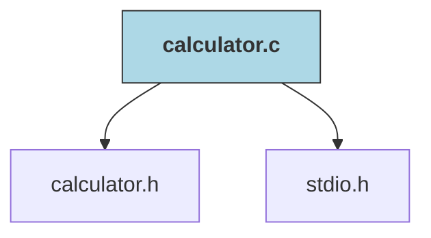
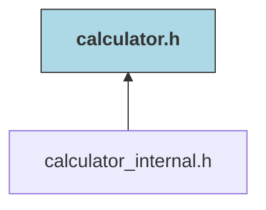

<!--
生成元: agree-before-implement スキル
文書種別: 最終仕様 (design)
最終更新日時: 2026-11-15 14:24:14 JST (承認後に関数名の誤記 `fix_doxygen_indent` を `fix_file` へ訂正)
最終更新エージェント: claude code / セッション ID: 03e5288f-ed33-43e2-a2f3-760514153b6f
稼働 OS: Windows
上流文書: `261115-doxygen-mermaid-backlog-discussion.md` (検討用 Markdown、合意版: 第 5 版)。削除されている場合があります。
再開手順: このファイルを開いたエージェントは、作業の前に agree-before-implement スキルを読み込んでください。上流文書が存在する場合は、上流文書の再開手順に従って進行位置を確認し、判断の経緯を上流文書の Q&A で確認します。存在しない場合は、この文書を単体の最終仕様として扱います。最終更新エージェントのセッション情報や稼働 OS・最終更新日時が参照可能であれば再開時のコンテキストや環境差分の把握に利用し、別エージェントや別環境・別 OS からの引き継ぎ、担当変更によりセッションが見つからない場合も異常とせず、文書の記載から継続してください。
-->

# Doxygen 図の Mermaid 移行の残課題対策 最終仕様

ファイル名: `261115-doxygen-mermaid-backlog-design.md`

## 目的と範囲

この文書は、[261114-doxygen-mermaid-migration-backlog.md](261114-doxygen-mermaid-migration-backlog.md) の残課題 BL-001 から BL-004 への対処を定めます。

Table: 課題ごとの対処

| 課題 ID | 対処 | 変更するサブモジュール |
| --- | --- | --- |
| BL-001 | 確認済みとして完了 (成果物の変更なし) | なし |
| BL-002 | テキスト モードの子プロセス呼び出し 17 か所に文字コードを明示 | `framework/doxyfw`、`framework/docsfw`、`framework/makefw` |
| BL-003 | `check-doxygen-indent.py --fix` を常に LF で書き戻す | `framework/doxyfw` |
| BL-004 | インクルード グラフの見出しを変え、矢印の向きと対象の位置を Doxygen HTML に合わせる | `framework/doxyfw` |

Git の操作 (ステージング、コミット、サブモジュールの更新の取り込み) は、この仕様の範囲に含めません。

## BL-001 他の app と Windows での生成結果の確認

BL-001 は、確認済みとして完了とします。成果物は変更しません。確認の根拠は次の 2 つです。

- Linux: Mermaid 移行を取り込んだ CI の実行 `43646517799` 以降、成果物 `docs-warns` (警告ファイルがあるときだけ保存される) がない。
- Windows: 9 個の app で `make doxy` を実行し、すべて警告 0 件で完了した。図 4,705 件がすべて ```` ```mermaid ```` と `Figure:` 行で出力され、`app/calc.net` の継承グラフも描画できた (対策元 backlog の「確認結果と対処 (2026-11-15)」)。

> [!NOTE]
> 記号 (`<`、`>`、`*` など) を含む名前のキャプションは、現在の app の実データにありません。この変換経路は、既存の単体テスト (`test_extract_graphs.py`、`test_preprocess.py`) で確認済みとして扱い、結合テストは追加しません。

## BL-002 子プロセスとのテキスト通信の文字コード

### 変更の規則

`subprocess.run()` と `subprocess.Popen()` で `text=True` を指定し、`encoding` を指定していない呼び出しに `encoding="utf-8"` を加えます。[Python の文字コード指定規範](../../python-text-encoding-guideline.md) の「子プロセスとのテキスト通信」に従います。

子プロセスが Python の場合は、子の標準入出力も UTF-8 になるよう、子の環境変数に `PYTHONIOENCODING=utf-8` を加えます。Windows の Python は、標準出力がパイプのとき既定でロケールの文字コード (日本語環境では cp932) で書き出します。親だけを UTF-8 にすると、非 ASCII 文字を含むパスなどの読み取りに失敗します。

> [!NOTE]
> 規範の注記「親プロセスで `encoding="utf-8"` を指定しても、子プロセス側の標準入出力エンコーディングは変更されません。両者の文字コード契約を一致させる必要があります。」を適用したものです。規範は変更しません。

### 対象の呼び出し

対象は、Python の構文木で抽出した次の 17 か所です (行番号は 2026-11-15 時点)。

Table: 文字コードを明示する呼び出し

| サブモジュール | ファイル | 行 | 子プロセス | 子の環境変数の追加 |
| --- | --- | --- | --- | --- |
| doxyfw | `bin_test/test_doxybook2_templates.py` | 73、82 | `doxygen`、`doxybook2` | なし |
| doxyfw | `bin_test/test_materialize_group_members.py` | 301、316 | `doxygen`、`doxybook2` | なし |
| doxyfw | `templates/generate-dependency-report.py` | 250、265、366、379、1423 | `git` | なし |
| docsfw | `livedocs/bin/vendor_assets.py` | 121 | `node` | なし |
| docsfw | `livedocs/bin_test/test_livedocs_publish_info.py` | 39 | `git` | なし |
| docsfw | `livedocs/bin_test/test_resolve_python_components.py` | 225、231、235 | Python (`resolve_python_components.py` とその子) | `PYTHONIOENCODING=utf-8` |
| docsfw | `livedocs/bin_test/test_stop_livedocs_serve.py` | 24 (`Popen`)、44 | `bash` 経由の Python、`bash` | 24 に `PYTHONIOENCODING=utf-8` |
| makefw | `bin_test/test_flex_bison_warnings.py` | 50 | `make` (Linux の GCC) | なし |

> [!NOTE]
> `test_flex_bison_warnings.py` は Linux だけで実行されるテストで、子プロセスは GCC です。MSVC のようにコンソールの文字コードで出力するツールは、対象に含みません。実装時に、子プロセスが UTF-8 以外で出力することが分かった場合は、その箇所の変更を止めて扱いを確認します。

## BL-003 字下げ修正の書き戻しの改行コード

`framework/doxyfw/bin/check-doxygen-indent.py` の修正処理 (`fix_file`) は、書き込みの `open()` に `newline='\n'` を指定し、実行環境によらず LF で書き戻します。読み込みは変更しません (CRLF も LF として読み込みます)。

- LF のファイルは、修正した行以外は変わりません。
- CRLF のファイルを修正すると、全行が LF になります。リポジトリの改行規則 (`.gitattributes` の `* text=auto eol=lf`) への正規化として扱います。
- 修正点がない場合と `--dry-run` の場合は、ファイルに書き込みません。
- 検出だけを行う処理 (字下げレベルの検査、図ブロックの検査、修正プレビュー) は変更しません。

`bin_test/test_check_doxygen_indent.py` に、`--fix` で次のとおり書き戻されることを確かめる単体テストを追加します。

- LF の入力は、LF だけで書き戻される。
- CRLF の入力は、CRLF を含まず LF だけで書き戻される。

## BL-004 インクルード グラフの見出しと向き

### 見出しとキャプション

2 種類のインクルード グラフの見出しを次のとおり変えます。キャプションは従来どおり `<名前> の<見出し>` の形です。

Table: インクルード グラフの見出し

| グラフ種別 | 変更前の見出し | 変更後の見出し | キャプションの例 |
| --- | --- | --- | --- |
| インクルード依存 (`incdepgraph`) | インクルード元 | インクルード依存関係 | `calculator.c のインクルード依存関係` |
| 被インクルード関係 (`invincdepgraph`) | インクルード先 | 被インクルード依存関係 | `calculator.h の被インクルード依存関係` |

### 矢印の向きと対象の位置

2 種類のインクルード グラフの矢印の向きと対象ノードの位置を、Doxygen HTML (Graphviz の図) に合わせます。どちらの図も、矢印は「インクルードする側 → インクルードされる側」へ向き、対象のファイルを上に置きます。

Table: インクルード グラフの向き

| グラフ種別 | Doxygen の XML のエッジ | Mermaid の出力 | 宣言 | 対象の位置 |
| --- | --- | --- | --- | --- |
| インクルード依存 | 対象 → インクルードされるファイル | XML の向きのまま | `flowchart TD` | 上 |
| 被インクルード関係 | 対象 → インクルードする側 | XML の向きを逆にする | `flowchart BT` | 上 |

出力は次のようになります。



Figure: calculator.c のインクルード依存関係



Figure: calculator.h の被インクルード依存関係

> [!IMPORTANT]
> Doxygen の XML の `invincdepgraph` は、対象の `node` が、対象をインクルードする側を `childnode` に持ちます (Doxygen 1.18.0 で確認)。Doxygen HTML は描画時に矢印を逆向きにするため、Mermaid でも XML のエッジを逆にします。

ノードの選び方 (ラベルが `.h` で終わるノードに絞る処理)、ノード ラベル (最短の後方パス)、対象ノードの強調の色 (水色) は変更しません。インクルード グラフ以外のグラフ種別も変更しません。

### 変更するファイル

Table: BL-004 で変更するファイル (`framework/doxyfw` 配下)

| ファイル | 変更内容 |
| --- | --- |
| `templates/extract-graphs.py` | 見出しの文字列を変更。インクルード依存は `reverse_edges` を外し、被インクルード関係は `reverse_edges=True` と `direction='BT'` を指定。関係するコメントと `graph_to_mermaid()` の `reverse_edges` の説明を、特定のグラフ種別に依存しない記述へ更新 |
| `templates/postprocess.sh` | 見出しの前に空行を入れる awk の正規表現 (L942) の `インクルード元|インクルード先` を新しい見出しへ変更 |
| `bin_test/test_extract_graphs.py` | 見出しとキャプションの期待値を変更。被インクルード関係の入力 XML を実際の Doxygen の XML の向き (対象 → インクルードする側) へ訂正。2 種類のグラフについて、宣言 (`flowchart TD` / `flowchart BT`) とエッジの向き (対象からの矢印 / 対象への矢印) を確かめる |
| `docs/extract-graphs.md` | 「図の宣言と向き」の表、「生成される Mermaid の例」のインクルード依存の例、「挿入位置と見出し」の見出しとキャプションの表を更新し、被インクルード関係の例を追加 |

生成 Markdown (`app/*/docs/doxybook2*`) はリポジトリの管理対象ではありません。次回の `make doxy` で新しい見出しと向きになります。

## 知見の反映計画

Table: 永続的な知見の反映先

| 反映先 | 反映する内容 |
| --- | --- |
| `framework/doxyfw/docs/extract-graphs.md` | 2 種類のインクルード グラフは Doxygen HTML と同じく「インクルードする側 → インクルードされる側」の矢印で対象を上に置くこと、`invincdepgraph` の XML は対象からインクルードする側へのエッジで、出力時に逆にすること |
| `framework/doxyfw/templates/extract-graphs.py` のコメント | 各グラフで `reverse_edges` と `direction` を指定する理由 (Doxygen HTML の向きに合わせるため) |
| `framework/doxyfw/bin/check-doxygen-indent.py` のコメント | 書き戻しを LF に固定する理由 (リポジトリの改行規則に合わせ、Windows で CRLF にしないため) |

BL-002 の内容は既存の Python の文字コード指定規範の適用であり、規範文書は変更しません。

## 検証手順

1. doxyfw の局所テストを実行します。

    ```bash
    python3 -X warn_default_encoding -W error::EncodingWarning -m unittest discover -s framework/doxyfw/bin_test -p 'test_*.py'
    ```

2. docsfw の変更したテスト (`livedocs/bin_test/` の 3 ファイル) と、`vendor_assets.py` の単体テスト (`livedocs/bin_test/test_vendor_assets.py`) を同じオプションで実行します。Windows では、`.venv` の Python と、子 Python への `PYTHONWARNDEFAULTENCODING=1` と `PYTHONWARNINGS=error::EncodingWarning` の継承を使います。
3. makefw の `bin_test/test_flex_bison_warnings.py` を同じオプションで実行します。Linux 専用のため、Windows では skip されることだけを確認し、Linux での実行結果は CI で確認します。
4. 構文木での再抽出で、`framework` 配下に `text=True` で `encoding` のない呼び出しが残っていないことを確認します。
5. 変更した Markdown (`framework/doxyfw/docs/extract-graphs.md` と、この案件の生成物) に `text_style_jp.py --dry-run` を実行し、問題がなければ `--in-place` を実行します。
6. `mmdc` が使える場合は、`extract-graphs.md` の新しい 2 つの例を描画し、構文エラーがないことを確認します。

framework 全体のテストと各 app の `make doxy` による再生成は、この仕様の検証に含めません。実施する場合は、コストを説明してユーザーに確認します。

## 受入条件

- BL-002 の 17 か所すべてに `encoding="utf-8"` が指定され、子が Python の 2 ファイルでは子の環境変数に `PYTHONIOENCODING=utf-8` が加えられていること。
- 検証手順 1 から 3 のテストが、`EncodingWarning` をエラーとして扱う設定で成功 (または対象外の OS で skip) すること。
- 検証手順 4 の再抽出で、`framework` 配下の対象の呼び出しが 0 件であること。
- `check-doxygen-indent.py --fix` が LF と CRLF の入力をどちらも LF で書き戻し、追加した単体テストが成功すること。
- 2 種類のインクルード グラフが新しい見出しとキャプションで出力され、矢印の向きと宣言が「矢印の向きと対象の位置」の表のとおりであることを、`test_extract_graphs.py` が確かめていること。
- `postprocess.sh` の見出しの前の空行の処理が、新しい見出しに適用されること。
- `extract-graphs.md` が新しい見出し、向き、例に更新され、`text_style_jp.py --dry-run` で指摘がないこと。
- 対策元 backlog の BL-002 から BL-004 の状態と経緯・対処が更新されていること。
