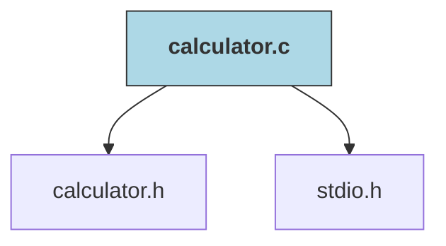
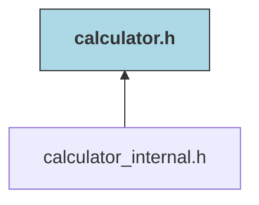

<!--
生成元: agree-before-implement スキル
文書種別: 検討用 Markdown (discussion)
最終更新日時: 2026-11-15 14:24:14 JST
最終更新エージェント: claude code / セッション ID: 03e5288f-ed33-43e2-a2f3-760514153b6f (第 4 版は codex による事実照合レビュー)
稼働 OS: Windows
下流文書: `261115-doxygen-mermaid-backlog-design.md` (最終仕様)、`261115-doxygen-mermaid-backlog-backlog.md` (残課題一覧)。未作成の場合や、削除されている場合があります。
再開手順: このファイルを開いたエージェントは、作業の前に agree-before-implement スキルを読み込んでください。ユーザーが編集した最新版を読み直し、作業 WBS の `← **CURRENT**` の項目から再開します。最終更新エージェントのセッション情報や稼働 OS・最終更新日時が参照可能であれば再開時のコンテキストや環境差分の把握に利用し、別エージェントや別環境・別 OS からの引き継ぎ、担当変更によりセッションが見つからない場合も異常とせず、文書の記載から継続してください。`← **CURRENT**` の項目は処理が中止された項目である場合があり、どこまで進んでいたかは文書だけでは分かりません。対象成果物の内容を確認して実施済みの範囲を特定してから、作業を再開してください。`← **CURRENT**` がなく、作業 WBS がすべて完了 (✅) であれば、この案件の合意フローは完了しています。
-->

# Doxygen 図の Mermaid 移行の残課題対策の検討

ファイル名: `261115-doxygen-mermaid-backlog-discussion.md`

## 検討の識別

検討 ID: `doxygen-mermaid-backlog-20261115`

版: 5

状態: 完了 (成果物の承認済み)

## 作業 WBS と進捗管理

この検討用 Markdown が管理する作業 WBS です。Q&A のターンごとに必要に応じて見直します。見送りの決定や範囲外の気付きは、どの段階でも生じた時点で `261115-doxygen-mermaid-backlog-backlog.md` に追記します。

凡例: ⏸️ 未着手、🔄 実施中、🚫 ブロック中、⚠️ 要注意、✅ 完了。現在取り組んでいる項目の末尾に `← **CURRENT**` を付けます。

- ✅ 1. 検討用 Markdown のための情報収集と質問の実施
    - ✅ 1.1. 前提条件と要求事項の調査 (対策元 backlog の 4 項目、CI の成果物、ローカルの生成結果、関連コード)
    - ✅ 1.2. 確認項目 ([Q-001](#q-001-bl-001-の-windows-側の確認根拠) から [Q-006](#q-006-doxygen-html-に合わせる項目)) の作成
    - ✅ 1.3. Q&A ターンごとのユーザー回答の受付と記録 (第 5 版で [Q-006](#q-006-doxygen-html-に合わせる項目) まで記録)
    - ✅ 1.4. 回答に基づく前提・制約の検証と WBS の見直し (第 5 版: 4.3 に `test_extract_graphs.py` の被インクルード グラフの入力 XML の訂正を追加)
- ✅ 2. 前提合意と残懸念の解消 (第 1 ゲート: 最終仕様作成への着手)
    - ✅ 2.1. 全論点に対する未解決事項および質問の解消確認
    - ✅ 2.2. 方針・前提条件の合意確定 (合意版: 第 5 版)
- ✅ 3. 最終決定事項 (最終仕様) の作成と承認の受付
    - ✅ 3.1. `261115-doxygen-mermaid-backlog-design.md` の作成
    - ✅ 3.2. 最終仕様における受入条件と整合性の確認
    - ✅ 3.3. 対話セッションにおける最終仕様の承認の受付 (第 2 ゲート)。2026-11-15 14:00:53 JST に Tetsuo Honda が承認。作業は `agy --dangerously-skip-permissions` (モデル `gemini-4-hydrogen-high`) に委譲し、claude code が管理とレビューを行う (同時のユーザー指示)
- ✅ 4. 承認された最終仕様に従った作業の実施
    - ✅ 4.1. BL-002: 17 か所の文字コード指定 ([Q-003](#q-003-bl-002-の文字コード指定の対象範囲))。agy が実装し、claude code が差分をレビュー
        - ✅ 4.1.1. doxyfw: `bin_test/test_doxybook2_templates.py`、`bin_test/test_materialize_group_members.py`、`templates/generate-dependency-report.py`
        - ✅ 4.1.2. docsfw: `livedocs/bin/vendor_assets.py`、`livedocs/bin_test/` の 3 ファイル (子 Python 2 ファイルは `PYTHONIOENCODING=utf-8` を追加)
        - ✅ 4.1.3. makefw: `bin_test/test_flex_bison_warnings.py`
    - ✅ 4.2. BL-003: `framework/doxyfw/bin/check-doxygen-indent.py` の LF での書き戻しと `bin_test/test_check_doxygen_indent.py` へのテスト 2 件の追加 ([Q-004](#q-004-bl-003-の改行コードの扱い))。agy が実装し、claude code が差分をレビュー
    - ✅ 4.3. BL-004 (agy が実装し、claude code がレビュー。コメントの用語「逆インクルード依存グラフ」を「被インクルード関係グラフ」へそろえる修正をレビュー時に実施): `framework/doxyfw/templates/extract-graphs.py`、`templates/postprocess.sh`、`docs/extract-graphs.md`、`bin_test/test_extract_graphs.py` の見出し名の更新と、矢印の向きと対象の位置を Doxygen HTML に合わせる変更 ([Q-005](#q-005-bl-004-のインクルード-グラフの見出し名)、[Q-006](#q-006-doxygen-html-に合わせる項目))。`test_extract_graphs.py` の被インクルード グラフの入力 XML を実際の Doxygen の XML の向きへ訂正
    - ✅ 4.4. BL-001: 別エージェントによる確認で対処済み (対策元 backlog の「確認結果と対処 (2026-11-15)」)。この案件での成果物の変更なし
    - ✅ 4.5. 正本ドキュメントおよびコード コメントへの永続的知見の反映 (`docs/extract-graphs.md` の「図の宣言と向き」、`extract-graphs.py` と `check-doxygen-indent.py` のコメント)
    - ✅ 4.6. doxyfw、docsfw、makefw の変更対象に対応する局所テスト (`-X warn_default_encoding -W error::EncodingWarning` 付き) と `text_style_jp.py` の実施。makefw の対象テストは Linux 専用のため Windows では skip (受入条件で許容)。全体テストは未実施
    - ✅ 4.7. 受入条件への適合確認 (全完確認)
    - ✅ 4.8. 残課題一覧の整理 (この案件で新たな残課題はなく、`261115-doxygen-mermaid-backlog-backlog.md` は作成しない。対策元 `261114-doxygen-mermaid-migration-backlog.md` の BL-002 から BL-004 を「対応済み」にし、経緯と対処を追記)
- ✅ 5. 成果物の承認の受付 (第 3 ゲート)
    - ✅ 5.1. 成果物・検証結果・残課題の提示
    - ✅ 5.2. 対話セッションにおける成果物の承認の受付。2026-11-15 に Tetsuo Honda が承認

## 対象と参照資料

対象成果物: `framework/doxyfw`、`framework/docsfw`、`framework/makefw` 配下のスクリプト、テスト、文書 (詳細は作業 WBS の 4.1 から 4.4)

今回の対象範囲: [261114-doxygen-mermaid-migration-backlog.md](261114-doxygen-mermaid-migration-backlog.md) の BL-001 から BL-004 の全項目 (ユーザー指示「全項目の対処を進めて」による)

書き込み可能な検討用 Markdown: この文書 (`261115-doxygen-mermaid-backlog-discussion.md`)

参照資料と版: 初回調査は作業ツリーの `main` (`f70e27ca`) 時点。第 4 版の再照合は `HEAD=c4e2d75e` の作業ツリー (未コミットの変更を含む)。CI の実行 `43646517799` (Mermaid 移行の取り込み、`973d0709`) から `43662114020` (`f70e27ca`) の成果物

## 調査結果

### BL-001 に関する事実

Linux の CI では、文書生成ジョブが `make doxy && make docs` を実行し、`app/**/doxy*.warn` があれば成果物 `docs-warns` として保存します (`.github/workflows/ci.yml` の L698 から L775)。Mermaid 移行を取り込んだ実行 `43646517799` 以降の 3 回の実行 (いずれも成功) には `docs-warns` がありません。当該 CI の生成対象について、保存対象の警告ファイルがなかったことを示します。成果物の不在だけでは、17 個の app すべてで Doxygen が実行されたとは判断できません。

一方、Windows の CI は Doxygen と Doxybook2 を `bin_test` の実行のためにだけ導入し、`make doxy` を実行しません。このため、対策元 backlog の恒久対応案にある「Windows の `docs-warns`」は存在しません。

作業ツリーには、2026-11-15 10:32 から 12:15 に更新された生成結果があります。その集計は次のとおりです (`string-catalog-sample` の `doxybook2_internal` と `doxybook2_public` は 2026-09-12 の古い出力で、現在の出力先 `doxybook2` とは別のため除外)。

| app | Mermaid 図 | PlantUML 図 | 継承グラフ (`flowchart BT`) | `Figure:` 行 |
| --- | --- | --- | --- | --- |
| calc (internal / public) | 40 / 8 | 0 / 0 | 0 / 0 | 40 / 8 |
| calc.net | 17 | 0 | 3 | 17 |
| cplat (internal / public) | 2827 / 179 | 0 / 0 | 0 / 0 | 2827 / 179 |
| doxygen-sample (internal / public) | 2 / 0 | 0 / 0 | 0 / 0 | 2 / 0 |
| override-sample (internal / public) | 34 / 9 | 0 / 0 | 0 / 0 | 34 / 9 |
| porter (internal / public) | 724 / 8 | 0 / 0 | 0 / 0 | 724 / 8 |
| service-sample | 32 | 0 | 0 | 32 |
| string-catalog-sample | 327 | 0 | 0 | 327 |
| struct-meta (internal / public) | 483 / 15 | 0 / 0 | 0 / 0 | 483 / 15 |

Table: 作業ツリーの生成結果の集計

`app/calc.net` の継承グラフ (例: `classCalcLib_1_1CalcException.md` の `CalcLib::CalcException の継承関係`) は ```` ```mermaid ```` と `Figure:` 行で出力されています。作業ツリーに `doxy*.warn` はありません。ただし、記号 (`<`、`>`、`*`、`[`、`]`、`~` など) を含むキャプションは、どの app の生成結果にもありません。

第 2 版の時点で、別エージェントが BL-001 を確認し、対策元 backlog に「確認結果と対処 (2026-11-15)」を追記して状態を「完了」にしました。追記の要点は次のとおりです。

- Windows 実機で 9 個の app の `make doxy` を実行し、すべて終了コード `0`、`doxy*.warn` 0 件で完了した。図 4,705 件がすべて ```` ```mermaid ```` と `Figure:` 行で出力された。
- `app/calc.net` の継承グラフ 3 件が `mmdc` で SVG に変換できた。
- 記号を含むキャプションは実データに存在しないため、この経路は単体テスト (`test_extract_graphs.py`、`test_preprocess.py`) での確認で十分と判断した。

### BL-002 に関する事実

対策元 backlog が挙げた 4 か所は、いずれも `subprocess.run(..., text=True)` で `encoding` を指定していません。同じ指定漏れは、doxyfw の本体スクリプト `templates/generate-dependency-report.py` にも 5 か所 (L253、L268、L369、L382、L1426) あります。L253 と L268 は `git` の出力を読み取る箇所で、既定の文字コードが UTF-8 でない Windows では、非 ASCII 文字を含むパスなどの読み取りに失敗する可能性があります。現状の呼び出しではコミット メッセージを読み取っていません。doxyfw 以外では、`framework/docsfw/livedocs` に 7 か所、`framework/makefw/bin_test` に 1 か所あります。

### BL-003 に関する事実

`check-doxygen-indent.py` の修正処理 (`fix_file`。第 5 版までの `fix_doxygen_indent` は関数名の誤記) は、L364 で `newline` を指定せずに読み込み、L462 で `newline` を指定せずに書き込みます。読み込み時に CRLF は LF へ変換され、Windows での書き込み時に LF は CRLF へ変換されます。リポジトリの `.gitattributes` は `* text=auto eol=lf` を基本とし、`.bat` と `.cmd` は CRLF の例外です。この規則だけで作業ツリーの全ファイルが LF であるとは断定できません。

### BL-004 に関する事実

見出し名は、対策元 backlog が挙げた箇所に加えて `templates/postprocess.sh` の L942 (見出しの前に空行を入れる awk の正規表現) にも列挙されています。このため、名称を変える場合は postprocess.sh も同時に更新する必要があります。

リポジトリ内の既存のコメントは、「インクルード元」を「対象をインクルードする側のファイル」の意味で使っています (例: `app/cplat/prod/include/cplat/base/shared_lib_lifecycle.h` の L14「インクルード元の .c ファイルは以下の関数を定義する必要があります」)。この用法は、`incdepgraph` (対象がインクルードするファイル) に付けている見出し「インクルード元」と逆の意味です。生成 Markdown (`docs/doxybook2*`) はリポジトリの管理対象ではなく、`make doxy` で再生成されます。

### Doxygen HTML との差異

[Q-005](#q-005-bl-004-のインクルード-グラフの見出し名) の補足を受けて、`app/cplat` の Doxygen HTML (`pages/doxygen/c-platform_internal/bench__case_8h__incl.svg` と `bench__case_8h__dep__incl.svg`。2026-09-22 の生成物) の座標と、作業ツリーの Mermaid 出力 (`app/cplat/docs/doxybook2_internal/Files/src/cmd/bench-io/bench_case.h.md`、`Files/include/cplat.h.md`) を比べました。

| 項目 | Doxygen HTML | 現在の Mermaid |
| --- | --- | --- |
| インクルード依存の矢印 | 対象 → インクルードされるファイル | インクルードされるファイル → 対象 (逆) |
| インクルード依存の対象の位置 | 上 | 下 |
| 被インクルードの矢印 | インクルードする側 → 対象 (矢印の先端が対象) | 対象 → インクルードする側 (逆) |
| 被インクルードの対象の位置 | 上 | 上 |
| 被インクルードのノード | ソース ファイル (`.c`) を含む | ラベルが `.h` で終わるノードだけ (`.hpp` なども除外)。`bench_case.h` のようにソース ファイルからだけインクルードされるヘッダーでは、図が出力されない |
| ノード ラベル | パス (例: `cplat/base/error.h`) | 最短の後方パス (例: `error.h`) |
| 対象ノードの強調 | 灰色 | 水色 (`#ADD8E6`) |

Table: インクルード グラフの Doxygen HTML との差異

この表は生成時期が異なる出力の比較です。差異の原因を確定するには、同じソースと設定で生成した HTML と XML の比較が必要です。`.h` 以外を除く処理は両方のインクルード グラフに適用され、インクルード依存では対象自身だけを拡張子によらず残します。

Doxygen HTML の 2 つの図は、どちらも「インクルードする側からインクルードされる側」へ矢印を向け、対象を上に置きます。現在の Mermaid は、インクルード依存では XML のエッジを意図的に逆にしています (`extract-graphs.py` の `reverse_edges=True`)。

第 5 版で、Doxygen 1.18.0 (作業端末の PATH 上のもの) により一時ディレクトリで小さな入力 (`a.h` が `b.h` をインクルードし、`user.h` が `a.h` をインクルード) の XML を生成し、エッジの向きを確かめました。`incdepgraph` も `invincdepgraph` も、対象 (`a.h`) の `node` が `childnode` を持ちます。つまり `invincdepgraph` の XML は「対象 → インクルードする側」の向きで、Doxygen HTML は描画時にこれを逆向きの矢印にしています。一方、`bin_test/test_extract_graphs.py` の `test_invincdepgraph_inserts_include_destination_section` は、入力 XML を「インクルードする側 → 対象」の向きで組んでおり、実際の XML と逆です。なお、`stdio.h` から `stdio.h` への自己ループは、Doxygen HTML にも同じエッジがあります (`app/cplat` 独自の `stdio.h` がシステムの `stdio.h` をインクルードするため)。

## 現行の合意内容

ユーザーの指示により、対策元 backlog の BL-001 から BL-004 の全項目を今回の対象とします。

BL-001 は、別エージェントの確認結果を反映するユーザーの指示 (2026-11-15 13:35 JST) により、対処済みとして扱います。この案件では BL-001 のための成果物の変更を行いません ([Q-001](#q-001-bl-001-の-windows-側の確認根拠)、[Q-002](#q-002-bl-001-の記号を含むキャプションの検証方法))。

BL-002 は、見つかった 17 か所すべてに `encoding="utf-8"` を指定します。対象は doxyfw、docsfw、makefw の 3 つのサブモジュールです ([Q-003](#q-003-bl-002-の文字コード指定の対象範囲))。

BL-003 は、`check-doxygen-indent.py` の修正処理の書き込みに `newline='\n'` を指定し、常に LF で書き戻します ([Q-004](#q-004-bl-003-の改行コードの扱い))。

BL-004 は、見出しを「インクルード依存関係」と「被インクルード依存関係」に変更します ([Q-005](#q-005-bl-004-のインクルード-グラフの見出し名))。あわせて、2 種類のインクルード グラフの矢印の向きと対象ノードの位置を Doxygen HTML に合わせます。ノードの選び方、ラベル、強調の色は現在の仕様を維持します ([Q-006](#q-006-doxygen-html-に合わせる項目))。

第 1 ゲートの合意版は第 5 版です。

## 観点別の確認

| 観点 | 状態 | 根拠・関連 Q |
| --- | --- | --- |
| 目的・利用者 | 確認済み | 対策元 backlog の各項目の「本来あるべき姿」 |
| 範囲・境界 | 確認済み | [Q-003](#q-003-bl-002-の文字コード指定の対象範囲)、[Q-006](#q-006-doxygen-html-に合わせる項目) |
| 入力・根拠 | 確認済み | 対策元 backlog の BL-001 の確認結果 ([Q-001](#q-001-bl-001-の-windows-側の確認根拠)) |
| 整合性・依存関係 | 確認済み | [Q-005](#q-005-bl-004-のインクルード-グラフの見出し名)、[Q-006](#q-006-doxygen-html-に合わせる項目)、[Doxygen HTML との差異](#doxygen-html-との差異) (実際の XML の向き) |
| 実現性・例外 | 確認済み | [Q-004](#q-004-bl-003-の改行コードの扱い) (CRLF の入力は LF へ正規化) |
| 受入条件・検証 | 確認済み | [対象成果物と合意版](#対象成果物と合意版) の受入条件 |

## 質問一覧

| Q-ID | 論点 | 状態 | 依存・関連 |
| --- | --- | --- | --- |
| [Q-001](#q-001-bl-001-の-windows-側の確認根拠) | BL-001 の Windows 側の確認根拠 | 解決済み | なし |
| [Q-002](#q-002-bl-001-の記号を含むキャプションの検証方法) | BL-001 の記号を含むキャプションの検証方法 | 解決済み | [Q-001](#q-001-bl-001-の-windows-側の確認根拠) |
| [Q-003](#q-003-bl-002-の文字コード指定の対象範囲) | BL-002 の文字コード指定の対象範囲 | 解決済み | なし |
| [Q-004](#q-004-bl-003-の改行コードの扱い) | BL-003 の改行コードの扱い | 解決済み | なし |
| [Q-005](#q-005-bl-004-のインクルード-グラフの見出し名) | BL-004 のインクルード グラフの見出し名 | 解決済み (補足を [Q-006](#q-006-doxygen-html-に合わせる項目) で確認) | [Q-006](#q-006-doxygen-html-に合わせる項目) |
| [Q-006](#q-006-doxygen-html-に合わせる項目) | Doxygen HTML に合わせる項目 | 解決済み | [Q-005](#q-005-bl-004-のインクルード-グラフの見出し名) |

## 明確化のための確認項目

### Q-001 BL-001 の Windows 側の確認根拠

**Status**

解決済み

**Question**

BL-001 の Windows 側の確認として、作業ツリーにある 2026-11-15 10:32 から 12:15 の生成結果を、Windows 上の `make doxy` の結果として扱ってよいですか。

**Context**

Windows の CI は `make doxy` を実行しないため、Windows の生成結果を CI から確認する手段はありません ([BL-001 に関する事実](#bl-001-に関する事実))。作業ツリーには本日更新された生成結果があり、すべて Mermaid 図と `Figure:` 行で出力され、`doxy*.warn` もありません。ただし、この生成をどの OS (Windows ネイティブか WSL か) で実行したかは、ファイルからは分かりません。Windows での生成と確認できれば、BL-001 の「Linux と Windows の双方」の条件は、Linux を CI、Windows を作業ツリーの結果で満たせます。

**Answer**

選択方式: 単一選択

- [ ] A: Windows ネイティブ環境で `make doxy` を実行した結果として扱う。
- [ ] B: Windows の結果として扱わない。ユーザーが Windows で `make doxy` を再実行し、その結果で確認する。
- [ ] C: Windows の確認は今回行わず、新しい backlog へ引き継ぐ。
- [x] D: その他
- [ ] X: 意図不明 (詳細な質問内容に再生成すること)

その他の回答 / 補足: 「BL-001 の確認を他のエージェントにしてもらった。261114-doxygen-mermaid-migration-backlog.md を見て反映して」(対話セッションでの発言を転記)

回答者: Tetsuo Honda  
回答日時: 2026-11-15 13:35:59 JST

**Recommendation**

推奨: なし  
理由: 生成した OS はユーザーだけが知っているため、推奨を示せません。Windows ネイティブで生成した場合は A、不明な場合は B を選んでください。

**Assessment**

対策元 backlog の BL-001 に「確認結果と対処 (2026-11-15)」が追記され、状態が「完了」になっていることを確認しました。追記には、Windows 実機で 9 個の app の `make doxy` を実行し、終了コード `0`、`doxy*.warn` 0 件、図 4,705 件がすべて Mermaid と `Figure:` 行で出力された結果が記録されています。この件数と app の一覧は、[BL-001 に関する事実](#bl-001-に関する事実) の集計 (`string-catalog-sample` の旧ディレクトリを除く) と一致します。Linux 側の CI の結果とあわせて、BL-001 の「Linux と Windows の双方」の条件は確認済みと判断します。

**Related**

[Q-002](#q-002-bl-001-の記号を含むキャプションの検証方法)

### Q-002 BL-001 の記号を含むキャプションの検証方法

**Status**

解決済み

**Question**

記号を含む名前のキャプションの変換経路を、どの方法で確認しますか。

**Context**

どの app の実データにも、記号 (`<`、`>`、`*`、`[`、`]`、`~` など) を含むキャプションがありません ([BL-001 に関する事実](#bl-001-に関する事実))。そのため、app の再生成では、この経路を確認できません。現状は、変換ヘルパーの単体テスト (`test_extract_graphs.py`、`test_preprocess.py`) だけが経路を確認しています。

`bin_test/test_mermaid_pipeline.py` は、一時ディレクトリで Doxygen、`preprocess.sh`、Doxybook2、`postprocess.sh` を順に実行する結合テストです。ここへ記号を含む入力を加えると、実際のツールを通した結果を自動で確認できます。

```text
案 A: test_mermaid_pipeline.py に C++ の入力を追加する
  入力: @mermaid "Foo<T>::operator* の図" を含むクラス テンプレート
  期待: 出力 Markdown に "Figure: Foo&#60;T&#62;::operator&#42; の図" がある
```

```text
案 B: テストを追加せず、既存の単体テストで確認済みとして BL-001 を閉じる
```

**Answer**

選択方式: 単一選択

- [ ] A: (推奨) `test_mermaid_pipeline.py` に、記号を含むキャプションの結合テストを追加する。
- [x] B: テストを追加せず、既存の単体テストで確認済みとして扱う。
- [ ] C: その他
- [ ] X: 意図不明 (詳細な質問内容に再生成すること)

その他の回答 / 補足: 対話セッションでの発言「BL-001 の確認を他のエージェントにしてもらった。261114-doxygen-mermaid-migration-backlog.md を見て反映して」による。反映元の backlog は、この経路を「単体テスト (`test_extract_graphs.py`、`test_preprocess.py`) での確認をもって十分と判断しました」とし、BL-001 を「完了」としているため、B に当たるものとして転記した。

回答者: Tetsuo Honda  
回答日時: 2026-11-15 13:35:59 JST

**Recommendation**

推奨: A  
理由: 実データに該当する名前が現れるまで経路が通らないため、実際の Doxygen と Doxybook2 を通す結合テストで常時確認できる状態にすると、BL-001 の「発行された文書を目視するまで気付けない」リスクを減らせます。テストは Linux と Windows の CI の `bin_test` で実行されます。  
制約: 自動生成グラフ (継承グラフなど) のキャプションは Doxygen が XML にグラフを出力する条件に依存するため、追加するテストは Doxygen コメントの図 (`@mermaid`) のキャプションを主対象とします。自動生成グラフも含められるかは実装時に確認し、含められない場合は結果を報告します。

**Assessment**

B の採用により、記号を含むキャプションの経路は単体テストだけで確認する状態になります。実データに該当する名前が現れた時点で初めて実際のツールを通るため、推奨案 A が減らそうとしたリスクは残ります。ただし、BL-001 の「本来あるべき姿」(すべての app で図が Mermaid と `Figure:` 行で出力され、新しい警告がない) は満たしており、未対処の残課題とはしません。結合テストを追加する場合は、新たな判断として別の Q で確認します。

**Related**

[Q-001](#q-001-bl-001-の-windows-側の確認根拠)

### Q-003 BL-002 の文字コード指定の対象範囲

**Status**

解決済み

**Question**

`subprocess.run(..., text=True)` の文字コード指定を、どの範囲まで修正しますか。

**Context**

対策元 backlog の対象は、doxyfw のテスト 2 ファイルの 4 か所です。調査の結果、同じ指定漏れが doxyfw の本体スクリプト `templates/generate-dependency-report.py` に 5 か所、docsfw に 7 か所、makefw に 1 か所ありました ([BL-002 に関する事実](#bl-002-に関する事実))。本体スクリプトの指定漏れは、テストと異なり、Windows での `make doxy` の実行結果に影響する可能性があります。docsfw と makefw は別のサブモジュールで、今回の対策元 backlog の範囲外です。

```text
案 A: doxyfw のテスト 4 か所 + generate-dependency-report.py の 5 か所を修正
      docsfw と makefw の 8 か所は新しい backlog に記録
案 B: doxyfw のテスト 4 か所だけを修正し、ほかは新しい backlog に記録
案 C: 見つかった全 17 か所を修正
```

**Answer**

選択方式: 単一選択

- [ ] A: (推奨) doxyfw のテストと本体スクリプトの 9 か所を修正し、docsfw と makefw は新しい backlog に記録する。
- [ ] B: 対策元 backlog の 4 か所だけを修正し、ほかは新しい backlog に記録する。
- [x] C: 見つかった全 17 か所を修正する。
- [ ] D: その他
- [ ] X: 意図不明 (詳細な質問内容に再生成すること)

その他の回答 / 補足:

回答者: Tetsuo Honda  
回答日時: 2026-11-15 13:43:58 JST (検討用 Markdown への記入をユーザーが対話セッションで通知した時刻)

**Recommendation**

推奨: A  
理由: 同じ doxyfw の中で、本体スクリプトの指定漏れのほうが実害の可能性が大きいためです。docsfw と makefw は別のサブモジュールで、検証と取り込みの単位が分かれるため、別案件として扱うほうが変更の確認が容易です。

**Assessment**

C の採用により、修正対象は doxyfw、docsfw、makefw の 3 つのサブモジュールにまたがります。対象は次の 17 か所で、`subprocess.run` 16 か所と `subprocess.Popen` 1 か所の `text=True` に `encoding="utf-8"` を加えます。

- doxyfw: `bin_test/test_doxybook2_templates.py` (2 か所)、`bin_test/test_materialize_group_members.py` (2 か所)、`templates/generate-dependency-report.py` (5 か所)
- docsfw: `livedocs/bin/vendor_assets.py` (1 か所)、`livedocs/bin_test/test_livedocs_publish_info.py` (1 か所)、`livedocs/bin_test/test_resolve_python_components.py` (3 か所)、`livedocs/bin_test/test_stop_livedocs_serve.py` (2 か所)
- makefw: `bin_test/test_flex_bison_warnings.py` (1 か所)

第 4 版では Python の構文木で呼び出し単位に再集計しました。`test_expand_toc.py` はすでに UTF-8 を指定しており対象外です。代わりに `test_resolve_python_components.py` の L235 の呼び出しが対象に入り、合計は 17 か所のままです。実装時には各箇所を読んで確かめ、静的な呼び出し一覧と `-X warn_default_encoding -W error::EncodingWarning` 付きの局所テストを併用します。未実行の経路の指定漏れはテストだけでは検出できません。子 Python プロセスの警告も調べる場合は、`PYTHONWARNDEFAULTENCODING=1` と `PYTHONWARNINGS=error::EncodingWarning` を子プロセスへ継承させます。対象の子プロセスが UTF-8 以外で出力するもの (たとえば OS 標準のコマンド) が含まれる場合は、修正を止めて別の Q で確認します。

**Related**

[Q-004](#q-004-bl-003-の改行コードの扱い) (同じ Python の入出力規範に関する判断)

### Q-004 BL-003 の改行コードの扱い

**Status**

解決済み

**Question**

`check-doxygen-indent.py --fix` で書き戻すとき、改行コードをどう扱いますか。

**Context**

現状は、読み込み時に CRLF を LF へ変換し、Windows での書き込み時に LF を CRLF へ変換します ([BL-003 に関する事実](#bl-003-に関する事実))。修正方法は 2 つあります。

```python
# 案 A: 読み込み・書き込みとも newline='' (元の改行コードを 1 行ごとに保つ)
with open(filepath, 'r', encoding='utf-8', newline='') as f:
    lines = f.readlines()
...
with open(filepath, 'w', encoding='utf-8', newline='') as f:
    f.writelines(lines)
# 未修正行の改行を保持する。修正行は別途、元の行末を抽出して再付与する変更が必要。
```

```python
# 案 B: 書き込みだけ newline='\n' (常に LF で書く)
with open(filepath, 'w', encoding='utf-8', newline='\n') as f:
    f.writelines(lines)
# LF のファイルは LF のまま。CRLF のファイルは全行が LF に変わる。
```

**Answer**

選択方式: 単一選択

- [ ] A: (推奨) 読み込み・書き込みとも `newline=''` で、元の改行コードを保つ。
- [x] B: 書き込み時に `newline='\n'` で、常に LF に統一する。
- [ ] C: その他
- [ ] X: 意図不明 (詳細な質問内容に再生成すること)

その他の回答 / 補足: Windows で CRLF にしているのは広義の不具合と思う。このリポジトリでは LF 統一のはず。

回答者: Tetsuo Honda  
回答日時: 2026-11-15 13:43:58 JST (検討用 Markdown への記入をユーザーが対話セッションで通知した時刻)

**Recommendation**

推奨: A  
理由: 対策元 backlog の「本来あるべき姿」は、実行環境によらず元のファイルの改行コードを保つことです。B では、CRLF のファイルに字下げの修正をすると全行が変わり、backlog が挙げたリスク (差分が全行に及ぶ) が CRLF のファイルで残ります。  
制約: 案 A の変更は修正処理 (`fix_doxygen_indent`) の読み込みと書き込みに限定し、検出だけを行う読み込み処理は変更しません。CRLF と LF の入力それぞれで、修正後に改行コードが保たれる単体テストを追加します。

**Assessment**

B の補足は、リポジトリの `.gitattributes` (`* text=auto eol=lf`) と整合します ([BL-003 に関する事実](#bl-003-に関する事実))。修正処理の書き込みに `newline='\n'` を指定すると、実行環境によらず LF で書き戻します。読み込みは既定のまま (CRLF も LF として読む) とするため、CRLF のファイルを修正した場合は全行が LF になります。修正点がない場合と `--dry-run` では書き込まないため、CRLF を常に正規化する操作ではありません。書き戻す場合の LF 化をリポジトリの改行規則への正規化として扱い、残課題としません。変更は修正処理の書き込みに限定し、検出だけを行う処理は変更しません。単体テストは、LF の入力が LF のまま、CRLF の入力が LF で書き戻されることを確認します。

**Related**

[Q-003](#q-003-bl-002-の文字コード指定の対象範囲)

### Q-005 BL-004 のインクルード グラフの見出し名

**Status**

解決済み

**Question**

インクルード関係の 2 種類のグラフの見出し名 (キャプションにも使用) を、どの名称にしますか。

**Context**

現状の見出し「インクルード元」と「インクルード先」は、リポジトリ内のコメントの用法と逆の意味になります ([BL-004 に関する事実](#bl-004-に関する事実))。キャプションは `<名前> の<見出し>` の形で作られます。Doxygen の英語の名称は、`incdepgraph` が「Include dependency graph」、`invincdepgraph` が「(this file is) included by」の向きを表します。変更する場合は、`extract-graphs.py`、`postprocess.sh`、`extract-graphs.md`、`test_extract_graphs.py` を同時に更新します。生成 Markdown は管理対象ではなく、次回の `make doxy` で新しい名称になります。

| 案 | `incdepgraph` の見出し / キャプション例 | `invincdepgraph` の見出し / キャプション例 |
| --- | --- | --- |
| 案 A | インクルード依存関係 / `calculator.c のインクルード依存関係` | 被インクルード依存関係 / `calculator.h の被インクルード依存関係` |
| 案 B | インクルードするファイル / `calculator.c のインクルードするファイル` | インクルードされるファイル / `calculator.h のインクルードされるファイル` |
| 案 C | インクルード元 / `calculator.c のインクルード元` (現状維持) | インクルード先 / `calculator.h のインクルード先` (現状維持) |

Table: 見出し名の案

案 B は対策元 backlog が例示した名称です。ただし `calculator.h のインクルードされるファイル` は、「calculator.h がインクルードされる先のファイル」とも「calculator.h によってインクルードされるファイル」とも読めます。案 A は、Doxygen の英語の名称と、`extract-graphs.md` の表で種類名に使っている「インクルード依存」「被インクルード関係」に近い名称です。「被」が向きを示します。

**Answer**

選択方式: 単一選択

- [x] A: (推奨) 「インクルード依存関係」と「被インクルード依存関係」に変更する。
- [ ] B: 「インクルードするファイル」と「インクルードされるファイル」に変更する。
- [ ] C: 現状の名称を維持し、`extract-graphs.md` に意味を明記する。
- [ ] D: その他 (名称を記入してください)
- [ ] X: 意図不明 (詳細な質問内容に再生成すること)

その他の回答 / 補足: 矢印などの状態も Doxygen HTML と合わせること。

回答者: Tetsuo Honda  
回答日時: 2026-11-15 13:43:58 JST (検討用 Markdown への記入をユーザーが対話セッションで通知した時刻)

**Recommendation**

推奨: A  
理由: キャプションの形 `<名前> の<見出し>` のままで向きを一意に読み取れ、Doxygen の英語の名称と既存文書の種類名にもそろいます。案 C は、リポジトリ内のコメントの用法と逆の意味のまま残ります。

**Assessment**

見出し名は A (「インクルード依存関係」と「被インクルード依存関係」) で確定します。補足の「矢印などの状態も Doxygen HTML と合わせること」は新しい要件です。Doxygen HTML と現在の Mermaid 出力を比べたところ、矢印の向きのほかにも差異がありました ([Doxygen HTML との差異](#doxygen-html-との差異))。「など」がどこまでを含むかは補足から一意に決まらないため、[Q-006](#q-006-doxygen-html-に合わせる項目) で確認します。

**Related**

[Q-006](#q-006-doxygen-html-に合わせる項目)

### Q-006 Doxygen HTML に合わせる項目

**Status**

解決済み

**Question**

[Q-005](#q-005-bl-004-のインクルード-グラフの見出し名) の補足「矢印などの状態も Doxygen HTML と合わせること」について、Doxygen HTML に合わせる項目はどれですか。

**Context**

[Doxygen HTML との差異](#doxygen-html-との差異) のとおり、2 種類のインクルード グラフには、矢印の向きのほかにノードの選び方、ラベル、強調の色の差異があります。ラベルと色は `extract-graphs.md` に設計として記載された現在の仕様 (`INC_GRAPH_LABEL_BASENAME_ONLY`、「対象ノードの強調」) です。被インクルード グラフからソース ファイル (`.c` など) を除く処理 (`filter_header_only_graph`) について、除く理由は文書に記載がありません。

矢印の向きと対象の位置を合わせた場合の説明用の出力案は次のとおりです。再生成して確認した結果ではありません。



Figure: calculator.c のインクルード依存関係 (変更後の案)



Figure: calculator.h の被インクルード依存関係 (変更後の案)

どちらも、対象のファイルが上、矢印は「インクルードする側からインクルードされる側」へ向きます。被インクルード グラフでは `flowchart BT` を使い、対象を上に置きます。

呼び出しグラフ、継承グラフ、コラボレーション図と Doxygen HTML との差異は、まだ調べていません。

**Answer**

選択方式: 複数選択

- [x] A: (推奨) 2 種類のインクルード グラフの矢印の向きと対象ノードの位置
- [ ] B: 被インクルード グラフのノードの選び方 (ソース ファイルを除かず、Doxygen HTML と同じノードを出す)
- [ ] C: インクルード グラフのノード ラベル (最短の後方パスでなく、Doxygen HTML と同じパスを出す)
- [ ] D: 対象ノードの強調の色 (水色でなく、Doxygen HTML と同じ灰色にする)
- [ ] E: インクルード グラフ以外のグラフ種別 (呼び出し、継承、コラボレーション)。選んだ場合は差異を調べ、合わせ方を別の Q で確認する
- [ ] F: その他
- [ ] X: 意図不明 (詳細な質問内容に再生成すること)

その他の回答 / 補足:

回答者: Tetsuo Honda  
回答日時: 2026-11-15 13:51:01 JST (検討用 Markdown への記入をユーザーが対話セッションで通知した時刻)

**Recommendation**

推奨: A のみ  
理由: 矢印の向きは、補足が名指しした項目です。現在の出力は 2 種類とも Doxygen HTML と矢印が逆で、Doxygen HTML と Markdown の両方を見る読者が依存の向きを取り違えるおそれがあります。C と D は、文書に記載された現在の設計です。B は、除く理由が文書にないため推奨の根拠を示せません。E は差異を調べていないため推奨できません。

**Assessment**

A だけが選ばれたため、2 種類のインクルード グラフの矢印の向きと対象ノードの位置だけを Doxygen HTML に合わせます。ノードの選び方 (B)、ラベル (C)、強調の色 (D)、他のグラフ種別 (E) は現在の仕様を維持し、残課題としません。

実装の向きは、実際の Doxygen の XML ([Doxygen HTML との差異](#doxygen-html-との差異) の第 5 版の確認) を前提に次のとおりとします。

- インクルード依存: XML のエッジ (対象 → インクルードされるファイル) をそのまま出力し、`flowchart TD` で対象を上に置きます。
- 被インクルード依存: XML のエッジ (対象 → インクルードする側) を逆にして「インクルードする側 → 対象」とし、`flowchart BT` で対象を上に置きます。

既存の単体テストの被インクルード グラフの入力 XML は実際の XML と逆向きのため、実際の向きへ訂正します。

**Related**

[Q-005](#q-005-bl-004-のインクルード-グラフの見出し名)

## 対象成果物と合意版

最終決定事項 (最終仕様) の設計書: `261115-doxygen-mermaid-backlog-design.md`

検討用 Markdown の合意版 (第 1 ゲート): 第 5 版

最終仕様 (design.md) の合意版 (第 2 ゲート): 2026-11-15 13:58:00 JST 版を承認 (2026-11-15 14:00:53 JST、Tetsuo Honda)

更新予定の成果物: 作業 WBS の 4.1 から 4.3 (4.4 の BL-001 は変更なし)

受入条件: 最終仕様の「受入条件」に記載します。要点は次のとおりです。

- 17 か所に `encoding="utf-8"` が指定され、doxyfw、docsfw、makefw の対象テストが `-X warn_default_encoding -W error::EncodingWarning` 付きで成功すること ([Q-003](#q-003-bl-002-の文字コード指定の対象範囲))
- `check-doxygen-indent.py --fix` が LF と CRLF の入力をどちらも LF で書き戻し、その単体テストが成功すること ([Q-004](#q-004-bl-003-の改行コードの扱い))
- 2 種類のインクルード グラフが新しい見出しとキャプションで出力され、矢印の向きと対象の位置が Doxygen HTML と一致し、doxyfw の `bin_test` が成功すること ([Q-005](#q-005-bl-004-のインクルード-グラフの見出し名)、[Q-006](#q-006-doxygen-html-に合わせる項目))

## 反映と検証の記録

### 第 2 ゲート後の作業 (2026-11-15)

実装は `agy` (モデル `gemini-4-hydrogen-high`) が 2 回に分けて行い、claude code が各回の差分をレビューしました。

| 回 | 範囲 | 変更したファイル |
| --- | --- | --- |
| 1 | BL-002、BL-003 | doxyfw 5 ファイル、docsfw 4 ファイル、makefw 1 ファイル |
| 2 | BL-004 | doxyfw 4 ファイル (`templates/extract-graphs.py`、`templates/postprocess.sh`、`bin_test/test_extract_graphs.py`、`docs/extract-graphs.md`) |

Table: 委譲した作業

レビュー時の対応は次のとおりです。

- 最終仕様の関数名 `fix_doxygen_indent` は誤記で、実際は `fix_file` でした。最終仕様を訂正しました。
- `extract-graphs.py` のコメントと docstring に残っていた「逆インクルード依存グラフ」(3 か所) を、文書の用語「被インクルード関係グラフ」へそろえました。

検証結果は次のとおりです (いずれも Windows)。

- doxyfw の `bin_test`: 138 件成功 (agy が 2 回目の変更後に実行)。レビュー後に `test_check_doxygen_indent.py` (13 件)、`test_extract_graphs.py` (37 件)、`test_postprocess.py` (7 件)、`test_mermaid_pipeline.py` (1 件) を再実行し、すべて成功。
- docsfw の対象テスト 4 ファイル: 75 件成功 (agy)。レビュー後に `test_stop_livedocs_serve.py` と `test_resolve_python_components.py` を再実行し、成功。
- makefw の `test_flex_bison_warnings.py`: Linux 専用のため skip。Linux での結果は CI で確認する。
- 構文木での再抽出: `framework` 配下で `text=True` を指定して `encoding` のない呼び出しは 0 件。
- Doxygen 1.18.0 で生成した XML への `extract-graphs.py` の適用: インクルード依存関係は `flowchart TD` で `n0 --> n1`、被インクルード依存関係は `flowchart BT` で `n1 --> n0` (対象は `n0`)。
- `extract-graphs.md` の新しい 2 図: `mmdc` で SVG に変換できた (agy)。`text_style_jp.py --dry-run` の指摘なし。

framework 全体のテスト、各 app の `make doxy` による再生成、Git の操作は行っていません。

### 第 4 版の事実照合

第 4 版ではこの文書だけを事実と照合して修正しました。ユーザー回答と Q-006 の未回答状態は維持しています。

- Python の構文木で文字コード指定漏れを集計し、doxyfw 9 か所、docsfw 7 か所、makefw 1 か所を確認しました。対象ファイルの内訳と検証範囲を訂正しました。
- `check-doxygen-indent.py` は修正行を `\n` 付きで再構成するため、案 A の入出力の指定だけでは CRLF を保持できません。不採用案 A の説明を訂正しました。採用済みの案 B は維持しています。
- 現在の生成 Markdown の再集計は表と一致しました (Mermaid 図と `Figure:` 行が各 4,705 件、PlantUML 0 件、`calc.net` の `flowchart BT` 3 件)。Windows での実行と SVG 変換の過去の結果は対策元 backlog の記録に依拠しており、今回再実行していません。
- GitHub API で CI 実行 `43646517799`、`43649878281`、`43662114020` の成功を確認しました。先頭と末尾の実行には `docs-warns` がないことも再確認しました。中間実行の成果物と各ジョブのログは今回再確認していません。
- グラフの向きは変換処理と保存済み SVG の矢印先端を照合しました。ノード選択の制約と比較元の生成時期の違いを追記しました。
