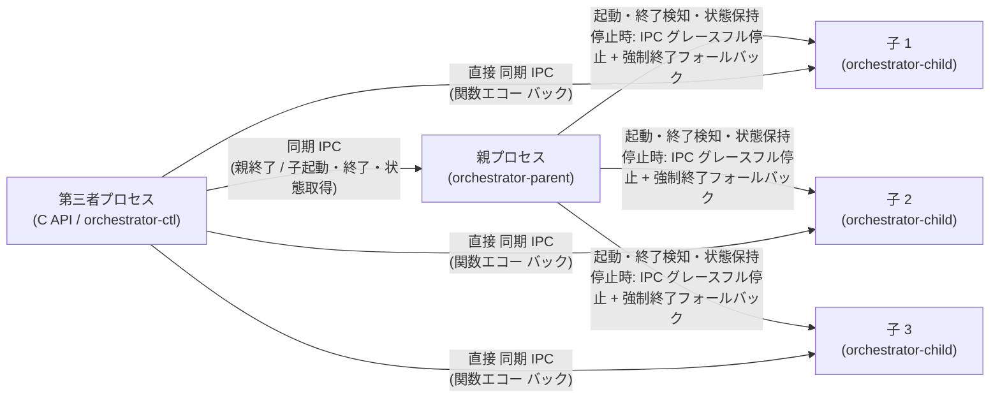
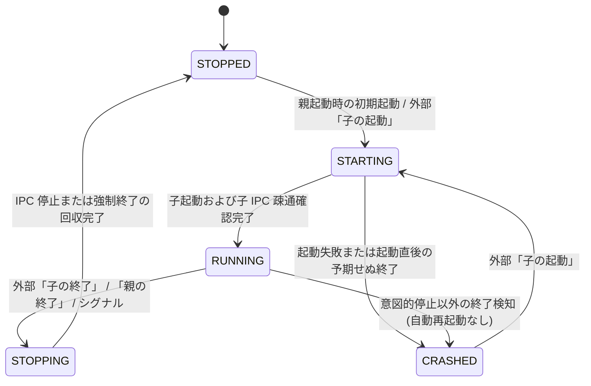

<!--
生成元: agree-before-implement スキル
文書種別: 最終仕様 (design)
最終更新日時: 2026-11-27 07:38:00 JST
最終更新エージェント: agy / セッション ID: 9d21d935-346c-44e1-b3ce-1a0bebca2117
稼働 OS: Linux (WSL)
上流文書: `261127-process-orchestration-sample-overview.md` (全体管理文書)、`261127-process-orchestration-sample-discussion.md` (検討用 Markdown)、`261127-process-orchestration-sample-lightadr.md` (簡易 ADR)。いずれも削除されている場合があります。
再開手順: このファイルを開いたエージェントは、作業の前に agree-before-implement スキルを読み込んでください。上流文書の全体管理文書が存在する場合は、その再開手順に従って進行位置を確認し、決定事項を簡易 ADR で、判断の経緯を検討用 Markdown の Q&A で確認します。存在しない場合は、この文書を単体の最終仕様として扱います。最終更新エージェントのセッション情報や稼働 OS・最終更新日時が参照可能であれば再開時のコンテキストや環境差分の把握に利用し、別エージェントや別環境・別 OS からの引き継ぎ、担当変更によりセッションが見つからない場合も異常とせず、文書の記載から継続してください。
-->

# プロセスとりまとめサンプル (PoC 実装) 最終仕様

ファイル名: `261127-process-orchestration-sample-design.md`

## 概要と目的

本仕様は、C 言語の関数から同期的に特定プロセスへ処理を要求し応答を受け取る汎用ローカル IPC 基盤と、その上に構築するプロセスとりまとめサンプル (親 1 プロセス・子 1〜3 プロセス・第三者プロセスからの制御) の PoC 実装を定義します。

本 PoC は `app/cplat` へ直接機能を追加せず、独立したサンプル app `app/process-orchestration-sample` として Linux/GCC と Windows/MSVC の双方でビルド・動作する構成で実装します。

> [!IMPORTANT]
> 汎用同期要求応答 IPC 層は、PoC 検証および Windows 実機での性能比較を経た後に `app/cplat` へマージすることを前提とします。そのため、公開ヘッダー・実装ディレクトリ・エラー規約・待機規約のすべてにおいて、汎用 IPC 層を PoC 固有の親・子制御層から明確に分離し、`cplat` の既存規約に完全準拠させます。

## 全体アーキテクチャー

### プロセス構成と通信経路



Figure: プロセスとりまとめサンプルの全体構成と通信経路

### レイヤー構成

ライブラリ (`libprocess_orchestration`) は次の 2 層へ厳格に分離します。

1. **汎用同期要求応答 IPC 層 (`process_orchestration/ipc.h`)**
    - 親・子・オーケストレーターの概念を一切持たない汎用層です。
    - エンドポイント解決 (空間スコープ・アクセス権ポリシー型)、内部トランスポート抽象層、固定長バイナリ フレーミング、単発・持続接続クライアント、I/O 多重化 + 固定ワーカー プール サーバーを提供します。
2. **プロセスとりまとめ制御層 (`process_orchestration/orchestrator.h`)**
    - 汎用 IPC 層の上に構築する PoC 固有の層です。
    - 第三者プロセスから親へ送る 4 操作 (親の終了、子の起動、子の終了、子の状態取得) と、親を経由せず子へ直接送る操作 (子の関数エコー バック) の C API および電文コーデックを提供します。

## ディレクトリ構成とワークスペース統合

### 配置パスとファイル構成

新規 app は既存の複数語 app と同じハイフン区切りの `app/process-orchestration-sample/` とします。実装開始時に `app/process_orchestration_sample/docs/prompts/current/` の検討文書群を `app/process-orchestration-sample/docs/prompts/current/` へ移設し、空になった旧ディレクトリを削除します。

```text
app/process-orchestration-sample/
+-- .gitignore
+-- AGENTS.md
+-- README.md
+-- appdeps.mk                                    # APP_DEPS := cplat
+-- makefile                                      # makefw の app 直下標準テンプレート
+-- docs/
|   +-- README.md                                 # 発行文書の入口
|   +-- verification-guide.md                     # Windows ビルド・性能比較・将来共通空間の実機検証手順書
|   +-- prompts/
|       +-- current/                              # 移設された検討文書群
+-- prod/
|   +-- Doxyfile.part
|   +-- README.md
|   +-- makefile
|   +-- makelocal.mk
|   +-- include/
|   |   +-- process_orchestration/
|   |       +-- export.h                          # DLL エクスポート マクロ (POS_EXPORT / POS_API)
|   |       +-- ipc.h                             # 汎用同期要求応答 IPC 公開 API
|   |       +-- orchestrator.h                    # 親・子制御クライアント公開 C API
|   +-- include_internal/
|   |   +-- process_orchestration/
|   |       +-- ipc_transport.h                   # 内部トランスポート抽象インターフェイス
|   |       +-- ipc_protocol.h                    # 固定長バイナリ ヘッダー定義と検証・エンコード
|   |       +-- orchestrator_protocol.h           # 親・子操作のメソッド ID とペイロード コーデック
|   +-- libsrc/
|   |   +-- makefile
|   |   +-- makepart.mk
|   |   +-- process_orchestration/
|   |       +-- makefile
|   |       +-- makepart.mk                       # 静的ライブラリ (既定) または makefw 標準構成
|   |       +-- ipc/
|   |       |   +-- makefile                      # サブディレクトリ走査方式 (ADD_SRCS は使用しない)
|   |       |   +-- ipc_endpoint.c                # エンドポイント検証・空間別パス/パイプ名解決
|   |       |   +-- ipc_protocol.c                # ヘッダー・フレームの送受信と境界検証
|   |       |   +-- ipc_client.c                  # 単発接続・持続接続クライアント API
|   |       |   +-- ipc_server.c                  # I/O 多重化 + 固定ワーカー プール サーバー
|   |       |   +-- ipc_transport_unix_linux.c    # Linux AF_UNIX + poll + eventfd バックエンド
|   |       |   +-- ipc_transport_unix_windows.c  # Windows AF_UNIX + WSAPoll バックエンド
|   |       |   +-- ipc_transport_pipe_windows.c  # Windows 名前付きパイプ + Overlapped/IOCP バックエンド
|   |       +-- orchestrator/
|   |           +-- makefile
|   |           +-- orchestrator_protocol.c       # 親・子メッセージ エンコード/デコード
|   |           +-- orchestrator_client.c         # 親・子向け公開 C クライアント API
|   +-- src/
|       +-- makefile
|       +-- cmd/
|           +-- makefile
|           +-- makepart.mk                       # OUTPUT_DIR := $(MYAPP_DIR)/prod/cbin
|           +-- orchestrator-parent/              # 親プロセス実行ファイル
|           |   +-- makefile
|           |   +-- main.c
|           +-- orchestrator-child/               # 子プロセス実行ファイル
|           |   +-- makefile
|           |   +-- main.c
|           +-- orchestrator-ctl/                 # 親・子共通の制御 CLI コマンド
|           |   +-- makefile
|           |   +-- main.c
|           +-- orchestrator-bench/               # 単発・持続・バックエンド性能比較ベンチマーク CLI
|               +-- makefile
|               +-- main.c
+-- test/
    +-- makefile
    +-- makepart.mk
    +-- src/
        +-- makefile
        +-- libprocess_orchestrationTest/
        |   +-- makefile
        |   +-- ipcUnitTest/                      # 汎用 IPC 単体テスト
        |       +-- makefile
        |       +-- ipcUnitTest.cc
        +-- integration/
            +-- makefile
            +-- orchestrationE2ETest/             # 実プロセス (親 + 子 1〜3 + C API / CLI) 統合テスト
                +-- makefile
                +-- orchestrationE2ETest.cc
```

> [!NOTE]
> `prod/libsrc/process_orchestration/` 配下のソース分割には makefw のサブディレクトリ走査方式 (各サブディレクトリへテンプレート `makefile` を配置) を採用し、`makepart.mk` の `ADD_SRCS` へ相対パスを列挙しません。

### ワークスペース同期

実装完了時に次のコマンドでワークスペース設定を同期し、差異警告が発生しない状態を維持します。

- `make sync-app-env` (`.vscode/.env.linux`、`.vscode/.env.windows`、`.vscode/settings.json` の同期)
- `bash framework/makefw/bin/sync_c_cpp_properties.sh --write` (`.vscode/c_cpp_properties.json` の同期)

## 汎用同期要求応答 IPC 層 (pos_ipc_*) 仕様

### 共通規約

- **結果コード**: `cplat/base/result.h` の共通結果コード (`CPLAT_OK`、`CPLAT_ERR_INVALID_ARGUMENT`、`CPLAT_ERR_UNSUPPORTED`、`CPLAT_ERR_NOT_FOUND`、`CPLAT_ERR_PERMISSION_DENIED`、`CPLAT_ERR_BUSY`、`CPLAT_ERR_TIMEOUT`、`CPLAT_ERR_BUFFER_TOO_SMALL`、`CPLAT_ERR_LIMIT_EXCEEDED`、`CPLAT_ERR_OUT_OF_MEMORY`、`CPLAT_ERR_EOF`、`CPLAT_ERR_CANCELED`、`CPLAT_ERR_CORRUPT_DATA`、`CPLAT_ERR_VERSION_MISMATCH`、`CPLAT_ERR_UNKNOWN` 等) を使用します。
- **詳細エラー**: OS 呼び出しを伴う API は `cplat_error *detail_out` (NULL 可) を受け取り、失敗時の詳細を格納します。
- **待機時間**: `int timeout_ms` を受け取り、`cplat/base/wait.h` の `CPLAT_WAIT_FOREVER`、`CPLAT_NO_WAIT`、または 0 以上の有限値 [ms] を許可し、負値は `CPLAT_ERR_INVALID_ARGUMENT` を返します。

### エンドポイント、空間スコープ、およびアクセス権ポリシー

```c
typedef enum pos_ipc_scope
{
    POS_IPC_SCOPE_USER = 0,   /* 同一ユーザー空間 */
    POS_IPC_SCOPE_SYSTEM = 1, /* 共通サービス空間 (daemon / Windows Service。本 PoC では型定義のみ) */
    POS_IPC_SCOPE_CUSTOM = 2  /* 呼び出し側指定の任意ベース ディレクトリ (テスト隔離向け) */
} pos_ipc_scope;

typedef enum pos_ipc_backend
{
    POS_IPC_BACKEND_DEFAULT = 0,   /* 各 OS の既定 (Linux / Windows ともに AF_UNIX) */
    POS_IPC_BACKEND_AF_UNIX = 1,   /* Unix ドメイン ソケット (SOCK_STREAM) */
    POS_IPC_BACKEND_NAMED_PIPE = 2 /* Windows 名前付きパイプ (Linux では CPLAT_ERR_UNSUPPORTED) */
} pos_ipc_backend;

typedef enum pos_ipc_access_mode
{
    POS_IPC_ACCESS_CURRENT_USER = 0,        /* 作成ユーザーのみ許可 (USER / CUSTOM 既定) */
    POS_IPC_ACCESS_GROUP = 1,               /* 指定グループへ許可 (SYSTEM スコープ向け予約) */
    POS_IPC_ACCESS_AUTHENTICATED_USERS = 2  /* 認証済みローカル ユーザーへ許可 (SYSTEM スコープ向け予約) */
} pos_ipc_access_mode;

typedef struct pos_ipc_access_policy
{
    pos_ipc_access_mode mode;   /* アクセス権ポリシー */
    uint32_t pad;               /* 明示的アラインメント (-Wpadded 対策) */
    const char *group_name;     /* POS_IPC_ACCESS_GROUP 指定時のグループ名 (NULL 可) */
} pos_ipc_access_policy;

typedef struct pos_ipc_endpoint
{
    pos_ipc_scope scope;        /* 空間スコープ */
    pos_ipc_backend backend;    /* 使用するトランスポート バックエンド */
    const char *namespace_name; /* アプリケーション名前空間 (例: "pos"。英数字・'-'・'_' のみ) */
    const char *instance_name;  /* インスタンス識別子 (例: "default"、テスト時は一意 ID) */
    const char *target_name;    /* 接続先プロセス識別名 (例: "parent"、"child-1"〜"child-3") */
    const char *custom_dir;     /* POS_IPC_SCOPE_CUSTOM 時のベース ディレクトリ (UTF-8、NULL 不可) */
} pos_ipc_endpoint;
```

#### スコープ別アドレス解決規則

Table: 空間スコープとバックエンドごとのアドレス解決規則

| スコープ | Linux (`AF_UNIX`) | Windows (`AF_UNIX`) | Windows (`NAMED_PIPE`) |
| --- | --- | --- | --- |
| `USER` | `$XDG_RUNTIME_DIR/<ns>/<inst>/<target>.sock` (未設定時は `<temp_dir>/pos-u<uid>/<ns>/<inst>/<target>.sock`、ディレクトリ `0700`・ソケット `0600`) | `<temp_dir>/<ns>/<inst>/<target>.sock` (`cplat_path_get_temp_dir()` 配下。ユーザー プロファイル一時領域により同一ユーザー保護) | `\\.\pipe\<ns>-u-<user_hash>-<inst>-<target>` (作成ユーザー向け既定 DACL) |
| `CUSTOM` | `<custom_dir>/<target>.sock` (ディレクトリ `0700`・ソケット `0600`) | `<custom_dir>/<target>.sock` | `\\.\pipe\<ns>-c-<dir_hash>-<target>` (`custom_dir` の 64 ビット ハッシュでテスト間衝突を防止) |
| `SYSTEM` | 本 PoC では `CPLAT_ERR_UNSUPPORTED` を返す (次フェーズ実装対象) | 本 PoC では `CPLAT_ERR_UNSUPPORTED` を返す (次フェーズ実装対象) | 本 PoC では `CPLAT_ERR_UNSUPPORTED` を返す (次フェーズ実装対象) |

> [!IMPORTANT]
> `AF_UNIX` の `sockaddr_un.sun_path` は Linux・Windows ともに 108 バイト上限 (終端 NUL を含むため実長 107 バイト以下) です。解決後の UTF-8 パス長が 107 バイトを超える場合は `CPLAT_ERR_BUFFER_TOO_SMALL` を返します。また、`namespace_name`・`instance_name`・`target_name` にはパス トラバーサルを防ぐため `'/'`・`'\\'`・`".."` を拒否し、`[A-Za-z0-9_-]` のみを許可します。

#### AF_UNIX 異常終了残骸 (stale socket) 対策

サーバー起動時にソケット ファイルがすでに存在する場合、次の手順で稼働中サーバーとの衝突と異常終了残骸を区別します。

1. 非ブロッキングで対象ソケットへ `connect()` を試行します。
2. 接続成功または `EAGAIN` / `WSAEWOULDBLOCK` 等で待ち受け中の実体が存在すると判定された場合は、別サーバーが稼働中とみなし `CPLAT_ERR_BUSY` を返して起動を中止します (既存ソケットを削除しません)。
3. `ECONNREFUSED` / `WSAECONNREFUSED` 等で接続先が存在しない残骸と確認できた場合のみ、古いソケット ファイルを削除 (`unlink` / `DeleteFileW`) してから `bind()` を行います。
4. サーバー正常停止時には自身のソケット ファイルを削除します。

### 内部トランスポート抽象層と OS 別実装

上位の `ipc_protocol.c`・`ipc_client.c`・`ipc_server.c` は OS 固有 API を直接呼ばず、`ipc_transport.h` の内部バックエンド テーブル (`pos_ipc_transport_ops`) 経由で操作します。

Table: OS 別トランスポート バックエンドとサーバー I/O 多重化方式

| OS | バックエンド | 実装ファイル | サーバー I/O 多重化 | クライアント接続・タイムアウト |
| --- | --- | --- | --- | --- |
| Linux | `AF_UNIX` (既定・唯一) | `ipc_transport_unix_linux.c` | `poll()` + `eventfd()` 起床通知 (`MSG_NOSIGNAL` で `SIGPIPE` 抑止) | 非ブロッキング `connect()` + `poll()` 残り時間制御 |
| Windows | `AF_UNIX` (既定) | `ipc_transport_unix_windows.c` | `WSAPoll()` + ループバック起床ソケット (`afunix.h` / Winsock2 初期化は `cplat` または内部 `WSAStartup`) | 非ブロッキング `connect()` + `WSAPoll()` 残り時間制御 |
| Windows | `NAMED_PIPE` | `ipc_transport_pipe_windows.c` | `CreateNamedPipeU` (`FILE_FLAG_OVERLAPPED`) + IOCP (`CreateIoCompletionPort` / `GetQueuedCompletionStatus` / `PostQueuedCompletionStatus` 起床) | `CreateFileU` + `WaitNamedPipeW` + Overlapped 期限付き読み書き |

> [!NOTE]
> Windows 名前付きパイプは Win32 `HANDLE` であり `WSAPoll()` で待機できないため、バックエンド内部で Overlapped I/O と IOCP (`CreateIoCompletionPort`) を用います。これにより、`AF_UNIX` と同様に待機中の持続接続でスレッドを消費せず、`WaitForMultipleObjects` の 64 ハンドル上限も回避できます。

### ワイヤー プロトコル (固定長バイナリ ヘッダー + 不透明バイト列)

すべてのマルチバイト整数はネットワーク バイト オーダー (ビッグ エンディアン、`cplat/net/byteorder.h`) で送受信します。単発接続・持続接続とも同一のフレーム形式を使用します。

Table: IPC フレーム ヘッダー構成 (固定 24 バイト)

| オフセット | サイズ [byte] | 型 | フィールド名 | 説明 |
| ---: | ---: | --- | --- | --- |
| 0 | 4 | `uint32_t` | `magic` | 固定マジック値 `0x504F5349U` (`"POSI"`) |
| 4 | 2 | `uint16_t` | `version` | プロトコル版 `1` |
| 6 | 2 | `uint16_t` | `flags` | `0x0001`: 要求フレーム、`0x0002`: 応答フレーム |
| 8 | 4 | `uint32_t` | `method_id` | 操作識別子 (呼び出し側とサーバーで規約定義) |
| 12 | 4 | `int32_t` | `status_code` | 要求時は `0`、応答時は `CPLAT_OK` または `CPLAT_ERR_*` 結果コード |
| 16 | 4 | `uint32_t` | `payload_size` | 後続ペイロードのバイト数 (上限: `POS_IPC_MAX_PAYLOAD_SIZE`、既定 1 [MiB] = `1048576U`) |
| 20 | 4 | `uint32_t` | `reserved` | 予約領域 (`0` 固定、将来の拡張用) |

- 受信時はヘッダー 24 バイトを全量読み込み、`magic` 不一致または `flags` 不正または `payload_size` 上限超過なら `CPLAT_ERR_CORRUPT_DATA`、`version` 不一致なら `CPLAT_ERR_VERSION_MISMATCH` を返して接続を切断します。
- 応答受信時にペイロード長がクライアント側 `response_capacity` を超える場合は、ストリーム同期を保つため接続を破棄 (または単発切断) しつつ、`*response_size_out` へ必要サイズを格納して `CPLAT_ERR_BUFFER_TOO_SMALL` を返します (持続接続で超過した場合はストリーム整合のため残余ペイロードを読み捨てて接続を維持するか、超過サイズ上限を超える場合は切断します。本仕様では上限内であれば残余を読み捨てて持続接続の再利用性を保ちます)。

### クライアント API (単発接続・持続接続の両立)

```c
/* 単発接続: 1 回の呼び出しで接続→要求→応答→切断を行う */
POS_EXPORT int POS_API pos_ipc_call(const pos_ipc_endpoint *endpoint,
                                    uint32_t method_id,
                                    const void *request_data,
                                    size_t request_size,
                                    void *response_buffer,
                                    size_t response_capacity,
                                    size_t *response_size_out,
                                    int timeout_ms,
                                    cplat_error *detail_out);

/* 持続接続: 接続を保持し、1 接続上で同期要求応答を直列反復する */
typedef struct pos_ipc_client pos_ipc_client;

POS_EXPORT int POS_API pos_ipc_client_open(const pos_ipc_endpoint *endpoint,
                                           int timeout_ms,
                                           pos_ipc_client **client_out,
                                           cplat_error *detail_out);

POS_EXPORT int POS_API pos_ipc_client_call(pos_ipc_client *client,
                                           uint32_t method_id,
                                           const void *request_data,
                                           size_t request_size,
                                           void *response_buffer,
                                           size_t response_capacity,
                                           size_t *response_size_out,
                                           int timeout_ms,
                                           cplat_error *detail_out);

POS_EXPORT void POS_API pos_ipc_client_close(pos_ipc_client *client);
```

- `pos_ipc_client` は内部に `cplat_local_lock` を持ち、同一クライアント ハンドルへの複数スレッドからの `pos_ipc_client_call()` を直列化します。
- サーバー側アイドル タイムアウトや相手プロセス終了により持続接続が切断された状態で `pos_ipc_client_call()` が呼ばれた場合、暗黙の自動再接続は行わず `CPLAT_ERR_EOF` または OS 切断エラーを返します (呼び出し側が再接続判断を明示的に行えるようにするため)。
- `pos_ipc_client_close(NULL)` は何もしません。

### サーバー API と接続管理モデル

```c
typedef struct pos_ipc_server pos_ipc_server;

typedef int (*pos_ipc_handler_fn)(uint32_t method_id,
                                  const void *request_data,
                                  size_t request_size,
                                  void *response_buffer,
                                  size_t response_capacity,
                                  size_t *response_size_out,
                                  void *user_context);

typedef struct pos_ipc_server_options
{
    pos_ipc_access_policy access_policy; /* アクセス権ポリシー */
    uint32_t worker_count;               /* 固定ワーカー スレッド数 (0 指定時は既定 4) */
    uint32_t max_connections;            /* 最大同時接続数 (0 指定時は既定 128) */
    uint32_t max_payload_size;           /* 最大ペイロード サイズ [byte] (0 指定時は既定 1 MiB) */
    int idle_timeout_ms;                 /* 持続接続のアイドル切断期限 [ms] (0 指定時は既定 30000) */
    int io_timeout_ms;                   /* 1 要求の送受信タイムアウト [ms] (0 指定時は既定 5000) */
} pos_ipc_server_options;

POS_EXPORT int POS_API pos_ipc_server_create(const pos_ipc_endpoint *endpoint,
                                             const pos_ipc_server_options *options,
                                             pos_ipc_server **server_out,
                                             cplat_error *detail_out);

POS_EXPORT int POS_API pos_ipc_server_register_handler(pos_ipc_server *server,
                                                       uint32_t method_id,
                                                       pos_ipc_handler_fn handler,
                                                       void *user_context);

POS_EXPORT int POS_API pos_ipc_server_start(pos_ipc_server *server, cplat_error *detail_out);
POS_EXPORT int POS_API pos_ipc_server_stop(pos_ipc_server *server, int timeout_ms, cplat_error *detail_out);
POS_EXPORT void POS_API pos_ipc_server_dispose(pos_ipc_server *server);
```

#### 接続ライフサイクルとリソース保護

1. **I/O 多重化ループ (1 スレッド)**: リスナーの `accept` と、アイドル状態にある全持続接続の読み取り可能イベントおよびアイドル タイムアウト期限を一元監視します。待機中の持続接続はスレッドを一切占有しません。
2. **固定数ワーカー スレッド プール (`worker_count` 本)**: I/O ループが接続の読み取り可能を検知すると、その接続を一時的に I/O 監視集合から外してワーカー キューへ渡します。ワーカーは 1 要求フレームを受信し、登録済みハンドラーを実行して 1 応答フレームを送信します。
3. **持続接続の再利用と回収**:
    - 応答送信が正常完了した場合、ワーカーはその接続の最終活動時刻を更新して I/O 監視集合へ戻し、次の要求またはクライアント切断を待ちます。
    - クライアントが切断 (EOF)、プロトコル不正、I/O エラー、または `idle_timeout_ms` 超過となった場合は、サーバー側で接続を閉じてスロットを解放します。
4. **最大同時接続数 (`max_connections`) 制限**: 接続数が `max_connections` に達している間に新たな接続が到着した場合は、即座に受け付け直後に切断 (またはバックログ制御) して FD / ハンドル枯渇を防ぎます。
5. **安全な停止 (`pos_ipc_server_stop`)**: 起床通知により I/O ループを即時停止し、新規接続を拒否して実行中ワーカーの完了を `timeout_ms` 内で待機し、残存接続とリスナーを解放します (ハンドラーの中から親/子の停止フラグを立て、メイン スレッドが応答送信完了後に `pos_ipc_server_stop()` を呼ぶことで、停止応答を確実に返してから終了できます)。

## プロセスとりまとめ制御層 (pos_orch_*) 仕様

### 子のライフサイクル状態と状態取得構造体

```c
#define POS_ORCH_CHILD_ID_MIN 1U
#define POS_ORCH_CHILD_ID_MAX 3U
#define POS_ORCH_CHILD_COUNT  3U

typedef enum pos_child_state
{
    POS_CHILD_STATE_STOPPED = 0,  /* 未起動、または「子の終了」指示による正常停止 */
    POS_CHILD_STATE_STARTING = 1, /* 起動処理中 (IPC 応答確認待ちを含む) */
    POS_CHILD_STATE_RUNNING = 2,  /* 稼働中 (子 IPC 受付可能) */
    POS_CHILD_STATE_STOPPING = 3, /* 停止処理中 */
    POS_CHILD_STATE_CRASHED = 4   /* 意図的停止以外で予期せず終了した状態 */
} pos_child_state;

typedef struct pos_child_status
{
    uint32_t child_id;           /* 1..3 */
    pos_child_state state;       /* 現在のライフサイクル状態 */
    uint32_t pid;                /* 稼働中または起動中の PID。STOPPED / CRASHED 時は 0 */
    uint32_t start_count;        /* 累計起動回数 (初回起動 + 外部「子の起動」指示による起動) */
    int32_t last_exit_code;      /* 直近の終了コード (has_last_exit_code == 1 の時有効) */
    uint32_t has_last_exit_code; /* 終了コード取得済みなら 1、未終了・未取得なら 0 */
} pos_child_status;

typedef struct pos_child_echo_result
{
    uint32_t child_id;    /* 応答した子 ID (1..3) */
    uint32_t child_pid;   /* 応答した子プロセスの PID */
    size_t message_len;   /* 返却メッセージ長 [byte] (終端 NUL 除く) */
} pos_child_echo_result;
```



Figure: 子プロセスの状態遷移

> [!NOTE]
> 親プロセスは子が `CRASHED` 状態となっても自動再起動を行わず、`state = POS_CHILD_STATE_CRASHED`、`pid = 0`、`last_exit_code`、`has_last_exit_code` を保持します。外部から「子の起動」指示を受けた場合にのみ `STARTING` → `RUNNING` へ遷移し、`start_count` を 1 加算します。

### 親・子 IPC メソッド定義

Table: 親プロセスおよび子プロセスの IPC メソッド一覧

| 宛先 | メソッド ID | 名称 | 要求ペイロード | 応答ペイロード | 振る舞い |
| --- | ---: | --- | --- | --- | --- |
| 親 (`parent`) | `0x00010001U` | `POS_ORCH_METHOD_PARENT_STOP` | なし (0 バイト) | なし (0 バイト) | 稼働中の全子プロセスを停止・回収したうえで成功応答を返し、親プロセスを終了する |
| 親 (`parent`) | `0x00010002U` | `POS_ORCH_METHOD_CHILD_START` | `uint32_t child_id` (4 バイト) | `pos_child_status` バイナリ (24 バイト) | 指定の子が `STOPPED` / `CRASHED` なら起動し IPC 受付可能を確認して返す。すでに `RUNNING` なら `CPLAT_ERR_BUSY` を返す |
| 親 (`parent`) | `0x00010003U` | `POS_ORCH_METHOD_CHILD_STOP` | `uint32_t child_id` (4 バイト) | `pos_child_status` バイナリ (24 バイト) | 指定の子へ IPC グレースフル停止要求を送り、期限超過時は `cplat_process_terminate()` で強制終了して回収する。すでに `STOPPED` / `CRASHED` なら状態を `STOPPED` として成功を返す |
| 親 (`parent`) | `0x00010004U` | `POS_ORCH_METHOD_CHILD_STATUS` | `uint32_t child_id` (4 バイト) | `pos_child_status` バイナリ (24 バイト) | 指定の子の最新状態 (監視スレッドと同期した現在状態) を返す |
| 子 (`child-1`〜`3`) | `0x00020001U` | `POS_ORCH_METHOD_CHILD_ECHO` | UTF-8 バイト列 (0 バイト以上、終端 NUL 不要) | `uint32_t child_id` + `uint32_t child_pid` + 入力 UTF-8 バイト列そのまま | 入力文字列を加工せずそのまま返し、応答元の子 ID と PID を先頭 8 バイトへ付与する |
| 子 (`child-1`〜`3`) | `0x00020002U` | `POS_ORCH_METHOD_CHILD_STOP` | なし (0 バイト) | なし (0 バイト) | 親からのグレースフル停止要求。成功応答を返した後に子の IPC サーバーを停止し正常終了 (終了コード 0) する |
| 子 (`child-1`〜`3`) | `0x00020003U` | `POS_ORCH_METHOD_CHILD_PING` | なし (0 バイト) | `uint32_t child_id` + `uint32_t child_pid` (8 バイト) | 親が子の起動完了 (IPC 受付可能) と子 PID を確認するための軽量ヘルス チェック |

### 親・子制御クライアント公開 C API (orchestrator.h)

呼び出し元は空間設定構造体 `pos_orch_config` (`scope`、`backend`、`namespace_name`、`instance_name`、`custom_dir`) を指定して各関数を呼び出します。

- `pos_orch_parent_stop(const pos_orch_config *config, int timeout_ms, cplat_error *detail_out)`
- `pos_orch_child_start(const pos_orch_config *config, uint32_t child_id, pos_child_status *status_out, int timeout_ms, cplat_error *detail_out)`
- `pos_orch_child_stop(const pos_orch_config *config, uint32_t child_id, pos_child_status *status_out, int timeout_ms, cplat_error *detail_out)`
- `pos_orch_child_status(const pos_orch_config *config, uint32_t child_id, pos_child_status *status_out, int timeout_ms, cplat_error *detail_out)`
- `pos_orch_child_echo(const pos_orch_config *config, uint32_t child_id, const char *message, char *echo_buffer, size_t echo_buffer_size, pos_child_echo_result *result_out, int timeout_ms, cplat_error *detail_out)`
- `pos_orch_child_echo_with_client(pos_ipc_client *client, const char *message, char *echo_buffer, size_t echo_buffer_size, pos_child_echo_result *result_out, int timeout_ms, cplat_error *detail_out)` (持続接続ハンドル経由での子直接エコー バック呼び出し)
- `pos_orch_make_parent_endpoint(const pos_orch_config *config, pos_ipc_endpoint *endpoint_out)` / `pos_orch_make_child_endpoint(const pos_orch_config *config, uint32_t child_id, pos_ipc_endpoint *endpoint_out)`

### 親プロセスの詳細動作

1. **起動と二重起動防止**: `parent` エンドポイントで IPC サーバーを起動します (同一空間で別親が稼働中なら `CPLAT_ERR_BUSY` で終了)。起動後、自身と同じディレクトリにある `orchestrator-child` 実行ファイルのパスを `cplat_process_get_executable_path()` + `cplat_path_dirname()` から解決し、子 1〜3 を起動します。
2. **子起動完了の確認**: 子プロセスを `cplat_process_start()` で起動した後、子の IPC エンドポイントへ `POS_ORCH_METHOD_CHILD_PING` を短い間隔 (例: 20 [ms]) でリトライし、応答成功をもって `POS_CHILD_STATE_RUNNING` かつ子 PID 確定とします (子起動から上限 5000 [ms] 以内に応答がなくプロセスが終了した場合は `POS_CHILD_STATE_CRASHED`)。
3. **異常終了監視スレッド**: 親の監視スレッドが稼働中の各子ハンドルに対して短い待機間隔 (例: 50 [ms]) で `cplat_process_timed_wait()` を確認し、期待状態が `RUNNING` の子が終了していた場合は `cplat_process_get_exit_code()` で終了コードを取得・ハンドルを `cplat_process_dispose()` し、状態を `POS_CHILD_STATE_CRASHED`、`pid = 0` へ更新します (自動再起動はしません)。
4. **グレースフル停止と強制終了フォールバック**:
    - 子の停止要求時は状態を `POS_CHILD_STATE_STOPPING` へ遷移させ、親から子へ IPC で `POS_ORCH_METHOD_CHILD_STOP` を送信し、最大 3000 [ms] (設定可能) まで `cplat_process_timed_wait()` で終了を待ちます。
    - 期限内に終了しない場合、または IPC 停止要求送信自体に失敗した場合は `cplat_process_terminate()` で強制終了し、`CPLAT_PROCESS_TERMINATE_WAIT_MS` (3000 [ms]) を上限に回収してから `POS_CHILD_STATE_STOPPED` へ遷移します。
    - 親への `SIGINT` / `SIGTERM` / `CTRL_C_EVENT` は `cplat_shutdown_request_register()` で捕捉し、`POS_ORCH_METHOD_PARENT_STOP` と同じ手順で全稼働中の子を停止・回収してから親自身を正常終了します。

## 実行ファイル CLI 仕様

すべての実行ファイルは `cplat_console_init()` と `cplat/argparser/argparser.h` を使用し、終了コードは `cplat/runtime/shutdown.h` のクロスプラットフォーム規約 (0: 正常、1〜124 のうち 3 を除く: アプリケーション失敗) に従います。

Table: 実行ファイル一覧と主なコマンド ライン引数

| 実行ファイル | 役割 | 主なオプション・サブコマンド |
| --- | --- | --- |
| `orchestrator-parent` | 親プロセス (子 1〜3 起動・状態管理・親 IPC サーバー) | `--scope user\|custom`、`--instance <name>`、`--base-dir <dir>`、`--backend default\|af_unix\|named_pipe`、`--child-stop-timeout-ms <ms>` |
| `orchestrator-child` | 子プロセス (子 IPC サーバー、エコー バック / 停止 / PING 応答) | `--child-id <1-3>` (必須)、`--scope user\|custom`、`--instance <name>`、`--base-dir <dir>`、`--backend default\|af_unix\|named_pipe` |
| `orchestrator-ctl` | 第三者プロセスからの制御 CLI | 共通オプション (`--scope`、`--instance`、`--base-dir`、`--backend`、`--timeout-ms`) + サブコマンド: `parent-stop`、`child-start <1-3>`、`child-stop <1-3>`、`child-status <1-3>`、`child-echo <1-3> <message> [--persistent-count <N>]` |
| `orchestrator-bench` | 汎用 IPC 性能比較ベンチマーク CLI | `--backend default\|af_unix\|named_pipe`、`--mode oneshot\|persistent\|both`、`--iterations <N>`、`--payload-size <bytes>`、`--connections <N>`、`--base-dir <dir>`。1 往復あたりの平均・p50・p95・p99 レイテンシ [us] とスループット [req/s] を標準出力へ出力する |

## コーディング規約・クロスプラットフォーム要件

- **言語標準**: 製品コード (`prod/`) は C17、テスト コード (`test/`) は C++17 とします。
- **トップ ダウン記載**: `app/process-orchestration-sample/prod/` 配下の全 `.c` ファイルは `app/general/docs/coding-guideline.md` の「関数の記載順と前方宣言」に従い、`python3 app/general/bin/check_c_topdown.py` のエラー・警告 0 件を満たします。
- **警告ゼロ**: `app/makepart.mk` の厳格警告フラグ (`-Wall -Wextra -Wpadded -Wconversion -Wsign-conversion -Wmissing-prototypes -Wstrict-prototypes -Wmissing-declarations` および MSVC `/W4`) において `.warn` ファイルが空であることを要件とします。
- **書式・文書**: C/C++ は `clang-format`、Markdown は `text_style_jp.py --dry-run` 指摘 0 件、公開ヘッダーは Doxygen 契約コメント (引数・戻り値・スレッド セーフ) を完備します。
- **非自明な OS 仕様の根拠**: `AF_UNIX` の 108 バイト上限、`MSG_NOSIGNAL`、`eventfd`、Windows `afunix.h` / `WSAPoll` / IOCP の非自明な仕様や回避策には `see: <URL>` コメントを残します。

## テスト仕様と実機検証計画

### 自動テスト (make test)

Google Test (`framework/testfw`) で次の 2 テスト スイートを実装します。

1. **汎用 IPC 単体テスト (`test/src/libprocess_orchestrationTest/ipcUnitTest/`)**
    - 正常系: 単発接続 (`pos_ipc_call`)、持続接続 (`pos_ipc_client_open` / `call` / `close`) による連続要求応答、複数スレッドからの同一持続ハンドル直列呼び出し、複数クライアント同時並行呼び出し、空ペイロードおよび大きめのバイナリ ペイロード転送。
    - 多数持続接続とリソース保護: 複数のアイドル持続接続を保持した状態で新規の単発・持続クライアントがブロックされず応答すること (ワーカー非飢餓)、`idle_timeout_ms` 超過でアイドル持続接続が自動切断されること、`max_connections` 上限超過時の安全な挙動。
    - 異常系・境界条件: 接続先不在 (`CPLAT_ERR_NOT_FOUND`)、ハンドラー未登録、タイムアウト (`CPLAT_ERR_TIMEOUT`)、応答バッファー不足 (`CPLAT_ERR_BUFFER_TOO_SMALL` + 必要サイズ返却 + 持続接続維持)、不正マジック / バージョン不一致 / 上限超過ペイロード (`CPLAT_ERR_CORRUPT_DATA` / `CPLAT_ERR_VERSION_MISMATCH`)、相手切断 (`CPLAT_ERR_EOF`)、異常終了残骸ソケット (stale socket) の自動回収と稼働中サーバーに対する二重起動拒否 (`CPLAT_ERR_BUSY`)、`UNIX_PATH_MAX` 超過拒否、`POS_IPC_SCOPE_SYSTEM` 指定時の `CPLAT_ERR_UNSUPPORTED`、Linux での `POS_IPC_BACKEND_NAMED_PIPE` 指定時の `CPLAT_ERR_UNSUPPORTED`。
    - Windows 環境では `AF_UNIX` と `NAMED_PIPE` の両バックエンドに対して同一のテスト ケース群を実行するパラメーター化テスト構成とします。
2. **実プロセス統合テスト (`test/src/integration/orchestrationE2ETest/`)**
    - 隔離された一時ディレクトリ (`POS_IPC_SCOPE_CUSTOM`) 上で実バイナリ (`orchestrator-parent`、`orchestrator-child`、`orchestrator-ctl`、`orchestrator-bench`) を起動し、次を自動検証します。
        - 親起動 → 子 1〜3 がすべて `POS_CHILD_STATE_RUNNING` かつ相異なる有効 PID、`start_count == 1` になること。
        - 第三者プロセス (C API の単発・持続接続、および `orchestrator-ctl child-echo`) から子 1〜3 へ直接エコー バックを送り、入力文字列の完全一致 (ASCII・UTF-8 日本語・空文字) と各子の `child_id`・`child_pid` 一致を確認。
        - 子 2 を外部から強制終了 (`cplat_process_terminate` 相当の強制 kill) → 親が自動再起動 **しない** こと、`child-status 2` が `POS_CHILD_STATE_CRASHED`・`pid == 0`・`has_last_exit_code == 1` になること、および子 2 への直接エコー バックが失敗することを確認。
        - 親へ `child-start 2` を送信 → 子 2 が新 PID・`start_count == 2`・`POS_CHILD_STATE_RUNNING` で復帰し、子 2 への直接エコー バックが新 PID で再び成功することを確認。
        - 親へ `child-stop 3` を送信 → IPC グレースフル停止により `POS_CHILD_STATE_STOPPED`・`pid == 0` となり子 3 へのエコー バックが失敗すること → `child-start 3` で再起動・復帰することを確認。
        - 親へ `parent-stop` を送信 → 子 1〜3 と親プロセスがすべて正常終了 (終了コード 0) し、残存プロセスおよび残存ソケット ファイルがないことを確認。
        - `orchestrator-bench` が小回数オプションで正常終了し、単発・持続の計測結果を出力することを確認。

### 実機検証手順書 (docs/verification-guide.md)

Linux (WSL) 環境では直接実行できない次の検証手順を `app/process-orchestration-sample/docs/verification-guide.md` へ整備します。

- Windows/MSVC 環境でのビルド・`make test` (`AF_UNIX` および `NAMED_PIPE` 両バックエンド) の実行手順
- Windows 実機での `orchestrator-bench` による `AF_UNIX` vs `NAMED_PIPE` の単発・持続接続レイテンシおよびスループット比較手順と結果記録フォーマット
- 将来フェーズで共通サービス空間 (`POS_IPC_SCOPE_SYSTEM`) を実装・検証する際の Linux daemon / Windows Service 異ユーザー間接続の確認観点

## 知見の正本ドキュメントおよびコード コメントへの反映計画

本設計・実装で得られる知見のうち、将来の保守および `app/cplat` 統合において恒久的に価値のある内容を選定して次へ反映します。

Table: 永続的知見の反映先と反映内容

| 反映先 | 反映する恒久的知見 |
| --- | --- |
| `app/process-orchestration-sample/prod/include/process_orchestration/ipc.h` | 汎用同期 IPC API の契約 (空間スコープ、`UNIX_PATH_MAX` 108 バイト制約、単発・持続接続のスレッド安全性と切断時の非自動再接続契約、I/O 多重化サーバーの `max_connections` / `idle_timeout_ms` によるリソース保護) |
| `app/process-orchestration-sample/prod/include/process_orchestration/orchestrator.h` | 親・子制御 API の契約、子の 5 状態遷移 (`STOPPED` / `STARTING` / `RUNNING` / `STOPPING` / `CRASHED`)、親経由操作と子直接操作の責務分離 |
| `app/process-orchestration-sample/prod/libsrc/process_orchestration/ipc/*.c` | `AF_UNIX` の stale socket 判定手順 (非ブロッキング `connect` 疎通確認後の削除)、`MSG_NOSIGNAL`、`eventfd`、Windows `afunix.h` / `WSAPoll` / 名前付きパイプ IOCP の非自明な OS 仕様と根拠 URL (`see: <URL>`) |
| `app/process-orchestration-sample/README.md`・`AGENTS.md` | app の目的、2 層アーキテクチャー、ビルド・実行・ベンチマーク方法、app 固有の作業規則 |
| `app/process-orchestration-sample/docs/verification-guide.md` | Windows 実機でのトランスポート性能比較手順と、将来の共通サービス空間 (`SYSTEM` スコープ) 検証観点 |

## 受入条件

1. `app/process-orchestration-sample/` が標準の makefw 構成 (`makefile`、`appdeps.mk`、`AGENTS.md`、`README.md`、`prod/Doxyfile.part`、`docs/README.md`、`docs/verification-guide.md`、`prod/`、`test/`) で整備され、検討文書群が `app/process-orchestration-sample/docs/prompts/current/` へ移設され旧空ディレクトリが削除されていること。
2. `app/cplat` に一切の変更を加えず、汎用 IPC 層 (`ipc.h` / `ipc/`) と親・子制御層 (`orchestrator.h` / `orchestrator/`) が分離され、`cplat` の共通結果コード・`cplat_error`・待機規約に準拠していること。
3. 汎用 IPC 層が固定長 24 バイト バイナリ ヘッダー + 不透明バイト列、単発・持続接続の両 API、I/O 多重化 + 固定ワーカー プール + `max_connections` + `idle_timeout_ms`、および Linux `AF_UNIX` / Windows `AF_UNIX` (既定) / Windows 名前付きパイプのトランスポート抽象層を備えていること (`POS_IPC_SCOPE_SYSTEM` は型定義済みで `CPLAT_ERR_UNSUPPORTED` を返すこと)。
4. 実行ファイル 4 本 (`orchestrator-parent`、`orchestrator-child`、`orchestrator-ctl`、`orchestrator-bench`) がビルドでき、親起動・子 1〜3 起動・親への 4 指示・子への直接エコー バック・子異常終了時の非自動再起動と `CRASHED` 状態検知・IPC グレースフル停止 (タイムアウト時強制終了フォールバック)・性能比較ベンチマークが仕様どおり動作すること。
5. Linux (WSL) において `app/process-orchestration-sample` の `make` が成功し、内容のある `.warn` ファイルが 0 件であること。
6. Linux (WSL) において `app/process-orchestration-sample` の `make test` で汎用 IPC 単体テストおよび実プロセス E2E 統合テストが全件合格すること。
7. `make sync-app-env` および `bash framework/makefw/bin/sync_c_cpp_properties.sh --write` を実行後、それぞれの `--check` が終了コード 0 で完了すること。
8. `app/process-orchestration-sample/prod/` 配下の全 `.c` ファイルに対し `python3 app/general/bin/check_c_topdown.py` のエラー・警告が 0 件であり、`clang-format` 準拠であること。
9. 追加・変更したすべての Markdown ファイルに対し `text_style_jp.py --dry-run` の指摘が 0 件であること。
10. `app/process-orchestration-sample/prod/libsrc/` にシンボリック リンクおよび `ADD_SRCS` が存在しないこと。
