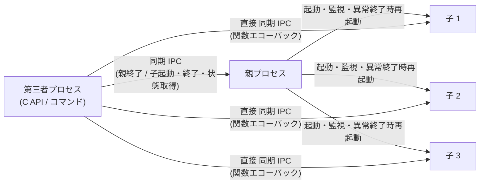

<!--
生成元: agree-before-implement スキル
文書種別: 検討用 Markdown (discussion)
最終更新日時: 2026-11-27 07:34:00 JST
最終更新エージェント: agy / セッション ID: 9d21d935-346c-44e1-b3ce-1a0bebca2117
稼働 OS: Linux (WSL)
上流文書: `261127-process-orchestration-sample-overview.md` (全体管理文書)。削除されている場合があります。
下流文書: `261127-process-orchestration-sample-lightadr.md` (簡易 ADR)、`261127-process-orchestration-sample-design.md` (最終仕様)、`261127-process-orchestration-sample-backlog.md` (残課題一覧)。未作成の場合や、削除されている場合があります。
再開手順: このファイルを開いたエージェントは、作業の前に agree-before-implement スキルを読み込んでください。ユーザーが編集した最新版を読み直し、上流文書の全体管理文書が存在する場合は、その再開手順に従って作業 WBS の `← **CURRENT**` の項目から再開します。存在しない場合は、各 Q の **Status** から未回答と未解決の Q を特定し、扱いをユーザーに確認してください。この文書には Q&A の本文だけを置き、新しい Q は末尾へ追記します。作業 WBS、質問一覧、観点別の確認などの管理情報をこの文書へ追加しないでください。最終更新エージェントのセッション情報や稼働 OS・最終更新日時が参照可能であれば再開時のコンテキストや環境差分の把握に利用し、別エージェントや別環境・別 OS からの引き継ぎ、担当変更によりセッションが見つからない場合も異常とせず、文書の記載から継続してください。
-->

# プロセスとりまとめサンプル (PoC 実装) 事前検討

ファイル名: `261127-process-orchestration-sample-discussion.md`

## 明確化のための確認項目

### Q-001 app ディレクトリ名と命名規則

**Status**

解決済み

**Question**

新規サンプル app のディレクトリ名 (`app/<name>`) は、作成済みの `app/process_orchestration_sample` のままとしますか、それとも既存の複数語 app に合わせてハイフン区切りへ統一しますか。

**Context**

- **経緯と背景**: 初期要件では「`cplat` の拡張は一旦は行わず、`app/process_orchestrate_sample` のような名前で実装する」と示されており、一方ですでにワークスペース上には `app/process_orchestration_sample/docs/prompts/current/` が作成されています。
- **リポジトリの既存状況**:
    - 既存の複数語 app ディレクトリはすべてハイフン区切りです (`service-sample`、`string-catalog-sample`、`override-sample`、`subfolder-sample`、`doxygen-sample`、`empty-lib`、`struct-meta`)。アンダースコア区切りの `app/` ディレクトリは現在存在しません。
    - なお、ビルド スクリプト (`resolve_app_deps.sh` や `sync-app-env.sh`) はアンダースコアを含むディレクトリ名でも技術的には動作します。
    - C ライブラリ内部ディレクトリ名やシンボル接頭辞は、既存 app (`app/struct-meta/prod/libsrc/struct_meta/` 等) と同様に C 識別子としてアンダースコア (`process_orchestration` や短縮接頭辞) を使用します。
- **判断の影響**:
    - `app/` ディレクトリ名を確定しないと、`makefile` 類、`appdeps.mk`、`.vscode` 同期パス、C ヘッダー配置パス、および検討文書の配置先パスが決まりません。実装着手前であれば、ディレクトリ名の変更コストはほぼありません。

**Answer**

選択方式: 単一選択

- [x] A: (推奨) 既存の複数語 app の命名慣例に合わせて、ハイフン区切りの `app/process-orchestration-sample` へ統一する (検討文書も移設する)。
- [ ] B: 作成済みの `app/process_orchestration_sample` をそのまま採用する。
- [ ] C: 初期要件の仮称に近い `app/process-orchestrate-sample` とする。
- [ ] D: その他
- [ ] X: 意図不明 (詳細な質問内容に再生成すること)

その他の回答 / 補足:

回答者: Tetsuo Honda  
回答日時: 2026-11-27 07:15:05 JST

**Assessment**

案 A の選択を確認しました。新規サンプル app のディレクトリ名を `app/process-orchestration-sample` に確定し、`LADR-001` へ反映します。なお、Q&A 進行中にエディターで開いている検討文書のパスが変わるのを避けるため、検討文書ディレクトリの `app/process-orchestration-sample/docs/prompts/current/` への移設は第 2 ゲート承認後の実装開始時 (WBS 4.1) に行います。他回答との矛盾はありません。

**Recommendation**

推奨: A  
優先した基準: リポジトリ横断の命名統一と、既存サンプル app (`service-sample`、`string-catalog-sample` 等) との一貫性を優先しました。  
理由: 既存の第一者管理 app はすべてハイフン区切りで統一されており、実装前の段階であれば検討文書ディレクトリを移設するだけで一貫性を保てます。ただし、すでに `app/process_orchestration_sample` の名前を意図して作成された場合は B を選択してください。

**Related**

- [Q-002](#q-002-ワークスペースのビルドと環境設定への組み込み範囲)
- [Q-006](#q-006-ライブラリと実行ファイルの構成)

### Q-002 ワークスペースのビルドと環境設定への組み込み範囲

**Status**

解決済み

**Question**

新規サンプル app をワークスペース全体のビルド (`make` / `make test`)、環境変数同期 (`make sync-app-env`)、およびドキュメント構成 (Doxygen / `docs/`) へどこまで組み込みますか。

**Context**

- **経緯と背景**: 本リポジトリでは、`app/<name>/makefile` を配置すると `app/makefile` (`resolve_app_deps.sh --app-order`) が自動的にビルド・テスト・`c_cpp_properties.json` 同期・`sync-app-env` の対象に含めます。
- **参照資料**: [ワークスペース作業ガイド](../../../../general/docs/workspace-agent-workflow.md)、[VS Code 環境変数](../../../../general/docs/vscode-variables.md)
- **各案の違い**:
    - 案 A: `service-sample` など既存の第一者管理サンプル app と同じ標準構成 (`makefile`、`appdeps.mk`、`.gitignore`、`AGENTS.md`、`README.md`、`prod/Doxyfile.part`、`docs/README.md`、`test/`) を整え、`make sync-app-env` と `sync_c_cpp_properties.sh --write` で `.vscode` 設定も同期します。ルート `make` や CI でも警告なしで一貫してビルド・テストできます。
    - 案 B: ビルドとテストの標準構成 (`makefile`、`appdeps.mk`、`.gitignore`、`AGENTS.md`、`README.md`、`prod/`、`test/`) と `.vscode` 同期は実施しますが、Doxygen (`Doxyfile.part`) や `docs/` 発行構成は PoC 段階では省略します (公開ヘッダーへの Doxygen コメント記述は通常どおり行います)。
    - 案 C: ワークスペース全体ビルドの対象外 (または `sync-app-env` 未同期) とし、app 単体でのみ `make` する構成にします (ただし `app/<name>/makefile` があると `resolve_app_deps.sh` が自動検出するため、除外するなら特殊な扱いが必要です)。

**Answer**

選択方式: 単一選択

- [x] A: (推奨) 既存サンプル app と同等の標準構成 (`makefile`、`appdeps.mk`、`AGENTS.md`、`README.md`、`Doxyfile.part`、`docs/README.md`、`prod/`、`test/`) を備え、`make sync-app-env` と `sync_c_cpp_properties.sh --write` でワークスペース設定を同期する。
- [ ] B: ビルド・テスト構成と `.vscode` 同期は標準どおり実施し、Doxygen 出力構成 (`Doxyfile.part`) と `docs/` 発行構成は PoC 段階では省略する。
- [ ] C: その他
- [ ] X: 意図不明 (詳細な質問内容に再生成すること)

その他の回答 / 補足:

回答者: Tetsuo Honda  
回答日時: 2026-11-27 07:15:05 JST

**Assessment**

案 A の選択を確認しました。`app/process-orchestration-sample` を既存の第一者管理サンプル app と同等の標準構成で整備し、`make sync-app-env` と `sync_c_cpp_properties.sh --write` による同期を実装工程へ組み込みます。他回答との矛盾はありません。

**Recommendation**

推奨: A  
優先した基準: ワークスペース標準構成との整合性と、CI・`make`・`make doxy` で警告や例外処理を生まない保守性を優先しました。  
理由: ルートの `make` 実行後には `sync-app-env --check` と `sync_c_cpp_properties.sh --check` が自動で走り、差異があると `.warn` が生成されます。既存サンプル app と同じ標準テンプレートに沿っておけば、特別な除外措置なしで Linux / Windows CI の恩恵をそのまま受けられます。

**Related**

- [Q-001](#q-001-app-ディレクトリ名と命名規則)
- [Q-013](#q-013-自動テストの範囲と検証レベル)

### Q-003 同期要求応答 IPC のトランスポート方式

**Status**

解決済み

**Question**

第三者プロセスから親プロセスおよび子プロセス 1〜3 へ同期的に要求を送り応答を受け取る汎用 IPC 層の、Linux / Windows 共通のトランスポート方式としてどれを採用しますか。

**Context**

- **経緯と背景**: 初期要件の「(4) ポイント」では、次の 2 点が重視されています。
    1. C の関数から、同期的に特定のプロセスへ処理を要求し応答を受け取る汎用の仕組みを考えたい。
    2. 同一ユーザー内でも、daemon / Windows Service のような共通空間に対して一般ユーザーがアクセスできる形態も考慮したい。
- **想定する全体構成** (初期要件「(1) 基本形態」):



Figure: プロセスとりまとめサンプルの基本形態と通信経路

- **各案の比較**:

Table: IPC トランスポート方式の比較

| 観点 | 案 A: Linux `AF_UNIX` + Windows 名前付きパイプ | 案 B: Linux・Windows ともに `AF_UNIX` | 案 C: TCP ループバック (`127.0.0.1`) |
| --- | --- | --- | --- |
| ポート競合・FW 干渉 | なし (名前でアドレッシング) | なし (ファイル パス) | あり (ポート割り当て・発見機構が必要) |
| daemon / Windows Service ↔ 一般ユーザーの権限制御 | OS ネイティブ (Linux: mode / group + `SO_PEERCRED`、Windows: `SECURITY_ATTRIBUTES` DACL / SDDL + クライアント PID 取得) | Linux は標準的。Windows の `AF_UNIX` は NTFS ACL 依存・パス長 108 バイト上限・抽象名前空間なしなど細かな制約がある | トランスポート層では不可 (同一ホストの全ユーザーが接続可能。別途トークン認証などが必要) |
| 既存 `cplat` との親和性 | Windows は `CreateNamedPipeU` / `CreateFileU` (`win32.h`) を活用可能。将来 `cplat` へ IPC 層を昇格する際の抽象モデルとして自然 | `cplat/net/socket.h` は IPv4 専用のため、結局 OS 固有実装が必要 | 既存 `cplat/net/socket.h` をそのまま利用でき実装量が最小 |
| 主な注意点 | 2 系統のトランスポート実装が必要。Linux は異常終了後の stale socket 回収対策が必要 | Windows 環境・SDK 差分の検証負荷が高い | ポート管理ファイルと権限境界の追加設計が必要 |

- **補足**: 共有メモリ (`cplat/mmap`) + プロセス間ロック (`cplat/sync`) 方式は、複数クライアントの同時接続管理やイベント通知 (Windows / Linux 横断のプロセス間条件待機がないためポーリングになる) が複雑化し、汎用要求応答基盤としての保守性で劣るため主要選択肢から外しています (ご希望の場合は「その他」でご指定ください)。

**Answer**

選択方式: 単一選択

- [ ] A: (推奨) OS ネイティブのローカル IPC を抽象化する (Linux: Unix ドメイン ソケット `AF_UNIX` / `SOCK_STREAM`、Windows: 名前付きパイプ `\\.\pipe\...`)。
- [x] B: Linux・Windows ともに Unix ドメイン ソケット (`AF_UNIX` / `SOCK_STREAM`) で統一する。
- [ ] C: 既存の `cplat/net/socket.h` を利用した TCP ループバック (`127.0.0.1`) で実装する。
- [ ] D: その他
- [ ] X: 意図不明 (詳細な質問内容に再生成すること)

その他の回答 / 補足: より性能の優れた方式としたい。検証が必要であれば検証をする。

回答者: Tetsuo Honda  
回答日時: 2026-11-27 07:15:05 JST

**Assessment**

案 B (Linux・Windows ともに `AF_UNIX` / `SOCK_STREAM`) の選択と「より性能の優れた方式としたい。検証が必要であれば検証をする」の補足を確認しました。Linux では `AF_UNIX` が最も高速なローカル ストリーム IPC ですが、Windows では `AF_UNIX` (`afunix.sys`) と名前付きパイプ (`npfs.sys`) の実性能 (往復レイテンシ・スループット・接続確立コスト) は環境や負荷特性により異なり、現在環境は Linux (WSL) のため Windows 実測なしでは優劣を断定できません。そのため、Windows 側のバックエンド構成と性能検証 (ベンチマーク) の範囲を確認する [Q-014](#q-014-windows-側トランスポートの性能検証とバックエンド構成) を追加します。また、Windows で `AF_UNIX` を用いる場合、エンドポイントは `\\.\pipe\...` ではなくファイル パス (NTFS ACL) となるため、[Q-005](#q-005-同一ユーザー空間と共通サービス空間の実装範囲) との整合を [Q-015](#q-015-同一ユーザー空間と共通サービス空間の-poc-実装範囲の整理) で確認します。両問の合意まで本問は未解決とします。

**History**

- 2026-11-27 07:34 JST: [Q-014](#q-014-windows-側トランスポートの性能検証とバックエンド構成) で案 A、[Q-015](#q-015-同一ユーザー空間と共通サービス空間の-poc-実装範囲の整理) で案 A が確定したため、本問を解決済みとし、`LADR-012` へ反映しました。

**Recommendation**

推奨: A  
優先した基準: daemon / Windows Service 共通空間における OS ネイティブなアクセス制御、ポート管理不要のアドレッシング、および将来 `cplat` へ汎用 IPC 機能として昇格できる設計品質を優先しました。  
理由: Linux の `AF_UNIX` と Windows の名前付きパイプは、それぞれの OS で最も実績のあるローカル プロセス間通信手段であり、サービス (root / SYSTEM) と一般ユーザー間の境界制御 (ファイル モード / グループ、`SO_PEERCRED`、SDDL DACL) を標準機能として備えています。

**Related**

- [Q-004](#q-004-汎用-ipc-の電文フレーミングとペイロード形式)
- [Q-005](#q-005-同一ユーザー空間と共通サービス空間の実装範囲)
- [Q-011](#q-011-汎用-ipc-サーバーの同時接続とリクエスト処理モデル)
- [Q-014](#q-014-windows-側トランスポートの性能検証とバックエンド構成)
- [Q-015](#q-015-同一ユーザー空間と共通サービス空間の-poc-実装範囲の整理)

### Q-004 汎用 IPC の電文フレーミングとペイロード形式

**Status**

解決済み

**Question**

汎用同期要求応答 IPC でやり取りする電文のフレーミングとペイロード形式は、どの方式を採用しますか。

**Context**

- **経緯と背景**: 初期要件「(4) ポイント」の「C の関数から、同期的に特定のプロセスに処理を要求/応答を受け取る汎用の仕組み」では、汎用 IPC 層と、その上に載るアプリケーション固有の操作 (親制御 4 種・子エコー バック) の責務境界を明確にする必要があります。
- **各案の具体例**:
    - **案 A (バイナリ ヘッダー + 不透明バイト列ペイロード)**:  
      汎用 IPC 層は固定長バイナリ ヘッダー (マジック、プロトコル版、操作 ID、結果コード、ペイロード長) と任意バイト列のみを転送します。ペイロード形式の選択は上位の関数 API 側へ委ねます (PoC では固定レイアウト構造体または UTF-8 文字列など軽量な形式を使用)。

```c
/* 案 A (推奨): 汎用 IPC 層の同期呼び出し API イメージ */
int pos_ipc_call(const pos_ipc_endpoint *endpoint,
                 uint32_t method_id,
                 const void *request_data,
                 size_t request_size,
                 void *response_buffer,
                 size_t response_capacity,
                 size_t *response_size_out,
                 int timeout_ms,
                 cplat_error *detail_out);
```

    - **案 B (長さプレフィックス + JSON ペイロード)**:  
      `app/cjson` を使い、要求・応答を JSON 文字列としてシリアライズします。人手で読みやすく、フィールド追加に対する拡張性が高い反面、汎用 IPC 層自体が JSON ライブラリへ依存します。

```json
/* 案 B: 電文ペイロードのイメージ */
{
  "method": "child.status",
  "params": { "child_id": 1 }
}
```

    - **案 C (改行区切りテキスト プロトコル)**:  
      テキスト 1 行でコマンドと応答を送受信します。バイナリや改行を含むエコー バック文字列にはエスケープ処理が必要になります。

**Answer**

選択方式: 単一選択

- [x] A: (推奨) 固定長バイナリ ヘッダー (マジック、版、操作 ID、結果コード、ペイロード長) + 任意バイト列ペイロードとし、汎用 IPC 層はペイロード形式を規定しない。
- [ ] B: 長さプレフィックス + JSON ペイロード (`app/cjson` を利用) とし、操作名・引数・応答を JSON で表現する。
- [ ] C: 改行区切りテキスト プロトコルとする。
- [ ] D: その他
- [ ] X: 意図不明 (詳細な質問内容に再生成すること)

その他の回答 / 補足:

回答者: Tetsuo Honda  
回答日時: 2026-11-27 07:15:05 JST

**Assessment**

案 A の選択を確認しました。固定長バイナリ ヘッダー + 不透明バイト列ペイロードの構成に確定し、`LADR-006` へ反映します。このフレーミングは単発接続・持続接続の双方 ([Q-011](#q-011-汎用-ipc-サーバーの同時接続とリクエスト処理モデル)、[Q-017](#q-017-単発接続と持続接続の両立におけるサーバー接続管理モデル)) で共通利用でき、将来の `cplat` 統合 ([Q-012](#q-012-公開-c-api-のエラー-コードと待機規約)) とも整合します。

**Recommendation**

推奨: A  
優先した基準: 汎用 IPC 層の責務分離、バイナリ データの透過的な転送、および将来 `cplat` へ組み込む際の依存最小化を優先しました。  
理由: 汎用層を「操作 ID + 不透明バイト列の同期要求応答」にしておけば、上位の利用者は用途に応じて固定構造体、UTF-8 文字列、JSON のいずれでも自由に載せられます。また、最大メッセージ サイズの上限チェックも固定長ヘッダーの段階で安全に行えます。

**Related**

- [Q-003](#q-003-同期要求応答-ipc-のトランスポート方式)
- [Q-010](#q-010-子への指示の関数エコー-バックの仕様)
- [Q-012](#q-012-公開-c-api-のエラー-コードと待機規約)

### Q-005 同一ユーザー空間と共通サービス空間の実装範囲

**Status**

解決済み

**Question**

「同一ユーザー内」と「daemon / Windows Service のような共通空間への一般ユーザーからのアクセス」の両形態について、今回の PoC ではどこまでを実装および検証の範囲としますか。

**Context**

- **経緯と背景**: 初期要件「(4) ポイント」では「同一ユーザー内でも、daemon / Windows Service のような共通空間に対して、ユーザーがアクセスできる形態も考慮したい」と明記されています。
- **空間ごとの技術的要件 (案 A のトランスポートを想定した場合)**:
    - **同一ユーザー空間 (User Scope)**:
        - Linux: `$XDG_RUNTIME_DIR/<app>/<instance>/<target>.sock` (未設定時は一時ディレクトリ配下の UID 固有ディレクトリ `0700` 内、ソケット `0600`)
        - Windows: `\\.\pipe\<app>-user-<sid-or-user>-<instance>-<target>` (作成ユーザー + SYSTEM / Administrators のみ許可する DACL)
    - **共通サービス空間 (System / Common Scope)**:
        - Linux: 共通ランタイム ディレクトリ (例: `/run/<app>/<instance>/<target>.sock` または明示指定ディレクトリ。ディレクトリ `0755`、ソケット `0660` (特定グループ) または `0666` (接続許可))
        - Windows: `\\.\pipe\<app>-system-<instance>-<target>` (サービス側が `Authenticated Users` 等へ読み書きを許可する SDDL DACL を付与してパイプ作成)
    - **テスト用隔離空間**: 自動テスト同士の衝突を避けるため、任意のインスタンス名 / ベース パスを指定可能にします。
- **判断のポイント**:
    - 実際の Linux systemd サービス登録や Windows SCM サービス登録 (root / 管理者権限が必要) まで PoC 本体に組み込むか、それとも「空間スコープ指定 + OS 権限設定 (mode / SDDL) の実装」までを PoC に含め、サービス登録自体は `service-sample` 等と組み合わせ可能な設計に留めるかで、実装規模とテスト前提が大きく変わります。

**Answer**

選択方式: 単一選択

- [x] A: (推奨) API と実装の双方で「空間スコープ (同一ユーザー空間 / 共通空間 / テスト向け任意空間)」と「アクセス権ポリシー (Linux mode・Windows SDDL)」を実装する。ただし systemd / Windows Service の登録機能自体は PoC に含めず、自動テストは同一ユーザー空間・隔離インスタンスで行い、共通空間の異ユーザー実機確認は手順書として整備する。
- [ ] B: 案 A に加えて、`service-sample` と同様に systemd / Windows Service としての登録・起動機能 (`install` / `uninstall` / `run`) も親プロセスへ組み込み、実サービス経由でのアクセスまで PoC の対象に含める。
- [ ] C: PoC の実装は同一ユーザー空間 (既定権限) のみに限定し、共通サービス空間はエンドポイント設計とドキュメント上の検討に留める。
- [ ] D: その他
- [ ] X: 意図不明 (詳細な質問内容に再生成すること)

その他の回答 / 補足: まずは同一ユーザーで PoC したい。

回答者: Tetsuo Honda  
回答日時: 2026-11-27 07:15:05 JST

**Assessment**

案 A の選択と「まずは同一ユーザーで PoC したい」の補足を確認しました。2 点の整合確認が必要です。(1) 案 A は「共通空間向けのアクセス権ポリシー (Linux mode・Windows SDDL) まで PoC で実装する」前提でしたが、補足の「まずは同一ユーザーで PoC したい」が「共通空間の権限設定コード実装は後続へ回し、API 設計 (スコープ定義) と同一ユーザー空間の実装に絞る」意図か、それとも「権限設定コードまで実装し検証をまず同一ユーザーから始める」意図かを明確にする必要があります。(2) [Q-003](#q-003-同期要求応答-ipc-のトランスポート方式) で Windows も `AF_UNIX` が選択されたため、Windows 側のエンドポイント表現は `\\.\pipe\...` ではなくファイル パスと親ディレクトリ NTFS ACL へ変わります。これらを [Q-015](#q-015-同一ユーザー空間と共通サービス空間の-poc-実装範囲の整理) で確認するため、本問は未解決とします。

**History**

- 2026-11-27 07:34 JST: [Q-015](#q-015-同一ユーザー空間と共通サービス空間の-poc-実装範囲の整理) で案 A が確定したため、本問を解決済みとし、`LADR-013` へ反映しました。

**Recommendation**

推奨: A  
優先した基準: PoC の本質である「汎用同期 IPC と空間・権限モデルの実証」への集中と、一般ユーザー権限のまま CI で完結するテスト性を優先しました。  
理由: 空間スコープと権限ポリシー (Linux の mode、Windows の SDDL DACL) を実装しておけば、共通空間アクセスに必要な技術的難所 (名前空間分離、権限設定、stale 対策) はコードで実証できます。サービス登録機構はすでに `app/service-sample` が存在するため、PoC に抱え込まず責務を分離するほうが明確です。

**Related**

- [Q-003](#q-003-同期要求応答-ipc-のトランスポート方式)
- [Q-013](#q-013-自動テストの範囲と検証レベル)
- [Q-015](#q-015-同一ユーザー空間と共通サービス空間の-poc-実装範囲の整理)

### Q-006 ライブラリと実行ファイルの構成

**Status**

解決済み

**Question**

親プロセス、子プロセス (1〜3)、C の制御 API、および操作用コマンドについて、ライブラリと実行ファイルの分割構成をどれにしますか。

**Context**

- **経緯と背景**: 初期要件では「親」「子 1〜3」「C の API で親・子へ指示を送る」「PoC ではコマンドとして実装」と示されています。
- **各案の構成比較**:
    - **案 A (1 ライブラリ + 3 実行ファイル)**:
        - ライブラリ (`prod/libsrc/` + `prod/include/`): 汎用同期 IPC 層 + 親/子制御 C API
        - 親実行ファイル (例: `orchestrator-parent`): 起動すると子 1〜3 を起動・監視し、親向け IPC サーバーを待ち受ける
        - 子実行ファイル (例: `orchestrator-child`): 引数で子 ID (`1`〜`3`) を受け取って起動し、子向け IPC サーバー (エコー バック等) を待ち受ける
        - 制御コマンド (例: `orchestrator-ctl`): サブコマンドで親・子双方の C API を呼び出す (`parent-stop`、`child-start <1-3>`、`child-stop <1-3>`、`child-status <1-3>`、`child-echo <1-3> <message>`)
    - **案 B (1 ライブラリ + 4 実行ファイル)**:
        - 案 A の制御コマンドを「親指示コマンド (`orchestrator-parent-ctl`)」と「子指示コマンド (`orchestrator-child-ctl`)」に分割します。
    - **案 C (1 ライブラリ + 1 マルチ コール実行ファイル)**:
        - 1 つの実行ファイルにサブコマンド (`parent`、`child`、`ctl` 等) をすべて集約します。実行ファイル数は最小ですが、`ps` / タスク マネージャー上で親と子を見分けにくくなります。
- **補足**: ライブラリ形態 (`static` / `shared`) は、他サンプル app と同様の標準構成 (必要に応じてコマンドとテストからリンク) を想定しています。

**Answer**

選択方式: 単一選択

- [x] A: (推奨) 1 ライブラリ + 3 実行ファイル (親プロセス、子プロセス、親・子共通の制御 CLI コマンド) とする。
- [ ] B: 1 ライブラリ + 4 実行ファイル (親プロセス、子プロセス、親向け制御コマンド、子向け制御コマンド) とする。
- [ ] C: 1 ライブラリ + 1 マルチ コール実行ファイル (サブコマンドで親・子・制御を切り替え) とする。
- [ ] D: その他
- [ ] X: 意図不明 (詳細な質問内容に再生成すること)

その他の回答 / 補足:

回答者: Tetsuo Honda  
回答日時: 2026-11-27 07:15:05 JST

**Assessment**

案 A の選択を確認しました。基本構成を 1 ライブラリ + 3 実行ファイル (親、子、制御 CLI) に確定し、`LADR-007` へ反映します。なお、[Q-014](#q-014-windows-側トランスポートの性能検証とバックエンド構成) で性能計測用ベンチマーク コマンドを含める決定となった場合は、ベンチマーク用実行ファイルを追加構成として反映します。

**Recommendation**

推奨: A  
優先した基準: プロセス一覧での視認性、手動実験時の操作性、およびビルド ターゲット数の適度な抑制を優先しました。  
理由: 親と子の実行ファイルを分けることで、異常終了テスト (`kill` / `taskkill`) やプロセス監視の挙動が視覚的に分かりやすくなります。制御コマンドは 1 つにまとめてサブコマンドで親向け・子向けを呼び分けることで、共通オプション (空間スコープ、インスタンス名、タイムアウト等) の重複を避けられます。

**Related**

- [Q-001](#q-001-app-ディレクトリ名と命名規則)
- [Q-012](#q-012-公開-c-api-のエラー-コードと待機規約)
- [Q-014](#q-014-windows-側トランスポートの性能検証とバックエンド構成)

### Q-007 子の異常終了判定と自動再起動ポリシー

**Status**

解決済み

**Question**

親プロセスが子 1〜3 を自動再起動する条件 (異常終了の判定基準) と、連続クラッシュ時の再起動待機 (バックオフ) をどのように扱いますか。

**Context**

- **経緯と背景**: 初期要件「(1) 基本形態」では「親を起動すると、親は子 1〜3 を起動する」「親は、子 1〜3 が仮に異常終了した際は、再起動させる」とあり、「(2) 親への指示」では「子の終了」「子の起動」を個別に指示できます。
- **確認が必要な境界条件**:
    1. **意図的停止との区別**: 親への「子の終了」指示で止めた子は再起動せず、`STOPPED` のまま維持する必要があります (期待状態 `desired = RUNNING` の子のみ監視・再起動対象)。
    2. **終了コード 0 での予期せぬ終了**: 期待状態が `RUNNING` の子が、親からの停止指示なしに終了した場合、終了コード 0 であっても予期せぬ終了として再起動するか、非 0 / シグナル終了のみ再起動するかで振る舞いが変わります。
    3. **連続クラッシュ時の暴走防止**: 子が起動直後にクラッシュし続けた場合、待機なしで即座に再起動すると CPU 負荷・プロセス生成が暴走します。短いバックオフ待機 (例: 初回 100 [ms]、上限 2000 [ms] 程度。安定稼働でリセット。テスト時は短縮設定可能) を挟むと安全です。

**Answer**

選択方式: 単一選択

- [ ] A: (推奨) 期待状態が稼働中の子が意図的停止以外で終了した場合は、終了コードにかかわらず予期せぬ終了として自動再起動する。連続クラッシュ防止のため短いバックオフ待機 (設定可能) を設ける。
- [ ] B: 期待状態が稼働中の子が「非 0 の終了コード」または「シグナル等による異常終了」となった場合のみ自動再起動し、終了コード 0 での自発終了時は停止状態とする (バックオフあり)。
- [ ] C: 意図的停止以外のすべての終了を対象に、バックオフなしで即座に再起動する。
- [x] D: その他
- [ ] X: 意図不明 (詳細な質問内容に再生成すること)

その他の回答 / 補足: 期待状態が稼働中の子が意図的停止以外で終了した場合は、PoC なのでそのままで再起動はしなくてよい。外部からの起動指示にまかせる。外部から親への状態取得で、直前に異常終了したかを把握できればよい。これは当初の方針と異なるので、この回答を優先して。

回答者: Tetsuo Honda  
回答日時: 2026-11-27 07:15:05 JST

**Assessment**

案 D および具体的な方針変更の指示を確認しました。当初の自動再起動方針を本回答で上書きし、「期待状態が稼働中の子が意図的停止以外で終了した場合、親は自動再起動せず、外部からの起動指示に任せる。親は子の終了を検知・回収し、外部からの状態取得で直前に異常終了したことを把握できるようにする」へ確定し、`LADR-002` を更新します。この方針変更に伴い、[Q-009](#q-009-子の状態取得で返す情報項目) の状態値 (`RESTARTING` 等) とフィールド構成の整合を [Q-016](#q-016-自動再起動なし方針に合わせた子の状態取得の仕様) で確認し、[Q-013](#q-013-自動テストの範囲と検証レベル) の統合テスト シナリオも自動再起動なし・異常終了検知 + 外部起動指示による再起動へ合わせます。

**Recommendation**

推奨: A  
優先した基準: 常駐ワーカー監視としての確実性と、テスト・実運用双方での暴走防止を優先しました。  
理由: 常駐を期待される子プロセスは親からの停止指示なしに終了すること自体が異常であり、Linux / Windows の終了コード差異 (例: Windows の強制終了コードやシグナル非対応) に左右されにくい判定になります。また、テストで短い再起動間隔を指定できるようにすれば自動テストの実行時間も抑えられます。

**Related**

- [Q-008](#q-008-親および子の停止手順)
- [Q-009](#q-009-子の状態取得で返す情報項目)
- [Q-016](#q-016-自動再起動なし方針に合わせた子の状態取得の仕様)

### Q-008 親および子の停止手順

**Status**

解決済み

**Question**

親への指示で「子の終了」または「親の終了」を受け取った際、稼働中の子プロセスをどの手順で停止しますか。

**Context**

- **経緯と背景**: `cplat/runtime/process.h` には強制終了 API (`cplat_process_terminate()`: Linux では `SIGKILL`、Windows では `TerminateProcess`) はありますが、クロスプラットフォームでグレースフル停止を指示するプロセス シグナル API はありません (Windows には非コンソール/サービス プロセスへ安全に送れる `SIGTERM` 相当がないため)。
- **各案の違い**:
    - **案 A (IPC によるグレースフル停止要求 + タイムアウト後強制終了)**:  
      親から対象の子へ IPC で内部的な停止要求を送り、子が自発的に IPC サーバーを閉じてソケット ファイル等の後始末を行ってから終了するのを一定時間 (例: 3000 [ms]) 待ちます。期限内に終了しない場合のみ `cplat_process_terminate()` で強制終了して回収します。「親の終了」時 (および親が `SIGINT` / `SIGTERM` を受けた時) も、全稼働中の子を同様に停止・回収してから親自身を終了します。
    - **案 B (即座に強制終了)**:  
      「子の終了」「親の終了」ともに `cplat_process_terminate()` で子を強制終了して終了待機・回収を行います。実装は単純ですが、子側の後始末 (Linux ソケット ファイル削除など) が実行されず親側での回収が必要になります。
    - **案 C (OS 別シグナル停止 + 強制終了)**:  
      Linux は `SIGTERM` → タイムアウト後 `SIGKILL`、Windows は `TerminateProcess` のみとします。OS 間で子の停止経路が異なります。

**Answer**

選択方式: 単一選択

- [x] A: (推奨) 親から子へ IPC でグレースフル停止要求を送り、一定時間内に終了しなければ `cplat_process_terminate()` で強制終了する (「親の終了」時も全稼働中の子を同様に停止・回収してから終了する)。
- [ ] B: 「子の終了」「親の終了」とも `cplat_process_terminate()` で即座に強制終了し、親側で終了待機とリソース回収を行う。
- [ ] C: Linux は `SIGTERM` 後にタイムアウトで `SIGKILL`、Windows は `TerminateProcess` とする。
- [ ] D: その他
- [ ] X: 意図不明 (詳細な質問内容に再生成すること)

その他の回答 / 補足: 親から子への停止要求自体も IPC 経路になると想定。

回答者: Tetsuo Honda  
回答日時: 2026-11-27 07:15:05 JST

**Assessment**

案 A の選択および補足 (親から子への停止要求も IPC 経路とする想定) を確認しました。親から子への IPC によるグレースフル停止要求 + タイムアウト後の `cplat_process_terminate()` フォールバック (親の終了時も全稼働中の子を同様に停止・回収) に確定し、`LADR-008` へ反映します。他回答との矛盾はありません。

**Recommendation**

推奨: A  
優先した基準: Linux と Windows での振る舞いの統一、子プロセス側の確実なクリーンアップ (ソケット/ハンドル解放)、および本 PoC の同期 IPC の実用性実証を優先しました。  
理由: 自前の同期 IPC を用いたグレースフル停止と `cplat_process_terminate()` へのフォールバックを組み合わせることで、OS ごとのシグナル仕様差を回避しながら安全かつ決定的に子プロセスを停止できます。

**Related**

- [Q-007](#q-007-子の異常終了判定と自動再起動ポリシー)

### Q-009 子の状態取得で返す情報項目

**Status**

解決済み

**Question**

親への指示「子の状態取得 (パラメーターで子 1〜3 を指定)」で呼び出し元へ返す情報として、どの項目を含めますか。

**Context**

- **経緯と背景**: 初期要件「(2) 親への指示」では「子の状態取得 (パラメーターで子を指定。1〜3)」が挙げられていますが、返却する状態項目や詳細フィールドは未定義です。
- **テスト・運用時の活用**:
    - 自動再起動の検証では、「異常終了前と後で子の PID が変わったこと」および「再起動回数が増えたこと」を確認できると、テストの判定が確実になります。
    - 起動直後に子へ直接エコー バックを送る場面では、子が IPC 受付可能な `RUNNING` 状態になったか (`STARTING` と区別するか) を知れると競合を避けられます。
- **各案の具体例**:

```c
/* 案 A (推奨) の構造体イメージ */
typedef enum pos_child_state
{
    POS_CHILD_STATE_STOPPED = 0,
    POS_CHILD_STATE_STARTING = 1,
    POS_CHILD_STATE_RUNNING = 2,
    POS_CHILD_STATE_STOPPING = 3,
    POS_CHILD_STATE_RESTARTING = 4
} pos_child_state;

typedef struct pos_child_status
{
    uint32_t child_id;        /* 1..3 */
    pos_child_state state;    /* 現在のライフサイクル状態 */
    uint32_t pid;             /* 稼働中または起動中の PID。停止中は 0 */
    uint32_t restart_count;   /* 異常終了からの自動再起動回数 */
    int32_t last_exit_code;   /* 直近の終了コード (has_last_exit_code == 1 の時有効) */
    uint32_t has_last_exit_code; /* 終了コード取得済みなら 1、未終了・未取得なら 0 */
} pos_child_status;
```

```c
/* 案 B の構造体イメージ */
typedef struct pos_child_status
{
    uint32_t child_id;   /* 1..3 */
    uint32_t is_running; /* 1=稼働中, 0=停止中 */
    uint32_t pid;        /* 稼働中の PID。停止中は 0 */
} pos_child_status;
```

**Answer**

選択方式: 単一選択

- [x] A: (推奨) 詳細なライフサイクル状態 (`STOPPED` / `STARTING` / `RUNNING` / `STOPPING` / `RESTARTING`)、現在 PID、自動再起動回数、および直近の終了コード (有効フラグ付き) を返す。
- [ ] B: 最小限の情報 (稼働中/停止中の 2 値 + 現在 PID) のみ返す。
- [ ] C: その他
- [ ] X: 意図不明 (詳細な質問内容に再生成すること)

その他の回答 / 補足:

回答者: Tetsuo Honda  
回答日時: 2026-11-27 07:15:05 JST

**Assessment**

案 A の選択を確認しましたが、[Q-007](#q-007-子の異常終了判定と自動再起動ポリシー) の方針変更により自動再起動を行わなくなり、代わりに「外部から親への状態取得で直前に異常終了したかを把握できること」が要件となりました。そのため、案 A の `RESTARTING` 状態と `restart_count` (自動再起動回数) は実態と合わず、直前の異常終了を区別する表現の確定が必要です。状態値と構造体フィールドの調整を [Q-016](#q-016-自動再起動なし方針に合わせた子の状態取得の仕様) で確認するため、本問は未解決とします。

**History**

- 2026-11-27 07:34 JST: [Q-016](#q-016-自動再起動なし方針に合わせた子の状態取得の仕様) で案 A が確定したため、本問を解決済みとし、`LADR-014` へ反映しました。

**Recommendation**

推奨: A  
優先した基準: 親の監視動作の可視性と、異常終了・再起動テストでの検証の確実性を優先しました。  
理由: PID と再起動回数と直近終了コードを返すことで、テスト プログラムが子プロセスのクラッシュ検知・再起動完了を確実に判定でき、デバッグも容易になります。構造体のサイズも小さく、パディングなし (`-Wpadded` 準拠) で簡潔に定義できます。

**Related**

- [Q-007](#q-007-子の異常終了判定と自動再起動ポリシー)
- [Q-016](#q-016-自動再起動なし方針に合わせた子の状態取得の仕様)

### Q-010 子への指示の関数エコー バックの仕様

**Status**

解決済み

**Question**

子プロセスへの直接指示「子の関数エコー バック」の入力と応答の仕様をどれにしますか。

**Context**

- **経緯と背景**: 初期要件「(3) 子への指示」では「C の API で、起動中の子に指示を送ることができる。親を経由せず直接子に送る。PoC での実装はコマンドとして実装: 子の関数エコー バック」とされています。
- **各案の違い**:
    - **案 A (UTF-8 文字列エコー バック + 応答メタ情報)**:  
      入力として任意の UTF-8 文字列 (空文字列やマルチバイト文字を含む) を受け取り、子プロセス内のエコー関数が「文字列を加工せずそのまま返却」し、あわせて応答構造体の別フィールドとして「応答した子 ID (`1`〜`3`)」と「応答した子プロセスの PID」を返します。メッセージの完全一致検証と、意図した子プロセス本人が直接応答したことの検証を両立できます。
    - **案 B (UTF-8 文字列のみ完全一致エコー バック)**:  
      入力文字列をそのまま応答文字列として返します (子 ID や PID のメタ情報は返しません)。
    - **案 C (任意バイナリ バイト列のエコー バック)**:  
      C API は `(const void *data, size_t size)` を受け取り任意バイト列をそのままエコー バックします (CLI からは UTF-8 文字列または指定データを送信)。

**Answer**

選択方式: 単一選択

- [x] A: (推奨) 入力 UTF-8 文字列を加工せずそのまま返し、あわせて別フィールドで応答元の子 ID (`1`〜`3`) と子プロセスの PID を返す。
- [ ] B: 入力 UTF-8 文字列のみをそのまま返す (メタ情報は含めない)。
- [ ] C: 任意バイナリ バイト列 (`const void *` + 長さ) をそのまま返す (メタ情報なし、または別フィールドで付与)。
- [ ] D: その他
- [ ] X: 意図不明 (詳細な質問内容に再生成すること)

その他の回答 / 補足:

回答者: Tetsuo Honda  
回答日時: 2026-11-27 07:15:05 JST

**Assessment**

案 A の選択を確認しました。入力 UTF-8 文字列のそのままの返却に加え、別フィールドで応答元の子 ID (`1`〜`3`) と子プロセス PID を返す仕様に確定し、`LADR-009` へ反映します。他回答との矛盾はありません。

**Recommendation**

推奨: A  
優先した基準: 「親を経由せず指定した子プロセスへ直接到達したこと」の検証容易性と、CLI からの扱いやすさを優先しました。  
理由: 文字列自体は改変せずそのまま返すため純粋なエコー バックとして確認でき、同時に応答メタ情報として子 ID と PID を受け取ることで、子 1〜3 のうち正しいプロセスが直接処理したこと、および再起動後に新しい子プロセスへ切り替わったことを一目で確認できます。

**Related**

- [Q-004](#q-004-汎用-ipc-の電文フレーミングとペイロード形式)

### Q-011 汎用 IPC サーバーの同時接続とリクエスト処理モデル

**Status**

解決済み

**Question**

親プロセスおよび子プロセスがリクエストを受け付ける汎用 IPC サーバーの同時接続・処理モデルをどれにしますか。

**Context**

- **経緯と背景**: 初期要件「(4) ポイント」のとおり、この仕組みは汎用的な同期要求応答基盤の PoC です。親プロセスは子 1〜3 の死活監視と再起動を行いながら第三者からの複数指示を受け付け、子プロセスも複数の第三者プロセスから同時にエコー バック要求を受ける可能性があります。
- **各案の違い**:
    - **案 A (1 接続 1 要求応答 + 受け付けスレッド & 接続ごとの並行処理、同時接続上限付き)**:  
      クライアントは呼び出しごとに接続→要求送信→応答受信→切断を行います。サーバー側は接続を受け付けたらワーカー スレッド (または固定数スレッド プール) で登録済みハンドラーを呼び出します。1 クライアントが送信途中で停止しても、タイムアウトで切断されるまで他クライアントの要求をブロックしません。
    - **案 B (1 接続 1 要求応答 + 単一スレッド直列処理)**:  
      受け付けた接続を 1 件ずつ順番に処理してから次の接続を受け付けます。ハンドラー内の排他が不要で実装が最も単純ですが、あるクライアントの処理 (例: 「子の終了」の停止待機や遅いクライアント) が終わるまで後続クライアントが待たされます。
    - **案 C (持続接続 + 1 接続上の複数要求多重化)**:  
      クライアント ハンドルを保持して複数回の同期呼び出しを 1 接続で再利用します。高頻度 RPC のオーバーヘッドは小さい一方、再接続・切断検知・多重化 ID 管理が複雑になり、短寿命 CLI コマンド主体では利点が薄くなります。

**Answer**

選択方式: 単一選択

- [ ] A: (推奨) 1 接続 1 要求応答とし、サーバー側は受け付けスレッド + ワーカー スレッド (同時処理数上限付き) で複数クライアントの要求を並行処理する。
- [ ] B: 1 接続 1 要求応答とし、サーバー側は単一スレッドで直列処理する (各操作の送受信にタイムアウトは設定する)。
- [ ] C: 持続接続 (1 接続上で複数回の同期要求を送受信するセッション型クライアント) とする。
- [x] D: その他
- [ ] X: 意図不明 (詳細な質問内容に再生成すること)

その他の回答 / 補足: A と C を呼び出し元で選択できるようにしたほうがいい。C を多数行うことでリソース的に問題になるかどうかも整理する。

回答者: Tetsuo Honda  
回答日時: 2026-11-27 07:15:05 JST

**Assessment**

案 D および補足 (呼び出し元が単発接続と持続接続を選択できるようにし、多数の持続接続によるリソース影響も整理すること) を確認しました。固定長ヘッダー方式 ([Q-004](#q-004-汎用-ipc-の電文フレーミングとペイロード形式)) であれば単発接続と持続接続は同一プロトコル上で両立できますが、サーバー側を単純な「接続ごとスレッド」にすると多数のアイドル持続接続がワーカー スレッドとスタックを占有して新規接続を飢餓させる問題が生じます。リソース影響の整理とサーバー側接続管理モデルの選択を [Q-017](#q-017-単発接続と持続接続の両立におけるサーバー接続管理モデル) で確認するため、本問は未解決とします。

**History**

- 2026-11-27 07:34 JST: [Q-017](#q-017-単発接続と持続接続の両立におけるサーバー接続管理モデル) で案 A が確定したため、本問を解決済みとし、`LADR-015` へ反映しました。

**Recommendation**

推奨: A  
優先した基準: 汎用 IPC 基盤としての実用性 (遅いクライアントや「子の終了」待機によるブロッキング回避) と、実装複雑度のバランスを優先しました。  
理由: 1 接続 1 要求応答のモデルは CLI コマンドからも一般の C 関数からも扱いやすく、さらにサーバー側を上限付きワーカー スレッドで並行処理することで、あるクライアントの停止や待機中処理が他の要求 (状態取得や別の子への操作) を止めません。

**Related**

- [Q-003](#q-003-同期要求応答-ipc-のトランスポート方式)
- [Q-017](#q-017-単発接続と持続接続の両立におけるサーバー接続管理モデル)

### Q-012 公開 C API のエラー コードと待機規約

**Status**

解決済み

**Question**

本サンプル app が提供する公開 C API (汎用 IPC 層および親・子制御 API) の戻り値エラー コードとタイムアウト規約は、既存の `cplat` 規約に揃えますか、それとも app 独自の体系にしますか。

**Context**

- **経緯と背景**: 初期要件に「`cplat` の拡張は一旦は行わず」とあり、将来的にこの PoC で検証した汎用 IPC 機構を `cplat` へ昇格・統合する可能性があります。
- **既存の `cplat` 規約**:
    - 戻り値: `cplat/base/result.h` の共通結果コード (`CPLAT_OK`、`CPLAT_ERR_INVALID_ARGUMENT`、`CPLAT_ERR_TIMEOUT`、`CPLAT_ERR_NOT_FOUND`、`CPLAT_ERR_PERMISSION_DENIED`、`CPLAT_ERR_BUSY`、`CPLAT_ERR_BUFFER_TOO_SMALL`、`CPLAT_ERR_EOF`、`CPLAT_ERR_UNKNOWN` 等)
    - 詳細エラー: `cplat_error *detail_out` (NULL 可)
    - 待機時間: `int timeout_ms` (`cplat/base/wait.h` の `CPLAT_WAIT_FOREVER`、`CPLAT_NO_WAIT`、または 0 以上の [ms])
- **各案の違い**:
    - 案 A: `cplat` の結果コード・`cplat_error`・待機規約をそのまま公開 API に採用します。将来 `cplat` へ移植する際に API 契約と利用側コードの変換コストが最小になります。
    - 案 B: app 独自の結果コード enum (例: `POS_OK`、`POS_ERR_*`) を定義し、公開ヘッダーから `cplat` 型を完全に隠蔽します。独立性は高まりますが、`cplat` との相互変換層が増えます。

**Answer**

選択方式: 単一選択

- [x] A: (推奨) `cplat` の共通結果コード (`CPLAT_OK` / `CPLAT_ERR_*`)、`cplat_error *detail_out`、および待機規約 (`timeout_ms` / `CPLAT_WAIT_FOREVER` / `CPLAT_NO_WAIT`) に準拠する。
- [ ] B: 本サンプル app 独自の結果コード enum を定義し、公開ヘッダーでは `cplat` のエラー型を露出しない。
- [ ] C: その他
- [ ] X: 意図不明 (詳細な質問内容に再生成すること)

その他の回答 / 補足: 基本の仕組みは最終的に cplat にマージしたいため。

回答者: Tetsuo Honda  
回答日時: 2026-11-27 07:15:05 JST

**Assessment**

案 A の選択および補足 (基本の仕組みは最終的に `cplat` へマージしたい) を確認しました。`cplat` の共通結果コード、`cplat_error *detail_out`、待機規約に準拠するとともに、汎用 IPC 層と PoC 固有の親・子制御層のヘッダーおよび実装を明確に分離し、将来 `cplat` へ移植しやすい構成とします (`LADR-010` へ反映)。他回答との矛盾はありません。

**Recommendation**

推奨: A  
優先した基準: 将来の `cplat` への昇格・統合の容易さと、リポジトリ内の他 C API との一貫性を優先しました。  
理由: すでに `cplat` を依存ライブラリとして利用する前提であり、共通結果コード・`cplat_error`・`timeout_ms` の規約を最初から揃えておくことで、不要なエラー コード変換を省き、PoC の知見をそのまま `cplat` 設計へ転用できます。

**Related**

- [Q-004](#q-004-汎用-ipc-の電文フレーミングとペイロード形式)
- [Q-006](#q-006-ライブラリと実行ファイルの構成)

### Q-013 自動テストの範囲と検証レベル

**Status**

解決済み

**Question**

`test/` 配下へ実装する Google Test (`framework/testfw`) の自動テスト範囲と、Linux / Windows および共通空間の検証方針をどれにしますか。

**Context**

- **経緯と背景**: 今回の作業環境は Linux (WSL) であり、Linux/GCC のビルドおよび `make test` は手元で実行できますが、Windows/MSVC のビルド・実行確認は Windows 実機または CI に委ねる形になります。
- **検証すべき主要シナリオ**:
    1. **汎用 IPC 単体テスト**: サーバー起動・停止、同期要求応答、同時並行呼び出し、タイムアウト、接続先不在、バッファー不足、不正電文・切断、Linux の stale socket 回収、権限設定 API の引数・エラー処理。
    2. **実プロセス統合テスト (エンド ツー エンド)**:
        - 親プロセス起動 → 子 1〜3 の自動起動と状態取得 (`RUNNING`、PID > 0)
        - 第三者プロセス (C API および制御 CLI) から子 1〜3 へ直接エコー バック送信 → 各子の ID・PID・文字列一致を確認
        - 特定の子の強制終了 (`cplat_process_terminate` / `kill`) → 親による自動再起動の検知 (新 PID、再起動回数 +1) と、再起動後の子への直接エコー バック成功を確認
        - 親への「子の終了 (子 2)」指示 → 子 2 が停止し自動再起動されないこと (`STOPPED`)、子 2 への直接エコー バックが失敗することを確認
        - 親への「子の起動 (子 2)」指示 → 子 2 が再起動して `RUNNING` になり直接エコー バックが再び成功することを確認
        - 親への「親の終了」指示 → 子 1〜3 および親プロセスがすべて正常終了し、残存プロセスがないことを確認
    3. **Windows ビルド・テストおよび共通空間 (異ユーザー / サービス) 検証**: Linux (WSL) 環境では直接実行できないため、CI または Windows 実機での検証手順を文書化します。

**Answer**

選択方式: 単一選択

- [x] A: (推奨) `test/` 配下に「汎用 IPC 単体テスト」と「実プロセス (親 + 子 1〜3 + C API / CLI) を起動するエンド ツー エンド統合テスト」の双方を実装し、`make test` で自動検証する。Windows 環境および異ユーザー/サービス空間の実機確認は検証手順書を整備し、CI または実機で確認する。
- [ ] B: `test/` 配下は汎用 IPC および状態管理ロジックの単体テストに留め、実プロセス (親 + 子 1〜3) を起動する動作確認は手動実行手順 (README) のみとする。
- [ ] C: 案 A に加えて、Linux 上で別ユーザーまたはサービス模擬を用いた権限確認テスト スクリプトも `bin_test/` 等へ追加する (実行に root / sudo 権限が必要な場合は条件付き実行とする)。
- [ ] D: その他
- [ ] X: 意図不明 (詳細な質問内容に再生成すること)

その他の回答 / 補足:

回答者: Tetsuo Honda  
回答日時: 2026-11-27 07:15:05 JST

**Assessment**

案 A の選択を確認しました。`test/` 配下へ汎用 IPC 単体テストおよび実プロセス統合テストを実装し、Windows 環境および異ユーザー/サービス空間の確認手順書を整備する方針に確定し、`LADR-011` へ反映します。なお、[Q-007](#q-007-子の異常終了判定と自動再起動ポリシー) の方針変更に伴い、子強制終了の統合テスト シナリオは「自動再起動されないことと異常終了状態の検知 → 外部からの起動指示による再起動とエコー バック復帰」の確認へ調整し、[Q-011](#q-011-汎用-ipc-サーバーの同時接続とリクエスト処理モデル) の方針に伴い単発接続と持続接続の両方をテスト対象に含めます。

**Recommendation**

推奨: A  
優先した基準: PoC の要件すべて (親起動、子 1〜3 起動、異常終了再起動、親指示 4 種、子直接エコー バック、親終了) の自動回帰検証と、CI での再現性・安定性を優先しました。  
理由: プロセス間通信とライフサイクル監視はモックだけでは競合・回収漏れ・ゾンビ プロセス等の不具合を見落としやすいため、隔離インスタンス上で実プロセスを起動する統合テストを `make test` へ組み込む価値が高いです。一方で権限昇格を伴う異ユーザー試験は CI 環境差が大きいため、自動テストとは分けて手順化するのが安定します。

**Related**

- [Q-002](#q-002-ワークスペースのビルドと環境設定への組み込み範囲)
- [Q-005](#q-005-同一ユーザー空間と共通サービス空間の実装範囲)
- [Q-007](#q-007-子の異常終了判定と自動再起動ポリシー)
- [Q-011](#q-011-汎用-ipc-サーバーの同時接続とリクエスト処理モデル)

### Q-014 Windows 側トランスポートの性能検証とバックエンド構成

**Status**

解決済み

**Question**

[Q-003](#q-003-同期要求応答-ipc-のトランスポート方式) で選択された両 OS `AF_UNIX` と「より性能の優れた方式としたい。検証が必要であれば検証をする」の方針を受け、本 PoC における Windows 側のトランスポート実装および性能比較ベンチマークの範囲をどれにしますか。

**Context**

- **経緯と背景**: [Q-003](#q-003-同期要求応答-ipc-のトランスポート方式) で Linux・Windows ともに `AF_UNIX` / `SOCK_STREAM` を選択しつつ、性能面で優れた方式を検証に基づき選びたい旨の補足をいただきました。
- **技術的事実と現在環境の制約**:
    - Linux では `AF_UNIX` / `SOCK_STREAM` が標準的かつ高速なローカル ストリーム IPC であり、単一実装で問題ありません。
    - Windows では `AF_UNIX` (`afunix.sys` + Winsock `AFD.sys`) と名前付きパイプ (`npfs.sys`) はカーネル内の別ドライバーで実装されており、1 往復あたりのレイテンシ、単発接続の接続確立コスト、持続接続のスループットは条件によって優劣が分かれます (特に単発接続の短命 RPC では名前付きパイプが有利なケースと、持続接続のストリーム転送で `AF_UNIX` が有利なケースの両面が報告されています)。
    - 現在の作業環境は Linux (WSL) であり、Windows ネイティブの実測ベンチマークは Windows 実機上で実行して確認する必要があります。
    - 将来 `cplat` へマージする ([Q-012](#q-012-公開-c-api-のエラー-コードと待機規約)) 観点からも、汎用 IPC 層の内部に薄いトランスポート抽象境界を置いておけば、上位プロトコル・API を変えずにバックエンドを切り替え・比較できます。
- **各案の違い**:
    - **案 A (Windows 両バックエンド + ベンチマーク ツールを実装)**:  
      内部にトランスポート抽象層を設け、Windows 向けに `AF_UNIX` (既定) と名前付きパイプの 2 バックエンドを実装します。あわせて単発接続・持続接続のレイテンシとスループットを計測する簡易ベンチマーク コマンド (例: `orchestrator-bench`) を用意し、Windows 実機で両方式を同条件比較できるようにします (計測結果に応じて既定バックエンドを切り替えるだけで済みます)。
    - **案 B (両 OS `AF_UNIX` のみ実装 + ベンチマーク ツールを実装)**:  
      内部にトランスポート抽象層は設けつつ、本 PoC で実装するのは Linux / Windows ともに `AF_UNIX` のみとし、まず `AF_UNIX` の実測値を計測できるベンチマーク コマンドを用意します。Windows の性能が不十分な場合に後続案件で名前付きパイプ バックエンドを追加比較します。
    - **案 C (両 OS `AF_UNIX` のみ実装、ベンチマークは本 PoC 対象外)**:  
      ベンチマーク用コマンドは作成せず、両 OS `AF_UNIX` の機能 PoC に集中します。

**Answer**

選択方式: 単一選択

- [x] A: (推奨) 内部にトランスポート抽象層を設け、Windows 向けに `AF_UNIX` (既定) と名前付きパイプの両バックエンド、および単発・持続接続の性能比較ベンチマーク コマンドを本 PoC に含める。
- [ ] B: 内部にトランスポート抽象層を設けつつ、本 PoC では両 OS とも `AF_UNIX` のみ実装し、性能計測用ベンチマーク コマンドを同梱する (名前付きパイプとの比較実装は実測結果を見て別案件で判断する)。
- [ ] C: 両 OS とも `AF_UNIX` のみ実装し、ベンチマーク コマンドは本 PoC に含めない。
- [ ] D: その他
- [ ] X: 意図不明 (詳細な質問内容に再生成すること)

その他の回答 / 補足:

回答者: Tetsuo Honda  
回答日時: 2026-11-27 07:33:08 JST

**Assessment**

案 A の選択を確認しました。内部にトランスポート抽象層を設け、Linux は `AF_UNIX`、Windows は `AF_UNIX` (既定) と名前付きパイプの両バックエンドを実装し、単発・持続接続の性能比較ベンチマーク コマンド (`orchestrator-bench`) を PoC に同梱する方針に確定します。`LADR-012` を新設し、`LADR-007` (実行ファイル構成) を更新し、[Q-003](#q-003-同期要求応答-ipc-のトランスポート方式) を解決済みとしました。他回答との矛盾はありません。

**Recommendation**

推奨: A  
優先した基準: 「より性能の優れた方式を検証に基づいて選ぶ」という方針の実証性と、将来の `cplat` マージ前に Windows 実機で同一プロトコル・同一負荷での定量比較を可能にすることを優先しました。  
理由: 共通フレーミングとサーバー処理の下に薄いトランスポート抽象層を置けば、Windows 名前付きパイプ バックエンドの追加規模は限定的 (数百行規模) であり、1 回の Windows 実機検証で `AF_UNIX` と名前付きパイプの単発・持続それぞれの実測データを得られます。なお、PoC の初回実装量を抑えたい場合は B が適しています。

**Related**

- [Q-003](#q-003-同期要求応答-ipc-のトランスポート方式)
- [Q-005](#q-005-同一ユーザー空間と共通サービス空間の実装範囲)
- [Q-006](#q-006-ライブラリと実行ファイルの構成)
- [Q-012](#q-012-公開-c-api-のエラー-コードと待機規約)

### Q-015 同一ユーザー空間と共通サービス空間の PoC 実装範囲の整理

**Status**

解決済み

**Question**

[Q-005](#q-005-同一ユーザー空間と共通サービス空間の実装範囲) の「まずは同一ユーザーで PoC したい」の補足および [Q-003](#q-003-同期要求応答-ipc-のトランスポート方式) の `AF_UNIX` 統一を踏まえ、今回の PoC で共通サービス空間 (daemon / Windows Service) 向けの API とアクセス権設定をどこまで実装しますか。

**Context**

- **経緯と背景**: [Q-005](#q-005-同一ユーザー空間と共通サービス空間の実装範囲) で案 A (空間スコープと権限設定コードの双方を実装) が選択された一方、補足に「まずは同一ユーザーで PoC したい」と記載されました。また、[Q-003](#q-003-同期要求応答-ipc-のトランスポート方式) で Windows も `AF_UNIX` を採用したため、Windows 側のエンドポイントおよび権限設定方式が名前付きパイプ (`\\.\pipe\...` の直接 SDDL) から、ソケット ファイル配置先ディレクトリの NTFS ACL (SDDL) へ変わります。
- **エンドポイント配置と権限のイメージ (`AF_UNIX` 統一時)**:
    - **同一ユーザー空間 (`USER` スコープ)**:
        - Linux: `$XDG_RUNTIME_DIR/<namespace>/<instance>/<target>.sock` (未設定時は一時ディレクトリ配下の UID 固有ディレクトリ `0700` 内、ソケット `0600`)
        - Windows: `%LOCALAPPDATA%/<namespace>/<instance>/<target>.sock` (または一時ディレクトリ配下。108 バイト上限に収まる短縮パス設計。ユーザー プロファイル配下のため既定で同一ユーザー保護)
    - **共通サービス空間 (`SYSTEM` スコープ)**:
        - Linux: 共通ディレクトリ (例: `/run/<namespace>/<instance>/<target>.sock` または明示パス。ディレクトリ `0755`、ソケット `0660` (指定グループ) または `0666`)
        - Windows: `%ProgramData%/<namespace>/<instance>/<target>.sock` (親ディレクトリへ `Authenticated Users` 等のアクセス許可を与える NTFS ACL / SDDL を適用)
    - **テスト用任意空間 (`CUSTOM` スコープ)**: 任意のベース ディレクトリを指定し、並列テスト間の衝突を防ぎます。
- **各案の違い**:
    - **案 A (API 設計は両空間対応、PoC 実装は同一ユーザー + テスト用任意空間に集中)**:  
      公開 API の型・設定構造体には最初から `USER` / `SYSTEM` / `CUSTOM` の空間スコープとアクセス権ポリシー項目を持たせ、将来の `cplat` 統合時に ABI / API を壊さずに拡張できる形にします。今回の PoC 実装では `USER` と `CUSTOM` を完全実装・テストし、`SYSTEM` スコープの異ユーザー許可 ACL 適用とサービス連携検証は `backlog.md` として次フェーズへ送ります。
    - **案 B (API 設計に加え、共通空間の権限設定コードも今回実装)**:  
      `USER` / `CUSTOM` に加えて、`SYSTEM` スコープのパス解決および権限設定コード (Linux `chmod` / グループ、Windows NTFS SDDL) も今回実装します (自動テストと初期検証はまず同一ユーザー空間で行い、異ユーザー実機確認は手順書化)。
    - **案 C (API・実装とも同一ユーザー空間とテスト用任意空間のみ)**:  
      今回の PoC では `SYSTEM` スコープ用の API 定義自体を持たせず、必要になった段階で API を追加します。

**Answer**

選択方式: 単一選択

- [x] A: (推奨) 公開 API の型・設計には空間スコープ (`USER` / `SYSTEM` / `CUSTOM`) とアクセス権ポリシーを最初から備え、今回の実装・検証は同一ユーザー空間 (`USER`) とテスト用任意空間 (`CUSTOM`) に集中する (`SYSTEM` の異ユーザー権限適用と検証は次フェーズとして `backlog.md` へ記録する)。
- [ ] B: 公開 API に加えて、`SYSTEM` スコープのパス解決およびアクセス権設定コード (Linux mode・Windows NTFS SDDL) まで今回の PoC で実装する (自動テストと初期検証は同一ユーザー空間で行う)。
- [ ] C: 今回の PoC では API・実装とも同一ユーザー空間とテスト用任意空間のみとし、共通空間向け API 拡張は後続案件とする。
- [ ] D: その他
- [ ] X: 意図不明 (詳細な質問内容に再生成すること)

その他の回答 / 補足:

回答者: Tetsuo Honda  
回答日時: 2026-11-27 07:33:08 JST

**Assessment**

案 A の選択を確認しました。公開 API に空間スコープ (`USER` / `SYSTEM` / `CUSTOM`) とアクセス権ポリシー型を最初から備えつつ、本 PoC の実装・検証は `USER` と `CUSTOM` に集中し、`SYSTEM` スコープは未サポート (`CPLAT_ERR_UNSUPPORTED`) として残課題一覧 (`261127-process-orchestration-sample-backlog.md` の BL-001) へ記録する方針に確定します。`LADR-013` を新設し、[Q-005](#q-005-同一ユーザー空間と共通サービス空間の実装範囲) を解決済みとしました。他回答との矛盾はありません。

**Recommendation**

推奨: A  
優先した基準: 「まずは同一ユーザーで PoC したい」という段階的検証の意図と、将来の `cplat` 統合 ([Q-012](#q-012-公開-c-api-のエラー-コードと待機規約)) を見据えた API 互換性の両立を優先しました。  
理由: API の型に空間スコープと権限ポリシーの受け皿を最初から設けておけば、後続フェーズで共通サービス空間 (daemon / Windows Service) を実装する際に呼び出し元の設計を崩さずに済みます。同時に、PoC 段階では手元と CI で確実に検証できる同一ユーザー空間に集中でき、未検証の権限設定コードが先行するリスクを抑えられます。

**Related**

- [Q-003](#q-003-同期要求応答-ipc-のトランスポート方式)
- [Q-005](#q-005-同一ユーザー空間と共通サービス空間の実装範囲)
- [Q-012](#q-012-公開-c-api-のエラー-コードと待機規約)
- [Q-014](#q-014-windows-側トランスポートの性能検証とバックエンド構成)

### Q-016 自動再起動なし方針に合わせた子の状態取得の仕様

**Status**

解決済み

**Question**

[Q-007](#q-007-子の異常終了判定と自動再起動ポリシー) で「子は自動再起動せず、外部からの状態取得で直前に異常終了したかを把握できればよい」と確定したことを受け、[Q-009](#q-009-子の状態取得で返す情報項目) の子の状態表現と返却フィールドをどれにしますか。

**Context**

- **経緯と背景**: [Q-009](#q-009-子の状態取得で返す情報項目) で案 A を選択いただきましたが、その案 A には自動再起動を前提とした `RESTARTING` 状態と `restart_count` (自動再起動回数) が含まれていました。[Q-007](#q-007-子の異常終了判定と自動再起動ポリシー) で自動再起動を行わない方針へ変更されたため、「意図的停止」と「直前の異常終了」を明確に区別できる構造へ調整する必要があります。
- **各案の具体例**:

```c
/* 案 A (推奨): 状態 enum に CRASHED を設けて意図的停止と区別 */
typedef enum pos_child_state
{
    POS_CHILD_STATE_STOPPED = 0,  /* 未起動、または親の「子の終了」指示による正常停止 */
    POS_CHILD_STATE_STARTING = 1, /* 起動処理中 */
    POS_CHILD_STATE_RUNNING = 2,  /* 稼働中 (IPC 受付可能) */
    POS_CHILD_STATE_STOPPING = 3, /* 停止処理中 */
    POS_CHILD_STATE_CRASHED = 4   /* 意図的停止以外で予期せず終了した状態 */
} pos_child_state;

typedef struct pos_child_status
{
    uint32_t child_id;           /* 1..3 */
    pos_child_state state;       /* 現在のライフサイクル状態 */
    uint32_t pid;                /* 稼働中または起動中の PID。停止・異常終了後は 0 */
    uint32_t start_count;        /* これまでの起動回数 (初回起動 + 外部指示による再起動) */
    int32_t last_exit_code;      /* 直近の終了コード (has_last_exit_code == 1 の時有効) */
    uint32_t has_last_exit_code; /* 終了コード取得済みなら 1、未終了・未取得なら 0 */
} pos_child_status;
```

```c
/* 案 B: 状態 enum は 4 値のまま、異常終了フラグを別フィールドで返す */
typedef enum pos_child_state
{
    POS_CHILD_STATE_STOPPED = 0,
    POS_CHILD_STATE_STARTING = 1,
    POS_CHILD_STATE_RUNNING = 2,
    POS_CHILD_STATE_STOPPING = 3
} pos_child_state;

typedef struct pos_child_status
{
    uint32_t child_id;
    pos_child_state state;
    uint32_t pid;
    uint32_t start_count;
    int32_t last_exit_code;
    uint32_t has_last_exit_code;
    uint32_t last_exit_unexpected; /* 直近の終了が異常終了なら 1、意図的停止または未終了なら 0 */
    uint32_t pad;                  /* 明示的パディング (-Wpadded 対策) */
} pos_child_status;
```

- **状態遷移の違い**: 案 A では `state == POS_CHILD_STATE_CRASHED` を見るだけで「現在止まっており、しかも直前に異常終了した」ことが一意に分かり、外部からの「子の起動」指示で再起動すると `STARTING` → `RUNNING` へ遷移します。案 B では再起動して `RUNNING` になった後も `last_exit_unexpected` を残す設計が可能です (逆に現在止まっている理由は `state` と `last_exit_unexpected` の 2 項目を組み合わせて判定します)。

**Answer**

選択方式: 単一選択

- [x] A: (推奨) 状態 enum を `STOPPED` / `STARTING` / `RUNNING` / `STOPPING` / `CRASHED` の 5 値とし、`child_id`、`state`、`pid`、`start_count`、`last_exit_code`、`has_last_exit_code` を返す。
- [ ] B: 状態 enum を `STOPPED` / `STARTING` / `RUNNING` / `STOPPING` の 4 値とし、別フィールド `last_exit_unexpected` (0 または 1) で直前の異常終了を返す (`start_count`、`last_exit_code`、`has_last_exit_code` を併用)。
- [ ] C: その他
- [ ] X: 意図不明 (詳細な質問内容に再生成すること)

その他の回答 / 補足:

回答者: Tetsuo Honda  
回答日時: 2026-11-27 07:33:08 JST

**Assessment**

案 A の選択を確認しました。`pos_child_state` を `STOPPED` / `STARTING` / `RUNNING` / `STOPPING` / `CRASHED` の 5 値とし、`pos_child_status` に `child_id`、`state`、`pid`、`start_count`、`last_exit_code`、`has_last_exit_code` を含める仕様に確定します。`LADR-014` を新設し、[Q-009](#q-009-子の状態取得で返す情報項目) を解決済みとしました。[Q-007](#q-007-子の異常終了判定と自動再起動ポリシー) の方針と完全に整合しています。

**Recommendation**

推奨: A  
優先した基準: 状態モデルの明快さと、呼び出し側 (外部監視やテスト) の条件分岐の単純さを優先しました。  
理由: `STOPPED` (意図的停止) と `CRASHED` (異常終了後の停止) を状態の 1 値として分離することで、利用側は `switch (status.state)` だけで子の現状を漏れなく判定できます。あわせて `start_count` と `last_exit_code` を返すため、外部からの起動指示による復帰や終了コードの診断も容易です。

**Related**

- [Q-007](#q-007-子の異常終了判定と自動再起動ポリシー)
- [Q-009](#q-009-子の状態取得で返す情報項目)

### Q-017 単発接続と持続接続の両立におけるサーバー接続管理モデル

**Status**

解決済み

**Question**

[Q-011](#q-011-汎用-ipc-サーバーの同時接続とリクエスト処理モデル) の「単発接続 (A) と持続接続 (C) を呼び出し元で選択できるようにし、持続接続を多数張った場合のリソース影響も整理する」という方針を受け、サーバー側の接続管理モデルとしてどれを採用しますか。

**Context**

- **経緯と背景**: [Q-011](#q-011-汎用-ipc-サーバーの同時接続とリクエスト処理モデル) で、呼び出し元が単発接続 (1 回の関数呼び出しで接続→要求→応答→切断) と持続接続 (接続ハンドルを保持して複数回の同期呼び出しを反復) を選択できる API 構成が指示されました。固定長バイナリ ヘッダー ([Q-004](#q-004-汎用-ipc-の電文フレーミングとペイロード形式)) を用いるため、両者は **同一のワイヤー プロトコル** でシームレスに共存できます (サーバーは接続上でフレームを繰り返し処理し、クライアント切断 EOF で終了するだけ)。
- **多数の持続接続 (C) によるリソース影響の整理**:

Table: サーバー側モデルごとの多数持続接続時のリソース影響

| 資源・観点 | 案 A: I/O 多重化 (`poll`/`WSAPoll`) + 固定数ワーカー プール | 案 B: 接続ごとスレッド (上限付き) |
| --- | --- | --- |
| アイドル持続接続が消費するスレッド | **0 本** (要求受信中のみワーカーを 1 本借用し、応答送信後に I/O 監視へ返却) | **1 本 / 接続** (アイドル中もスレッドを占有) |
| ワーカー飢餓リスク | **なし** (多数のアイドル持続接続があっても、新規の単発接続や別クライアントをブロックしない) | **あり** (例: ワーカー上限 16 のとき、16 件のアイドル持続接続だけで 17 件目の新規接続が拒否・待機となる) |
| メモリ消費 (256 接続の目安) | スレッド数一定 + 接続管理構造体 (~数十 KiB) + カーネル ソケット バッファー (実通信時に割り当て、目安数 MiB 程度) | 左記に加え、スレッド スタック予約 (Linux 既定 8 MiB × 256 = 仮想 2 GiB、Windows 既定 1 MiB × 256 = 256 MiB) と実ページ消費 |
| FD / ソケット上限 | Linux: `RLIMIT_NOFILE` (既定 1024〜、`poll` は 1024 制限なし)、Windows: `WSAPoll` (`select` の 64 制限なし)。いずれも `max_connections` と `idle_timeout_ms` で上限管理する | 同左。ただし実際にはスレッド上限が先にボトルネックになる |
| 実装複雑度 | 中 (I/O ループ 1 本 + 接続テーブル + 固定ワーカー プール) | 低 (accept 後にスレッド起動またはキュー投入) |

- **持続接続多数時の必須ガード (案 A / B 共通)**:
    - `max_connections` (最大同時接続数上限、設定可能。超過時は新規接続を拒否またはビジー応答して FD 枯渇を防ぐ)
    - `idle_timeout_ms` (無通信の持続接続を自動切断する上限時間、設定可能。クライアント異常停止や `close` 忘れによるリークを防ぐ)
    - クライアント側の自動再切断検知 (アイドル切断後に呼び出された場合は明確なエラーまたは再接続方針を API 契約として定義)
- **クライアント API のイメージ (単発 + 持続の両立)**:

```c
/* 単発接続 (A): 1 回だけ呼ぶ CLI や低頻度呼び出し向け */
int pos_ipc_call(const pos_ipc_endpoint *endpoint,
                 uint32_t method_id,
                 const void *req, size_t req_size,
                 void *resp, size_t resp_cap, size_t *resp_size_out,
                 int timeout_ms, cplat_error *detail_out);

/* 持続接続 (C): 高頻度呼び出し向け (1 接続上は要求→応答を直列反復) */
int pos_ipc_client_open(const pos_ipc_endpoint *endpoint,
                        int timeout_ms,
                        pos_ipc_client **client_out,
                        cplat_error *detail_out);
int pos_ipc_client_call(pos_ipc_client *client,
                        uint32_t method_id,
                        const void *req, size_t req_size,
                        void *resp, size_t resp_cap, size_t *resp_size_out,
                        int timeout_ms, cplat_error *detail_out);
void pos_ipc_client_close(pos_ipc_client *client);
```

- **補足 (1 接続上の多重化について)**: 案 A では 1 本の持続接続上では「要求→応答」を 1 件ずつ直列反復します (同一 `pos_ipc_client` を複数スレッドから呼ぶ場合は内部ロックで直列化、並行実行したい場合は複数クライアントを開く)。1 接続上で複数リクエストを非同期多重化 (pipelining) する案 C は、リクエスト ID 相関・応答の順序逆転・専用受信スレッドが必要になり複雑度が跳ね上がります。

**Answer**

選択方式: 単一選択

- [x] A: (推奨) サーバーは I/O 多重化 (`poll` / `WSAPoll`) + 固定数ワーカー スレッド プール + 最大同時接続数上限 + アイドル タイムアウトとし、1 持続接続上は要求→応答を直列反復する (単発接続と持続接続の両 API を提供)。
- [ ] B: サーバーは接続ごとスレッド (上限付き) + アイドル タイムアウトとし、1 持続接続上は要求→応答を直列反復する (同時接続数上限が小さくてよい前提で実装を単純化)。
- [ ] C: 案 A の I/O 多重化 + ワーカー プールに加え、1 持続接続上での複数リクエスト非同期多重化 (リクエスト ID 相関) までサポートする。
- [ ] D: その他
- [ ] X: 意図不明 (詳細な質問内容に再生成すること)

その他の回答 / 補足:

回答者: Tetsuo Honda  
回答日時: 2026-11-27 07:33:08 JST

**Assessment**

案 A の選択を確認しました。サーバー側は I/O 多重化 (`AF_UNIX` では `poll` / `WSAPoll`、Windows 名前付きパイプ バックエンドでは Overlapped I/O + IOCP) と固定数ワーカー スレッド プール、最大同時接続数上限 (`max_connections`)、およびアイドル タイムアウト (`idle_timeout_ms`) でアイドル持続接続によるスレッド枯渇を防ぎ、1 持続接続上は要求→応答を直列反復するモデルに確定します。`LADR-015` を新設し、[Q-011](#q-011-汎用-ipc-サーバーの同時接続とリクエスト処理モデル) を解決済みとしました。全 17 問と全 6 観点が確定し、残懸念がないことを確認しました。

**Recommendation**

推奨: A  
優先した基準: 多数の持続接続を張ってもスレッド枯渇や新規接続の飢餓を起こさない耐障害性、将来の `cplat` 統合 ([Q-012](#q-012-公開-c-api-のエラー-コードと待機規約)) に耐える汎用設計、および実装複雑度のバランスを優先しました。  
理由: アイドル状態の持続接続を `poll` / `WSAPoll` に戻してスレッドを解放する構造にすれば、単発クライアントと多数の持続クライアントが混在しても安定動作し、Windows の `select` 64 ソケット上限も回避できます。一方、1 接続内は直列反復に留めることで、同期 C 関数呼び出しの単純さと高スループットを両立できます。

**Related**

- [Q-003](#q-003-同期要求応答-ipc-のトランスポート方式)
- [Q-004](#q-004-汎用-ipc-の電文フレーミングとペイロード形式)
- [Q-011](#q-011-汎用-ipc-サーバーの同時接続とリクエスト処理モデル)
- [Q-012](#q-012-公開-c-api-のエラー-コードと待機規約)
