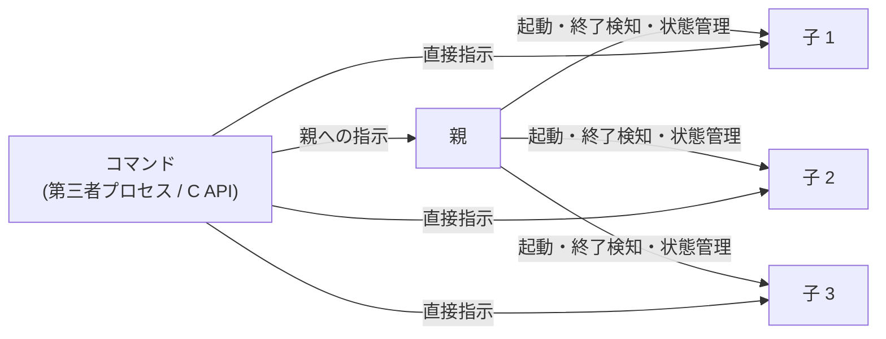

<!--
生成元: agree-before-implement スキル
文書種別: 簡易 ADR (lightadr)
最終更新日時: 2026-11-27 07:34:00 JST
最終更新エージェント: agy / セッション ID: 9d21d935-346c-44e1-b3ce-1a0bebca2117
稼働 OS: Linux (WSL)
上流文書: `261127-process-orchestration-sample-overview.md` (全体管理文書)、`261127-process-orchestration-sample-discussion.md` (検討用 Markdown)。いずれも削除されている場合があります。
再開手順: このファイルを開いたエージェントは、作業の前に agree-before-implement スキルを読み込んでください。上流文書の全体管理文書が存在する場合は、その再開手順に従って進行位置を確認します。存在しない場合は、この文書を単体の決定事項の記録として扱います。この文書は正式な ADR ではありません。正式な ADR への転記はユーザーが必要時に行うため、エージェントは依頼なしに転記や正式な ADR の作成・更新を行わないでください。最終更新エージェントのセッション情報や稼働 OS・最終更新日時が参照可能であれば再開時のコンテキストや環境差分の把握に利用し、別エージェントや別環境・別 OS からの引き継ぎ、担当変更によりセッションが見つからない場合も異常とせず、文書の記載から継続してください。
-->

# プロセスとりまとめサンプル (PoC 実装) 簡易 ADR

ファイル名: `261127-process-orchestration-sample-lightadr.md`

この文書は、検討で得られた事実、ユーザーの選択とコメント、およびそれらに基づく決定事項を、決定 1 件ごとにまとめた簡易 ADR (Architecture Decision Record: 設計判断の記録) です。正式な ADR ではなく、対案の比較や決定の影響の評価は記載していません。  
各決定の「決定」は、方針が変わるたびに書き換え、常に最新の決定だけを示します。変更の推移は「経緯」に時系列で記録します。

## 決定事項一覧

Table: 決定事項の一覧

| 決定 ID | 題名 | 最終更新日 | 源泉 |
| --- | --- | --- | --- |
| [LADR-001](#ladr-001-cplat-を拡張せず独立した-poc-サンプル-app-として実装する方針) | `cplat` を拡張せず独立した PoC サンプル app として実装する方針 | 2026-11-27 | 初期依頼 (2026-11-27 対話)、[Q-001](261127-process-orchestration-sample-discussion.md#q-001-app-ディレクトリ名と命名規則)、[Q-002](261127-process-orchestration-sample-discussion.md#q-002-ワークスペースのビルドと環境設定への組み込み範囲) |
| [LADR-002](#ladr-002-親プロセスと子プロセス-1-から-3-の基本形態) | 親プロセスと子プロセス 1 から 3 の基本形態 | 2026-11-27 | 初期依頼 (2026-11-27 対話)、[Q-007](261127-process-orchestration-sample-discussion.md#q-007-子の異常終了判定と自動再起動ポリシー) |
| [LADR-003](#ladr-003-第三者プロセスから親へ指示を送る-c-api-と-poc-コマンド要件) | 第三者プロセスから親へ指示を送る C API と PoC コマンド要件 | 2026-11-27 | 初期依頼 (2026-11-27 対話) |
| [LADR-004](#ladr-004-第三者プロセスから子へ直接指示を送る-c-api-と-poc-コマンド要件) | 第三者プロセスから子へ直接指示を送る C API と PoC コマンド要件 | 2026-11-27 | 初期依頼 (2026-11-27 対話) |
| [LADR-005](#ladr-005-汎用的な同期要求応答-ipc-と共通空間アクセス考慮の方針) | 汎用的な同期要求応答 IPC と共通空間アクセス考慮の方針 | 2026-11-27 | 初期依頼 (2026-11-27 対話) |
| [LADR-006](#ladr-006-汎用-ipc-の電文フレーミングとペイロード形式) | 汎用 IPC の電文フレーミングとペイロード形式 | 2026-11-27 | [Q-004](261127-process-orchestration-sample-discussion.md#q-004-汎用-ipc-の電文フレーミングとペイロード形式) |
| [LADR-007](#ladr-007-ライブラリと実行ファイルの構成) | ライブラリと実行ファイルの構成 | 2026-11-27 | [Q-006](261127-process-orchestration-sample-discussion.md#q-006-ライブラリと実行ファイルの構成)、[Q-014](261127-process-orchestration-sample-discussion.md#q-014-windows-側トランスポートの性能検証とバックエンド構成) |
| [LADR-008](#ladr-008-親および子の停止手順) | 親および子の停止手順 | 2026-11-27 | [Q-008](261127-process-orchestration-sample-discussion.md#q-008-親および子の停止手順) |
| [LADR-009](#ladr-009-子への指示の関数エコー-バックの仕様) | 子への指示の関数エコー バックの仕様 | 2026-11-27 | [Q-010](261127-process-orchestration-sample-discussion.md#q-010-子への指示の関数エコー-バックの仕様) |
| [LADR-010](#ladr-010-公開-c-api-の規約と-cplat-統合を見据えた責務分離) | 公開 C API の規約と `cplat` 統合を見据えた責務分離 | 2026-11-27 | [Q-012](261127-process-orchestration-sample-discussion.md#q-012-公開-c-api-のエラー-コードと待機規約) |
| [LADR-011](#ladr-011-自動テストと検証範囲の方針) | 自動テストと検証範囲の方針 | 2026-11-27 | [Q-013](261127-process-orchestration-sample-discussion.md#q-013-自動テストの範囲と検証レベル) |
| [LADR-012](#ladr-012-同期要求応答-ipc-のトランスポート方式と性能比較構成) | 同期要求応答 IPC のトランスポート方式と性能比較構成 | 2026-11-27 | [Q-003](261127-process-orchestration-sample-discussion.md#q-003-同期要求応答-ipc-のトランスポート方式)、[Q-014](261127-process-orchestration-sample-discussion.md#q-014-windows-側トランスポートの性能検証とバックエンド構成) |
| [LADR-013](#ladr-013-同一ユーザー空間と共通サービス空間の設計と-poc-実装範囲) | 同一ユーザー空間と共通サービス空間の設計と PoC 実装範囲 | 2026-11-27 | [Q-005](261127-process-orchestration-sample-discussion.md#q-005-同一ユーザー空間と共通サービス空間の実装範囲)、[Q-015](261127-process-orchestration-sample-discussion.md#q-015-同一ユーザー空間と共通サービス空間の-poc-実装範囲の整理) |
| [LADR-014](#ladr-014-子の状態取得のライフサイクル状態と返却項目) | 子の状態取得のライフサイクル状態と返却項目 | 2026-11-27 | [Q-009](261127-process-orchestration-sample-discussion.md#q-009-子の状態取得で返す情報項目)、[Q-016](261127-process-orchestration-sample-discussion.md#q-016-自動再起動なし方針に合わせた子の状態取得の仕様) |
| [LADR-015](#ladr-015-単発接続と持続接続の両立およびサーバー接続管理モデル) | 単発接続と持続接続の両立およびサーバー接続管理モデル | 2026-11-27 | [Q-011](261127-process-orchestration-sample-discussion.md#q-011-汎用-ipc-サーバーの同時接続とリクエスト処理モデル)、[Q-017](261127-process-orchestration-sample-discussion.md#q-017-単発接続と持続接続の両立におけるサーバー接続管理モデル) |

## LADR-001 cplat を拡張せず独立した PoC サンプル app として実装する方針

決定者: Tetsuo Honda  
最終更新日: 2026-11-27

### 背景と課題

プロセス間の同期要求応答およびプロセスとりまとめの仕組みを実証するにあたり、共通基盤ライブラリである `app/cplat` を直接拡張するか、独立したサンプル app として PoC 実装するか、またそのディレクトリ名とワークスペース標準構成への組み込み範囲を明確にする必要があります。

### 得られた事実

- 初期要件として「プロセスとりまとめサンプル (PoC 実装)」「`cplat` の拡張は一旦は行わず、`app/process_orchestrate_sample` のような名前で実装する」方針が提示された。
- 既存の複数語 app ディレクトリはすべてハイフン区切り (`service-sample`、`string-catalog-sample`、`struct-meta` 等) で統一されている。
- `app/<name>/makefile` を配置した app は `resolve_app_deps.sh` によりワークスペースのビルド・テスト・環境同期の対象となる。

### 決定

`app/cplat` の拡張は行わず、既存の複数語 app の命名慣例に合わせたハイフン区切りの `app/process-orchestration-sample` として独立したサンプル app で PoC を実装する (検討文書も実装開始時に移設する)。  
`makefile`、`appdeps.mk`、`AGENTS.md`、`README.md`、`Doxyfile.part`、`docs/README.md`、`prod/`、`test/` の標準構成を備え、`make sync-app-env` と `sync_c_cpp_properties.sh --write` でワークスペース設定を同期する。

### 経緯

| 日時 (JST) | 源泉 | ユーザーの選択 | ユーザーのコメント | 決定への反映 |
| --- | --- | --- | --- | --- |
| 2026-11-27 07:00 | 初期依頼 (対話) | `cplat` の拡張は行わず独立サンプル app で PoC 実装する方針を明示 | `cplat` の拡張は一旦は行わず、`app/process_orchestrate_sample` のような名前で PoC 実装を行う | 新規に決定 |
| 2026-11-27 07:15 | [Q-001](261127-process-orchestration-sample-discussion.md#q-001-app-ディレクトリ名と命名規則) | A: ハイフン区切りの `app/process-orchestration-sample` へ統一する (検討文書も移設する) | なし | 決定を補足 (app ディレクトリ名を確定) |
| 2026-11-27 07:15 | [Q-002](261127-process-orchestration-sample-discussion.md#q-002-ワークスペースのビルドと環境設定への組み込み範囲) | A: 既存サンプル app と同等の標準構成を備え、`make sync-app-env` と `sync_c_cpp_properties.sh --write` で同期する | なし | 決定を補足 (ワークスペース統合範囲を確定) |

## LADR-002 親プロセスと子プロセス 1 から 3 の基本形態

決定者: Tetsuo Honda  
最終更新日: 2026-11-27

### 背景と課題

プロセスとりまとめサンプルにおける親プロセスと子プロセスの起動主体、構成数、および子プロセス異常終了時の基本動作を明確にする必要があります。

### 得られた事実

- 初期要件の基本形態として、親 1 プロセスと子 1〜3 の 3 プロセスを構成し、コマンド (第三者プロセス) から親および子 1〜3 それぞれへ指示を送る構成が提示された。
- 初期要件では「親はユーザー (あるいは、テスト プログラム) が起動する」「親を起動すると、親は子 1〜3 を起動する」「親は、子 1〜3 が仮に異常終了した際は、再起動させる」とされていたが、[Q-007](261127-process-orchestration-sample-discussion.md#q-007-子の異常終了判定と自動再起動ポリシー) にて「PoC なので異常終了しても親による自動再起動は行わず、外部からの起動指示に任せ、状態取得で直前に異常終了したかを把握できればよい」と方針変更された。

Figure: 親プロセスと子プロセス 1〜3 の基本形態

### 決定

親プロセスはユーザーまたはテスト プログラムが起動する。親プロセスは起動時に子 1〜3 の 3 プロセスを起動する。  
期待状態が稼働中の子が意図的停止以外で終了した場合、親プロセスは自動再起動を行わず、その終了を検知・回収して異常終了状態を保持する。再起動は外部からの「子の起動」指示に委ね、外部から親への「子の状態取得」によって直前に異常終了したことを把握できるようにする。

### 経緯

| 日時 (JST) | 源泉 | ユーザーの選択 | ユーザーのコメント | 決定への反映 |
| --- | --- | --- | --- | --- |
| 2026-11-27 07:00 | 初期依頼 (対話) | 親 1・子 1〜3 の起動および異常終了時再起動の基本形態を明示 | なし | 新規に決定 |
| 2026-11-27 07:15 | [Q-007](261127-process-orchestration-sample-discussion.md#q-007-子の異常終了判定と自動再起動ポリシー) | D: その他 (自動再起動せず、外部起動指示と状態取得による異常終了把握とする) | 期待状態が稼働中の子が意図的停止以外で終了した場合は、PoC なのでそのままで再起動はしなくてよい。外部からの起動指示にまかせる。外部から親への状態取得で、直前に異常終了したかを把握できればよい。これは当初の方針と異なるので、この回答を優先して | 決定を変更 (異常終了時の親による自動再起動を廃止し、異常終了状態の保持と外部起動指示へ変更) |

## LADR-003 第三者プロセスから親へ指示を送る C API と PoC コマンド要件

決定者: Tetsuo Honda  
最終更新日: 2026-11-27

### 背景と課題

親プロセスに対する外部からの制御経路と、PoC で実装すべき親向け操作の一覧を明確にする必要があります。

### 得られた事実

- 初期要件として「C の API で、親に指示を送ることができる (指示を送信するのは、親プロセスでも子プロセスでもなく、第三者プロセス)」「PoC ではコマンドとして実装する」ことが示された。
- 親への指示として「親の終了」「子の起動 (パラメーターで子を指定: 1〜3)」「子の終了 (パラメーターで子を指定: 1〜3)」「子の状態取得 (パラメーターで子を指定: 1〜3)」の 4 項目が示された。

### 決定

親プロセスでも子プロセスでもない第三者プロセスから、C の API を通じて親プロセスへ指示を送信できるようにし、PoC ではコマンドとして「親の終了」「子の起動 (子 1〜3 指定)」「子の終了 (子 1〜3 指定)」「子の状態取得 (子 1〜3 指定)」の 4 操作を実装する。

### 経緯

| 日時 (JST) | 源泉 | ユーザーの選択 | ユーザーのコメント | 決定への反映 |
| --- | --- | --- | --- | --- |
| 2026-11-27 07:00 | 初期依頼 (対話) | 第三者プロセスからの C API および PoC コマンド 4 操作を明示 | なし | 新規に決定 |

## LADR-004 第三者プロセスから子へ直接指示を送る C API と PoC コマンド要件

決定者: Tetsuo Honda  
最終更新日: 2026-11-27

### 背景と課題

起動中の子プロセスに対する外部からの指示経路 (親を経由するか直接送るか) と、PoC で実装すべき子向け操作を明確にする必要があります。

### 得られた事実

- 初期要件として「C の API で、起動中の子に指示を送ることができる」「親を経由せず直接子に送る」「PoC ではコマンドとして『子の関数エコー バック』を実装する」ことが示された。

### 決定

第三者プロセスから、親プロセスを経由せず起動中の子プロセスへ C の API で直接指示を送信できるようにし、PoC ではコマンドとして「子の関数エコー バック」を実装する。

### 経緯

| 日時 (JST) | 源泉 | ユーザーの選択 | ユーザーのコメント | 決定への反映 |
| --- | --- | --- | --- | --- |
| 2026-11-27 07:00 | 初期依頼 (対話) | 親を経由しない子への直接指示 C API と「子の関数エコー バック」を明示 | なし | 新規に決定 |

## LADR-005 汎用的な同期要求応答 IPC と共通空間アクセス考慮の方針

決定者: Tetsuo Honda  
最終更新日: 2026-11-27

### 背景と課題

PoC 固有のプロセス操作に閉じない汎用 IPC 設計の方針と、将来的なサービス運用を見据えたアクセス空間の考慮範囲を明確にする必要があります。

### 得られた事実

- 初期要件のポイントとして「C の関数から、同期的に特定のプロセスに処理を要求し応答を受け取る汎用の仕組みを考えたい」「同一ユーザー内でも、daemon / Windows Service のような共通空間に対して、ユーザーがアクセスできる形態も考慮したい」ことが示された。

### 決定

C の関数から同期的に特定プロセスへ処理を要求して応答を受け取る汎用の仕組みとして設計し、同一ユーザー内での利用に加えて、daemon / Windows Service のような共通空間へ一般ユーザーがアクセスする形態も考慮する。

### 経緯

| 日時 (JST) | 源泉 | ユーザーの選択 | ユーザーのコメント | 決定への反映 |
| --- | --- | --- | --- | --- |
| 2026-11-27 07:00 | 初期依頼 (対話) | 汎用同期要求応答 IPC および共通空間アクセス考慮の方針を明示 | なし | 新規に決定 |

## LADR-006 汎用 IPC の電文フレーミングとペイロード形式

決定者: Tetsuo Honda  
最終更新日: 2026-11-27

### 背景と課題

汎用同期要求応答 IPC 層と、その上に載るアプリケーション固有の操作 (親制御 4 種・子エコー バック等) の責務境界および電文のフレーミング形式を定める必要があります。

### 得られた事実

- [Q-004](261127-process-orchestration-sample-discussion.md#q-004-汎用-ipc-の電文フレーミングとペイロード形式) において、バイナリ ヘッダー + 不透明バイト列ペイロード、JSON ペイロード、改行区切りテキストの選択肢を比較した。

### 決定

汎用 IPC 層の電文は、固定長バイナリ ヘッダー (マジック、プロトコル版、操作 ID、結果コード、ペイロード長) と任意バイト列ペイロードで構成し、汎用 IPC 層自身はペイロード内部のデータ形式を規定しない。

### 経緯

| 日時 (JST) | 源泉 | ユーザーの選択 | ユーザーのコメント | 決定への反映 |
| --- | --- | --- | --- | --- |
| 2026-11-27 07:15 | [Q-004](261127-process-orchestration-sample-discussion.md#q-004-汎用-ipc-の電文フレーミングとペイロード形式) | A: 固定長バイナリ ヘッダー + 任意バイト列ペイロードとし、汎用 IPC 層はペイロード形式を規定しない | なし | 新規に決定 |

## LADR-007 ライブラリと実行ファイルの構成

決定者: Tetsuo Honda  
最終更新日: 2026-11-27

### 背景と課題

親プロセス、子プロセス (1〜3)、C 制御 API、操作コマンド、および性能計測ベンチマークをどのライブラリと実行ファイル構成へ分割するかを定める必要があります。

### 得られた事実

- [Q-006](261127-process-orchestration-sample-discussion.md#q-006-ライブラリと実行ファイルの構成) において、1 ライブラリ + 3 実行ファイル (親・子・制御 CLI) が選択された。
- [Q-014](261127-process-orchestration-sample-discussion.md#q-014-windows-側トランスポートの性能検証とバックエンド構成) において、単発・持続接続および Windows 両バックエンドを比較するベンチマーク コマンドを本 PoC に同梱することが選択された。

### 決定

1 ライブラリ (汎用同期 IPC 層 + 親・子制御 C API) と 4 実行ファイル (親プロセス `orchestrator-parent`、子プロセス `orchestrator-child`、親・子共通の制御 CLI コマンド `orchestrator-ctl`、性能比較ベンチマーク コマンド `orchestrator-bench`) で構成する。

### 経緯

| 日時 (JST) | 源泉 | ユーザーの選択 | ユーザーのコメント | 決定への反映 |
| --- | --- | --- | --- | --- |
| 2026-11-27 07:15 | [Q-006](261127-process-orchestration-sample-discussion.md#q-006-ライブラリと実行ファイルの構成) | A: 1 ライブラリ + 3 実行ファイル (親プロセス、子プロセス、親・子共通の制御 CLI コマンド) とする | なし | 新規に決定 |
| 2026-11-27 07:33 | [Q-014](261127-process-orchestration-sample-discussion.md#q-014-windows-側トランスポートの性能検証とバックエンド構成) | A: 単発・持続接続および Windows 両バックエンドの性能比較ベンチマーク コマンドを本 PoC に含める | なし | 決定を補足 (ベンチマーク コマンド `orchestrator-bench` を実行ファイル構成に追加) |

## LADR-008 親および子の停止手順

決定者: Tetsuo Honda  
最終更新日: 2026-11-27

### 背景と課題

親への「子の終了」および「親の終了」指示を受けた際、Linux と Windows の双方で安全かつ一貫した手順で子プロセスを停止・回収する方法を定める必要があります。

### 得られた事実

- `cplat/runtime/process.h` には強制終了 API (`cplat_process_terminate()`) があるが、クロスプラットフォームのグレースフル停止シグナル API は存在しない。
- [Q-008](261127-process-orchestration-sample-discussion.md#q-008-親および子の停止手順) において、親から子への停止要求自体も IPC 経路を用いる方針が確認された。

### 決定

親プロセスは「子の終了」指示を受けた際、親から対象の子へ IPC 経路でグレースフル停止要求を送り、一定時間内に終了しなければ `cplat_process_terminate()` で強制終了して終了待機・回収を行う。「親の終了」時 (および親が終了シグナルを受けた際) も、全稼働中の子を同様に停止・回収してから親自身を終了する。

### 経緯

| 日時 (JST) | 源泉 | ユーザーの選択 | ユーザーのコメント | 決定への反映 |
| --- | --- | --- | --- | --- |
| 2026-11-27 07:15 | [Q-008](261127-process-orchestration-sample-discussion.md#q-008-親および子の停止手順) | A: 親から子へ IPC でグレースフル停止要求を送り、タイムアウト時に `cplat_process_terminate()` で強制終了する | 親から子への停止要求自体も IPC 経路になると想定 | 新規に決定 |

## LADR-009 子への指示の関数エコー バックの仕様

決定者: Tetsuo Honda  
最終更新日: 2026-11-27

### 背景と課題

起動中の子プロセスへ親を経由せず直接送信する「子の関数エコー バック」について、入力データ形式と応答に含める情報を定める必要があります。

### 得られた事実

- [Q-010](261127-process-orchestration-sample-discussion.md#q-010-子への指示の関数エコー-バックの仕様) において、UTF-8 文字列 + 応答メタ情報 (子 ID・PID)、UTF-8 文字列のみ、任意バイナリの各案を比較した。

### 決定

子の関数エコー バックは、入力の UTF-8 文字列を加工せずそのまま返却し、あわせて別フィールドで応答元の子 ID (`1`〜`3`) と子プロセスの PID を返す。

### 経緯

| 日時 (JST) | 源泉 | ユーザーの選択 | ユーザーのコメント | 決定への反映 |
| --- | --- | --- | --- | --- |
| 2026-11-27 07:15 | [Q-010](261127-process-orchestration-sample-discussion.md#q-010-子への指示の関数エコー-バックの仕様) | A: 入力 UTF-8 文字列を加工せずそのまま返し、別フィールドで応答元の子 ID (`1`〜`3`) と子プロセスの PID を返す | なし | 新規に決定 |

## LADR-010 公開 C API の規約と cplat 統合を見据えた責務分離

決定者: Tetsuo Honda  
最終更新日: 2026-11-27

### 背景と課題

本 PoC で実装する汎用 IPC 層と親・子制御 API のエラー コード・待機規約、および将来の `app/cplat` 統合に向けた設計方針を定める必要があります。

### 得られた事実

- `cplat` は `cplat/base/result.h` の共通結果コード (`CPLAT_OK` / `CPLAT_ERR_*`)、`cplat_error *detail_out`、`cplat/base/wait.h` の待機規約 (`timeout_ms` / `CPLAT_WAIT_FOREVER` / `CPLAT_NO_WAIT`) を採用している。
- [Q-012](261127-process-orchestration-sample-discussion.md#q-012-公開-c-api-のエラー-コードと待機規約) の補足で「基本の仕組みは最終的に `cplat` にマージしたい」方針が明示された。

### 決定

公開 C API の戻り値・詳細エラー・待機規約は `cplat` の規約 (`CPLAT_OK` / `CPLAT_ERR_*`、`cplat_error *detail_out`、`timeout_ms` / `CPLAT_WAIT_FOREVER` / `CPLAT_NO_WAIT`) に準拠する。また、基本の仕組みである汎用 IPC 層を、PoC 固有の親・子制御層から明確に分離し、最終的に `cplat` へマージしやすいモジュール構造とする。

### 経緯

| 日時 (JST) | 源泉 | ユーザーの選択 | ユーザーのコメント | 決定への反映 |
| --- | --- | --- | --- | --- |
| 2026-11-27 07:15 | [Q-012](261127-process-orchestration-sample-discussion.md#q-012-公開-c-api-のエラー-コードと待機規約) | A: `cplat` の共通結果コード、`cplat_error *detail_out`、および待機規約に準拠する | 基本の仕組みは最終的に `cplat` にマージしたいため | 新規に決定 |

## LADR-011 自動テストと検証範囲の方針

決定者: Tetsuo Honda  
最終更新日: 2026-11-27

### 背景と課題

`test/` 配下へ実装する Google Test の対象範囲と、Linux (WSL) 環境外となる Windows および異ユーザー/サービス空間の検証手段を定める必要があります。

### 得られた事実

- 現在の開発環境は Linux (WSL) であり、Windows/MSVC ビルドおよび実機テストは Windows 環境または CI での実行が必要である。
- [Q-013](261127-process-orchestration-sample-discussion.md#q-013-自動テストの範囲と検証レベル) において、単体テスト + 実プロセス統合テストの両方を実装する案が選択された。

### 決定

`test/` 配下へ「汎用 IPC 単体テスト」と「実プロセス (親 + 子 1〜3 + C API / CLI) を起動するエンド ツー エンド統合テスト」の双方を Google Test (`framework/testfw`) で実装し、`make test` で自動検証する。Windows 環境および異ユーザー/サービス空間の確認は検証手順書を整備し、CI または実機で確認する。

### 経緯

| 日時 (JST) | 源泉 | ユーザーの選択 | ユーザーのコメント | 決定への反映 |
| --- | --- | --- | --- | --- |
| 2026-11-27 07:15 | [Q-013](261127-process-orchestration-sample-discussion.md#q-013-自動テストの範囲と検証レベル) | A: 汎用 IPC 単体テストと実プロセス統合テストの双方を実装し、Windows・異ユーザー空間は検証手順書を整備する | なし | 新規に決定 |

## LADR-012 同期要求応答 IPC のトランスポート方式と性能比較構成

決定者: Tetsuo Honda  
最終更新日: 2026-11-27

### 背景と課題

Linux と Windows の双方で高効率に動作するローカル同期要求応答 IPC のトランスポート方式を定め、Windows 実機での性能比較検証を可能にするバックエンド構成を決める必要があります。

### 得られた事実

- Linux では `AF_UNIX` / `SOCK_STREAM` が標準的かつ高速なローカル ストリーム IPC である。
- Windows では `AF_UNIX` (`afunix.sys`) と名前付きパイプ (`npfs.sys`) が利用可能であり、接続確立コストやスループットの優劣は負荷特性と実機環境の実測で確認する必要がある。
- [Q-003](261127-process-orchestration-sample-discussion.md#q-003-同期要求応答-ipc-のトランスポート方式) で両 OS `AF_UNIX` が選択され、「より性能の優れた方式としたい。検証が必要であれば検証をする」と補足された。
- [Q-014](261127-process-orchestration-sample-discussion.md#q-014-windows-側トランスポートの性能検証とバックエンド構成) で、内部トランスポート抽象層 + Windows 両バックエンド (`AF_UNIX` 既定 + 名前付きパイプ) + ベンチマーク コマンド同梱が選択された。

### 決定

汎用 IPC 層の内部にトランスポート抽象層を設け、Linux は `AF_UNIX` / `SOCK_STREAM`、Windows は `AF_UNIX` / `SOCK_STREAM` (既定) と名前付きパイプ (`\\.\pipe\...`) の両バックエンドを実装する。あわせて単発接続・持続接続のレイテンシおよびスループットを計測・比較するベンチマーク コマンド (`orchestrator-bench`) を PoC に同梱し、Windows 実機で実測比較できるようにする。

### 経緯

| 日時 (JST) | 源泉 | ユーザーの選択 | ユーザーのコメント | 決定への反映 |
| --- | --- | --- | --- | --- |
| 2026-11-27 07:15 | [Q-003](261127-process-orchestration-sample-discussion.md#q-003-同期要求応答-ipc-のトランスポート方式) | B: Linux・Windows ともに `AF_UNIX` / `SOCK_STREAM` で統一する | より性能の優れた方式としたい。検証が必要であれば検証をする | 仮方針 (Windows 検証構成を Q-014 で確認) |
| 2026-11-27 07:33 | [Q-014](261127-process-orchestration-sample-discussion.md#q-014-windows-側トランスポートの性能検証とバックエンド構成) | A: 内部にトランスポート抽象層を設け、Windows 向けに `AF_UNIX` (既定) と名前付きパイプの両バックエンド、および性能比較ベンチマーク コマンドを同梱する | なし | 新規に決定 |

## LADR-013 同一ユーザー空間と共通サービス空間の設計と PoC 実装範囲

決定者: Tetsuo Honda  
最終更新日: 2026-11-27

### 背景と課題

同一ユーザー内の利用と、daemon / Windows Service のような共通空間へ一般ユーザーがアクセスする形態の両立について、公開 API の型設計と今回 PoC での実装・検証境界を明確にする必要があります。

### 得られた事実

- [Q-005](261127-process-orchestration-sample-discussion.md#q-005-同一ユーザー空間と共通サービス空間の実装範囲) の補足で「まずは同一ユーザーで PoC したい」と示された。
- [Q-015](261127-process-orchestration-sample-discussion.md#q-015-同一ユーザー空間と共通サービス空間の-poc-実装範囲の整理) で、空間スコープ (`USER` / `SYSTEM` / `CUSTOM`) とアクセス権ポリシーの型を公開 API へ最初から備え、今回実装は `USER` と `CUSTOM` に集中し、`SYSTEM` スコープの異ユーザー権限適用と検証を次フェーズ (`backlog.md`) とする案が選択された。

### 決定

公開 IPC API のエンドポイント設定に空間スコープ (`USER` / `SYSTEM` / `CUSTOM`) とアクセス権ポリシーを最初から定義し、将来の `cplat` 統合時に API 構造を崩さず拡張できるようにする。今回の PoC 実装および自動テストは同一ユーザー空間 (`USER`) とテスト用任意空間 (`CUSTOM`) に集中し、`SYSTEM` スコープの呼び出しは `CPLAT_ERR_UNSUPPORTED` を返す契約として、共通空間の異ユーザー権限適用と実機検証は残課題一覧 (`BL-001`) へ記録する。

### 経緯

| 日時 (JST) | 源泉 | ユーザーの選択 | ユーザーのコメント | 決定への反映 |
| --- | --- | --- | --- | --- |
| 2026-11-27 07:15 | [Q-005](261127-process-orchestration-sample-discussion.md#q-005-同一ユーザー空間と共通サービス空間の実装範囲) | A: 空間スコープと権限ポリシーを備え、自動テストは同一ユーザー空間で行う | まずは同一ユーザーで PoC したい | 仮方針 (今回実装境界を Q-015 で確認) |
| 2026-11-27 07:33 | [Q-015](261127-process-orchestration-sample-discussion.md#q-015-同一ユーザー空間と共通サービス空間の-poc-実装範囲の整理) | A: 公開 API に空間スコープ (`USER` / `SYSTEM` / `CUSTOM`) とアクセス権ポリシーを備え、今回実装・検証は `USER` と `CUSTOM` に集中する (`SYSTEM` は `backlog.md` へ記録) | なし | 新規に決定 |

## LADR-014 子の状態取得のライフサイクル状態と返却項目

決定者: Tetsuo Honda  
最終更新日: 2026-11-27

### 背景と課題

親プロセスによる子の自動再起動を行わない方針 ([LADR-002](#ladr-002-親プロセスと子プロセス-1-から-3-の基本形態)) に合わせ、外部から親へ「子の状態取得」を行った際に意図的停止と直前の異常終了を明確に区別できる状態モデルと構造体フィールドを定める必要があります。

### 得られた事実

- [Q-009](261127-process-orchestration-sample-discussion.md#q-009-子の状態取得で返す情報項目) で詳細なライフサイクル状態と診断情報 (PID、終了コード等) を返す方針が選択された。
- [Q-016](261127-process-orchestration-sample-discussion.md#q-016-自動再起動なし方針に合わせた子の状態取得の仕様) で、`STOPPED` / `STARTING` / `RUNNING` / `STOPPING` / `CRASHED` の 5 値 enum と 6 フィールド構造体が選択された。

### 決定

子の状態は `POS_CHILD_STATE_STOPPED`、`POS_CHILD_STATE_STARTING`、`POS_CHILD_STATE_RUNNING`、`POS_CHILD_STATE_STOPPING`、`POS_CHILD_STATE_CRASHED` の 5 値とし、状態取得 API は `child_id`、`state`、`pid`、`start_count`、`last_exit_code`、`has_last_exit_code` の 6 フィールドで構成される構造体を返す。

### 経緯

| 日時 (JST) | 源泉 | ユーザーの選択 | ユーザーのコメント | 決定への反映 |
| --- | --- | --- | --- | --- |
| 2026-11-27 07:15 | [Q-009](261127-process-orchestration-sample-discussion.md#q-009-子の状態取得で返す情報項目) | A: 詳細なライフサイクル状態と PID・終了コード等を返す | なし | 仮方針 (Q-007 との整合を Q-016 で確認) |
| 2026-11-27 07:33 | [Q-016](261127-process-orchestration-sample-discussion.md#q-016-自動再起動なし方針に合わせた子の状態取得の仕様) | A: `STOPPED` / `STARTING` / `RUNNING` / `STOPPING` / `CRASHED` の 5 値とし、`child_id`、`state`、`pid`、`start_count`、`last_exit_code`、`has_last_exit_code` を返す | なし | 新規に決定 |

## LADR-015 単発接続と持続接続の両立およびサーバー接続管理モデル

決定者: Tetsuo Honda  
最終更新日: 2026-11-27

### 背景と課題

呼び出し元が単発接続 (1 接続 1 要求応答) と持続接続 (1 接続上で複数回の同期要求応答) の両方を選択できるようにしつつ、多数の持続接続を保持した際のスレッド枯渇やワーカー飢餓を防ぐサーバー側接続管理モデルを定める必要があります。

### 得られた事実

- 固定長バイナリ ヘッダー ([LADR-006](#ladr-006-汎用-ipc-の電文フレーミングとペイロード形式)) により、単発接続と持続接続は同一のワイヤー プロトコル上で共存できる。
- 接続ごとスレッド方式ではアイドル持続接続がワーカー スレッドとスタックを占有し新規接続を飢餓させるが、I/O 多重化 + 固定ワーカー プール + 最大同時接続数上限 + アイドル タイムアウトにより、アイドル持続接続のスレッド占有を 0 に抑えられる。
- [Q-011](261127-process-orchestration-sample-discussion.md#q-011-汎用-ipc-サーバーの同時接続とリクエスト処理モデル) および [Q-017](261127-process-orchestration-sample-discussion.md#q-017-単発接続と持続接続の両立におけるサーバー接続管理モデル) で、単発・持続両 API の提供と I/O 多重化 + 固定ワーカー プール方式が選択された。

### 決定

クライアント API として単発接続 (`pos_ipc_call`) と持続接続 (`pos_ipc_client_open` / `pos_ipc_client_call` / `pos_ipc_client_close`) の双方を提供し、1 持続接続上は要求→応答を直列反復する (同一ハンドルへの複数スレッド呼び出しは内部ロックで直列化)。  
サーバー側は I/O 多重化 (`AF_UNIX` は `poll` / `WSAPoll`、Windows 名前付きパイプは Overlapped I/O + IOCP) + 固定数ワーカー スレッド プール + 最大同時接続数上限 (`max_connections`) + アイドル タイムアウト (`idle_timeout_ms`) で接続を管理し、待機中の持続接続によるスレッド枯渇・ワーカー飢餓を防ぐ。

### 経緯

| 日時 (JST) | 源泉 | ユーザーの選択 | ユーザーのコメント | 決定への反映 |
| --- | --- | --- | --- | --- |
| 2026-11-27 07:15 | [Q-011](261127-process-orchestration-sample-discussion.md#q-011-汎用-ipc-サーバーの同時接続とリクエスト処理モデル) | D: その他 (A と C を呼び出し元で選択可能にする) | A と C を呼び出し元で選択できるようにしたほうがいい。C を多数行うことでリソース的に問題になるかどうかも整理する | 仮方針 (リソース整理とサーバー モデルを Q-017 で確認) |
| 2026-11-27 07:33 | [Q-017](261127-process-orchestration-sample-discussion.md#q-017-単発接続と持続接続の両立におけるサーバー接続管理モデル) | A: I/O 多重化 + 固定数ワーカー スレッド プール + 最大同時接続数上限 + アイドル タイムアウトとし、1 持続接続上は直列反復する | なし | 新規に決定 |
