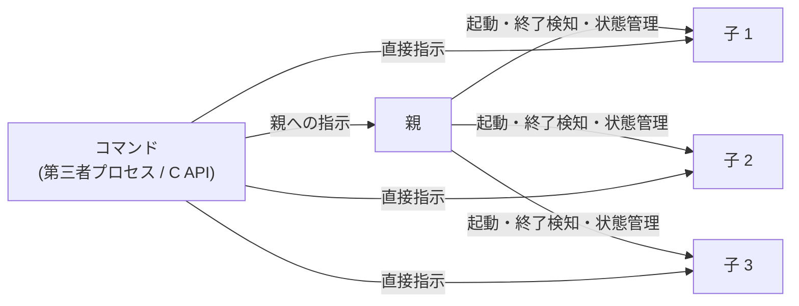

<!--
生成元: agree-before-implement スキル
文書種別: 全体管理文書 (overview)
最終更新日時: 2026-11-27 20:01:00 JST
最終更新エージェント: agy / セッション ID: 9d21d935-346c-44e1-b3ce-1a0bebca2117
稼働 OS: Linux (WSL)
下流文書: `261127-process-orchestration-sample-discussion.md` (検討用 Markdown)、`261127-process-orchestration-sample-lightadr.md` (簡易 ADR)、`261127-process-orchestration-sample-design.md` (最終仕様)、`261127-process-orchestration-sample-backlog.md` (残課題一覧)。未作成の場合や、削除されている場合があります。
再開手順: このファイルを開いたエージェントは、作業の前に agree-before-implement スキルを読み込んでください。この文書と、ユーザーが編集した最新の検討用 Markdown を読み直し、作業 WBS の `← **CURRENT**` の項目から再開します。最終更新エージェントのセッション情報や稼働 OS・最終更新日時が参照可能であれば再開時のコンテキストや環境差分の把握に利用し、別エージェントや別環境・別 OS からの引き継ぎ、担当変更によりセッションが見つからない場合も異常とせず、文書の記載から継続してください。`← **CURRENT**` の項目は処理が中止された項目である場合があり、どこまで進んでいたかは文書だけでは分かりません。対象成果物の内容を確認して実施済みの範囲を特定してから、作業を再開してください。`← **CURRENT**` がなく、作業 WBS がすべて完了 (✅) であれば、この案件の合意フローは完了しています。
-->

# プロセスとりまとめサンプル (PoC 実装) 全体管理

ファイル名: `261127-process-orchestration-sample-overview.md`

この文書は、案件の識別、作業 WBS、対象範囲、確認状況、経緯を管理します。質問と回答の本文は検討用 Markdown (`261127-process-orchestration-sample-discussion.md`) に、決定事項は簡易 ADR (`261127-process-orchestration-sample-lightadr.md`) に記載し、この文書には重複して記載しません。

## 案件の識別

検討 ID: `261127-process-orchestration-sample`

検討用 Markdown の版: 2 (合意済み)

状態: 作業実施中

## 作業 WBS と進捗管理

この案件の作業 WBS です。検討用 Markdown のための情報収集と質問の実施、残懸念がないことの確認 (第 1 ゲート: 最終仕様作成への着手)、最終決定事項 (最終仕様) を記載した `261127-process-orchestration-sample-design.md` の作成、最終仕様の承認の受付 (第 2 ゲート)、承認された最終仕様に従った作業の実施、および作業完了後の成果物の承認の受付 (第 3 ゲート) に至る手順を記載します。  
具体的な作業対象は、Q&A での合意内容に応じて各ターンで見直します。各ゲートの通過・承認および作業の進行に従って、小項目 (末端項目) 1 件ごとに着手直前 (🔄 への更新と `← **CURRENT**` の付け替え) と完了直後 (✅ への更新と親項目の状態再判定) に都度この文書を更新します。決定事項は、Q を解決済みにした時点、またはユーザーが決定を明示した時点で `261127-process-orchestration-sample-lightadr.md` へ反映します。見送りの決定や範囲外の気付きは、生じた時点で `261127-process-orchestration-sample-backlog.md` に追記します。

凡例: ⏸️ 未着手、🔄 実施中、🚫 ブロック中、⚠️ 要注意、✅ 完了。現在取り組んでいる項目の末尾に `← **CURRENT**` を付けます。

- ✅ 1. 検討用 Markdown のための情報収集と質問の実施
    - ✅ 1.1. 前提条件と要求事項の調査 (初期要件の取り込み、ルート `AGENTS.md`、`app/cplat` 公開 API、`app/service-sample`、`app/porter`、ビルド設計、コーディング規範、VS Code 環境変数同期の確認)
    - ✅ 1.2. 課題・論点の抽出と明確化のための確認項目 ([Q-001](261127-process-orchestration-sample-discussion.md#q-001-app-ディレクトリ名と命名規則) 〜 [Q-013](261127-process-orchestration-sample-discussion.md#q-013-自動テストの範囲と検証レベル)) の作成、および初期決定事項の簡易 ADR ([LADR-001](261127-process-orchestration-sample-lightadr.md#ladr-001-cplat-を拡張せず独立した-poc-サンプル-app-として実装する方針) 〜 [LADR-005](261127-process-orchestration-sample-lightadr.md#ladr-005-汎用的な同期要求応答-ipc-と共通空間アクセス考慮の方針)) への記録
    - ✅ 1.3. ターン 1 (Q-001 〜 Q-013) のユーザー回答の受付と記録
    - ✅ 1.4. ターン 1 回答の検証、簡易 ADR (`LADR-001`・`LADR-002` 更新、`LADR-006` 〜 `LADR-011` 追加)、WBS の見直し、および追加確認項目 ([Q-014](261127-process-orchestration-sample-discussion.md#q-014-windows-側トランスポートの性能検証とバックエンド構成) 〜 [Q-017](261127-process-orchestration-sample-discussion.md#q-017-単発接続と持続接続の両立におけるサーバー接続管理モデル)) の作成
    - ✅ 1.5. ターン 2 (Q-014 〜 Q-017) のユーザー回答の受付と記録
    - ✅ 1.6. ターン 2 回答の検証、簡易 ADR (`LADR-007` 更新、`LADR-012` 〜 `LADR-015` 追加)、残課題一覧 (`BL-001`・`BL-002`) の作成、WBS の見直し
- ✅ 2. 前提合意と残懸念の解消 (第 1 ゲート: 最終仕様作成への着手)
    - ✅ 2.1. 全論点 (Q-001 〜 Q-017) に対する未解決事項および質問の解消確認
    - ✅ 2.2. 方針・前提条件の合意確定 (簡易 ADR `LADR-001` 〜 `LADR-015` と全解決済み Q の一致を確認し、懸念がないことをもってフェーズ 2 へ着手)
- ✅ 3. 最終決定事項 (最終仕様) の作成と承認の受付
    - ✅ 3.1. `261127-process-orchestration-sample-design.md` の作成 (ディレクトリ構成、将来 `cplat` 統合を見据えた汎用 IPC 層、トランスポート抽象層と Linux `AF_UNIX` / Windows `AF_UNIX`・名前付きパイプ両バックエンド、単発・持続接続、I/O 多重化サーバー、空間・権限設計、親・子・制御 API・CLI・ベンチマーク仕様、テスト仕様、知見反映計画)
    - ✅ 3.2. 最終仕様における受入条件と整合性の確認 (C17 規範、トップ ダウン記載、クロスプラットフォーム制約、ワークスペース統合規約との照合)
    - ✅ 3.3. 対話セッションにおける最終仕様 (`261127-process-orchestration-sample-design.md`) の承認の受付 (第 2 ゲート: 作業着手の合意)
- ✅ 4. 承認された最終仕様に従った作業の実施 (対象 app: `app/process-orchestration-sample`)
    - ✅ 4.1. `app/process-orchestration-sample/` の作成、検討文書 (`docs/prompts/current/`) の `app/process_orchestration_sample/` からの移設、および標準基盤ファイルの作成 (`makefile`、`appdeps.mk`、`.gitignore`、`AGENTS.md`、`README.md`、`prod/Doxyfile.part`、`docs/README.md`、`prod/makefile`、`test/makefile`)
    - ✅ 4.2. 汎用同期要求応答 IPC ライブラリ (将来 `cplat` マージを見据えた分離構成: 公開ヘッダー、トランスポート抽象層、Linux `AF_UNIX` / Windows `AF_UNIX`・名前付きパイプ両バックエンド、固定長バイナリ フレーミング、単発・持続接続クライアント、I/O 多重化 + 固定ワーカー プール サーバー、`USER`/`CUSTOM` 空間実装と `SYSTEM` 型定義) の実装
    - ✅ 4.3. 親・子制御クライアント C API の実装 (親終了、子起動、子終了、子状態取得、子直接エコー バック)
    - ✅ 4.4. 実行ファイル 4 本 (`orchestrator-parent`、`orchestrator-child`、`orchestrator-ctl`、`orchestrator-bench`) の実装
    - ✅ 4.5. 汎用 IPC 単体テストおよび実プロセス統合テスト (`test/`) の実装
    - ✅ 4.6. ワークスペース環境設定の同期 (`make sync-app-env`、`sync_c_cpp_properties.sh --write`)
    - ✅ 4.7. 正本ドキュメントおよびコード コメント (Doxygen・README・Windows 性能比較および異ユーザー空間の実機検証手順書等) への永続的知見の反映
    - ✅ 4.8. 局所ビルド、`.warn` 確認、`make test`、および機械的検証 (`check_c_topdown.py`、`clang-format`、`text_style_jp.py` 等) の実施
    - ✅ 4.9. 受入条件への適合確認 (全作業の完了確認)
    - ✅ 4.10. 簡易 ADR (`261127-process-orchestration-sample-lightadr.md`) の最終確認
    - ✅ 4.11. 残課題一覧 (`261127-process-orchestration-sample-backlog.md`) の再構築と整理
- ✅ 5. 成果物の承認の受付 (第 3 ゲート)
    - ✅ 5.1. 成果物・検証結果・残課題の提示
    - ✅ 5.2. 対話セッションにおける成果物の承認の受付 (「承認」または「完了」の受領によるスキル完了)

## 対象と参照資料

対象成果物 (確定):

- `app/process-orchestration-sample/` 配下の標準ビルド構成 (`makefile`、`appdeps.mk`、`.gitignore`、`AGENTS.md`、`README.md`、`prod/Doxyfile.part`、`docs/README.md`、`docs/verification-guide.md`)
- C ライブラリ (`prod/include/process_orchestration/`、`prod/include_internal/process_orchestration/`、`prod/libsrc/process_orchestration/`): 汎用同期要求応答 IPC 層と親・子制御 C API 層
- 実行ファイル 4 本 (`prod/src/cmd/`): `orchestrator-parent`、`orchestrator-child`、`orchestrator-ctl`、`orchestrator-bench`
- Google Test (`test/`): 汎用 IPC 単体テスト + 実プロセス統合テスト
- ワークスペース同期設定: `.vscode/.env.linux`、`.vscode/.env.windows`、`.vscode/settings.json`、`.vscode/c_cpp_properties.json`
- 検討文書の移設: `app/process_orchestration_sample/docs/prompts/current/` → `app/process-orchestration-sample/docs/prompts/current/` (空となった旧ディレクトリを削除)

今回の対象範囲: `app/cplat` の拡張は行わず、独立したサンプル app (`app/process-orchestration-sample`) として、将来 `cplat` へマージ可能な汎用同期要求応答 IPC 層 (Linux `AF_UNIX`、Windows `AF_UNIX` 既定 + 名前付きパイプ両バックエンド、固定長バイナリ ヘッダー + 不透明バイト列、単発・持続両接続、I/O 多重化 + 固定ワーカー プール、`USER` / `CUSTOM` 空間実装と `SYSTEM` 型定義) およびプロセスとりまとめ (親 1・子 1〜3、異常終了時は自動再起動せず `CRASHED` 状態保持、IPC グレースフル停止 + 強制終了フォールバック) の PoC と性能比較ベンチマーク、単体・実プロセス統合テスト、実機検証手順書を実装する。`SYSTEM` スコープの異ユーザー権限実装・実機検証 (BL-001) および Windows 実測後の `cplat` 正式統合 (BL-002) は残課題一覧へ送る。

書き込み可能な検討文書: この文書 (`261127-process-orchestration-sample-overview.md`)、検討用 Markdown (`261127-process-orchestration-sample-discussion.md`)、簡易 ADR (`261127-process-orchestration-sample-lightadr.md`)、最終仕様 (`261127-process-orchestration-sample-design.md`)、残課題一覧 (`261127-process-orchestration-sample-backlog.md`)

### 初期要件 (PoC 概要)

本案件の出発点となる要件は次のとおりです (ただし、子異常終了時の自動再起動は [Q-007](261127-process-orchestration-sample-discussion.md#q-007-子の異常終了判定と自動再起動ポリシー) により「自動再起動せず、外部起動指示と状態取得による異常終了把握」へ方針変更済みです。最新の確定方針は簡易 ADR を参照してください)。

- **位置付け**: プロセスとりまとめサンプルの PoC 実装とする。`cplat` の拡張は一旦行わず、独立したサンプル app として実装する ([Q-001](261127-process-orchestration-sample-discussion.md#q-001-app-ディレクトリ名と命名規則) により `app/process-orchestration-sample` に確定)。
- **(1) 基本形態**:
    - 親はユーザー (またはテスト プログラム) が起動する。
    - 親を起動すると、親は子 1〜3 を起動する。
    - 親は、子 1〜3 が異常終了した際は終了を検知・状態保持する (当初の自動再起動方針から [Q-007](261127-process-orchestration-sample-discussion.md#q-007-子の異常終了判定と自動再起動ポリシー) で変更)。

Figure: プロセスとりまとめサンプルの基本形態

- **(2) 親への指示**:
    - C の API で、親プロセスでも子プロセスでもない第三者プロセスから親に指示を送ることができる。
    - PoC ではコマンドとして次の 4 操作を実装する。
        - 親の終了
        - 子の起動 (パラメーターで子を指定: 1〜3)
        - 子の終了 (パラメーターで子を指定: 1〜3)
        - 子の状態取得 (パラメーターで子を指定: 1〜3)
- **(3) 子への指示**:
    - C の API で、起動中の子に親を経由せず直接指示を送ることができる。
    - PoC ではコマンドとして次の操作を実装する。
        - 子の関数エコー バック
- **(4) ポイント**:
    - C の関数から、同期的に特定のプロセスへ処理を要求し応答を受け取る汎用の仕組みを検討する (基本の仕組みは最終的に `cplat` へマージする前提)。
    - 同一ユーザー内だけでなく、daemon / Windows Service のような共通空間に対して一般ユーザーがアクセスできる形態も考慮する。

### 参照資料と版

Table: 参照資料の一覧と確認対象

| 資料 | 版・時点 | 確認した内容 |
| --- | --- | --- |
| `AGENTS.md` (リポジトリ ルート) | 2026-11-27 ワーク ツリー | Git 書き込み禁止、C/C++・Markdown・makefw・Linux/Windows 両対応の共通規則 |
| `app/general/docs/coding-guideline.md` | 2026-11-27 ワーク ツリー | C17 前提、トップ ダウン記載、構造体パディング対策、Doxygen・実装コメント規範 |
| `app/general/docs/workspace-agent-workflow.md` | 2026-11-27 ワーク ツリー | `make sync-app-env`、`.warn` 確認、`text_style_jp.py`、局所テスト運用 |
| `app/general/docs/vscode-variables.md` | 2026-11-27 ワーク ツリー | 新規 app 追加時の `c_cpp_properties.json` と `.env.linux` / `.env.windows` / `settings.json` 同期規則 |
| `app/general/docs/build-design.md` | 2026-11-27 ワーク ツリー | makefw のディレクトリ構造 (`prod/include/`, `prod/libsrc/`, `prod/src/cmd/`, `test/`) |
| `app/makepart.mk` | 2026-11-27 ワーク ツリー | GCC 警告フラグ (`-Wpadded`, `-Wconversion`, `-Wmissing-prototypes` 等)、`WIN32_MANIFEST = utf8`、`pthread` リンク |
| `app/cplat/prod/include/cplat/` | 2026-11-27 ワーク ツリー | 既存利用可能 API (`runtime/process.h`、`runtime/shutdown.h`、`sync/sync.h`、`net/socket.h`、`mmap/mmap.h`、`crt/path.h`、`argparser/argparser.h`、`win32/win32.h`、`base/result.h`) |
| `app/service-sample/`、`app/porter/` | 2026-11-27 ワーク ツリー | 既存サンプル app のディレクトリ構成、命名 (ハイフン区切り)、`appdeps.mk`、サービス停止抽象 |

## 観点別の確認

Table: 観点別の確認状況

| 観点 | 状態 | 根拠・関連 Q |
| --- | --- | --- |
| 目的・利用者 | 確認済み | [LADR-001](261127-process-orchestration-sample-lightadr.md#ladr-001-cplat-を拡張せず独立した-poc-サンプル-app-として実装する方針) 〜 [LADR-005](261127-process-orchestration-sample-lightadr.md#ladr-005-汎用的な同期要求応答-ipc-と共通空間アクセス考慮の方針)、[LADR-007](261127-process-orchestration-sample-lightadr.md#ladr-007-ライブラリと実行ファイルの構成)、[LADR-009](261127-process-orchestration-sample-lightadr.md#ladr-009-子への指示の関数エコー-バックの仕様)、[LADR-014](261127-process-orchestration-sample-lightadr.md#ladr-014-子の状態取得のライフサイクル状態と返却項目) ([Q-006](261127-process-orchestration-sample-discussion.md#q-006-ライブラリと実行ファイルの構成)、[Q-009](261127-process-orchestration-sample-discussion.md#q-009-子の状態取得で返す情報項目)、[Q-010](261127-process-orchestration-sample-discussion.md#q-010-子への指示の関数エコー-バックの仕様)、[Q-016](261127-process-orchestration-sample-discussion.md#q-016-自動再起動なし方針に合わせた子の状態取得の仕様)) |
| 範囲・境界 | 確認済み | [LADR-001](261127-process-orchestration-sample-lightadr.md#ladr-001-cplat-を拡張せず独立した-poc-サンプル-app-として実装する方針)、[LADR-007](261127-process-orchestration-sample-lightadr.md#ladr-007-ライブラリと実行ファイルの構成)、[LADR-010](261127-process-orchestration-sample-lightadr.md#ladr-010-公開-c-api-の規約と-cplat-統合を見据えた責務分離)、[LADR-012](261127-process-orchestration-sample-lightadr.md#ladr-012-同期要求応答-ipc-のトランスポート方式と性能比較構成)、[LADR-013](261127-process-orchestration-sample-lightadr.md#ladr-013-同一ユーザー空間と共通サービス空間の設計と-poc-実装範囲)、`BL-001`、`BL-002` ([Q-001](261127-process-orchestration-sample-discussion.md#q-001-app-ディレクトリ名と命名規則)、[Q-002](261127-process-orchestration-sample-discussion.md#q-002-ワークスペースのビルドと環境設定への組み込み範囲)、[Q-005](261127-process-orchestration-sample-discussion.md#q-005-同一ユーザー空間と共通サービス空間の実装範囲)、[Q-014](261127-process-orchestration-sample-discussion.md#q-014-windows-側トランスポートの性能検証とバックエンド構成)、[Q-015](261127-process-orchestration-sample-discussion.md#q-015-同一ユーザー空間と共通サービス空間の-poc-実装範囲の整理)) |
| 入力・根拠 | 確認済み | [初期要件 (PoC 概要)](#初期要件-poc-概要)、ルート `AGENTS.md`、`app/cplat` 公開ヘッダー、リポジトリ各種規範 (2026-11-27 時点) |
| 整合性・依存関係 | 確認済み | [LADR-001](261127-process-orchestration-sample-lightadr.md#ladr-001-cplat-を拡張せず独立した-poc-サンプル-app-として実装する方針)、[LADR-006](261127-process-orchestration-sample-lightadr.md#ladr-006-汎用-ipc-の電文フレーミングとペイロード形式)、[LADR-010](261127-process-orchestration-sample-lightadr.md#ladr-010-公開-c-api-の規約と-cplat-統合を見据えた責務分離)、[LADR-012](261127-process-orchestration-sample-lightadr.md#ladr-012-同期要求応答-ipc-のトランスポート方式と性能比較構成)、[LADR-013](261127-process-orchestration-sample-lightadr.md#ladr-013-同一ユーザー空間と共通サービス空間の設計と-poc-実装範囲) ([Q-003](261127-process-orchestration-sample-discussion.md#q-003-同期要求応答-ipc-のトランスポート方式)、[Q-004](261127-process-orchestration-sample-discussion.md#q-004-汎用-ipc-の電文フレーミングとペイロード形式)、[Q-012](261127-process-orchestration-sample-discussion.md#q-012-公開-c-api-のエラー-コードと待機規約)、[Q-014](261127-process-orchestration-sample-discussion.md#q-014-windows-側トランスポートの性能検証とバックエンド構成)、[Q-015](261127-process-orchestration-sample-discussion.md#q-015-同一ユーザー空間と共通サービス空間の-poc-実装範囲の整理)) |
| 実現性・例外 | 確認済み | [LADR-002](261127-process-orchestration-sample-lightadr.md#ladr-002-親プロセスと子プロセス-1-から-3-の基本形態)、[LADR-008](261127-process-orchestration-sample-lightadr.md#ladr-008-親および子の停止手順)、[LADR-012](261127-process-orchestration-sample-lightadr.md#ladr-012-同期要求応答-ipc-のトランスポート方式と性能比較構成)、[LADR-014](261127-process-orchestration-sample-lightadr.md#ladr-014-子の状態取得のライフサイクル状態と返却項目)、[LADR-015](261127-process-orchestration-sample-lightadr.md#ladr-015-単発接続と持続接続の両立およびサーバー接続管理モデル) ([Q-007](261127-process-orchestration-sample-discussion.md#q-007-子の異常終了判定と自動再起動ポリシー)、[Q-008](261127-process-orchestration-sample-discussion.md#q-008-親および子の停止手順)、[Q-011](261127-process-orchestration-sample-discussion.md#q-011-汎用-ipc-サーバーの同時接続とリクエスト処理モデル)、[Q-016](261127-process-orchestration-sample-discussion.md#q-016-自動再起動なし方針に合わせた子の状態取得の仕様)、[Q-017](261127-process-orchestration-sample-discussion.md#q-017-単発接続と持続接続の両立におけるサーバー接続管理モデル)) |
| 受入条件・検証 | 確認済み | [LADR-011](261127-process-orchestration-sample-lightadr.md#ladr-011-自動テストと検証範囲の方針)、[LADR-012](261127-process-orchestration-sample-lightadr.md#ladr-012-同期要求応答-ipc-のトランスポート方式と性能比較構成)、[LADR-013](261127-process-orchestration-sample-lightadr.md#ladr-013-同一ユーザー空間と共通サービス空間の設計と-poc-実装範囲) ([Q-002](261127-process-orchestration-sample-discussion.md#q-002-ワークスペースのビルドと環境設定への組み込み範囲)、[Q-013](261127-process-orchestration-sample-discussion.md#q-013-自動テストの範囲と検証レベル)、[Q-014](261127-process-orchestration-sample-discussion.md#q-014-windows-側トランスポートの性能検証とバックエンド構成)、[Q-015](261127-process-orchestration-sample-discussion.md#q-015-同一ユーザー空間と共通サービス空間の-poc-実装範囲の整理)) |

## 質問一覧

各 Q の本文は検討用 Markdown にあります。Q-ID には検討用 Markdown の該当見出しへのリンクを設けます。

Table: 確認項目の一覧

| Q-ID | 論点 | 状態 | 依存・関連 | 反映先の決定 |
| --- | --- | --- | --- | --- |
| [Q-001](261127-process-orchestration-sample-discussion.md#q-001-app-ディレクトリ名と命名規則) | app ディレクトリ名と命名規則 | 解決済み | [Q-002](261127-process-orchestration-sample-discussion.md#q-002-ワークスペースのビルドと環境設定への組み込み範囲)、[Q-006](261127-process-orchestration-sample-discussion.md#q-006-ライブラリと実行ファイルの構成) | [LADR-001](261127-process-orchestration-sample-lightadr.md#ladr-001-cplat-を拡張せず独立した-poc-サンプル-app-として実装する方針) |
| [Q-002](261127-process-orchestration-sample-discussion.md#q-002-ワークスペースのビルドと環境設定への組み込み範囲) | ワークスペースのビルドと環境設定への組み込み範囲 | 解決済み | [Q-001](261127-process-orchestration-sample-discussion.md#q-001-app-ディレクトリ名と命名規則)、[Q-013](261127-process-orchestration-sample-discussion.md#q-013-自動テストの範囲と検証レベル) | [LADR-001](261127-process-orchestration-sample-lightadr.md#ladr-001-cplat-を拡張せず独立した-poc-サンプル-app-として実装する方針) |
| [Q-003](261127-process-orchestration-sample-discussion.md#q-003-同期要求応答-ipc-のトランスポート方式) | 同期要求応答 IPC のトランスポート方式 | 解決済み | [Q-004](261127-process-orchestration-sample-discussion.md#q-004-汎用-ipc-の電文フレーミングとペイロード形式)、[Q-005](261127-process-orchestration-sample-discussion.md#q-005-同一ユーザー空間と共通サービス空間の実装範囲)、[Q-011](261127-process-orchestration-sample-discussion.md#q-011-汎用-ipc-サーバーの同時接続とリクエスト処理モデル)、[Q-014](261127-process-orchestration-sample-discussion.md#q-014-windows-側トランスポートの性能検証とバックエンド構成)、[Q-015](261127-process-orchestration-sample-discussion.md#q-015-同一ユーザー空間と共通サービス空間の-poc-実装範囲の整理) | [LADR-012](261127-process-orchestration-sample-lightadr.md#ladr-012-同期要求応答-ipc-のトランスポート方式と性能比較構成) |
| [Q-004](261127-process-orchestration-sample-discussion.md#q-004-汎用-ipc-の電文フレーミングとペイロード形式) | 汎用 IPC の電文フレーミングとペイロード形式 | 解決済み | [Q-003](261127-process-orchestration-sample-discussion.md#q-003-同期要求応答-ipc-のトランスポート方式)、[Q-010](261127-process-orchestration-sample-discussion.md#q-010-子への指示の関数エコー-バックの仕様)、[Q-012](261127-process-orchestration-sample-discussion.md#q-012-公開-c-api-のエラー-コードと待機規約) | [LADR-006](261127-process-orchestration-sample-lightadr.md#ladr-006-汎用-ipc-の電文フレーミングとペイロード形式) |
| [Q-005](261127-process-orchestration-sample-discussion.md#q-005-同一ユーザー空間と共通サービス空間の実装範囲) | 同一ユーザー空間と共通サービス空間の実装範囲 | 解決済み | [Q-003](261127-process-orchestration-sample-discussion.md#q-003-同期要求応答-ipc-のトランスポート方式)、[Q-013](261127-process-orchestration-sample-discussion.md#q-013-自動テストの範囲と検証レベル)、[Q-015](261127-process-orchestration-sample-discussion.md#q-015-同一ユーザー空間と共通サービス空間の-poc-実装範囲の整理) | [LADR-013](261127-process-orchestration-sample-lightadr.md#ladr-013-同一ユーザー空間と共通サービス空間の設計と-poc-実装範囲) |
| [Q-006](261127-process-orchestration-sample-discussion.md#q-006-ライブラリと実行ファイルの構成) | ライブラリと実行ファイルの構成 | 解決済み | [Q-001](261127-process-orchestration-sample-discussion.md#q-001-app-ディレクトリ名と命名規則)、[Q-012](261127-process-orchestration-sample-discussion.md#q-012-公開-c-api-のエラー-コードと待機規約)、[Q-014](261127-process-orchestration-sample-discussion.md#q-014-windows-側トランスポートの性能検証とバックエンド構成) | [LADR-007](261127-process-orchestration-sample-lightadr.md#ladr-007-ライブラリと実行ファイルの構成) |
| [Q-007](261127-process-orchestration-sample-discussion.md#q-007-子の異常終了判定と自動再起動ポリシー) | 子の異常終了判定と自動再起動ポリシー | 解決済み | [Q-008](261127-process-orchestration-sample-discussion.md#q-008-親および子の停止手順)、[Q-009](261127-process-orchestration-sample-discussion.md#q-009-子の状態取得で返す情報項目)、[Q-016](261127-process-orchestration-sample-discussion.md#q-016-自動再起動なし方針に合わせた子の状態取得の仕様) | [LADR-002](261127-process-orchestration-sample-lightadr.md#ladr-002-親プロセスと子プロセス-1-から-3-の基本形態) |
| [Q-008](261127-process-orchestration-sample-discussion.md#q-008-親および子の停止手順) | 親および子の停止手順 | 解決済み | [Q-007](261127-process-orchestration-sample-discussion.md#q-007-子の異常終了判定と自動再起動ポリシー) | [LADR-008](261127-process-orchestration-sample-lightadr.md#ladr-008-親および子の停止手順) |
| [Q-009](261127-process-orchestration-sample-discussion.md#q-009-子の状態取得で返す情報項目) | 子の状態取得で返す情報項目 | 解決済み | [Q-007](261127-process-orchestration-sample-discussion.md#q-007-子の異常終了判定と自動再起動ポリシー)、[Q-016](261127-process-orchestration-sample-discussion.md#q-016-自動再起動なし方針に合わせた子の状態取得の仕様) | [LADR-014](261127-process-orchestration-sample-lightadr.md#ladr-014-子の状態取得のライフサイクル状態と返却項目) |
| [Q-010](261127-process-orchestration-sample-discussion.md#q-010-子への指示の関数エコー-バックの仕様) | 子への指示の関数エコー バックの仕様 | 解決済み | [Q-004](261127-process-orchestration-sample-discussion.md#q-004-汎用-ipc-の電文フレーミングとペイロード形式) | [LADR-009](261127-process-orchestration-sample-lightadr.md#ladr-009-子への指示の関数エコー-バックの仕様) |
| [Q-011](261127-process-orchestration-sample-discussion.md#q-011-汎用-ipc-サーバーの同時接続とリクエスト処理モデル) | 汎用 IPC サーバーの同時接続とリクエスト処理モデル | 解決済み | [Q-003](261127-process-orchestration-sample-discussion.md#q-003-同期要求応答-ipc-のトランスポート方式)、[Q-017](261127-process-orchestration-sample-discussion.md#q-017-単発接続と持続接続の両立におけるサーバー接続管理モデル) | [LADR-015](261127-process-orchestration-sample-lightadr.md#ladr-015-単発接続と持続接続の両立およびサーバー接続管理モデル) |
| [Q-012](261127-process-orchestration-sample-discussion.md#q-012-公開-c-api-のエラー-コードと待機規約) | 公開 C API のエラー コードと待機規約 | 解決済み | [Q-004](261127-process-orchestration-sample-discussion.md#q-004-汎用-ipc-の電文フレーミングとペイロード形式)、[Q-006](261127-process-orchestration-sample-discussion.md#q-006-ライブラリと実行ファイルの構成) | [LADR-010](261127-process-orchestration-sample-lightadr.md#ladr-010-公開-c-api-の規約と-cplat-統合を見据えた責務分離) |
| [Q-013](261127-process-orchestration-sample-discussion.md#q-013-自動テストの範囲と検証レベル) | 自動テストの範囲と検証レベル | 解決済み | [Q-002](261127-process-orchestration-sample-discussion.md#q-002-ワークスペースのビルドと環境設定への組み込み範囲)、[Q-005](261127-process-orchestration-sample-discussion.md#q-005-同一ユーザー空間と共通サービス空間の実装範囲)、[Q-007](261127-process-orchestration-sample-discussion.md#q-007-子の異常終了判定と自動再起動ポリシー)、[Q-011](261127-process-orchestration-sample-discussion.md#q-011-汎用-ipc-サーバーの同時接続とリクエスト処理モデル) | [LADR-011](261127-process-orchestration-sample-lightadr.md#ladr-011-自動テストと検証範囲の方針) |
| [Q-014](261127-process-orchestration-sample-discussion.md#q-014-windows-側トランスポートの性能検証とバックエンド構成) | Windows 側トランスポートの性能検証とバックエンド構成 | 解決済み | [Q-003](261127-process-orchestration-sample-discussion.md#q-003-同期要求応答-ipc-のトランスポート方式)、[Q-005](261127-process-orchestration-sample-discussion.md#q-005-同一ユーザー空間と共通サービス空間の実装範囲)、[Q-006](261127-process-orchestration-sample-discussion.md#q-006-ライブラリと実行ファイルの構成)、[Q-012](261127-process-orchestration-sample-discussion.md#q-012-公開-c-api-のエラー-コードと待機規約) | [LADR-007](261127-process-orchestration-sample-lightadr.md#ladr-007-ライブラリと実行ファイルの構成)、[LADR-012](261127-process-orchestration-sample-lightadr.md#ladr-012-同期要求応答-ipc-のトランスポート方式と性能比較構成) |
| [Q-015](261127-process-orchestration-sample-discussion.md#q-015-同一ユーザー空間と共通サービス空間の-poc-実装範囲の整理) | 同一ユーザー空間と共通サービス空間の PoC 実装範囲の整理 | 解決済み | [Q-003](261127-process-orchestration-sample-discussion.md#q-003-同期要求応答-ipc-のトランスポート方式)、[Q-005](261127-process-orchestration-sample-discussion.md#q-005-同一ユーザー空間と共通サービス空間の実装範囲)、[Q-012](261127-process-orchestration-sample-discussion.md#q-012-公開-c-api-のエラー-コードと待機規約)、[Q-014](261127-process-orchestration-sample-discussion.md#q-014-windows-側トランスポートの性能検証とバックエンド構成) | [LADR-013](261127-process-orchestration-sample-lightadr.md#ladr-013-同一ユーザー空間と共通サービス空間の設計と-poc-実装範囲) |
| [Q-016](261127-process-orchestration-sample-discussion.md#q-016-自動再起動なし方針に合わせた子の状態取得の仕様) | 自動再起動なし方針に合わせた子の状態取得の仕様 | 解決済み | [Q-007](261127-process-orchestration-sample-discussion.md#q-007-子の異常終了判定と自動再起動ポリシー)、[Q-009](261127-process-orchestration-sample-discussion.md#q-009-子の状態取得で返す情報項目) | [LADR-014](261127-process-orchestration-sample-lightadr.md#ladr-014-子の状態取得のライフサイクル状態と返却項目) |
| [Q-017](261127-process-orchestration-sample-discussion.md#q-017-単発接続と持続接続の両立におけるサーバー接続管理モデル) | 単発接続と持続接続の両立におけるサーバー接続管理モデル | 解決済み | [Q-003](261127-process-orchestration-sample-discussion.md#q-003-同期要求応答-ipc-のトランスポート方式)、[Q-004](261127-process-orchestration-sample-discussion.md#q-004-汎用-ipc-の電文フレーミングとペイロード形式)、[Q-011](261127-process-orchestration-sample-discussion.md#q-011-汎用-ipc-サーバーの同時接続とリクエスト処理モデル)、[Q-012](261127-process-orchestration-sample-discussion.md#q-012-公開-c-api-のエラー-コードと待機規約) | [LADR-015](261127-process-orchestration-sample-lightadr.md#ladr-015-単発接続と持続接続の両立およびサーバー接続管理モデル) |

## 対象成果物と合意版

最終決定事項 (最終仕様) の設計書: `261127-process-orchestration-sample-design.md`

検討用 Markdown の合意版 (第 1 ゲート): 版 2 (2026-11-27 07:34 JST 確定)

最終仕様 (`design.md`) の合意版 (第 2 ゲート): 2026-11-27 07:38 JST 初版 (2026-11-27 07:56 JST ユーザー承認)

更新予定の成果物: 「対象と参照資料」の対象成果物のとおり

受入条件: 最終仕様 (`261127-process-orchestration-sample-design.md`) の「受入条件」 (1〜10) のとおり

## 経緯

案件の進行上の出来事を、発生順に末尾へ追記します。個々の決定の内容は簡易 ADR に記載し、ここには出来事と参照先だけを記載します。

Table: 案件進行の経緯

| 日時 (JST) | 出来事 | 内容・参照先 |
| --- | --- | --- |
| 2026-11-27 07:00 | 案件の開始 | 初期要件と既存リポジトリ構成を調査し、全体管理文書、検討用 Markdown (版 1、Q-001 〜 Q-013)、簡易 ADR (LADR-001 〜 LADR-005) を作成 |
| 2026-11-27 07:05 | 初期要件の文書内取り込み | 一時メモへの外部参照を除去し、初期要件および基本形態の Mermaid 図を全体管理文書・簡易 ADR・検討用 Markdown 内へ自己完結する形で取り込み |
| 2026-11-27 07:17 | ターン 1 回答反映と追加確認の提示 | Q-001 〜 Q-013 の回答を検証し、9 件 (Q-001・Q-002・Q-004・Q-006・Q-007・Q-008・Q-010・Q-012・Q-013) を解決済みとして簡易 ADR (`LADR-001`・`LADR-002` 更新、`LADR-006` 〜 `LADR-011` 追加) へ反映。残論点 4 件 (Q-003・Q-005・Q-009・Q-011) の明確化のため検討用 Markdown を版 2 とし、Q-014 〜 Q-017 を追記 |
| 2026-11-27 07:34 | ターン 2 回答反映・第 1 ゲート通過 | Q-014 〜 Q-017 の回答を検証し、全 17 問・全 6 観点が確定。簡易 ADR (`LADR-007` 更新、`LADR-012` 〜 `LADR-015` 追加) と残課題一覧 (`BL-001`・`BL-002`) を作成し、残懸念なしとしてフェーズ 2 (`261127-process-orchestration-sample-design.md` の作成) へ着手 |
| 2026-11-27 07:38 | 最終仕様の作成・第 2 ゲート提示 | `261127-process-orchestration-sample-design.md` を作成し、簡易 ADR および受入条件との整合を確認して第 2 ゲートの承認待ちへ移行 |
| 2026-11-27 07:57 | 第 2 ゲート通過・作業実施開始 | 最終仕様 (`261127-process-orchestration-sample-design.md`) の承認を受領し、WBS 4.1 より対象成果物の作成に着手 |
| 2026-11-27 08:19 | 実装・検証完了・第 3 ゲート提示 | 全 WBS (4.1〜4.11) の実装・局所ビルド・単体/E2E テスト・環境同期・各種機械的検証を完了し、残課題一覧を整理済みへ更新して第 3 ゲート承認待ちへ移行 |
| 2026-11-27 19:28 | 機能仕様 (`functional-spec`) の追加 | `docs/functional-spec-guideline.md` および `docs/functional-spec/` (3 カテゴリ計 36 要件) を追加し、`check_functional_spec.py` 合格を確認 |
| 2026-11-27 20:01 | 第 3 ゲート通過・案件完了 | ユーザーより成果物の承認を受領し、全 WBS 項目を完了 (`✅`) として本案件を完了 |

## 反映と検証の記録

### 作成・更新した主な成果物

- **基盤・ドキュメント**: `app/process-orchestration-sample/` (`makefile`、`appdeps.mk`、`.gitignore`、`AGENTS.md`、`README.md`、`docs/README.md`、`docs/functional-spec-guideline.md`、`docs/functional-spec/` (`README.md`、`ipc.md`、`orchestration.md`、`cli_tools.md`)、`docs/verification-guide.md`、`prod/README.md`、`prod/Doxyfile.part`、および各階層の `makepart.mk` / `makelocal.mk` / `makechild.mk`)
- **汎用同期 IPC ライブラリ (`libprocess_orchestration.a`)**: `prod/include/process_orchestration/ipc.h`、`export.h`、`prod/include_internal/process_orchestration/ipc_protocol.h`、`ipc_transport.h`、`prod/libsrc/process_orchestration/ipc/` (`ipc_endpoint.c`、`ipc_protocol.c`、`ipc_client.c`、`ipc_server.c`、`ipc_transport_unix_linux.c`、`ipc_transport_unix_windows.c`、`ipc_transport_pipe_windows.c`)
- **親・子制御 C API 層**: `prod/include/process_orchestration/orchestrator.h`、`prod/include_internal/process_orchestration/orchestrator_protocol.h`、`prod/libsrc/process_orchestration/orchestrator/` (`orchestrator_protocol.c`、`orchestrator_client.c`)
- **実行ファイル 4 本 (`prod/cbin/`)**: `orchestrator-parent`、`orchestrator-child`、`orchestrator-ctl`、`orchestrator-bench`
- **自動テスト (`test/`)**: `test/src/libprocess_orchestrationTest/ipcUnitTest/ipcUnitTest.cc` (6 テスト)、`test/src/integration/orchestrationE2ETest/orchestrationE2ETest.cc` (2 テスト)
- **ワークスペース同期**: `.vscode/.env.linux`、`.vscode/.env.windows`、`.vscode/settings.json`、`.vscode/c_cpp_properties.json`

### 検証結果 (Linux / WSL)

- **ビルド (`make`)**: 成功。内容のある `.warn` ファイル 0 件。
- **自動テスト (`make test`)**:
    - `ipcUnitTest`: 6 / 6 合格 (単発・持続接続、共有ハンドル並行、多数アイドル持続接続の非飢餓、アイドル タイムアウト切断、各種異常系・境界条件、`SYSTEM` / `NAMED_PIPE` 未サポート、`UNIX_PATH_MAX` 超過、stale socket 回収)
    - `orchestrationE2ETest`: 2 / 2 合格 (親起動→子 1〜3 稼働→直接エコー バック (単発・持続・CLI・UTF-8 日本語・空文字)→子 2 強制終了後の非自動再起動と `CRASHED` 状態保持→`child-start` による復帰→`child-stop` の IPC グレースフル停止と復帰→`parent-stop` の正常終了とソケット清掃、および `orchestrator-bench` スモーク)
- **Linux `AF_UNIX` 参考ベンチマーク (`orchestrator-bench --iterations 500 --payload-size 256 --connections 1`)**:
    - `oneshot`: avg 110.35 [us] / p50 99.11 [us] / p95 162.29 [us] / p99 229.99 [us] / 9027.0 [req/s]
    - `persistent`: avg 74.49 [us] / p50 72.28 [us] / p95 84.57 [us] / p99 98.35 [us] / 13350.3 [req/s]
- **トップ ダウン記載 (`check_c_topdown.py`)**: `prod/` 配下 13 `.c` ファイルすべてエラー 0 件・警告 0 件。
- **書式・文書・構成チェック**: `clang-format` 適用済み、全 Markdown の `text_style_jp.py --dry-run` 指摘 0 件、`prod/libsrc/` のシンボリック リンクおよび `ADD_SRCS` 0 件、`app/cplat` 無変更、`sync-app-env.sh --check` および `sync_c_cpp_properties.sh --check` 合格。
- **受入条件 (1〜10)**: 全項目適合を確認済み。
- **残課題 (`backlog.md`)**: `BL-001` (`SYSTEM` スコープの異ユーザー権限実装・実機検証)、`BL-002` (Windows 実機での `AF_UNIX` vs `NAMED_PIPE` 性能比較および `app/cplat` への正式統合) を整理済み。
